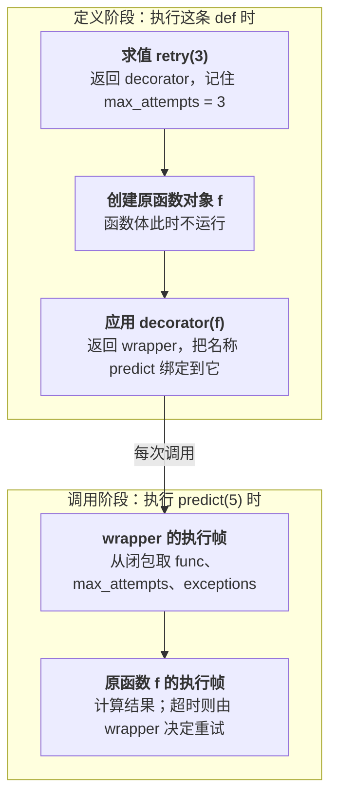
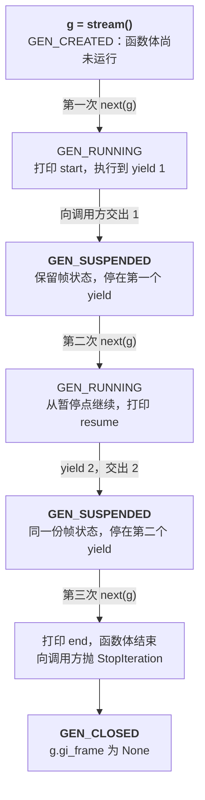
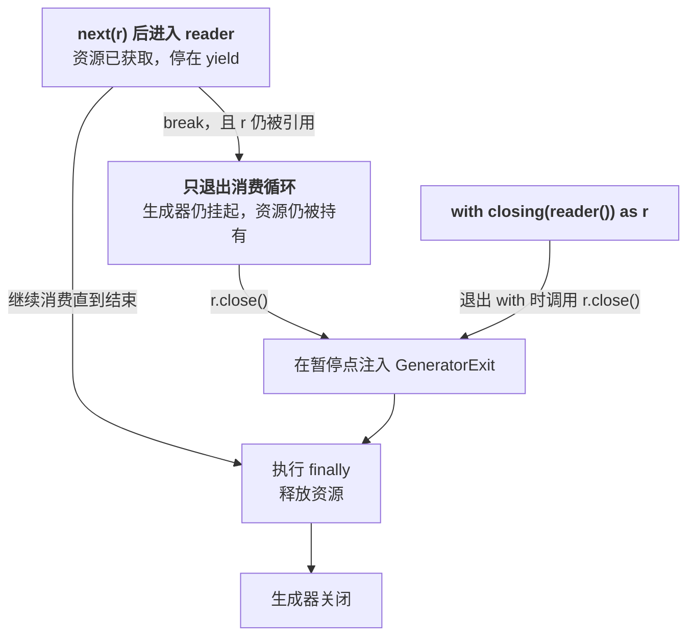
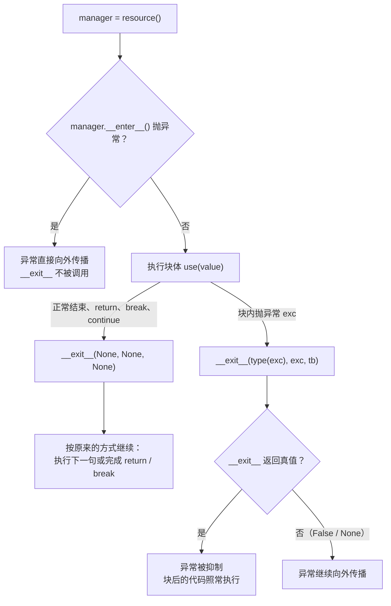

装饰器、生成器、`with` 是 AI-Infra 代码里出现最多的三种写法——[《执行模型》](/python-execution-model-code-objects-functions-and-frames.html)开头那七行里的三行：

- **@register("cuda")**：装饰器在模块导入时执行，注册表能否填上取决于谁导入了它
- **for batch in loader**：生成器的暂停与恢复
- **with torch.inference_mode()**：上下文管理协议：进入时改状态、退出时恢复

它们都不引入新机制，而是前五篇机制的组合。本篇只回答一个问题：

> **装饰器、生成器、`with` 各在什么时候执行，分别改变了哪一段调用或执行过程？[^q0]**

## 一、总览

三种写法各依赖前面的两样东西，本篇按依赖顺序排：

| 写法 | 建立在什么之上 |
| :--- | :--- |
| 装饰器 | 闭包（[《作用域与闭包》](/python-scopes-and-closures.html)）+ 描述符（[《对象模型与协议》的「描述符协议：属性查找的可编程点」一节](/python-object-model-and-protocols.html#4-描述符协议属性查找的可编程点)） |
| 生成器 | 帧（[《执行模型》](/python-execution-model-code-objects-functions-and-frames.html)）+ 迭代协议（[《对象模型与协议》的「迭代协议：可迭代对象与迭代器」一节](/python-object-model-and-protocols.html#3-迭代协议可迭代对象与迭代器)） |
| 上下文管理器 | 特殊方法 `__enter__` / `__exit__`；`contextlib` 的实现又建立在生成器之上 |

Table: 三种写法各自依赖的机制

最后一章用贯穿前六篇的 `runner.py`（全文贴在[第五章](#五一个推理组件的完整运行时追踪)）把导入、创建、调用、流式、异常五个阶段完整追踪一遍。

| 章 | 主题 | 内容 |
|---|---|---|
| 二 | 装饰器：用闭包和描述符改写调用路径 | 基本机制、`wraps`、参数化、类装饰器与注册、与描述符的叠放顺序、异步 |
| 三 | 生成器与惰性执行 | 帧的挂起、惰性的成本、`yield from`、关闭与清理 |
| 四 | 上下文管理器 | `with` 的展开、`contextlib`、AI-Infra 中的用法、异步版本 |
| 五 | 一个推理组件的完整运行时追踪 | 按导入、创建、调用、流式、异常五个阶段追踪 `Runner`，并归纳工程建议 |
| 六 | 本文小结 |  |
| 七 | 自测 | 4 道题 |

Table: 本文的章节安排

## 二、装饰器：用闭包和描述符改写调用路径

`runner.py` 里的 `@registered("runner")` 让 `Runner` 在被定义的同时进入注册表。装饰器的全部机制在前面已经准备好了：函数是对象（[《执行模型》](/python-execution-model-code-objects-functions-and-frames.html)），闭包能记住参数（[《作用域与闭包》](/python-scopes-and-closures.html)），类属性上的函数是描述符（[《对象模型与协议》的「描述符协议：属性查找的可编程点」一节](/python-object-model-and-protocols.html#4-描述符协议属性查找的可编程点)）。这一章把它们组装起来。

### 1. 基本机制

```python title='最简单的装饰器 log_call：wrapper 包住原函数'
def log_call(func):
    def wrapper(*args, **kwargs):
        print("calling", func.__name__)
        return func(*args, **kwargs)
    return wrapper


@log_call
def predict(x):
    return x * 2
```

`@log_call` 是语法糖，等价于在 `def` 执行完之后立刻做一次重新绑定：

```python title='@log_call 等价于定义后立刻重新绑定'
def predict(x): ...
predict = log_call(predict)
```

所以：每次执行到这条 `def` 时，装饰器都会被调用；如果定义在模块顶层，通常就是首次导入执行模块代码时，而不是每次调用 `predict` 时。此后名称 `predict` 指向 `wrapper`，原函数由 `wrapper` 的闭包 cell 保留；若没有其他引用，就不再有独立名称指向它。多个装饰器从下往上应用：

```python title='多个装饰器从下往上应用'
@outer
@inner
def run(): ...
# run = outer(inner(run))     调用时先进 outer 的 wrapper，再进 inner 的
```

> [!NOTE] 与 Java 对照：装饰器不是注解
> Java 的 `@Transactional`、`@Retryable` 是元数据，调用拦截来自读取它们的框架，例如 Spring 创建的代理；Python 的 `@log_call` 本身就是一次调用和名称重新绑定，不依赖扫描或代理框架。读代码时分别追踪“谁读取注解”和“装饰器返回了谁”，不能只看两个语言里都有 `@`。

### 2. 装饰器与闭包的关系

`wrapper` 能在 `log_call` 返回之后仍然找到 `func`，靠的是[《作用域与闭包》](/python-scopes-and-closures.html)的 cell：`wrapper.__closure__[0].cell_contents is predict_original`。闭包是实现装饰器最常见的方式，但不是必需的——任何"接收可调用对象、返回可调用对象"的东西都是装饰器，包括类：

```python title='用类实现装饰器：__init__ 收函数、__call__ 转发'
class LogCall:
    def __init__(self, func):
        self.func = func

    def __call__(self, *args, **kwargs):
        print("calling", self.func.__name__)
        return self.func(*args, **kwargs)


@LogCall
def predict(x): ...
```

状态少用闭包，状态多、需要暴露方法（如 `cache.clear()`）用类——与[《作用域与闭包》的「闭包还是类」一章](/python-scopes-and-closures.html#六闭包还是类) 的取舍一致。注意类实现的装饰器用在**方法**上时有一个坑，见 §6。

### 3. `functools.wraps` 与 `__wrapped__`

`wrapper` 是一个新函数对象，它的 `__name__`、`__doc__`、`__module__`、`__qualname__`、`__annotations__` 都是自己的。不处理的话，`predict.__name__` 变成 `'wrapper'`，日志、文档、`pickle`、测试框架的参数化 ID 全部受影响。`functools.wraps` 把这些元数据从原函数复制过来，并额外设置 `wrapper.__wrapped__ = func`：

```python title='functools.wraps 复制元数据并设置 __wrapped__'
from functools import wraps


def log_call(func):
    @wraps(func)
    def wrapper(*args, **kwargs):
        return func(*args, **kwargs)
    return wrapper
```

`__wrapped__` 让 `inspect.signature` 能穿透装饰器看到原始签名，也让调试时可以用 `predict.__wrapped__` 拿回原函数。`wraps` 复制的只是元数据，不改变行为：包装器仍然可能改变参数校验、返回值、异常类型和执行时机。

### 4. 带参数的装饰器

`@retry(max_attempts=3)` 多一层：先用参数调用 `retry`，得到真正的装饰器，再用它装饰函数。

```python title='带参数的装饰器 retry：三层函数'
def retry(max_attempts, exceptions=(TimeoutError,)):
    def decorator(func):
        @wraps(func)
        def wrapper(*args, **kwargs):
            for attempt in range(max_attempts):
                try:
                    return func(*args, **kwargs)
                except exceptions:
                    if attempt == max_attempts - 1:
                        raise
        return wrapper
    return decorator
```

| 层 | 函数 | 执行时机 | 返回 / 保存在哪里 |
|---|---|---|---|
| 配置层 | `retry(max_attempts)` | 执行被装饰的定义时，先求值装饰器表达式 | 返回 `decorator`；参数经闭包 cell 保留 |
| 装饰层 | `decorator(func)` | 函数对象创建后，名称最终绑定前 | 返回 `wrapper`；闭包保留 `func` 和重试参数 |
| 运行层 | `wrapper(*args, **kwargs)` | 每次调用装饰后的函数时 | 新建本次调用帧，返回 `func` 的结果 |

Table: retry 的三层：配置层、装饰层、运行层

`max_attempts` 和 `exceptions` 经由两层闭包到达 `wrapper`。重试装饰器应只捕获明确可重试的异常，让其余异常原样传播——`except Exception` 会把断言失败、类型错误和 CUDA OOM 一起重试。



定义阶段产出可复用的包装函数和闭包；调用阶段才创建本次的 `args`、`kwargs`、`attempt` 等局部状态。若定义写在另一个函数内部，每次运行到该定义都会重新装饰，并不是整个进程只装饰一次。

### 5. 装饰类：注册表

先说清装饰器**接收什么**：紧贴 `def` 的装饰器收到函数对象，紧贴 `class` 的收到类对象；`async def` 也产生函数对象。多层叠放时，外层收到的是**内层装饰器的返回值**，不一定仍是函数（§6 的 `property` / `staticmethod` 就会改变它）。装饰器语法只能写在函数或类定义前，但其**返回值**可以是任何对象：`@property` 返回描述符；`@functools.lru_cache` 返回带 `cache_info()` 的可调用对象；默认的 `@dataclass` 原地改造并返回原类，`slots=True` 则返回新类。

装饰器的参数可以是类，返回原类不变、只做登记，就是第一章的 `registered`：

```python title='装饰类做注册：registered 返回原类只做登记'
def registered(name):
    def decorator(cls):
        if name in REGISTRY:
            raise ValueError(f"duplicate registration: {name}")
        REGISTRY[name] = cls
        return cls
    return decorator
```

由 §1 的时机规则和[《模块与导入系统》的「`sys.modules` 缓存、导入副作用与注册机制」一章](/python-modules-and-the-import-system.html#七sysmodules-缓存导入副作用与注册机制) 的导入规则可推出它的行为：注册发生在类定义执行时，模块顶层的类通常就是在导入时注册；模块没被导入则注册不会发生。若同一文件以两个模块名执行，可能向**同一个注册表**重复登记并报错，也可能各自创建一份注册表，导致查找的一方看不到另一方的注册。重复注册抛异常而不是静默覆盖，能让共享注册表里的重复定义尽早暴露，但不能替代对模块身份的检查。

### 6. 装饰方法时的叠放顺序：与描述符的交互

装饰器应用在**类体执行时**，此时 `def` 产生的还是普通函数（[《对象模型与协议》的「类也是对象：`type` 创建类」一节](/python-object-model-and-protocols.html#1-类也是对象type-创建类)），描述符协议要等到属性访问时才起作用。这决定了几件事：

```python title='@classmethod 与 @log_call 的叠放顺序'
class Runner:
    @classmethod
    @log_call                  # 先应用：包装的是普通函数，wrapper 还是普通函数
    def create(cls): ...       # 再应用 classmethod：把 wrapper 包成 classmethod 对象
```

- 对这种只会调用 `func(*args)` 的通用包装器，`log_call` 放在 `classmethod`/`staticmethod`/`property` **下面**最稳妥，让它先拿到普通函数。反过来包 `classmethod` 或 `property`，包装器拿到不可直接调用的描述符，会报错。`staticmethod` 从 Python 3.10 起可直接调用，所以反序在某些类访问中能跑，但包装结果变成普通函数后，实例访问又会多绑定一个 `self`，不再保留静态方法的语义。
- `wrapper(*args, **kwargs)` 的 `args[0]` 是 `self`/`cls`——因为 `wrapper` 作为普通函数放在类上，本身就是非数据描述符，绑定后 `self` 会正常传入。这是函数式装饰器能"透明"用于方法的原因。
- §2 那种用类实现的装饰器**不能**透明用于方法：`LogCall` 实例没有 `__get__`，不是描述符，`obj.method` 得到的是 `LogCall` 实例本身，调用时不会传 `self`（报 `TypeError: S.m() missing 1 required positional argument: 'self'`）。要修复就给 `LogCall` 加一个 `__get__`，返回 `functools.partial(self, obj)` 或 `types.MethodType(self, obj)`。

[《对象模型与协议》的「类与对象模型」一章](/python-object-model-and-protocols.html#二类与对象模型对象如何被创建和查找)的知识在这里直接决定了代码能不能跑。

### 7. 同步与异步装饰器

`async def` 函数被调用时只返回协程对象，不执行函数体。同步 `wrapper` 包裹异步函数时，`func(*args)` 立即返回一个协程，`wrapper` 的"结束"日志在函数体真正运行之前就打出来了，异常也捕获不到。异步函数需要异步包装器：

```python title='异步函数需要 async 的包装器'
def async_log_call(func):
    @wraps(func)
    async def wrapper(*args, **kwargs):
        print("start")
        result = await func(*args, **kwargs)
        print("end")
        return result
    return wrapper
```

需要同时支持两种函数的装饰器，用 `inspect.iscoroutinefunction(func)` 分派。并发与异步在本系列第三篇展开。

## 三、生成器与惰性执行

[《执行模型》](/python-execution-model-code-objects-functions-and-frames.html)说普通函数调用创建一次执行，返回时退出活动调用栈。生成器则可以在 `yield` 处**挂起**，下次 `next()` 时从原地恢复。

先把两个词说白：**帧**就是一次执行的“活动记录”——这次执行的局部变量、以及执行到了哪一条指令；**挂起**是指函数走到 `yield` 处停下来，把值交给调用方，但这份活动记录保留，下次 `next()` 从暂停点继续，局部变量还是刚才的值。普通帧退出调用栈后，如果仍被 traceback 或调试器引用，也不一定立即释放；生成器的不同在于它保留了**可继续执行**的状态。`runner.py` 的 `Runner.stream` 用它实现流式输出。

> [!NOTE] 与 Java 对照：yield 与惰性迭代
> Java 的 `Iterator`、`Stream` 也能惰性地产生值，但没有 Python 这种生成器函数语法；手写迭代器通常把进度保存在对象字段，Python 则替开发者保留暂停的帧。Java `switch` 表达式中的 `yield` 是提交分支结果，不是暂停函数。两边的惰性数据源都可能持有文件等资源，不能把消费结束当成自动关闭的保证。

### 1. `yield`：帧被挂起而不是销毁

```python title='用 inspect 看生成器帧的挂起与恢复'
import inspect


def stream():
    print("  start")
    yield 1
    print("  resume")
    yield 2
    print("  end")


g = stream()
print(type(g), inspect.getgeneratorstate(g))   # <class 'generator'> GEN_CREATED   —— 函数体一行都没执行
print(next(g))                                  #   start / 1
print(inspect.getgeneratorstate(g))            # GEN_SUSPENDED
print(next(g))                                  #   resume / 2
next(g)                                         #   end → StopIteration；状态变为 GEN_CLOSED
```

把这段执行画成状态变化，关键不在于“函数被调用了几次”，而在于**同一份执行状态被恢复了几次**：



调用生成器函数不执行函数体，只创建一个生成器对象，它内部保留帧状态（可通过 `g.gi_frame` 观察）；第一次 `next()` 才开始执行；到 `yield` 处暂停，帧里的局部变量、指令位置全部保留（`g.gi_frame.f_locals` 可以直接看到）；函数体结束时通过 `StopIteration` 告知消费者。生成器的帧在两次 `next()` 之间仍然可恢复，这是惰性执行的基础。生成器同时实现了 `__iter__`（返回自己）和 `__next__`，所以它是[《对象模型与协议》的「对象协议」一章](/python-object-model-and-protocols.html#三对象协议语法背后的特殊方法)意义上的迭代器，可以直接放进 `for`。

再用一个局部变量看“保留”的到底是什么：

```python title='生成器保留的是同一次执行：局部变量 n 从 2 变成 1'
def countdown(n):
    while n > 0:
        yield n
        n -= 1


g = countdown(2)
print(inspect.getgeneratorstate(g), g.gi_frame.f_locals)  # GEN_CREATED {'n': 2}
print(next(g), g.gi_frame.f_locals)                       # 2 {'n': 2}
print(next(g), g.gi_frame.f_locals)                       # 1 {'n': 1}
print(list(g), g.gi_frame)                               # [] None
```

第一次 `yield 2` 时还没执行 `n -= 1`，所以帧里仍是 `n = 2`；第二次 `next()` 才继续减到 1。正常耗尽后，生成器不再持有执行帧，`gi_frame` 变成 `None`；若此前有代码另存了帧引用，那个帧对象仍可存活。

### 2. 惰性的价值与成本

生成器让"生产一个、消费一个"成为默认模式，不需要把全部结果放进内存：

```python title='逐行读文件的生成器 read_lines'
def read_lines(path):
    with open(path) as file:
        for line in file:
            yield line
```

流式 Token 输出、大数据集分片读取、Batch 生成、日志消费都是这个模式。但惰性有两个经常被忽视的成本：

- **暂停也可能延长资源占用**。上面 `read_lines` 的文件句柄在第一次 `next()` 时打开，要到生成器结束或被关闭时才关——如果消费方中途 `break` 并保留着未关闭的生成器，文件就一直开着（§4）。GPU 张量、数据库游标、进程间队列同理；正常耗尽或显式关闭后，即使生成器对象还在，清理逻辑也已经执行。
- **错误延迟出现**。生成器函数里的 bug 在 `next()` 时才暴露，traceback 的调用方是消费者而不是创建者。

### 3. `yield from`

`yield from sub()` 把 `sub` 产生的每个值直接转发给外层的消费者，同时把 `send()`、`throw()`、`close()` 也透传给子生成器，并且能拿到子生成器的返回值：

```python title='yield from 转发子生成器并拿到它的返回值'
def sub():
    yield 1
    return "sub-result"


def outer():
    result = yield from sub()
    print("sub returned:", result)      # sub returned: sub-result
```

它不只是嵌套 `for` 的简写。`Runner.stream` 用 `yield from self.model.generate(batch)` 把模型的生成器**原样**暴露给调用方，包括调用方 `close()` 时能一路传到模型层面做清理。`async`/`await` 在语法上就是从 `yield from` 演化来的。

### 4. 关闭与清理：`GeneratorExit`、`finally` 与 `break`

`g.close()` 在生成器挂起的 `yield` 处抛入 `GeneratorExit`，让 `try/finally` 和 `with` 的清理逻辑有机会执行：

```python title='带 try/finally 的生成器 reader'
def reader():
    print("  open")
    try:
        yield 1
        yield 2
    finally:
        print("  close file")


r = reader()
next(r)          #   open
r.close()        #   close file
```

`for` 循环正常跑完会耗尽生成器，`finally` 自然执行；但 `break` 只是**退出循环**，不会关闭生成器：

```python title='break 不关闭生成器：finally 要等到 del 才执行'
r = reader()
for v in r:
    break
print("after break")      # 此时 "close file" 还没有出现
del r                     #   close file   —— 引用计数归零时，生成器的析构才调用 close()
```

在 CPython 里，生成器对象被回收时会自动 `close()`，所以上面的例子在 `del` 后立刻清理。但依赖这一点是脆弱的：生成器被别处引用（放进列表、被 traceback 持有、被闭包捕获）就不会及时回收；在其他实现或存在循环引用时，回收时机不确定。**需要确定性清理的生成器，要么由消费方在 `finally` 里显式 `close()`，要么用 `contextlib.closing(gen)` 包起来放进 `with`。** 对象回收的细节在本系列第五篇。

同一个 `reader()`，消费方式决定资源什么时候释放：



`closing` 不会把数据提前读完，只保证离开 `with` 时调用 `close()`。即使循环只取一个值就 `break`，资源也有明确的退出路径。

> [!NOTE] 与 Java 对照：终止操作不等于 close
> Java `Stream` 的终止操作（如 `findFirst()`）不会自动调用 `close()`；`Files.lines(path)` 这类持有资源的流仍要放进 try-with-resources。对应到 Python，`break` 不会关闭生成器，持有资源时应使用 `with closing(g)` 或显式 `close()`，不能依赖两种语言各自的垃圾回收时机。

## 四、上下文管理器：把资源生命周期交给协议

第三章的结论是"资源的释放时机不能靠猜"。`with` 语句就是为此设计的：把"进入/退出"两个动作绑定到一个代码块上，无论块内是正常结束、`return`、还是抛异常，退出动作都执行。`runner.py` 的 `InferenceContext` 和 `torch.inference_mode()` 都是这个协议。

### 1. `with` 的展开

```python title='一个 with 语句'
with resource() as value:
    use(value)
```

等价于：

```python title='with 的等价展开：__enter__、__exit__ 与异常传递'
manager = resource()
value = manager.__enter__()
normal_exit = True
try:
    use(value)
except BaseException as exc:
    normal_exit = False
    if not manager.__exit__(type(exc), exc, exc.__traceback__):
        raise                                   # __exit__ 返回假值 → 异常继续传播
finally:
    if normal_exit:
        manager.__exit__(None, None, None)      # 正常结束、return、break、continue 都走这里
```

这里展示控制流，省略了特殊方法查找细节：真实的 `with` 在管理器的**类型**上取 `__enter__`、`__exit__`，并在进入块体前保存退出方法，而不是走实例字典里的同名属性。PEP 343 的展开采用 try / except / finally；若把 `finally` 错换成 `else`，块内 `return` 或 `break` 时就会漏掉退出动作。

把这段展开按"块怎么结束"分成几条路径，`__exit__` 被调用几次、收到什么参数、异常最后去了哪里就一目了然：



由展开可以读出几条规则，每一条都在实验中验证过：

- `__enter__` 抛异常时，`__exit__` **不会**被调用；如果进入过程中已经获取了一部分资源，必须由 `__enter__` 自己清理，不能假设“进入失败就没资源”；
- `__exit__` 收到异常三元组，返回 `True` 表示**抑制**该异常（块外看不到），返回 `False`/`None` 则异常照常传播；`contextlib.suppress` 就是一个返回 `True` 的 `__exit__`；
- 块内 `return`、`break` 同样触发 `__exit__`，因为它们也走 `try` 的退出路径。

> [!NOTE] 与 Java 对照：with 与 try-with-resources
> Java 的 try-with-resources 在退出块时调用 `AutoCloseable.close()`；Python 的 `with` 还多了进入钩子及其返回值，退出钩子也能接收异常三元组。`__exit__` 返回真值可抑制块内异常，Java 的 `close()` 返回 `void`，没有这个协议；若块体和清理同时失败，Java 有 suppressed exceptions，Python 则按异常上下文链保留关系。

### 2. 类实现与 `contextlib.contextmanager`

类实现直接写两个方法：

```python title='用类实现上下文管理器：__enter__ 与 __exit__'
class Resource:
    def __enter__(self):
        print("acquire"); return self
    def __exit__(self, exc_type, exc, tb):
        print("release"); return False
```

生成器实现更短——`@contextmanager` 把一个只 `yield` 一次的生成器包装成上下文管理器：

```python title='用 @contextmanager 把只 yield 一次的生成器变成上下文管理器'
from contextlib import contextmanager


@contextmanager
def resource():
    handle = acquire()
    try:
        yield handle              # yield 之前是 __enter__，之后是 __exit__
    finally:
        release(handle)
```

它的机制是第三章的内容：`__enter__` 调一次 `next()` 跑到 `yield`；`__exit__` 在没有异常时再调一次 `next()` 让它跑完，有异常时用 `gen.throw(exc)` 把异常**在 `yield` 那一行抛出**。所以 `try/finally` 不是可选的——没有它，块内的异常会让生成器在 `yield` 处直接终止，`release` 永远不会执行。同理，想在 `@contextmanager` 里抑制异常，要在 `except` 里捕获并不再抛出。

### 3. AI-Infra 中的上下文管理器

`torch.inference_mode()`、`torch.autocast()`、`torch.profiler.profile()`、`torch.cuda.stream(s)`、`torch.no_grad()`、分布式通信组的生命周期，大多数是"**进入时切换一个全局或线程局部状态，退出时恢复原值**"，而不是获取/释放一个句柄。读这类代码时要问：

1. 进入时改了什么状态？是线程局部还是进程全局？（`no_grad` 是线程局部的；多线程数据加载时要注意）
2. 退出时是否恢复到**进入前**的值，还是恢复到某个默认值？嵌套使用时二者行为不同；
3. 异常路径是否也恢复？（用 `try/finally` 或类实现的 `__exit__` 才能保证）
4. 作为装饰器使用时（`@torch.no_grad()`）语义是否一致？

第一章的 `Runner.__call__` 用 `nullcontext()` 处理"不需要上下文"的分支，避免了 `if` 两个分支重复写 `self.model(batch)`——这是 `contextlib` 里最常用的小工具之一。

### 4. 异步上下文管理器

`async with` 对应 `__aenter__`/`__aexit__`，两者都是协程，允许在进入和退出时 `await`（建立连接、优雅关闭）。`contextlib.asynccontextmanager` 是对应的生成器版本。

## 五、一个推理组件的完整运行时追踪

下面是贯穿前六篇的 `runner.py` 全文（行号旁的蓝色数字可点，下面各阶段的描述会链接回具体的行）：

```python title='runner.py 全文：带 !ref 锚点的完整运行时追踪'
# runner.py
from contextlib import nullcontext

REGISTRY = {}


# !ref registered +7
def registered(name):                        # 带参数的装饰器：registered("runner") 先被调用，返回下面的 decorator
    def decorator(cls):                      # 真正的装饰器：拿到被装饰的类 Runner，登记后原样返回
        if name in REGISTRY:
            raise ValueError(f"duplicate registration: {name}")
        REGISTRY[name] = cls
        return cls

    return decorator


# !ref ctx +7
class InferenceContext:                      # 上下文管理器：进入/退出推理模式
    def __enter__(self):
        print("enter inference mode")
        return self

    def __exit__(self, exc_type, exc, tb):
        print("exit inference mode")
        return False


# !ref apply
@registered("runner")
class Runner:
    # !ref init +2
    def __init__(self, model, inference=True):
        self.model = model
        self.inference = inference

    # !ref call +3
    def __call__(self, batch):               # 可调用协议
        context = InferenceContext() if self.inference else nullcontext()
        with context:
            return self.model(batch)

    # !ref stream +1
    def stream(self, batch):                 # 生成器：流式输出
        yield from self.model.generate(batch)
```

现在可以按时间顺序，用前六篇的机制精确描述它的每一步——导入、帧、异常传播、对象创建、属性查找、协议、生成器与上下文管理器。

### 1. 导入阶段

某个模块执行 `import runner`（或 `from runner import Runner`）：

1. `sys.modules` 中没有 `"runner"`，进入查找（[《模块与导入系统》的「`import` 语句的执行过程」一章](/python-modules-and-the-import-system.html#三import-语句的执行过程)）；
2. `sys.meta_path` 上的 `PathFinder` 沿 `sys.path` 找到 `runner.py`，`FileFinder` 按 `.py` 后缀选出 `SourceFileLoader`，生成 `ModuleSpec`（[《模块与导入系统》的「三层查找机制：`sys.meta_path`、`PathFinder` 与 loader」一章](/python-modules-and-the-import-system.html#四三层查找机制sysmeta_pathpathfinder-与-loader)）；
3. 创建空模块对象，写入 `sys.modules["runner"]`——此刻它还是空的（[《模块与导入系统》的「循环导入与依赖方向」一章](/python-modules-and-the-import-system.html#八循环导入与依赖方向) 循环导入的窗口期）；
4. 取得模块的 code object：没有有效缓存时编译整个文件，否则从 `.pyc` 读回（[《执行模型》的「Python 不是"逐行解释"」一章](/python-execution-model-code-objects-functions-and-frames.html#二python-不是逐行解释)）；随后在模块 `__dict__` 中执行顶层代码：
   - `from contextlib import nullcontext`：若 `contextlib` 已在 `sys.modules`，复用该模块并绑定名称；否则先导入它；
   - `REGISTRY = {}`：创建字典；
   - [`def registered(name)`](#registered)：创建函数对象，`__globals__` 指向本模块的 `__dict__`（[《执行模型》的「函数对象：code object 的运行时封装」一章](/python-execution-model-code-objects-functions-and-frames.html#三函数对象code-object-的运行时封装)）；
   - `class InferenceContext:`：执行类体、调用 `type` 创建类对象（[《对象模型与协议》的「类也是对象：`type` 创建类」一节](/python-object-model-and-protocols.html#1-类也是对象type-创建类)）；
   - [`@registered("runner") class Runner:`](#apply)：先求值 `registered("runner")` 得到 `decorator`（闭包持有 `name`，[《作用域与闭包》的「闭包就是"函数对象 + cell"」一章](/python-scopes-and-closures.html#三闭包就是函数对象--cell)），再执行类体并由元类创建类对象，随后调用 `decorator(类对象)`——写入 `REGISTRY`，返回原类（第二章 §5）；最后名称 `Runner` 绑定到它。
5. 导入方拿到模块对象或 `Runner` 名称。

如果没有执行 `runner` 模块的顶层代码，注册就不会发生。如果 `runner.py` 同时以 `__main__` 和 `runner` 两个名字执行，本例会连 `REGISTRY = {}` 也执行两次，得到两份注册表，**不会仅因双重导入就报重复注册**；只有装饰器写入同一份共享注册表时，重名才会触发 `duplicate registration`。这两种失败分别是注册状态分裂和重复登记，排查时要区分。

### 2. 创建对象阶段

`runner = Runner(model)`：

1. `Runner` 是类对象，调用它执行 `type.__call__(Runner, model)`（[《对象模型与协议》的「对象创建：`__new__`、`__init__` 与 `type.__call__`」一节](/python-object-model-and-protocols.html#7-对象创建__new____init__-与-type__call__)）；
2. `Runner.__new__(Runner)` 分配实例（未重写，走 `object.__new__`）；
3. [`Runner.__init__(instance, model)`](#init) 执行：`self.model = model`、`self.inference = True`，两次赋值走默认 `__setattr__`，写入实例 `__dict__`（[《对象模型与协议》的「实例属性与类属性」一节](/python-object-model-and-protocols.html#2-实例属性与类属性)）；
4. 返回实例，名称 `runner` 绑定到它。

### 3. 调用阶段

`output = runner(batch)`：

1. 解释器在 `type(runner)` 上查找 `__call__` 槽位（[《对象模型与协议》的「语法到特殊方法的映射，且在类型上查找」一节](/python-object-model-and-protocols.html#1-语法到特殊方法的映射且在类型上查找)），找到 [`Runner.__call__`](#call)；
2. 函数作为非数据描述符被绑定，`self = runner`（[《对象模型与协议》的「方法绑定、`classmethod`、`staticmethod`、`property`：描述符的四种形态」一节](/python-object-model-and-protocols.html#5-方法绑定classmethodstaticmethodproperty描述符的四种形态)），创建新的执行帧（[《执行模型》的「执行帧与调用栈」一章](/python-execution-model-code-objects-functions-and-frames.html#四执行帧与调用栈)）；
3. `self.inference`：类 MRO 上没有同名描述符，实例 `__dict__` 中命中（[《对象模型与协议》的「属性查找算法：`object.__getattribute__`」一节](/python-object-model-and-protocols.html#3-属性查找算法object__getattribute__) 的 ③ 实例字典）；
4. `InferenceContext()` 创建上下文管理器实例；
5. `with context:` 调用 [`__enter__`](#ctx)，打印 `enter inference mode`（第四章 §1）；
6. `self.model(batch)`：`model` 是什么类型就走什么类型的 `__call__`——如果是 `nn.Module`，进入 `_wrapped_call_impl` → hooks → `forward`（[《对象模型与协议》的「可调用对象：`__call__`」一节](/python-object-model-and-protocols.html#2-可调用对象__call__)）；
7. `return` 触发 `with` 的退出路径，`__exit__(None, None, None)` 打印 `exit inference mode`，返回 `False`；
8. 帧退出活动调用栈，返回值绑定到 `output`；没有其他引用时，帧状态可被释放。

### 4. 流式执行阶段

`for out in runner.stream(batch):`：

1. [`runner.stream`](#stream) 绑定为方法，调用它**不执行函数体**，返回一个 `GEN_CREATED` 状态的生成器对象（第三章 §1）；
2. `for` 调用 `iter()`，生成器返回自身（[《对象模型与协议》的「迭代协议：可迭代对象与迭代器」一节](/python-object-model-and-protocols.html#3-迭代协议可迭代对象与迭代器)）；
3. 第一次 `next()`：进入函数体，`self.model.generate(batch)` 被调用，返回模型的生成器；`yield from` 开始转发（第三章 §3）；
4. 每产生一个 token，两个生成器的帧都挂起，控制权回到 `for` 循环体；
5. 模型生成器结束，`yield from` 收到 `StopIteration`，`stream` 的帧也结束，`for` 退出。

如果调用方在第 4 步 `break`，两个生成器都停在挂起状态；它们持有的资源要到生成器对象被回收（或显式 `close()`）时才释放（第三章 §4）。

### 5. 异常阶段

若第 3 阶段第 6 步 `self.model(batch)` 抛出 `RuntimeError`：

1. 异常在 `model` 的帧中产生，沿 `f_back` 回到 `Runner.__call__` 的帧（[《异常处理与失败传播》的「`try` 结构与传播路径」一章](/python-exceptions-and-failure-propagation.html#二try-结构与传播路径)）；
2. 经过 `with` 块：`InferenceContext.__exit__(RuntimeError, exc, tb)` 被调用，打印 `exit inference mode`，返回 `False`，异常继续传播（第四章 §1）；
3. `__call__` 的帧退出活动调用栈，但仍被 traceback 引用，不能当作已经销毁；
4. 到达调用方的 `try`：

   ```python title='调用方的 try：记录 traceback 后重抛'
   try:
       output = runner(batch)
   except Exception:
       logger.exception("inference failed")
       raise
   ```

   记录完整 traceback 后原样重抛（[《异常处理与失败传播》的「记录并重抛：`raise` 与 `raise exc` 的区别」一章](/python-exceptions-and-failure-propagation.html#六记录并重抛raise-与-raise-exc-的区别)）；再向上由 Worker 主循环决定重试、降级还是退出。

五个阶段对应的机制：

| 阶段 | 机制 | 章节 |
| :--- | :--- | :--- |
| 导入 | finder/loader、`sys.modules`、顶层代码执行、装饰器注册 | 上篇四、四 |
| 创建 | `type.__call__`、`__new__`/`__init__`、`__setattr__` | 二 |
| 调用 | `__call__` 槽位、方法绑定、属性查找、`with` | 二、三、六 |
| 流式 | 生成器帧挂起、`yield from`、迭代协议 | 三、五 |
| 异常 | 沿帧传播、`__exit__` 参与、异常链与重抛 | 六、上篇五 |

Table: 五个阶段对应的机制

### 6. 从追踪到工程建议

上面的追踪也解释了为什么下面这些常见建议是对的：

- **减少导入副作用**。顶层代码在 `import` 时执行，时机由导入顺序决定。把"定义类、注册名字"留在顶层，把"加载模型、初始化 CUDA、建立连接"放进显式调用的函数。
- **入口文件要薄**。被当作脚本运行的文件不要包含会被别处导入的定义，否则会出现 `__main__`/模块名双重导入。
- **依赖方向单向**。`基础 → 核心 → 服务`，循环依赖用提取协议模块解决，不用局部导入掩盖。
- **隐式机制留给框架层**。`__getattr__`、元类、自定义 finder、复杂装饰器在业务代码里应该很少见；它们让"这行代码到底调了什么"不再能靠阅读得知。
- **资源清理走协议**。文件、锁、连接、CUDA 上下文、通信组都用 `with` 或 `try/finally`；生成器持有资源时要有确定性的关闭路径。
- **异常要么处理要么重抛**。`except Exception: log` 不是处理；捕获 `BaseException` 会吞掉终止信号。
- **给重要对象一个好的 `__repr__`**。日志里 `Request(id='r-1', batch_size=32, device='cuda:0')` 比五个字段各打一行更容易排查。
- **不确定就做实验**。`dis`、`inspect`、`sys.modules`、`__mro__`、`__closure__`、`gi_frame` 都是现成的观察工具。本文的所有输出都是这样得到的，而不是凭记忆写的。

## 六、本文小结

| 机制 | 要点 |
|---|---|
| 装饰器 | 定义时执行一次的函数调用；靠闭包记参数，靠描述符协议对方法透明 |
| 生成器 | `yield` 保留可恢复的帧；暂停可能延长资源占用；`break` 不等于 `close` |
| <span style="white-space:nowrap">上下文管理器</span> | `__enter__` / `__exit__` 绑定到代码块；`@contextmanager` 把异常 `throw` 进 `yield` |

Table: 装饰器、生成器与上下文管理器的要点

回到开头那三行代码：

| 开头的写法 | 背后的机制 | 在哪一节 |
|---|---|---|
| `@register("cuda")` 注册表能否填上取决于谁导入了它 | 装饰器在**定义时**执行一次；定义所在的模块没被导入、或被以两个名字导入，注册就不会发生或发生两次 | 二 §5 |
| `for batch in loader` | 生成器在 `yield` 处挂起、下一次 `next` 恢复 | 三 §1 |
| `with torch.inference_mode()` | `with` 展开为 `__enter__` / `__exit__`；这类上下文管理器进入时切换一个线程局部状态、退出时恢复，异常也照样恢复 | 四 §1、§3 |

Table: 开头三行代码背后的机制

读 AI-Infra 代码时的这些疑问，也都落在本篇的机制上：

- 一个用类实现的装饰器为什么用在方法上就报 `missing self`——它不是描述符，绑定不会发生；
- 一个生成器持有的文件为什么一直没关——消费方 `break` 了但没 `close()`。

前六篇到这里讲完了语言的运行时机制。后面八篇分别讨论类型系统（三篇）、并发与异步、动态机制与插件架构、内存管理、测试与调试、工程化与交付，每一篇都会用到前六篇的某一组机制。

配套代码：本文验证各个结论用的小脚本（生成器与上下文管理器、装饰器顺序）在 [ai-learning-labs/python-for-ai-infra/01-language-mechanisms](https://github.com/arganzheng/ai-learning-labs/tree/main/python-for-ai-infra/01-language-mechanisms)，只依赖标准库。

## 七、自测

1. 写了 `@register("cuda")` 装饰器的后端在注册表里找不到，两个最常见的原因是什么？

   <details markdown="1"><summary>答案</summary>

   装饰器在**定义时**执行一次：（1）它所在的模块从未被导入，注册没发生；（2）同一模块被以两个名字导入（如 `pkg.mod` 与 `mod`，`sys.path[0]` 差异导致），注册发生了两次或落到另一份模块对象里。

   </details>

2. 用类实现的装饰器（`__init__` 存函数、`__call__` 转发）用在普通函数上没问题，用在方法上却报 `missing 1 required positional argument: 'self'`，为什么？

   <details markdown="1"><summary>答案</summary>

   方法能拿到 `self` 靠的是函数对象实现了 `__get__`（非数据描述符），`obj.method` 时被绑定；装饰后类属性上放的是装饰器类的实例，它没有 `__get__`，`obj.method` 得到的就是这个实例本身，调用时不会传 `self`。给装饰器类补一个 `__get__`（返回 `functools.partial(self, obj)` 或 `MethodType`），或改用闭包实现，都能修好。

   </details>

3. `g = runner.stream(batch)` 这一行执行完，`stream` 的函数体执行了吗？

   <details markdown="1"><summary>答案</summary>

   没有。调用含 `yield` 的函数只创建生成器对象；第一次 `next(g)`（或 `for` 的第一轮）才进入函数体，运行到第一个 `yield` 挂起。

   </details>

4. `runner.py` 里 `InferenceContext.__exit__` 返回 `False`。`with` 块里的 `self.model(batch)` 抛了异常，"exit inference mode" 会打印吗？异常会被吞掉吗？

   <details markdown="1"><summary>答案</summary>

   会打印，不会吞掉。无论块内正常结束、`return` 还是抛异常，`__exit__` 都执行；它返回假值，异常在退出动作之后继续向外传播，返回真值才会被抑制。

   </details>

[^q0]: **装饰器**在定义时执行一次：`@d` 写在 `def f` 上等于 `f = d(f)`，之后名字 `f` 指向 `d` 返回的对象，每次调用先进入它；带参数的装饰器是"返回装饰器的函数"，参数靠闭包记住（[第二章](#二装饰器用闭包和描述符改写调用路径)）。**生成器**改变的是函数体的执行时机：调用生成器函数只创建生成器对象，函数体在 `next()` 时才运行，到 `yield` 处帧挂起、下次从原地恢复（[第三章](#三生成器与惰性执行)）。**`with`** 把进入和退出两个动作绑定到一个代码块：展开为 `__enter__` / `__exit__`，无论块内正常结束、`return` 还是抛异常，退出动作都执行（[第四章](#四上下文管理器把资源生命周期交给协议)）。[第五章](#五一个推理组件的完整运行时追踪)在一个推理组件上把这三者与前五篇的机制从头追了一遍。
