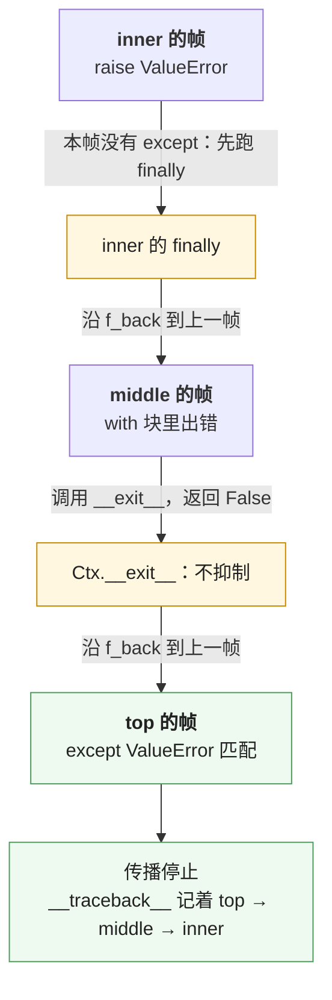

"异常发生时会怎样"是每个机制都带着的一条分支：导入失败让注册表为空，`finally` 在生成器关闭时执行，`__exit__` 会收到块内的异常。本篇讨论异常本身：它如何沿帧链传播，以及在 AI-Infra 中什么样的处理方式是安全的。

本篇只回答一个问题：

> **异常抛出后沿什么路径传播、途中会执行哪些代码；在 AI-Infra 里，什么样的处理方式是安全的？[^q0]**

## 一、总览

本篇前一半讲机制，后一半讲用法：先看异常沿帧链走的路径（第二章）和异常类型的层级（第三章），再看三件处理异常时要做的决定——在哪一层翻译成调用方能决策的类型（第四章）、怎么保留根因（第五章）、记录之后要不要重抛（第六章）。

| 章 | 主题 | 内容 |
|---|---|---|
| 二 | `try` 结构与传播路径 | `except` / `else` / `finally` 的时机、途经 `finally` 与 `__exit__` |
| 三 | `BaseException` 层级 | 五个直接子类、业务代码捕获哪一个 |
| 四 | 自定义异常与错误边界 | 按"能怎么办"分类、在哪一层翻译 |
| 五 | 异常链 | `from exc`、`from None`、`__cause__` 与 `__context__` |
| 六 | 记录并重抛 | `raise` 与 `raise exc` 的区别、只记录不重抛 |
| 七 | 本文小结 |  |
| 八 | 自测 | 4 道题 |

Table: 本文的章节安排

## 二、`try` 结构与传播路径

```python title='try / except / else / finally 各自执行的时机'
try:
    result = run()
except ValueError as exc:
    handle(exc)
else:
    process(result)          # 只在 try 块没有异常时执行
finally:
    cleanup()                # 总是执行，包括 return 和未被捕获的异常
```

异常发生时，解释器沿当前帧的 `f_back` 链向上寻找匹配的 `except`；每经过一帧，就把这一帧记进 `__traceback__`。找不到时，子线程由 `threading.excepthook` 打印后结束，主线程打印 traceback 后以非零状态退出。这就是[《执行模型》的「执行帧与调用栈」一章](/python-execution-model-code-objects-functions-and-frames.html#四执行帧与调用栈)中看到的 traceback 结构。

上面是骨架。下面用一个能直接运行的三层调用，看异常往上走时依次经过谁：

```python title="异常从 inner 向外传播：先过 finally，再过 __exit__，最后被 top 接住"
import traceback


class Ctx:
    def __enter__(self):
        return self

    def __exit__(self, exc_type, exc, tb):
        print("middle 的 __exit__ 收到", exc_type.__name__)
        return False                     # 不抑制，继续往外抛


def inner():
    try:
        raise ValueError("bad batch")
    finally:
        print("inner 的 finally")


def middle():
    with Ctx():
        inner()
    print("这一行不会执行")


def top():
    try:
        middle()
    except ValueError as exc:
        names = [f.name for f in traceback.extract_tb(exc.__traceback__)]
        print("top 接住：", exc, names)


top()
```

```text title="运行输出（Python 3.12）"
inner 的 finally
middle 的 __exit__ 收到 ValueError
top 接住： bad batch ['top', 'middle', 'inner']
```



- 异常每离开一帧，先执行这一帧里活动的 `finally` 和 `__exit__`，再到调用者那一帧找 `except`。
- `__exit__` 返回真值会抑制异常，传播就停在那一层；`top` 就收不到了。
- traceback 从接住它的那一帧记到抛出的那一帧，与[《执行模型》](/python-execution-model-code-objects-functions-and-frames.html)里打印的顺序一致。

> [!NOTE] 与 Java 对照：else 与 finally
> 两门语言的 `finally` 都用于离开 `try` 结构时执行清理。Python 还提供 `else` 子句，只在 `try` 正常结束时运行，Java 没有对应子句。

## 三、`BaseException` 层级

所有异常都继承自 `BaseException`。3.11 起它的直接子类有五个（3.10 及之前没有 `BaseExceptionGroup`，是四个）：

| `BaseException` 的直接子类 | 什么时候出现 | 业务代码是否捕获 |
|---|---|---|
| `Exception` | 几乎所有业务异常的根：`ValueError`、`OSError`、`RuntimeError` 和自定义异常都在它下面 | 捕获它 |
| `BaseExceptionGroup` | 3.11 起，把多个异常打包一起抛出；常用的 `ExceptionGroup` 同时也是 `Exception` 的子类 | 用 `except*` 处理 |
| `GeneratorExit` | 生成器 / 协程被关闭（[《装饰器、生成器与上下文管理器》的「生成器与惰性执行」一章](/python-decorators-generators-and-context-managers.html#三生成器与惰性执行)） | 不捕获 |
| `KeyboardInterrupt` | 按下 Ctrl+C | 不捕获 |
| `SystemExit` | 调用 `sys.exit()` | 不捕获 |

Table: BaseException 的直接子类：业务代码应捕获的根是 Exception

`except BaseException:` 或裸 `except:` 会吞掉 `KeyboardInterrupt` 和 `SystemExit`——Worker 收到终止信号却继续跑；也会吞掉 `GeneratorExit`，让生成器无法关闭。业务代码捕获 `Exception` 即可。

> [!NOTE] 与 Java 对照：没有受检异常
> Python 不像 Java 那样区分受检异常与非受检异常，也不要求用 `throws` 声明。调用方必须处理哪些失败，要靠接口文档约定，编译器不会强制检查。

## 四、自定义异常与错误边界

异常类型是给**调用方**用的，它应该回答"发生了什么"以及"能怎么办"：

```python title='自定义异常层级：按"能怎么办"分类'
class BackendError(Exception): ...
class BackendUnavailableError(BackendError): ...     # 可以换后端
class BackendExecutionError(BackendError): ...       # 可以重试


try:
    run_backend()
except BackendUnavailableError:
    fallback_to_cpu()
except BackendExecutionError:
    retry()
```

按业务边界建一个异常基类，让调用方可以选择粗粒度（`except BackendError`）或细粒度处理。错误边界就是"在哪一层把底层异常翻译成调用方能决策的类型"——通常在模块或服务的公共接口处。

## 五、异常链：`from exc` 与 `from None`

在处理一个异常时抛出另一个，Python 自动记录原异常：

```python title='raise … from exc：显式记录异常链'
try:
    load_config()
except OSError as exc:
    raise RuntimeError("failed to load configuration") from exc
```

`from exc` 设置 `__cause__`，traceback 显示 "The above exception was the direct cause of the following exception"；不写 `from` 则隐式记录到 `__context__`，显示 "During handling of the above exception, another exception occurred"。两者都保留根因，区别只是措辞和意图的明确程度。`from None` 抑制链条——只在底层异常确实对调用方无意义时使用，否则排障时会丢掉关键信息。

> [!NOTE] 与 Java 对照：保留异常原因
> `raise RuntimeError(msg) from exc` 可类比 `throw new RuntimeException(msg, cause)`；Python 的 `__cause__` 类似 Java 的 `getCause()`。差别是 Python 没写 `from` 时还会自动把正在处理的异常记到 `__context__`，Java 不传 `cause` 就没有这条链。

## 六、记录并重抛：`raise` 与 `raise exc` 的区别

```python title='记录完整 traceback 后原样重抛'
try:
    worker.run()
except Exception:
    logger.exception("worker failed")    # 记录完整 traceback
    raise                                # 原样重抛
```

裸 `raise` 重新抛出当前异常，traceback 不变；`raise exc` 则会把**当前这一行**追加进 traceback，实验中同一个异常的帧列表从 `['<module>', 'w']` 变成 `['<module>', '<module>', 'w']`，多出一层噪音。

> [!NOTE] 与 Java 对照：重抛与调用栈
> Java 没有裸 `throw;` 语法，用 `throw e;` 重抛已有异常通常不会重建其栈信息（栈通常在构造异常时记录）。Python 的 traceback 随传播逐帧累加，因此 `raise` 与 `raise exc` 的这项差别不能直接套到 Java 上。

只记录不重抛是最常见的错误处理反模式：

```python title='反模式：只记录 str(exc) 不重抛'
try:
    train_step(batch)
except Exception as exc:
    logger.error(str(exc))     # 丢了 traceback，也丢了异常本身
```

上层以为任务成功，Worker 带着不一致的状态继续跑，分布式训练中表现为某个 rank 悄悄掉队、其他 rank 在集合通信上无限等待。原则是：**能处理就处理并明确恢复到一致状态，不能处理就重抛；日志不是处理**。

## 七、本文小结

- 异常沿帧链 `f_back` 向上传播，每经过一帧记进 `__traceback__`；每离开一帧，先执行这一帧里活动的 `finally` 和 `__exit__`。若被捕获或被 `__exit__` 抑制，就不再继续向外传播。
- 业务代码捕获 `Exception`；`except BaseException:` 和裸 `except:` 会吞掉终止信号和生成器关闭。
- 在模块或服务的公共接口处把底层异常翻译成调用方能决策的类型，用 `from exc` 保留根因。
- 记录之后用裸 `raise` 重抛；只记录不重抛是反模式，Worker 会带着错误状态继续跑。

## 八、自测

1. `except BaseException:` 比 `except Exception:` 多接住哪三种异常？各有什么后果？

   <details markdown="1"><summary>答案</summary>

   `KeyboardInterrupt`、`SystemExit`、`GeneratorExit`。前两个被吞掉，Worker 收到终止信号却继续跑；`GeneratorExit` 被吞掉，生成器无法关闭。

   </details>

2. 在 `except` 块里记录日志后重抛，写 `raise` 和写 `raise exc` 有什么区别？

   <details markdown="1"><summary>答案</summary>

   裸 `raise` 重新抛出当前异常，traceback 不变；`raise exc` 会把当前这一行再追加进 traceback，多出一层与问题无关的帧。

   </details>

3. `raise RuntimeError(msg) from exc` 与不写 `from` 直接在 `except` 块里抛新异常，原异常分别记录在哪个属性上？

   <details markdown="1"><summary>答案</summary>

   写 `from exc` 记在 `__cause__`，traceback 显示 "The above exception was the direct cause of the following exception"；不写则隐式记在 `__context__`，显示 "During handling of the above exception, another exception occurred"。两者都保留了根因。

   </details>

4. 函数 `inner` 抛出异常，它的调用者 `middle` 里有一个包着这次调用的 `with` 块，再外层的 `top` 有匹配的 `except`。`with` 的 `__exit__` 和 `top` 的 `except` 谁先执行？`__exit__` 返回真值会怎样？

   <details markdown="1"><summary>答案</summary>

   `__exit__` 先执行：异常每离开一帧，先执行这一帧里活动的 `finally` 和 `__exit__`，再到调用者那一帧找 `except`。`__exit__` 返回真值会抑制异常，传播停在那一层，`top` 收不到。

   </details>

[^q0]: **路径**：解释器沿当前帧的 `f_back` 链向上找匹配的 `except`，每经过一帧把它记进 `__traceback__`；每离开一帧，先执行这一帧里活动的 `finally` 和 `__exit__`，`__exit__` 返回真值则传播到此为止。一直没人接住时，主线程打印 traceback 后以非零状态退出，子线程由 `threading.excepthook` 打印后结束（[第二章](#二try-结构与传播路径)）。**安全的处理方式**：业务代码只捕获 `Exception`（[第三章](#三baseexception-层级)）；在公共接口处把底层异常翻译成调用方能决策的类型，并用 `from exc` 保留根因（[第四章](#四自定义异常与错误边界)、[第五章](#五异常链from-exc-与-from-none)）；能处理就恢复到一致状态，不能处理就用裸 `raise` 重抛，日志不是处理（[第六章](#六记录并重抛raise-与-raise-exc-的区别)）。
