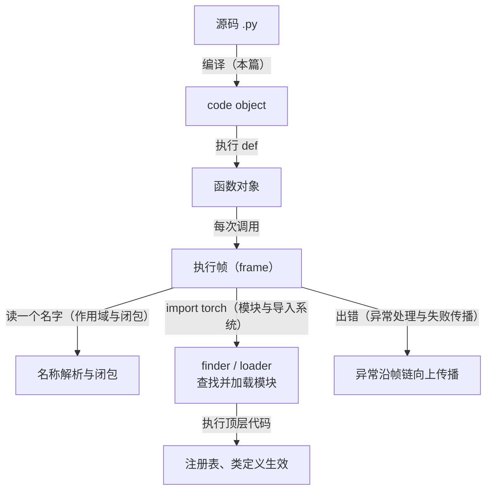
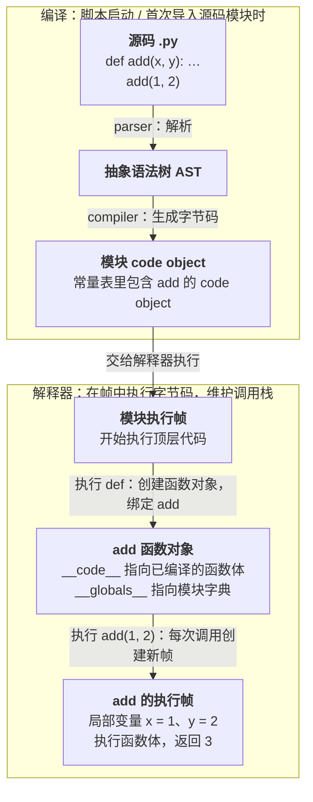
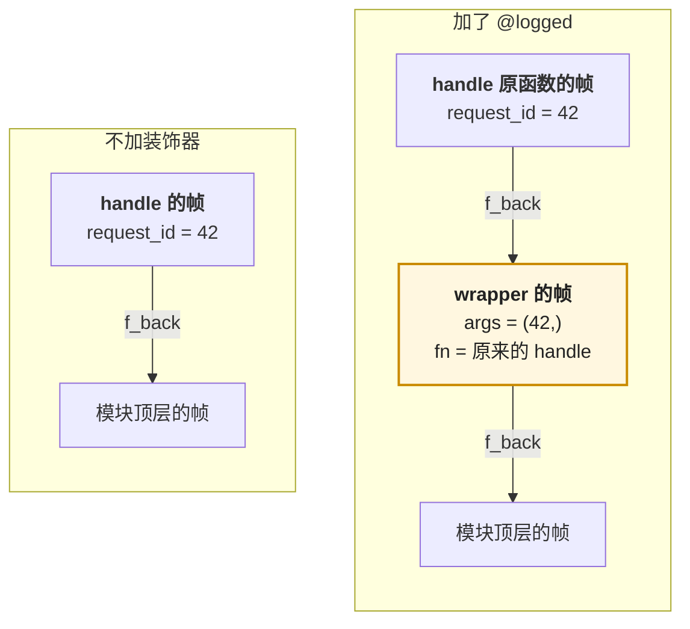
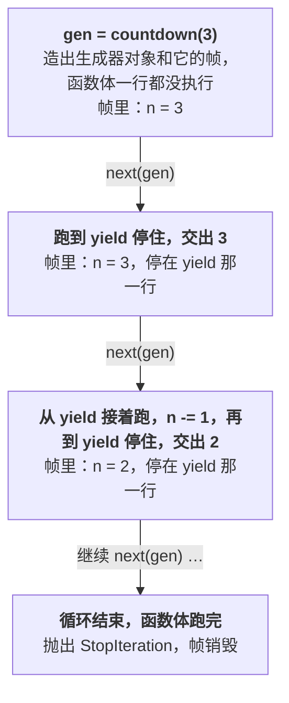

Python 常被认为是一门"简单易学"的语言。但在深度学习框架、推理服务和分布式训练系统里，真正需要掌握的不是语法，而是语法背后的运行时模型。下面这些在 AI-Infra 代码里随处可见的写法，每一行都依赖一个可以被替换、被拦截、被扩展的机制：

- **import torch**：触发 .so 扩展加载、算子注册、后端初始化
- **model(x)**：走的是 __call__，中间可能插入 hooks
- **for batch in loader**：迭代协议 + 生成器的暂停与恢复
- **with torch.inference_mode()**：上下文管理协议：进入时改状态、退出时恢复
- **@register("cuda")**：装饰器在模块导入时执行，注册表能否填上取决于谁导入了它
- **self.linear = nn.Linear(4, 4)**：__setattr__ 拦截赋值，把子模块登记到 _modules
- **except Exception: log; raise**：异常是否重抛，决定 Worker 是否退出

这七行分散在本系列的前六篇里：

| 写法 | 讲它的那一篇 |
| :--- | :--- |
| `import torch` | [《模块与导入系统》](/python-modules-and-the-import-system.html) |
| `model(x)`、`self.linear = nn.Linear(4, 4)` | [《对象模型与协议》](/python-object-model-and-protocols.html) |
| `for batch in loader` | [《对象模型与协议》](/python-object-model-and-protocols.html)（迭代协议）、[《装饰器、生成器与上下文管理器》](/python-decorators-generators-and-context-managers.html)（生成器） |
| `with torch.inference_mode()`、`@register("cuda")` | [《装饰器、生成器与上下文管理器》](/python-decorators-generators-and-context-managers.html) |
| `except Exception: log; raise` | [《异常处理与失败传播》](/python-exceptions-and-failure-propagation.html) |

Table: 开头七行代码各在哪一篇展开

不理解这些机制，读 PyTorch 或 vLLM 的源码就只能逐行翻译语法；理解之后，才能看出一个框架"为什么这样设计"，也才能解释那些经典故障——"本地能跑、换台机器就 `ImportError`"、"明明写了注册装饰器、运行时却找不到后端"、"`python -m` 能跑、`python script.py` 不能"。

这六篇有一个共同的基础：代码在运行时以什么形态存在。本篇只回答这一个问题：

> **一段 Python 源码从文本变成正在运行的代码，中间经过哪几种对象，它们各在什么时候产生？[^q0]**

## 一、总览

### 1. 前六篇的主线



- **code object**：字节码、常量、名字表。导入源码模块时可缓存在 `__pycache__/*.pyc`；直接运行脚本不写这个缓存。
- **执行帧**：这一次执行的局部变量与执行位置。一次普通函数调用一个帧，帧连成调用栈。
- **名称解析与闭包**：名称按 Local → Enclosing → Global → Builtins 分类；查找位置在编译期决定。闭包通过 cell 保留外层变量，不必保留整个外层帧。
- **模块查找与加载**：先查 `sys.modules`；未命中时由 finder 查找（路径查找用 `sys.path`，子模块用父包的 `__path__`），创建模块后先放进 `sys.modules`，再执行模块代码。`.so` 扩展也在加载时被 `dlopen`。
- **异常传播**：异常沿帧链向上传播，每一层的 `except` 有机会接住；没人接住就到解释器顶层打印 traceback。

- [《作用域与闭包》](/python-scopes-and-closures.html)：帧里的名称怎么解析，闭包怎么保留外层变量。
- [《模块与导入系统》](/python-modules-and-the-import-system.html)：finder / loader 找到并加载模块，顶层代码执行后，注册表、类定义才生效。
- [《异常处理与失败传播》](/python-exceptions-and-failure-propagation.html)：异常沿帧链向上传播，途经活动的 `finally` / `__exit__`。
- [《对象模型与协议》](/python-object-model-and-protocols.html)、[《装饰器、生成器与上下文管理器》](/python-decorators-generators-and-context-managers.html)：类、实例、方法、生成器这些对象怎么被创建和使用。

后面五篇都依赖本篇：闭包依赖函数对象与帧，导入以"执行模块顶层代码"收尾，异常沿帧链传播，生成器是一个挂起的帧。

### 2. 一个贯穿前六篇的例子


为了让后面的机制讨论有一个共同的落点，先给出一个极简的推理组件。它没有任何真实的模型逻辑，但用到了本系列前六篇要讲的每一种机制：

```python title='runner.py：贯穿前六篇的极简推理组件'
# runner.py
from contextlib import nullcontext

REGISTRY = {}


def registered(name):                        # 带参数的装饰器：registered("runner") 先被调用，返回下面的 decorator
    def decorator(cls):                      # 真正的装饰器：拿到被装饰的类 Runner，登记后原样返回
        if name in REGISTRY:
            raise ValueError(f"duplicate registration: {name}")
        REGISTRY[name] = cls
        return cls

    return decorator


class InferenceContext:                      # 上下文管理器：进入/退出推理模式
    def __enter__(self):
        print("enter inference mode")
        return self

    def __exit__(self, exc_type, exc, tb):
        print("exit inference mode")
        return False


@registered("runner")
class Runner:
    def __init__(self, model, inference=True):
        self.model = model
        self.inference = inference

    def __call__(self, batch):               # 可调用协议
        context = InferenceContext() if self.inference else nullcontext()
        with context:
            return self.model(batch)

    def stream(self, batch):                 # 生成器：流式输出
        yield from self.model.generate(batch)
```

最容易看晕的是开头那个两层嵌套的 `registered` / `decorator`。`@registered("runner")` 是两步：先调用 `registered("runner")`——它什么都不登记，只是把 `name` 记住，**返回**内层函数 `decorator`；然后 Python 把紧跟其后的 `class Runner` 交给这个 `decorator(cls)`，它把类写进 `REGISTRY["runner"]`，再把类原样返回，于是名字 `Runner` 仍然指向那个类。所以"带参数的装饰器"其实是"一个返回装饰器的函数"；没有参数的装饰器只有 `decorator` 那一层。这里 `decorator` 能用到 `name`，靠的是闭包（[《作用域与闭包》](/python-scopes-and-closures.html)）。

这段代码从写下到跑完，Python 运行时做了这些事：

1. 另一个模块执行 `import runner`，导入系统找到文件、编译成字节码、执行模块顶层代码——`REGISTRY` 被创建，`@registered("runner")` 在这一刻把 `Runner` 写进注册表；
2. `Runner(model)` 创建实例，经过 `__new__` 和 `__init__`；
3. `runner(batch)` 触发 `__call__`，其中 `with context:` 进入并退出上下文；
4. `for out in runner.stream(batch)` 创建生成器，逐步暂停与恢复；
5. 任何一步抛出异常，异常沿执行帧向上传播，途经 `__exit__` 和调用方的 `try/except`。

五步分别在哪一篇讲：

| 步骤 | 讲它的那一篇 |
| :--- | :--- |
| 编译成字节码、执行顶层代码、调用时创建帧 | 本篇 |
| 第 1 步：找到并执行模块 | [《模块与导入系统》](/python-modules-and-the-import-system.html) |
| 第 2、3 步：创建实例、`__call__` | [《对象模型与协议》](/python-object-model-and-protocols.html) |
| 第 1 步里的装饰器，第 3 步的 `with`，第 4 步的生成器 | [《装饰器、生成器与上下文管理器》](/python-decorators-generators-and-context-managers.html) |
| 第 5 步：异常传播 | [《异常处理与失败传播》](/python-exceptions-and-failure-propagation.html) |

Table: runner.py 的五步各在哪一篇展开

[《装饰器、生成器与上下文管理器》](/python-decorators-generators-and-context-managers.html)的最后一章会把五步串起来完整追踪一遍。

### 3. 本篇的主线：从源码到帧

Python 源码在运行前会先被编译成字节码，解释器执行的是字节码，不是源文件的文本。本篇讲清这条链路——源码怎么变成 code object、函数对象、执行帧，以及编译在什么时候发生——后面的导入、闭包、生成器都建在它上面。

以一个定义了 `add(x, y)`、随后调用 `add(1, 2)` 的脚本为例，CPython 在进程启动后分两步处理：先编译，再执行。



- **编译器处理代码**：整个模块先编译，函数体也在这时编成嵌套的 code object；执行 `def` 和调用函数都不重新编译。
- **解释器运行代码**：先在模块帧里执行顶层字节码，遇到 `def` 创建函数对象，遇到普通函数调用进入新帧，返回后继续调用者。它是执行这些步骤的运行时，不是链路上的另一份代码产物。
- **缓存可以跳过编译**：导入源码模块时，若有有效的 `.pyc`，直接读回 code object，再从执行模块代码开始；同一进程已导入的模块通常连执行也跳过（[《模块与导入系统》](/python-modules-and-the-import-system.html)）。

### 4. 本文的章节安排

本篇按一段代码经过的形态排：先是编译的产物 code object，再是执行 `def` 得到的函数对象，然后是调用时创建的帧，最后是帧里的名称与对象的关系。

| 章 | 主题 | 内容 |
|---|---|---|
| 二 | Python 不是"逐行解释" | 编译的触发时机、字节码、code object |
| 三 | 函数对象 | `def` 是语句；`__code__`、`__defaults__`、`__globals__` |
| 四 | 执行帧与调用栈 | 帧的字段、`f_back` 链、装饰器多出的一帧、生成器的帧 |
| 五 | 名称绑定 | 名称与对象、`==` 与 `is`、别名 |
| 六 | 本文小结 |  |
| 七 | 自测 | 4 道题 |

Table: 本文的章节安排

## 二、Python 不是"逐行解释"

"解释器读一行、执行一行"是入门时的近似，但它解释不了为什么一个函数里的语法错误会让整个模块都无法导入，也解释不了为什么闭包能记住外层变量。实际过程是：

源代码（`.py`）经 parser 生成 AST，再经 compiler 生成 code object（含字节码），最后由解释器在执行帧中运行。

Python 没有 `javac` 那样一个单独的编译步骤，但编译确实发生，而且有明确的触发时机：

| 触发 | 编译什么 | 产物放哪 |
|---|---|---|
| `python script.py` 启动 | 整个 `script.py` | 内存里的 code object；**不**写 `.pyc` |
| 第一次 `import mod`（[《模块与导入系统》](/python-modules-and-the-import-system.html)） | 整个 `mod.py`，含其中每个函数体、类体 | 内存里的 code object，并写到 `__pycache__/mod.cpython-312.pyc` 缓存；下次导入若源文件没变，直接读 `.pyc` 跳过编译 |
| `exec(src)` / `eval(expr)` / `compile(src, ...)` | 传入的字符串 | 返回或直接执行 code object——这是"运行时编译"的显式入口 |
| 交互式解释器每输入一条语句 | 那一条语句 | 立刻执行 |

Table: Python 编译的触发时机与产物

所以说"运行时编译"是指：编译发生在**进程运行期间、第一次用到某个模块时**，而不是在一个独立的构建阶段；单位是**整个模块**——一个函数里的语法错误会让整个文件编译失败，于是 `import` 报 `SyntaxError`，哪怕那个函数从未被调用。编译的产物里，每个函数体、类体、生成器体各自是一个嵌套的 code object；`def` 语句执行时只是把已经编译好的 code object 包成函数对象（第三章），不再编译。

> [!NOTE] 与 Java 对照：编译与执行
> `javac` 通常在构建期把源码编成 `.class`，JVM 运行时加载字节码，解释执行，并可将热点代码 JIT 编译成机器码。这里讨论的 CPython 3.12 在脚本启动或源码模块导入时编译，之后解释执行字节码；`.pyc` 是编译缓存，不是必须预先构建的交付物。

用 `dis` 可以看到函数的字节码：

```python title='用 dis 看 add 的字节码'
import dis


def add(x, y):
    return x + y


dis.dis(add)
```

CPython 3.12 的输出：

```text title='add 的字节码：四条指令'
  4           0 RESUME                   0

  5           2 LOAD_FAST                0 (x)
              4 LOAD_FAST                1 (y)
              6 BINARY_OP                0 (+)
             10 RETURN_VALUE
```

四条指令：把两个局部变量压栈、做二元运算、返回。指令集会随 CPython 版本变化（3.11 起大量指令被重写以支持自适应特化），但读法是稳定的：左列是源码行号，中间是字节偏移，右边是指令名和参数。

code object 本身是一个普通对象，函数只是它的一个引用：

```python title='code object 是普通对象，函数只是它的引用'
c = add.__code__
print(type(c))                                    # <class 'code'>
print(c.co_varnames, c.co_argcount, c.co_consts)  # ('x', 'y') 2 (None,)
```

这里需要分清几个概念，后面每一章都会用到：

| 形态 | 是什么 | 什么时候产生 | 保存在哪里 | Java 对照 |
| :--- | :--- | :--- | :--- | :--- |
| 源代码 | `.py` 文本 | 开发者编写 | 磁盘上的 `.py` 文件；也可来自内存字符串 | `.java` 源文件 |
| code object | 字节码、常量表、变量名表、行号表 | 编译时产生，也可从有效 `.pyc` 读回 | 进程内存；函数通过 `__code__` 引用；嵌套代码在外层的 `co_consts` 中；导入时可缓存到磁盘 `.pyc` | 类比 `.class` 中方法的字节码与元数据；加载后由 JVM 管理 |
| 函数对象 | code object + 默认参数 + 全局命名空间 + 闭包 + 注解 | 执行到 `def` 时 | 进程内存中的对象，由模块字典、局部变量或容器等引用 | 方法本身不是函数对象；lambda 的函数式接口实例可类比，但不等同 |
| 执行帧（frame） | 一次执行的局部变量、指令位置、调用者链 | 开始执行模块或调用函数时 | 线程的活动调用栈；返回后仍可被 traceback 等保留；生成器的暂停帧由生成器持有 | JVM 栈中的方法调用帧 |

Table: 源代码、code object、函数对象与执行帧

字节码格式和执行循环属于 CPython 实现细节，不属于语言规范。但 code object、函数对象、帧这三个概念在所有主流实现中都存在，理解它们不会被版本差异推翻。

## 三、函数对象：code object 的运行时封装

执行到 `def` 语句时，解释器用编译好的 code object 创建一个函数对象，并把名称绑定到它。函数对象携带了运行这段代码所需的全部上下文：

```python title='函数对象携带的上下文：__code__、__defaults__、__globals__'
def predict(x, scale=2):
    """Scale the input."""
    return x * scale


print(type(predict))            # <class 'function'>
print(predict.__code__)         # <code object predict at 0x..., file "...", line 1>
print(predict.__defaults__)     # (2,)
print(predict.__doc__)          # Scale the input.
print(predict.__qualname__)     # predict
print(predict.__globals__ is globals())   # True
```

`__globals__` 是函数定义所在模块的命名空间字典——这决定了函数里的全局名称在**定义它的模块**中查找，而不是在调用它的模块中。[《作用域与闭包》](/python-scopes-and-closures.html)的作用域规则、[《模块与导入系统》](/python-modules-and-the-import-system.html)里"模块的顶层代码执行后名称才存在"，都以 `__globals__` 这个字段为基础——查全局名称就是查这个字典。

`def` 是语句，每执行一次就创建一个新的函数对象。两个函数对象可以共享同一个 code object：

```python title='每执行一次 def 就是一个新函数对象，code object 可共享'
def make():
    def f():
        return 1
    return f


a, b = make(), make()
print(a is b, a.__code__ is b.__code__)   # False True
```

这就是为什么函数在 Python 里是"一等对象"：它可以被赋值、传参、返回、放进容器、动态添加属性——本质上它就是一个带有 `__call__` 的普通对象。[《装饰器、生成器与上下文管理器》的「装饰器」一章](/python-decorators-generators-and-context-managers.html#二装饰器用闭包和描述符改写调用路径)的装饰器把这件事用到极致：`@log_call` 只是把名称 `predict` 重新绑定到另一个函数对象。

> [!NOTE] 与 Java 对照：函数与方法
> Java 的方法本身不是普通对象；lambda 和方法引用通过函数式接口实例来传递行为。Python 的 `def` 则是运行时语句，执行后得到的函数对象可以直接赋值、传参和返回。

## 四、执行帧与调用栈

每次调用函数，解释器创建一个执行帧，包含局部变量、当前执行到的指令位置、指向调用者帧的引用。帧对象可以被观察：

```python title='用 inspect.currentframe 观察当前帧与调用者'
import inspect


def show_frame():
    frame = inspect.currentframe()
    print(frame.f_code.co_name, list(frame.f_locals), frame.f_back.f_code.co_name)


show_frame()    # show_frame ['frame'] <module>
```

traceback 显示的调用链，就是异常发生时沿 `f_back` 串起来的帧：

```python title='traceback 就是沿 f_back 串起来的帧链'
def inner():
    raise ValueError("boom")


def outer():
    inner()


try:
    outer()
except ValueError as exc:
    tb = exc.__traceback__
    while tb:
        print(tb.tb_frame.f_code.co_name, tb.tb_lineno)
        tb = tb.tb_next
```

```text title="运行输出：从最外层到出错的那一层"
<module> 10
outer 6
inner 2
```

三行各是一帧：模块顶层执行到第 10 行调用了 `outer`，`outer` 执行到第 6 行调用了 `inner`，`inner` 在第 2 行抛出异常。

一帧里具体有什么，决定了后面几章的行为。帧对象上能直接读到的字段：

| 字段 | 内容 | 后面哪里用到 |
|---|---|---|
| `f_code` | 正在执行的 code object | 上一章：同一个 code object 可以同时有多帧在跑（递归） |
| `f_locals` | 当前作用域的局部名称映射 | [《作用域与闭包》](/python-scopes-and-closures.html)：普通函数的局部变量每次调用一份。CPython 在优化函数作用域中使用内部槽位；3.12 及之前的 `f_locals` 是从槽位同步出的字典，3.13 起（PEP 667）是可写回槽位的代理。模块和类体的命名空间另论 |
| `f_globals` / `f_builtins` | 函数定义所在模块的字典、内置名称的字典 | [《作用域与闭包》](/python-scopes-and-closures.html)：全局名称不存在帧里，帧只带着"去哪个字典找"的指针 |
| `f_lineno` | 当前执行到哪一行 | 帧记着执行到哪条指令（行号由它换算），之后从那里继续——生成器靠的就是这个执行位置 |
| `f_back` | 调用者的帧 | 调用栈就是沿 `f_back` 串起来的链；异常沿这条链往上找 `except` |

Table: 帧对象的字段，以及各自在哪里起作用

下面这段把其中两件事直接跑出来：装饰器为什么会在调用栈里多出一层，以及"生成器是一个可以暂停的帧"是什么意思。

```python title="沿 f_back 打印调用栈；看生成器对象身上的帧"
import functools
import inspect


def show_stack():
    """从当前帧出发，沿 f_back 一路走到最外层，打印每一帧的函数名、局部变量名和正在执行的行号。"""
    frame = inspect.currentframe().f_back
    while frame:
        names = list(frame.f_locals)[:3]
        print(f"  {frame.f_code.co_name:10s} 局部变量 {names}  第 {frame.f_lineno} 行")
        frame = frame.f_back


def logged(fn):
    @functools.wraps(fn)
    def wrapper(*args):
        return fn(*args)
    return wrapper


@logged
def handle(request_id):
    show_stack()


print("① 被装饰的函数调用时，栈里多一层 wrapper：")
handle(42)


def countdown(n):
    while n > 0:
        yield n
        n -= 1


gen = countdown(3)
print("② 生成器对象自己带着一个帧：")
print("  还没开始：第", gen.gi_frame.f_lineno, "行，局部变量", gen.gi_frame.f_locals)
next(gen)
next(gen)
print("  取了两个值之后停在：第", gen.gi_frame.f_lineno, "行，局部变量", gen.gi_frame.f_locals)
```

```text title="运行输出（Python 3.12）"
① 被装饰的函数调用时，栈里多一层 wrapper：
  handle     局部变量 ['request_id']  第 23 行
  wrapper    局部变量 ['args', 'fn']  第 17 行
  <module>   局部变量 ['__name__', '__doc__', '__package__']  第 27 行
② 生成器对象自己带着一个帧：
  还没开始：第 30 行，局部变量 {'n': 3}
  取了两个值之后停在：第 32 行，局部变量 {'n': 2}
```

两段输出各画成一张图。



装饰之后，名字 `handle` 指向的其实是 `wrapper`，调用要先进 `wrapper` 的帧，再由它调原函数。报错时 traceback 里多出来的那一行 `wrapper` 就是黄色这一帧（[《装饰器、生成器与上下文管理器》的「装饰器」一章](/python-decorators-generators-and-context-managers.html#二装饰器用闭包和描述符改写调用路径)）。



普通函数的帧在 `return` 时就销毁了；生成器的帧挂在生成器对象上（`gi_frame`），局部变量和"停在第几行"都留着，所以能一次一次接着跑。`await` 的挂起与恢复用的是同一个机制（[《装饰器、生成器与上下文管理器》的「生成器与惰性执行」一章](/python-decorators-generators-and-context-managers.html#三生成器与惰性执行)）。

另外两件事在后面两篇展开：局部变量、外层函数的变量、全局变量分别存在帧里、cell 里、模块字典里，所以取值方式不同（[《作用域与闭包》](/python-scopes-and-closures.html)）；异常传播是沿 `f_back` 一帧一帧往上找 `except`，上面那三行输出就是这条链（[《异常处理与失败传播》](/python-exceptions-and-failure-propagation.html)）。

生产代码不应依赖 `inspect.currentframe()` 或修改帧对象，但调试器、profiler、`logging` 的调用位置记录都建立在帧之上。

> [!NOTE] 与 Java 对照：观察调用栈
> Java 也有调用帧，但通常通过 `StackTraceElement`、`StackWalker` 等有限视图观察调用栈，不能像 CPython 的 `inspect.currentframe()` 那样拿到包含局部状态的帧对象。

## 五、名称绑定：名称不是变量盒子

Python 的赋值不是"把值放进一个盒子"，而是"让一个名称指向一个对象"。

```python title='赋值是绑定名称：两个名称指向同一个列表'
x = []
y = x
y.append(1)
print(x, y, x is y)     # [1] [1] True
```

这里只有一个列表对象，`x` 和 `y` 是它的两个名称。因此要分开四件事：**名称**、**对象**、**对象身份**（`id()`、`is`）、**对象可变性**。

> [!NOTE] 与 Java 对照：名称与类型
> Java 的对象变量同样持有引用，但变量有静态类型，赋值要经过编译期检查。Python 名称本身不固定类型，类型属于它绑定的对象。类型注解如何提供信息、由谁检查，见[《类型表达与 typing 工具箱》](/python-type-expression-and-the-typing-toolbox.html)。

`==` 比较值，`is` 比较身份。

> [!NOTE] 与 Java 对照：值相等与身份相同
> 对两个对象引用，Python 的 `==` 大致相当于 Java 的 `equals()`，Python 的 `is` 相当于 Java 的引用 `==`：
>
> | 想问的问题 | Python 写法 | Java 写法 |
> | :--- | :--- | :--- |
> | 两个对象的**值**相等吗 | `a == b`（走 `__eq__` 比较协议） | `a.equals(b)` |
> | 两个名称指向**同一个对象**吗 | `a is b` | `a == b`（两边都是引用时） |
> | 是不是空 | `x is None` | `x == null` |
>
> Table: 值相等与身份相同：Python 与 Java 的写法对照
>
> 对照只到这里。Python 的 `==` 是运算符协议，`__eq__` 可以返回任意对象：NumPy 数组、`torch.Tensor` 的 `a == b` 逐元素比较，返回布尔数组 / 张量，当结果包含多个元素时，`if a == b:` 会报“truth value is ambiguous”，要用 `torch.equal(a, b)` 或 `(a == b).all()`；Java 的 `equals()` 永远返回 `boolean`。Java 的 `==` 在两边是 `int` 这类基本类型时也比较值；Python 没有基本类型与包装类型之分。小整数缓存会让身份比较看起来像值比较：Java 的 `Integer a = 127, b = 127` 时 `a == b` 为 `true`，换成 1000 就不能依赖这个结果；Python 也有对象复用。两边都应把值比较与身份比较分开。

回到 Python：对值做 `is` 判断结果不可预期：

```python title='== 比值、is 比身份：对值做 is 结果不可预期'
a = 1000
b = 1000
print(a == b, a is b)                         # True True   —— 同一编译单元里的常量被合并
p = int("1000")
q = int("1000")
print(p == q, p is q)                         # True False  —— 运行时各自创建
```

第一组为 `True` 只是因为 CPython 编译器把同一 code object 里相同的常量合并进了常量表——这是实现细节：同样两行在交互式解释器里逐行输入，各自编译，`a is b` 就是 `False`；第二组是运行时分别创建的两个对象。所以工程代码中 `is` 只用于单例：`is None`、`is True`、哨兵对象。

在 AI-Infra 中，名称绑定和别名会直接影响：

- 配置对象被传入多个组件后，某个组件的原地修改会被其他组件看到；
- 一个 Batch 被 DataLoader、预处理器和模型共享时，谁做了原地操作；
- 缓存里放的是可变对象时，缓存内容会随外部修改而"漂移"；
- 多进程 Worker 各自持有的是**副本**（`fork` 后各自的地址空间），进程内的全局注册表并不共享——这一点在[《模块与导入系统》的「`sys.modules` 缓存、导入副作用与注册机制」一章](/python-modules-and-the-import-system.html#七sysmodules-缓存导入副作用与注册机制)会再遇到。

## 六、本文小结

- **编译**：源码在脚本启动或第一次导入时，以整个模块为单位编译成 code object；函数体是其中嵌套的 code object。导入的模块会写 `.pyc` 缓存，直接运行的脚本不写。
- **函数对象**：执行到 `def` 时创建，等于 code object + `__globals__` + 默认值 + cell；每执行一次 `def` 就是一个新的函数对象。
- **执行帧**：每次调用创建一个，存放局部变量与指令位置，用 `f_back` 指向调用者；traceback 就是这条链。
- **名称绑定**：名称是绑定到对象的标签，不是盒子；`==` 比值，`is` 比身份。

| 读代码时的疑问 | 原因 |
| :--- | :--- |
| 一个没被调用的函数里有语法错误，为什么整个模块导入失败 | 编译以整个模块为单位 |
| 函数里的全局名称为什么不受调用方影响 | 函数对象的 `__globals__` 指向定义它的模块 |
| 加了装饰器后 traceback 为什么多一行 | 调用先进入 `wrapper` 的帧 |
| 配置对象传给多个组件后为什么互相影响 | 多个名称绑定的是同一个对象 |

Table: 四个疑问与对应的机制

配套代码：本文验证各个结论用的小脚本（`dis` 与 code object）在 [ai-learning-labs/python-for-ai-infra/01-language-mechanisms](https://github.com/arganzheng/ai-learning-labs/tree/main/python-for-ai-infra/01-language-mechanisms)，只依赖标准库。

## 七、自测

1. 一个模块里有个从未被调用的函数，函数体内有语法错误。`import` 这个模块会怎样？为什么？

   <details markdown="1"><summary>答案</summary>

   `import` 直接报 `SyntaxError`。编译以**整个模块**为单位，函数体在模块编译时就被编成嵌套的 code object，与它是否被调用无关。

   </details>

2. `python script.py` 会为 `script.py` 写 `.pyc` 吗？`import mod` 呢？

   <details markdown="1"><summary>答案</summary>

   直接运行的脚本不写；第一次 `import mod` 会把 code object 缓存到 `__pycache__/mod.cpython-312.pyc`，下次导入若源文件没变就直接读它、跳过编译。

   </details>

3. 模块 `a` 里定义的函数被模块 `b` 导入后调用，函数体里的全局名称在 `a` 还是 `b` 的命名空间里查找？靠哪个字段？

   <details markdown="1"><summary>答案</summary>

   在 `a` 里。函数对象的 `__globals__` 指向**定义它的模块**的命名空间字典，与谁调用它无关。

   </details>

4. `x = [1]; y = x; y.append(2)` 之后 `x` 是什么？为什么工程代码里 `is` 只用于 `None` 这类单例？

   <details markdown="1"><summary>答案</summary>

   `[1, 2]`：只有一个列表对象，`x` 和 `y` 是它的两个名称。`is` 比较的是身份，两个值相同的对象是不是同一个取决于实现细节（例如编译器是否合并了常量），结果不可预期。

   </details>

[^q0]: 三种。**code object**：编译的产物（字节码、常量表、名字表），在脚本启动或第一次导入模块时以整个模块为单位产生，函数体是嵌套在其中的 code object（[第二章](#二python-不是逐行解释)）。**函数对象**：执行到 `def` 语句时产生，把 code object 与 `__globals__`、默认值、cell 封装在一起（[第三章](#三函数对象code-object-的运行时封装)）。**执行帧**：每次调用时产生，存放这一次执行的局部变量和指令位置，并用 `f_back` 指向调用者（[第四章](#四执行帧与调用栈)）。帧里的名称只是绑定到对象的标签（[第五章](#五名称绑定名称不是变量盒子)）。
