Python 常被认为是一门"简单易学"的语言。但在深度学习框架、推理服务和分布式训练系统里，真正需要掌握的不是语法，而是语法背后的运行时模型。下面这些在 AI-Infra 代码里随处可见的写法，每一行都依赖一个可以被替换、被拦截、被扩展的机制：

- **import torch**：触发 .so 扩展加载、算子注册、后端初始化
- **model(x)**：走的是 __call__，中间可能插入 hooks
- **for batch in loader**：迭代协议 + 生成器的暂停与恢复
- **with torch.inference_mode()**：上下文管理协议：进入时改状态、退出时恢复
- **@register("cuda")**：装饰器在模块导入时执行，注册表能否填上取决于谁导入了它
- **self.linear = nn.Linear(4, 4)**：__setattr__ 拦截赋值，把子模块登记到 _modules
- **except Exception: log; raise**：异常是否重抛，决定 Worker 是否退出

这七行里，`import torch` 与 `except ... raise` 两行是本篇的内容（第四、五章）——**代码怎么被加载、怎么跑、出错了怎么传播**；其余五行关于对象——`__call__`、迭代协议、上下文管理器、装饰器、`__setattr__`——在[下篇](/python-object-model-protocols-decorators-and-generators.html)。不理解这些机制，读 PyTorch 或 vLLM 的源码就只能逐行翻译语法；理解之后，才能看出一个框架"为什么这样设计"，也才能解释那些经典故障——"本地能跑、换台机器就 `ImportError`"、"明明写了注册装饰器、运行时却找不到后端"、"`python -m` 能跑、`python script.py` 不能"。

本篇只回答一个问题：

> **一段 Python 代码从文本变成正在运行的帧，名称在帧里怎么解析，模块怎么被找到并执行，异常又怎么沿着帧传播？[^q0]**

## 一、总览

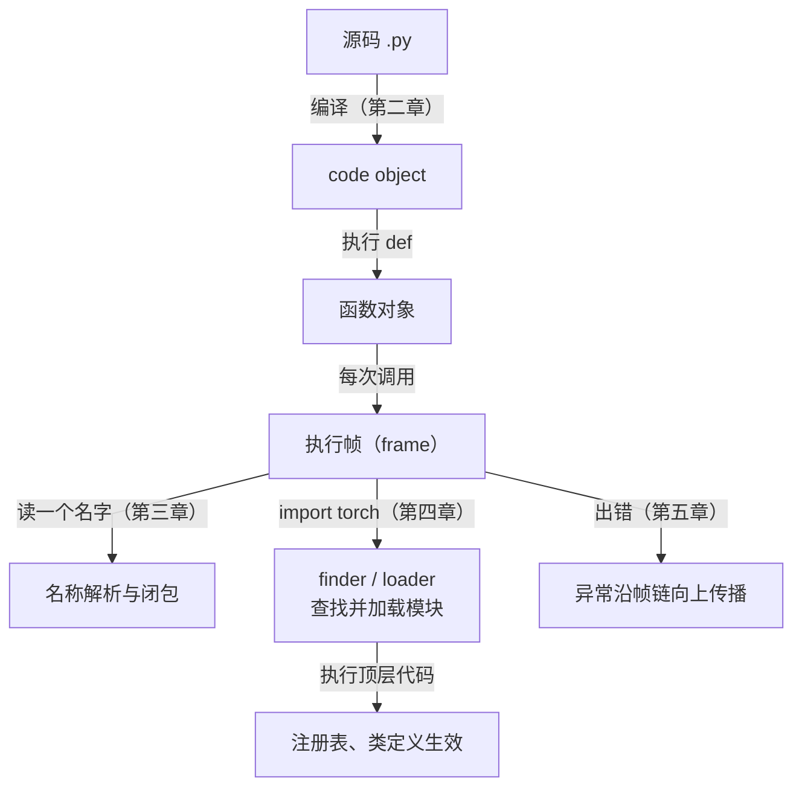

- **code object**：字节码、常量、名字表。导入源码模块时可缓存在 `__pycache__/*.pyc`；直接运行脚本不写这个缓存。
- **执行帧**：这一次执行的局部变量与执行位置。一次普通函数调用一个帧，帧连成调用栈。
- **名称解析与闭包**：名称按 Local → Enclosing → Global → Builtins 分类；查找位置在编译期决定。闭包通过 cell 保留外层变量，不必保留整个外层帧。
- **模块查找与加载**：先查 `sys.modules`；未命中时由 finder 查找（路径查找用 `sys.path`，子模块用父包的 `__path__`），创建模块后先放进 `sys.modules`，再执行模块代码。`.so` 扩展也在加载时被 `dlopen`。
- **异常传播**：异常沿帧链向上传播，每一层的 `except` 有机会接住；没人接住就到解释器顶层打印 traceback。


### 1. 一个贯穿上下两篇的例子

为了让后面的机制讨论有一个共同的落点，先给出一个极简的推理组件。它没有任何真实的模型逻辑，但用到了上下两篇要讲的每一种机制：

```python title='runner.py：贯穿上下两篇的极简推理组件'
# runner.py
from contextlib import nullcontext

REGISTRY = {}


def registered(name):                        # 带参数的装饰器：registered("runner") 先被调用，返回下面的 decorator
    def decorator(cls):                      # 真正的装饰器：拿到被装饰的类 Runner，登记后原样返回
        if name in REGISTRY:
            raise ValueError(f"duplicate registration: {name}")
        REGISTRY[name] = cls
        return cls

    return decorator


class InferenceContext:                      # 上下文管理器：进入/退出推理模式
    def __enter__(self):
        print("enter inference mode")
        return self

    def __exit__(self, exc_type, exc, tb):
        print("exit inference mode")
        return False


@registered("runner")
class Runner:
    def __init__(self, model, inference=True):
        self.model = model
        self.inference = inference

    def __call__(self, batch):               # 可调用协议
        context = InferenceContext() if self.inference else nullcontext()
        with context:
            return self.model(batch)

    def stream(self, batch):                 # 生成器：流式输出
        yield from self.model.generate(batch)
```

最容易看晕的是开头那个两层嵌套的 `registered` / `decorator`。`@registered("runner")` 是两步：先调用 `registered("runner")`——它什么都不登记，只是把 `name` 记住，**返回**内层函数 `decorator`；然后 Python 把紧跟其后的 `class Runner` 交给这个 `decorator(cls)`，它把类写进 `REGISTRY["runner"]`，再把类原样返回，于是名字 `Runner` 仍然指向那个类。所以"带参数的装饰器"其实是"一个返回装饰器的函数"；没有参数的装饰器只有 `decorator` 那一层。这里 `decorator` 能用到 `name`，靠的是第三章的闭包。

这段代码从写下到跑完，Python 运行时做了这些事：

1. 另一个模块执行 `import runner`，导入系统找到文件、编译成字节码、执行模块顶层代码——`REGISTRY` 被创建，`@registered("runner")` 在这一刻把 `Runner` 写进注册表；
2. `Runner(model)` 创建实例，经过 `__new__` 和 `__init__`；
3. `runner(batch)` 触发 `__call__`，其中 `with context:` 进入并退出上下文；
4. `for out in runner.stream(batch)` 创建生成器，逐步暂停与恢复；
5. 任何一步抛出异常，异常沿执行帧向上传播，途经 `__exit__` 和调用方的 `try/except`。

第 1 步和第 5 步是本篇的内容：编译、帧、名称解析、导入、异常传播；第 2–4 步关于对象——创建、调用、协议、生成器、上下文——在[下篇](/python-object-model-protocols-decorators-and-generators.html)，下篇最后一章再把五步串起来完整追踪一遍。

### 2. 本篇的主线：从源码到帧

总览图里的每条边，对应后面一章：

- **第二章，执行模型**：源码编译成 code object；执行 `def` 时封装成函数对象，调用函数时创建执行帧。类对象不是把 code object 直接封装起来：要先执行类体，再由元类创建，见[下篇第二章](/python-object-model-protocols-decorators-and-generators.html#二类与对象模型对象如何被创建和查找)。
- **第三章，作用域与闭包**：帧里的名称怎么解析。
- **第四章，导入系统**：finder / loader 找到并加载模块，顶层代码执行后，注册表、类定义才生效。
- **第五章，异常传播**：异常沿帧链向上传播，途经活动的 `finally` / `__exit__`；若被捕获或抑制，就不再继续向外传播。

各章之间的依赖是单向的：第三章的闭包依赖第二章的函数对象与帧；第四章的导入以"执行模块顶层代码"收尾，用到第二章的编译单元；第五章的异常沿第二章的帧链传播。

### 3. 本文的章节安排

| 章 | 主题 | 内容 |
|---|---|---|
| 二 | 执行模型：源码如何变成正在运行的代码 | code object、字节码、函数对象、执行帧、名称绑定 |
| 三 | 作用域与闭包：名称在哪里被解析 | LEGB 的编译期本质、cell、`nonlocal`、延迟绑定 |
| 四 | 模块与导入系统：代码如何被加载 | `import` 的执行过程、`meta_path` / `PathFinder` / loader 三层机制、`sys.path` 与启动方式、项目布局与 editable 安装、`sys.modules` 与注册前提、循环导入、动态导入、导入语法 |
| 五 | 异常处理与失败传播 | 层级、错误边界、异常链、记录并重抛 |
| 六 | 本文小结 |  |
| 七 | 自测 | 3 道题 |

Table: 本文的章节安排

## 二、执行模型：源码如何变成正在运行的代码

Python 源码在运行前会先被编译成字节码，解释器执行的是字节码，不是源文件的文本。这一章讲清这条链路——源码怎么变成 code object、函数对象、执行帧，以及编译在什么时候发生——后面的导入、闭包、生成器都建在它上面。

以一个定义了 `add(x, y)`、随后调用 `add(1, 2)` 的脚本为例，CPython 在进程启动后分两步处理：先编译，再执行。

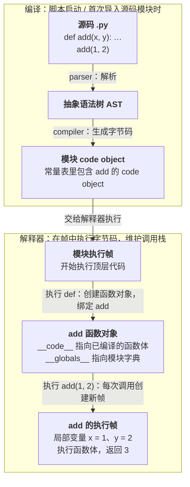

- **编译器处理代码**：整个模块先编译，函数体也在这时编成嵌套的 code object；执行 `def` 和调用函数都不重新编译。
- **解释器运行代码**：先在模块帧里执行顶层字节码，遇到 `def` 创建函数对象，遇到普通函数调用进入新帧，返回后继续调用者。它是执行这些步骤的运行时，不是链路上的另一份代码产物。
- **缓存可以跳过编译**：导入源码模块时，若有有效的 `.pyc`，直接读回 code object，再从执行模块代码开始；同一进程已导入的模块通常连执行也跳过（第四章）。

### 1. Python 不是"逐行解释"

"解释器读一行、执行一行"是入门时的近似，但它解释不了为什么一个函数里的语法错误会让整个模块都无法导入，也解释不了为什么闭包能记住外层变量。实际过程是：

源代码（`.py`）经 parser 生成 AST，再经 compiler 生成 code object（含字节码），最后由解释器在执行帧中运行。

Python 没有 `javac` 那样一个单独的编译步骤，但编译确实发生，而且有明确的触发时机：

| 触发 | 编译什么 | 产物放哪 |
|---|---|---|
| `python script.py` 启动 | 整个 `script.py` | 内存里的 code object；**不**写 `.pyc` |
| 第一次 `import mod`（第四章） | 整个 `mod.py`，含其中每个函数体、类体 | 内存里的 code object，并写到 `__pycache__/mod.cpython-312.pyc` 缓存；下次导入若源文件没变，直接读 `.pyc` 跳过编译 |
| `exec(src)` / `eval(expr)` / `compile(src, ...)` | 传入的字符串 | 返回或直接执行 code object——这是"运行时编译"的显式入口 |
| 交互式解释器每输入一条语句 | 那一条语句 | 立刻执行 |

Table: Python 编译的触发时机与产物

所以说"运行时编译"是指：编译发生在**进程运行期间、第一次用到某个模块时**，而不是在一个独立的构建阶段；单位是**整个模块**——一个函数里的语法错误会让整个文件编译失败，于是 `import` 报 `SyntaxError`，哪怕那个函数从未被调用。编译的产物里，每个函数体、类体、生成器体各自是一个嵌套的 code object；`def` 语句执行时只是把已经编译好的 code object 包成函数对象（§2），不再编译。

> [!NOTE] 与 Java 对照：编译与执行
> `javac` 通常在构建期把源码编成 `.class`，JVM 运行时加载字节码，解释执行，并可将热点代码 JIT 编译成机器码。这里讨论的 CPython 3.12 在脚本启动或源码模块导入时编译，之后解释执行字节码；`.pyc` 是编译缓存，不是必须预先构建的交付物。

用 `dis` 可以看到函数的字节码：

```python title='用 dis 看 add 的字节码'
import dis


def add(x, y):
    return x + y


dis.dis(add)
```

CPython 3.12 的输出：

```text title='add 的字节码：四条指令'
  4           0 RESUME                   0

  5           2 LOAD_FAST                0 (x)
              4 LOAD_FAST                1 (y)
              6 BINARY_OP                0 (+)
             10 RETURN_VALUE
```

四条指令：把两个局部变量压栈、做二元运算、返回。指令集会随 CPython 版本变化（3.11 起大量指令被重写以支持自适应特化），但读法是稳定的：左列是源码行号，中间是字节偏移，右边是指令名和参数。

code object 本身是一个普通对象，函数只是它的一个引用：

```python title='code object 是普通对象，函数只是它的引用'
c = add.__code__
print(type(c))                                    # <class 'code'>
print(c.co_varnames, c.co_argcount, c.co_consts)  # ('x', 'y') 2 (None,)
```

这里需要分清几个概念，后面每一章都会用到：

| 形态 | 是什么 | 什么时候产生 | 保存在哪里 | Java 对照 |
| :--- | :--- | :--- | :--- | :--- |
| 源代码 | `.py` 文本 | 开发者编写 | 磁盘上的 `.py` 文件；也可来自内存字符串 | `.java` 源文件 |
| code object | 字节码、常量表、变量名表、行号表 | 编译时产生，也可从有效 `.pyc` 读回 | 进程内存；函数通过 `__code__` 引用；嵌套代码在外层的 `co_consts` 中；导入时可缓存到磁盘 `.pyc` | 类比 `.class` 中方法的字节码与元数据；加载后由 JVM 管理 |
| 函数对象 | code object + 默认参数 + 全局命名空间 + 闭包 + 注解 | 执行到 `def` 时 | 进程内存中的对象，由模块字典、局部变量或容器等引用 | 方法本身不是函数对象；lambda 的函数式接口实例可类比，但不等同 |
| 执行帧（frame） | 一次执行的局部变量、指令位置、调用者链 | 开始执行模块或调用函数时 | 线程的活动调用栈；返回后仍可被 traceback 等保留；生成器的暂停帧由生成器持有 | JVM 栈中的方法调用帧 |

Table: 源代码、code object、函数对象与执行帧

字节码格式和执行循环属于 CPython 实现细节，不属于语言规范。但 code object、函数对象、帧这三个概念在所有主流实现中都存在，理解它们不会被版本差异推翻。

### 2. 函数对象：code object 的运行时封装

执行到 `def` 语句时，解释器用编译好的 code object 创建一个函数对象，并把名称绑定到它。函数对象携带了运行这段代码所需的全部上下文：

```python title='函数对象携带的上下文：__code__、__defaults__、__globals__'
def predict(x, scale=2):
    """Scale the input."""
    return x * scale


print(type(predict))            # <class 'function'>
print(predict.__code__)         # <code object predict at 0x..., file "...", line 1>
print(predict.__defaults__)     # (2,)
print(predict.__doc__)          # Scale the input.
print(predict.__qualname__)     # predict
print(predict.__globals__ is globals())   # True
```

`__globals__` 是函数定义所在模块的命名空间字典——这决定了函数里的全局名称在**定义它的模块**中查找，而不是在调用它的模块中。第三章的作用域规则、第四章"模块的顶层代码执行后名称才存在"，都以 `__globals__` 这个字段为基础——查全局名称就是查这个字典。

`def` 是语句，每执行一次就创建一个新的函数对象。两个函数对象可以共享同一个 code object：

```python title='每执行一次 def 就是一个新函数对象，code object 可共享'
def make():
    def f():
        return 1
    return f


a, b = make(), make()
print(a is b, a.__code__ is b.__code__)   # False True
```

这就是为什么函数在 Python 里是"一等对象"：它可以被赋值、传参、返回、放进容器、动态添加属性——本质上它就是一个带有 `__call__` 的普通对象。[下篇第四章](/python-object-model-protocols-decorators-and-generators.html#四装饰器用闭包和描述符改写调用路径)的装饰器把这件事用到极致：`@log_call` 只是把名称 `predict` 重新绑定到另一个函数对象。

> [!NOTE] 与 Java 对照：函数与方法
> Java 的方法本身不是普通对象；lambda 和方法引用通过函数式接口实例来传递行为。Python 的 `def` 则是运行时语句，执行后得到的函数对象可以直接赋值、传参和返回。

### 3. 执行帧与调用栈

每次调用函数，解释器创建一个执行帧，包含局部变量、当前执行到的指令位置、指向调用者帧的引用。帧对象可以被观察：

```python title='用 inspect.currentframe 观察当前帧与调用者'
import inspect


def show_frame():
    frame = inspect.currentframe()
    print(frame.f_code.co_name, list(frame.f_locals), frame.f_back.f_code.co_name)


show_frame()    # show_frame ['frame'] <module>
```

traceback 显示的调用链，就是异常发生时沿 `f_back` 串起来的帧：

```python title='traceback 就是沿 f_back 串起来的帧链'
def inner():
    raise ValueError("boom")


def outer():
    inner()


try:
    outer()
except ValueError as exc:
    tb = exc.__traceback__
    while tb:
        print(tb.tb_frame.f_code.co_name, tb.tb_lineno)
        tb = tb.tb_next
```

```text title="运行输出：从最外层到出错的那一层"
<module> 10
outer 6
inner 2
```

三行各是一帧：模块顶层执行到第 10 行调用了 `outer`，`outer` 执行到第 6 行调用了 `inner`，`inner` 在第 2 行抛出异常。

一帧里具体有什么，决定了后面几章的行为。帧对象上能直接读到的字段：

| 字段 | 内容 | 后面哪里用到 |
|---|---|---|
| `f_code` | 正在执行的 code object | 上一节：同一个 code object 可以同时有多帧在跑（递归） |
| `f_locals` | 当前作用域的局部名称映射 | 第三章：普通函数的局部变量每次调用一份。CPython 在优化函数作用域中使用内部槽位；3.12 及之前的 `f_locals` 是从槽位同步出的字典，3.13 起（PEP 667）是可写回槽位的代理。模块和类体的命名空间另论 |
| `f_globals` / `f_builtins` | 函数定义所在模块的字典、内置名称的字典 | 第三章：全局名称不存在帧里，帧只带着"去哪个字典找"的指针 |
| `f_lineno` | 当前执行到哪一行 | 帧记着执行到哪条指令（行号由它换算），之后从那里继续——生成器靠的就是这个执行位置 |
| `f_back` | 调用者的帧 | 调用栈就是沿 `f_back` 串起来的链；异常沿这条链往上找 `except` |

Table: 帧对象的字段，以及各自在后面哪一章起作用

下面这段把其中两件事直接跑出来：装饰器为什么会在调用栈里多出一层，以及"生成器是一个可以暂停的帧"是什么意思。

```python title="沿 f_back 打印调用栈；看生成器对象身上的帧"
import functools
import inspect


def show_stack():
    """从当前帧出发，沿 f_back 一路走到最外层，打印每一帧的函数名、局部变量名和正在执行的行号。"""
    frame = inspect.currentframe().f_back
    while frame:
        names = list(frame.f_locals)[:3]
        print(f"  {frame.f_code.co_name:10s} 局部变量 {names}  第 {frame.f_lineno} 行")
        frame = frame.f_back


def logged(fn):
    @functools.wraps(fn)
    def wrapper(*args):
        return fn(*args)
    return wrapper


@logged
def handle(request_id):
    show_stack()


print("① 被装饰的函数调用时，栈里多一层 wrapper：")
handle(42)


def countdown(n):
    while n > 0:
        yield n
        n -= 1


gen = countdown(3)
print("② 生成器对象自己带着一个帧：")
print("  还没开始：第", gen.gi_frame.f_lineno, "行，局部变量", gen.gi_frame.f_locals)
next(gen)
next(gen)
print("  取了两个值之后停在：第", gen.gi_frame.f_lineno, "行，局部变量", gen.gi_frame.f_locals)
```

```text title="运行输出（Python 3.12）"
① 被装饰的函数调用时，栈里多一层 wrapper：
  handle     局部变量 ['request_id']  第 23 行
  wrapper    局部变量 ['args', 'fn']  第 17 行
  <module>   局部变量 ['__name__', '__doc__', '__package__']  第 27 行
② 生成器对象自己带着一个帧：
  还没开始：第 30 行，局部变量 {'n': 3}
  取了两个值之后停在：第 32 行，局部变量 {'n': 2}
```

两段输出各画成一张图。

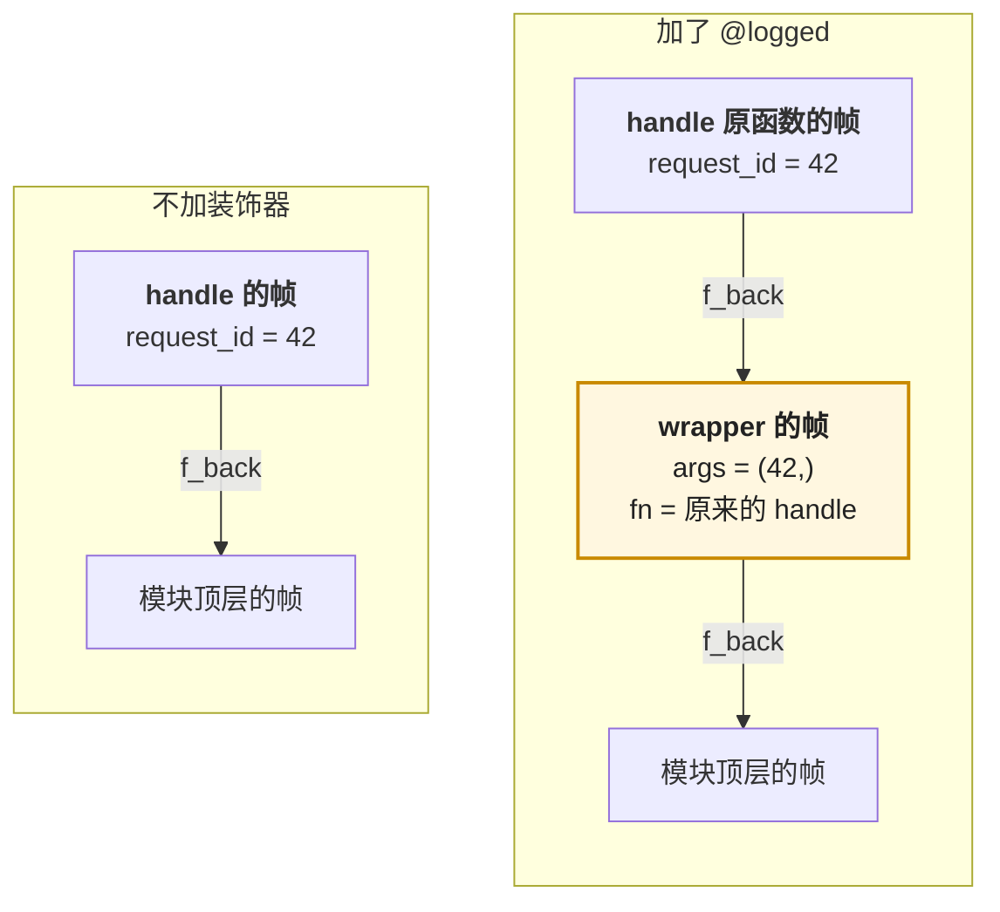

装饰之后，名字 `handle` 指向的其实是 `wrapper`，调用要先进 `wrapper` 的帧，再由它调原函数。报错时 traceback 里多出来的那一行 `wrapper` 就是黄色这一帧（[下篇第四章](/python-object-model-protocols-decorators-and-generators.html#四装饰器用闭包和描述符改写调用路径)）。

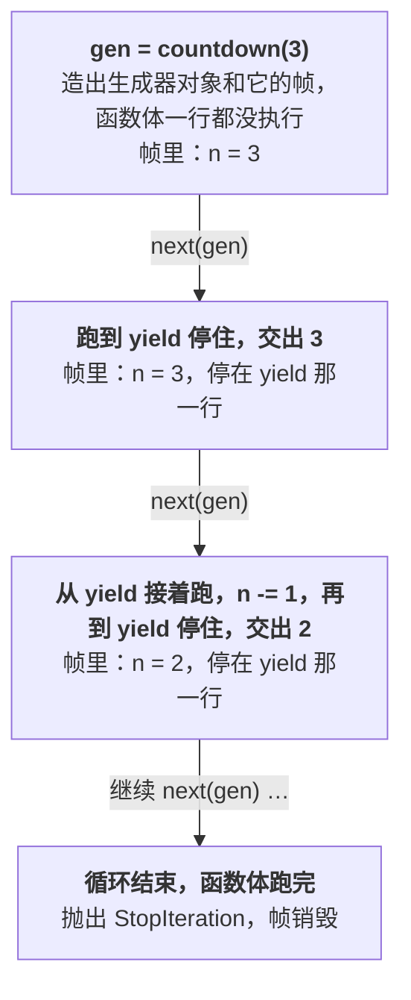

普通函数的帧在 `return` 时就销毁了；生成器的帧挂在生成器对象上（`gi_frame`），局部变量和"停在第几行"都留着，所以能一次一次接着跑。`await` 的挂起与恢复用的是同一个机制（[下篇第五章](/python-object-model-protocols-decorators-and-generators.html#五生成器与惰性执行)）。

另外两件事在本篇后面展开：局部变量、外层函数的变量、全局变量分别存在帧里、cell 里、模块字典里，所以取值方式不同（第三章）；异常传播是沿 `f_back` 一帧一帧往上找 `except`，上面那三行输出就是这条链（第五章）。

生产代码不应依赖 `inspect.currentframe()` 或修改帧对象，但调试器、profiler、`logging` 的调用位置记录都建立在帧之上。

> [!NOTE] 与 Java 对照：观察调用栈
> Java 也有调用帧，但通常通过 `StackTraceElement`、`StackWalker` 等有限视图观察调用栈，不能像 CPython 的 `inspect.currentframe()` 那样拿到包含局部状态的帧对象。

### 4. 名称绑定：名称不是变量盒子

Python 的赋值不是"把值放进一个盒子"，而是"让一个名称指向一个对象"。

```python title='赋值是绑定名称：两个名称指向同一个列表'
x = []
y = x
y.append(1)
print(x, y, x is y)     # [1] [1] True
```

这里只有一个列表对象，`x` 和 `y` 是它的两个名称。因此要分开四件事：**名称**、**对象**、**对象身份**（`id()`、`is`）、**对象可变性**。

> [!NOTE] 与 Java 对照：名称与类型
> Java 的对象变量同样持有引用，但变量有静态类型，赋值要经过编译期检查。Python 名称本身不固定类型，类型属于它绑定的对象。类型注解如何提供信息、由谁检查，见本系列第二篇。

`==` 比较值，`is` 比较身份。

> [!NOTE] 与 Java 对照：值相等与身份相同
> 对两个对象引用，Python 的 `==` 大致相当于 Java 的 `equals()`，Python 的 `is` 相当于 Java 的引用 `==`：
>
> | 想问的问题 | Python 写法 | Java 写法 |
> | :--- | :--- | :--- |
> | 两个对象的**值**相等吗 | `a == b`（走 `__eq__` 比较协议） | `a.equals(b)` |
> | 两个名称指向**同一个对象**吗 | `a is b` | `a == b`（两边都是引用时） |
> | 是不是空 | `x is None` | `x == null` |
>
> Table: 值相等与身份相同：Python 与 Java 的写法对照
>
> 对照只到这里。Python 的 `==` 是运算符协议，`__eq__` 可以返回任意对象：NumPy 数组、`torch.Tensor` 的 `a == b` 逐元素比较，返回布尔数组 / 张量，当结果包含多个元素时，`if a == b:` 会报“truth value is ambiguous”，要用 `torch.equal(a, b)` 或 `(a == b).all()`；Java 的 `equals()` 永远返回 `boolean`。Java 的 `==` 在两边是 `int` 这类基本类型时也比较值；Python 没有基本类型与包装类型之分。小整数缓存会让身份比较看起来像值比较：Java 的 `Integer a = 127, b = 127` 时 `a == b` 为 `true`，换成 1000 就不能依赖这个结果；Python 也有对象复用。两边都应把值比较与身份比较分开。

回到 Python：对值做 `is` 判断结果不可预期：

```python title='== 比值、is 比身份：对值做 is 结果不可预期'
a = 1000
b = 1000
print(a == b, a is b)                         # True True   —— 同一编译单元里的常量被合并
p = int("1000")
q = int("1000")
print(p == q, p is q)                         # True False  —— 运行时各自创建
```

第一组为 `True` 只是因为 CPython 编译器把同一 code object 里相同的常量合并进了常量表——这是实现细节：同样两行在交互式解释器里逐行输入，各自编译，`a is b` 就是 `False`；第二组是运行时分别创建的两个对象。所以工程代码中 `is` 只用于单例：`is None`、`is True`、哨兵对象。

在 AI-Infra 中，名称绑定和别名会直接影响：

- 配置对象被传入多个组件后，某个组件的原地修改会被其他组件看到；
- 一个 Batch 被 DataLoader、预处理器和模型共享时，谁做了原地操作；
- 缓存里放的是可变对象时，缓存内容会随外部修改而"漂移"；
- 多进程 Worker 各自持有的是**副本**（`fork` 后各自的地址空间），进程内的全局注册表并不共享——这一点在第四章 §6 会再遇到。

## 三、作用域与闭包：名称在哪里被解析

第二章说函数对象携带 `__globals__`，帧里存放局部变量。那么函数体里写下一个名称时，Python 在哪里找它？答案是**编译期就决定了**——这是理解闭包、`nonlocal` 和"循环里的 lambda 全都返回同一个值"的钥匙。

### 1. LEGB 是编译期规则

名称查找的四层通常叫 LEGB：Local（当前函数）→ Enclosing（外层函数）→ Global（模块）→ Builtins。这个缩写乍一看很像 LGBT，第一次见的人常常念串；它其实没有别的含义，只是四个单词的首字母，按**由内到外**的顺序排：先看自己这个函数，再看包着它的函数，再看模块，最后看内置。

编译器编译每个函数时，把函数体里出现的每个名字归进四类之一，记在这个函数的 code object 的四张名单上：

| code object 上的名单 | 类别 | 是什么 |
|---|---|---|
| `co_varnames` | 局部变量 | 本函数自己的变量（含参数），只有自己用 |
| `co_cellvars` | cell 变量 | 本函数自己的变量，但内层函数也要用 |
| `co_freevars` | 自由变量 | 不是本函数的，从外层函数借来的 |
| `co_names` | 全局名称 | 既不是自己的、也不是外层函数的：运行时到模块和内置里按名字找。这张名单其实是“按名字查的字符串表”，属性名、`import` 的模块名也记在这里，所以它不全是作用域意义上的全局变量 |

Table: code object 上的四张名单，对应编译器给名字分的四类

用一个四层各放一个名字的例子把四张名单打印出来：

```python title="四层各放一个名字：看 code object 上的四张名单"
import builtins

limit = 100                     # 模块里绑定


def outer(items):
    total = 0                   # 只在 outer 里用
    seen = []                   # outer 里绑定，inner 也要用

    def inner(x):
        doubled = x * 2         # 只在 inner 里用
        seen.append(doubled)    # 来自外层函数
        return min(doubled, limit)   # limit 来自模块，min 来自内置

    for item in items:
        total += inner(item)
    return total, inner


total, inner = outer([10, 80])
for fn in (outer, inner):
    code = fn.__code__
    print(fn.__name__)
    print("  局部变量 co_varnames:", code.co_varnames)
    print("  cell 变量 co_cellvars:", code.co_cellvars)
    print("  自由变量 co_freevars:", code.co_freevars)
    print("  按名字查的 co_names  :", code.co_names)
print("inner.__closure__[0].cell_contents =", inner.__closure__[0].cell_contents)
print("limit 在模块字典里:", "limit" in globals(), "  min 在 builtins 里:", hasattr(builtins, "min"))
```

```text title="运行输出（Python 3.12）"
outer
  局部变量 co_varnames: ('items', 'total', 'inner', 'item')
  cell 变量 co_cellvars: ('seen',)
  自由变量 co_freevars: ()
  按名字查的 co_names  : ()
inner
  局部变量 co_varnames: ('x', 'doubled')
  cell 变量 co_cellvars: ()
  自由变量 co_freevars: ('seen',)
  按名字查的 co_names  : ('append', 'min', 'limit')
inner.__closure__[0].cell_contents = [20, 160]
limit 在模块字典里: True   min 在 builtins 里: True
```

把这些名字各自存在哪、`inner` 运行时怎么取到它们画出来：

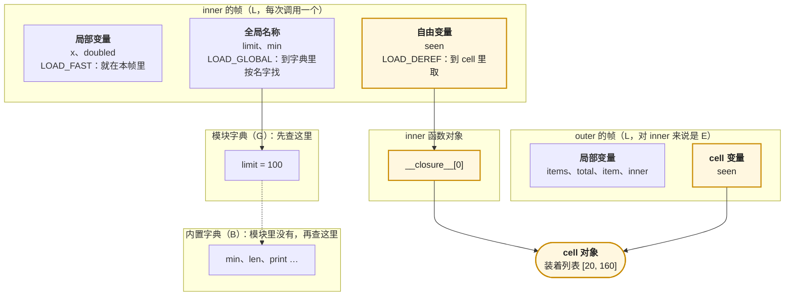

- **局部变量**（`x`、`doubled`、`total` …）：在谁的帧里就是谁的，调用结束随帧消失。
- **`seen` 只有一份**，放在黄色的 cell 里。`outer` 的帧和 `inner` 函数对象各有一个箭头指向它：在 `outer` 的名单里它叫 cell 变量，在 `inner` 的名单里它叫自由变量，是同一个东西的两头。输出最后那个 `[20, 160]` 就是 `outer` 返回之后从 `inner` 手里的 cell 读出来的。
- **`limit`、`min`** 不在任何帧里：`inner` 运行时先查模块字典，没有再查内置字典。所以在模块里定义一个叫 `min` 的变量，会把内置的 `min` 挡住。

四类与 LEGB 四层**不是一一对应**：LEGB 说的是名字绑定在哪一层，四类说的是站在某个函数里看它存在哪、用哪条指令取。

| 名字绑定在哪一层（LEGB） | 站在使用它的函数里，编译器归为 | 值存在哪 | 取值指令 | 上例中 |
|---|---|---|---|---|
| L：本函数，没有内层函数用它 | **局部变量** | 这次调用的帧里 | `LOAD_FAST` | `outer` 的 `total`<br/>`inner` 的 `x`、`doubled` |
| L：本函数，且有内层函数用它 | **cell 变量** | 一个单独的 cell 对象里，帧只留一个指向它的引用 | `LOAD_DEREF` | `outer` 的 `seen` |
| E：外层函数 | **自由变量** | 外层函数的那个 cell（同一个对象） | `LOAD_DEREF` | `inner` 的 `seen` |
| G：模块<br/>B：内置 | **全局名称**（编译器不区分 G 与 B） | 模块的字典；找不到再查内置的字典 | `LOAD_GLOBAL` | `limit`（模块）<br/>`min`（内置） |

Table: LEGB 四层与编译器的四类名称怎样对应

L 这一层被拆成了两类，G 与 B 被并成了一类。

编译器怎么决定一个名字归哪一类：编译 `inner` 时扫描整个函数体，有赋值的是局部变量，没有赋值但在外层函数中有定义的是**自由变量**（free variable），其余都当作全局/内置。

**Python 没有变量声明，一个名称属于哪个作用域由"这个函数体里有没有对它赋值"决定，而且是在编译期、看整个函数体一次决定的。**

> [!NOTE] 与 Java 对照：声明与赋值
> Java 里 `int count;` 先声明局部变量，之后的 `count++` 只是使用；Python 里一句 `count = 99` 本身就让编译器把 `count` 归为本函数的局部变量，不管它写在函数的第几行（显式 `global` / `nonlocal` 除外）。

三个函数，模块里有一个 `count = 10`，看各自读到什么：

```python title="只读、先读后赋值、声明后赋值：同一个 count 的三种归类"
import traceback

count = 10


def only_read():
    return count                # 整个函数没有给 count 赋值


def read_then_assign():
    first = count               # 第一行想读模块里的 count
    count = 99                  # 后面才赋值
    return first


def declare_then_assign():
    global count                # 先声明
    first = count
    count = 99
    return first


for fn in (only_read, read_then_assign, declare_then_assign):
    names = str(fn.__code__.co_varnames)
    try:
        result = fn()
    except UnboundLocalError as error:
        failing_line = traceback.extract_tb(error.__traceback__)[-1].line.split("#")[0].strip()
        result = f"UnboundLocalError，出错的行：{failing_line}"
    print(f"{fn.__name__:20s} 局部变量 {names:19s} → {result}")
print("模块里的 count 现在是", count)
```

```text title="运行输出（Python 3.12）"
only_read            局部变量 ()                  → 10
read_then_assign     局部变量 ('count', 'first')  → UnboundLocalError，出错的行：first = count
declare_then_assign  局部变量 ('first',)          → 10
模块里的 count 现在是 99
```

三个函数运行时各自去哪里找 `count`：

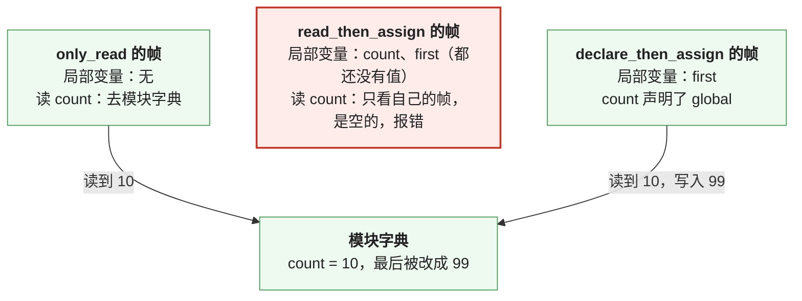

中间那一帧没有连到模块字典的线：模块里明明有 `count = 10`，它不去看。由此得到三条后果，每条都能在上面的输出里找到：

1. **一个名字在一个函数里只归一类，不存在"前半段是全局、后半段是局部"。** `read_then_assign` 第一行想读的是模块里的 `count`，但函数后面有一句赋值，整个函数里的 `count` 就都是局部变量了。输出里出错的行是 `first = count`——读的那一行，而不是赋值那一行。
2. **局部变量可以"有位置、没有值"。** `count` 在 `read_then_assign` 的局部变量名单里，位置已经留好，只是执行到第一行时还没放进值。所以报的是 `UnboundLocalError`（局部变量还没绑定值），不是"找不到这个名字"的 `NameError`。
3. **要在函数里改外层的变量，必须先声明。** `declare_then_assign` 多了一句 `global count`，`count` 就从局部变量名单里消失了，读到 10、写入的 99 落在模块字典里（最后一行）。要改的是外层函数的变量时，用的是 `nonlocal`（§3）。

编译器对函数体里的每个名称做的是同一串判断，判断的结果就是运行时用哪条取值指令：

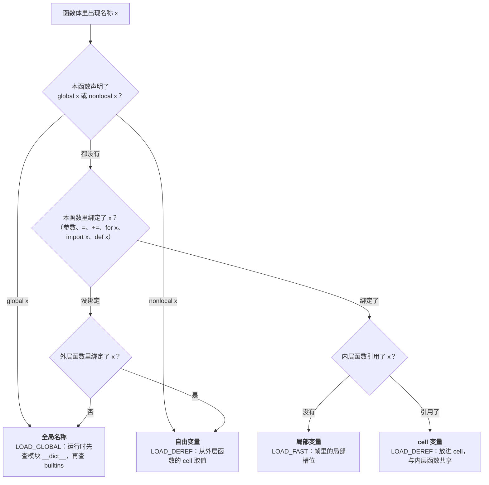

图里只有 `LOAD_GLOBAL` 在运行时按名字查字典（模块 `__dict__` 找不到再去 `builtins`）；局部变量和 cell 都是按编译时排好的下标取值，运行时不再"找"。判断的第二步只问"有没有绑定"，不问绑定出现在第几行——§3 的 `UnboundLocalError` 就落在"局部变量"这个出口上，只是读的时候槽位里还没有值。

分类结果直接体现在字节码里。接着上面的例子，把 `inner` 里每个名字用的取值指令列出来：

```python title="inner 里每个名字用哪条指令取值"
import dis

for ins in dis.get_instructions(inner):
    if ins.opname.startswith("LOAD") and isinstance(ins.argval, str):
        print(f"{ins.argval:8s} {ins.opname}")
```

```text title="运行输出（Python 3.12）"
x        LOAD_FAST
seen     LOAD_DEREF
append   LOAD_ATTR
doubled  LOAD_FAST
min      LOAD_GLOBAL
doubled  LOAD_FAST
limit    LOAD_GLOBAL
```

`x`、`doubled` 是 `LOAD_FAST`，`seen` 是 `LOAD_DEREF`，`min`、`limit` 是 `LOAD_GLOBAL`，与上面那张表逐行对得上（`append` 是属性，用 `LOAD_ATTR`）。

`LOAD_DEREF` 表示"从 cell 中取值"，而不是 `LOAD_FAST`（局部）或 `LOAD_GLOBAL`（全局）。查找**位置**是编译期确定的，运行时只是按位置取值。这也是为什么在函数里对一个名称赋值，会让**整个函数**中该名称都变成局部变量，哪怕赋值语句在后面——下面 §3 的 `UnboundLocalError` 就是这个规则的直接后果。

### 2. 闭包就是"函数对象 + cell"

`outer([10, 80])` 返回之后，它的帧已经销毁，`inner` 为什么还能往 `seen` 里追加？因为 `seen` 不在 `outer` 的帧里，而在 cell 里，`inner` 函数对象通过 `__closure__` 拿着这个 cell。接着上面的例子：

```python title="闭包的实体：co_cellvars、co_freevars 与 __closure__ 里的 cell"
print(outer.__code__.co_cellvars)        # outer 里要与内层共享的变量
print(inner.__code__.co_freevars)        # inner 里从外层借来的变量
print(inner.__closure__)                 # inner 函数对象手里的 cell
print(inner.__closure__[0].cell_contents)
inner(5)                                 # outer 早已返回，inner 仍能往 seen 里追加
print(inner.__closure__[0].cell_contents)
```

```text title="运行输出（Python 3.12，地址每次运行不同，这里用 0x… 代替）"
('seen',)
('seen',)
(<cell at 0x…: list object at 0x…>,)
[20, 160]
[20, 160, 10]
```

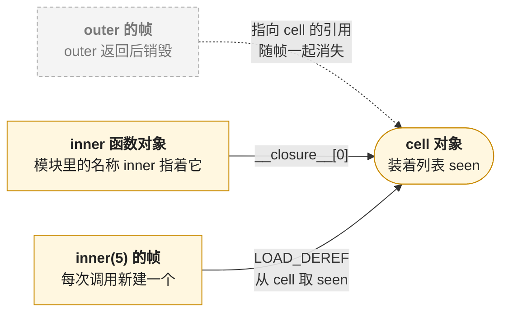

| 步骤 | 发生了什么 | 这时谁指着 cell |
|---|---|---|
| ① 调用 `outer([10, 80])` | 新建 `outer` 的帧；`seen` 是 cell 变量，所以同时新建一个 cell，把列表放进去 | `outer` 的帧 |
| ② 执行 `def inner` | 新建 `inner` 函数对象，把这个 cell 的引用放进它的 `__closure__` | `outer` 的帧、`inner` 函数对象 |
| ③ `outer` 返回 | 帧销毁；返回的 `inner` 函数对象绑定到模块里的名称 `inner` | 只剩 `inner` 函数对象 |
| ④ 调用 `inner(5)` | 新建 `inner` 的帧，`LOAD_DEREF` 顺着 `__closure__` 从 cell 里取到列表，追加 10 | `inner` 函数对象 |

Table: 一个闭包从创建到被调用的四步

所以闭包不是什么魔法："外层帧销毁了，但 cell 对象被内层函数对象引用着，所以还活着。" 再调用一次 `outer()` 会新建另一个 cell 和另一个 `inner` 函数对象，两次得到的闭包互不影响——§3 的计数器就靠这一点让每个计数器各数各的。这就是**词法作用域**：名称的解析依据函数**定义时**的代码结构，与调用位置无关。

在 AI-Infra 中闭包常用来携带少量配置进入回调：后端名、重试次数、指标标签、模型引用。但它也是隐式依赖——读者无法从函数签名看出它依赖了什么。

### 3. `nonlocal` 与 `UnboundLocalError`

读外层变量不需要声明，**重新绑定**外层变量需要 `nonlocal`：

```python title='用 nonlocal 重新绑定外层变量的计数器'
def make_counter(start=0):
    count = start

    def increment():
        nonlocal count
        count += 1
        return count

    return increment


counter = make_counter()
print(counter(), counter())                 # 1 2
print(counter.__closure__[0].cell_contents)  # 2   —— 修改的是同一个 cell
```

去掉 `nonlocal` 会得到：

```text title='去掉 nonlocal 后的 UnboundLocalError'
UnboundLocalError: cannot access local variable 'count' where it is not associated with a value
```

按 §1 的规则，`count += 1` 是赋值，编译器因此把 `count` 判定为 `increment` 的**局部变量**；执行时先读局部槽位，而它还没有值。这个错误经常出现在把一个模块级计数器、开关或缓存直接在函数里 `+=` 的时候——那时需要的是 `global`。

> [!NOTE] 与 Java 对照：修改捕获的状态
> Java 的 lambda 和匿名内部类捕获的外层局部变量必须是 `final` 或 effectively final，不能像 Python 的 `nonlocal count` 那样重新绑定。要累加状态，通常捕获数组、`AtomicInteger` 或其他对象的引用，再修改其内容；引用不能重新赋值，不代表对象不可变。

### 4. 延迟绑定：cell 是共享的

闭包最常见的陷阱：

```python title='延迟绑定陷阱：三个 lambda 都返回 2'
def make_fns():
    fns = []
    for i in range(3):
        fns.append(lambda: i)
    return fns


print([fn() for fn in make_fns()])          # [2, 2, 2]
```

先看清 `lambda: i` 这个写法本身。`lambda 参数列表: 表达式` 定义一个匿名函数，冒号前是参数、冒号后是返回值；`lambda: i` 的参数列表是**空的**，所以 `i` 不是参数，而是一个要到外层去找的自由变量——每次调用它，都去 `make_fns` 的作用域里取 `i` **当前**的值。

用 §2 的知识解释结果：`i` 是 `make_fns` 的 cell 变量，三个 lambda 的 `__closure__` 指向**同一个** cell（可以打印 `id(fn.__closure__[0])` 验证，三者相同）。lambda 体里的 `i` 在**调用时**才 `LOAD_DEREF`，此时循环早已结束，cell 里是最后一个值。

修法是在创建时就把值固定下来——用默认参数（默认值在 `def`/`lambda` 求值时计算一次）：

```python title='用默认参数在创建时固定 i'
fns.append(lambda i=i: i)                    # [0, 1, 2]
```

`i=i` 里等号左边是 lambda 自己的参数 `i`，右边是循环变量 `i` 此刻的值，被当作默认值存进函数对象（`fn.__defaults__`）；调用 `fn()` 时不传参，就用这个默认值，于是 lambda 体里的 `i` 变成了局部变量，不再去外层找。注意不能写成 `lambda i: i`——那是一个**必须**接收一个参数的恒等函数，`fn()` 会直接报 `TypeError: <lambda>() missing 1 required positional argument: 'i'`。

两种写法的差别在于值存在哪里：

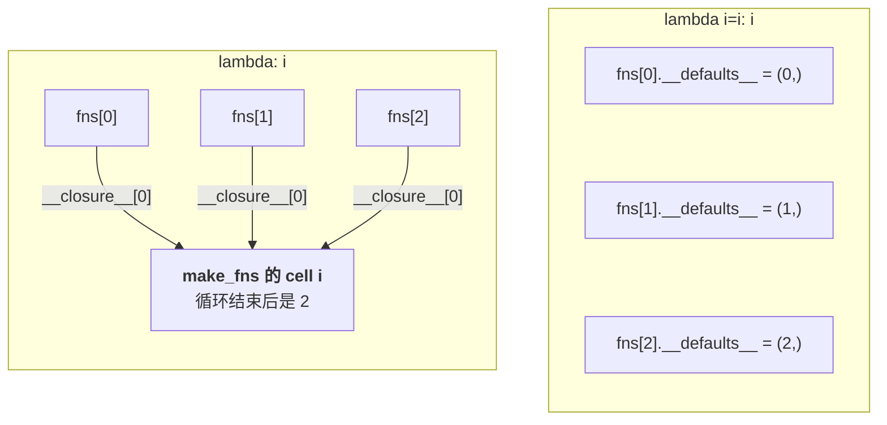

左边三个函数对象指向同一个 cell，cell 只有一个"当前值"，调用时读到的都是循环结束后的 2；右边每个函数对象在创建时把 `i` 的值拷进自己的 `__defaults__`，之后循环再怎么改 `i` 都与它无关。

或者用 `functools.partial(handler, i)`，语义更明确。构造一批 Worker 回调、为每个 GPU 生成一个任务函数、在循环里注册 hook，都会遇到这个问题。

> [!NOTE] 与 Java 对照：捕获值与共享变量
> Java 的 lambda 捕获外层局部变量的值；如果值是引用，拷贝的也是引用。Python 闭包共享的是 cell，调用时读当前值。上面会变化的循环变量 `i` 在 Java 中不满足 effectively final，直接捕获会编译失败；通常在每轮声明一个新的局部变量保存当轮值，再交给 lambda。

### 5. 闭包还是类

闭包和类都能"把状态和行为绑在一起"。取舍标准是状态的数量和生命周期：

- 一两个只读配置、一个简单计数：闭包即可，代码短；
- 状态多于两三个、需要被外部检查或重置、有清理逻辑：用类。类的状态在 `__dict__` 里可见可调试，闭包的状态藏在 `cell_contents` 里。

[下篇第四章](/python-object-model-protocols-decorators-and-generators.html#四装饰器用闭包和描述符改写调用路径)会看到，装饰器既可以用闭包写，也可以用类写，取舍标准相同。

## 四、模块与导入系统：代码如何被加载

前两章讨论的是一个函数内部发生的事。但函数要先存在才能被调用，而让它存在的动作是 `import`：找到文件、编译、执行顶层代码、把结果放进一个模块对象。第一章的 `Runner` 之所以能出现在 `REGISTRY` 里，唯一的原因是 `runner.py` 被导入并执行过。这一章把导入系统拆开：它由哪几层组成、`sys.path` 从哪里来、为什么同一份代码换一种启动方式就 `ImportError`。

### 1. 模块是对象，包是带 `__path__` 的模块

先说两个词：

- **模块（module）**：一个 `.py` 文件。
- **包（package）**：一个装着若干模块的目录，目录里放一个 `__init__.py`。包的用处是给模块分层起名——`mypackage.model` 读作"`mypackage` 目录下的 `model.py`"。

下面这个目录里各有一个：

```text title='一个模块 single.py 和一个包 mypackage'
project/
├── single.py            # 模块：一个文件
└── mypackage/           # 包：一个带 __init__.py 的目录
    ├── __init__.py      # 内容：print("执行 mypackage/__init__.py")
    └── model.py         # 包里的模块，全名 mypackage.model
```

在 `project/` 下把两者都导入，看得到的是什么：

```python title='分别导入模块 single 和包 mypackage'
import single, mypackage

print(type(single), type(mypackage))
print(single.__file__)
print(mypackage.__file__)
print(hasattr(single, "__path__"), mypackage.__path__)
print(hasattr(mypackage, "model"))

import mypackage.model
print(hasattr(mypackage, "model"), mypackage.model.__file__)
```

```text title='运行输出（Python 3.12）'
执行 mypackage/__init__.py
<class 'module'> <class 'module'>
.../project/single.py
.../project/mypackage/__init__.py
False ['.../project/mypackage']
False
True .../project/mypackage/model.py
```

| | 模块 `single` | 包 `mypackage` |
| :--- | :--- | :--- |
| 磁盘上是什么 | 一个文件 `single.py` | 一个目录 `mypackage/` |
| 导入时执行哪份代码 | `single.py` | `mypackage/__init__.py` |
| 导入后得到的对象 | `module` 对象 | 也是 `module` 对象 |
| `__path__` 属性 | 没有 | `['.../project/mypackage']` |

Table: 模块与包导入后的对照

- 导入一个包，执行的是它的 `__init__.py`，得到的同样是一个模块对象。所以在导入系统眼里，包就是**多了一个 `__path__` 属性**的模块。
- `__path__` 是一个目录列表，回答"这个包的子模块去哪里找"。`import mypackage.model` 就是到 `mypackage.__path__` 列出的目录里找 `model.py`。
- 导入包不会顺带导入它里面的模块：`import mypackage` 之后 `mypackage.model` 还不存在（输出第 6 行），执行过 `import mypackage.model` 才有（第 7 行）。

模块对象的属性字典就是那份文件的全局命名空间：

```python title='导入后的 json 是一个模块对象，__dict__ 就是它的全局命名空间'
import json, types

print(type(json), isinstance(json, types.ModuleType))   # <class 'module'> True
print(list(json.__dict__)[:6])
# ['__name__', '__doc__', '__package__', '__loader__', '__spec__', '__path__']
```

前几个名字是导入系统写入的元数据（标准库的 `json` 是一个包，所以也有 `__path__`）。`json.dumps` 这样的属性访问，就是在这个字典里查键。第二章说函数对象的 `__globals__` 指向定义它的模块命名空间——指的正是这个 `__dict__`。

`mypackage/__init__.py` 是包被导入时执行的模块体。它有两个合理用途：把内部模块的公共对象提升到包级（`from .model import Model`），以及用 `__all__` 声明 `from mypackage import *` 的导出集合。`__all__` 只影响 `import *`、文档和静态分析工具，不是访问控制。

`__init__.py` 里不应放重逻辑。导入包就会执行它，一个 `import mypackage.utils` 会先跑完 `mypackage/__init__.py`——如果那里面 `import torch`、检查 CUDA、建立连接，所有导入方都要付这个代价，并且更容易形成循环导入（§7）。没有 `__init__.py` 的目录是**命名空间包**（PEP 420），能被导入，但缺少一个明确的初始化入口；后面 §4 会看到 PyTorch 自己的一个报错正是命名空间包造成的。

### 2. `import` 语句的执行过程

`import mypackage.model` 在解释器内部大致经历以下步骤（对照 [CPython 3.12.0 的 `Lib/importlib/_bootstrap.py`](https://github.com/python/cpython/blob/v3.12.0/Lib/importlib/_bootstrap.py) 中的 `_find_and_load` → `_find_spec` → `_load_unlocked`）：

1. **缓存**：查 `sys.modules["mypackage.model"]`，命中已初始化的模块对象就返回；若值为 `None` 则拒绝导入。模块还在执行顶层代码时，其他线程通常先等待模块锁，同一线程的循环导入可能拿到半成品（§7）。
2. 未命中：先确保父包 `"mypackage"` 已导入，递归走同一流程。
3. **查找**：依次询问 `sys.meta_path` 里的每个 finder：`find_spec(name, path)`。第一个返回非 `None` 的 `ModuleSpec` 胜出；全部为 `None` 则抛 `ModuleNotFoundError`。
4. `module_from_spec(spec)` 调用 `spec.loader.create_module(spec)` 创建模块对象；若返回 `None`，由导入系统创建。随后写入 `__name__`、`__spec__` 等元数据；有文件位置时还会设置 `__file__`。
5. `sys.modules[name] = module`。注意：在执行之前。
6. **执行**：`spec.loader.exec_module(module)`。源码模块在这一步编译（或读 `.pyc`），并在 `module.__dict__` 中执行顶层代码。
7. 把结果绑定到当前命名空间：`import a.b` 绑定 `a`；`from a.b import c` 绑定 `c`。

把这七步画成流程，能看清两处分支：缓存命中时直接跳到第 7 步，第 3 步全部落空时抛错；还有一条列表里没写的失败路径——顶层代码执行时抛异常，导入系统会把第 5 步登记的模块从 `sys.modules` 删掉，下次 `import` 会重新执行一遍，而不是拿到一个半成品：

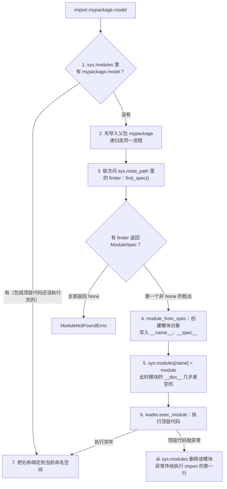

有三点决定了后面几节的全部内容：

- **第 1 步**说明同一个模块名在一个进程里只执行一次。注册表、单例、模块级缓存都依赖这一点（§6）。
- **第 5 步在第 6 步之前**。模块在顶层代码执行完之前就已经在 `sys.modules` 里了，此时它是一个"部分初始化"的模块。循环导入之所以表现为 `AttributeError`/`ImportError: cannot import name`，就是有人在这个窗口期拿到了它（§7）。
- **第 3 步是可插拔的**。`sys.meta_path` 是一个普通列表，谁都可以往里插 finder。下一节展开。

> [!NOTE] 与 Java 对照：import 会不会执行代码
> Java 的 `import` 是编译期声明，只简化名称书写；Python 的 `import` 是运行时语句，要走上面的查找、加载、执行和绑定过程。
>
> | | Python 模块导入 | Java 类加载与初始化 |
> | :--- | :--- | :--- |
> | 何时执行初始化代码 | 首次导入时执行模块顶层代码 | 与 `import` 无关，类初始化通常由 `new`、调用静态方法等主动使用触发 |
> | 缓存与身份 | `sys.modules`，按模块名 | JVM 按定义类加载器与类的全限定名区分类 |
>
> Table: Python 模块导入与 Java 类加载、初始化的对照
>
> 注册机制（§6）与循环导入（§7）要从模块的执行顺序理解，不能套 Java `import` 的直觉。Java 的类加载器隔离、`ClassNotFoundException` 与 `NoClassDefFoundError` 没有一一对应的 Python 机制；排查 Python 加载问题时，重点看 `sys.path`、`sys.modules` 和启动方式（§4）。

### 3. 三层查找机制：`sys.meta_path`、`PathFinder` 与 loader

上一节的第 3 步"查找"和第 6 步"执行"由两种对象分工完成，中间靠一张记录交接：

| 对象 | 做什么 |
| :--- | :--- |
| finder（查找器） | 回答"这个名字我找不找得到"，找到就交出一张 `ModuleSpec` |
| `ModuleSpec` | 一张记录：模块叫什么、从哪来、由哪个 loader 加载 |
| loader（加载器） | 按 `ModuleSpec` 把来源变成模块对象，并执行其中的代码 |

Table: 导入系统里的三种对象

每个导入过的模块都把自己那张 `ModuleSpec` 留在 `__spec__` 上：

```python title='打印 json 的 __spec__'
import json
print(json.__spec__)
```

```text title='json 的 ModuleSpec：name、loader、origin 等字段'
ModuleSpec(name='json',
           loader=<_frozen_importlib_external.SourceFileLoader object at 0x...>,
           origin='/.../lib/python3.12/json/__init__.py',
           submodule_search_locations=['/.../lib/python3.12/json'])
```

四个字段依次是：模块叫什么、由谁加载（`loader`）、从哪来（`origin`）、如果是包则子模块去哪找（`submodule_search_locations`，也就是 `__path__` 的来源）。

查找分三层，每一层都是"问一圈，谁认领归谁"。下图是全貌，后面按层展开：

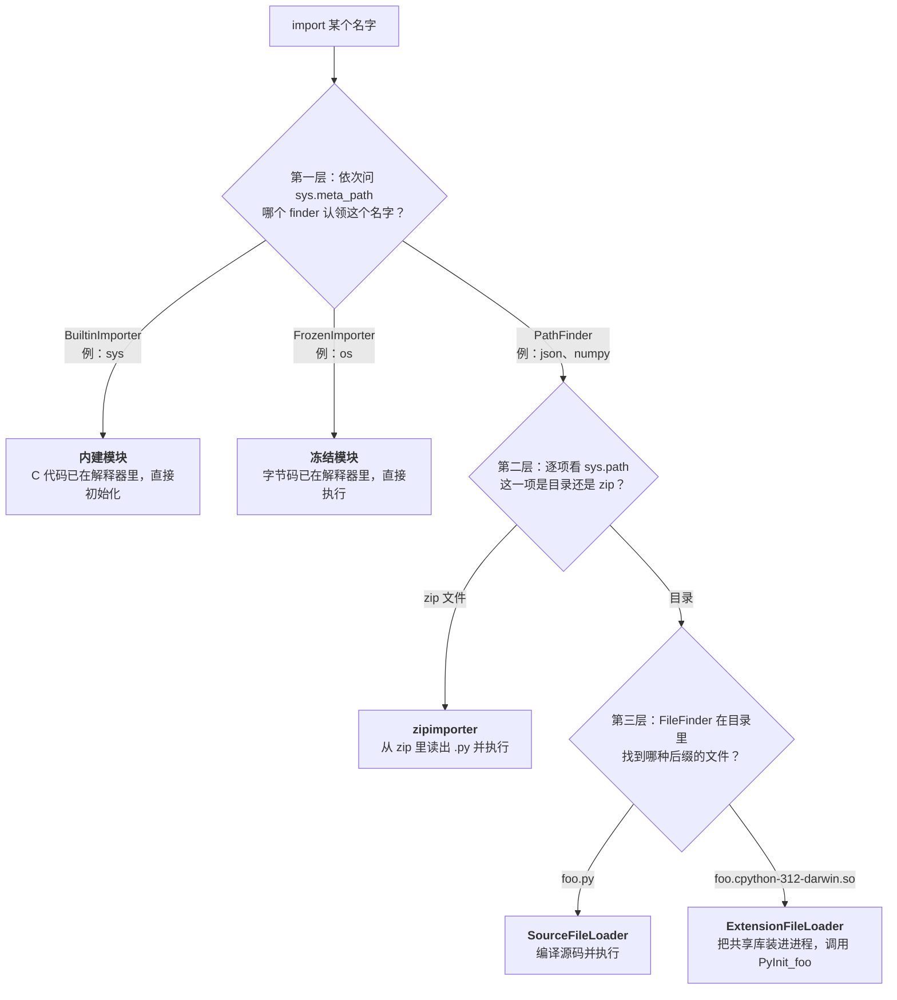

**第一层：`sys.meta_path` 里的 finder**

```python title='第一层：遍历 sys.meta_path 里的 finder'
import sys
for finder in sys.meta_path:
    print(finder)
```

在一个装了 setuptools 的 venv 里：

```text title='一个装了 setuptools 的 venv 里的四个 meta_path finder'
<_distutils_hack.DistutilsMetaFinder object at 0x...>
<class '_frozen_importlib.BuiltinImporter'>
<class '_frozen_importlib.FrozenImporter'>
<class '_frozen_importlib_external.PathFinder'>
```

后三个是 Python 自带的，各管一类来源。拿三个模块各验证一个：

```python title='sys、os、json 分别由哪个 finder 认领'
import sys, os, json

for name in ["sys", "os", "json"]:
    spec = sys.modules[name].__spec__
    print(name, spec.origin, spec.loader)
```

```text title='运行输出（Python 3.12）'
sys built-in <class '_frozen_importlib.BuiltinImporter'>
os frozen <class '_frozen_importlib.FrozenImporter'>
json /.../lib/python3.12/json/__init__.py <_frozen_importlib_external.SourceFileLoader object at 0x...>
```

- **`BuiltinImporter` 管内建模块**：用 C 写、直接编译进 `python` 可执行文件的模块，例如 `sys`。磁盘上没有对应的文件，所以 `sys` 没有 `__file__` 属性。
- **`FrozenImporter` 管冻结模块**：用 Python 写，但字节码在构建解释器时就嵌进了可执行文件，例如 `os` 和导入系统自己（`importlib` 的核心是 Python 代码，它没法靠"从磁盘导入"把自己导入进来）。
- **`PathFinder` 管磁盘上的文件**：其余所有模块——标准库的 `json`、`pip` 装的 `numpy`、自己写的代码。它怎么找，是第二、三层的内容。

前两个 finder 找到后自己就是 loader（输出里 `spec.loader` 就是它们本身）；`PathFinder` 则把加载交给别的 loader。

列表里排第一的 `DistutilsMetaFinder` 不是 Python 自带的，是 setuptools 装进来的：

- **它做什么**：Python 3.12 的标准库删掉了 `distutils`，setuptools 自带了一份副本。这个 finder 认领 `distutils` 这个名字，把它指到副本上——在这个 venv 里 `import distutils; print(distutils.__file__)` 输出 `.../site-packages/setuptools/_distutils/__init__.py`。
- **它怎么进的列表**：setuptools 在 `site-packages` 下放了一个 `distutils-precedence.pth` 文件，解释器启动时会执行其中以 `import` 开头的那一行，那一行把这个 finder 插到 `sys.meta_path` 最前面。
- **它说明什么**：`sys.meta_path` 是一个普通列表，排在前面的先被问到。第三方代码往前面插一个 finder，就能抢在 Python 自带的 finder 之前决定一个名字导入成什么。§5 的 editable 安装也用同样的手法。

**第二层：`PathFinder` 沿 `sys.path` 找目录 finder**

`PathFinder.find_spec` 遍历 `sys.path`（子模块则遍历父包的 `__path__`），对每个目录调用 `sys.path_hooks` 中的钩子，得到一个负责该目录的 finder，并缓存在 `sys.path_importer_cache`：

```python title='第二层：sys.path_hooks 里的钩子'
for hook in sys.path_hooks:
    print(hook)
```

```text title='两个 path hook：zipimporter 与 FileFinder'
<class 'zipimport.zipimporter'>
<function FileFinder.path_hook.<locals>.path_hook_for_FileFinder at 0x...>
```

所以 zip 文件和普通目录都能出现在 `sys.path` 上：前者由 `zipimporter` 接管，后者由 `FileFinder` 接管。

**第三层：`FileFinder` 按后缀选 loader**

`FileFinder` 在自己负责的目录里查找 `name/__init__.py`、`name.<后缀>`，后缀与 loader 的对应表来自 `importlib.machinery`：

```python title='第三层：FileFinder 按后缀选 loader 的对应表'
import importlib.machinery as m
print(m.SOURCE_SUFFIXES)       # ['.py']                                     → SourceFileLoader
print(m.BYTECODE_SUFFIXES)     # ['.pyc']                                    → SourcelessFileLoader
print(m.EXTENSION_SUFFIXES)    # ['.cpython-312-darwin.so', '.abi3.so', '.so'] → ExtensionFileLoader
```

这张表说明了一件初学者容易漏掉的事：**`import` 能导入的不只是 `.py` 文件。** 同一条 `import foo`，目录里是 `foo.py` 就编译执行它；是 `foo.cpython-312-darwin.so`（Linux 上是 `foo.cpython-312-x86_64-linux-gnu.so`）就把它当作**扩展模块**（extension module）加载——一个用 C / C++ 编译出来的共享库。

亲手做一个最小的扩展模块。`foo.c` 只提供一个返回 42 的函数 `bar`：

```c title='foo.c：一个最小的扩展模块'
#include <Python.h>

static PyObject *bar(PyObject *self, PyObject *args) {
    return PyLong_FromLong(42);
}

static PyMethodDef methods[] = {
    {"bar", bar, METH_NOARGS, "return 42"},
    {NULL, NULL, 0, NULL},
};

static struct PyModuleDef def = {
    PyModuleDef_HEAD_INIT, "foo", NULL, -1, methods,
};

// !ref pyinit-foo
PyMODINIT_FUNC PyInit_foo(void) {
    return PyModule_Create(&def);
}
```

在 macOS、Apple clang、CPython 3.12 上编译并导入：

```bash title='把 foo.c 编译成 foo.cpython-312-darwin.so 并导入'
$ INC=$(python -c 'import sysconfig; print(sysconfig.get_paths()["include"])')
$ cc -shared -undefined dynamic_lookup -I$INC foo.c -o foo.cpython-312-darwin.so
$ python -c 'import foo; print(foo.bar()); print(foo.__spec__.loader)'
42
<_frozen_importlib_external.ExtensionFileLoader object at 0x...>
```

`ExtensionFileLoader` 做了两件事：用 [dlopen](# "tip: 操作系统提供的函数：在程序运行中途把一个共享库装进当前进程") 把 `.so` 装进进程，然后调用其中的 [`PyInit_foo`](#pyinit-foo) 拿到模块对象。从此 `foo.bar()` 调的是 C 函数，`import` 语句本身看不出任何差别。

一个共享库要能被 `import foo` 加载，`PyInit_foo` 是 loader 向它要的唯一一个符号，但前后还各有一个条件：

1. **文件名对得上**：`foo` 加上 `EXTENSION_SUFFIXES` 里的某个后缀，并且放在 `sys.path` 的某个目录里。否则 `FileFinder` 根本不认它——把上面的文件改名成 `qux.cpython-311-darwin.so`，`import qux` 得到的是 `ModuleNotFoundError: No module named 'qux'`。
2. **导出 `PyInit_<模块名>`**：名字必须和模块名一致。把同一个文件复制成 `baz.so` 再 `import baz`，得到 `ImportError: dynamic module does not define module export function (PyInit_baz)`；一个不是为 Python 写的普通共享库也是这个报错。
3. **`PyInit_foo` 返回一个模块对象**（或一份模块定义，由导入系统据此创建模块）。
4. **二进制与当前解释器兼容**：它依赖的其他共享库找得到，编译时用的 Python 头文件与运行它的解释器一致。这一条导入系统不检查，文件名里的 `cpython-312-darwin` 标签就是为它准备的——标签不符的文件在第 1 条就被挡掉；裸的 `.so` 后缀没有标签，装错版本会在加载时报未定义符号或直接崩溃。

`import torch` 时加载的 `torch._C` 走的是完全相同的路径：`torch/__init__.py` 里的 `from torch._C import *` 让 `PathFinder` 在 `torch/` 目录下找到 `_C.cpython-312-x86_64-linux-gnu.so`，由 `ExtensionFileLoader` 载入——数百 MB 的 libtorch 就这样进入进程。C++ 系列第一篇会从 C++ 这一侧讲 `torch/csrc/stub.c` 里那个 `PyInit__C` 长什么样、它又拉起了哪些 `.so`。numpy 也一样：

```python title='一个真实的 C 扩展模块：numpy 的 ExtensionFileLoader 与 .so 路径'
import numpy, sys
m = sys.modules["numpy._core._multiarray_umath"]
print(m.__spec__.loader)   # <_frozen_importlib_external.ExtensionFileLoader object at 0x...>
print(m.__spec__.origin)   # .../site-packages/numpy/_core/_multiarray_umath.cpython-312-darwin.so
```

**三个可以直接用的入口**

查找和加载是分开的两步，中间的 `ModuleSpec` 是普通对象，所以这条流水线有三处可以从外面接进去：

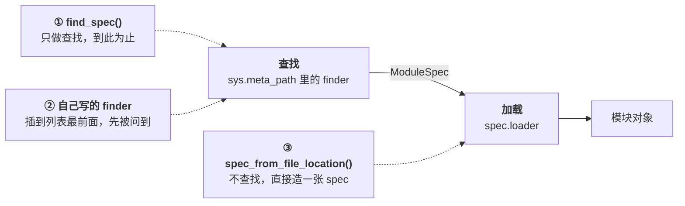

| 想做的事 | 用哪个入口 | 在 AI-Infra 里的用处 |
| :--- | :--- | :--- |
| 判断一个库装没装，但不真的导入它 | ① `importlib.util.find_spec(name)` | "装了 Triton / flash-attn 就用它"的可选依赖判断 |
| 让某个名字的导入失败、改道或被记录 | ② 往 `sys.meta_path` 最前面插一个 finder | 测试里模拟"依赖没装"；排查启动时到底导入了什么 |
| 加载一个不在 `sys.path` 上的文件 | ③ `spec_from_file_location` + `module_from_spec` + `exec_module` | 加载刚编译到临时目录的 `.so`、按路径加载用户给的配置或插件文件 |

Table: 导入流水线的三个入口

**① 只查找，不导入。** 没装 triton、装了 numpy 的环境里：

```python title='find_spec 只走查找：能判断装没装，但不执行模块'
import importlib.util, sys

print(importlib.util.find_spec("triton"))
print(importlib.util.find_spec("numpy").origin)
print("numpy" in sys.modules)
```

```text title='运行输出（Python 3.12）'
None
.../site-packages/numpy/__init__.py
False
```

没装返回 `None`，装了返回它的 `ModuleSpec`。最后一行的 `False` 是要点：numpy 找到了，但没有被导入，它的 `.so` 也没有被加载。`try: import numpy` 也能判断装没装，代价是真的把它加载进来。

**② 插一个自己的 finder。** finder 只需要一个 `find_spec` 方法：返回 `None` 表示"不归我管，问下一个"，返回 spec 或抛异常则查找到此结束。下面这个 finder 让测试可以模拟"numpy 没安装"：

```python title='往 sys.meta_path 最前面插一个 Blocker，模拟 numpy 未安装'
import importlib.abc, sys


class Blocker(importlib.abc.MetaPathFinder):
    def __init__(self, names):
        self.names = names

    def find_spec(self, fullname, path, target=None):
        if fullname in self.names:
            raise ModuleNotFoundError(f"{fullname} blocked for testing", name=fullname)
        return None


sys.meta_path.insert(0, Blocker({"numpy"}))

try:
    import numpy
except ModuleNotFoundError as e:
    print("ModuleNotFoundError:", e)

import json
print("json 正常导入")
```

```text title='运行输出（Python 3.12）'
ModuleNotFoundError: numpy blocked for testing
json 正常导入
```

numpy 明明装着，却导入失败：`Blocker` 排在最前面，先被问到，直接抛了异常。`json` 不在名单里，`Blocker` 返回 `None`，后面的 finder 照常处理。把 `find_spec` 的内容换成"打印名字、返回 `None`"，它就成了一个记录器：

```python title='同一个位置插一个 Recorder：记录一条 import 实际请求了哪些模块'
import importlib.abc, sys


class Recorder(importlib.abc.MetaPathFinder):
    def find_spec(self, fullname, path, target=None):
        print("请求导入:", fullname)
        return None


sys.meta_path.insert(0, Recorder())
import xml.dom.minidom
```

```text title='运行输出（Python 3.12）'
请求导入: xml
请求导入: xml.dom
请求导入: xml.dom.domreg
请求导入: xml.dom.minidom
请求导入: xml.dom.minicompat
请求导入: xml.dom.xmlbuilder
请求导入: copy
请求导入: xml.dom.NodeFilter
```

一条 `import` 带出了八次查找。服务启动慢、想知道"启动时到底导入了什么"时，这是最直接的手段。

**③ 手工造一张 spec，加载任意位置的文件。** 把前面编译出的 `foo.cpython-312-darwin.so` 挪到一个不在 `sys.path` 上的目录 `/tmp/elsewhere/`，`import foo` 找不到它，但可以按路径加载：

```python title='spec_from_file_location：按文件路径加载，不经过 sys.path'
import importlib.util

path = "/tmp/elsewhere/foo.cpython-312-darwin.so"
spec = importlib.util.spec_from_file_location("foo", path)   # 不查找，直接造 spec
print(type(spec.loader).__name__)
module = importlib.util.module_from_spec(spec)               # §2 的第 4 步
spec.loader.exec_module(module)                              # §2 的第 6 步
print(module.bar())
```

```text title='运行输出（Python 3.12）'
ExtensionFileLoader
42
```

`spec_from_file_location` 看后缀选出了 `ExtensionFileLoader`，剩下两行就是 §2 的第 4 步和第 6 步。PyTorch 的 JIT 扩展编译（`torch.utils.cpp_extension.load`）把 `.so` 编译到临时目录之后，用的正是这三行（`torch/utils/cpp_extension.py` 的 `_import_module_from_library`）。

**小结：六个模块，同一条 `import`**

把这一节出现过的模块放在一起，再加一个放进 zip 的 `inzip.py`，逐个打印它们的 loader 和来源：

```python title='六个模块各由哪个 loader 加载、从哪来'
import sys

sys.path.insert(0, "/tmp/z/bundle.zip")     # zip 里有一个 inzip.py
sys.path.insert(0, "/tmp/ext")              # 目录里有 foo.cpython-312-darwin.so
import os, json, numpy, inzip, foo

for name in ["sys", "os", "json", "numpy._core._multiarray_umath", "inzip", "foo"]:
    spec = sys.modules[name].__spec__
    loader = spec.loader
    loader_name = getattr(loader, "__name__", type(loader).__name__)
    print(f"{name:30} {loader_name:20} {spec.origin}")
```

```text title='运行输出（Python 3.12）'
sys                            BuiltinImporter      built-in
os                             FrozenImporter       frozen
json                           SourceFileLoader     /.../lib/python3.12/json/__init__.py
numpy._core._multiarray_umath  ExtensionFileLoader  .../site-packages/numpy/_core/_multiarray_umath.cpython-312-darwin.so
inzip                          zipimporter          /tmp/z/bundle.zip/inzip.py
foo                            ExtensionFileLoader  /tmp/ext/foo.cpython-312-darwin.so
```

六个模块来自解释器内部、源码文件、共享库和 zip，写法都是 `import 名字`，对应本节开头那张图里的五条路径（numpy 的 `.so` 和 `foo` 走同一条）：

- finder 决定**从哪找**，loader 决定**怎么变成模块**，`ModuleSpec` 是两者之间交接的那张记录。
- 每一层都是一个可以增删的列表（`sys.meta_path`、`sys.path_hooks`、后缀表），新增一种来源只需要加一个 finder 或 loader，`import` 语句不用变。editable 安装、测试里被屏蔽的依赖、JIT 编译出来的 `.so` 都是这样接进来的。

### 4. `sys.path` 的构成，以及 `python script.py` 与 `python -m` 的差别

`PathFinder` 沿 `sys.path` 找，那么 `sys.path` 里有什么？启动时它按顺序由这几部分拼成：

| 组成部分 | 内容 |
| :--- | :--- |
| `sys.path[0]` | 取决于启动方式（见下） |
| `PYTHONPATH` | 环境变量中的目录 |
| 标准库 | `.../lib/python3.12`、`python312.zip`、`lib-dynload` |
| `site-packages` | 当前解释器或虚拟环境的第三方包目录 |
| `.pth` 文件里的行 | `site` 模块处理 `site-packages` 下的 `*.pth`：每行一个目录追加到 `sys.path`；<br/>以 `import` 开头的行会被直接执行（§3 的 `DistutilsMetaFinder` 就是这么装进来的） |

Table: sys.path 的五个组成部分

真正制造差异的是 `sys.path[0]`。规则是：

| 启动方式 | `sys.path[0]` | `__name__` | `__package__` |
| :--- | :--- | :--- | :--- |
| `python path/to/script.py` | **脚本所在目录** | `__main__` | `None` |
| `python -m pkg.mod` | **当前工作目录** | `__main__` | `pkg` |
| `python -c` / 交互式 | `''`（当前目录） | `__main__` | `None` |

Table: 不同启动方式下的 sys.path[0]、__name__ 与 __package__

3.11 起加 `-P` 或设 `PYTHONSAFEPATH=1`，三种方式都不再自动插入这一项；下面依赖启动目录的“意外可导入”不再成立。`PYTHONPATH`、已安装包等其他路径来源仍需另看。

用一个 src 布局的项目验证。`src/myproject/cli.py` 打印自己的身份，然后做一次相对导入：

```python title='src/myproject/cli.py：打印自己的身份再做相对导入'
# src/myproject/cli.py
import sys
print("__name__    =", __name__)
print("__package__ =", __package__)
print("sys.path[0] =", repr(sys.path[0]))
from .core import register
print("relative import ok")
```

第一种启动方式：

```bash title='python src/myproject/cli.py：相对导入失败'
$ python src/myproject/cli.py
__name__    = __main__
__package__ = None
sys.path[0] = '/.../proj/src/myproject'
ImportError: attempted relative import with no known parent package
```

第二种启动方式（在仓库根目录，包已 editable 安装，安装方式见 §5）：

```bash title='python -m myproject.cli：__package__ 正确、相对导入成功'
$ python -m myproject.cli
__name__    = __main__
__package__ = myproject
sys.path[0] = '/.../proj'
relative import ok
```

差别的机制：

- **相对导入依赖 `__package__`**。`from .core import x` 被解析成 `__package__ + ".core"`。作为脚本运行时 `__package__` 是 `None`，解释器不知道"当前包"是谁，于是报错。`python -m` 则是先把 `myproject.cli` 当作一个**模块**找到（走 §3 的全部流程，因此需要 `myproject` 可导入），再把它当作 `__main__` 执行，`__package__` 由此得到正确的值。
- **`sys.path[0]` 是脚本目录，会制造"意外可导入"**。在 `cli.py` 里写 `import core`（绝对导入一个叫 `core` 的顶层模块）用第一种方式能成功——因为 `src/myproject/` 恰好在 `sys.path[0]`。但这个模块的名字是 `core` 而不是 `myproject.core`；一旦别处以 `myproject.core` 导入同一个文件，它会被**第二次执行**，得到两个互不相认的模块。

第二点值得单独演示，因为它是"注册表里出现重复项"和"`isinstance` 莫名其妙为 False"的常见根源。一个脚本 `app.py` 通过装饰器注册 `Runner`，同时它又被别的模块按模块名导入：

```python title='app.py 既作脚本运行又被按模块名导入'
# app.py
from registry import register

@register
class Runner: ...

if __name__ == "__main__":
    import app                    # 模拟别的模块（如 worker）按模块名导入 app
    print(Runner is app.Runner, isinstance(app.Runner(), Runner))
```

```bash title='同一个文件被执行两次：重复注册与 isinstance 为 False'
$ python app.py
duplicate registration: Runner False
False False
```

同一个文件以 `__main__` 和 `app` 两个名字各执行了一遍，`sys.modules` 里有两个条目，两个 `Runner` 类对象，注册表里第二个覆盖了第一个。规避方法是让入口文件尽量薄：`__main__` 里只 `from myproject.cli import main; main()`，业务代码不放在会被当作脚本运行的文件里。

PyTorch 源码里有一段专门针对这个陷阱的报错文案。`torch/__init__.py` 在 `from torch._C import _initExtension` 失败后检查 `torch._C.__file__ is None`，如果成立就提示：

> It appears that PyTorch has loaded the `torch/_C` folder of the PyTorch repository rather than the C extensions ... This error can generally be solved ... by running Python from a different directory.

原因正是上面的规则：在 PyTorch 仓库根目录执行 `python -c "import torch"`，`sys.path[0]` 是 `''`（当前目录），`PathFinder` 先在这里找到源码树中的 `torch/` 目录，而不是 `site-packages` 里安装好的那个；源码树里 `torch/_C/` 只是一个放 `.pyi` 存根的目录、没有 `__init__.py`，于是被当作命名空间包导入，`__file__` 为 `None`，所有 C 函数都不存在。

### 5. 项目布局、测试与 editable 安装

§4 的规则解释了 flat 布局与 src 布局之争的全部内容。两种布局：

```text title='flat 布局与 src 布局的目录树'
flat 布局                        src 布局
myproject/                       myproject/
├── pyproject.toml               ├── pyproject.toml
├── myproject/                   ├── src/
│   ├── __init__.py              │   └── myproject/
│   └── core.py                  │       ├── __init__.py
└── tests/                       │       └── core.py
    └── test_core.py             └── tests/
                                     └── test_core.py
```

用一个只做 `import myproject.core` 的测试，在**没有安装**包的情况下分别运行：

| 布局 | 命令 | 结果 | 原因 |
| :--- | :--- | :--- | :--- |
| flat | `python -m pytest tests/` | 通过 | `-m` 把当前目录（仓库根）放进 `sys.path`，源码树直接可导入 |
| flat | `pytest tests/` | `ModuleNotFoundError` | `pytest` 可执行文件不加当前目录；pytest 默认的 prepend 模式只把 `tests/` 插入 `sys.path` |
| flat | `pytest tests/`，且 `tests/__init__.py` 存在 | 通过 | prepend 模式向上找到第一个不含 `__init__.py` 的目录（仓库根）插入 `sys.path` |
| src | 任何方式 | `ModuleNotFoundError` | `src/` 不在任何路径上 |

Table: flat 与 src 布局在未安装时的导入结果

flat 布局的三行结果说明了什么叫"测试环境可以导入、安装后不能"：测试通过与否取决于用 `pytest` 还是 `python -m pytest`、`tests/` 下有没有 `__init__.py`，而这些都与包装得对不对无关。`pyproject.toml` 里漏掉一个子包、忘了带上数据文件，flat 布局的测试照样绿——因为测的根本不是安装产物。

src 布局把这条路堵死：源码树不在任何默认路径上，测试**只能**导入安装后的包。开发时用 editable 安装让"安装后的包"指回源码：

```bash title='editable 安装留下的 .pth 文件指回 src'
$ pip install -e .
$ ls site-packages | grep myproject
__editable__.myproject-0.1.0.pth
myproject-0.1.0.dist-info
$ cat site-packages/__editable__.myproject-0.1.0.pth
/.../proj/src
```

这一行 `.pth` 就是 §4 开头那份 `sys.path` 构成清单里的最后一项——`site` 模块启动时把 `src/` 追加到 `sys.path`，`PathFinder` 由此能找到 `src/myproject/`。这是 setuptools 对 src 布局这类"简单布局"的做法；当包结构无法用一条路径表达时（多个源码根、包名与目录名不一致、`--config-settings editable_mode=strict`），setuptools 64 及以后（PEP 660）会改为生成一个 `__editable___<name>_finder.py`，并通过 `.pth` 把其中的 `MetaPathFinder` 插进 `sys.meta_path`——也就是 §3 第一层的自定义 finder。两种方式殊途同归：**editable 安装不是复制文件，而是修改导入系统的查找路径**。

由此可以推出它的边界：修改 `.py` 文件立即生效（每次导入都重新走查找与编译）；但新增顶层包、修改 `[project.scripts]` 入口、变更依赖，都需要重新 `pip install -e .`，因为这些信息记录在 `dist-info` 和 `.pth` 里，不会自动更新。

`pyproject.toml` 的完整写法、依赖锁定与打包分发，见本系列第七篇[《工程化与生产交付》](/python-engineering-and-production-delivery.html)。

### 6. `sys.modules` 缓存、导入副作用与注册机制

回到 §2 的第 1 步：同一个模块名在同一进程里只执行一次。

```python title='同一个模块名在进程里只执行一次：sys.modules 缓存'
import sys, json
first = sys.modules["json"]
import json as j2
print(j2 is json, sys.modules["json"] is first)     # True True
```

这条规则是**所有基于导入的注册机制的前提**。第一章的 `@registered("runner")` 在模块顶层执行，意味着：

- 模块被导入 → 注册发生一次；
- 模块没被任何人导入 → 注册表是空的。"写了装饰器却找不到后端"，原因永远是这一条；
- 模块被以两个名字导入（§4 的 `__main__`/`app`）→ 注册两次，后者覆盖前者；
- `importlib.reload(module)` → 顶层代码重新执行，注册表被再写一遍；
- 多进程 → 每个进程有自己的 `sys.modules`，注册表在 `fork` 之后是各自的副本，主进程后来的注册子进程看不到。

因此导入不是"声明依赖"，而是"执行代码"。AI-Infra 中导入触发的典型副作用有：算子/后端注册、插件发现、CUDA 扩展加载、环境变量读取、设备初始化、日志配置、全局缓存创建。这些副作用本身不是坏事——PyTorch 的算子注册就依赖它——但它们的**时机**由导入顺序决定，而导入顺序通常不是显式控制的。工程上的两条原则：

- 顶层只做"声明式"的事（定义类、注册名字），把创建连接、加载模型、初始化 CUDA 放进显式调用的函数；
- 需要保证注册发生时，显式导入插件模块，不要依赖"总会有人导入它"。

### 7. 循环导入与依赖方向

```python title='循环导入失败的最小例子：a.py 与 b.py 互相 from-import'
# a.py
from b import B          # ← 执行到这里时，a 已在 sys.modules，但 A 还没定义
class A: ...

# b.py
from a import A          # ← 拿到的是部分初始化的 a，A 不存在 → ImportError: cannot import name 'A'
class B: ...
```

按 §2 的步骤：导入 `a` → `a` 进入 `sys.modules` → 执行 `a` 顶层 → 遇到 `from b import B` → 导入 `b` → 执行 `b` 顶层 → 遇到 `from a import A` → `a` 已在 `sys.modules`，直接取 → 但 `a` 的顶层代码还停在第一行，`A` 尚未定义 → 失败。

`import a` 而不是 `from a import A` 有时能"绕过去"，因为它只绑定模块对象，属性访问推迟到运行时；`TYPE_CHECKING` 块和函数内的局部导入同理。但这些只是改变了**导入时机**，没有消除模块之间的环。首选解法是调整依赖方向：

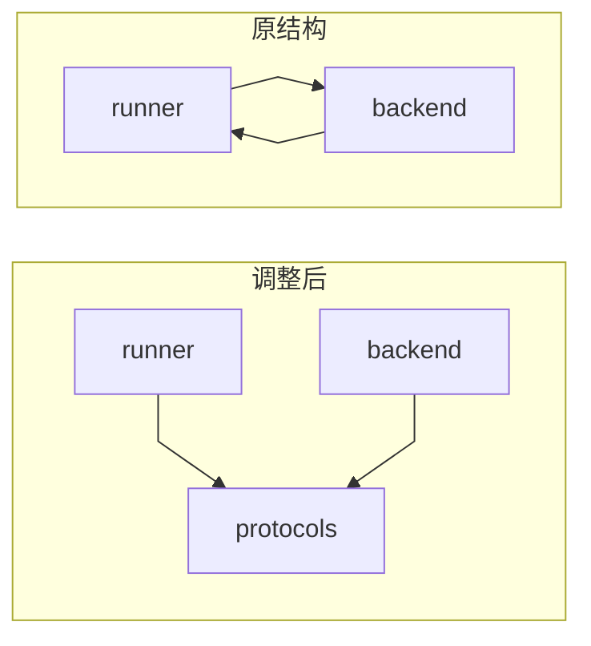

箭头表示模块依赖。`protocols` 只放接口与数据结构，不依赖实现。

如果一个项目需要靠局部导入来"修"循环导入，通常说明模块边界需要重新划分。

### 8. 动态导入：`importlib.import_module`

模块名在运行时才确定时用 `importlib.import_module`：

```python title='按名字动态导入后端：importlib.import_module'
import importlib


def load_backend(name):
    module = importlib.import_module(f"mypackage.backends.{name}")
    return module.create_backend()
```

它走的是 §2 的同一条流程，只是名字来自字符串。代价是依赖关系对静态工具不可见、拼写错误延迟到运行时、字符串来自不可信输入时会变成任意代码执行。按配置加载后端、`pkgutil.iter_modules` 扫描插件包、`importlib.metadata.entry_points` 发现第三方插件——这三种插件发现方式的对比与选型，在本系列第四篇[《反射、元编程与插件架构》](/python-reflection-metaprogramming-and-plugin-architecture.html)中展开。

### 9. 导入语法与名称绑定

`import math`、`import numpy as np`、`from math import sqrt` 三种写法的区别只有一点：**§2 第 7 步绑定什么名称**。`import` 绑定模块名；`as` 只是在当前命名空间起一个别名，不会创建第二个模块对象（`import numpy as np; import numpy; np is numpy` 为 `True`）；`from ... import` 直接绑定成员，简洁但来源不明显、容易被同名覆盖。

工程惯例：模块级依赖用 `import package.submodule`，生态约定的缩写用 `as`（`np`、`pd`），少量稳定的公共对象用 `from ... import`（`Path`、`contextmanager`），不用 `from module import *`。

> [!NOTE] 与 Java 对照：导入语法
>
> | | Python `import` | Java `import` |
> | :--- | :--- | :--- |
> | 别名 | `as` | 无 |
> | 导入成员 | `from m import f` | 静态成员用 `import static C.f` |
> | 可以放在函数里吗 | 可以，作为延迟导入 | 不可以 |
>
> Table: Python 与 Java 的导入语法对照
>
> 语法相近不代表动作相同；是否执行代码的差别见本章 §2。

## 五、异常处理与失败传播

前面每一章都有一个"异常发生时会怎样"的分支：`__exit__` 收到异常、`finally` 在生成器关闭时执行、导入失败让注册表为空。这一章讨论异常本身：它如何沿帧链传播，以及在 AI-Infra 中什么样的处理方式是安全的。

### 1. `try` 结构与传播路径

```python title='try / except / else / finally 各自执行的时机'
try:
    result = run()
except ValueError as exc:
    handle(exc)
else:
    process(result)          # 只在 try 块没有异常时执行
finally:
    cleanup()                # 总是执行，包括 return 和未被捕获的异常
```

异常发生时，解释器沿当前帧的 `f_back` 链向上寻找匹配的 `except`；每经过一帧，就把这一帧记进 `__traceback__`。找不到时，子线程由 `threading.excepthook` 打印后结束，主线程打印 traceback 后以非零状态退出。这就是第二章 §3 中看到的 traceback 结构。

上面是骨架。下面用一个能直接运行的三层调用，看异常往上走时依次经过谁：

```python title="异常从 inner 向外传播：先过 finally，再过 __exit__，最后被 top 接住"
import traceback


class Ctx:
    def __enter__(self):
        return self

    def __exit__(self, exc_type, exc, tb):
        print("middle 的 __exit__ 收到", exc_type.__name__)
        return False                     # 不抑制，继续往外抛


def inner():
    try:
        raise ValueError("bad batch")
    finally:
        print("inner 的 finally")


def middle():
    with Ctx():
        inner()
    print("这一行不会执行")


def top():
    try:
        middle()
    except ValueError as exc:
        names = [f.name for f in traceback.extract_tb(exc.__traceback__)]
        print("top 接住：", exc, names)


top()
```

```text title="运行输出（Python 3.12）"
inner 的 finally
middle 的 __exit__ 收到 ValueError
top 接住： bad batch ['top', 'middle', 'inner']
```

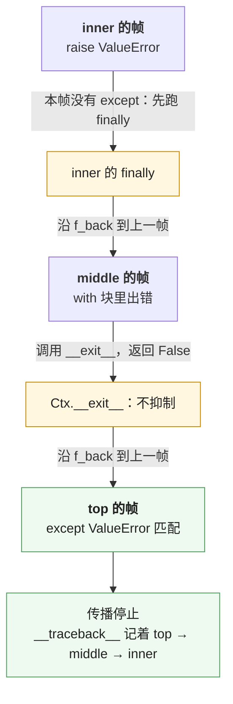

- 异常每离开一帧，先执行这一帧里活动的 `finally` 和 `__exit__`，再到调用者那一帧找 `except`。
- `__exit__` 返回真值会抑制异常，传播就停在那一层；`top` 就收不到了。
- traceback 从接住它的那一帧记到抛出的那一帧，与第二章 §3 打印的顺序一致。

> [!NOTE] 与 Java 对照：else 与 finally
> 两门语言的 `finally` 都用于离开 `try` 结构时执行清理。Python 还提供 `else` 子句，只在 `try` 正常结束时运行，Java 没有对应子句。

### 2. `BaseException` 层级

所有异常都继承自 `BaseException`。3.11 起它的直接子类有五个（3.10 及之前没有 `BaseExceptionGroup`，是四个）：

| `BaseException` 的直接子类 | 什么时候出现 | 业务代码是否捕获 |
|---|---|---|
| `Exception` | 几乎所有业务异常的根：`ValueError`、`OSError`、`RuntimeError` 和自定义异常都在它下面 | 捕获它 |
| `BaseExceptionGroup` | 3.11 起，把多个异常打包一起抛出；常用的 `ExceptionGroup` 同时也是 `Exception` 的子类 | 用 `except*` 处理 |
| `GeneratorExit` | 生成器 / 协程被关闭（[下篇第五章](/python-object-model-protocols-decorators-and-generators.html#五生成器与惰性执行)） | 不捕获 |
| `KeyboardInterrupt` | 按下 Ctrl+C | 不捕获 |
| `SystemExit` | 调用 `sys.exit()` | 不捕获 |

Table: BaseException 的直接子类：业务代码应捕获的根是 Exception

`except BaseException:` 或裸 `except:` 会吞掉 `KeyboardInterrupt` 和 `SystemExit`——Worker 收到终止信号却继续跑；也会吞掉 `GeneratorExit`，让生成器无法关闭。业务代码捕获 `Exception` 即可。

> [!NOTE] 与 Java 对照：没有受检异常
> Python 不像 Java 那样区分受检异常与非受检异常，也不要求用 `throws` 声明。调用方必须处理哪些失败，要靠接口文档约定，编译器不会强制检查。

### 3. 自定义异常与错误边界

异常类型是给**调用方**用的，它应该回答"发生了什么"以及"能怎么办"：

```python title='自定义异常层级：按"能怎么办"分类'
class BackendError(Exception): ...
class BackendUnavailableError(BackendError): ...     # 可以换后端
class BackendExecutionError(BackendError): ...       # 可以重试


try:
    run_backend()
except BackendUnavailableError:
    fallback_to_cpu()
except BackendExecutionError:
    retry()
```

按业务边界建一个异常基类，让调用方可以选择粗粒度（`except BackendError`）或细粒度处理。错误边界就是"在哪一层把底层异常翻译成调用方能决策的类型"——通常在模块或服务的公共接口处。

### 4. 异常链：`from exc` 与 `from None`

在处理一个异常时抛出另一个，Python 自动记录原异常：

```python title='raise … from exc：显式记录异常链'
try:
    load_config()
except OSError as exc:
    raise RuntimeError("failed to load configuration") from exc
```

`from exc` 设置 `__cause__`，traceback 显示 "The above exception was the direct cause of the following exception"；不写 `from` 则隐式记录到 `__context__`，显示 "During handling of the above exception, another exception occurred"。两者都保留根因，区别只是措辞和意图的明确程度。`from None` 抑制链条——只在底层异常确实对调用方无意义时使用，否则排障时会丢掉关键信息。

> [!NOTE] 与 Java 对照：保留异常原因
> `raise RuntimeError(msg) from exc` 可类比 `throw new RuntimeException(msg, cause)`；Python 的 `__cause__` 类似 Java 的 `getCause()`。差别是 Python 没写 `from` 时还会自动把正在处理的异常记到 `__context__`，Java 不传 `cause` 就没有这条链。

### 5. 记录并重抛：`raise` 与 `raise exc` 的区别

```python title='记录完整 traceback 后原样重抛'
try:
    worker.run()
except Exception:
    logger.exception("worker failed")    # 记录完整 traceback
    raise                                # 原样重抛
```

裸 `raise` 重新抛出当前异常，traceback 不变；`raise exc` 则会把**当前这一行**追加进 traceback，实验中同一个异常的帧列表从 `['<module>', 'w']` 变成 `['<module>', '<module>', 'w']`，多出一层噪音。

> [!NOTE] 与 Java 对照：重抛与调用栈
> Java 没有裸 `throw;` 语法，用 `throw e;` 重抛已有异常通常不会重建其栈信息（栈通常在构造异常时记录）。Python 的 traceback 随传播逐帧累加，因此 `raise` 与 `raise exc` 的这项差别不能直接套到 Java 上。

只记录不重抛是最常见的错误处理反模式：

```python title='反模式：只记录 str(exc) 不重抛'
try:
    train_step(batch)
except Exception as exc:
    logger.error(str(exc))     # 丢了 traceback，也丢了异常本身
```

上层以为任务成功，Worker 带着不一致的状态继续跑，分布式训练中表现为某个 rank 悄悄掉队、其他 rank 在集合通信上无限等待。原则是：**能处理就处理并明确恢复到一致状态，不能处理就重抛；日志不是处理**。

## 六、本文小结

本篇讲的四种机制，都围绕**帧**这一个东西：

- **执行模型**
  - 源码在脚本启动或第一次导入时整模块编译成 code object；函数对象 = code + `__globals__` + 默认值 + cell。
  - 每次调用创建一个帧，帧里放局部变量与指令位置；名称是绑定到对象的标签，不是盒子。
- **作用域与闭包**
  - 名称的归属在编译期决定（LEGB）；闭包 = 函数对象 + cell。
  - cell 是共享的，所以有延迟绑定。
- **导入系统**
  - `import` 是运行时动作：`sys.modules` → `meta_path` finder → loader → 执行顶层代码。
  - `sys.path[0]` 由启动方式决定；editable 安装修改的是查找路径。
  - 注册机制的前提是"每个模块只执行一次"，限定同一进程、同一模块名且没有 `reload`，见第四章 §6。
- **异常**
  - 沿帧链 `f_back` 向上传播，每经过一帧记进 `__traceback__`，途经活动的 `__exit__` 和 `finally`；若被捕获或抑制，就不再继续向外传播。
  - 只记录不重抛是反模式。

回到开头那七行里属于本篇的两行：

| 开头的写法 | 背后的机制 | 在哪一节 |
|---|---|---|
| `import torch` 触发 `.so` 加载、算子注册 | `import` 是运行时动作：`PathFinder` 找到 `torch/_C.*.so`，`ExtensionFileLoader` `dlopen` 它并调 `PyInit__C`；顶层代码顺带执行注册 | 四 §3、§6 |
| `except Exception: log; raise` | 异常沿帧链传播，途经每个 `__exit__` 和 `finally`<br/>只记录不重抛，Worker 会带着错误状态继续跑<br/>裸 `raise` 保留原始 traceback | 五 §1、§5 |

Table: 开头两行代码背后的机制

读 AI-Infra 代码时的这些疑问，也都落在本篇的机制上：

- 一个后端为什么"写了注册装饰器却找不到"——它所在的模块没被导入，或被以两个名字导入了；
- 一份代码为什么"`python -m` 能跑、`python script.py` 不能"——`sys.path[0]` 和 `__package__` 不同；
- 测试为什么"本地过、装完挂"——flat 布局让测试导入的是源码树而不是安装产物；
- `import torch` 为什么能加载几百 MB 的 C++ 库——`ExtensionFileLoader` 是导入系统的一个普通 loader；
- 一个 Worker 为什么带着错误状态继续跑——异常被记录后没有重抛。

下篇从"对象"这一侧接着讲：类怎么被 `type` 创建、`obj.attr` 是一个什么算法、`runner(batch)` 与 `for`、`with` 这些语法背后是哪些特殊方法，装饰器与生成器又怎么用本篇的闭包和帧搭出来。

配套代码：本文验证各个结论用的小脚本（`dis` 与 code object、import 系统、自定义 `MetaPathFinder`）在 [ai-learning-labs/python-for-ai-infra/01-language-mechanisms](https://github.com/arganzheng/ai-learning-labs/tree/main/python-for-ai-infra/01-language-mechanisms)，只依赖标准库。

## 七、自测

1. `import torch` 为什么能把几百 MB 的 C++ 库加载进来并完成算子注册？涉及导入系统的哪两个组件？

   <details markdown="1"><summary>答案</summary>

   `PathFinder` 在 `sys.path` 上找到 `torch/_C.*.so`，`ExtensionFileLoader` 用 `dlopen` 加载它并调用 `PyInit__C`；`.so` 只是导入系统里一种普通的 loader 处理的模块。算子注册是 `torch/__init__.py` 及子模块顶层代码执行的副作用——`import` 是运行时动作。

   </details>

2. 一个函数里写了 `x = x + 1`，而 `x` 是全局变量，为什么读它会报 `UnboundLocalError` 而不是拿到全局值？

   <details markdown="1"><summary>答案</summary>

   名称的归属在**编译期**决定：函数体内出现对 `x` 的赋值，`x` 就是这个函数的局部变量，整个函数里都是——不存在"前半段全局、后半段局部"。读到 `x + 1` 时局部 `x` 还没有值，于是 `UnboundLocalError`。要改全局的 `x` 必须 `global x`（外层函数的变量则 `nonlocal`）。

   </details>

3. 循环里写 `fns.append(lambda: i)`，三个函数各返回什么？把 `i` 改成 `lambda i=i: i` 之后呢？

   <details markdown="1"><summary>答案</summary>

   第一种都返回 2，第二种返回 0、1、2。`lambda: i` 里的 `i` 是自由变量，三个函数的 `__closure__` 指向 `make_fns` 的**同一个** cell，调用时才读，读到的是循环结束后的值；`i=i` 在创建函数时把当时的值存进各自的 `__defaults__`，函数体里的 `i` 变成局部变量，不再读 cell。

   </details>

[^q0]: 分四个阶段看。**被加载**：`import` 是运行时动作——`PathFinder` 沿 `sys.path` 找到模块，`.py` 编译成字节码后执行顶层代码，`.so` 由 `ExtensionFileLoader` `dlopen` 并调用 `PyInit_*`；装饰器注册、类创建这些副作用就发生在这一步，所以「注册表为什么是空的」几乎总是导入问题（[第二章](#二执行模型源码如何变成正在运行的代码)、[第四章](#四模块与导入系统代码如何被加载)）。**创建对象**：`Runner(model)` 走 `type.__call__` → `__new__` → `__init__`，之后每次 `obj.attr` 按「数据描述符 → 实例 `__dict__` → 类 MRO 上的非数据描述符 / 类属性 → `__getattr__`」查找，`nn.Module` 的 `__setattr__` / `__getattr__` 就插在这条链上（[下篇第二章](/python-object-model-protocols-decorators-and-generators.html#二类与对象模型对象如何被创建和查找)、[下篇第三章](/python-object-model-protocols-decorators-and-generators.html#三对象协议语法背后的特殊方法)）。**执行任务**：`model(x)` 查类型上的 `__call__`，经过 hooks 再到 `forward`；`for` 用迭代协议，生成器是挂起在 `yield` 处的帧；装饰器在定义时执行一次、返回一个替代对象（[下篇第三章](/python-object-model-protocols-decorators-and-generators.html#三对象协议语法背后的特殊方法)至[下篇第五章](/python-object-model-protocols-decorators-and-generators.html#五生成器与惰性执行)）。**释放资源**：`with` 展开为 `__enter__` / `__exit__`，异常沿帧链向外传播、途经每个 `__exit__` 与 `finally`；对象在引用计数归零时立即释放，循环引用交给 GC（[下篇第六章](/python-object-model-protocols-decorators-and-generators.html#六上下文管理器把资源生命周期交给协议)、[第五章](#五异常处理与失败传播)）。[下篇第七章](/python-object-model-protocols-decorators-and-generators.html#七一个推理组件的完整运行时追踪)把这四步在一个推理组件上从头追了一遍。
