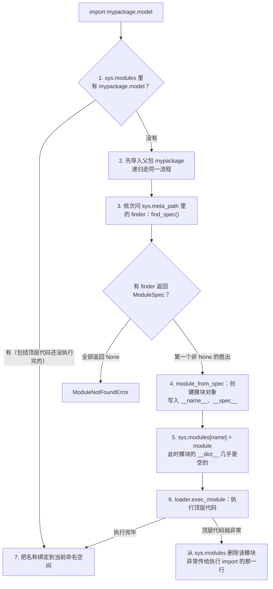
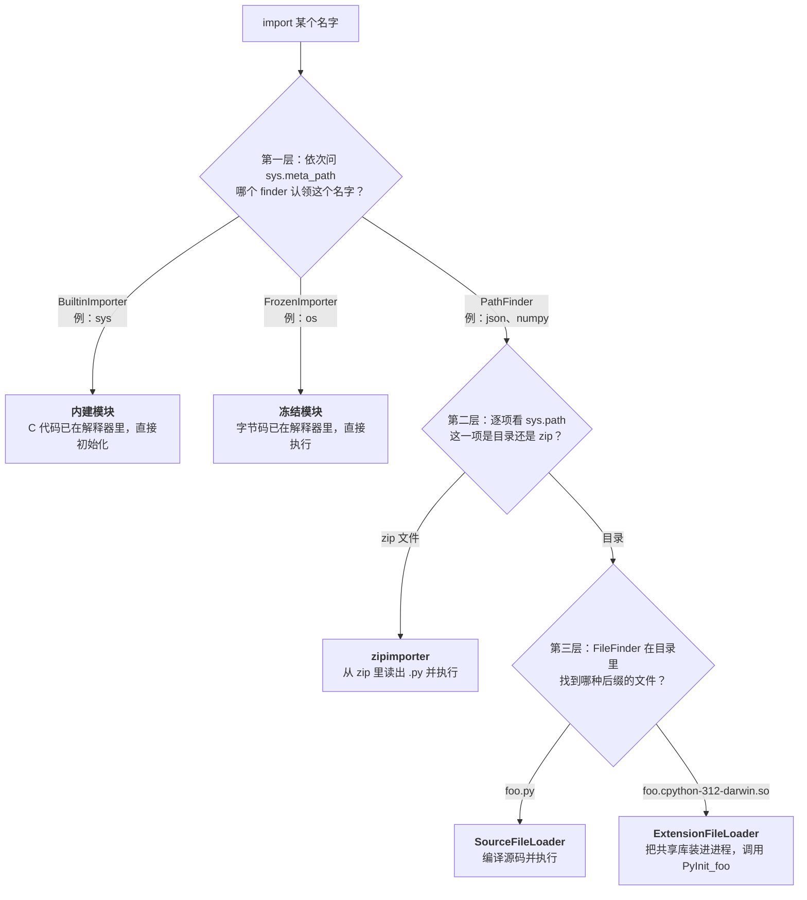
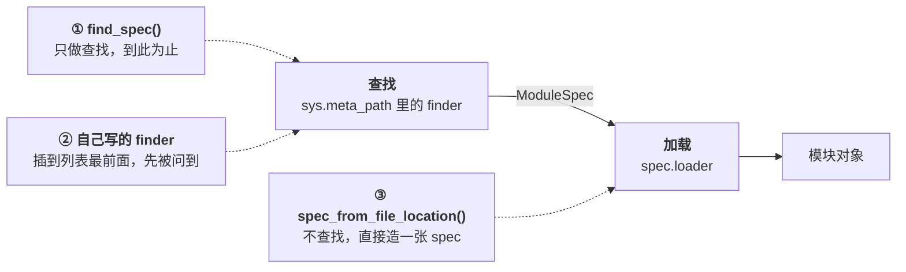
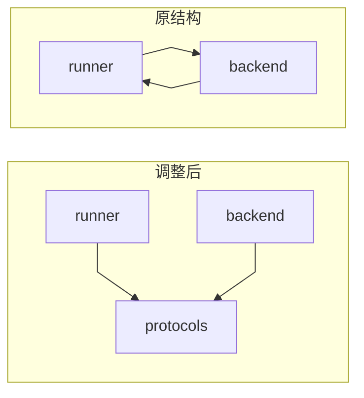

函数要先存在才能被调用，而让它存在的动作是 `import`：找到文件、编译、执行顶层代码、把结果放进一个模块对象。[《执行模型》](/python-execution-model-code-objects-functions-and-frames.html)里那个 `runner.py` 的 `Runner` 之所以能出现在 `REGISTRY` 里，唯一的原因是 `runner.py` 被导入并执行过。AI-Infra 里一批经典故障也都出在这一步——"本地能跑、换台机器就 `ImportError`"、"明明写了注册装饰器、运行时却找不到后端"、"`python -m` 能跑、`python script.py` 不能"。

本篇只回答一个问题：

> **`import` 一个名字时，Python 去哪里找、找到之后做了什么；为什么同一份代码换一种启动方式就 `ImportError`？[^q0]**

## 一、总览

本篇顺着一条 `import` 语句往下拆：先看导入的结果是什么对象（第二章），再看这条语句的七个步骤（第三章），然后展开其中的"查找"（第四章）和查找所依赖的 `sys.path`（第五、六章），接着是"每个模块只执行一次"带来的两件事——注册机制和循环导入（第七、八章），最后是动态导入和几种导入写法的差别（第九、十章）。

| 章 | 主题 | 内容 |
|---|---|---|
| 二 | 模块是对象，包是带 `__path__` 的模块 | 模块与包、`__init__.py`、命名空间包 |
| 三 | `import` 语句的执行过程 | 查缓存、查找、先登记后执行、绑定名称 |
| 四 | 三层查找机制 | `sys.meta_path`、`PathFinder`、loader，扩展模块，三个入口 |
| 五 | `sys.path` 的构成与启动方式 | `python script.py` 与 `python -m` 的差别 |
| 六 | 项目布局、测试与 editable 安装 | flat 与 src 布局、`.pth` |
| 七 | `sys.modules` 缓存、导入副作用与注册机制 | 模块只执行一次、双重导入 |
| 八 | 循环导入与依赖方向 | 部分初始化的模块、怎么拆 |
| 九 | 动态导入 | `importlib.import_module` |
| 十 | 导入语法与名称绑定 | 三种 `import` 写法绑定的名称 |
| 十一 | 本文小结 |  |
| 十二 | 自测 | 5 道题 |

Table: 本文的章节安排

## 二、模块是对象，包是带 `__path__` 的模块

先说两个词：

- **模块（module）**：一个 `.py` 文件。
- **包（package）**：一个装着若干模块的目录，目录里放一个 `__init__.py`。包的用处是给模块分层起名——`mypackage.model` 读作"`mypackage` 目录下的 `model.py`"。

下面这个目录里各有一个：

```text title='一个模块 single.py 和一个包 mypackage'
project/
├── single.py            # 模块：一个文件
└── mypackage/           # 包：一个带 __init__.py 的目录
    ├── __init__.py      # 内容：print("执行 mypackage/__init__.py")
    └── model.py         # 包里的模块，全名 mypackage.model
```

在 `project/` 下把两者都导入，看得到的是什么：

```python title='分别导入模块 single 和包 mypackage'
import single, mypackage

print(type(single), type(mypackage))
print(single.__file__)
print(mypackage.__file__)
print(hasattr(single, "__path__"), mypackage.__path__)
print(hasattr(mypackage, "model"))

import mypackage.model
print(hasattr(mypackage, "model"), mypackage.model.__file__)
```

```text title='运行输出（Python 3.12）'
执行 mypackage/__init__.py
<class 'module'> <class 'module'>
.../project/single.py
.../project/mypackage/__init__.py
False ['.../project/mypackage']
False
True .../project/mypackage/model.py
```

| | 模块 `single` | 包 `mypackage` |
| :--- | :--- | :--- |
| 磁盘上是什么 | 一个文件 `single.py` | 一个目录 `mypackage/` |
| 导入时执行哪份代码 | `single.py` | `mypackage/__init__.py` |
| 导入后得到的对象 | `module` 对象 | 也是 `module` 对象 |
| `__path__` 属性 | 没有 | `['.../project/mypackage']` |

Table: 模块与包导入后的对照

- 导入一个包，执行的是它的 `__init__.py`，得到的同样是一个模块对象。所以在导入系统眼里，包就是**多了一个 `__path__` 属性**的模块。
- `__path__` 是一个目录列表，回答"这个包的子模块去哪里找"。`import mypackage.model` 就是到 `mypackage.__path__` 列出的目录里找 `model.py`。
- 导入包不会顺带导入它里面的模块：`import mypackage` 之后 `mypackage.model` 还不存在（输出第 6 行），执行过 `import mypackage.model` 才有（第 7 行）。

模块对象的属性字典就是那份文件的全局命名空间：

```python title='导入后的 json 是一个模块对象，__dict__ 就是它的全局命名空间'
import json, types

print(type(json), isinstance(json, types.ModuleType))   # <class 'module'> True
print(list(json.__dict__)[:6])
# ['__name__', '__doc__', '__package__', '__loader__', '__spec__', '__path__']
```

前几个名字是导入系统写入的元数据（标准库的 `json` 是一个包，所以也有 `__path__`）。`json.dumps` 这样的属性访问，就是在这个字典里查键。[《执行模型》](/python-execution-model-code-objects-functions-and-frames.html)说函数对象的 `__globals__` 指向定义它的模块命名空间——指的正是这个 `__dict__`。

`mypackage/__init__.py` 是包被导入时执行的模块体。它有两个合理用途：把内部模块的公共对象提升到包级（`from .model import Model`），以及用 `__all__` 声明 `from mypackage import *` 的导出集合。`__all__` 只影响 `import *`、文档和静态分析工具，不是访问控制。

`__init__.py` 里不应放重逻辑。导入包就会执行它，一个 `import mypackage.utils` 会先跑完 `mypackage/__init__.py`——如果那里面 `import torch`、检查 CUDA、建立连接，所有导入方都要付这个代价，并且更容易形成循环导入（第八章）。没有 `__init__.py` 的目录是**命名空间包**（PEP 420），能被导入，但缺少一个明确的初始化入口；后面第五章会看到 PyTorch 自己的一个报错正是命名空间包造成的。

## 三、`import` 语句的执行过程

`import mypackage.model` 在解释器内部大致经历以下步骤（对照 [CPython 3.12.0 的 `Lib/importlib/_bootstrap.py`](https://github.com/python/cpython/blob/v3.12.0/Lib/importlib/_bootstrap.py) 中的 `_find_and_load` → `_find_spec` → `_load_unlocked`）：

1. **缓存**：查 `sys.modules["mypackage.model"]`，命中已初始化的模块对象就返回；若值为 `None` 则拒绝导入。模块还在执行顶层代码时，其他线程通常先等待模块锁，同一线程的循环导入可能拿到半成品（第八章）。
2. 未命中：先确保父包 `"mypackage"` 已导入，递归走同一流程。
3. **查找**：依次询问 `sys.meta_path` 里的每个 finder：`find_spec(name, path)`。第一个返回非 `None` 的 `ModuleSpec` 胜出；全部为 `None` 则抛 `ModuleNotFoundError`。
4. `module_from_spec(spec)` 调用 `spec.loader.create_module(spec)` 创建模块对象；若返回 `None`，由导入系统创建。随后写入 `__name__`、`__spec__` 等元数据；有文件位置时还会设置 `__file__`。
5. `sys.modules[name] = module`。注意：在执行之前。
6. **执行**：`spec.loader.exec_module(module)`。源码模块在这一步编译（或读 `.pyc`），并在 `module.__dict__` 中执行顶层代码。
7. 把结果绑定到当前命名空间：`import a.b` 绑定 `a`；`from a.b import c` 绑定 `c`。

把这七步画成流程，能看清两处分支：缓存命中时直接跳到第 7 步，第 3 步全部落空时抛错；还有一条列表里没写的失败路径——顶层代码执行时抛异常，导入系统会把第 5 步登记的模块从 `sys.modules` 删掉，下次 `import` 会重新执行一遍，而不是拿到一个半成品：



有三点决定了后面几节的全部内容：

- **第 1 步**说明同一个模块名在一个进程里只执行一次。注册表、单例、模块级缓存都依赖这一点（第七章）。
- **第 5 步在第 6 步之前**。模块在顶层代码执行完之前就已经在 `sys.modules` 里了，此时它是一个"部分初始化"的模块。循环导入之所以表现为 `AttributeError`/`ImportError: cannot import name`，就是有人在这个窗口期拿到了它（第八章）。
- **第 3 步是可插拔的**。`sys.meta_path` 是一个普通列表，谁都可以往里插 finder。下一章展开。

> [!NOTE] 与 Java 对照：import 会不会执行代码
> Java 的 `import` 是编译期声明，只简化名称书写；Python 的 `import` 是运行时语句，要走上面的查找、加载、执行和绑定过程。
>
> | | Python 模块导入 | Java 类加载与初始化 |
> | :--- | :--- | :--- |
> | 何时执行初始化代码 | 首次导入时执行模块顶层代码 | 与 `import` 无关，类初始化通常由 `new`、调用静态方法等主动使用触发 |
> | 缓存与身份 | `sys.modules`，按模块名 | JVM 按定义类加载器与类的全限定名区分类 |
>
> Table: Python 模块导入与 Java 类加载、初始化的对照
>
> 注册机制（第七章）与循环导入（第八章）要从模块的执行顺序理解，不能套 Java `import` 的直觉。Java 的类加载器隔离、`ClassNotFoundException` 与 `NoClassDefFoundError` 没有一一对应的 Python 机制；排查 Python 加载问题时，重点看 `sys.path`、`sys.modules` 和启动方式（第五章）。

## 四、三层查找机制：`sys.meta_path`、`PathFinder` 与 loader

上一章的第 3 步"查找"和第 6 步"执行"由两种对象分工完成，中间靠一张记录交接：

| 对象 | 做什么 |
| :--- | :--- |
| finder（查找器） | 回答"这个名字我找不找得到"，找到就交出一张 `ModuleSpec` |
| `ModuleSpec` | 一张记录：模块叫什么、从哪来、由哪个 loader 加载 |
| loader（加载器） | 按 `ModuleSpec` 把来源变成模块对象，并执行其中的代码 |

Table: 导入系统里的三种对象

每个导入过的模块都把自己那张 `ModuleSpec` 留在 `__spec__` 上：

```python title='打印 json 的 __spec__'
import json
print(json.__spec__)
```

```text title='json 的 ModuleSpec：name、loader、origin 等字段'
ModuleSpec(name='json',
           loader=<_frozen_importlib_external.SourceFileLoader object at 0x...>,
           origin='/.../lib/python3.12/json/__init__.py',
           submodule_search_locations=['/.../lib/python3.12/json'])
```

四个字段依次是：模块叫什么、由谁加载（`loader`）、从哪来（`origin`）、如果是包则子模块去哪找（`submodule_search_locations`，也就是 `__path__` 的来源）。

查找分三层，每一层都是"问一圈，谁认领归谁"。下图是全貌，后面按层展开：



**第一层：`sys.meta_path` 里的 finder**

```python title='第一层：遍历 sys.meta_path 里的 finder'
import sys
for finder in sys.meta_path:
    print(finder)
```

在一个装了 setuptools 的 venv 里：

```text title='一个装了 setuptools 的 venv 里的四个 meta_path finder'
<_distutils_hack.DistutilsMetaFinder object at 0x...>
<class '_frozen_importlib.BuiltinImporter'>
<class '_frozen_importlib.FrozenImporter'>
<class '_frozen_importlib_external.PathFinder'>
```

后三个是 Python 自带的，各管一类来源。拿三个模块各验证一个：

```python title='sys、os、json 分别由哪个 finder 认领'
import sys, os, json

for name in ["sys", "os", "json"]:
    spec = sys.modules[name].__spec__
    print(name, spec.origin, spec.loader)
```

```text title='运行输出（Python 3.12）'
sys built-in <class '_frozen_importlib.BuiltinImporter'>
os frozen <class '_frozen_importlib.FrozenImporter'>
json /.../lib/python3.12/json/__init__.py <_frozen_importlib_external.SourceFileLoader object at 0x...>
```

- **`BuiltinImporter` 管内建模块**：用 C 写、直接编译进 `python` 可执行文件的模块，例如 `sys`。磁盘上没有对应的文件，所以 `sys` 没有 `__file__` 属性。
- **`FrozenImporter` 管冻结模块**：用 Python 写，但字节码在构建解释器时就嵌进了可执行文件，例如 `os` 和导入系统自己（`importlib` 的核心是 Python 代码，它没法靠"从磁盘导入"把自己导入进来）。
- **`PathFinder` 管磁盘上的文件**：其余所有模块——标准库的 `json`、`pip` 装的 `numpy`、自己写的代码。它怎么找，是第二、三层的内容。

前两个 finder 找到后自己就是 loader（输出里 `spec.loader` 就是它们本身）；`PathFinder` 则把加载交给别的 loader。

列表里排第一的 `DistutilsMetaFinder` 不是 Python 自带的，是 setuptools 装进来的：

- **它做什么**：Python 3.12 的标准库删掉了 `distutils`，setuptools 自带了一份副本。这个 finder 认领 `distutils` 这个名字，把它指到副本上——在这个 venv 里 `import distutils; print(distutils.__file__)` 输出 `.../site-packages/setuptools/_distutils/__init__.py`。
- **它怎么进的列表**：setuptools 在 `site-packages` 下放了一个 `distutils-precedence.pth` 文件，解释器启动时会执行其中以 `import` 开头的那一行，那一行把这个 finder 插到 `sys.meta_path` 最前面。
- **它说明什么**：`sys.meta_path` 是一个普通列表，排在前面的先被问到。第三方代码往前面插一个 finder，就能抢在 Python 自带的 finder 之前决定一个名字导入成什么。第六章的 editable 安装也用同样的手法。

**第二层：`PathFinder` 沿 `sys.path` 找目录 finder**

`PathFinder.find_spec` 遍历 `sys.path`（子模块则遍历父包的 `__path__`），对每个目录调用 `sys.path_hooks` 中的钩子，得到一个负责该目录的 finder，并缓存在 `sys.path_importer_cache`：

```python title='第二层：sys.path_hooks 里的钩子'
for hook in sys.path_hooks:
    print(hook)
```

```text title='两个 path hook：zipimporter 与 FileFinder'
<class 'zipimport.zipimporter'>
<function FileFinder.path_hook.<locals>.path_hook_for_FileFinder at 0x...>
```

所以 zip 文件和普通目录都能出现在 `sys.path` 上：前者由 `zipimporter` 接管，后者由 `FileFinder` 接管。

**第三层：`FileFinder` 按后缀选 loader**

`FileFinder` 在自己负责的目录里查找 `name/__init__.py`、`name.<后缀>`，后缀与 loader 的对应表来自 `importlib.machinery`：

```python title='第三层：FileFinder 按后缀选 loader 的对应表'
import importlib.machinery as m
print(m.SOURCE_SUFFIXES)       # ['.py']                                     → SourceFileLoader
print(m.BYTECODE_SUFFIXES)     # ['.pyc']                                    → SourcelessFileLoader
print(m.EXTENSION_SUFFIXES)    # ['.cpython-312-darwin.so', '.abi3.so', '.so'] → ExtensionFileLoader
```

这张表说明了一件初学者容易漏掉的事：**`import` 能导入的不只是 `.py` 文件。** 同一条 `import foo`，目录里是 `foo.py` 就编译执行它；是 `foo.cpython-312-darwin.so`（Linux 上是 `foo.cpython-312-x86_64-linux-gnu.so`）就把它当作**扩展模块**（extension module）加载——一个用 C / C++ 编译出来的共享库。

亲手做一个最小的扩展模块。`foo.c` 只提供一个返回 42 的函数 `bar`：

```c title='foo.c：一个最小的扩展模块'
#include <Python.h>

static PyObject *bar(PyObject *self, PyObject *args) {
    return PyLong_FromLong(42);
}

static PyMethodDef methods[] = {
    {"bar", bar, METH_NOARGS, "return 42"},
    {NULL, NULL, 0, NULL},
};

static struct PyModuleDef def = {
    PyModuleDef_HEAD_INIT, "foo", NULL, -1, methods,
};

// !ref pyinit-foo
PyMODINIT_FUNC PyInit_foo(void) {
    return PyModule_Create(&def);
}
```

在 macOS、Apple clang、CPython 3.12 上编译并导入：

```bash title='把 foo.c 编译成 foo.cpython-312-darwin.so 并导入'
$ INC=$(python -c 'import sysconfig; print(sysconfig.get_paths()["include"])')
$ cc -shared -undefined dynamic_lookup -I$INC foo.c -o foo.cpython-312-darwin.so
$ python -c 'import foo; print(foo.bar()); print(foo.__spec__.loader)'
42
<_frozen_importlib_external.ExtensionFileLoader object at 0x...>
```

`ExtensionFileLoader` 做了两件事：用 [dlopen](# "tip: 操作系统提供的函数：在程序运行中途把一个共享库装进当前进程") 把 `.so` 装进进程，然后调用其中的 [`PyInit_foo`](#pyinit-foo) 拿到模块对象。从此 `foo.bar()` 调的是 C 函数，`import` 语句本身看不出任何差别。

一个共享库要能被 `import foo` 加载，`PyInit_foo` 是 loader 向它要的唯一一个符号，但前后还各有一个条件：

1. **文件名对得上**：`foo` 加上 `EXTENSION_SUFFIXES` 里的某个后缀，并且放在 `sys.path` 的某个目录里。否则 `FileFinder` 根本不认它——把上面的文件改名成 `qux.cpython-311-darwin.so`，`import qux` 得到的是 `ModuleNotFoundError: No module named 'qux'`。
2. **导出 `PyInit_<模块名>`**：名字必须和模块名一致。把同一个文件复制成 `baz.so` 再 `import baz`，得到 `ImportError: dynamic module does not define module export function (PyInit_baz)`；一个不是为 Python 写的普通共享库也是这个报错。
3. **`PyInit_foo` 返回一个模块对象**（或一份模块定义，由导入系统据此创建模块）。
4. **二进制与当前解释器兼容**：它依赖的其他共享库找得到，编译时用的 Python 头文件与运行它的解释器一致。这一条导入系统不检查，文件名里的 `cpython-312-darwin` 标签就是为它准备的——标签不符的文件在第 1 条就被挡掉；裸的 `.so` 后缀没有标签，装错版本会在加载时报未定义符号或直接崩溃。

`import torch` 时加载的 `torch._C` 走的是完全相同的路径：`torch/__init__.py` 里的 `from torch._C import *` 让 `PathFinder` 在 `torch/` 目录下找到 `_C.cpython-312-x86_64-linux-gnu.so`，由 `ExtensionFileLoader` 载入——数百 MB 的 libtorch 就这样进入进程。C++ 系列第一篇会从 C++ 这一侧讲 `torch/csrc/stub.c` 里那个 `PyInit__C` 长什么样、它又拉起了哪些 `.so`。numpy 也一样：

```python title='一个真实的 C 扩展模块：numpy 的 ExtensionFileLoader 与 .so 路径'
import numpy, sys
m = sys.modules["numpy._core._multiarray_umath"]
print(m.__spec__.loader)   # <_frozen_importlib_external.ExtensionFileLoader object at 0x...>
print(m.__spec__.origin)   # .../site-packages/numpy/_core/_multiarray_umath.cpython-312-darwin.so
```

**三个可以直接用的入口**

查找和加载是分开的两步，中间的 `ModuleSpec` 是普通对象，所以这条流水线有三处可以从外面接进去：



| 想做的事 | 用哪个入口 | 在 AI-Infra 里的用处 |
| :--- | :--- | :--- |
| 判断一个库装没装，但不真的导入它 | ① `importlib.util.find_spec(name)` | "装了 Triton / flash-attn 就用它"的可选依赖判断 |
| 让某个名字的导入失败、改道或被记录 | ② 往 `sys.meta_path` 最前面插一个 finder | 测试里模拟"依赖没装"；排查启动时到底导入了什么 |
| 加载一个不在 `sys.path` 上的文件 | ③ `spec_from_file_location` + `module_from_spec` + `exec_module` | 加载刚编译到临时目录的 `.so`、按路径加载用户给的配置或插件文件 |

Table: 导入流水线的三个入口

**① 只查找，不导入。** 没装 triton、装了 numpy 的环境里：

```python title='find_spec 只走查找：能判断装没装，但不执行模块'
import importlib.util, sys

print(importlib.util.find_spec("triton"))
print(importlib.util.find_spec("numpy").origin)
print("numpy" in sys.modules)
```

```text title='运行输出（Python 3.12）'
None
.../site-packages/numpy/__init__.py
False
```

没装返回 `None`，装了返回它的 `ModuleSpec`。最后一行的 `False` 是要点：numpy 找到了，但没有被导入，它的 `.so` 也没有被加载。`try: import numpy` 也能判断装没装，代价是真的把它加载进来。

**② 插一个自己的 finder。** finder 只需要一个 `find_spec` 方法：返回 `None` 表示"不归我管，问下一个"，返回 spec 或抛异常则查找到此结束。下面这个 finder 让测试可以模拟"numpy 没安装"：

```python title='往 sys.meta_path 最前面插一个 Blocker，模拟 numpy 未安装'
import importlib.abc, sys


class Blocker(importlib.abc.MetaPathFinder):
    def __init__(self, names):
        self.names = names

    def find_spec(self, fullname, path, target=None):
        if fullname in self.names:
            raise ModuleNotFoundError(f"{fullname} blocked for testing", name=fullname)
        return None


sys.meta_path.insert(0, Blocker({"numpy"}))

try:
    import numpy
except ModuleNotFoundError as e:
    print("ModuleNotFoundError:", e)

import json
print("json 正常导入")
```

```text title='运行输出（Python 3.12）'
ModuleNotFoundError: numpy blocked for testing
json 正常导入
```

numpy 明明装着，却导入失败：`Blocker` 排在最前面，先被问到，直接抛了异常。`json` 不在名单里，`Blocker` 返回 `None`，后面的 finder 照常处理。把 `find_spec` 的内容换成"打印名字、返回 `None`"，它就成了一个记录器：

```python title='同一个位置插一个 Recorder：记录一条 import 实际请求了哪些模块'
import importlib.abc, sys


class Recorder(importlib.abc.MetaPathFinder):
    def find_spec(self, fullname, path, target=None):
        print("请求导入:", fullname)
        return None


sys.meta_path.insert(0, Recorder())
import xml.dom.minidom
```

```text title='运行输出（Python 3.12）'
请求导入: xml
请求导入: xml.dom
请求导入: xml.dom.domreg
请求导入: xml.dom.minidom
请求导入: xml.dom.minicompat
请求导入: xml.dom.xmlbuilder
请求导入: copy
请求导入: xml.dom.NodeFilter
```

一条 `import` 带出了八次查找。服务启动慢、想知道"启动时到底导入了什么"时，这是最直接的手段。

**③ 手工造一张 spec，加载任意位置的文件。** 把前面编译出的 `foo.cpython-312-darwin.so` 挪到一个不在 `sys.path` 上的目录 `/tmp/elsewhere/`，`import foo` 找不到它，但可以按路径加载：

```python title='spec_from_file_location：按文件路径加载，不经过 sys.path'
import importlib.util

path = "/tmp/elsewhere/foo.cpython-312-darwin.so"
spec = importlib.util.spec_from_file_location("foo", path)   # 不查找，直接造 spec
print(type(spec.loader).__name__)
module = importlib.util.module_from_spec(spec)               #第三章的第 4 步
spec.loader.exec_module(module)                              #第三章的第 6 步
print(module.bar())
```

```text title='运行输出（Python 3.12）'
ExtensionFileLoader
42
```

`spec_from_file_location` 看后缀选出了 `ExtensionFileLoader`，剩下两行就是第三章的第 4 步和第 6 步。PyTorch 的 JIT 扩展编译（`torch.utils.cpp_extension.load`）把 `.so` 编译到临时目录之后，用的正是这三行（`torch/utils/cpp_extension.py` 的 `_import_module_from_library`）。

**小结：六个模块，同一条 `import`**

把这一节出现过的模块放在一起，再加一个放进 zip 的 `inzip.py`，逐个打印它们的 loader 和来源：

```python title='六个模块各由哪个 loader 加载、从哪来'
import sys

sys.path.insert(0, "/tmp/z/bundle.zip")     # zip 里有一个 inzip.py
sys.path.insert(0, "/tmp/ext")              # 目录里有 foo.cpython-312-darwin.so
import os, json, numpy, inzip, foo

for name in ["sys", "os", "json", "numpy._core._multiarray_umath", "inzip", "foo"]:
    spec = sys.modules[name].__spec__
    loader = spec.loader
    loader_name = getattr(loader, "__name__", type(loader).__name__)
    print(f"{name:30} {loader_name:20} {spec.origin}")
```

```text title='运行输出（Python 3.12）'
sys                            BuiltinImporter      built-in
os                             FrozenImporter       frozen
json                           SourceFileLoader     /.../lib/python3.12/json/__init__.py
numpy._core._multiarray_umath  ExtensionFileLoader  .../site-packages/numpy/_core/_multiarray_umath.cpython-312-darwin.so
inzip                          zipimporter          /tmp/z/bundle.zip/inzip.py
foo                            ExtensionFileLoader  /tmp/ext/foo.cpython-312-darwin.so
```

六个模块来自解释器内部、源码文件、共享库和 zip，写法都是 `import 名字`，对应本章开头那张图里的五条路径（numpy 的 `.so` 和 `foo` 走同一条）：

- finder 决定**从哪找**，loader 决定**怎么变成模块**，`ModuleSpec` 是两者之间交接的那张记录。
- 每一层都是一个可以增删的列表（`sys.meta_path`、`sys.path_hooks`、后缀表），新增一种来源只需要加一个 finder 或 loader，`import` 语句不用变。editable 安装、测试里被屏蔽的依赖、JIT 编译出来的 `.so` 都是这样接进来的。

## 五、`sys.path` 的构成，以及 `python script.py` 与 `python -m` 的差别

`PathFinder` 沿 `sys.path` 找，那么 `sys.path` 里有什么？启动时它按顺序由这几部分拼成：

| 组成部分 | 内容 |
| :--- | :--- |
| `sys.path[0]` | 取决于启动方式（见下） |
| `PYTHONPATH` | 环境变量中的目录 |
| 标准库 | `.../lib/python3.12`、`python312.zip`、`lib-dynload` |
| `site-packages` | 当前解释器或虚拟环境的第三方包目录 |
| `.pth` 文件里的行 | `site` 模块处理 `site-packages` 下的 `*.pth`：每行一个目录追加到 `sys.path`；<br/>以 `import` 开头的行会被直接执行（第四章的 `DistutilsMetaFinder` 就是这么装进来的） |

Table: sys.path 的五个组成部分

真正制造差异的是 `sys.path[0]`。规则是：

| 启动方式 | `sys.path[0]` | `__name__` | `__package__` |
| :--- | :--- | :--- | :--- |
| `python path/to/script.py` | **脚本所在目录** | `__main__` | `None` |
| `python -m pkg.mod` | **当前工作目录** | `__main__` | `pkg` |
| `python -c` / 交互式 | `''`（当前目录） | `__main__` | `None` |

Table: 不同启动方式下的 sys.path[0]、__name__ 与 __package__

3.11 起加 `-P` 或设 `PYTHONSAFEPATH=1`，三种方式都不再自动插入这一项；下面依赖启动目录的“意外可导入”不再成立。`PYTHONPATH`、已安装包等其他路径来源仍需另看。

用一个 src 布局的项目验证。`src/myproject/cli.py` 打印自己的身份，然后做一次相对导入：

```python title='src/myproject/cli.py：打印自己的身份再做相对导入'
# src/myproject/cli.py
import sys
print("__name__    =", __name__)
print("__package__ =", __package__)
print("sys.path[0] =", repr(sys.path[0]))
from .core import register
print("relative import ok")
```

第一种启动方式：

```bash title='python src/myproject/cli.py：相对导入失败'
$ python src/myproject/cli.py
__name__    = __main__
__package__ = None
sys.path[0] = '/.../proj/src/myproject'
ImportError: attempted relative import with no known parent package
```

第二种启动方式（在仓库根目录，包已 editable 安装，安装方式见 第六章）：

```bash title='python -m myproject.cli：__package__ 正确、相对导入成功'
$ python -m myproject.cli
__name__    = __main__
__package__ = myproject
sys.path[0] = '/.../proj'
relative import ok
```

差别的机制：

- **相对导入依赖 `__package__`**。`from .core import x` 被解析成 `__package__ + ".core"`。作为脚本运行时 `__package__` 是 `None`，解释器不知道"当前包"是谁，于是报错。`python -m` 则是先把 `myproject.cli` 当作一个**模块**找到（走第四章的全部流程，因此需要 `myproject` 可导入），再把它当作 `__main__` 执行，`__package__` 由此得到正确的值。
- **`sys.path[0]` 是脚本目录，会制造"意外可导入"**。在 `cli.py` 里写 `import core`（绝对导入一个叫 `core` 的顶层模块）用第一种方式能成功——因为 `src/myproject/` 恰好在 `sys.path[0]`。但这个模块的名字是 `core` 而不是 `myproject.core`；一旦别处以 `myproject.core` 导入同一个文件，它会被**第二次执行**，得到两个互不相认的模块。

第二点值得单独演示，因为它是"注册表里出现重复项"和"`isinstance` 莫名其妙为 False"的常见根源。一个脚本 `app.py` 通过装饰器注册 `Runner`，同时它又被别的模块按模块名导入：

```python title='app.py 既作脚本运行又被按模块名导入'
# app.py
from registry import register

@register
class Runner: ...

if __name__ == "__main__":
    import app                    # 模拟别的模块（如 worker）按模块名导入 app
    print(Runner is app.Runner, isinstance(app.Runner(), Runner))
```

```bash title='同一个文件被执行两次：重复注册与 isinstance 为 False'
$ python app.py
duplicate registration: Runner False
False False
```

同一个文件以 `__main__` 和 `app` 两个名字各执行了一遍，`sys.modules` 里有两个条目，两个 `Runner` 类对象，注册表里第二个覆盖了第一个。规避方法是让入口文件尽量薄：`__main__` 里只 `from myproject.cli import main; main()`，业务代码不放在会被当作脚本运行的文件里。

PyTorch 源码里有一段专门针对这个陷阱的报错文案。`torch/__init__.py` 在 `from torch._C import _initExtension` 失败后检查 `torch._C.__file__ is None`，如果成立就提示：

> It appears that PyTorch has loaded the `torch/_C` folder of the PyTorch repository rather than the C extensions ... This error can generally be solved ... by running Python from a different directory.

原因正是上面的规则：在 PyTorch 仓库根目录执行 `python -c "import torch"`，`sys.path[0]` 是 `''`（当前目录），`PathFinder` 先在这里找到源码树中的 `torch/` 目录，而不是 `site-packages` 里安装好的那个；源码树里 `torch/_C/` 只是一个放 `.pyi` 存根的目录、没有 `__init__.py`，于是被当作命名空间包导入，`__file__` 为 `None`，所有 C 函数都不存在。

## 六、项目布局、测试与 editable 安装

第五章的规则解释了 flat 布局与 src 布局之争的全部内容。两种布局：

```text title='flat 布局与 src 布局的目录树'
flat 布局                        src 布局
myproject/                       myproject/
├── pyproject.toml               ├── pyproject.toml
├── myproject/                   ├── src/
│   ├── __init__.py              │   └── myproject/
│   └── core.py                  │       ├── __init__.py
└── tests/                       │       └── core.py
    └── test_core.py             └── tests/
                                     └── test_core.py
```

用一个只做 `import myproject.core` 的测试，在**没有安装**包的情况下分别运行：

| 布局 | 命令 | 结果 | 原因 |
| :--- | :--- | :--- | :--- |
| flat | `python -m pytest tests/` | 通过 | `-m` 把当前目录（仓库根）放进 `sys.path`，源码树直接可导入 |
| flat | `pytest tests/` | `ModuleNotFoundError` | `pytest` 可执行文件不加当前目录；pytest 默认的 prepend 模式只把 `tests/` 插入 `sys.path` |
| flat | `pytest tests/`，且 `tests/__init__.py` 存在 | 通过 | prepend 模式向上找到第一个不含 `__init__.py` 的目录（仓库根）插入 `sys.path` |
| src | 任何方式 | `ModuleNotFoundError` | `src/` 不在任何路径上 |

Table: flat 与 src 布局在未安装时的导入结果

flat 布局的三行结果说明了什么叫"测试环境可以导入、安装后不能"：测试通过与否取决于用 `pytest` 还是 `python -m pytest`、`tests/` 下有没有 `__init__.py`，而这些都与包装得对不对无关。`pyproject.toml` 里漏掉一个子包、忘了带上数据文件，flat 布局的测试照样绿——因为测的根本不是安装产物。

src 布局把这条路堵死：源码树不在任何默认路径上，测试**只能**导入安装后的包。开发时用 editable 安装让"安装后的包"指回源码：

```bash title='editable 安装留下的 .pth 文件指回 src'
$ pip install -e .
$ ls site-packages | grep myproject
__editable__.myproject-0.1.0.pth
myproject-0.1.0.dist-info
$ cat site-packages/__editable__.myproject-0.1.0.pth
/.../proj/src
```

这一行 `.pth` 就是 第五章 开头那份 `sys.path` 构成清单里的最后一项——`site` 模块启动时把 `src/` 追加到 `sys.path`，`PathFinder` 由此能找到 `src/myproject/`。这是 setuptools 对 src 布局这类"简单布局"的做法；当包结构无法用一条路径表达时（多个源码根、包名与目录名不一致、`--config-settings editable_mode=strict`），setuptools 64 及以后（PEP 660）会改为生成一个 `__editable___<name>_finder.py`，并通过 `.pth` 把其中的 `MetaPathFinder` 插进 `sys.meta_path`——也就是第四章第一层的自定义 finder。两种方式殊途同归：**editable 安装不是复制文件，而是修改导入系统的查找路径**。

由此可以推出它的边界：修改 `.py` 文件立即生效（每次导入都重新走查找与编译）；但新增顶层包、修改 `[project.scripts]` 入口、变更依赖，都需要重新 `pip install -e .`，因为这些信息记录在 `dist-info` 和 `.pth` 里，不会自动更新。

`pyproject.toml` 的完整写法、依赖锁定与打包分发，见[《工程化与生产交付》](/python-engineering-and-production-delivery.html)。

## 七、`sys.modules` 缓存、导入副作用与注册机制

回到第三章的第 1 步：同一个模块名在同一进程里只执行一次。

```python title='同一个模块名在进程里只执行一次：sys.modules 缓存'
import sys, json
first = sys.modules["json"]
import json as j2
print(j2 is json, sys.modules["json"] is first)     # True True
```

这条规则是**所有基于导入的注册机制的前提**。第一章的 `@registered("runner")` 在模块顶层执行，意味着：

- 模块被导入 → 注册发生一次；
- 模块没被任何人导入 → 注册表是空的。"写了装饰器却找不到后端"，原因永远是这一条；
- 模块被以两个名字导入（第五章的 `__main__`/`app`）→ 注册两次，后者覆盖前者；
- `importlib.reload(module)` → 顶层代码重新执行，注册表被再写一遍；
- 多进程 → 每个进程有自己的 `sys.modules`，注册表在 `fork` 之后是各自的副本，主进程后来的注册子进程看不到。

因此导入不是"声明依赖"，而是"执行代码"。AI-Infra 中导入触发的典型副作用有：算子/后端注册、插件发现、CUDA 扩展加载、环境变量读取、设备初始化、日志配置、全局缓存创建。这些副作用本身不是坏事——PyTorch 的算子注册就依赖它——但它们的**时机**由导入顺序决定，而导入顺序通常不是显式控制的。工程上的两条原则：

- 顶层只做"声明式"的事（定义类、注册名字），把创建连接、加载模型、初始化 CUDA 放进显式调用的函数；
- 需要保证注册发生时，显式导入插件模块，不要依赖"总会有人导入它"。

## 八、循环导入与依赖方向

```python title='循环导入失败的最小例子：a.py 与 b.py 互相 from-import'
# a.py
from b import B          # ← 执行到这里时，a 已在 sys.modules，但 A 还没定义
class A: ...

# b.py
from a import A          # ← 拿到的是部分初始化的 a，A 不存在 → ImportError: cannot import name 'A'
class B: ...
```

按第三章的步骤：导入 `a` → `a` 进入 `sys.modules` → 执行 `a` 顶层 → 遇到 `from b import B` → 导入 `b` → 执行 `b` 顶层 → 遇到 `from a import A` → `a` 已在 `sys.modules`，直接取 → 但 `a` 的顶层代码还停在第一行，`A` 尚未定义 → 失败。

`import a` 而不是 `from a import A` 有时能"绕过去"，因为它只绑定模块对象，属性访问推迟到运行时；`TYPE_CHECKING` 块和函数内的局部导入同理。但这些只是改变了**导入时机**，没有消除模块之间的环。首选解法是调整依赖方向：



箭头表示模块依赖。`protocols` 只放接口与数据结构，不依赖实现。

如果一个项目需要靠局部导入来"修"循环导入，通常说明模块边界需要重新划分。

## 九、动态导入：`importlib.import_module`

模块名在运行时才确定时用 `importlib.import_module`：

```python title='按名字动态导入后端：importlib.import_module'
import importlib


def load_backend(name):
    module = importlib.import_module(f"mypackage.backends.{name}")
    return module.create_backend()
```

它走的是第三章的同一条流程，只是名字来自字符串。代价是依赖关系对静态工具不可见、拼写错误延迟到运行时、字符串来自不可信输入时会变成任意代码执行。按配置加载后端、`pkgutil.iter_modules` 扫描插件包、`importlib.metadata.entry_points` 发现第三方插件——这三种插件发现方式的对比与选型，在[《反射、元编程与插件架构》](/python-reflection-metaprogramming-and-plugin-architecture.html)中展开。

## 十、导入语法与名称绑定

`import math`、`import numpy as np`、`from math import sqrt` 三种写法的区别只有一点：**第三章第 7 步绑定什么名称**。`import` 绑定模块名；`as` 只是在当前命名空间起一个别名，不会创建第二个模块对象（`import numpy as np; import numpy; np is numpy` 为 `True`）；`from ... import` 直接绑定成员，简洁但来源不明显、容易被同名覆盖。

工程惯例：模块级依赖用 `import package.submodule`，生态约定的缩写用 `as`（`np`、`pd`），少量稳定的公共对象用 `from ... import`（`Path`、`contextmanager`），不用 `from module import *`。

> [!NOTE] 与 Java 对照：导入语法
>
> | | Python `import` | Java `import` |
> | :--- | :--- | :--- |
> | 别名 | `as` | 无 |
> | 导入成员 | `from m import f` | 静态成员用 `import static C.f` |
> | 可以放在函数里吗 | 可以，作为延迟导入 | 不可以 |
>
> Table: Python 与 Java 的导入语法对照
>
> 语法相近不代表动作相同；是否执行代码的差别见第三章。

## 十一、本文小结

- `import` 是运行时动作：`sys.modules` → `meta_path` finder → loader → 执行顶层代码 → 绑定名称。
- finder 决定从哪找，loader 决定怎么变成模块；`.py`、`.so`、zip 里的文件都只是不同的 loader。
- `sys.path[0]` 由启动方式决定；editable 安装修改的是查找路径。
- 注册机制的前提是"每个模块只执行一次"，限定同一进程、同一模块名且没有 `reload`。
- 模块在执行顶层代码之前就已登记进 `sys.modules`，循环导入拿到的是部分初始化的模块。

| 读代码时的疑问 | 原因 |
| :--- | :--- |
| `import torch` 为什么能加载几百 MB 的 C++ 库并完成算子注册 | `PathFinder` 找到 `torch/_C.*.so`，`ExtensionFileLoader` 把它装进进程并调用 `PyInit__C`；顶层代码顺带执行注册 |
| 后端"写了注册装饰器却找不到" | 它所在的模块没被导入，或被以两个名字导入了 |
| "`python -m` 能跑、`python script.py` 不能" | `sys.path[0]` 和 `__package__` 不同 |
| 测试"本地过、装完挂" | flat 布局让测试导入的是源码树而不是安装产物 |

Table: 四个疑问与对应的机制

配套代码：本文验证各个结论用的小脚本（import 系统、自定义 `MetaPathFinder`）在 [ai-learning-labs/python-for-ai-infra/01-language-mechanisms](https://github.com/arganzheng/ai-learning-labs/tree/main/python-for-ai-infra/01-language-mechanisms)，只依赖标准库。

## 十二、自测

1. `import torch` 为什么能把几百 MB 的 C++ 库加载进来并完成算子注册？涉及导入系统的哪两个组件？

   <details markdown="1"><summary>答案</summary>

   `PathFinder` 在 `sys.path` 上找到 `torch/_C.*.so`，`ExtensionFileLoader` 用 `dlopen` 加载它并调用 `PyInit__C`；`.so` 只是导入系统里一种普通的 loader 处理的模块。算子注册是 `torch/__init__.py` 及子模块顶层代码执行的副作用——`import` 是运行时动作。

   </details>

2. 模块对象被放进 `sys.modules`，是在执行它的顶层代码之前还是之后？这解释了哪一类报错？

   <details markdown="1"><summary>答案</summary>

   之前。所以顶层代码还没执行完时，别的模块已经能从 `sys.modules` 拿到它——一个部分初始化的模块。循环导入表现为 `AttributeError` 或 `ImportError: cannot import name`，就是有人在这个窗口期拿到了它。

   </details>

3. 模块顶层代码执行到一半抛了异常，`sys.modules` 里会留下这个半成品吗？

   <details markdown="1"><summary>答案</summary>

   不会。导入系统会把它从 `sys.modules` 删掉，异常传给执行 `import` 的那一行；下次 `import` 会重新执行一遍。

   </details>

4. `importlib.util.find_spec("numpy")` 返回了一个 `ModuleSpec`，此时 `"numpy" in sys.modules` 是什么？

   <details markdown="1"><summary>答案</summary>

   `False`。`find_spec` 只走查找，不创建也不执行模块，numpy 的 `.so` 也没有被加载。

   </details>

5. 一个共享库导出了 `PyInit_foo`，但文件名是 `foo.cpython-311-darwin.so`，在 CPython 3.12 里 `import foo` 报什么错？为什么不是"找不到 `PyInit_foo`"？

   <details markdown="1"><summary>答案</summary>

   `ModuleNotFoundError`。这个后缀不在 3.12 的 `EXTENSION_SUFFIXES` 里，`FileFinder` 在查找阶段就不认它，根本到不了加载那一步。

   </details>

[^q0]: **去哪里找**：先查 `sys.modules` 缓存；没有就依次问 `sys.meta_path` 里的 finder，其中 `PathFinder` 沿 `sys.path`（子模块沿父包的 `__path__`）逐个目录找，再按文件后缀选 loader（[第三章](#三import-语句的执行过程)、[第四章](#四三层查找机制sysmeta_pathpathfinder-与-loader)）。**找到之后**：创建模块对象，先登记进 `sys.modules`，再执行顶层代码，最后把名称绑定到当前命名空间；装饰器注册、类创建这些副作用都发生在"执行顶层代码"这一步，而且同一进程同一模块名只发生一次（[第七章](#七sysmodules-缓存导入副作用与注册机制)）。**换启动方式就 `ImportError`**：`python script.py` 把脚本所在目录放在 `sys.path[0]`，且 `__package__` 为空，相对导入无从解析；`python -m pkg.mod` 放的是当前目录，并把它当作包里的模块找到（[第五章](#五syspath-的构成以及-python-scriptpy-与-python--m-的差别)）。
