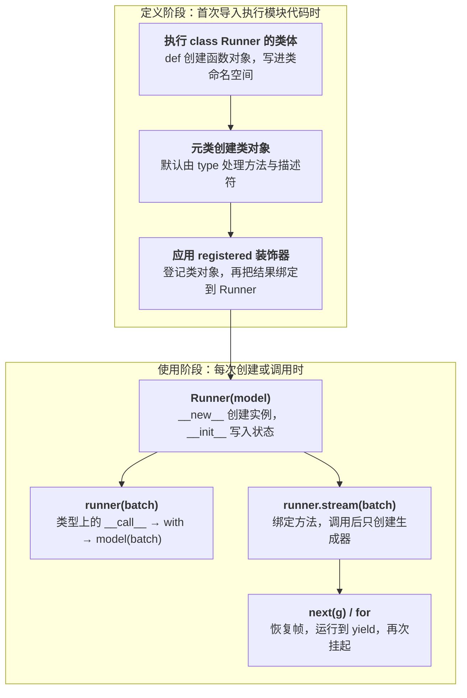
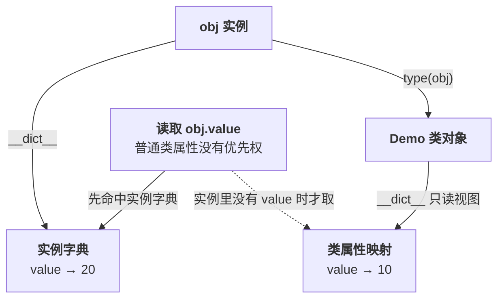
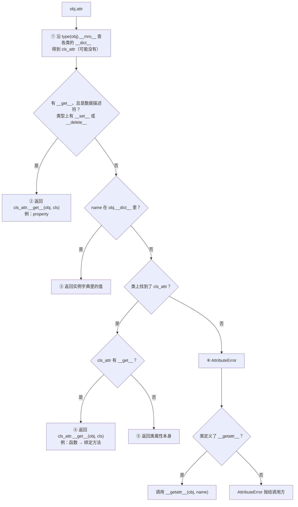
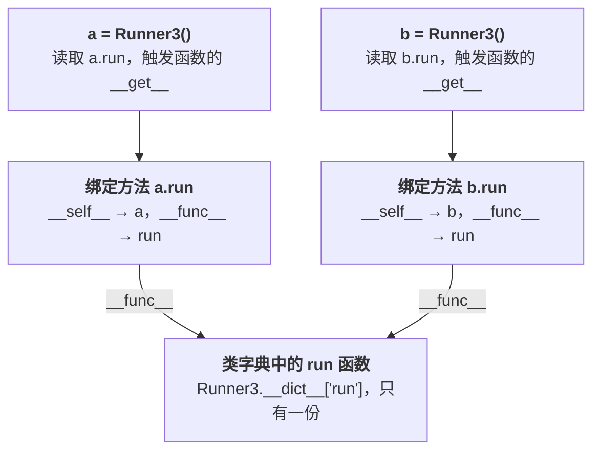
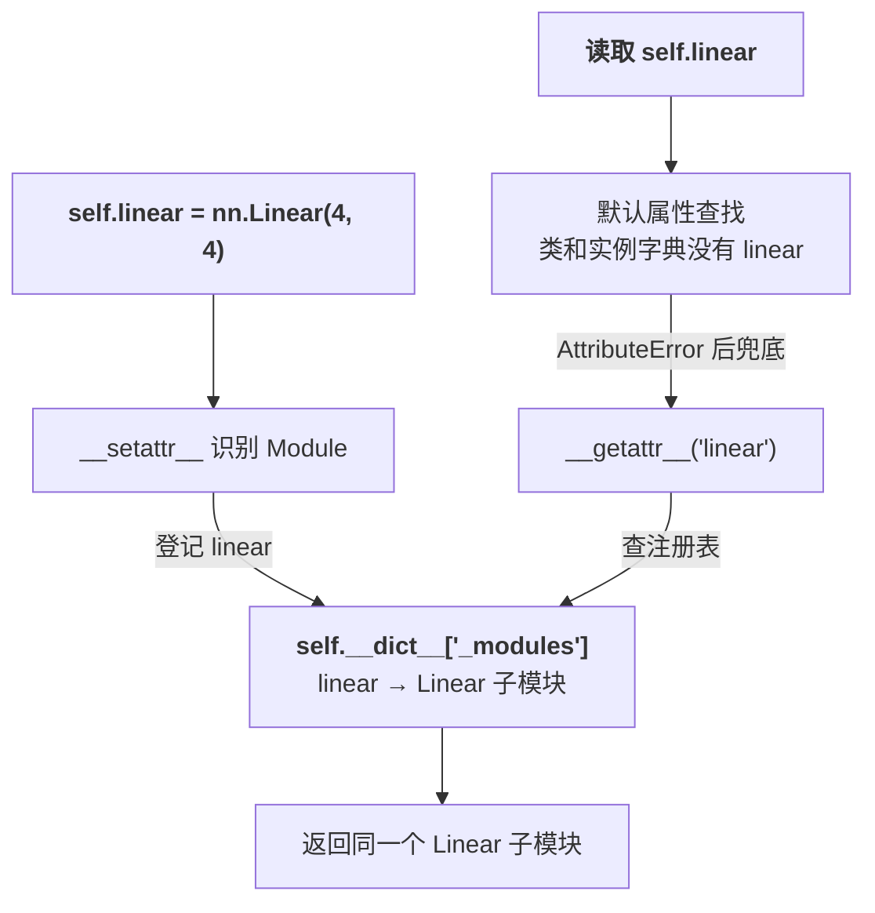
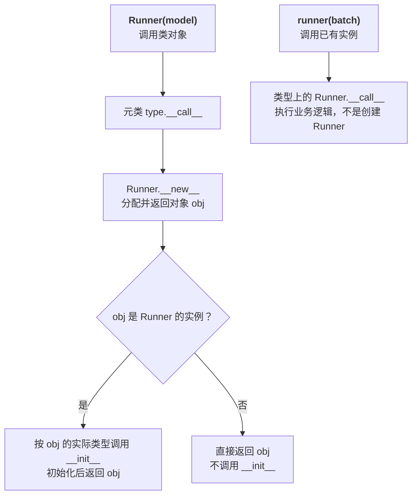
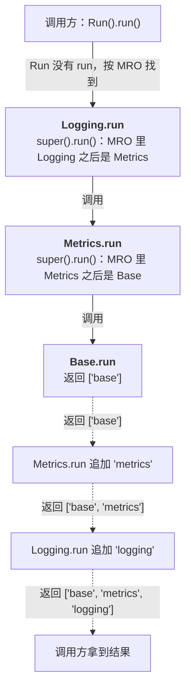

前四篇讲的是代码怎么跑：源码编译成 code object，调用创建帧，名称在帧里按 LEGB 解析，`import` 找到并执行模块，异常沿帧链传播。本篇讲**对象怎么工作**——[《代码如何被执行》](/python-execution-model-code-objects-functions-and-frames.html)开头那七行里的三行：

- **model(x)**：走的是 __call__，中间可能插入 hooks
- **for batch in loader**：迭代协议
- **self.linear = nn.Linear(4, 4)**：__setattr__ 拦截赋值，把子模块登记到 _modules

本篇只回答一个问题：

> **`Runner(model)`、`runner.model`、`runner(batch)` 这几行背后，对象是怎么被创建的、属性和方法是怎么被找到的、语法是怎么交给对象自己决定的？[^q0]**

答案分两层：类由 `type` 创建，`obj.attr` 是一个固定算法（描述符协议是它的可编程点）；`runner(batch)`、`for`、`[]` 这些语法查的是类型上的特殊方法。

## 一、总览

### 1. 例子与依赖关系


例子仍是[《代码如何被执行》](/python-execution-model-code-objects-functions-and-frames.html)里的 `runner.py`——一个用了装饰器注册表、上下文管理器、`__call__` 与生成器的极简推理组件：

```python title='runner.py：装饰器注册表、上下文管理器、__call__ 与生成器'
# runner.py
from contextlib import nullcontext

REGISTRY = {}


def registered(name):                        # 带参数的装饰器：registered("runner") 先被调用，返回下面的 decorator
    def decorator(cls):                      # 真正的装饰器：拿到被装饰的类 Runner，登记后原样返回
        if name in REGISTRY:
            raise ValueError(f"duplicate registration: {name}")
        REGISTRY[name] = cls
        return cls

    return decorator


class InferenceContext:                      # 上下文管理器：进入/退出推理模式
    def __enter__(self):
        print("enter inference mode")
        return self

    def __exit__(self, exc_type, exc, tb):
        print("exit inference mode")
        return False


@registered("runner")
class Runner:
    def __init__(self, model, inference=True):
        self.model = model
        self.inference = inference

    def __call__(self, batch):               # 可调用协议
        context = InferenceContext() if self.inference else nullcontext()
        with context:
            return self.model(batch)

    def stream(self, batch):                 # 生成器：流式输出
        yield from self.model.generate(batch)
```

[《模块与导入系统》](/python-modules-and-the-import-system.html)解释了它被 `import` 时发生了什么，[《异常处理与失败传播》](/python-exceptions-and-failure-propagation.html)解释了异常怎么传播；本篇解释对象这一侧：`Runner(model)` 创建实例、`runner.model` 读取属性、`runner(batch)` 触发 `__call__`。`with` 和 `runner.stream(batch)` 的生成器留给[《装饰器、生成器与上下文管理器》](/python-decorators-generators-and-context-managers.html)。



图从**模块代码已经开始执行**的地方接[《模块与导入系统》](/python-modules-and-the-import-system.html)。源码和函数体的编译发生在此前；执行 `class`、应用装饰器、调用 `Runner(model)` 都不是重新编译。装饰器表达式 `registered("runner")` 在类体执行前求值，得到的装饰器在类对象创建后应用，[《装饰器、生成器与上下文管理器》的「装饰器」一章](/python-decorators-generators-and-context-managers.html#二装饰器用闭包和描述符改写调用路径)会把这两个时机分开。

先区分链路上的对象，再看它们如何协作。下表说的是运行中的对象；除了 code object 可写入 `.pyc`，它们不是磁盘上的另一份代码文件。

| 对象 | 什么时候产生 | 保存在哪里 | Java 对照 |
| :--- | :--- | :--- | :--- |
| 类对象 `Runner` | 执行类体后，由元类创建 | 进程内存；模块字典里的 `Runner`、注册表等引用它；类的 `__dict__` 提供属性映射的只读视图 | `Class<?>` 可反映类的运行时信息，但普通 Java 类不是执行 `class` 语句时创建的 |
| 实例 `runner` | 调用 `Runner(model)` 时 | 进程内存；普通实例的状态在 `__dict__`，使用 `__slots__` 的类也可放在槽位中 | `new Runner(model)` 创建的堆对象 |
| 函数 `Runner.__dict__["stream"]` | 类体执行到 `def stream` 时 | 类属性映射引用它；`__code__` 指向此前已编译的 code object | 类的方法有字节码，但不是 Python 这种可直接取出、替换的函数对象 |
| 绑定方法 `runner.stream` | 通过实例读取类上的函数属性时 | 临时的方法对象，持有 `__self__` 和 `__func__`；赋给变量后可继续存活 | `runner::stream` 的绑定方法引用可类比，但需要函数式接口作为目标类型 |
| 描述符，如 `property`、`Typed(int)` | 构造该对象并放入类属性时 | 描述符对象由类引用；它管理的值可存在实例字典、槽位或其他存储中 | getter/setter 只能类比用途；Java 没有同样的属性访问协议 |
| 生成器 `g` | 调用含 `yield` 的函数时 | 生成器对象保留暂停执行所需的帧状态，包括局部变量和指令位置 | 手写 `Iterator` 把进度存进字段；Java 没有对应的生成器函数语法 |

Table: 类、实例、函数、绑定方法、描述符与生成器的产生时机和保存位置

第二章的方法绑定、`property` 依赖描述符协议，所以描述符放在第二章内部讲，而不是拖到对象协议之后。装饰器、生成器和上下文管理器都建立在这两章之上，放在[《装饰器、生成器与上下文管理器》](/python-decorators-generators-and-context-managers.html)。

### 2. 本文的章节安排

| 章 | 主题 | 内容 |
|---|---|---|
| 二 | 类与对象模型：对象如何被创建和查找 | `type`、属性查找算法、描述符、方法绑定与三种内建描述符、`__getattr__`、`__new__` / `__init__`、MRO 与 `super`、Mixin 与组合 |
| 三 | 对象协议：语法背后的特殊方法 | `__call__`、迭代协议、`__getitem__`、真值、`__eq__` / `__hash__` |
| 四 | 本文小结 |  |
| 五 | 自测 | 4 道题 |

Table: 本文的章节安排

## 二、类与对象模型：对象如何被创建和查找

模块被导入、顶层代码执行时，`class Runner:` 语句创建了一个类对象。接下来 `Runner(model)` 创建实例，`runner.model`、`runner.stream` 读取属性。这一章回答的核心问题只有一个：**`obj.attr` 到底做了什么**。方法绑定、`property`、`classmethod`、`__getattr__`、`nn.Module` 把子模块藏在 `_modules` 里却能用 `self.linear` 访问——全部是这一个算法的不同分支。

### 1. 类也是对象：`type` 创建类

`class` 是运行时语句。执行它时，解释器：

1. 新建一个命名空间字典，在其中执行类体（所以类体里的 `def` 创建的是普通函数对象，并被放进这个字典）；
2. 调用元类（默认是 `type`）：`type(name, bases, namespace)`，得到类对象；
3. 把名称绑定到类对象。

```python title='类也是对象：type(Runner)、__mro__ 与只读的 __dict__'
class Runner:
    def run(self, batch):
        return batch


print(type(Runner))                       # <class 'type'>
print(Runner.__mro__)                     # (<class 'Runner'>, <class 'object'>)
print(type(Runner.__dict__))              # <class 'mappingproxy'>   类属性字典的只读视图
print(type(Runner.__dict__["run"]))       # <class 'function'>       类里存的是普通函数
```

不涉及自定义元类等扩展时，可以手工完成第 2 步，得到具有相同方法的类：

```python title='手工调用 type(name, bases, namespace) 造出同样的类'
Runner = type("Runner", (object,), {"run": lambda self, batch: batch})
```

两个事实值得记住：**类的 `__dict__` 里存的方法就是普通函数对象**（后面 §5 解释它如何变成"方法"）；**类由 `type` 创建**，所以替换 `type` 为自定义元类就能干预类的创建——`nn.Module` 没有用元类，但许多 ORM、配置框架和 `abc.ABC` 用了。元类的用法在[《Python 的动态机制及工程实践》](/python-reflection-metaprogramming-and-plugin-architecture.html)展开，这里只需知道它是 `class` 语句的第 2 步。

> [!NOTE] 与 Java 对照：类对象与实例
> Java 的 `Runner.class` 得到 `Class<Runner>`，`new Runner(...)` 创建实例；Python 的 `Runner` 本身就是可调用的类对象，默认由 `type` 创建。两边都有类的运行时信息，但 Python 的类体是会执行的代码：里面的赋值、`def` 和装饰器会在执行类定义时产生对象，而不是每次创建实例时重做。

### 2. 实例属性与类属性

实例有自己的 `__dict__`，类有类的 `__dict__`：

```python title='实例 __dict__ 与类 __dict__ 各是各的'
class Demo:
    value = 10


obj = Demo()
print(obj.__dict__)                     # {}            实例字典是空的，value 在类上
obj.value = 20
print(obj.__dict__)                     # {'value': 20}
print(Demo.__dict__["value"], Demo.value, obj.value)   # 10 10 20
```

这里的 `value` 是普通类属性，所以赋值 `obj.value = 20` 写的是实例字典，类属性不受影响；遇到 `property` 等数据描述符或自定义 `__setattr__` 时，写入会被接管。反过来，可变的类属性会被所有实例共享——`class Bad: items = []` 之后 `a.items.append(1)` 会让 `b.items` 也变成 `[1]`，因为没有任何赋值发生在实例上，`a.items` 读到的是类字典里的同一个列表。需要每实例独立的可变状态，在 `__init__` 里创建。

把前一个例子里的引用画出来，`obj.value = 20` 并不是把类里的 `10` 改成了 `20`：



> [!NOTE] 与 Java 对照：类属性不等于 static 字段
> Java 用 `static` 区分类字段与实例字段；Python 按数据描述符、实例字典、其余类属性的优先级读取。`Demo.value` 改类属性，`obj.value = 20` 在这个例子里却会新建同名实例属性，并不修改 `Demo.value`。可变的类属性又会被实例共享，不能仅凭写法 `obj.value` 判断数据属于谁。

### 3. 属性查找算法：`object.__getattribute__`

先补一个马上要用到的词：**MRO（Method Resolution Order，方法解析顺序）就是查找类属性时依次检查哪些类**，不只用于找方法。单继承时很好理解：

```python title='先看单继承的 MRO：当前类、父类、object'
class Base:
    value = 10


class Child(Base):
    pass


print([cls.__name__ for cls in Child.__mro__])  # ['Child', 'Base', 'object']
print(Child().value)                           # 10：Child 没有，再找 Base
```

这里先按 `Child → Base → object` 的顺序逐个查类的 `__dict__` 就够了；多继承时如何排出这个顺序，以及 `super()` 怎么沿它继续找，放在本章 §8 展开。**MRO 决定类之间的先后，下面的算法决定类属性和实例属性谁优先。**

现在可以给出核心算法。`obj.attr` 默认调用 `type(obj).__getattribute__(obj, "attr")`，对普通对象它的逻辑是：

```python title='object.__getattribute__ 的等价伪代码：六步查找顺序'
MISSING = object()                              # 与合法的类属性值 None 区分


def __getattribute__(obj, name):                 # 默认查找算法的简化伪代码
    cls = type(obj)
    cls_attr = lookup_in_mro(cls, name, MISSING) # ① 沿 cls.__mro__ 查 __dict__，未找到才返回 MISSING
    descr_get = getattr(type(cls_attr), "__get__", None)

    if descr_get is not None and is_data_descriptor(cls_attr):   # ② 有读取方法的数据描述符优先
        return descr_get(cls_attr, obj, cls)

    instance_dict = get_instance_dict(obj)      # ③ 不经过 obj.__getattribute__；无字典时视为空
    if name in instance_dict:
        return instance_dict[name]

    if cls_attr is not MISSING:
        if descr_get is not None:              # ④ 非数据描述符：函数、classmethod、staticmethod
            return descr_get(cls_attr, obj, cls)
        return cls_attr                          # ⑤ 普通类属性

    raise AttributeError(name)                   # ⑥ 都没有 → 抛出；若类定义了 __getattr__，解释器接着调它
```

伪代码里的 ① 只是"先在类上找一遍"，真正决定结果的是后面几次判断。描述符方法要查**描述符对象的类型**，而不是在它自己的实例字典里找。下面流程假设描述符正常返回：类上找到的东西要**先看它有没有 `__get__` 且是数据描述符**，再决定实例字典有没有机会；查找抛出 `AttributeError` 后，点号访问才会尝试 `__getattr__`：



用一个实验同时放进三种类属性，再给实例字典塞入同名值，看哪一个生效：

```python title='一个实验比较 property、函数和普通类属性的查找优先级'
class LookupDemo:
    count = 10

    @property
    def value(self):
        return "from property"

    def run(self):
        return "from class method"


obj = LookupDemo()
obj.__dict__.update(
    value="from instance dict",
    run=lambda: "from instance function",
    count=20,
)
print(obj.value)             # from property：② 数据描述符先于 ③ 实例字典
print(obj.run())             # from instance function：③ 实例字典先于 ④ 非数据描述符
print(obj.count)             # 20：③ 实例字典先于 ⑤ 普通类属性
print(LookupDemo.count)      # 10：类属性没有改变

del obj.__dict__["run"]
del obj.__dict__["count"]
print(obj.run())             # from class method：实例没有，才绑定类上的函数
print(obj.count)             # 10：实例没有，才返回普通类属性
```

这里刻意直接写实例字典，让三种同名属性同时存在：`property` 即使没有 setter，类型上仍有 `__set__`，所以读时优先；函数是非数据描述符；`count` 对应的整数则根本不是描述符。后两种都允许实例里的值遮住类上的值，删除实例值后才重新露出类属性。

这个顺序设计的意图：`property` 这类需要**控制读写**的东西必须不能被实例字典绕过，所以放最前；方法这类**只提供默认行为**的东西允许被实例覆盖（monkey patch 单个对象的方法就靠这一点），所以放实例字典之后。

### 4. 描述符协议：属性查找的可编程点

算法里的 ②（数据描述符）和 ④（非数据描述符）都在调用一个东西的 `__get__`。凡是定义了 `__get__`、`__set__` 或 `__delete__` 之一的对象，放在**类属性**位置上，就是描述符：

- 只有 `__get__`：**非数据描述符**，可被实例字典覆盖；
- 有 `__set__` 或 `__delete__`：**数据描述符**，优先于实例字典。

一个做类型校验的描述符：

```python title='一个做类型校验的描述符 Typed：__set_name__、__get__、__set__'
class Typed:
    def __init__(self, expected_type):
        self.expected_type = expected_type

    def __set_name__(self, owner, name):      # 类创建时被调用，拿到自己在类里的名字
        self.name = name

    def __get__(self, obj, objtype=None):
        if obj is None:                       # 通过类访问（Config.batch_size）时 obj 为 None
            return self
        return obj.__dict__.get(self.name)

    def __set__(self, obj, value):
        if not isinstance(value, self.expected_type):
            raise TypeError(f"{self.name} expects {self.expected_type.__name__}, got {type(value).__name__}")
        obj.__dict__[self.name] = value


class Config:
    batch_size = Typed(int)
    device = Typed(str)

    def __init__(self, batch_size, device):
        self.batch_size = batch_size          # 触发 Typed.__set__
        self.device = device


config = Config(32, "cuda")
config.batch_size = "big"                    # TypeError: batch_size expects int, got str
```

描述符必须放在类上才生效——算法第 ① 步（沿类的 MRO 查找）只查类，实例字典里的对象即便有 `__get__` 也不会被调用。

`__slots__` 是描述符的一个内建应用：`class S: __slots__ = ("a",)` 会让 `type` 为每个槽位在类上创建一个 `member_descriptor`（数据描述符），直接读写实例的固定内存偏移。若基类没有提供实例字典，且槽位里没有 `"__dict__"`，这种实例就没有 `__dict__`；子类不声明 `__slots__` 时又会获得字典。第五篇讨论内存时会回到它。

> [!NOTE] 与 Java 对照：描述符接管的是访问语法
> Java 的字段访问和 getter/setter 调用是两种写法；Python 的描述符能让 `config.batch_size`、`config.batch_size = 32` 分别执行 `__get__`、`__set__`。类上保存的是管理访问的 `Typed` 对象，本例中的整数值仍在各个实例字典里，不是所有实例共用一个值。

### 5. 方法绑定、`classmethod`、`staticmethod`、`property`：描述符的四种形态

有了 §3 的算法和 §4 的协议，"方法"就不再需要单独解释：**函数对象实现了 `__get__`**，所以它是非数据描述符。

```python title='函数是非数据描述符：通过类访问得函数，通过实例访问得绑定方法'
class Runner3:
    def run(self, batch):
        return batch


r3 = Runner3()
print(Runner3.run)          # <function Runner3.run at 0x...>          通过类访问：__get__(None, cls) 返回函数本身
print(r3.run)               # <bound method Runner3.run of <Runner3 ...>>  通过实例访问：__get__(r3, cls) 返回绑定方法
print(r3.run.__self__ is r3, r3.run.__func__ is Runner3.run)          # True True
print(Runner3.__dict__["run"].__get__(r3, Runner3))                    # 手工调用 __get__，得到同样的绑定方法
```

绑定方法是一个小对象，持有实例（`__self__`）和原函数（`__func__`），调用时把 `__self__` 塞到第一个参数位置。`self` 不是关键字，只是这个协议约定的第一个参数。



不是把函数复制进每个实例，而是在读取属性时临时配上接收者：`a.run(batch)` 相当于调用 `Runner3.run(a, batch)`；`b.run(batch)` 则传入 `b`。这也解释了为什么直接把函数写进**实例字典**不会自动绑定：它不经过类上描述符的分支。

> [!NOTE] 与 Java 对照：实例方法与绑定方法
> 两边的实例方法调用都会携带接收者；Python 把它显式写成第一个参数 `self`，并把“函数 + 接收者”暴露成可读取的绑定方法对象。Java 的 `obj::method` 也能记住接收者，但它是在函数式接口的目标类型下创建的方法引用，不是每次读取 `obj.method` 的结果。

`classmethod`、`staticmethod`、`property` 是三个内建的描述符类型，区别只在 `__get__` 返回什么，以及是否有 `__set__`：

```python title='classmethod、staticmethod、property 三个内建描述符的 __get__ 返回值'
class K:
    @classmethod
    def c(cls): return cls
    @staticmethod
    def s(): return "s"
    @property
    def p(self): return "p"


print(type(K.__dict__["c"]), type(K.__dict__["s"]), type(K.__dict__["p"]))
# <class 'classmethod'> <class 'staticmethod'> <class 'property'>
print(hasattr(classmethod, "__set__"), hasattr(staticmethod, "__set__"), hasattr(property, "__set__"))
# False False True
```

| 类属性上的对象 | `__get__(obj, cls)` 返回 | 数据描述符？ | 效果 | Java 对照 |
| :--- | :--- | :--- | :--- | :--- |
| 函数 | `obj` 为 `None` 时返回函数；否则返回绑定 `obj` 的方法 | 否 | 实例方法 | 实例方法；Python 显式声明 `self` |
| `classmethod` | 无论通过类还是实例访问，都绑定到访问所用的类 | 否 | 第一个参数是类 | 静态工厂可类比用途，但不会自动得到调用处的子类 |
| `staticmethod` | 原函数本身，不绑定任何东西 | 否 | 普通函数挂在类命名空间 | `static` 方法可类比用途；Python 仍按运行时属性查找规则取值 |
| `property` | 实例访问返回 `fget(obj)`；类访问返回 property 本身 | **是**（有 `__set__`，未提供 setter 时抛 `AttributeError`） | 计算属性，且不可被实例字典覆盖 | getter/setter 或 record 访问器；Java 仍要调用方法 |

Table: 函数、classmethod、staticmethod、property 的 __get__ 行为

从这张表能直接推出三者的用法：

- **`classmethod` 的价值在于 `cls` 是"实际被调用的那个类"**。`Sub.c()` 和 `Sub().c()` 都返回 `Sub`，不是 `K`。这让它成为替代构造函数的标准写法：

  ```python title='classmethod 作替代构造函数：cls 是实际被调用的那个类'
  class Runner:
      def __init__(self, model, device="cpu"):
          self.model = model
          self.device = device

      @classmethod
      def from_config(cls, config):
          return cls(model=config["model"], device=config.get("device", "cpu"))


  class GPURunner(Runner): ...


  cfg = {"model": "demo", "device": "cuda"}
  print(type(GPURunner.from_config(cfg)).__name__)  # GPURunner
  ```

  对象尚未存在，所以不能是实例方法；需要构造"当前类或子类"，所以不该写死 `Runner(...)`——`cls(...)` 自动跟随继承。

- **`staticmethod` 只是命名空间归属**。既不需要实例也不需要类的函数，放在类里是为了表达"逻辑上属于它"；很多时候放模块级更简单。
- **`property` 是数据描述符**，所以 §3 的实验中它赢过实例字典。它适合"看起来像字段、实际需要计算或校验"的场景；不适合隐藏昂贵操作——调用方看到 `runner.device` 不会预期它去查询硬件。

> [!NOTE] 与 Java 对照：classmethod 与静态工厂
> Java 的 `GPURunner.fromConfig(cfg)` 若继承的是 `Runner` 的静态工厂，方法体里的 `new Runner(...)` 不会自动变成 `new GPURunner(...)`。Python 的 `GPURunner.from_config(cfg)` 则自动把 `GPURunner` 绑定给 `cls`，所以 `cls(...)` 创建子类实例。Java 要实现类似工厂，可以显式传构造器 `GPURunner::new`；区别在于由调用方传入，而不是由属性查找注入。

### 6. `__getattr__` 与 `__getattribute__`：查找失败后的钩子

§3 算法的第 ⑥ 步（都没找到，抛 `AttributeError`）：`__getattribute__` 抛出 `AttributeError` 之后，如果类定义了 `__getattr__`，解释器会调用它作为最后手段。

```python title='__getattr__ 只在查找失败后被调用'
class Cfg:
    def __init__(self):
        self.a = 1

    def __getattr__(self, name):
        print("  __getattr__ called for", name)
        return None


c = Cfg()
print(c.a)      # 1                                —— 正常查找命中，__getattr__ 不参与
print(c.b)      # __getattr__ called for b / None  —— 只在失败后调用
```

`__getattribute__` 则拦截**所有**属性访问，包括 `self.__dict__`。重写它时必须用 `object.__getattribute__(self, name)` 去取真实值，否则无限递归。业务代码几乎不需要它。

`__getattr__` 有一个隐蔽的陷阱：**它会掩盖 `property` 内部的 `AttributeError`**。

```python title='__getattr__ 掩盖 property 内部的 AttributeError'
class P:
    @property
    def v(self):
        raise AttributeError("bug inside property")   # 比如 property 里访问了一个拼错的字段

    def __getattr__(self, name):
        return f"fallback({name})"


print(P().v)    # fallback(v)
```

`property` 的 getter 抛出 `AttributeError`，`__getattribute__` 把它当作"没找到 `v`"，转而调用 `__getattr__("v")`——真正的 bug 被吞掉，换成一个看似合理的返回值。有 `__getattr__` 的类里，`property` 中的异常应转换成其他类型再抛出。

一个真实的例子是 `torch.nn.Module`。它把参数、缓冲区和子模块分别存在 `_parameters`、`_buffers`、`_modules` 三个字典里，**不放在实例 `__dict__`**。这依靠两个钩子配合（PyTorch 2.9.0，`torch/nn/modules/module.py`）：

```python title='torch.nn.Module 的 __setattr__ 骨架：参数与子模块分开存放'
# Module.__setattr__ 的骨架
def __setattr__(self, name, value):
    if isinstance(value, Parameter):
        remove_from(self.__dict__, self._buffers, self._modules, ...)   # 保证同名只存在于一处
        self.register_parameter(name, value)
    elif isinstance(value, Module):
        remove_from(self.__dict__, self._parameters, self._buffers, ...)
        self._modules[name] = value
    else:
        super().__setattr__(name, value)                                  # 普通属性才进 __dict__


# Module.__getattr__ 的骨架
def __getattr__(self, name):
    if name in self.__dict__["_parameters"]: return self.__dict__["_parameters"][name]
    if name in self.__dict__["_buffers"]:    return self.__dict__["_buffers"][name]
    if name in self.__dict__["_modules"]:    return self.__dict__["_modules"][name]
    raise AttributeError(f"'{type(self).__name__}' object has no attribute '{name}'")
```

于是 `self.linear = nn.Linear(4, 4)` 被 `__setattr__` 截获，写进 `_modules`；之后 `self.linear` 走 §3 的算法在类和实例字典都找不到，落到 `__getattr__`，从 `_modules` 取回。这就是 `parameters()`、`state_dict()`、`.to(device)` 能够递归遍历所有子模块的原因——它们只需遍历三个字典，而不需要扫描 `__dict__` 猜哪些属性是模块。代价是每次访问子模块都多走一次失败查找加一次 Python 级函数调用，所以在热路径上 PyTorch 自己也会先把 `self.linear` 取到局部变量。

注意，`linear` 不直接在实例字典里，不等于三个注册字典也不在：`self.__dict__["_modules"]` 持有的就是子模块注册表。



模块级也有同样的钩子（PEP 562）：在模块顶层定义 `__getattr__(name)`，访问不存在的模块属性时会被调用。`torch/__init__.py` 用它做两件事——对已废弃的名字发出 `DeprecationWarning` 后返回替代品，以及对少数子模块做惰性导入（第一次访问时才 `importlib.import_module`）。

### 7. 对象创建：`__new__`、`__init__` 与 `type.__call__`

`Runner(model)` 是对**类对象**的调用；这里的元类是默认的 `type`，因此由 `type.__call__` 组织创建过程。省略底层槽位调用与返回值校验后，可以概括为：

```python title='type.__call__ 的简化伪代码：__new__ 再 __init__'
def __call__(cls, *args, **kwargs):          # 说明创建顺序，不是底层实现
    obj = cls.__new__(cls, *args, **kwargs)  # 分配并返回实例
    if isinstance(obj, cls):               # __new__ 可返回 cls 的子类实例
        type(obj).__init__(obj, *args, **kwargs)  # 按返回对象的类型初始化；必须返回 None
    return obj
```

`__new__` 被特殊处理为静态方法，不需要显式写 `@staticmethod`，负责“造出对象”；`__init__` 负责“填充对象”。重写 `__new__` 的场景很少：不可变类型（`int`、`tuple`、`str`）的子类化必须在 `__new__` 里改值，因为 `__init__` 拿到的已经是造好的不可变对象；单例、实例缓存、根据参数返回不同子类的工厂类也在这里做。其他情况只写 `__init__`。

如果 `__new__` 返回的不是 `cls` 的实例，`__init__` 不会被调用——这是"工厂类"模式的机制基础。



两条路径里都有 `__call__`，但接收者不同：前者由元类负责造实例，后者由实例的类型负责执行模型调用。

> [!NOTE] 与 Java 对照：分配与初始化
> Java 的 `new Runner(...)` 把分配对象和执行构造器连在一起；Python 在协议上分成 `__new__` 返回对象、`__init__` 初始化对象。因此 `__init__` 不是分配内存的构造步骤，不能用 `return another_object` 换掉实例；这类替换发生在 `__new__` 或工厂函数里。

### 8. 继承、MRO 与协作式 `super()`

属性查找算法第 ① 步"沿 `cls.__mro__` 查找"，MRO（Method Resolution Order）就是这个顺序。单继承时它就是从子类到 `object` 的链；多继承时由 C3 线性化算法计算，保证子类先于父类、多个父类之间保持声明顺序：

```python title='多继承的 MRO：C(A, B) 找到 A.run 就停'
class A:
    def run(self): return ["A"]
class B:
    def run(self): return ["B"]
class C(A, B): pass


print([k.__name__ for k in C.__mro__], C().run())    # ['C', 'A', 'B', 'object'] ['A']
```

`C().run()` 找到 `A.run` 就停，**不会**自动接着调 `B.run`。想让链上的每一层都执行，每一层必须自己调 `super()`：

```python title='协作式 super()：链上每一层都自己调 super().run()'
class Base:
    def run(self): return ["base"]
class Logging:
    def run(self):
        result = super().run(); result.append("logging"); return result
class Metrics:
    def run(self):
        result = super().run(); result.append("metrics"); return result
class Run(Logging, Metrics, Base): pass


print([k.__name__ for k in Run.__mro__])   # ['Run', 'Logging', 'Metrics', 'Base', 'object']
print(Run().run())                         # ['base', 'metrics', 'logging']
```

把这次调用按时间画出来：调用沿 MRO 往下走到 `Base`，返回值再沿原路往回传，每一层在**拿到下一层的结果之后**才 `append`，所以最先追加的是离 `Base` 最近的 `Metrics`：



`Logging.run` 里的 `super().run()` 调到的是 `Metrics.run`，不是 `Base.run`——`super()` 的含义是"**在实例的 MRO 中，当前类之后的下一个**"，它取决于实例的类型，而不是写代码时看到的父类。`Logging` 类的作者并不知道 `Metrics` 的存在，链条却能接上，这就是协作式多继承。

零参数 `super()` 之所以知道"当前类"是谁，是因为编译器在使用了 `super()` 的方法里注入了一个名为 `__class__` 的闭包变量（可以用 `Child.run.__code__.co_freevars` 看到 `('__class__',)`）——[《作用域与闭包》](/python-scopes-and-closures.html)的 cell 机制在这里又出现了一次。

协作式多继承的约定：每一层都调 `super()`（包括 `__init__`）；同名方法签名兼容，通常用 `*args, **kwargs` 透传；不假设 `super()` 指向某个具体类。任何一层漏掉 `super()`，它之后的所有层都会被跳过。声明顺序不一致时 C3 会直接拒绝：`class X(A, C)` 抛出 `TypeError: Cannot create a consistent method resolution order (MRO) for bases A, C`，因为 `C` 已经要求 `A` 在自己之后。

> [!NOTE] 与 Java 对照：super 不是固定的父类名称
> Java 单继承加接口；`super.method()` 从当前类的直接父类一侧查找，不会沿多个类组成的协作链继续分派。两个无继承关系接口的同名 default 方法冲突时，需要实现类显式选择。Python 的 `super()` 则按实际实例的 MRO，从当前类之后继续查找：上面的 `Logging` 没有继承 `Metrics`，却能经由 `super().run()` 调到它。

### 9. Mixin 与组合

Mixin 是协作式多继承的一种受限用法：一个只提供横向能力（日志、指标、序列化）、不代表完整实体、不持有业务依赖的类，被放在基类列表前部：

```python title='LoggingMixin 放在基类列表前部'
class LoggingMixin:
    def log(self, message):
        print(f"[LOG] {message}")


class Runner(LoggingMixin, BaseRunner):
    def run(self):
        self.log("start")
```

Mixin 没有绕开 MRO 的复杂性，只是把它限制在一个容易验证的范围内。约束是：职责单一；对宿主类的要求明确；`__init__` 遵守协作式 `super()`；用 `__mro__` 和测试固定实际顺序。

而 `model`、`scheduler`、`tokenizer` 这类**业务依赖**，应该用组合——持有而不是继承：

```python title='业务依赖用组合：InferenceRunner 持有 model、scheduler、tokenizer'
class InferenceRunner:
    def __init__(self, model, scheduler, tokenizer):
        self.model = model
        self.scheduler = scheduler
        self.tokenizer = tokenizer
```

组合的依赖是显式的（构造参数），可以注入替身，不依赖 MRO 和 `super()` 协议。选择规则：

| 关系 | 方式 |
| :--- | :--- |
| 稳定的"是一种"关系、遵守框架协议（如 `nn.Module`） | 继承 |
| 复用独立的横向能力 | Mixin，谨慎 |
| 给单个函数加日志、重试、tracing | 装饰器（[《装饰器、生成器与上下文管理器》的「装饰器」一章](/python-decorators-generators-and-context-managers.html#二装饰器用闭包和描述符改写调用路径)） |
| 管理业务依赖 | 组合 |

Table: 继承与组合的选择规则

## 三、对象协议：语法背后的特殊方法

第二章解释了 `obj.attr`。但 `runner(batch)`、`for x in loader`、`batch[0]`、`if tensor:`、`with ctx:` 这些**不是**属性访问的语法，Python 也是交给对象自己决定的——通过一组以双下划线命名的特殊方法。这一章讨论其中最常见的几个；`with` 和 `yield` 留给[《装饰器、生成器与上下文管理器》](/python-decorators-generators-and-context-managers.html)。

### 1. 语法到特殊方法的映射，且在类型上查找

| 表达式 | 特殊方法 |
| :--- | :--- |
| `x(...)` | `__call__` |
| `for item in x` | `__iter__`，然后对迭代器反复 `__next__` |
| `x[key]`、`x[key] = v`、`del x[key]` | `__getitem__`、`__setitem__`、`__delitem__` |
| `len(x)` | `__len__` |
| `if x`、`bool(x)` | `__bool__`，缺失时退化为 `__len__` |
| `x == y`、`hash(x)` | `__eq__`、`__hash__` |
| `x + y` | `__add__`，失败时尝试 `y.__radd__` |
| `with x:` | `__enter__`、`__exit__` |
| `obj.attr` | `__getattribute__`、`__getattr__`（第二章） |

Table: 语法到特殊方法的映射

有一个规则与第二章的属性查找不同：**特殊方法由解释器直接在类型上查找，跳过实例字典**。

```python title='特殊方法在类型上查找：实例上的 __call__ 被跳过'
class C:
    def __call__(self):
        return "type-level"


c = C()
c.__call__ = lambda: "instance-level"
print(c())              # type-level        —— 解释器查的是 type(c).__call__
print(c.__call__())     # instance-level    —— 普通属性访问才看实例字典
```

这是性能考虑的结果：`a + b` 如果每次都走完整的属性查找算法太慢，CPython 在类型对象上为每个特殊方法维护了一个槽位（slot），运算时直接取槽位。后果是"给单个对象打补丁换掉 `__call__`"不起作用——必须换类，或者在类的 `__call__` 里做转发。

### 2. 可调用对象：`__call__`

实现 `__call__` 的实例可以像函数一样被调用。第一章的 `Runner.__call__` 就是这样让 `runner(batch)` 成立的。相比函数，可调用对象能同时携带配置、缓存、依赖和生命周期状态，因此模型、推理器、预处理器、Hook、Loss 大多是可调用对象。

`nn.Module` 是最典型的例子。`model(x)` 不直接调 `forward`，而是 `Module.__call__`——在 PyTorch 2.9.0 中它被赋值为 `_wrapped_call_impl`（`torch/nn/modules/module.py`）：先检查有没有 `torch.compile` 生成的编译版本，再进入 `_call_impl`；`_call_impl` 在没有任何 hook 注册时直接调用 `forward`，否则依次执行 forward pre-hooks、`forward`、forward hooks，并处理 backward hooks 的挂载。所以直接调 `model.forward(x)` 会绕过全部 hook——这就是文档要求"调用模块而不是 forward"的机制原因。

> [!NOTE] 与 Java 对照：可调用对象
> Java 可以用函数式接口实例表达行为，但仍通过 `.apply()`、`.call()` 等方法调用，没有让任意实例支持 `model(x)` 的运算符协议。在调用前后加 hook 也不一定要 AOP：显式包装一层方法就能做到；Python 的 `__call__` 让这层包装仍可使用函数调用语法。

### 3. 迭代协议：可迭代对象与迭代器

`for item in x` 展开为：

```python title='for 循环的展开：iter() 与 next() 直到 StopIteration'
it = iter(x)               # 调 x.__iter__()，得到迭代器
while True:
    try:
        item = next(it)    # 调 it.__next__()
    except StopIteration:
        break
    ...
```

**可迭代对象**（iterable）实现 `__iter__` 并返回一个迭代器；**迭代器**（iterator）实现 `__next__`，并且自己的 `__iter__` 返回自己。两者常被混为一谈，但差别决定了能否重复遍历：

```python title='可迭代对象与迭代器的差别：列表可反复遍历，CountDown 只能一次'
lst = [1, 2]
print(iter(lst) is lst)                 # False   列表每次 iter() 返回一个新迭代器，可反复遍历


class CountDown:                        # 既是可迭代对象又是迭代器
    def __init__(self, start): self.current = start
    def __iter__(self): return self
    def __next__(self):
        if self.current <= 0: raise StopIteration
        self.current -= 1
        return self.current + 1


c = CountDown(2)
print(list(c), list(c))                 # [2, 1] []    —— 第二次遍历是空的：迭代器耗尽后不会重置
```

`torch.utils.data.DataLoader` 是可迭代对象——每个 epoch 的 `for batch in loader` 都重新调用 `iter(loader)`，开始一轮迭代。默认情况下会创建新迭代器，多 worker 模式也会重建 worker；但 `persistent_workers=True` 且 `num_workers > 0` 时，会复用迭代器及 worker，并重置本轮迭代状态。不能因此笼统地说“每次都创建新对象”；应在每个 epoch 重新向 loader 请求迭代，而不是继续对上一轮已经耗尽的迭代器调用 `next()`。

> [!NOTE] 与 Java 对照：Iterable 与 Iterator
> Java 的 `Iterable<T>.iterator()`、`Iterator<T>.hasNext()/next()` 与这里的两层角色相近；Python 用 `iter()`、`next()` 和 `StopIteration`，没有单独的 `hasNext()`。Java 要声明实现接口，Python 的运行时协议不要求继承特定基类。能否重复遍历，取决于 `iter(x)` 如何提供或重置迭代状态，不是只看有没有 `__iter__`。

还有一条历史兼容规则：没有 `__iter__` 但有 `__getitem__` 的对象也可迭代——解释器从 0 开始调 `__getitem__` 直到 `IndexError`。`Dataset` 子类只实现 `__getitem__` 和 `__len__` 就能被 `for` 遍历，靠的就是它。

### 4. `__getitem__` 与容器协议

```python title='只实现 __getitem__ 的 Batch：索引与切片都原样传入'
class Batch:
    def __init__(self, values): self.values = values
    def __getitem__(self, index): return self.values[index]


batch = Batch([1, 2, 3])
print(batch[0], batch[1:])              # 1 [2, 3]     —— 切片对象 slice(1, None, None) 原样传给 __getitem__
```

`__getitem__` 收到的 `index` 可以是整数、切片、元组（`x[i, j]` 传入 `(i, j)`）、甚至任意对象——Tensor 的高级索引 `t[mask]`、`t[..., 0]` 全部走这一个方法，由实现自己解释参数。

### 5. 真值判断

`if x:` 先找 `__bool__`，没有则用 `__len__` 是否为零，两者都没有则一律为真。这带来一个 AI-Infra 特有的陷阱：多元素 Tensor 的真值没有明确定义，PyTorch 会抛 `RuntimeError: Boolean value of Tensor with more than one value is ambiguous`。所以 `if tensor:`、`tensor and other`、`x if mask else y` 在 Tensor 上都不安全，要用 `.any()`/`.all()`/`torch.where` 明确意图。同理，`if batch:` 判断"是否有数据"时，要确认 `Batch` 类实现了 `__len__` 或 `__bool__`，否则永远为真。

### 6. `__eq__` 与 `__hash__`

`==` 调 `__eq__`；作为字典键或集合元素则需要 `__hash__`。两者有一条契约：**相等的对象必须有相同的哈希值**。为了防止违反它，只定义 `__eq__` 会让 Python 把 `__hash__` 设为 `None`：

```python title='只定义 __eq__ 会让 __hash__ 变成 None'
class User:
    def __init__(self, uid): self.uid = uid
    def __eq__(self, other): return isinstance(other, User) and self.uid == other.uid


print(User.__hash__)     # None
{User(1)}                # TypeError: unhashable type: 'User'
```

需要哈希就显式实现 `__hash__`，并且只使用参与 `__eq__` 且在对象生命周期内不变的字段。`@dataclass(frozen=True)` 会自动生成一致的两者；可变的 dataclass 默认也是不可哈希的，原因相同。

> [!NOTE] 与 Java 对照：equals / hashCode 契约
> Java 的 `equals` / `hashCode` 也要求相等对象具有相同哈希值，`HashMap`、`HashSet` 都依赖它。不同的是 Python 在类只重写 `__eq__` 时会自动禁用继承来的默认哈希；Java 不会替开发者禁用 `hashCode()`，需要自己保证两者一致。Python 的 `==` 对应值比较，`is` 对应身份比较，不要把它们与 Java 引用上的 `==` 混淆。

## 四、本文小结

| 机制 | 要点 |
|---|---|
| <span style="white-space:nowrap">类与对象模型</span> | 默认由 `type` 创建类；属性读取优先级：有 `__get__` 的数据描述符 → 实例字典 → 非数据描述符或普通类属性；抛出 `AttributeError` 后才尝试 `__getattr__`<br/>方法、`classmethod`、`staticmethod`、`property` 通过描述符决定绑定或取值 |
| 对象协议 | 语法交给类型上的特殊方法；特殊方法跳过实例字典 |

Table: 对象模型与对象协议的要点

回到开头那三行代码：

| 开头的写法 | 背后的机制 | 在哪一节 |
|---|---|---|
| `model(x)` 走 `__call__`，中间插入 hooks | 调用语法查的是**类型**上的 `__call__`；`nn.Module.__call__` = `_wrapped_call_impl` → pre-hooks → `forward` → hooks，所以 `model.forward(x)` 绕过全部 hook | 三 §1、§2 |
| `for batch in loader` | `for` 先调用 `iter(loader)` 开始本轮迭代，再反复 `next()`；DataLoader 可新建迭代器，也可在 persistent worker 模式下复用并重置 | 三 §3 |
| `self.linear = nn.Linear(4, 4)` 登记到 `_modules` | `Module.__setattr__` 拦截赋值写进 `_modules`（不进 `__dict__`），读取时属性查找算法在类和实例字典都找不到，落到 `__getattr__` 从 `_modules` 取回 | 二 §3、§6 |

Table: 开头三行代码背后的机制

读 AI-Infra 代码时的这些疑问，也都落在本篇的机制上：

- `nn.Module` 为什么能用 `self.linear` 访问一个不在 `__dict__` 里的子模块——`__setattr__` 拦截写、`__getattr__` 兜底读；
- `model(x)` 和 `model.forward(x)` 为什么不等价——`__call__` 在类型上查找，hooks 挂在那里；
- `super().__init__()` 为什么不一定调到"父类"——它调的是实例 MRO 中的下一个。

配套代码：本文验证各个结论用的小脚本（描述符优先级、可调用对象）在 [ai-learning-labs/python-for-ai-infra/01-language-mechanisms](https://github.com/arganzheng/ai-learning-labs/tree/main/python-for-ai-infra/01-language-mechanisms)，只依赖标准库。

## 五、自测

1. `model(x)` 与 `model.forward(x)` 为什么不等价？

   <details markdown="1"><summary>答案</summary>

   调用语法查的是**类型**上的 `__call__`：`nn.Module.__call__` → `_wrapped_call_impl` → pre-hooks → `forward` → hooks。直接调 `forward` 绕过全部 hook（包括 `register_forward_hook` 注册的），行为可能不同。

   </details>

2. `self.linear = nn.Linear(4, 4)` 之后 `self.linear` 为什么不在 `self.__dict__` 里却能访问？

   <details markdown="1"><summary>答案</summary>

   `Module.__setattr__` 拦截赋值，把子模块写进 `_modules` 字典而不是实例 `__dict__`；读取时属性查找在类与实例字典都找不到，落到 `__getattr__`，它从 `_modules` / `_parameters` / `_buffers` 取回。

   </details>

3. `for batch in loader` 里 `for` 对 `loader` 做了什么？为什么每个 epoch 能重新迭代？

   <details markdown="1"><summary>答案</summary>

   `for` 先调用 `iter(loader)` 开始本轮迭代，再反复 `next()` 直到 `StopIteration`。默认创建新迭代器，多 worker 时也重建 worker；`persistent_workers=True` 且 `num_workers > 0` 时则复用迭代器和 worker，并重置迭代状态。下一个 epoch 要重新执行 `iter(loader)`，不是继续消费上一轮已耗尽的状态。

   </details>

4. 类上有一个 `property` 叫 `device`，实例的 `__dict__` 里也被塞进了一个 `"device"` 键。读 `obj.device` 得到哪一个？

   <details markdown="1"><summary>答案</summary>

   `property` 的。`property` 是数据描述符，属性查找算法先查类型 MRO 上的数据描述符，再查实例字典。

   </details>

[^q0]: 两层。（1）对象模型：类由 `type` 创建——`Runner(model)` 先调元类 `type.__call__`，依次 `__new__` 分配、`__init__` 初始化；`obj.attr` 是一个固定算法——先查类型 MRO 上的数据描述符，再查实例 `__dict__`，再查非数据描述符与类属性，最后 `__getattr__`；方法就是函数这个非数据描述符绑定实例的结果（[第二章](#二类与对象模型对象如何被创建和查找)）。（2）对象协议：语法交给对象自己决定靠**特殊方法**——`runner(batch)` 查类型上的 `__call__`，`for` 查 `__iter__` / `__next__`，`[]` 查 `__getitem__`，而且是在类型上查、跳过实例字典（[第三章](#三对象协议语法背后的特殊方法)）。
