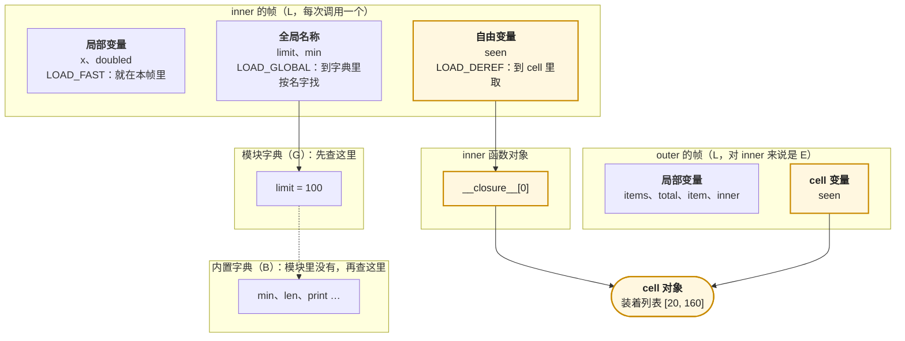
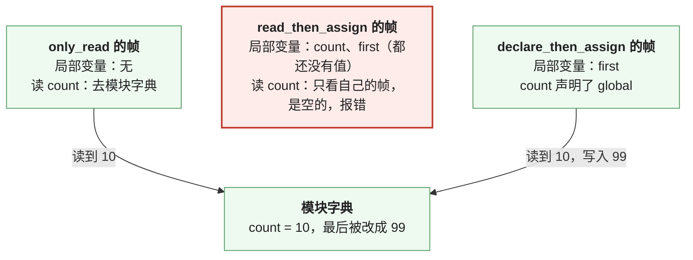
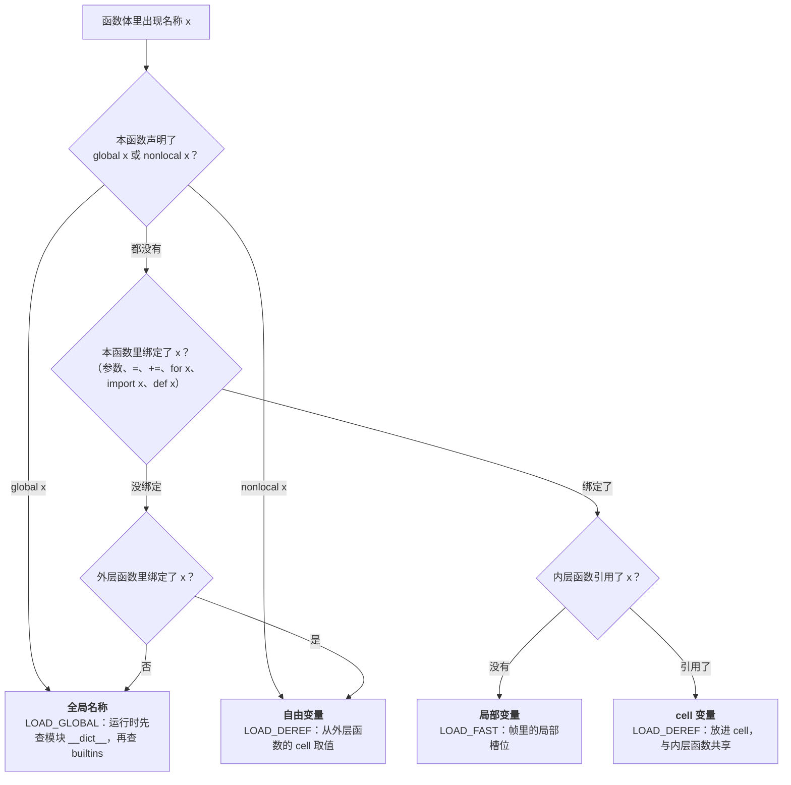
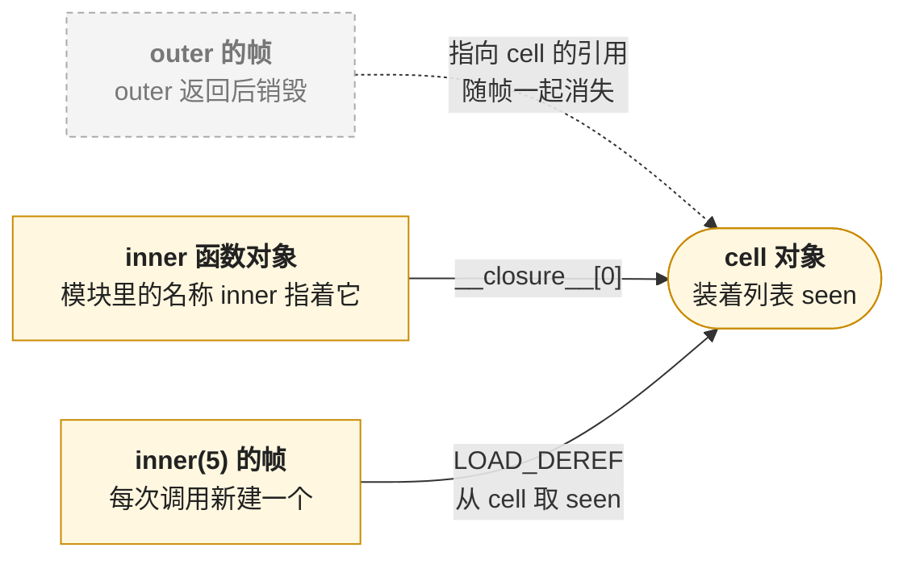
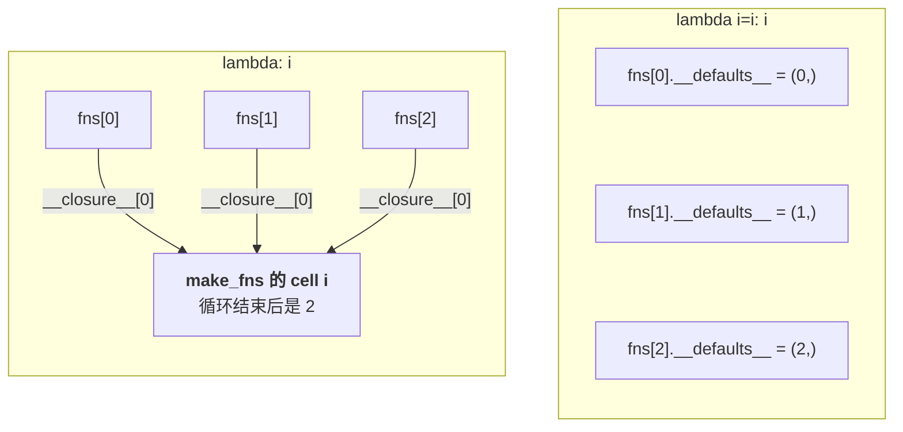

[《代码如何被执行》](/python-execution-model-code-objects-functions-and-frames.html)说函数对象携带 `__globals__`，帧里存放局部变量。那么函数体里写下一个名称时，Python 在哪里找它？答案是**编译期就决定了**——这是理解闭包、`nonlocal` 和"循环里的 lambda 全都返回同一个值"的钥匙。

本篇只回答一个问题：

> **函数体里写下一个名称，Python 去哪里找它；外层函数返回之后，内层函数为什么还能用它的变量？[^q0]**

## 一、总览

本篇先讲规则，再讲实现，最后讲由实现带来的现象：名称归属哪个作用域是编译期定的（第二章）；内层函数用到的外层变量存在 cell 里，这就是闭包（第三章）；`UnboundLocalError` 和延迟绑定都是这两条的直接后果（第四、五章）；最后是闭包与类的取舍（第六章）。

| 章 | 主题 | 内容 |
|---|---|---|
| 二 | LEGB 是编译期规则 | 四类作用域、名称归属在编译期决定、对应的字节码 |
| 三 | 闭包就是"函数对象 + cell" | `__closure__`、cell 的生命周期 |
| 四 | `nonlocal` 与 `UnboundLocalError` | 赋值让名称变成局部、`global` / `nonlocal` 声明 |
| 五 | 延迟绑定：cell 是共享的 | 循环里的 `lambda`、默认参数的修法 |
| 六 | 闭包还是类 | 两种保存状态方式的取舍 |
| 七 | 本文小结 |  |
| 八 | 自测 | 3 道题 |

Table: 本文的章节安排

## 二、LEGB 是编译期规则

名称查找的四层通常叫 LEGB：Local（当前函数）→ Enclosing（外层函数）→ Global（模块）→ Builtins。这个缩写乍一看很像 LGBT，第一次见的人常常念串；它其实没有别的含义，只是四个单词的首字母，按**由内到外**的顺序排：先看自己这个函数，再看包着它的函数，再看模块，最后看内置。

编译器编译每个函数时，把函数体里出现的每个名字归进四类之一，记在这个函数的 code object 的四张名单上：

| code object 上的名单 | 类别 | 是什么 |
|---|---|---|
| `co_varnames` | 局部变量 | 本函数自己的变量（含参数），只有自己用 |
| `co_cellvars` | cell 变量 | 本函数自己的变量，但内层函数也要用 |
| `co_freevars` | 自由变量 | 不是本函数的，从外层函数借来的 |
| `co_names` | 全局名称 | 既不是自己的、也不是外层函数的：运行时到模块和内置里按名字找。这张名单其实是“按名字查的字符串表”，属性名、`import` 的模块名也记在这里，所以它不全是作用域意义上的全局变量 |

Table: code object 上的四张名单，对应编译器给名字分的四类

用一个四层各放一个名字的例子把四张名单打印出来：

```python title="四层各放一个名字：看 code object 上的四张名单"
import builtins

limit = 100                     # 模块里绑定


def outer(items):
    total = 0                   # 只在 outer 里用
    seen = []                   # outer 里绑定，inner 也要用

    def inner(x):
        doubled = x * 2         # 只在 inner 里用
        seen.append(doubled)    # 来自外层函数
        return min(doubled, limit)   # limit 来自模块，min 来自内置

    for item in items:
        total += inner(item)
    return total, inner


total, inner = outer([10, 80])
for fn in (outer, inner):
    code = fn.__code__
    print(fn.__name__)
    print("  局部变量 co_varnames:", code.co_varnames)
    print("  cell 变量 co_cellvars:", code.co_cellvars)
    print("  自由变量 co_freevars:", code.co_freevars)
    print("  按名字查的 co_names  :", code.co_names)
print("inner.__closure__[0].cell_contents =", inner.__closure__[0].cell_contents)
print("limit 在模块字典里:", "limit" in globals(), "  min 在 builtins 里:", hasattr(builtins, "min"))
```

```text title="运行输出（Python 3.12）"
outer
  局部变量 co_varnames: ('items', 'total', 'inner', 'item')
  cell 变量 co_cellvars: ('seen',)
  自由变量 co_freevars: ()
  按名字查的 co_names  : ()
inner
  局部变量 co_varnames: ('x', 'doubled')
  cell 变量 co_cellvars: ()
  自由变量 co_freevars: ('seen',)
  按名字查的 co_names  : ('append', 'min', 'limit')
inner.__closure__[0].cell_contents = [20, 160]
limit 在模块字典里: True   min 在 builtins 里: True
```

把这些名字各自存在哪、`inner` 运行时怎么取到它们画出来：



- **局部变量**（`x`、`doubled`、`total` …）：在谁的帧里就是谁的，调用结束随帧消失。
- **`seen` 只有一份**，放在黄色的 cell 里。`outer` 的帧和 `inner` 函数对象各有一个箭头指向它：在 `outer` 的名单里它叫 cell 变量，在 `inner` 的名单里它叫自由变量，是同一个东西的两头。输出最后那个 `[20, 160]` 就是 `outer` 返回之后从 `inner` 手里的 cell 读出来的。
- **`limit`、`min`** 不在任何帧里：`inner` 运行时先查模块字典，没有再查内置字典。所以在模块里定义一个叫 `min` 的变量，会把内置的 `min` 挡住。

四类与 LEGB 四层**不是一一对应**：LEGB 说的是名字绑定在哪一层，四类说的是站在某个函数里看它存在哪、用哪条指令取。

| 名字绑定在哪一层（LEGB） | 站在使用它的函数里，编译器归为 | 值存在哪 | 取值指令 | 上例中 |
|---|---|---|---|---|
| L：本函数，没有内层函数用它 | **局部变量** | 这次调用的帧里 | `LOAD_FAST` | `outer` 的 `total`<br/>`inner` 的 `x`、`doubled` |
| L：本函数，且有内层函数用它 | **cell 变量** | 一个单独的 cell 对象里，帧只留一个指向它的引用 | `LOAD_DEREF` | `outer` 的 `seen` |
| E：外层函数 | **自由变量** | 外层函数的那个 cell（同一个对象） | `LOAD_DEREF` | `inner` 的 `seen` |
| G：模块<br/>B：内置 | **全局名称**（编译器不区分 G 与 B） | 模块的字典；找不到再查内置的字典 | `LOAD_GLOBAL` | `limit`（模块）<br/>`min`（内置） |

Table: LEGB 四层与编译器的四类名称怎样对应

L 这一层被拆成了两类，G 与 B 被并成了一类。

编译器怎么决定一个名字归哪一类：编译 `inner` 时扫描整个函数体，有赋值的是局部变量，没有赋值但在外层函数中有定义的是**自由变量**（free variable），其余都当作全局/内置。

**Python 没有变量声明，一个名称属于哪个作用域由"这个函数体里有没有对它赋值"决定，而且是在编译期、看整个函数体一次决定的。**

> [!NOTE] 与 Java 对照：声明与赋值
> Java 里 `int count;` 先声明局部变量，之后的 `count++` 只是使用；Python 里一句 `count = 99` 本身就让编译器把 `count` 归为本函数的局部变量，不管它写在函数的第几行（显式 `global` / `nonlocal` 除外）。

三个函数，模块里有一个 `count = 10`，看各自读到什么：

```python title="只读、先读后赋值、声明后赋值：同一个 count 的三种归类"
import traceback

count = 10


def only_read():
    return count                # 整个函数没有给 count 赋值


def read_then_assign():
    first = count               # 第一行想读模块里的 count
    count = 99                  # 后面才赋值
    return first


def declare_then_assign():
    global count                # 先声明
    first = count
    count = 99
    return first


for fn in (only_read, read_then_assign, declare_then_assign):
    names = str(fn.__code__.co_varnames)
    try:
        result = fn()
    except UnboundLocalError as error:
        failing_line = traceback.extract_tb(error.__traceback__)[-1].line.split("#")[0].strip()
        result = f"UnboundLocalError，出错的行：{failing_line}"
    print(f"{fn.__name__:20s} 局部变量 {names:19s} → {result}")
print("模块里的 count 现在是", count)
```

```text title="运行输出（Python 3.12）"
only_read            局部变量 ()                  → 10
read_then_assign     局部变量 ('count', 'first')  → UnboundLocalError，出错的行：first = count
declare_then_assign  局部变量 ('first',)          → 10
模块里的 count 现在是 99
```

三个函数运行时各自去哪里找 `count`：



中间那一帧没有连到模块字典的线：模块里明明有 `count = 10`，它不去看。由此得到三条后果，每条都能在上面的输出里找到：

1. **一个名字在一个函数里只归一类，不存在"前半段是全局、后半段是局部"。** `read_then_assign` 第一行想读的是模块里的 `count`，但函数后面有一句赋值，整个函数里的 `count` 就都是局部变量了。输出里出错的行是 `first = count`——读的那一行，而不是赋值那一行。
2. **局部变量可以"有位置、没有值"。** `count` 在 `read_then_assign` 的局部变量名单里，位置已经留好，只是执行到第一行时还没放进值。所以报的是 `UnboundLocalError`（局部变量还没绑定值），不是"找不到这个名字"的 `NameError`。
3. **要在函数里改外层的变量，必须先声明。** `declare_then_assign` 多了一句 `global count`，`count` 就从局部变量名单里消失了，读到 10、写入的 99 落在模块字典里（最后一行）。要改的是外层函数的变量时，用的是 `nonlocal`（第四章）。

编译器对函数体里的每个名称做的是同一串判断，判断的结果就是运行时用哪条取值指令：



图里只有 `LOAD_GLOBAL` 在运行时按名字查字典（模块 `__dict__` 找不到再去 `builtins`）；局部变量和 cell 都是按编译时排好的下标取值，运行时不再"找"。判断的第二步只问"有没有绑定"，不问绑定出现在第几行——第四章的 `UnboundLocalError` 就落在"局部变量"这个出口上，只是读的时候槽位里还没有值。

分类结果直接体现在字节码里。接着上面的例子，把 `inner` 里每个名字用的取值指令列出来：

```python title="inner 里每个名字用哪条指令取值"
import dis

for ins in dis.get_instructions(inner):
    if ins.opname.startswith("LOAD") and isinstance(ins.argval, str):
        print(f"{ins.argval:8s} {ins.opname}")
```

```text title="运行输出（Python 3.12）"
x        LOAD_FAST
seen     LOAD_DEREF
append   LOAD_ATTR
doubled  LOAD_FAST
min      LOAD_GLOBAL
doubled  LOAD_FAST
limit    LOAD_GLOBAL
```

`x`、`doubled` 是 `LOAD_FAST`，`seen` 是 `LOAD_DEREF`，`min`、`limit` 是 `LOAD_GLOBAL`，与上面那张表逐行对得上（`append` 是属性，用 `LOAD_ATTR`）。

`LOAD_DEREF` 表示"从 cell 中取值"，而不是 `LOAD_FAST`（局部）或 `LOAD_GLOBAL`（全局）。查找**位置**是编译期确定的，运行时只是按位置取值。这也是为什么在函数里对一个名称赋值，会让**整个函数**中该名称都变成局部变量，哪怕赋值语句在后面——下面第四章的 `UnboundLocalError` 就是这个规则的直接后果。

## 三、闭包就是"函数对象 + cell"

`outer([10, 80])` 返回之后，它的帧已经销毁，`inner` 为什么还能往 `seen` 里追加？因为 `seen` 不在 `outer` 的帧里，而在 cell 里，`inner` 函数对象通过 `__closure__` 拿着这个 cell。接着上面的例子：

```python title="闭包的实体：co_cellvars、co_freevars 与 __closure__ 里的 cell"
print(outer.__code__.co_cellvars)        # outer 里要与内层共享的变量
print(inner.__code__.co_freevars)        # inner 里从外层借来的变量
print(inner.__closure__)                 # inner 函数对象手里的 cell
print(inner.__closure__[0].cell_contents)
inner(5)                                 # outer 早已返回，inner 仍能往 seen 里追加
print(inner.__closure__[0].cell_contents)
```

```text title="运行输出（Python 3.12，地址每次运行不同，这里用 0x… 代替）"
('seen',)
('seen',)
(<cell at 0x…: list object at 0x…>,)
[20, 160]
[20, 160, 10]
```



| 步骤 | 发生了什么 | 这时谁指着 cell |
|---|---|---|
| ① 调用 `outer([10, 80])` | 新建 `outer` 的帧；`seen` 是 cell 变量，所以同时新建一个 cell，把列表放进去 | `outer` 的帧 |
| ② 执行 `def inner` | 新建 `inner` 函数对象，把这个 cell 的引用放进它的 `__closure__` | `outer` 的帧、`inner` 函数对象 |
| ③ `outer` 返回 | 帧销毁；返回的 `inner` 函数对象绑定到模块里的名称 `inner` | 只剩 `inner` 函数对象 |
| ④ 调用 `inner(5)` | 新建 `inner` 的帧，`LOAD_DEREF` 顺着 `__closure__` 从 cell 里取到列表，追加 10 | `inner` 函数对象 |

Table: 一个闭包从创建到被调用的四步

所以闭包不是什么魔法："外层帧销毁了，但 cell 对象被内层函数对象引用着，所以还活着。" 再调用一次 `outer()` 会新建另一个 cell 和另一个 `inner` 函数对象，两次得到的闭包互不影响——第四章的计数器就靠这一点让每个计数器各数各的。这就是**词法作用域**：名称的解析依据函数**定义时**的代码结构，与调用位置无关。

在 AI-Infra 中闭包常用来携带少量配置进入回调：后端名、重试次数、指标标签、模型引用。但它也是隐式依赖——读者无法从函数签名看出它依赖了什么。

## 四、`nonlocal` 与 `UnboundLocalError`

读外层变量不需要声明，**重新绑定**外层变量需要 `nonlocal`：

```python title='用 nonlocal 重新绑定外层变量的计数器'
def make_counter(start=0):
    count = start

    def increment():
        nonlocal count
        count += 1
        return count

    return increment


counter = make_counter()
print(counter(), counter())                 # 1 2
print(counter.__closure__[0].cell_contents)  # 2   —— 修改的是同一个 cell
```

去掉 `nonlocal` 会得到：

```text title='去掉 nonlocal 后的 UnboundLocalError'
UnboundLocalError: cannot access local variable 'count' where it is not associated with a value
```

按第二章的规则，`count += 1` 是赋值，编译器因此把 `count` 判定为 `increment` 的**局部变量**；执行时先读局部槽位，而它还没有值。这个错误经常出现在把一个模块级计数器、开关或缓存直接在函数里 `+=` 的时候——那时需要的是 `global`。

> [!NOTE] 与 Java 对照：修改捕获的状态
> Java 的 lambda 和匿名内部类捕获的外层局部变量必须是 `final` 或 effectively final，不能像 Python 的 `nonlocal count` 那样重新绑定。要累加状态，通常捕获数组、`AtomicInteger` 或其他对象的引用，再修改其内容；引用不能重新赋值，不代表对象不可变。

## 五、延迟绑定：cell 是共享的

闭包最常见的陷阱：

```python title='延迟绑定陷阱：三个 lambda 都返回 2'
def make_fns():
    fns = []
    for i in range(3):
        fns.append(lambda: i)
    return fns


print([fn() for fn in make_fns()])          # [2, 2, 2]
```

先看清 `lambda: i` 这个写法本身。`lambda 参数列表: 表达式` 定义一个匿名函数，冒号前是参数、冒号后是返回值；`lambda: i` 的参数列表是**空的**，所以 `i` 不是参数，而是一个要到外层去找的自由变量——每次调用它，都去 `make_fns` 的作用域里取 `i` **当前**的值。

用第三章的知识解释结果：`i` 是 `make_fns` 的 cell 变量，三个 lambda 的 `__closure__` 指向**同一个** cell（可以打印 `id(fn.__closure__[0])` 验证，三者相同）。lambda 体里的 `i` 在**调用时**才 `LOAD_DEREF`，此时循环早已结束，cell 里是最后一个值。

修法是在创建时就把值固定下来——用默认参数（默认值在 `def`/`lambda` 求值时计算一次）：

```python title='用默认参数在创建时固定 i'
fns.append(lambda i=i: i)                    # [0, 1, 2]
```

`i=i` 里等号左边是 lambda 自己的参数 `i`，右边是循环变量 `i` 此刻的值，被当作默认值存进函数对象（`fn.__defaults__`）；调用 `fn()` 时不传参，就用这个默认值，于是 lambda 体里的 `i` 变成了局部变量，不再去外层找。注意不能写成 `lambda i: i`——那是一个**必须**接收一个参数的恒等函数，`fn()` 会直接报 `TypeError: <lambda>() missing 1 required positional argument: 'i'`。

两种写法的差别在于值存在哪里：



左边三个函数对象指向同一个 cell，cell 只有一个"当前值"，调用时读到的都是循环结束后的 2；右边每个函数对象在创建时把 `i` 的值拷进自己的 `__defaults__`，之后循环再怎么改 `i` 都与它无关。

或者用 `functools.partial(handler, i)`，语义更明确。构造一批 Worker 回调、为每个 GPU 生成一个任务函数、在循环里注册 hook，都会遇到这个问题。

> [!NOTE] 与 Java 对照：捕获值与共享变量
> Java 的 lambda 捕获外层局部变量的值；如果值是引用，拷贝的也是引用。Python 闭包共享的是 cell，调用时读当前值。上面会变化的循环变量 `i` 在 Java 中不满足 effectively final，直接捕获会编译失败；通常在每轮声明一个新的局部变量保存当轮值，再交给 lambda。

## 六、闭包还是类

闭包和类都能"把状态和行为绑在一起"。取舍标准是状态的数量和生命周期：

- 一两个只读配置、一个简单计数：闭包即可，代码短；
- 状态多于两三个、需要被外部检查或重置、有清理逻辑：用类。类的状态在 `__dict__` 里可见可调试，闭包的状态藏在 `cell_contents` 里。

[《装饰器、生成器与上下文管理器》的「装饰器」一章](/python-decorators-generators-and-context-managers.html#二装饰器用闭包和描述符改写调用路径)会看到，装饰器既可以用闭包写，也可以用类写，取舍标准相同。

## 七、本文小结

- 名称属于哪个作用域（Local → Enclosing → Global → Builtins）在**编译期**按"本函数里有没有绑定"决定，运行时只是按位置取值。
- 函数体内任何位置对一个名称赋值，它在整个函数里都是局部变量；要改外层的用 `global` / `nonlocal`。
- 闭包 = 函数对象 + cell。外层帧销毁后，cell 被内层函数的 `__closure__` 引用着，所以还活着。
- cell 是共享的、调用时才读，所以循环里创建的多个闭包读到的是同一个变量的最终值。

## 八、自测

1. 一个函数里写了 `x = x + 1`，而 `x` 是全局变量，为什么读它会报 `UnboundLocalError` 而不是拿到全局值？

   <details markdown="1"><summary>答案</summary>

   名称的归属在**编译期**决定：函数体内出现对 `x` 的赋值，`x` 就是这个函数的局部变量，整个函数里都是——不存在"前半段全局、后半段局部"。读到 `x + 1` 时局部 `x` 还没有值，于是 `UnboundLocalError`。要改全局的 `x` 必须 `global x`（外层函数的变量则 `nonlocal`）。

   </details>

2. 循环里写 `fns.append(lambda: i)`，三个函数各返回什么？把 `i` 改成 `lambda i=i: i` 之后呢？

   <details markdown="1"><summary>答案</summary>

   第一种都返回 2，第二种返回 0、1、2。`lambda: i` 里的 `i` 是自由变量，三个函数的 `__closure__` 指向 `make_fns` 的**同一个** cell，调用时才读，读到的是循环结束后的值；`i=i` 在创建函数时把当时的值存进各自的 `__defaults__`，函数体里的 `i` 变成局部变量，不再读 cell。

   </details>

3. `outer()` 已经返回，它的帧销毁了，返回的 `inner` 为什么还能读到 `outer` 的局部变量？再调用一次 `outer()` 得到的闭包会和前一个共享这个变量吗？

   <details markdown="1"><summary>答案</summary>

   被 `inner` 用到的外层变量不存在帧的普通槽位里，而是存在一个 cell 对象里；`inner` 的 `__closure__` 引用着这个 cell，所以帧销毁后它还活着。不共享：每次调用 `outer()` 都新建一个 cell 和一个 `inner` 函数对象。

   </details>

[^q0]: 名称去哪里找是**编译期**定的：编译函数体时按"本函数里有没有对它的绑定"把每个名称归到局部、外层函数、全局或内置之一，运行时只按归好的位置取值（[第二章](#二legb-是编译期规则)）。内层函数用到的外层变量存放在 cell 对象里，内层函数通过 `__closure__` 引用它，所以外层函数返回、帧销毁之后变量仍然可用（[第三章](#三闭包就是函数对象--cell)）。两个常见现象都由此而来：函数内对名称赋值会让它在整个函数里变成局部变量（[第四章](#四nonlocal-与-unboundlocalerror)），多个闭包共享同一个 cell 导致延迟绑定（[第五章](#五延迟绑定cell-是共享的)）。
