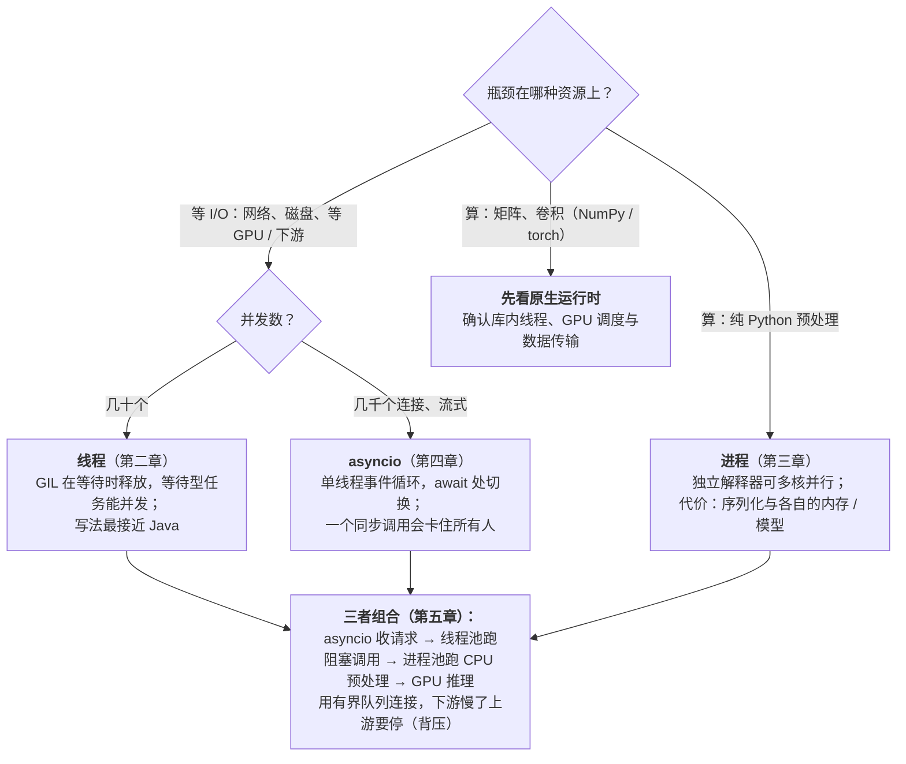
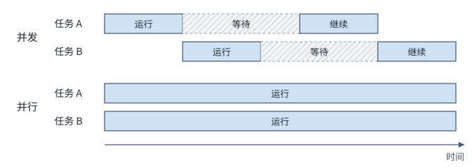
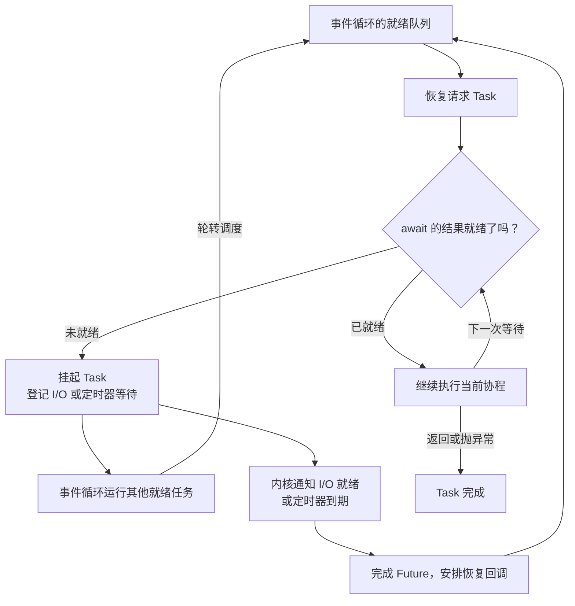
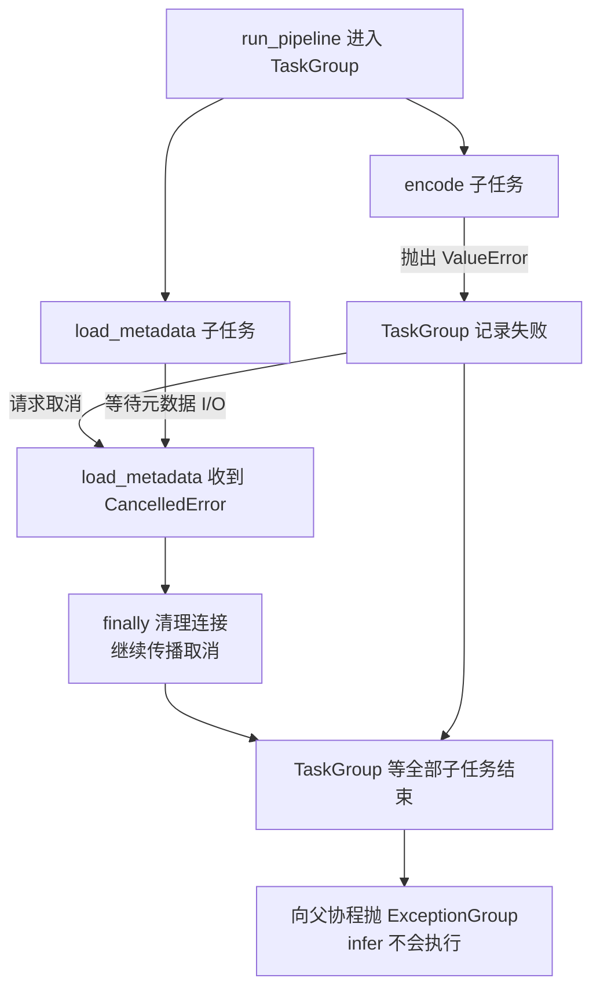
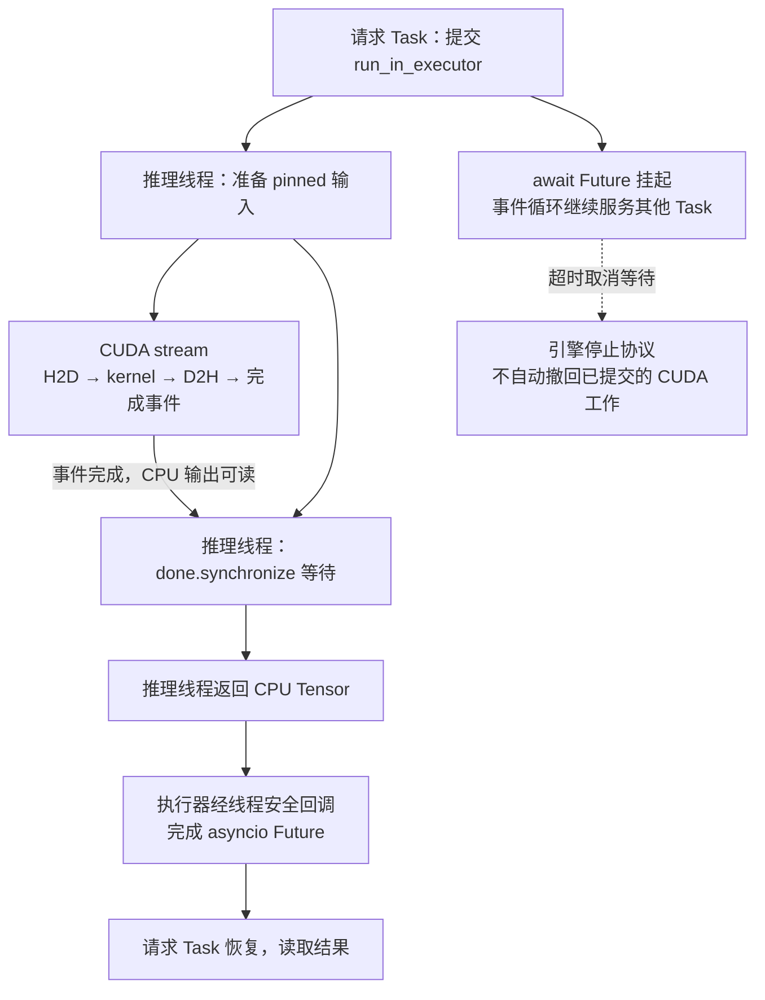

先看一个真实形状的故障。一个用 FastAPI 写的推理网关，后面接着 GPU 上的推理引擎：压测到每秒 200 个请求时 p99 延迟涨到 8 秒，而 GPU 利用率只有 30%——算力明明空着，请求却在排队。第一反应是"多开几个线程"，没用：请求处理里有一段纯 Python 的 tokenize 与 JSON 拼装，CPython 的全局解释器锁让 32 个线程也只能一个一个地算。换成多进程，吞吐上去了，但每个进程各自加载了一份 5 GB 的模型，显存翻了几倍。改成 `asyncio`，网络那一段快了，可是有人在协程里调了一个同步的 `requests.get`，整条事件循环被卡住 3 秒，所有请求一起等。

这个故障里的每一步都不是"不会用线程 / 进程 / async"，而是没回答对三个问题：瓶颈到底在哪一种资源上（GPU 空着，卡的是 CPU 上的 Python 还是网络等待？），任务之间该怎么交接（预处理、推理、后处理是三个阶段，中间用什么连？），以及下游慢了上游怎么办（队列无限长就是 OOM 的倒计时）。Python 在 AI-Infra 里不做最重的数值计算——那是 CUDA 与 C++ 的事——但推理服务、任务调度、数据预处理、监控与流水线编排都由它负责，系统的吞吐、尾延迟与资源利用率取决于它把这三个问题答对没有。所以本文不按"线程怎么建、`async` 怎么写"组织，而是围绕三个工程问题：

> **当前瓶颈是 CPU、GPU、网络还是外部服务？[^q0] 任务之间应该如何协作？[^q1] 当下游处理速度跟不上上游输入速度时，系统如何保持稳定？[^q2]**

## 一、总览




### 1. 三个工程问题与 Java 对照基准

上面三个问题贯穿全文。第一个问题——瓶颈在哪——决定选哪种执行模型，本文第二、三、四章分别展开线程、进程和 asyncio 三种模型，每一章都按同样的顺序讲：怎么启动任务、任务之间怎么协作（队列、同步原语、上下文）、这种模型的边界在哪（能不能取消、怎么停机）。第二个问题——任务如何协作——的答案就分布在这三章的"协作"小节里，同一个概念（Future、有界队列、Semaphore）会出现三次，后两次只讲和线程版的差别。第三个问题——过载时如何保持稳定——在第五章用批处理、流式、GPU 混合并发这些 AI-Infra 的组合模式回答，那时三种模型都已具备，可以看它们如何拼在一起。最后收敛成常见错误和一棵决策树。

Python 正文以 **CPython 3.10–3.12 的带 GIL 构建**为主；`TaskGroup`、`asyncio.timeout()` 和 `except*` 需要 3.11+，3.13/3.14 的变化另行标注。Java 对照以 **Java 25 LTS**（2025-09 发布）为基准，虚拟线程从 Java 21 起可用；结构化并发在 JDK 25 仍是 preview，会显式标注。对照的是工程职责，不能据此推断调度、内存可见性或取消语义相同。

开头的网关会反复出现：请求协程接收输入，必要时交给进程池预处理；有界队列把请求交给攒批任务；专用线程调用推理引擎，结果经 Future 回到请求协程。**提交触发工作，队列容量决定能否继续接单，Future 完成触发恢复，超时或断连触发取消与引擎清理**。第一幅图负责选模型，后面的机制图负责解释这些交接。

对 Java 工程师来说，本文的阅读顺序有一个便利：第二章的线程模型与 `java.util.concurrent` 几乎一一对应，Future、`BlockingQueue`、`Semaphore`、`ThreadLocal` 都能直接对上；第三章的进程则对照独立 JVM 间的数据与状态交接；第四章的 asyncio 则要对照虚拟线程和 Reactor 来理解。先在熟悉的地方把概念立起来，再看另外两种模型改变了什么。

### 2. 并发不等于并行

**并发（Concurrency）** 同时发生。描述的是多个任务在同一时间段内交替推进。

**并行（Parallelism）** 同时进行。描述的是多个任务在同一时刻真正同时执行。

例如，一个事件循环可以在多个网络请求之间快速切换。虽然某个时刻只有一段 Python 代码在运行，但多个请求都能向前推进，这属于并发。

而多个进程分别运行在不同 CPU 核心上，则属于并行。

可以简单地表示为：



对于 AI-Infra，二者经常组合使用：

- **Python asyncio**
    - 管理大量网络请求
    - 管理任务生命周期
    - 调度后台协作任务
- **线程或进程**
    - 执行阻塞操作
    - 执行 CPU 密集型预处理
- **GPU / C++ Runtime**
    - 执行真正的模型计算

### 3. 三种执行模型一览

Python 中常见的并发方式可以分为三类：

| 模型 | 适合场景 | 主要成本 | 典型问题 | Java 对应 |
| :--- | :--- | :--- | :--- | :--- |
| 线程 | 阻塞 I/O、兼容同步库 | 线程栈、上下文切换 | 共享状态、线程安全 | 平台线程 `ExecutorService` |
| 进程 | 纯 Python CPU 并行、独立运行时 | 进程创建、序列化、内存 | 数据复制、进程通信 | 无透明标准执行器；可类比独立 JVM 交接 |
| asyncio | 大量 I/O、任务编排 | 需要异步调用链 | 事件循环被阻塞 | 虚拟线程 / `CompletableFuture` / Reactor |

Table: 三种执行模型一览

这张表里最需要 Java 程序员注意的是第二行和第三行。

**第二行**：JVM 多线程本来就能利用多核，通常不用为了 CPU 并行再拆进程。Python 的 `ProcessPoolExecutor` 常用来绕开 GIL，但进程也提供故障隔离、独立资源与运行时状态；这些需求在 Java 中同样存在，只是标准执行器没有透明的跨进程版本。

**第三行**：Java 21 之后，"高并发 I/O"的答案从 `CompletableFuture`/Reactor 变成了虚拟线程。虚拟线程让你**用同步代码写法拿到异步的伸缩性**，而 Python 至今仍必须显式写 `async`/`await`。这是两个生态最大的分野，第四章会展开。

三种模型在后面每一章都会按同一组维度展开，先把结论放在这里，读完全文再回头看：

| 维度 | 线程 `threading` / `ThreadPoolExecutor` | 进程 `multiprocessing` / `ProcessPoolExecutor` | asyncio |
| :--- | :--- | :--- | :--- |
| 谁调度 | 操作系统 | 操作系统 | 事件循环（用户态，单线程） |
| 切换点 | OS 抢占；Python 执行还受 GIL 约束 | OS 抢占 | 协程在真正挂起时让出，常见于 `await` |
| 能否多核并行 | 纯 Python 代码不能；释放 GIL 的原生计算可以 | **是** | 单个循环不能并行执行 Python 代码 |
| 任务句柄 | `concurrent.futures.Future` | `concurrent.futures.Future` | `asyncio.Task` / `asyncio.Future` |
| 运行中的任务如何停止 | 共享 Event 等协作停止，无通用强制取消 | 协作停止，或强制终止 worker | 协作式 `CancelledError`，外部工作另行处理 |
| 队列 | `queue.Queue` | `multiprocessing.Queue` | `asyncio.Queue` |
| 同步原语 | `threading.Lock/RLock/Semaphore/Event/Condition` | `multiprocessing` 同名类 | `asyncio` 同名类（无 `RLock`，不可重入） |
| 请求上下文 | threading.local 按线程隔离，线程池需清理 / 传播 | 每次提交不自动传播，显式传参 | Task 默认复制 ContextVar 绑定 |
| 共享数据 | 直接共享内存，业务不变量需同步 | 序列化拷贝，或 `shared_memory` | 同循环同步片段通常不被其他 Task 插入；跨线程另行同步 |
| 单个执行单元的成本 | 一个 OS 线程（约 8 MB 虚拟内存栈） | 一个解释器进程 | 一个协程对象（几 KB） |

Table: 线程、进程、asyncio 按同一组维度的对比

没有一种模型适合所有场景。工程上的第一原则是：

> 不要根据 API 的流行程度选择并发模型，而要根据瓶颈类型选择并发模型。

### 4. GIL：Python 并发的底层约束

GIL（Global Interpreter Lock）是常见带 GIL 的 CPython 解释器中的执行锁；对这里讨论的同一解释器，同一时刻只允许一个线程执行 Python 字节码。它不是 Python 语言必须采用的机制。

这意味着即使创建了多个线程，纯 Python 的 CPU 密集型代码在同一时刻仍然只有一个线程在运行。GIL 的存在是为了保护 CPython 内部的引用计数和内存管理机制，使得对象的创建和销毁不需要细粒度锁。

对应 Java：**JVM 没有任何等价物**。这是两个语言并发模型最根本的差异，根源在内存管理策略：

| | CPython | JVM |
| :--- | :--- | :--- |
| 内存回收 | 引用计数为主 + 循环 GC 兜底 | 追踪式 GC（G1 / ZGC / Shenandoah） |
| 对象访问的并发保护 | GIL 保护解释器内部状态；业务不变量仍需同步 | 业务共享状态用锁、原子类等同步；JMM 定义可见性 |
| 多线程 CPU 并行 | 纯 Python 代码通常不可（带 GIL 构建）；native 扩展另看实现 | 支持 JVM 代码并行 |
| 内存可见性模型 | 不能把 GIL 当作语言级的 JMM；用同步原语交接状态 | JMM（JLS 第 17 章）、`volatile`、`happens-before` |

Table: CPython 与 JVM 的内存管理差异

> [!NOTE] 与 Java 对照：GIL 不是业务锁，也不是 volatile
> GIL 串行化带 GIL 的 CPython 中的 Python 执行，但不保证一段业务操作的原子性，也不提供可移植的共享状态协议。跨线程通知用 `Event`，传数据用 `Queue`，保护不变量用 `Lock`；不要靠反复读取普通变量轮询。Java 的 `volatile` / happens-before 规则不能直接套过来。

Java 工程师迁移过来时最常见的误判是：把 `ExecutorService` + 纯 Python CPU 计算直接翻译成 `ThreadPoolExecutor`，然后发现 16 线程和 1 线程一样慢。受限的是这部分 Python 执行，不是整个进程中的所有原生计算。

#### 1. GIL 何时释放

GIL 并非始终被持有。以下操作通常会释放 GIL：

- 网络 I/O（socket read/write）；
- 文件 I/O（磁盘读写）；
- `time.sleep()`；
- 许多 C 扩展的长计算路径（是否释放取决于具体操作与实现）；
- 数据库驱动的等待操作。

这就是为什么线程仍然能有效加速 I/O 密集型任务：当一个线程在等待网络响应时，GIL 被释放，其他线程可以继续执行 Python 代码。

对应 Java：这个"释放 GIL"的动作，在 Java 21+ 的虚拟线程里有一个形似而神不同的对应物——**unmount（卸载）**。虚拟线程执行阻塞 I/O 时会从载体平台线程上卸载，让出载体给别的虚拟线程。区别在于：

- Python 释放 GIL 是**让出解释器的执行许可**，线程本身还在 OS 里阻塞着，OS 线程数不变；
- Java 卸载虚拟线程是**归还 OS 线程**，所以能开几十万个虚拟线程而只占几十个 OS 线程。

在本文的 CPython 中，`threading` 线程由 OS 线程承载；单个 asyncio 循环则是多个 Task 对一个线程（M:1）。Java 虚拟线程的 M:N 由 JVM 在多个载体线程上调度，不能把单循环 asyncio 直接称作 M:N。

顺带一提，Java 里曾有一个和"GIL 未释放"高度类似的坑：虚拟线程在 `synchronized` 块内阻塞会 **pin**（钉住）载体线程，导致载体无法复用。**JEP 491 在 JDK 24 已经消除了这个问题**，`synchronized` 内阻塞也能正常卸载了。JDK 21～23 上仍需把热点路径的 `synchronized` 换成 `ReentrantLock`。

#### 2. 对并发模型选择的影响

| 任务类型 | 线程能否加速 | 原因 |
| :--- | :--- | :--- |
| 网络 I/O | 能 | I/O 等待期间 GIL 释放 |
| 文件 I/O | 能 | 同上 |
| C 扩展计算 | 视实现而定 | 释放 GIL 且库线程安全时才可能多核加速 |
| 纯 Python CPU 计算 | 通常不能获得多核加速 | 周期性交接 GIL 只让线程交替运行，不让它们同时执行 |

Table: GIL 对各类任务能否线程加速的影响

对于纯 Python 的 CPU 密集型任务，需要使用多进程（每个进程有独立的解释器和 GIL）或者使用 C 扩展库将计算下沉到 native 层。

#### 3. Python 3.13+ free-threaded 模式

Python 3.13 引入了实验性的 free-threaded 模式（PEP 703），允许多个线程真正并行执行 Python 字节码：

```bash title="运行 free-threaded 的 python3.13t"
# 需要专门编译的 free-threaded 版本
python3.13t script.py
```

3.13 里它是实验特性；从 Python 3.14 起（PEP 779）它成为官方支持的构建，但仍是可选构建，默认的解释器照旧带 GIL。换用之前要考虑三点：

- 部分第三方 C 扩展尚未适配；
- 单线程性能略有下降；
- 默认构建仍带 GIL，生产环境换用前要先确认依赖的扩展都已支持 free-threaded。

但这是 Python 并发模型的重要演进方向。对于 Java 开发者来说，可以把 free-threaded Python 理解为 Python 正在向 Java 的真正多线程并行能力靠拢。

对应 Java：free-threaded CPython 面临的挑战，正是 JVM 在 20 多年前就解决过的那些——细粒度锁、无锁数据结构、内存序、伪共享。有一点差异值得留意：JVM 从第一天起就有 JMM 规范，任何库作者都知道自己写的代码要在多线程下正确。而 Python 生态里绝大多数 C 扩展是在"有 GIL 兜底"的假设下写的，所以 free-threaded 模式的真正阻力不在 CPython 本身，而在 NumPy、PyTorch 这些扩展需要逐一审计和适配。这类似于"如果 Java 的整个生态都是在单线程假设下写出来的，然后某天你打开了多线程"。

### 5. 本文的章节安排

| 章 | 主题 | 小节 |
|---|---|---|
| 二 | 线程：Java 工程师最熟悉的模型 | 1 线程与线程池：ThreadPoolExecutor 与 Future<br/>2 线程间的协作：`queue.Queue` 与背压<br/>3 同步原语：Lock、RLock、Semaphore、Event、Condition<br/>4 线程本地状态：`threading.local`<br/>5 线程的边界：超时能做什么、为什么线程不能被取消<br/>Java 对照随线程池、队列、锁与取消就近展开 |
| 三 | 进程：绕开 GIL 的代价 | 1 进程池与启动方式：fork / spawn / forkserver<br/>2 进程间的数据：序列化与共享内存，DataLoader<br/>3 进程间的协作：`multiprocessing.Queue` 与同步原语<br/>4 进程的边界：协作停止与强制终止、worker 崩溃、上下文不传播；Java 对照随数据与上下文展开 |
| 四 | asyncio：单线程内的 M:1 调度 | 1 为什么需要第三种模型<br/>2 事件循环：调度核心与阻塞陷阱<br/>3 协程、Task 与 Future<br/>4 TaskGroup：结构化并发<br/>5 超时、取消与异常传播<br/>6 ContextVars：跨 await 传递上下文<br/>7 `asyncio.Queue` 与背压策略<br/>8 asyncio 的同步原语：与线程版的三个差别<br/>9 Sync/Async Bridge：`to_thread`、`run_in_executor`、FastAPI 的分流；虚拟线程对照见 §1 |
| 五 | AI-Infra 组合模式：三种模型一起用 | 1 异步批处理：连接并发与 GPU 利用率<br/>2 异步流式处理<br/>3 混合并发：Python 异步与底层 GPU 运行时<br/>4 后台任务与资源监控 |
| 六 | 常见错误与改进方式 |  |
| 七 | 一个实用的并发决策树 + Java 与 Python 并发概念速查表 |  |
| 八 | 本文小结 |  |

Table: 本文的章节安排

## 二、线程：Java 工程师最熟悉的模型

Python 的 `threading` 模块和 `concurrent.futures.ThreadPoolExecutor` 与 `java.util.concurrent` 的对应关系是三种模型里最直接的：一个 `threading.Thread` 就是一个 OS 线程（对应 Java 的平台线程），`ThreadPoolExecutor` 对应 `ExecutorService`，`Future` 对应 `Future`。所以本章的任务不是介绍新概念，而是把 Java 工程师已有的概念在 Python 里落地，并且标出**默认值不同**和**能力缺失**的地方——后两章会反复回来对照这里。

### 1. 线程与线程池：`ThreadPoolExecutor` 与 `Future`

线程适合这样的任务：

- 调用只提供同步接口的 HTTP 客户端；
- 访问传统数据库驱动；
- 读取文件或设备；
- 调用同步 SDK；
- 等待外部服务返回。

一个真实例子是 `huggingface_hub` 下载模型权重。`snapshot_download` 内部用线程池并发拉取多个 shard 文件，因为 HTTP 下载和磁盘写入都会释放 GIL：

```python title="snapshot_download 用 max_workers 并发下载 shard"
from huggingface_hub import snapshot_download

# max_workers 控制并发下载的文件数，默认 8
snapshot_download(
    repo_id="meta-llama/Llama-3.1-8B-Instruct",
    max_workers=16,
)
```

自己写的话大概是这个样子：

```python title="用 ThreadPoolExecutor.map 并发调用同步模型服务"
from concurrent.futures import ThreadPoolExecutor


def invoke_sync_model(request_id: str) -> str:
    # 假设这里调用的是同步模型服务客户端
    return f"result-{request_id}"


def run_batch(request_ids: list[str]) -> list[str]:
    with ThreadPoolExecutor(max_workers=16) as executor:
        return list(executor.map(invoke_sync_model, request_ids))
```

`executor.map()` 是"提交一批、按顺序取结果"的便捷写法。更通用的接口是 `submit()`，它返回一个 `concurrent.futures.Future`——任务的句柄：

```python title="submit 返回 Future，用 as_completed 先完成先处理"
from concurrent.futures import ThreadPoolExecutor, as_completed, wait, FIRST_COMPLETED

with ThreadPoolExecutor(max_workers=16) as executor:
    futures = {executor.submit(invoke_sync_model, rid): rid for rid in request_ids}

    for future in as_completed(futures):          # 谁先完成先处理
        rid = futures[future]
        try:
            result = future.result()              # 任务抛的异常在这里重新抛出
        except Exception as exc:
            logger.warning("request %s failed: %s", rid, exc)

    done, pending = wait(futures, timeout=5.0, return_when=FIRST_COMPLETED)
```

`Future` 的接口和 Java 的 `java.util.concurrent.Future` 几乎逐字对应：`result(timeout)` ≈ `get(timeout, unit)`，`done()` ≈ `isDone()`，`cancel()` ≈ `cancel(false)`，`add_done_callback()` ≈ `CompletableFuture.whenComplete()`。这个 `Future` 类型同时服务于线程池和进程池（第三章），是两者共用的抽象；asyncio 有一个**另外的** `asyncio.Future`，接口相似但不能混用（4.3 节）。

两个默认值需要注意：

- `ThreadPoolExecutor` 默认 `max_workers = min(32, os.cpu_count() + 4)`，不像 Java 的 `newCachedThreadPool()` 那样无上限增长。这个默认值对 I/O 任务通常偏小，需要显式指定。
- `executor.map()` 按提交顺序取结果，取第 2 个结果时可能阻塞，即使第 3 个早已完成。**延迟取结果不等于延迟提交**：3.10–3.12 默认会积极消费输入并提交任务，大输入仍可能积压；3.14+ 可用 `buffersize` 限制未产出结果的提交窗口。按完成顺序处理则用 `as_completed()`。

> [!NOTE] 与 Java 对照：平台线程池与虚拟线程
> Python 的 worker 是 OS 线程，对照的是 Java 平台线程。Java 19+ 的 `ExecutorService.close()` 和 Python 线程池的 `with` 都会等待已提交任务；Java 的 `invokeAll()` 在返回前等全部完成，Python 的 `map()` 则在取结果时等待，二者不能视为同一个阻塞点。

```java title="Java 平台线程池的对应写法：newFixedThreadPool 与 invokeAll"
// 平台线程池：与 ThreadPoolExecutor(max_workers=16) 语义最接近
try (var pool = Executors.newFixedThreadPool(16)) {   // Java 19+ 实现了 AutoCloseable
    List<Future<String>> futures = pool.invokeAll(
        requestIds.stream().map(id -> (Callable<String>) () -> invokeSyncModel(id)).toList()
    );
}

// Java 21+ 更推荐：虚拟线程，不需要调 max_workers
try (var pool = Executors.newVirtualThreadPerTaskExecutor()) {
    List<Future<String>> futures = pool.invokeAll(tasks);
}
```

Java 21+ 的虚拟线程减少了每个等待任务的线程成本，但仍要限制连接数、排队量与下游并发；“不需要池化虚拟线程”不等于容量无限。Python 线程数开到几千时，OS 线程栈与调度成本已经不可忽略，大量网络连接通常更适合 asyncio。

线程不会让 Python CPU 代码突破 GIL（1.4 节）。对于纯 Python 的 CPU 密集型计算，增加线程通常不能获得理想的线性加速。但网络请求、磁盘访问和部分 C 扩展操作会释放 GIL，因此线程依然适合大量阻塞 I/O。

### 2. 线程间的协作：`queue.Queue` 与背压

线程之间传递工作最常用的结构是生产者—消费者队列。AI-Infra 里一个典型形态是：请求输入 → 预处理 → 排队 → 批处理 → GPU 推理 → 结果返回。

如果输入速度高于消费速度，队列就会积压。`queue.Queue(maxsize=N)` 是标准库的**有界阻塞队列**，满了 `put()` 就阻塞——这就是最基本的**背压**（backpressure）：让生产者慢下来。

```python title="有界 queue.Queue 加哨兵：带背压的批处理消费者"
import queue
import threading

work: queue.Queue[dict | None] = queue.Queue(maxsize=1000)
STOP = None                                  # 哨兵：告诉消费者可以退出了


def producer(requests: list[dict]) -> None:
    for request in requests:
        work.put(request)                    # 队列满时在这里阻塞，上游自动减速
    for _ in range(WORKER_COUNT):
        work.put(STOP)


def consumer() -> None:
    while True:
        request = work.get()
        if request is STOP:
            work.task_done()                 # 哨兵也是一次 put，不记账 join() 会永远等
            break
        try:
            process(request)
        finally:
            work.task_done()


workers = [threading.Thread(target=consumer, daemon=True) for _ in range(WORKER_COUNT)]
for w in workers:
    w.start()
producer(incoming)
work.join()                                  # 等所有已入队的任务处理完
```

对应 Java：`queue.Queue(maxsize=N)` 就是 `new ArrayBlockingQueue<>(N)` / `new LinkedBlockingQueue<>(N)`，方法一一对应：

| 语义 | Python `queue.Queue` | Java `BlockingQueue` |
| :--- | :--- | :--- |
| 满则等待 | `queue.put(x)` | `queue.put(x)` |
| 满则立即失败 | `queue.put_nowait(x)` → `queue.Full` | `queue.offer(x)` → `false` |
| 满则限时等待 | `queue.put(x, timeout=t)` → `queue.Full` | `queue.offer(x, t, SECONDS)` |
| 空则等待 | `queue.get()` | `queue.take()` |
| 空则限时等待 | `queue.get(timeout=t)` → `queue.Empty` | `queue.poll(t, SECONDS)` |
| 批量出队 | 无对应，只能循环 `get_nowait()` | `queue.drainTo(list, max)` |
| 等待队列排空 | `queue.join()` + `task_done()` | 无内置，需 `CountDownLatch` / `Phaser` |
| 无界队列 | `queue.Queue()`（默认无界） | `new LinkedBlockingQueue<>()`（默认 `Integer.MAX_VALUE`） |

Table: queue.Queue 与 Java BlockingQueue 的方法对照

两边的默认值都是**无界**，这也是两边同一个经典事故：`Executors.newFixedThreadPool()` 内部用的就是无界 `LinkedBlockingQueue`，任务堆积到 OOM 时线程池看起来一切正常；Python 里 `queue.Queue()` 不写 `maxsize` 是同样的结局。**两个语言里，写下队列容量都应该是肌肉记忆。** 后面 `multiprocessing.Queue`（3.3 节）和 `asyncio.Queue`（4.7 节）沿用同一套接口和同一个默认值。

`queue.join()` / `task_done()` 这一对是 Python 多出来的，用于"等所有已入队任务处理完"，Java 侧要自己用 `Phaser` 或 `CountDownLatch` 拼。哨兵值（sentinel）是 Python 里让消费者退出的惯用法，Java 里常用 "poison pill"，是同一个东西。

队列满时的处理策略不只有阻塞等待。在线服务里更常见的是立即拒绝、丢弃低优先级、降级，这些策略与执行模型无关，放在 4.7 节和 asyncio 版本一起讨论，因为对外服务的入口通常是 asyncio。

### 3. 同步原语：`Lock`、`RLock`、`Semaphore`、`Event`、`Condition`

`threading` 提供了一套和 `java.util.concurrent` 职责相近的同步原语。不要用“单条字节码”判断业务原子性：指令内部可能调用用户代码或进入释放 GIL 的扩展，指令与调度细节也随版本变化。**复合操作**（读—改—写、检查再执行）应由锁保护，`self.counter += 1` 不能作为可移植的线程安全保证；某次压测没丢更新也不能证明它安全。

```python title="用 Lock 保护复合操作的 ModelManager"
import threading


class ModelManager:
    def __init__(self) -> None:
        self._lock = threading.Lock()
        self._model: Model | None = None

    def reload(self, model_path: str) -> None:
        with self._lock:                         # with 块退出时自动 release，含异常路径
            self._model = load_model(model_path)

    def predict(self, inputs: dict) -> dict:
        with self._lock:
            if self._model is None:
                raise RuntimeError("model not loaded")
            return self._model.infer(inputs)
```

`Semaphore` 限制并发度（限制同时打开的连接、同时使用的 GPU slot）；`Event` 是一个可以 `set()`/`clear()` 的布尔信号，`wait()` 阻塞直到它被置位；`Condition` 是条件变量，"等待某个谓词成立"。

```python title="Event 与 Semaphore：模型就绪门与并发度上限"
model_ready = threading.Event()

def serve(request: dict) -> dict:
    model_ready.wait()                           # 模型加载完成前所有请求在这里等
    return predict(request)

def load_and_serve(path: str) -> None:
    load_model(path)
    model_ready.set()                            # 唤醒所有等待者；之后到达的 wait() 立即返回
```

对应 Java，几乎逐个对得上：

| Python `threading` | Java | 差异 |
| :--- | :--- | :--- |
| `Lock` | `ReentrantLock` / `synchronized` | **Python 的 `Lock` 不可重入**，同一线程二次 `acquire` 死锁 |
| `RLock` | `ReentrantLock` | 可重入版本，才是 `ReentrantLock` 的对应物 |
| `Semaphore(n)` | `Semaphore(n)` | Python 无 `tryAcquire()`；`acquire(blocking=False)` / `acquire(timeout=t)` 对应 |
| `BoundedSemaphore(n)` | — | 释放超过初值时抛 `ValueError`，Java 的 `Semaphore` 不校验 |
| `Event` | `CountDownLatch(1)`（一次性） | `Event` 可 `clear()` 重置；`CountDownLatch` 不能 |
| `Condition` | `Condition` / `Object.wait()` | 相同；`notify()` 错过就错过 |
| `Barrier(n)` | `CyclicBarrier(n)` | 相同 |
| 读写锁 | `ReentrantReadWriteLock` / `StampedLock` | **Python 无内置**，需用 `Condition` 拼 |
| 原子变量 | `AtomicInteger` 等 | **Python 无同类通用内置接口**，用 `Lock` 保护更新 |

Table: threading 同步原语与 Java 的对照

第一行是 Java 工程师最容易踩的坑：`synchronized` 和 `ReentrantLock` 都是可重入的，`synchronized void a() { b(); }` 调用另一个 `synchronized` 方法天经地义；Python 里 `threading.Lock` 不可重入，同样的代码永久死锁，要么用 `RLock`，要么把临界区逻辑抽成不加锁的私有方法。4.8 节会看到 asyncio 版的 `Lock` 连 `RLock` 都没有。

### 4. 线程本地状态：`threading.local`

日志字段、Trace ID、租户 ID 这类"横切"数据，不适合作为参数层层传递。线程模型下的答案是 `threading.local()`：每个线程一份独立的属性集合，对应 Java 的 `ThreadLocal`。

```python title="threading.local 存每线程的 request_id"
import threading

_ctx = threading.local()

def handle(request: dict) -> None:
    _ctx.request_id = request["id"]
    ...
    logger.info("done", extra={"request_id": _ctx.request_id})
```

它的适用前提是**一个请求从头到尾在一个线程里跑**——线程池里每个任务独占一个 worker 线程的时候成立。第四章会看到这个前提在 asyncio 下不成立（成千上万个协程共享一个线程），Python 为此引入了 `contextvars`；进程之间则根本不存在传播，必须显式传参（3.4 节）。

对应 Java：`ThreadLocal` 语义相同，连"忘记清理导致泄漏/串数据"的坑也相同——线程池复用 worker 线程时，上一个任务留下的值会被下一个任务看到。Python 里通常在任务入口无条件重新赋值，或者用 `try/finally` 删除属性。SLF4J 的 `MDC` 底层就是 `ThreadLocal`，`structlog`/`logging` 的线程版本上下文也是 `threading.local`。

### 5. 线程的边界：超时能做什么、为什么线程不能被取消

这一节是线程模型和另外两种模型分歧最大的地方，也是从 Java 迁移过来最容易误判的地方。

**超时只能约束等待方，不能停止执行方。** `future.result(timeout=2.0)` 超时后抛 `TimeoutError`，但 worker 线程里的任务**照常跑完**：

```python title="future.result 超时后 worker 里的任务照常跑"
with ThreadPoolExecutor(max_workers=1) as ex:
    f = ex.submit(slow_call)            # 内部 sleep 0.3s
    try:
        f.result(timeout=0.05)
    except TimeoutError:
        print("running:", f.running())  # True：任务还在跑
# 离开 with 块时 executor.shutdown(wait=True)，仍然要等 0.3s
```

```text title="超时实验的输出：running: True，退出 with 块仍等了 0.31 s"
running: True
exit with-block took 0.31s (waited for worker)
```

**线程不能被取消。** Python 的 `threading.Thread` 没有 `interrupt()`，没有 `stop()`，没有任何从外部打断一个正在运行的线程的手段。`Future.cancel()` 只对**还没开始执行**的任务有效：

```python title="Future.cancel 对正在跑与排队中的任务"
with ThreadPoolExecutor(max_workers=1) as ex:
    f1 = ex.submit(slow_call)           # 立刻开始跑
    f2 = ex.submit(slow_call)           # 排队等 f1
    time.sleep(0.05)
    print("cancel running:", f1.cancel(), "| cancel pending:", f2.cancel())
```

```text title="cancel 实验的输出：正在跑的取消失败、排队的成功"
cancel running: False | cancel pending: True
```

这与 Java 有一个关键差别。Java 的 `future.cancel(true)` 会对正在运行的线程调 `interrupt()`，任务如果在阻塞点（`sleep`、`take`、`await`）会收到 `InterruptedException`，可以协作式地退出。Python 线程连这个协作式的信号通道都没有：**阻塞在 `time.sleep()`、`socket.recv()`、`queue.get()` 里的线程，从外部无法唤醒。**

工程上的替代方案只有两种，都要求任务本身配合：

1. **停止标志 + 有限阻塞**。用 `threading.Event` 做标志，所有阻塞调用都带 `timeout`，循环里检查标志：

```python title="停止标志加有限阻塞的协作式退出"
stop = threading.Event()

def worker() -> None:
    while not stop.is_set():
        try:
            item = work.get(timeout=0.5)     # 不能无限阻塞，否则永远检查不到 stop
        except queue.Empty:
            continue
        process(item)

stop.set()                                    # 请求停止
t.join(timeout=5.0)                           # 等它退出，但最多等 5 秒
```

2. **daemon 线程**。当只剩 daemon 线程时，解释器可以退出，不保证这些线程的清理逻辑会运行。它不是取消接口，也不是“主线程一退出就杀掉所有 daemon”；只适合可以随进程退出而丢弃的后台工作。

线程池层面，Python 3.9 起 `executor.shutdown(cancel_futures=True)` 会取消所有**排队中**的任务，但仍然要等正在跑的那几个结束：

```python title="shutdown(cancel_futures=True) 只取消排队中的任务"
ex.shutdown(cancel_futures=True)
# states: ['done', 'cancelled', 'cancelled', 'cancelled']  —— 第一个已在跑，只能等它
```

这一条限制直接决定了两件事：第一，阻塞调用应设置内部时限，否则卡死的下游会长期占用 worker；第二，等待方超时不会自动停止工作。线程可用 Event 等协议协作退出，进程也可通过进程间信号协作停止；asyncio 在 4.5 节用取消异常管理等待链，三者都要由任务实现资源清理。

## 三、进程：绕开 GIL 的代价

如果测量确认任务主要执行纯 Python CPU 计算，线程通常无法提供多核加速（1.4 节），可以用进程。每个进程有独立的解释器和 GIL。不要只凭“tokenize”或“图像解码”这个名字决定模型：具体库可能在 Rust/C/C++ 中计算并释放 GIL，先测库的实现与线程伸缩性，再决定是否承担跨进程成本。

代价是**隔离**：进程之间不共享内存。第二章里"直接共享对象、加把锁"的做法在这里全部失效，数据要序列化传递或者放进显式的共享内存，上下文不会自动传播，`Future`、队列、同步原语虽然都有对应物，但每一个都多了一层跨进程的成本。本章按和第二章相同的顺序讲：启动、数据与协作、边界。

### 1. 进程池与启动方式：`fork` / `spawn` / `forkserver`

```python title="ProcessPoolExecutor 做 CPU 密集型预处理"
from concurrent.futures import ProcessPoolExecutor


def preprocess(item: bytes) -> list[int]:
    # 示例：模拟 CPU 密集型预处理
    return [value * value for value in item]


def preprocess_batch(items: list[bytes]) -> list[list[int]]:
    with ProcessPoolExecutor() as executor:
        return list(executor.map(preprocess, items))
```

接口和 `ThreadPoolExecutor` 完全相同——`submit()`、`map()`、`as_completed()`、返回同一个 `concurrent.futures.Future`。这是 `concurrent.futures` 的设计意图：换一个类名就能在线程和进程之间切换。`max_workers` 默认是 `os.cpu_count()`（Python 3.13 起是 `os.process_cpu_count()`，尊重 cgroup 限制）。

真正不同的是**子进程怎么被创建**。有三种启动方式：

| 启动方式 | 机制 | 速度 | 风险 | 默认平台 |
| :--- | :--- | :--- | :--- | :--- |
| `fork` | 复制父进程的整个地址空间，子进程从 `fork()` 处继续 | 快（毫秒级，copy-on-write） | 父进程有多线程或已初始化 CUDA 时**可能死锁**；只复制调用线程 | Linux（Python 3.13 及以前） |
| `spawn` | 启动一个全新的解释器，重新 `import` 主模块，用 pickle 传递目标函数和参数 | 慢（数百毫秒到秒级） | 主模块顶层代码会被重新执行 | macOS、Windows |
| `forkserver` | 先启动一个干净的单线程服务进程，之后从它 `fork` | 首次慢，之后快 | 兼顾两者 | **Linux（Python 3.14 起）** |

Table: fork、spawn、forkserver 三种启动方式

`spawn` 和 `forkserver` 都会重新导入主模块，所以任何用多进程的脚本必须写 `if __name__ == "__main__":` 保护——否则子进程导入主模块时又会创建进程池，无限递归。这在 Java 里完全没有对应概念。《模块与导入系统》里[`python script.py` 与 `python -m` 的差别](/python-modules-and-the-import-system.html#五syspath-的构成以及-python-scriptpy-与-python--m-的差别)一章讲过 `__name__` 在两种启动方式下的取值，这里是它最实际的用途。

Python 3.14 把 Linux 的默认从 `fork` 改成 `forkserver`，直接原因是 `fork` 与多线程混用不安全：`fork()` 只复制调用它的那个线程，其他线程持有的锁（包括 CUDA 运行时、日志库、`malloc` 内部的锁）在子进程里永远不会被释放。PyTorch 的 `DataLoader` 在 CUDA 已初始化的进程里用 `fork` 启动 worker 时报 `Cannot re-initialize CUDA in forked subprocess`，就是这类问题的表现。显式指定启动方式：

```python title="显式用 spawn 上下文创建进程池"
import multiprocessing as mp

ctx = mp.get_context("spawn")
with ProcessPoolExecutor(max_workers=8, mp_context=ctx) as executor:
    ...
```

每个 worker 进程需要的昂贵初始化（加载模型、建立连接）用 `initializer` 做一次，而不是在每个任务里做：

```python title="用 initializer 在每个 worker 里只加载一次模型"
_model = None

def _init_worker(model_path: str) -> None:
    global _model
    _model = load_model(model_path)          # 每个 worker 进程执行一次

def _run(item: bytes) -> list[int]:
    return _model.process(item)

with ProcessPoolExecutor(max_workers=8, initializer=_init_worker, initargs=(model_path,)) as ex:
    results = list(ex.map(_run, items))
```

> [!NOTE] 与 Java 对照：worker 初始化与模型所有权
> Java 的 ThreadFactory 创建线程，不直接等于 Python 进程池的 initializer。JVM 内常可共享一个线程安全模型；若引擎要求线程私有状态，也可能每 worker 一份。Python 多进程通常各自初始化模型，因此要核算每份 CPU / GPU 资源，不能只改 worker 数。

### 2. 进程间的数据：序列化与共享内存

> [!NOTE] 与 Java 对照：共享堆与进程隔离
> JVM 中线程通常共享一份堆；Python 进程池的 worker 拥有各自的解释器状态。绕开 GIL 是常见动机，故障隔离和独立资源也是拆进程的理由。Java 工程师可以拿 Spark executor / Flink TaskManager 的数据交接来类比：序列化、各自的状态、失败重放都会出现，只是这里发生在单机上。

| | Java 多线程 | Python 多进程 |
| :--- | :--- | :--- |
| 数据传递 | 共享堆上的对象引用，零拷贝 | pickle 序列化 + 管道，或显式共享内存 |
| 传大对象 | 传引用无需复制，访问与同步仍有成本 | 昂贵，可能抵消并行收益 |
| 全局状态 | 天然共享 | 每个进程一份，需要 `initializer` 重建 |
| 启动成本 | 微秒级 | 毫秒到秒级（`spawn` 要重新 import 整个模块树） |
| 进程级崩溃（如段错误） | 可终止整个 JVM | worker 退出后 `ProcessPoolExecutor` 整池报错 |
| 上下文传递 | 线程池不自动传播 ThreadLocal；ScopedValue 依赖作用域 API | 不自动传播请求上下文，显式传参 |
| 取消 | `interrupt()`，任务需配合 | 可轮询共享停止信号；强制中止要终止进程 |

Table: Java 多线程与 Python 多进程的连锁差异

显式共享内存可以减少大数据复制，但创建、关闭与解除链接要由应用协调；它不会把多个进程变成共享 Python 对象堆。


进程池的每一次 `submit()`，参数要 pickle 后通过管道发给 worker，返回值再 pickle 回来。对小对象无所谓，对大数组是灾难：一个 1 GB 的 NumPy 数组传给 worker，就是 1 GB 的序列化 + 1 GB 的管道拷贝 + 1 GB 的反序列化，很可能比计算本身还慢。

因此多进程有四条纪律：

- 不要无意中复制巨大的模型对象（用 `initializer` 在 worker 里加载，而不是当参数传）；
- 不要通过进程间消息传输大型 Tensor 或数组；
- 不要在每个任务里重复初始化昂贵的运行时；
- 大数据用**共享内存**传，并明确生命周期和所有权。

共享内存的标准库入口是 `multiprocessing.shared_memory`：

```python title="multiprocessing.shared_memory 承载 numpy 数组"
from multiprocessing import shared_memory
import numpy as np

shm = shared_memory.SharedMemory(create=True, size=arr.nbytes)
shared = np.ndarray(arr.shape, dtype=arr.dtype, buffer=shm.buf)
shared[:] = arr[:]                            # 一次拷贝进共享内存
# 把 shm.name、shape、dtype 传给子进程（都是小对象），子进程 attach 后零拷贝读写
# ...
shm.close(); shm.unlink()                     # 谁 create 谁 unlink，否则 /dev/shm 泄漏
```

这个模式在 AI 生态里最典型的落地就是 `torch.utils.data.DataLoader`：

```python title="DataLoader 的 num_workers 就是进程池加共享内存"
from torch.utils.data import DataLoader

loader = DataLoader(
    dataset,
    batch_size=32,
    num_workers=8,        # 8 个子进程做数据加载和预处理
    prefetch_factor=2,    # 每个 worker 预取 2 个 batch
    pin_memory=True,      # 结果放入 pinned memory，加速 H2D 拷贝
    persistent_workers=True,  # 不要每个 epoch 都重建进程
)
```

`num_workers>0` 时 DataLoader 用子进程加载与预处理样本，图像解码等操作可能由 native 库完成，并非都受 GIL 限制。常见 CPU Tensor 可通过共享内存交接给主进程，具体路径由 PyTorch 的 worker / collate 与序列化实现决定。`num_workers=0` 在主进程加载；是否喂不满 GPU，要测实际数据读取和推理速度。

DataLoader 也精确演示了多进程的两个经典代价：

- `RuntimeError: DataLoader worker (pid X) is killed by signal: Bus error` —— 容器里 `/dev/shm` 默认只有 64MB，共享内存不够。要么 `docker run --shm-size=8g`，要么调小 `num_workers`。
- worker 的内存成本取决于启动方式。spawn 重建 Dataset 等状态，fork 初始可写时复制共享页面，但 Python 对象引用计数等写入可能让页面私有化；不要假设一个大字典会一直零拷贝共享，也不要把每个 worker 都说成马上复制整个主进程。

进程并不是"更快的线程"，而是更强隔离、也更高成本的执行单元。

### 3. 进程间的协作：`multiprocessing.Queue` 与同步原语

第二章的生产者—消费者和同步原语在 `multiprocessing` 里都有同名对应物，接口刻意保持一致：

| 概念 | `threading` / `queue` | `multiprocessing` | 差别 |
| :--- | :--- | :--- | :--- |
| 队列 | `queue.Queue(maxsize)` | `multiprocessing.Queue(maxsize)` | 元素要 pickle<br/>底层是管道 + 一个喂送线程<br/>`put()` 返回时数据可能还没进管道 |
| 单向队列 | — | `multiprocessing.SimpleQueue` | 无 `maxsize`、无 `join()`，更轻 |
| 锁/信号量/事件/条件 | `Lock`、`RLock`、`Semaphore`、`Event`、`Condition` | 同名 | 基于 OS 信号量实现，跨进程可用；必须在创建子进程**之前**创建并传入 |
| 共享变量 | 直接共享 | `Value`、`Array`（共享内存中的 C 类型） | 只能放 C 类型，复合更新仍要 `get_lock()` |
| 共享容器 | 直接共享 | `Manager().dict()` / `.list()` | 走代理进程 + RPC，每次访问一次 IPC，很慢 |

Table: threading 与 multiprocessing 同名对应物的差别

有界的 `multiprocessing.Queue` 提供的背压和 `queue.Queue` 相同：满了 `put()` 阻塞，`put(x, timeout=t)` 超时抛 `queue.Full`（同一个异常类）。`DataLoader` 的 `prefetch_factor` 就是这个机制的应用——每个 worker 最多预取 `prefetch_factor` 个 batch，主进程消费得慢，worker 就在 `put()` 上等着，不会把内存吃光。**背压不是 asyncio 的概念，是所有生产者—消费者结构的概念**；4.7 节的 `asyncio.Queue` 是第三个同构实现。

实践中，`ProcessPoolExecutor` + `initializer` 已经覆盖了绝大多数 CPU 密集场景，很少需要直接用 `multiprocessing.Queue` 和进程级锁。需要用到它们的时候，通常意味着设计里有"多个进程共享可变状态"，这时先问一句：这份状态能不能改成"每个进程一份，最后汇总"？能的话，就不需要任何进程级同步。

### 4. 进程的边界：协作停止与强制终止、worker 崩溃、上下文不传播

**取消。** `Future.cancel()` 在进程池里同样只对未开始的任务有效，而且成功率比线程池还低——`ProcessPoolExecutor` 会提前把若干任务派发到 worker 的输入队列，一旦进了那个队列就不可取消：

```text title="进程池里 cancel 的输出：排队的任务也已被预派发"
cancel running: False | cancel pending: False    # 排队的那个也已经被预派发
```

运行中的任务可以轮询进程间 Event 等停止信号，协作退出并清理。若任务不配合、需要强制打断纯计算，则只能在进程边界终止 worker：POSIX 上 `Process.terminate()` 默认发 SIGTERM，`kill()` 发 SIGKILL；Windows 的实现不同。强制终止不保证 finally 执行，还可能损坏队列或遗留锁。3.10–3.12 的 ProcessPoolExecutor 没有公开的逐 worker 终止接口；3.14 新增 `terminate_workers()` / `kill_workers()`，作用于整个池的存活 worker，之后不能继续提交任务。

**崩溃。** worker 进程被 OOM killer 杀掉、段错误、`os._exit()`，在线程池里没有对应场景（线程崩了整个进程都崩）。进程池的表现是 `BrokenProcessPool`：

```python title="worker 里 os._exit 触发 BrokenProcessPool"
from concurrent.futures.process import BrokenProcessPool

with ProcessPoolExecutor(max_workers=1) as ex:
    f = ex.submit(crash, None)          # worker 里 os._exit(1)
    try:
        f.result()
    except BrokenProcessPool as e:
        print(e)
```

```text title="BrokenProcessPool 的报错原文"
A process in the process pool was terminated abruptly while the future was running or pending.
```

注意后果：**整个池子报废**，不只是那一个任务——池子无法判断丢失的是哪些任务，于是所有未完成的 Future 都以这个异常结束，之后再 `submit()` 也会抛。生产代码需要在外层捕获、重建池子、重放任务。这一点与 Java 完全不同：一个线程抛异常，线程池只是换一个 worker 继续。

**上下文不会按请求自动传播。** `spawn` 启动的新解释器通常读到模块里的默认值；`fork` 可能继承创建子进程那一刻的 `threading.local` / `ContextVar` 快照，但之后父子独立，进程池更不会在每次提交时重新同步。用显式 `spawn` 的完整脚本验证：

```python title="spawn 进程池不传播父进程临时设置的 ContextVar"
import multiprocessing as mp
from concurrent.futures import ProcessPoolExecutor
from contextvars import ContextVar

cv = ContextVar("request_id", default="-")


def read_context():
    return cv.get()


if __name__ == "__main__":
    cv.set("req-42")
    with ProcessPoolExecutor(max_workers=1, mp_context=mp.get_context("spawn")) as pool:
        print("in worker:", pool.submit(read_context).result(), "| in main:", cv.get())
# in worker: - | in main: req-42
```

目标函数必须位于可导入模块的顶层，不能传 `lambda`。Trace ID、租户 ID 这类请求上下文应作为**显式参数**传入；`initializer` 适合设置 worker 生命周期内不变的配置。上面的脚本要保存成文件运行，不能把交互式解释器当成可导入主模块。


## 四、asyncio：单线程内的 M:1 调度

前两章的执行单元都是操作系统调度的：线程被 OS 抢占式切换，进程更是各自独立。asyncio 是第三种模型——**一个线程里跑一个事件循环，成千上万个协程在它上面协作式地轮转**。同一循环上的任务协作式切换，常见挂起点是 `await`（异步迭代和异步上下文管理也包含等待）；OS 仍负责调度承载循环的线程，以及提供 I/O 就绪通知。单个循环是多 Task 对一个线程，与 Java 虚拟线程的多任务对多个载体线程不能视为同一种调度器。

本章按和前两章相同的顺序：先看它解决什么问题（1）和运行时怎么工作（2），再看任务句柄（3、4）、取消（5）、上下文（6）、队列（7）、同步原语（8）——每一节都会指出和第二章线程版的差别。第 9 节讲三种模型的交汇点 Sync/Async Bridge；Java 对照放在各自的调用、调度与取消机制旁。

### 1. 为什么需要第三种模型

第二章末尾说过，Python 线程是 1:1 映射到 OS 线程的，`max_workers` 开到几千就有明显的调度和内存开销。当系统需要同时维护大量网络连接时，异步 I/O 通常更加合适：

```python title="httpx.AsyncClient 并发抓取多个 URL"
import asyncio
import httpx


async def fetch(client: httpx.AsyncClient, url: str) -> str:
    response = await client.get(url)
    response.raise_for_status()
    return response.text


async def fetch_all(urls: list[str]) -> list[str]:
    async with httpx.AsyncClient(timeout=10.0) as client:
        tasks = [fetch(client, url) for url in urls]
        return await asyncio.gather(*tasks)
```

这里并不是创建了与请求数量相同的线程，而是由事件循环统一管理网络连接。当某个请求等待网络响应时，事件循环可以继续运行其他任务。

写过 Node.js 的读者会觉得这段代码眼熟：`async def` / `await` / `gather` 几乎逐字对应 `async function` / `await` / `Promise.all`，而且执行模型也一样——**一个线程、一个事件循环、协作式让出**。这不是巧合：`async`/`await` 这套语法源自 C# 5（2012），JavaScript（ES2017）和 Python（3.5，2015）先后借用，背后的事件循环模型也同源。但有三处差别决定了 Python 代码不能照 JS 的直觉写。第一，JS 里事件循环是运行时自带、永远在跑的，任何一段 JS 代码天然就在循环里；Python 的事件循环是一个普通库对象，要 `asyncio.run()` 显式启动，同一个程序里还可以同时有线程池和进程池（第五章的组合模式正是靠这一点）。第二，JS 的 `Promise` 在创建的瞬间就开始执行；Python 调用 `async def` 函数得到的协程对象**什么都不做**，直到被 `await` 或交给 `create_task()`（4.3 节，也是最常见的 bug 来源）。第三，JS 的主线程只有这一种模型（`worker_threads` 是隔离的、只能靠消息传递的另一个循环），阻塞代码没有别的去处；Python 有共享内存的线程和多进程作为逃生口，`to_thread` / `run_in_executor`（4.9 节）就是把阻塞代码搬出循环的桥。

> [!NOTE] 与 Java 对照：虚拟线程与函数染色
> Java 虚拟线程在 JDK 支持的阻塞点卸载载体，可以直接调用同步 `HttpClient.send()`；asyncio 不会替同步函数改写阻塞行为。Python 必须把异步调用沿 `async def` / `await` 链传播，遇到同步 SDK 时用线程桥接（§9）。

```java title="Java 并发抓 URL 的两种写法：CompletableFuture 与虚拟线程"
// 1. CompletableFuture 风格（这里的 HttpClient 需 Java 11+，toList 需 Java 16+）
List<CompletableFuture<String>> futures = urls.stream()
        .map(url -> client.sendAsync(request(url), BodyHandlers.ofString())
                          .thenApply(HttpResponse::body))
        .toList();
CompletableFuture.allOf(futures.toArray(new CompletableFuture[0])).join();

// 2. Java 21+：虚拟线程，同步写法 + 异步伸缩性
try (var pool = Executors.newVirtualThreadPerTaskExecutor()) {
    List<Future<String>> results = pool.invokeAll(
        urls.stream().map(url -> (Callable<String>) () ->
            client.send(request(url), BodyHandlers.ofString()).body()
        ).toList()
    );
}
```

对比 Python 的写法，核心区别是**函数染色（function coloring）**：

| | Python asyncio | Java 虚拟线程 |
| :--- | :--- | :--- |
| 调用等待操作 | 采用异步 API 并 await；同步阻塞 API 需桥接 | 直接调用，普通方法即可 |
| 传染性 | 有：一个 `async` 会沿调用链向上传染 | 无 |
| 同步库能否直接用 | 不能，会阻塞事件循环 | 能，JDK 已改写内部阻塞点 |
| 库生态 | 需要 `requests` / `httpx.AsyncClient` 两套 | 一套 `HttpClient` 通吃 |
| 让出执行权 | 等待真正挂起时，协作式 | 由 JDK 在阻塞点自动卸载 |

Table: asyncio 函数染色与 Java 虚拟线程的对比

但异步并不意味着所有代码都自动变快。下面的代码会阻塞整个事件循环：

```python title="反例：协程里 time.sleep 阻塞整个事件循环"
import asyncio
import time


async def bad_task() -> None:
    time.sleep(5)  # 错误：阻塞事件循环
    print("done")
```

应该改为：

```python title="改法：用 await asyncio.sleep 让出循环"
async def good_task() -> None:
    await asyncio.sleep(5)
    print("done")
```

`asyncio.sleep()` 会主动交出执行权，而 `time.sleep()` 会占用当前线程，使同一事件循环中的其他任务全部停顿。这是本章反复出现的主题：**协程模型把"何时让出"的责任从运行时转移给了代码作者**。线程模型下 `time.sleep()` 只影响自己那个线程，OS 会调度别的线程；协程模型下它冻结所有人。

### 2. 事件循环：调度核心与阻塞陷阱

很多人把 `await` 理解为"等待结果"。更准确地说，`await` 是一次协作式调度机会。

当协程执行到：

```python title="await 一次网络请求：一次协作式调度机会"
result = await client.get(url)
```

它通常会经历以下过程：

1. 发起网络请求；
2. 注册对 socket 的关注；
3. 当前协程暂时挂起；
4. 事件循环处理其他就绪任务；
5. socket 可读时恢复当前协程；
6. 协程继续执行后续代码。

事件循环底层通常依赖操作系统提供的 I/O 多路复用机制，例如：

- Linux 上的 `epoll`；
- macOS 上的 `kqueue`；
- Windows 上的 IOCP 等机制。

抽象后的流程可以表示为：

- **事件循环**
  - 检查已完成的定时器
  - 检查已完成的 Future
  - 轮询网络 I/O
  - 恢复可继续执行的协程
  - 执行协程直到真正挂起或结束

把前面的请求协程 `fetch` 放进循环，关键不是“看见 await 就切换”，而是**等待的结果是否已经就绪**。结果未就绪时，Task 保存挂起位置，事件循环才有机会运行别的任务：



- 挂起的 Task 保留协程状态，不独占 OS 线程。
- `await` 一个已完成的 Future 可以直接继续，不保证让出；`await asyncio.sleep(0)` 才是明确让出一次的常用写法。
- 如果协程同步执行 `time.sleep(5)`，事件循环这 5 秒无法处理就绪回调；即使响应早已到达，其他请求仍只能等。


对应 Java：这套模型 Java 程序员其实很熟悉，它就是 **Netty 的 EventLoop**。`uvicorn`（Python 最主流的 ASGI 服务器）默认用 `uvloop`——基于 libuv 的事件循环实现，和 Netty 基于 epoll/kqueue 是同一层抽象。

对照关系：

| Python asyncio | Netty / Reactor | 说明 |
| :--- | :--- | :--- |
| 事件循环 | `EventLoop` / `EventLoopGroup` | 都是单线程轮询 + 回调 |
| `uvloop` | Netty native transport（epoll/kqueue） | 都是 C 实现的加速版 |
| 协程被 `await` 挂起 | `ChannelFuture` + listener | Python 用语法糖藏起了回调 |
| 阻塞事件循环 | 在 EventLoop 线程里做阻塞调用 | 完全相同的事故模式 |
| `asyncio.to_thread()` | `Schedulers.boundedElastic()` / 业务 `EventExecutorGroup` | 把阻塞活外包出去 |

Table: asyncio 与 Netty / Reactor 的对照

Netty 那条铁律"**永远不要在 EventLoop 线程里执行阻塞操作**"，逐字适用于 asyncio。Spring WebFlux 里 `.block()` 引发的线上事故，和 Python 里 `time.sleep()` 引发的是同一类问题。

区别在于**默认线程数**：Netty 默认起 `2 * CPU` 个 EventLoop，一个被阻塞还有其他的顶着；`asyncio.run()` 只有**一个**事件循环、跑在一个线程里，阻塞一次就是全局停摆。多核部署靠的是起多个 worker 进程（`uvicorn --workers 4` 或 gunicorn + UvicornWorker），本质上是"多进程 + 每进程一个事件循环"的 SO_REUSEPORT 模型。

因此，异步代码有一个关键约束：

> 协程必须频繁地、主动地交出执行权。

如果某个协程长时间执行同步代码，整个事件循环都会受到影响。两种最常见的阻塞来源——只有同步接口的库、CPU 密集的纯 Python 代码——解法都是把工作外包给线程池或进程池，也就是把第二、三章的模型接进来。这是三种模型的交汇点，放在 4.9 节统一讲。这里先讲怎么**识别**阻塞。

#### 识别事件循环阻塞

可以从几个方面监控事件循环：

- 统计协程执行时间；
- 记录事件循环延迟；
- 检查请求的 P99 和 P999 延迟；
- 使用调试模式检测慢回调；
- 对同步 I/O 和 CPU 计算建立代码审查规则。

开发环境可以启用：

```python title="开启 asyncio 调试模式检测慢回调"
import asyncio

asyncio.run(main(), debug=True)
```

debug 模式会对执行超过 100ms 的回调打 `Executing <Handle...> took 0.5 seconds` 警告，阈值可以用 `loop.slow_callback_duration` 调整。

对应 Java：同一类问题有三种成熟工具，Python 侧目前都没有等价物：

| 目的 | Java | Python |
| :--- | :--- | :--- |
| 开发期检测阻塞调用 | **BlockHound**（字节码插桩，检测到阻塞直接抛异常） | `asyncio` debug 模式（只事后告警，不拦截） |
| 生产期定位 pinning | **JFR `jdk.VirtualThreadPinned` 事件** | 无内置对应；靠 `asyncio.all_tasks()` + 自建指标 |
| 线程/协程转储 | `jstack`、`Thread.dump_to_file`（JDK 21+ 支持虚拟线程） | `asyncio.all_tasks()` + `task.get_stack()` |

Table: 识别事件循环阻塞的工具：Java 与 Python

BlockHound 的缺失是实打实的短板：Python 没有办法在运行时可靠地识别"这次调用会阻塞"。工程上只能靠约定和 code review——比如在 CI 里用 `flake8-async`（旧名 `flake8-trio`）静态扫描协程里的 `time.sleep`、`requests.`、`open()` 这类调用。

生产系统则应结合日志、指标和 tracing，定位具体是哪一个任务长时间没有让出执行权。一个便宜且有效的做法是常驻一个"心跳协程"来测量事件循环延迟，等价于监控 Netty EventLoop 的 pending task 积压：

```python title="心跳协程测量事件循环延迟"
async def monitor_loop_lag(interval: float = 0.5) -> None:
    loop = asyncio.get_running_loop()
    while True:
        start = loop.time()
        await asyncio.sleep(interval)
        lag = loop.time() - start - interval
        if lag > 0.1:
            logger.warning("event loop lag: %.3fs", lag)
```

### 3. 协程、Task 与 Future

在 `asyncio` 中，需要区分几个概念。它们和第二章的 `concurrent.futures.Future` 有相似的接口，但是**另一套类型**，不能互相 `await` 或 `result()`——4.9 节的 `run_in_executor` 就是两套 Future 之间的转换器。

#### 1. 协程对象

调用异步函数时，得到的是协程对象：

```python title="调用异步函数只得到协程对象"
coro = fetch_data()
```

此时函数体还没有开始执行。协程对象必须被 `await` 或提交给 `create_task()` 后才会运行。

对应 Java：**没有对应物，而且这是最容易出 bug 的差异**。Java 里没有"惰性的异步计算"这个概念：

```java title="Java 里 supplyAsync 一调用就开始跑"
// Java: 调用的瞬间就已经提交给 ForkJoinPool 开始跑了
CompletableFuture<String> f = CompletableFuture.supplyAsync(this::fetchData);
```

```python title="Python 里 coro = fetch_data() 一行都没执行"
# Python: 什么都没发生，函数体一行都没执行
coro = fetch_data()
```

如果你按 Java 的直觉写下面这段，两个请求是**串行**的，总耗时是两者之和：

```python title="按 Java 直觉写的两个 await 是串行的"
a = await fetch_user()      # 等它完成
b = await fetch_orders()    # 再开始下一个
```

要并发必须显式转成 Task：

```python title="用 create_task 让两个请求真正并发"
task_a = asyncio.create_task(fetch_user())    # 现在才开始调度
task_b = asyncio.create_task(fetch_orders())
a, b = await task_a, await task_b
```

配套的报错也是 Python 特有的：忘记 `await` 时，你得到的不是编译错误（Java 里 `CompletableFuture<String>` 赋给 `String` 编译不过），而是运行时一句 `RuntimeWarning: coroutine 'fetch_data' was never awaited`，业务逻辑静默地没有执行。mypy/pyright 能查出大部分这类问题，务必开启。

#### 2. Task

Task 是事件循环中被调度执行的协程：

```python title="create_task 把协程变成被调度的 Task"
task = asyncio.create_task(fetch_data())
```

创建 Task 后，事件循环可以在适当时机执行它。

对应 Java：`asyncio.Task` ≈ `CompletableFuture` + `Future`（承担了两者的职责）。API 对照：

| Python | Java | 备注 |
| :--- | :--- | :--- |
| `asyncio.create_task(coro)` | `CompletableFuture.supplyAsync(sup)` | Java 侧立即开始执行 |
| `await task` | `f.get()` / `f.join()` | Java 阻塞线程，Python 挂起协程 |
| `task.done()` | `f.isDone()` | 相同 |
| `task.result()` | `f.getNow(null)` | 未完成时 Python 抛 `InvalidStateError` |
| `task.cancel()` | `f.cancel(true)` | 见 4.5 节，取消语义差别很大 |
| `asyncio.gather(*ts)` | `CompletableFuture.allOf(...)` | `gather` 直接返回结果列表，`allOf` 返回 `Void` |
| `asyncio.wait(ts, return_when=FIRST_COMPLETED)` | `CompletableFuture.anyOf(...)` | 相同语义 |
| `task.add_done_callback(fn)` | `f.thenAccept(fn)` / `whenComplete` | Python 没有链式组合子 |

Table: asyncio.Task 与 CompletableFuture 的 API 对照

最后一行值得展开：Python **没有** `thenApply` / `thenCompose` / `thenCombine` 这一整套组合子，因为 `await` 已经让顺序组合变成了普通的顺序代码。`thenCompose(this::next)` 在 Python 里就是 `next(await first())`。这是 async/await 语法相对 CompletableFuture 链式 API 的主要优势。

还有一个 Python 独有的陷阱：**`create_task()` 返回的 Task 只被事件循环弱引用**。如果不保存引用，任务可能在执行到一半时被 GC 回收：

```python title="create_task 的 Task 只被弱引用：必须自己持有"
# 错误：task 随时可能被 GC
asyncio.create_task(background_job())

# 正确：持有强引用直到完成
_background_tasks: set[asyncio.Task] = set()

task = asyncio.create_task(background_job())
_background_tasks.add(task)
task.add_done_callback(_background_tasks.discard)
```

Java 里没有这个问题——线程是 GC root，跑起来的任务不会被回收。

#### 3. Future

Future 表示一个未来会完成的结果。它通常是底层异步操作和任务调度之间的桥梁。

大多数业务代码不需要直接创建 Future，但理解它有助于理解 `await`、Task 和底层 I/O 的关系。

对应 Java：`asyncio.Future` 就是**可以手动完成的 `CompletableFuture`**，而不是 `java.util.concurrent.Future`（后者只读，对应 Python 里没有单独类型）。

| Python | Java |
| :--- | :--- |
| `loop.create_future()` | `new CompletableFuture<>()` |
| `future.set_result(v)` | `f.complete(v)` |
| `future.set_exception(e)` | `f.completeExceptionally(e)` |

Table: asyncio.Future 与 CompletableFuture 的对照

用途也完全一致：当结果由**事件循环之外**的东西产生时（回调式 C 库、另一个线程、批处理器的调度端），用它把回调世界桥接回 `await` 世界。5.1 节的批处理器就是这个模式的完整例子。

跨线程完成 Future 时，**`asyncio.Future` 不是线程安全的**。把检查与完成都安排到循环线程，避免客户端刚取消就又调用 `set_result()`：

```python title="在线程外产生结果，在循环线程检查并完成 Future（上下文片段）"
def complete_on_loop(value):
    def finish():
        if not future.done():
            future.set_result(value)
    loop.call_soon_threadsafe(finish)
```

这里的 loop / future 由请求侧创建并交给回调。Java 的 `CompletableFuture.complete()` 本身线程安全，且在已完成时返回 false；Python 的 `set_result()` 对已完成 Future 会抛 `InvalidStateError`，所以只做线程转发仍不够。

### 4. `TaskGroup`：结构化并发

在需要启动多个相互关联的任务时，推荐使用结构化并发：

```python title="TaskGroup 结构化并发的流水线"
import asyncio


async def run_pipeline(request_id: str) -> str:
    async with asyncio.TaskGroup() as group:
        encode_task = group.create_task(encode(request_id))
        metadata_task = group.create_task(load_metadata(request_id))

    encoded = encode_task.result()
    metadata = metadata_task.result()
    return await infer(encoded, metadata)
```

结构化并发强调：

- 子任务属于明确的父任务；
- 父任务结束前，需要处理子任务；
- 子任务失败时，错误不会被悄悄丢弃；
- 任务生命周期更加容易管理。

对应 Java：`asyncio.TaskGroup`（Python 3.11+）对应 **`StructuredTaskScope`**，来自 Project Loom。

> **版本说明：** `StructuredTaskScope` 到 **JDK 25 仍是 preview**（JEP 505，第五次预览；JDK 26 的 JEP 525 是第六次），编译运行需要 `--enable-preview`。JDK 25 对 API 做了较大改动：不再用构造器，改为静态工厂 `open()`，并引入 `Joiner` 表达完成策略。网上 JDK 21 时代的 `new StructuredTaskScope.ShutdownOnFailure()` 示例已经过时。

```java title="JDK 25 的 StructuredTaskScope.open 与 Joiner"
// JDK 25 (preview)
Response handle() throws InterruptedException {
    try (var scope = StructuredTaskScope.open()) {     // 默认：任一失败则全体取消
        Subtask<Encoded>  encoded  = scope.fork(() -> encode(requestId));
        Subtask<Metadata> metadata = scope.fork(() -> loadMetadata(requestId));

        scope.join();                                  // 汇合，失败则抛出

        return infer(encoded.get(), metadata.get());
    }
}
```

两边的设计意图高度一致，逐条对照：

| 语义 | Python `TaskGroup` | Java `StructuredTaskScope`（JDK 25） |
| :--- | :--- | :--- |
| 作用域 | `async with` | `try`-with-resources |
| 启动子任务 | `group.create_task(coro)` | `scope.fork(callable)` |
| 汇合 | 退出 `async with` 块时隐式 | 显式 `scope.join()`，且必须调用 |
| 取结果 | `task.result()` | `subtask.get()`（`join()` 之后才安全） |
| 执行载体 | 事件循环上的协程 | 每个 fork 一个虚拟线程 |
| 默认失败策略 | 任一子任务失败 → 取消其余 → 抛出 | 同左（零参 `open()`） |
| "取第一个成功的" | 需循环筛选成功结果、处理全部失败并取消剩余；FIRST_COMPLETED 也可能先返回失败 | `Joiner.anySuccessfulResultOrThrow()` |
| "全部完成不管成败" | `asyncio.gather(..., return_exceptions=True)` | `Joiner.awaitAll()`，再逐个检查 Subtask 状态 |
| 多个子任务同时失败 | `ExceptionGroup`，配 `except*` 语法 | 默认 Joiner 报首个失败；自定义 Joiner 可收集更多异常 |

Table: TaskGroup 与 StructuredTaskScope 的逐条对照

表里"默认失败策略"一行在运行时是下面这个顺序。以前面的 `run_pipeline` 为例，假设 `encode` 抛出 `ValueError`、`load_metadata` 还在等网络：




三点值得看清：第一，`TaskGroup` 等到**每个**子任务都结束（包括被取消的那个把清理代码跑完）才把异常交给父协程，所以退出 `async with` 时不会留下还在跑的子任务；第二，被取消的子任务不算失败，`ExceptionGroup` 里只有真正的 `ValueError`；第三，父协程收到的是 `ExceptionGroup` 而不是裸的 `ValueError`，`except ValueError:` 接不住它，要写 `except* ValueError:`（见下文第 2 条）。取消信号在子任务里怎样表现为 `CancelledError`、为什么必须重新抛出，在 4.5 节展开。

三个实质差异：

**1. 汇合是隐式还是显式。** Python 在 `async with` 退出时自动等待，你无法“忘记 join”；Java 必须显式 `join()`。Python 块内也可以 `await task` 提前等某个结果；不经等待就调用 `task.result()`，只有任务已经完成时才安全。把取结果放在块外，是利用退出时的汇合保证。

**2. 失败的表达。** 先用标准库实验验证一次失败时的清理与异常组，再看多重失败怎样扩展：

```python title="可运行实验：encode 失败，元数据任务先清理，再报告异常组"
import asyncio


async def encode():
    await asyncio.sleep(0)       # 让 metadata 任务也先启动
    raise ValueError("bad input")


async def load_metadata():
    try:
        await asyncio.Event().wait()
    finally:
        print("metadata cleaned")


async def main():
    try:
        async with asyncio.TaskGroup() as group:  # Python 3.11+
            group.create_task(encode())
            group.create_task(load_metadata())
    except* ValueError as errors:
        print("failures:", len(errors.exceptions))


if __name__ == "__main__":
    asyncio.run(main())
# metadata cleaned
# failures: 1
```

这里仍是 `run_pipeline` 中的两个角色，只把真实 I/O 换成标准库等待。一次失败时异常组只有一项；若多个子任务在取消生效前都抛出异常，`except*` 可以按类型分别处理。


`ExceptionGroup` + `except*` 让你能按类型分别处理**一组**并发异常。Java 侧可用自定义聚合异常或 `addSuppressed()` 表达多重错误，但没有等价的语言级分组处理语法；默认 Joiner 也不会自动把所有失败组成 Python 式异常组。

**3. 成熟度相反。** Python 的 `TaskGroup` 自 3.11 起就是**稳定 API**，vLLM、FastAPI 生态已经在生产里大量使用；Java 的 `StructuredTaskScope` 预览了五轮仍未转正，API 每个版本都在变。所以从 Java 迁过来的人反而会发现 Python 这块更能直接用。

相比之下，随意创建后台任务容易造成任务泄漏：

```python title="随手 create_task 造成任务泄漏"
asyncio.create_task(background_job())
```

如果没有保存引用、处理异常和设计退出流程，任务可能在服务关闭时被强行终止，异常也可能无法被业务感知。这正是 `TaskGroup` 和 `StructuredTaskScope` 共同要消灭的东西——Loom 团队称之为"**逃逸的并发**"，即子任务的生命周期超出了创建它的语法块。

### 5. 超时、取消与异常传播

2.5 节的线程池超时只约束等待方。asyncio 多了一层协作式取消：`task.cancel()` 请求在 Task 下次获得执行时注入 `CancelledError`，通常表现为从正在等待的 `await` 抛出。**请求取消不等于工作已经停止**：协程可以清理、延迟响应甚至错误地吞掉信号，循环被同步代码堵住时也无法及时投递。

在 AI 服务中，超时是正常的控制手段。下面的 `infer` 沿用前面的异步推理接口：

```python title="asyncio.timeout 给推理调用加超时（Python 3.11+）"
import asyncio


async def infer_with_timeout(payload: dict) -> dict:
    try:
        async with asyncio.timeout(2.0):
            return await infer(payload)
    except TimeoutError:
        return {"error": "inference timeout"}
```

`asyncio.timeout()` 超时时取消**当前 Task**，在退出上下文时把由此产生的 `CancelledError` 转为 `TimeoutError`；直接等待的子协程沿调用链响应取消，但独立创建的后台 Task 不会自动成为它的子作用域。Python 3.10 通常用 `asyncio.wait_for()`，其超时异常写作 `asyncio.TimeoutError`，并会等待被取消的 awaitable 完成取消，因此实际耗时可以超过 timeout。

> [!NOTE] 与 Java 对照：等待超时与终止工作
> `CompletableFuture.orTimeout()` 让 Future 异常完成，`Future.get(timeout)` 只让本次等待超时，二者都不保证停止生产结果的工作。`ExecutorService.submit()` 返回的 Future 可用 `cancel(true)` 请求中断；`CompletableFuture.cancel(true)` 的参数不控制线程中断。Python 的超时能沿 await 链请求取消，同样不能据此断言线程、进程或 GPU 已停止。

```java title="Java 等待超时与协作式中断的两种入口"
// 上下文片段：inferAsync 返回 CompletableFuture<Response>
CompletableFuture<Response> f = inferAsync(payload)
        .orTimeout(2, TimeUnit.SECONDS)
        .exceptionally(e -> Response.error("inference timeout"));

// submitted 是 ExecutorService.submit 返回的 Future<Response>
try {
    return submitted.get(2, TimeUnit.SECONDS);
} catch (TimeoutException e) {
    submitted.cancel(true);  // 请求中断，任务及其调用的 API 必须响应
    return Response.error("inference timeout");
}
```

把网关请求取消后，还需要通知引擎 `abort(request_id)`、从队列移除或跳过过期请求，并决定已经提交的 GPU 工作如何收尾。CUDA kernel 通常不会因 Python Task 被取消而立即中止。

#### 清理与取消传播

消费者取到项目后，无论处理成功、失败还是被取消，都要归还队列的完成计数：

```python title="消费者在 finally 中记账，并在清理后传播取消"
async def worker() -> None:
    try:
        while True:
            item = await queue.get()
            try:
                await process(item)
            finally:
                queue.task_done()
    except asyncio.CancelledError:
        await cleanup()  # 清理本身也需有时限，并考虑再次取消
        raise
```

> [!NOTE] 与 Java 对照：取消异常与中断标志
> `CancelledError` 和 `InterruptedException` 都要求代码配合清理，但传播机制不同。Python 用 `raise` 继续抛异常；Java 可以继续抛 `InterruptedException`，或在不能抛出的边界恢复线程中断标志。恢复标志不会自动展开调用栈，不能写成与 `raise` 完全等价。

```java title="Java 消费者在不能继续抛异常的边界恢复中断标志"
try {
    while (true) {
        Item item = queue.take();
        process(item);
    }
} catch (InterruptedException e) {
    cleanup();
    Thread.currentThread().interrupt();
}
```

| 语义 | Python | Java |
| :--- | :--- | :--- |
| 取消请求 | `task.cancel()` | `thread.interrupt()` / Executor Future 的 `cancel(true)` |
| 被请求方何时响应 | Task 下次获得执行，常从等待处抛出 | 可中断的阻塞 API 抛异常；计算循环需查标志 |
| 纯计算是否被强行打断 | 否；没有挂起点还会堵住循环 | 否；任务需主动检查中断 |
| 取消状态 | `cancelling()` 是请求计数，`uncancel()` 供特殊控制场景使用（3.11+） | `isInterrupted()` 查询线程标志 |
| 异常继承 | `CancelledError` 自 3.8 起继承 `BaseException` | `InterruptedException` 继承 `Exception` |
| 屏蔽外层取消 | `asyncio.shield(task)` 保护被等待的任务，调用者仍会收到取消 | 没有直接对应 API |

Table: Python 取消与 Java 中断的相近职责及不同边界

普通 `except Exception` 不会吞掉 Python 的取消信号：

```python title="普通错误处理不会捕获 CancelledError"
async def run_logged():
    try:
        await do_work()
    except Exception:
        logger.exception("failed")
```

Java 的宽泛 `catch (Exception e)` 会包含 `InterruptedException`，需要单独处理。`shield()` 也不是“保证完成”：要保存被保护 Task 的强引用、处理其最终异常，并在关闭阶段等待它；事件循环关闭、任务被直接取消或进程退出都不在这个保证内。

#### 与线程、进程模型的对照

| | 线程池 | 进程池 | asyncio |
| :--- | :--- | :--- | :--- |
| 等待超时后自动停止工作吗 | 否 | 否 | 取消可沿 await 链传播；外部工作需单独处理 |
| 协作式停止 | `Event` / 停止标志，配合 I/O 时限 | 进程间信号 / 共享标志，worker 轮询 | `CancelledError`、`finally` |
| 强制打断纯计算 | 无安全的通用线程终止接口 | 终止进程可以，但会丢清理和进程内状态 | 不能；循环需获得执行机会 |
| 清理保证 | 任务配合退出 | 协作退出可清理；强制终止不保证 | 必须响应取消；清理仍可能被再次取消 |

Table: 三种执行模型中等待结束、工作停止与资源清理的区别

结构化并发把**任务所有权和汇合**放进同一作用域；取消只是其中的停止协议。线程桥、进程池和推理引擎都要补上自己的停止协议，不能仅凭前端协程已抛异常判断资源已经回收。

### 6. ContextVars：跨 `await` 传递上下文

2.4 节用 `threading.local` 传递 Trace ID、Request ID 这类横切数据，前提是"一个请求独占一个线程"。asyncio 下这个前提不成立：成千上万个协程共享一个线程，`threading.local` 里的值会在请求之间串。用一个实验直接看：

```python title="实验：同一线程里 threading.local 与 ContextVar 的取值"
import asyncio
import threading
from contextvars import ContextVar

tl = threading.local()
cv: ContextVar[str] = ContextVar("rid", default="-")


async def handler(rid):
    tl.rid = rid
    token = cv.set(rid)
    try:
        await asyncio.sleep(0)
        print(f"task {rid}: local={tl.rid} ctxvar={cv.get()}")
    finally:
        cv.reset(token)


async def main():
    await asyncio.gather(handler("A"), handler("B"))


if __name__ == "__main__":
    asyncio.run(main())
```

```text title="实验输出：threading.local 串了、ContextVar 各归各"
task A: local=B ctxvar=A
task B: local=B ctxvar=B
```

`handler("A")` 在 `await` 之后读到的 `threading.local` 是 `B` 写进去的——两个协程在同一个线程里。`ContextVar` 则每个 Task 一份，读回来的是自己的值。

AI-Infra 服务通常需要在日志、指标和链路追踪中传递：

- Trace ID；
- Request ID；
- 用户或租户 ID；
- 模型名称；
- 调度队列；
- 权限上下文。

全局变量不适合异步并发，因为多个请求会互相覆盖。

可以使用 `contextvars`：

```python title="定义带默认值的 ContextVar"
from contextvars import ContextVar

request_id_var: ContextVar[str] = ContextVar(
    "request_id",
    default="-",
)


async def handle_request(request_id: str) -> None:
    token = request_id_var.set(request_id)
    try:
        await call_model()
        print(f"request_id={request_id_var.get()}")
    finally:
        request_id_var.reset(token)
```

在异步任务中，ContextVar 会随着任务上下文传播，比手动给每个函数增加大量参数更加适合日志和 tracing。

对应 Java：`ThreadLocal` 因为上面的原因不是对应物，剩下两个候选要分清。

**`InheritableThreadLocal` —— 更接近，但传播时机不同。** 它在**创建**子线程时复制父线程的值，之后各自独立。`asyncio.create_task()` 的行为几乎一样：默认创建 Task 时拷贝当前 Context 的**绑定快照**，子任务里 `set()` 的新绑定不会回流给父任务。快照不是深拷贝：若绑定的是可变字典，父子任务仍可能改到同一个对象。Python 3.11+ 还允许用 `create_task(..., context=ctx)` 显式指定 Context。

```python title="create_task 拷贝上下文快照，子任务 set 不回流"
request_id_var.set("req-1")
task = asyncio.create_task(handler())   # handler 内看到 "req-1"
# handler 里再 set，不影响这里
```

需要注意的是，Java 21+ 的虚拟线程**不推荐**用 `InheritableThreadLocal`：每个请求一个虚拟线程时，几十万份线程本地副本的内存开销是实打实的问题。这也是 `ScopedValue` 诞生的直接动机。

**`ScopedValue` —— 语义上最接近的对应物**，Java 21 预览、**JDK 25 正式转正**（JEP 506）：

```java title="Java 的 ScopedValue.where(...).run 作用域绑定"
private static final ScopedValue<String> REQUEST_ID = ScopedValue.newInstance();

// 绑定只在这个作用域内有效，退出即自动解绑
ScopedValue.where(REQUEST_ID, requestId)
           .run(() -> handleRequest());

String id = REQUEST_ID.get();   // 未绑定时抛 NoSuchElementException
```

对照：

| | `contextvars.ContextVar` | `ThreadLocal` | `ScopedValue`（JDK 25 final） |
| :--- | :--- | :--- | :--- |
| 绑定粒度 | Context（Task 默认各自持有） | Thread（含虚拟线程） | 动态作用域（调用栈） |
| 可变性 | 可随时 `set()` | 可随时 `set()` | **不可变**，只能重新绑定 |
| 解绑方式 | `reset(token)`，需自己保证 | `remove()`，忘了就内存泄漏 | 作用域退出自动解绑 |
| 传给子任务 | `create_task()` 自动拷贝快照 | 不传播（`Inheritable` 版才传） | 传给 `StructuredTaskScope.fork()` 的子任务 |
| 未设置时 | 返回 `default` 或抛 `LookupError` | 返回 `null` 或 `initialValue()` | 抛 `NoSuchElementException` |
| 存储位置 | Task 关联的 Context，复制绑定不复制值对象 | Thread 关联的映射 | 线程动态作用域；结构化子任务可继承绑定 |

Table: ContextVar、ThreadLocal 与 ScopedValue 的对照

两个实践层面的结论：

1. **`ScopedValue` 比 `ContextVar` 更严格**（不可变 + 强制作用域），Python 的 `set()`/`reset(token)` 更灵活但更容易忘记 `reset`。所以 Python 侧务必用 `try/finally` 包住，就像上面的例子那样。
2. **真实项目里通常不直接用它们。** OpenTelemetry 在两个生态里都做了封装：Python 的 `opentelemetry.context` 底层就是 `ContextVar`，Java 的 `io.opentelemetry.context.Context` 配 `try (Scope s = context.makeCurrent())`。日志侧，Python 用 `structlog.contextvars.bind_contextvars()`，Java 用 SLF4J 的 `MDC`（其实现正是 `ThreadLocal`，所以在 WebFlux/虚拟线程下同样有传播问题，需要 `MDCAdapter` 或 Reactor 的 `contextWrite`）。

```python title="structlog 用 bind_contextvars 给日志自动带字段"
# 真实项目里更常见的形态（structlog）
import structlog

structlog.contextvars.bind_contextvars(request_id=request_id, model="llama-3.1-8b")
logger.info("inference started")   # 自动带上这两个字段
```

**上下文能跨越 Sync/Async Bridge。** `asyncio.to_thread()` 在把函数丢进线程池之前会 `contextvars.copy_context()`，所以线程池里的同步代码能读到调用协程的 `ContextVar`（读不到 `threading.local`，那是另一个线程）：

```python title="to_thread 里能读到 ContextVar、读不到 threading.local"
in_thread = await asyncio.to_thread(lambda: (getattr(tl, "rid", None), cv.get()))
# task A: in to_thread: local=None ctxvar=A
```

`loop.run_in_executor()` 不自动拷贝上下文。线程池可为每次提交新建 `ctx = contextvars.copy_context()`，再提交 `ctx.run, fn`；同一个 Context 不能同时进入多个线程。这个办法不适用于进程池（Context 不可 pickle），进程间仍应显式传参数，创建进程时的快照见 3.4 节。

但它也不应该被滥用。业务上真正重要的数据，仍然应该通过明确的函数参数传递。ContextVar 更适合横切关注点，例如：

- 日志字段；
- tracing；
- 请求范围的鉴权信息；
- 事务或会话上下文。

这条建议和 Loom 团队对 `ScopedValue` 的定位完全一致：它是"隐式的方法参数"，只应该承载那些显式传递会污染每一层签名的横切数据。

### 7. `asyncio.Queue` 与背压策略

2.2 节的生产者—消费者与有界队列在 asyncio 里是第三个同构实现：`asyncio.Queue(maxsize=N)`，接口与 `queue.Queue` 相同，只是阻塞的对象从线程变成了协程——`await queue.put()` 挂起当前协程而不是占住线程。

没有背压的实现可能类似这样：

```python title="没有背压：来一个请求就 create_task 一个"
tasks = []

for request in incoming_requests:
    tasks.append(asyncio.create_task(process(request)))
```

请求越多，Task 越多，内存最终会被耗尽。

#### 1. 使用有界队列

```python title="创建有界的 asyncio.Queue"
import asyncio


queue: asyncio.Queue[dict] = asyncio.Queue(maxsize=1000)
```

生产者：

```python title="生产者：await queue.put"
async def producer(request: dict) -> None:
    await queue.put(request)
```

当队列达到上限时，`put()` 会等待。这就是最基本的背压。

`asyncio.Queue` 与 `queue.Queue`（2.2 节）、`multiprocessing.Queue`（3.3 节）的方法逐个对应，差别只有两点：阻塞方法要 `await`（`await queue.put(x)`、`await queue.get()`）；没有 `timeout=` 参数，限时等待要写 `asyncio.wait_for(queue.get(), t)` 或用 `asyncio.timeout()`。`put_nowait()` / `get_nowait()` 行为一样，只是异常类换成了 `asyncio.QueueFull` / `asyncio.QueueEmpty`（独立的类，不是 `queue.Full` 的别名，捕获时别写错）。默认同样**无界**，同样是 OOM 的常见来源。

消费者：

```python title="消费者：get、process、task_done"
async def consumer() -> None:
    while True:
        request = await queue.get()
        try:
            await process(request)
        finally:
            queue.task_done()
```

启动多个消费者：

```python title="启动多个消费者协程"
async def start_workers(worker_count: int) -> None:
    workers = [
        asyncio.create_task(consumer())
        for _ in range(worker_count)
    ]

    await asyncio.gather(*workers)
```

#### 2. 背压策略不只有等待

在在线推理服务中，队列满时可以采用不同策略：

1. **阻塞等待**：适合允许排队的离线任务；
2. **立即拒绝**：返回 429 或服务繁忙；
3. **丢弃低优先级任务**：保护关键请求；
4. **降级处理**：使用更小模型或较低分辨率；
5. **动态扩容**：增加推理实例；
6. **批处理合并**：提高 GPU 利用率。

对应 Java：这份策略清单在 Java 里是**标准库内置的**——`ThreadPoolExecutor` 的 `RejectedExecutionHandler`：

| 背压策略 | Java 内置实现 | Python |
| :--- | :--- | :--- |
| 阻塞等待 | `CallerRunsPolicy`（由提交方自己跑，天然减速） | `await queue.put()` |
| 立即拒绝 | `AbortPolicy`（默认，抛 `RejectedExecutionException`） | `queue.put_nowait()` + 捕获 `QueueFull` |
| 静默丢弃 | `DiscardPolicy` | 自己写 |
| 丢弃最旧的 | `DiscardOldestPolicy` | 自己写 |
| 需求驱动背压 | Reactive Streams `Subscription.request(n)` | 异步生成器天然按需拉取 |

Table: 背压策略：Java 内置实现与 Python 写法

Python 没有这层抽象，所有策略都要在业务代码里手写。一个可用的模板：

```python title="put_nowait 满则 429：AbortPolicy 的 Python 写法"
async def submit(request: dict) -> None:
    try:
        queue.put_nowait(request)          # 对应 AbortPolicy
    except asyncio.QueueFull:
        raise HTTPException(status_code=429, detail="server busy")
```

`CallerRunsPolicy` 特别值得一提：它是 Java 生态里被低估的背压神器——队列满时让提交线程自己执行任务，提交方自动被拖慢，压力沿调用链向上游传导。Python 里没有等价物，因为"提交方"是协程，让它同步执行任务反而会阻塞事件循环。

最后一行的 Reactive Streams 是概念上最完整的背压：消费者用 `request(n)` 声明自己能吃多少，需求信号逐级向上游传播。有意思的是，**Python 的异步生成器天然具备这个性质**——`async for` 每次迭代才驱动生成器产出一个元素，消费者不拉就不生产，不需要额外协议。这是 5.2 节的重点。

背压的目标不是让所有请求都成功，而是防止系统在压力下失控。

### 8. asyncio 的同步原语：与线程版的三个差别

`asyncio` 提供了和 2.3 节 `threading` 同名的 `Lock`、`Semaphore`、`BoundedSemaphore`、`Event`、`Condition`、`Barrier`，用法也一样，只是获取要 `await`（或 `async with`）。它们是协作式的——不阻塞线程，而是让协程在事件循环中等待。与线程版相比有三个差别，理解了执行模型就都能推出来：

1. **先看共享状态由谁访问。** 仅由同一循环的 Task 访问、且不挂起或重入的同步片段通常不会被其他 Task 插入；跨 `await` 的不变量需要锁。若还有线程访问，asyncio 锁不能替代线程同步。
2. **没有 `RLock`。** `asyncio.Lock` 不可重入，而且没有可重入版本。
3. **公平性要看 API 契约。** Java Semaphore 可显式选公平模式；现代 CPython 的等待队列行为不能当作 asyncio.Semaphore 的跨版本严格公平保证。

下面分别看三个最常用的原语，Java 对照集中在与 2.3 节不同的地方。

#### 1. Semaphore：限制并发度

Semaphore 是最常用的限流工具。当系统需要限制同时执行的任务数量时：

```python title="asyncio.Semaphore 限制并发抓取数"
import asyncio


semaphore = asyncio.Semaphore(10)


async def limited_fetch(client: httpx.AsyncClient, url: str) -> str:
    async with semaphore:
        response = await client.get(url)
        return response.text


async def fetch_all(urls: list[str]) -> list[str]:
    async with httpx.AsyncClient(timeout=10.0) as client:
        tasks = [limited_fetch(client, url) for url in urls]
        return await asyncio.gather(*tasks)
```

典型应用场景：

- 限制并发连接数；
- 限制同时使用的 GPU slot；
- 控制对外部 API 的调用速率。

注意 Semaphore 只限制并发度，不提供队列、超时和拒绝语义。如果需要完整的流量控制，通常要与有界队列配合使用。

对应 Java：`java.util.concurrent.Semaphore`，语义几乎逐字对应：

```java title="Java Semaphore 的 acquire/release 对应写法"
private final Semaphore semaphore = new Semaphore(10);

String limitedFetch(String url) throws Exception {
    semaphore.acquire();
    try {
        return client.send(request(url), BodyHandlers.ofString()).body();
    } finally {
        semaphore.release();        // Python 的 async with 帮你做了这件事
    }
}
```

| | Python | Java |
| :--- | :--- | :--- |
| 获取 | `await sem.acquire()` / `async with sem` | `sem.acquire()` |
| 非阻塞获取 | `sem.locked()` 只能查询，无 `try_acquire` | `sem.tryAcquire()` |
| 限时获取 | `asyncio.wait_for(sem.acquire(), t)` | `sem.tryAcquire(t, SECONDS)` |
| 释放 | `sem.release()` / 退出 `async with` | `sem.release()`（必须在 `finally`） |
| 公平性 | 现代 CPython 按等待队列处理；公共 API 未像 Lock 一样承诺严格公平 | 默认非公平，可显式 `new Semaphore(n, true)` |
| 可释放超额许可 | 可以（`BoundedSemaphore` 才会检查） | 可以（`Semaphore` 不校验） |

Table: asyncio.Semaphore 与 Java Semaphore 对照

两点差异值得注意：

1. **Python 缺 `tryAcquire()`**。想实现"拿不到就立刻返回 429"，别用 `asyncio.wait_for(sem.acquire(), timeout=0)`——3.12 实测即使有空余许可它也会先让出、然后直接超时；正确做法是先查 `sem.locked()`（没有许可时为 True），在同一事件循环、没有其他线程访问且取得可用许可不挂起的路径上，检查后立即 acquire 不会被其他 Task 插队：`if sem.locked(): return 429` 然后 `async with sem:`；或者干脆用有界队列。
2. **公平性按契约与版本确认**。Java 可显式选择公平模式；现代 CPython 的 Semaphore 会照顾排队等待者，但文档没有像 `asyncio.Lock` 一样给出严格公平承诺。GPU slot 若要求租户公平，应由调度层明确实现，不能只依赖容器内部队列。

顺带一提，真实项目里限流常常不需要自己写 Semaphore。`httpx` 内建了连接池限制：

```python title="httpx.Limits 内建的连接池限制"
limits = httpx.Limits(max_connections=100, max_keepalive_connections=20)
async with httpx.AsyncClient(limits=limits, timeout=10.0) as client:
    ...
```

这对应 Java 里 `HttpClient` 的连接池配置，或 Resilience4j 的 `Bulkhead`。能用库自带的就别自己造。

#### 2. Lock：保护共享状态

当多个协程需要互斥地访问共享资源时：

```python title="asyncio.Lock 保护 reload 与 predict 的互斥"
import asyncio


class ModelManager:
    def __init__(self) -> None:
        self._lock = asyncio.Lock()
        self._model: Model | None = None

    async def reload(self, model_path: str) -> None:
        async with self._lock:
            self._model = await load_model(model_path)

    async def predict(self, inputs: dict) -> dict:
        async with self._lock:
            if self._model is None:
                raise RuntimeError("model not loaded")
            return await self._model.infer(inputs)
```

`Lock` 保证 `reload` 和 `predict` 不会同时执行，避免在模型热加载过程中接受推理请求。

需要注意：`asyncio.Lock` 不可重入——同一个协程在持有锁时再次 `acquire` 会死锁。如果需要可重入语义，需要自行封装。

对应 Java：**这里是最容易踩坑的一处，因为 Java 的两种锁都是可重入的。**

```java title="Java 的 synchronized 与 ReentrantLock 都可重入"
synchronized void a() { b(); }     // 可以，同一线程重入
synchronized void b() { }

private final ReentrantLock lock = new ReentrantLock();   // 名字就写着 Reentrant
```

`asyncio.Lock` 不可重入，意味着这段在 Java 里天经地义的代码，在 Python 里是永久死锁：

```python title="asyncio.Lock 不可重入：predict_batch 调 predict 永久死锁"
class ModelManager:
    async def predict(self, inputs: dict) -> dict:
        async with self._lock:
            return await self._infer(inputs)

    async def predict_batch(self, batch: list[dict]) -> list[dict]:
        async with self._lock:              # 已持有锁
            return [await self.predict(x) for x in batch]   # 死锁
```

正确做法是把临界区逻辑抽成一个**不加锁的私有方法**，由公开方法负责加锁——这在 Java 里也是好实践，只是 Python 里它是硬性要求。

完整对照：

| | Python | Java |
| :--- | :--- | :--- |
| 互斥锁 | `asyncio.Lock`（**不可重入**） | `synchronized` / `ReentrantLock`（可重入） |
| 线程版互斥锁 | `threading.Lock`（不可重入） | 同上 |
| 可重入版 | `threading.RLock`（**仅线程，无 asyncio 版**） | `ReentrantLock` |
| 读写锁 | 无内置 | `ReentrantReadWriteLock` / `StampedLock` |
| 条件变量 | `asyncio.Condition` | `Condition` / `Object.wait()` |
| 限时获取 | `asyncio.wait_for(lock.acquire(), t)` | `lock.tryLock(t, SECONDS)` |

Table: asyncio.Lock 与 Java 锁的对照

注意第三行：`threading` 模块有 `RLock`，`asyncio` **没有**。以及第四行——模型热加载这类"多读少写"的场景在 Java 里会用 `ReentrantReadWriteLock`，Python 里得自己用 `Condition` 或计数器拼一个。

同一事件循环中，若状态只由这些 Task 访问，一段不挂起、也不通过回调重入的同步代码通常不会被其他 Task 插入执行。因此简单计数未必需要 asyncio 锁。但这不是 Python 语言的“原子块”：别的线程、信号处理或用户回调仍可能参与，`asyncio.Lock` 也不保护跨线程访问。上面的锁保护的是跨 `await` 的模型切换不变量。

#### 3. Event：协程间的信号通知

`Event` 适合"等待某个条件就绪"的场景：

```python title="asyncio.Event 做模型就绪信号"
import asyncio


model_ready = asyncio.Event()


async def handle_request(request: dict) -> dict:
    await model_ready.wait()  # 阻塞直到模型加载完成
    return await predict(request)


async def load_and_serve(model_path: str) -> None:
    await load_model(model_path)
    model_ready.set()  # 通知所有等待的协程
```

典型应用：

- 模型加载完成前暂停推理请求；
- 等待初始化流程结束；
- 协调多个工作阶段的启停。

`Event.set()` 会唤醒所有正在 `wait()` 的协程。如果需要反复触发，可以调用 `clear()` 重置状态。

对应 Java：没有单一对应物，`asyncio.Event` 覆盖了 Java 里三个类的职责：

| 场景 | Python | Java |
| :--- | :--- | :--- |
| 一次性"就绪"信号 | `Event` + `set()`（不再 `clear()`） | `CountDownLatch(1)` 或 `CompletableFuture<Void>` |
| 可重复触发的开关 | `Event` + `set()` / `clear()` | 无内置；`Condition` 或 `Phaser` 手写 |
| 等待 N 件事完成 | `asyncio.gather()` / `queue.join()` | `CountDownLatch(N)` |
| 多方反复汇合 | 无内置 | `CyclicBarrier` / `Phaser` |

Table: asyncio.Event 覆盖的 Java 场景

上面模型加载的例子，Java 里就是经典的 `CountDownLatch`：

```java title="Java 里对应的 CountDownLatch"
private final CountDownLatch modelReady = new CountDownLatch(1);

Response handleRequest(Request req) throws InterruptedException {
    modelReady.await();          // 等价于 await model_ready.wait()
    return predict(req);
}

void loadAndServe(String path) {
    loadModel(path);
    modelReady.countDown();      // 等价于 model_ready.set()
}
```

关键差异是 **`Event` 可以 `clear()` 而 `CountDownLatch` 不能重置**。这让 Python 的 `Event` 能直接表达"暂停/恢复"这类反复切换的开关（比如模型热更新期间挂起推理、恢复后放行），Java 里得用 `Phaser` 或自己拿 `Condition` 拼。

两边共有的坑：`set()` 之后再来的 `wait()` **立即返回**（因为 Event 是有状态的），这和 `Condition.signal()` / `notify()` 的"错过就永远错过"完全不同。想要"错过就等下一次"的语义，用 `asyncio.Condition`。

### 9. Sync/Async Bridge：`to_thread`、`run_in_executor`、FastAPI 的分流

到这里三种模型都讲完了，可以看它们怎么接在一起。真实的 AI 服务几乎总是三者混用：asyncio 做入口和编排，线程池承载只有同步接口的库，进程池承载 CPU 密集的预处理。连接它们的桥就是本节的内容——也是 4.2 节留下的"阻塞事件循环怎么办"的答案。

#### 把同步函数放入线程池

当必须调用同步库时，可以使用 `asyncio.to_thread()`：

```python title="asyncio.to_thread 包同步 SDK"
import asyncio


def call_blocking_sdk(payload: dict) -> dict:
    # 第三方 SDK 只有同步接口
    return {"ok": True, "payload": payload}


async def call_sdk(payload: dict) -> dict:
    return await asyncio.to_thread(call_blocking_sdk, payload)
```

在较早版本的 Python 中，也可以使用：

```python title="旧版写法：loop.run_in_executor"
loop = asyncio.get_running_loop()
result = await loop.run_in_executor(
    None,
    call_blocking_sdk,
    payload,
)
```

这是一种典型的 Sync/Async Bridge：异步系统负责任务协作，线程池负责承载阻塞调用。

这个桥在 FastAPI 里是自动的，而且是它最重要的设计决策之一。Starlette 的实现只有几行：

```python title="Starlette 的 run_in_threadpool 只有几行"
# starlette/concurrency.py
async def run_in_threadpool(func, *args, **kwargs):
    if kwargs:
        func = functools.partial(func, **kwargs)
    return await anyio.to_thread.run_sync(func, *args)
```

FastAPI 据此分流：**`async def` 端点在事件循环上跑，普通 `def` 端点自动丢进线程池**。

```python title="FastAPI 的分流：async def 上循环、def 进线程池"
@app.post("/embed")
async def embed_async(req: Request):
    # 在事件循环上执行——这里面绝不能有阻塞调用
    return await client.post(...)


@app.post("/predict")
def predict_sync(req: Request):
    # 自动被 run_in_threadpool 包装，可以放心写阻塞代码
    return model.predict(req.data)
```

所以 FastAPI 里最反直觉的一条经验是：**如果你的处理函数是阻塞的，把 `async def` 改回 `def` 反而更安全**。AnyIO 的默认 limiter 通常是 40 个 token，限制同时进入这些线程调用的数量；它可配置，也不是整个进程的所有线程上限。FastAPI 只自动分流由框架调用的端点与依赖，自己在 `async def` 内直接调用的同步辅助函数仍在循环线程上执行。

对应 Java：

```java title="WebFlux 用 boundedElastic 承载阻塞调用"
// Reactor / WebFlux：把阻塞调用外包给弹性线程池
Mono.fromCallable(() -> blockingSdk.call(payload))
    .subscribeOn(Schedulers.boundedElastic());
```

两者都把同步调用挪出事件循环，但容量策略不同：Reactor 的 `boundedElastic()` 有自己的线程和排队上限，`asyncio.to_thread()` 使用的默认执行器限制 worker 数，却不因此限制待执行队列。入口仍需用有界队列或信号量施加背压。

但 Java 21+ 之后，这座桥基本可以拆了——虚拟线程上直接调阻塞 SDK 就行，不需要外包给另一个线程池。Spring Boot 3.2+ 的 `spring.threads.virtual.enabled=true` 就是在做这件事。**Python 目前没有等价的"拆桥"方案**，Sync/Async Bridge 是长期存在的结构，而不是过渡方案。

#### 把 CPU 密集型代码放入进程池

下面这种写法仍然可能阻塞事件循环所在的执行环境：

```python title="反例：async def 里直接做 CPU 密集计算"
async def bad_preprocess(data: bytes) -> list[int]:
    return expensive_python_computation(data)
```

更合适的方式是交给进程池：

```python title="用 run_in_executor 把 CPU 密集计算交给进程池"
import asyncio
from concurrent.futures import ProcessPoolExecutor


def expensive_preprocess(data: bytes) -> list[int]:
    return [x * x for x in data]


async def preprocess_async(
    data: bytes,
    pool: ProcessPoolExecutor,
) -> list[int]:
    loop = asyncio.get_running_loop()
    return await loop.run_in_executor(
        pool,
        expensive_preprocess,
        data,
    )
```

实际系统中还需要评估序列化成本。如果输入数据很大，进程池可能因为数据复制而抵消计算收益。

`run_in_executor` 返回的是一个 `asyncio.Future`，它在内部包装了线程池/进程池返回的 `concurrent.futures.Future`，完成时通过 `loop.call_soon_threadsafe()` 把结果搬回事件循环线程——这就是 4.3 节说的"两套 Future 之间的转换器"。反方向（从线程里向事件循环提交协程）用 `asyncio.run_coroutine_threadsafe(coro, loop)`，它返回一个 `concurrent.futures.Future` 供线程侧阻塞等待。

三种模型在桥上的角色可以概括为：

| 工作类型 | 放在哪 | 桥 | 取消语义 |
| :--- | :--- | :--- | :--- |
| 原生异步 I/O | 事件循环 | 不需要 | 协作式，`CancelledError` |
| 只有同步接口的 I/O | 线程池 | `asyncio.to_thread()` | 取消 `asyncio.Future` 不会停止线程里的调用（2.5 节） |
| 纯 Python CPU 计算 | 进程池 | `loop.run_in_executor(pool, fn)` | 同上，且要考虑序列化成本（3.2 节） |
| GPU 推理 | 专用线程 | `run_in_executor(infer_pool, fn)` | 5.3 节 |

Table: 三种工作类型在事件循环桥上的角色

注意第三列的取消语义：`await asyncio.to_thread(...)` 被取消时，协程侧立刻收到 `CancelledError`，但线程池里的同步调用**继续跑到结束**。桥能把阻塞调用挪出事件循环，不能赋予它可取消性——那是执行模型决定的。


## 五、AI-Infra 组合模式：三种模型一起用

前三章分别讲了线程、进程和 asyncio。真实的 AI-Infra 服务不会只用其中一种：请求入口是 asyncio，GPU 推理在专用线程，CPU 预处理在进程池，它们之间用队列、Future 和背压连接。本章的四个模式都是这样的组合，每个模式都会标出它用到了前面哪些机制。

### 1. 异步批处理：连接并发与 GPU 利用率

GPU 推理通常不是单个请求越快越好，而是需要在延迟和批量之间做权衡。

这是 AI-Infra 里最有价值的一个并发模式，主流框架都内置了。先看真实实现长什么样——Ray Serve 的 `@serve.batch`：

```python title="Ray Serve 的 @serve.batch 装饰器"
from ray import serve


@serve.deployment
class Model:
    @serve.batch(max_batch_size=8, batch_wait_timeout_s=0.1)
    async def __call__(self, samples: list[int]) -> list[int]:
        # 调用方传单个对象，这里收到的是一批
        return (np.array(samples) * 2).tolist()
```

调用方看到的仍然是"一次请求一个结果"，攒批完全透明。这两个参数控制基础的延迟/吞吐权衡：`max_batch_size` 决定批量上限，`batch_wait_timeout_s` 决定第一个请求最多等多久。Triton Inference Server 的配置里是同一组概念，只是换了名字（`max_batch_size` 和 `max_queue_delay_microseconds`）。

vLLM 更进一步，用的是 **continuous batching**（也叫 in-flight batching）：不等整批推理完成才换批，而是每个 decode step 都重新组批，已完成的序列立即离开、新请求立即加入。这消除了传统静态批处理里"整批等最慢的那个"的浪费。

理解内部机制仍然重要——下面手写一个展示收集与分发的最小骨架（Python 3.11+），尚不包含完整关闭协议：

```python title="手写最小动态批处理器 BatchProcessor"
import asyncio
from collections.abc import Awaitable, Callable
from typing import TypeVar

# Python 3.12+ 可以使用 class BatchProcessor[T, R]: 语法
T = TypeVar("T")
R = TypeVar("R")


class BatchProcessor:
    def __init__(
        self,
        infer_batch: Callable[[list[T]], Awaitable[list[R]]],
        max_batch_size: int = 16,
        max_wait_seconds: float = 0.01,
        max_queue_size: int = 1024,
    ) -> None:
        self.queue: asyncio.Queue[
            tuple[T, asyncio.Future[R]]
        ] = asyncio.Queue(maxsize=max_queue_size)
        self.infer_batch = infer_batch
        self.max_batch_size = max_batch_size
        self.max_wait_seconds = max_wait_seconds

    async def submit(self, item: T) -> R:
        loop = asyncio.get_running_loop()
        future: asyncio.Future[R] = loop.create_future()

        await self.queue.put((item, future))
        return await future

    async def run(self) -> None:
        while True:
            first_item, first_future = await self.queue.get()
            batch = [(first_item, first_future)]

            deadline = asyncio.get_running_loop().time() + (
                self.max_wait_seconds
            )

            while len(batch) < self.max_batch_size:
                remaining = deadline - asyncio.get_running_loop().time()
                if remaining <= 0:
                    break

                try:
                    item = await asyncio.wait_for(
                        self.queue.get(),
                        timeout=remaining,
                    )
                    batch.append(item)
                except TimeoutError:
                    break

            items = [item for item, _ in batch]

            try:
                results = await self.infer_batch(items)
                if len(results) != len(batch):
                    raise ValueError("infer_batch must return one result per input")

                for (_, future), result in zip(batch, results):
                    if not future.done():
                        future.set_result(result)

            except asyncio.CancelledError:
                for _, future in batch:
                    if not future.done():
                        future.cancel()
                raise

            except Exception as exc:
                for _, future in batch:
                    if not future.done():
                        future.set_exception(exc)

            finally:
                for _ in batch:
                    self.queue.task_done()
```

这个例子体现了几个重要思想：

- 请求通过队列进入推理阶段；
- 队列有界（`maxsize`）：推理跟不上时，`submit` 会在 `await self.queue.put()` 处挂起，压力回传给调用方，而不是让队列无限增长；
- 推理端按照最大批量收集请求；
- 如果批量未满，也只等待有限时间；
- 每个请求通过自己的 Future 获得结果；
- 推理失败时，错误传播给对应请求。

真实系统还需要增加：

- 请求级超时；
- 取消后的 Future 清理；
- 按模型、租户或优先级分队列；
- GPU 显存水位控制；
- 批量大小动态调整；
- 推理实例熔断和重试。

**把它封装成装饰器**

Ray Serve 的 `@serve.batch` 让调用方"传一个、收一个"，攒批完全不可见。用上面的 `BatchProcessor` 加二十行就能做到同样的事——这也是《装饰器、生成器与上下文管理器》里讲的[装饰器](/python-decorators-generators-and-context-managers.html#二装饰器用闭包和描述符改写调用路径)在真实系统里的样子：装饰器收到的是那个"接收一批"的异步函数，返回的是一个"接收单个"的异步函数，中间藏着一个惰性启动的后台 Task：

```python title="把 BatchProcessor 封装成 @batched 装饰器"
import functools


def batched(max_batch_size: int = 16, max_wait_seconds: float = 0.01):
    """把 async def f(items: list[T]) -> list[R] 变成 async def f(item: T) -> R，内部自动攒批。"""

    def decorator(infer_batch):
        processor: BatchProcessor | None = None
        worker: asyncio.Task | None = None

        @functools.wraps(infer_batch)
        async def submit_one(item):
            nonlocal processor, worker
            if processor is None:                                   # 第一次调用时才创建：此时一定已在事件循环里
                processor = BatchProcessor(infer_batch, max_batch_size, max_wait_seconds)
                worker = asyncio.create_task(processor.run())       # 后台常驻的攒批循环
            return await processor.submit(item)

        submit_one.batch = infer_batch                              # 保留原函数，测试或离线批处理时直接调
        return submit_one

    return decorator


@batched(max_batch_size=8, max_wait_seconds=0.1)
async def predict(samples: list[int]) -> list[int]:                # 写的时候按"一批"写
    return [s * 2 for s in samples]


async def main():
    results = await asyncio.gather(*(predict(i) for i in range(20)))   # 用的时候按"一个"用
    print(results)                                                     # [0, 2, 4, ..., 38]，内部只跑了 3 次 predict.batch
```

三处对应《对象如何工作》里装饰器一章的机制：`batched(...)` 是带参数的装饰器，两层闭包把 `max_batch_size` 带到 `submit_one` 里；`nonlocal processor` 让闭包在第一次调用时改写外层变量，把"创建队列与后台 Task"推迟到事件循环已经在跑的时候（`create_task` 需要运行中的循环，Queue 的循环绑定通常是惰性的；一起延迟创建更容易管理所有权）；`functools.wraps` 让 `predict.__name__` 与文档字符串保持原样。这个装饰器只演示接口改写：仅用于一个事件循环，不能跨多次 `asyncio.run()` 复用；关闭时还需保存并取消、等待 worker，清理队列中的 Future。Ray Serve 则统一管理这些生命周期——它的后台 Task 会跟着 replica 的生命周期启停，还处理了取消与超时；调用方看到的接口一模一样。

对应 Java：同一个模式在 Java 里是"攒批线程 + `BlockingQueue` + `CompletableFuture`"，`drainTo` 让攒批代码比 Python 短得多：

```java title="Java 版攒批：BlockingQueue.drainTo 加 CompletableFuture"
record Job<T, R>(T item, CompletableFuture<R> future) { }

private final BlockingQueue<Job<T, R>> queue = new ArrayBlockingQueue<>(1000);

void runBatchLoop() throws InterruptedException {
    while (true) {
        Job<T, R> first = queue.take();                    // 阻塞等第一个
        List<Job<T, R>> batch = new ArrayList<>(List.of(first));

        // 等待窗口内尽量多攒，攒不到就算了
        long deadline = System.nanoTime() + Duration.ofMillis(10).toNanos();
        while (batch.size() < maxBatchSize) {
            long remain = deadline - System.nanoTime();
            if (remain <= 0) break;
            Job<T, R> next = queue.poll(remain, TimeUnit.NANOSECONDS);
            if (next == null) break;
            batch.add(next);
        }

        try {
            List<R> results = inferBatch(batch.stream().map(Job::item).toList());
            for (int i = 0; i < batch.size(); i++) {
                batch.get(i).future().complete(results.get(i));   // 逐个回填
            }
        } catch (Exception e) {
            batch.forEach(j -> j.future().completeExceptionally(e));
        }
    }
}
```

结构逐行同构：

| 角色 | Python | Java |
| :--- | :--- | :--- |
| 入队等待 | `await queue.get()` | `queue.take()` |
| 限时补批 | `asyncio.wait_for(queue.get(), remaining)` | `queue.poll(remaining, NANOSECONDS)` |
| 批量抽干 | 无对应，只能循环 `get()` | **`queue.drainTo(batch, maxSize)`** |
| 单请求的结果句柄 | `loop.create_future()` | `new CompletableFuture<>()` |
| 回填结果 | `future.set_result(r)` | `future.complete(r)` |
| 回填异常 | `future.set_exception(e)` | `future.completeExceptionally(e)` |
| 调用方等待 | `await future` | `future.get()` / 虚拟线程里直接 `join()` |
| 攒批循环的载体 | 一个常驻 Task | 一个专用线程 |

Table: 异步批处理的角色：Python 与 Java 逐行对照

`drainTo(collection, maxElements)` 是 Java 独有的便利：一次性把队列里现有元素全捞出来，不需要逐个 `get()`。Python 侧要模拟只能写 `while not queue.empty(): queue.get_nowait()`。

另一个差异是**跨线程回填的安全性**（4.3 节提过）：Java 的 `CompletableFuture.complete()` 线程安全，推理线程可以直接调；Python 里如果推理跑在别的线程，要用 4.3 节的线程安全回调，让 done 检查与 set_result 都在循环线程执行。上面的 Python 实现之所以能直接 `set_result`，是因为整个循环都在事件循环线程里。

### 2. 异步流式处理

对于文本生成、音频处理和视频推理，结果可能不是一次性返回，而是持续产生。

Python 可以使用异步生成器表达流式结果：

```python title="异步生成器 stream_tokens 表达流式结果"
from collections.abc import AsyncIterator


async def stream_tokens(prompt: str) -> AsyncIterator[str]:
    async for token in engine.generate_stream(prompt):
        yield token
```

调用方可以边生成边发送：

```python title="调用方边生成边发送"
async def handle_request(prompt: str) -> None:
    async for token in stream_tokens(prompt):
        await send_to_client(token)
```

这正是 vLLM 暴露的接口形态——`AsyncLLMEngine.generate()` 返回一个异步生成器，逐步产出 `RequestOutput`：

```python title="vLLM 的 engine.generate 返回异步生成器"
async def stream(prompt: str, request_id: str):
    results = engine.generate(prompt, SamplingParams(max_tokens=512), request_id)
    async for output in results:
        yield output.outputs[0].text
```

配 FastAPI 的 `StreamingResponse` 就是一个完整的 SSE 接口：

```python title="配 StreamingResponse 做成 SSE 接口"
from fastapi.responses import StreamingResponse


@app.post("/v1/completions")
async def completions(req: CompletionRequest):
    async def event_stream():
        async for chunk in stream(req.prompt, uuid4().hex):
            yield f"data: {json.dumps({'text': chunk})}\n\n"
        yield "data: [DONE]\n\n"

    return StreamingResponse(event_stream(), media_type="text/event-stream")
```

对应 Java：`AsyncIterator` 对应 **Reactive Streams 的 `Publisher`**，实践中是 Reactor 的 `Flux` 或 RxJava 的 `Flowable`。同一个 SSE 接口在 WebFlux 里：

```java title="WebFlux 里同一个 SSE 接口：返回 Flux"
@PostMapping(value = "/v1/completions", produces = MediaType.TEXT_EVENT_STREAM_VALUE)
public Flux<String> completions(@RequestBody CompletionRequest req) {
    return engine.generate(req.prompt())
                 .map(chunk -> "{\"text\":\"" + chunk + "\"}");
}
```

对照：

| | Python | Java（Reactor） | Java 21+（虚拟线程） |
| :--- | :--- | :--- | :--- |
| 流类型 | `AsyncIterator[T]` | `Flux<T>` | 阻塞 `Iterator<T>` / `Stream<T>` |
| 生产 | `yield` | `Flux.create` / `generate` | 直接 return |
| 消费 | `async for` | `.subscribe()` / `.map()` | `for (T x : it)` |
| 背压 | **拉取式，天然背压** | `request(n)`，显式协议 | 阻塞即背压 |
| 组合算子 | 无（用 `async for` + 普通代码） | 极其丰富（`flatMap`、`window`、`buffer`…） | Stream API |
| 清理钩子 | `finally` / `aclosing()` | `doFinally` / `onCancel` | `try`-with-resources |

Table: 异步流式处理：Python、Reactor 与虚拟线程的对照

**背压那一行是最重要的差异**。Reactive Streams 需要一整套 `request(n)` 协议来表达"消费者还能吃多少"，而 Python 的异步生成器是**拉取式**的：`async for` 不迭代下一轮，生成器就停在 `yield` 那一行不动。消费者慢，生产者自动跟着慢，不需要任何协议。

这也是为什么 Python 生态里几乎没有出现 Reactive Streams 那样的库——async/await + 异步生成器已经在语言层面免费提供了背压。Java 到了虚拟线程时代其实也在往回走：能用阻塞 `Iterator` 就不用 `Flux`，因为阻塞本身就是最朴素的背压。

代价是 Python **没有 Reactor 那套算子**。`Flux.buffer(100)`、`window(Duration.ofSeconds(1))`、`retryWhen(...)` 这些在 Python 里都要手写循环。做流式聚合、限速、窗口化时会明显感到缺失。

流式处理有三个关键问题。

#### 1. 客户端断开连接

客户端关闭连接后，应取消后续推理或生成任务，否则 GPU 仍然可能继续消耗资源。

这在 LLM 服务里是实打实的成本问题：用户关掉浏览器，后端还在为一个没人要的回答烧 GPU。vLLM 的做法是显式中止：

```python title="客户端断开时调用 engine.abort 中止序列"
async def event_stream(request: Request, request_id: str):
    try:
        async for chunk in stream(prompt, request_id):
            if await request.is_disconnected():
                await engine.abort(request_id)      # 通知调度器丢弃这个序列
                return
            yield chunk
    except asyncio.CancelledError:
        await engine.abort(request_id)
        raise
```

与 Java 对照：Reactor 可在 `doOnCancel` 中接入引擎的 abort 协议，但 Subscription 取消与 Python 异常传播机制不同，二者都不会自动撤回 GPU 工作。Servlet 写响应可能通过 `IOException` 感知断连，也要接上显式清理。

#### 2. 流速不匹配

如果服务端生成速度高于客户端读取速度，发送缓冲区会逐渐增大。因此，发送操作也必须是可等待的，并且要设置合理的缓冲上限。

对应 Java：这就是 Reactive Streams 存在的全部理由。Reactor 里可以显式选策略——`onBackpressureBuffer(1000)`、`onBackpressureDrop()`、`onBackpressureLatest()`。Python 侧因为是拉取式的，只要**全链路都是 `async for` + `await send()`**，背压自动成立；一旦中间插了一个无界 `asyncio.Queue` 做解耦，背压就断了。这是 Python 流式代码里最隐蔽的一类 bug：链路看起来是异步的，但某个环节的队列悄悄吸收了所有压力。

#### 3. 资源清理

流式响应中需要保证：

- 连接被关闭；
- 推理上下文被释放；
- 临时文件被删除；
- 统计指标被上报；
- 取消状态被正确传递。

可以使用异步上下文管理器统一处理生命周期：

```python title="用 asynccontextmanager 统一管理推理会话的生命周期"
from contextlib import asynccontextmanager


@asynccontextmanager
async def inference_session(request_id: str):
    session = await create_session(request_id)
    try:
        yield session
    finally:
        await session.close()
```

### 3. 混合并发：Python 异步与底层 GPU 运行时

很多 AI 系统并不是纯 Python 系统：

1. 异步 HTTP / gRPC 服务
2. Python 编排层
3. PyTorch / TensorRT / CUDA Runtime
4. GPU

这类系统需要明确区分两种"异步"：

1. **Python 异步**：事件循环层面的协作式调度；
2. **GPU 异步**：CPU 提交 CUDA 操作后，GPU 在设备端继续执行。

二者并不等价。

例如，某个 GPU API 返回后，并不一定代表 GPU 计算已经完成。某些同步操作可能触发等待，导致 Python 线程停顿。另一方面，如果多个请求共享模型、CUDA Stream 或缓存，也需要明确线程安全和并发语义。

一个常见的做法是将推理放到独立线程中，避免阻塞事件循环：

```python title="推理放到独立线程池，与事件循环隔离"
import asyncio
from concurrent.futures import ThreadPoolExecutor

import torch

# 推理线程池，与事件循环线程隔离
_infer_pool = ThreadPoolExecutor(max_workers=2)


def _run_inference(
    model: torch.nn.Module,
    inputs: torch.Tensor,
) -> torch.Tensor:
    """在独立线程中执行推理，避免阻塞事件循环。"""
    with torch.no_grad():
        return model(inputs.to("cuda")).cpu()


async def infer_async(
    model: torch.nn.Module,
    inputs: torch.Tensor,
) -> torch.Tensor:
    loop = asyncio.get_running_loop()
    return await loop.run_in_executor(
        _infer_pool,
        _run_inference,
        model,
        inputs,
    )
```

这种模式下，事件循环负责接收请求和编排任务，推理线程负责与 GPU 交互。需要注意的是，如果模型或推理引擎不是线程安全的，`max_workers` 应设为 1，或者为每个 worker 维护独立的模型实例。

上面的默认拷贝会让推理线程等待传输完成；事件循环因等待的是线程 Future，仍可服务其他请求。若想减少主机端的拷贝等待，需要区分两个目标：`non_blocking=True` 尝试让主机尽早返回，**传输与计算能否重叠**还取决于 pinned memory、不同 stream、设备能力和依赖关系。可分页内存也可能支持主机异步提交，不能概括成“不是 pinned 就静默同步”。

下面是替换 `_run_inference` 函数体的示意片段，演示 pinned 输入、显式 stream 和完成事件。代码在同一 stream 中顺序拷贝与计算，尚不构成跨请求流水线：

```python title="推理线程内用完成事件确认 CPU 输出可读"
# 上下文：model 已在 CUDA 上，inputs 是 CPU Tensor
host_inputs = inputs.pin_memory()
stream = torch.cuda.Stream()
stream.wait_stream(torch.cuda.current_stream())  # 接住当前 stream 上的模型初始化

with torch.no_grad(), torch.cuda.stream(stream):
    gpu_inputs = host_inputs.to("cuda", non_blocking=True)
    outputs = model(gpu_inputs)
    host_result = torch.empty_like(outputs, device="cpu", pin_memory=True)
    host_result.copy_(outputs, non_blocking=True)
    done = torch.cuda.Event()
    done.record(stream)

done.synchronize()  # 只等待该事件之前提交的工作；仍在推理线程里
result = host_result
```

- H2D 期间不要改写 `host_inputs`；D2H 完成前不要读取 `host_result`。
- 这里局部变量一直存活到事件完成。跨 stream 复用 tensor 还需用事件 / `wait_stream()` 建立依赖，并用 `record_stream()` 或显式生命周期管理避免分配器过早复用存储。
- `torch.cuda.synchronize()` 等待指定设备上所有 stream，比单个完成事件范围更大，不能写成“只等当前 stream”。

一次请求的结果要跨过两道完成边界：



GPU 完成由事件保证，协程恢复由 Future 保证。把 `synchronize()` 或同步 `.cpu()` 直接写进 `async def`，等待就落到事件循环线程上；只取消 Future，则推理线程和设备可能仍在继续。

> [!NOTE] 与 Java 对照：native 调用与设备完成
> JNI / Panama 同样只是 native 调用边界，不自动把阻塞调用变成异步；若 Java 库暴露 CUDA / 推理引擎，也必须处理设备完成与内存所有权。JVM 线程返回、Python Future 完成和 GPU 完成是三个各自定义的事件。

Python 调 PyTorch，本质上是通过 C 扩展（pybind11）进入 native 层；Java 调 native 的路径是 JNI，或者 Java 22 起转正的 **Panama FFM API**（`java.lang.foreign`，JEP 454）。两边共有的约束是一致的：

| 关注点 | Python + PyTorch | Java + JNI / Panama |
| :--- | :--- | :--- |
| 进入 native | pybind11，调用期间释放 GIL | JNI / `Linker.downcallHandle()` |
| 阻塞式 native 调用 | 阻塞整个事件循环 | 阻塞该线程；**虚拟线程会被 pin** |
| 内存所有权 | Tensor 的 refcount + CUDA caching allocator | `Arena` 管理 `MemorySegment` 生命周期 |
| 零拷贝传数据 | `__cuda_array_interface__` / DLPack | `MemorySegment` / `ByteBuffer.allocateDirect` |

Table: 进入 native 层：Python + PyTorch 与 Java + JNI / Panama

注意第二行：Java 虚拟线程在执行 native 帧时**仍然会被 pin 到载体线程**（JEP 491 只解决了 `synchronized`，没有也无法解决 native 帧）。所以"长时间的 native 调用必须放到专用线程池，不要占着调度线程"这条规则，在两个生态里字面相同——Python 是别占事件循环，Java 是别占虚拟线程的载体。这也是为什么上面那段 `run_in_executor` 的写法，在 Java 里的对应物是 `Executors.newFixedThreadPool(2)` 而不是虚拟线程池。

设备异步语义属于所调用的运行时；即使用 Java 绑定调用推理引擎，也必须按该库协议等待结果、处理取消并保留缓冲区。不能用语言选择推断这一层不存在。

工程上应注意：

- 不要在事件循环中执行长时间的同步 GPU 等待；
- 不要假设 Python Task 并发就等于 GPU 计算并行；
- 根据推理引擎的线程安全要求设计 worker；
- 明确 CUDA Stream、显存缓存和请求上下文的所有权；
- 通过批处理和设备级调度提高 GPU 利用率；
- 使用指标区分排队时间、CPU 预处理时间、GPU 执行时间和结果传输时间。

一个请求的总延迟可以拆解为：

```text title="一个请求总延迟的七段拆解"
总延迟 =
    排队时间
  + 预处理时间
  + Host 到 Device 传输时间
  + GPU 执行时间
  + Device 到 Host 传输时间
  + 后处理时间
  + 网络发送时间
```

如果只观察接口总耗时，就很难判断瓶颈到底在哪里。

### 4. 后台任务与资源监控

资源监控任务通常不应该阻塞主调度循环。

```python title="后台协程 report_gpu_metrics 周期上报"
import asyncio


async def report_gpu_metrics() -> None:
    while True:
        try:
            metrics = await collect_gpu_metrics()
            await publish_metrics(metrics)
        except Exception:
            # 监控失败不能影响主服务
            log_exception()
        finally:
            await asyncio.sleep(5)
```

启动监控任务：

```python title="serve 启动监控任务并在 finally 里取消等待"
async def serve() -> None:
    monitor_task = asyncio.create_task(report_gpu_metrics())

    try:
        await run_server()
    finally:
        monitor_task.cancel()
        await asyncio.gather(
            monitor_task,
            return_exceptions=True,
        )
```

后台任务必须具备明确的关闭流程：

1. 停止接收新请求；
2. 等待关键请求完成；
3. 取消监控和刷新任务；
4. 关闭网络连接；
5. 释放线程池、进程池和 GPU 资源；
6. 刷新日志和指标。

如果只调用 `cancel()` 而不等待任务结束，清理逻辑可能没有机会执行。

在 FastAPI 里，这套生命周期由 `lifespan` 上下文管理器承载：

```python title="FastAPI 的 lifespan 承载后台任务的启停"
from contextlib import asynccontextmanager


@asynccontextmanager
async def lifespan(app: FastAPI):
    monitor = asyncio.create_task(report_gpu_metrics())
    yield                                    # 服务运行期
    monitor.cancel()
    await asyncio.gather(monitor, return_exceptions=True)


app = FastAPI(lifespan=lifespan)
```

对应 Java：

| 语义 | Python | Java |
| :--- | :--- | :--- |
| 后台常驻任务 | `asyncio.create_task()` | `ScheduledExecutorService` / `@Scheduled` |
| 周期执行 | `while True: ... await sleep(5)` | `scheduleAtFixedRate(task, 0, 5, SECONDS)` |
| 生命周期钩子 | FastAPI `lifespan` | `@PostConstruct` / `@PreDestroy`、`SmartLifecycle` |
| 请求取消 | `task.cancel()` | `executor.shutdownNow()` |
| 等待收尾 | `await gather(t, return_exceptions=True)` | `executor.awaitTermination(30, SECONDS)` |
| 优雅停机 | `uvicorn` 捕获 SIGTERM 后跑 lifespan 收尾 | Spring Boot `server.shutdown=graceful` |

Table: 后台任务与资源监控：Python 与 Java 对照

"`shutdownNow()` 之后必须 `awaitTermination()`"和"`cancel()` 之后必须 `await`"是同一条规则的两种写法。

一个 Python 特有的差异：`scheduleAtFixedRate` 是**固定速率**（上一轮超时会连续补跑），而手写的 `while True: work(); await sleep(5)` 是**固定延迟**（对应 `scheduleWithFixedDelay`）。想要固定速率语义得自己算下一次的绝对时刻。上面 `report_gpu_metrics` 用 `finally: await asyncio.sleep(5)` 是固定延迟，对监控场景来说这通常反而是更安全的选择——采集变慢时自动降频，不会雪崩式堆积。

## 六、常见错误与改进方式

### 1. 把所有任务都改成异步

异步适合 I/O，不适合自动解决 CPU 瓶颈。

```python title="反例：async def 包一个纯 CPU 计算"
async def compute() -> int:
    return heavy_python_computation()
```

改进方式：根据计算类型选择线程、进程或专用计算运行时。

### 2. 在协程中调用同步网络库

```python title="反例：协程里调用同步的 requests.get"
async def handler() -> None:
    response = requests.get(url)
```

改进方式：

- 使用异步客户端；
- 或通过 `asyncio.to_thread()` 调用同步客户端。

**这条对 Java 程序员格外重要。** 在 Java 21+ 的虚拟线程里，直接调用阻塞的 `HttpClient.send()` 是**完全正确**的高并发写法，JDK 会自动卸载线程。同样的直觉搬到 Python 协程里，就是把整个服务卡死的线上事故。迁移时要建立的第一条肌肉记忆是：**Python 的运行时不会替你把阻塞调用变成非阻塞的。**

### 3. 无限制创建 Task

```python title="反例：循环里无限制 create_task"
for item in items:
    asyncio.create_task(process(item))
```

改进方式：使用有界队列（2.2、4.7 节）、Semaphore（4.8 节）或固定数量的 worker。

```python title="改法：Semaphore 限制并发的 limited_process"
semaphore = asyncio.Semaphore(100)


async def limited_process(item: dict) -> None:
    async with semaphore:
        await process(item)
```

但需要注意，Semaphore 只能限制同时执行的任务数，不能替代完整的队列、超时和拒绝策略。

### 4. 没有设置超时

任何跨网络边界的调用都可能永远等待。生产环境中的 RPC、数据库、对象存储和模型调用都应设置超时。

### 5. 忽略取消

服务关闭、客户端断开、超时和上游取消都会触发取消传播。协程必须释放资源，并且通常应重新抛出 `CancelledError`。

### 6. 把异步当成低延迟保证

异步可以减少等待期间的资源浪费，但不能消除：

- 网络延迟；
- GPU 排队；
- 模型执行时间；
- 序列化成本；
- 锁竞争；
- 数据拷贝；
- 下游服务拥塞。

异步改善的是并发组织方式，不是物理执行时间。

## 七、一个实用的并发决策树

可以按照以下顺序做选择：

### 1. 确定主要瓶颈

- 网络、数据库、RPC、磁盘等待：优先考虑 `asyncio` 或线程；
- 纯 Python CPU 计算：优先考虑进程或专用计算库；
- GPU 推理：重点优化批处理、设备调度和数据移动；
- 外部任务等待：使用异步任务、队列和状态轮询。

### 2. 确认依赖库的接口类型

- 原生异步库：直接接入事件循环；
- 只有同步接口：放入线程池；
- 不适合进程间复制的大对象：避免直接交给进程池；
- 线程不安全的客户端：为每个 worker 管理独立实例。

### 3. 设计容量边界

至少明确：

- 最大并发请求数；
- 队列最大长度；
- 单请求超时时间；
- worker 数量；
- 批处理最大大小；
- 内存和显存上限；
- 队列满时的处理策略。

### 4. 设计故障传播

明确以下问题：

- 一个子任务失败，是否取消同组任务？
- 请求超时，是否取消 GPU 推理？
- 客户端断开，是否停止结果生成？
- 服务退出时，哪些任务必须完成？
- 重试是否可能造成重复执行？

### 5. 附：Java 与 Python 并发概念速查表

Python 基准与正文一致，以 **CPython 3.10–3.12 的带 GIL 构建**为主，3.11+ 功能单独注明；Java 为 **25 LTS**。标注"preview"的 Java 特性需要 `--enable-preview`。

**执行单元**

| 概念 | Java 25 | Python（版本见条目） | 关键差异 |
| :--- | :--- | :--- | :--- |
| OS 线程 | `Thread`（平台线程） | `threading.Thread` | 都由 OS 调度，GIL 与内存模型仍不同 |
| 轻量执行单元 | 虚拟线程（Java 21 转正） | 协程 / Task | Java 支持的阻塞点可卸载；Python Task 协作挂起 |
| 线程池 | `Executors.newFixedThreadPool(n)` | `ThreadPoolExecutor(max_workers=n)` | Python 默认 `min(32, cpu+4)` |
| 每任务一个虚拟线程 | `newVirtualThreadPerTaskExecutor()` | 无对应 | Python 用 asyncio 顶替 |
| CPU 并行 | `parallelStream()` / `ForkJoinPool` | `ProcessPoolExecutor` | Python 需跨进程序列化 |
| 事件循环 | Netty `EventLoop` / Reactor | `asyncio` 事件循环 / `uvloop` | Python 单循环单线程 |
| 全局锁 | 无 | GIL | 决定了上面所有行的取舍 |

Table: 并发概念速查：执行单元

**任务与编排**

| 概念 | Java 25 | Python（版本见条目） | 关键差异 |
| :--- | :--- | :--- | :--- |
| 异步结果句柄 | `CompletableFuture<T>` | `asyncio.Task` / `Future` | Java 线程安全完成，Python 需 `call_soon_threadsafe` |
| 惰性 vs 急性 | 创建即执行 | 协程对象惰性，`create_task` 才调度 | Python 忘记 `await` 静默无操作 |
| 等待全部 | `CompletableFuture.allOf()` | `asyncio.gather()` | `gather` 直接返回结果列表 |
| 等待任一 | `anyOf()` | `asyncio.wait(FIRST_COMPLETED)` | 相同 |
| 按完成顺序 | `ExecutorCompletionService` | `asyncio.as_completed()` | 相同 |
| 顺序组合 | `thenApply` / `thenCompose` | 直接写 `await`，无需组合子 | Python 语法优势 |
| 结构化并发 | `StructuredTaskScope`（**preview**，JEP 505） | `asyncio.TaskGroup`（3.11 起**稳定**） | 成熟度 Python 领先 |
| 多重异常 | `addSuppressed()` | `ExceptionGroup` + `except*` | Python 有语言级支持 |

Table: 并发概念速查：任务与编排

**生命周期与上下文**

| 概念 | Java 25 | Python（版本见条目） | 关键差异 |
| :--- | :--- | :--- | :--- |
| 取消信号 | `interrupt()` / `cancel(true)` | `task.cancel()` | 都是协作式 |
| 取消异常 | `InterruptedException`（`Exception` 子类） | `CancelledError`（**`BaseException`** 子类） | Python 不会被 `except Exception` 误吞 |
| 传播停止请求 | 恢复线程中断标志，或继续抛异常 | `raise` 继续抛取消异常 | 标志恢复不会自动展开调用栈 |
| 屏蔽取消 | 无内置 | `asyncio.shield()` | Python 独有 |
| 超时 | `orTimeout()` / `get(t, unit)` | `asyncio.timeout()`（3.11+） | Python 取消沿 await 链传播，外部工作仍需停止协议 |
| 上下文传递 | `ScopedValue`（**JDK 25 转正**，JEP 506） | `contextvars.ContextVar` | ScopedValue 不可变且强制作用域 |
| 线程本地 | `ThreadLocal` | `threading.local()` | asyncio 下**不能用**，会串请求 |
| 日志上下文 | SLF4J `MDC` | `structlog.contextvars` | MDC 底层是 ThreadLocal，有传播问题 |

Table: 并发概念速查：生命周期与上下文

**同步与流控**

| 概念 | Java 25 | Python（版本见条目） | 关键差异 |
| :--- | :--- | :--- | :--- |
| 互斥锁 | `ReentrantLock` / `synchronized` | `asyncio.Lock` | **Java 可重入，asyncio 不可重入** |
| 读写锁 | `ReentrantReadWriteLock` | 无内置 | Python 需手写 |
| 信号量 | `Semaphore`（可选公平） | `asyncio.Semaphore` | Python 严格公平不应作跨版本保证 |
| 非阻塞获取 | `tryAcquire()` / `tryLock()` | 无直接对应 | `wait_for(..., 0)` 不是 tryAcquire；见 4.8 节 |
| 一次性信号 | `CountDownLatch(1)` | `asyncio.Event` | Event 可 `clear()` 重置 |
| 等 N 件完成 | `CountDownLatch(N)` | `queue.join()` / `gather()` | 相同 |
| 有界队列 | `ArrayBlockingQueue(n)` | `asyncio.Queue(maxsize=n)` | Java 这个类必须给容量；Python 省略 maxsize 才无界 |
| 批量出队 | `drainTo(list, max)` | 无对应 | Java 便利 |
| 拒绝策略 | `RejectedExecutionHandler`（4 种内置） | 需手写 | Java 有 `CallerRunsPolicy` |
| 流式背压 | Reactive Streams `request(n)` | 异步生成器天然拉取式 | Python 不需要额外协议 |
| 流类型 | `Flux<T>` / `Publisher<T>` | `AsyncIterator[T]` | Reactor 算子远比 Python 丰富 |

Table: 并发概念速查：同步与流控

**诊断工具**

| 目的 | Java 25 | Python（版本见条目） |
| :--- | :--- | :--- |
| 阻塞调用检测 | BlockHound（运行时拦截） | `asyncio` debug 模式（事后告警） |
| 静态扫描 | ArchUnit 等 | `flake8-async` |
| 线程/任务转储 | `jstack` / `Thread.dump_to_file` | `asyncio.all_tasks()` + `get_stack()` |
| 调度延迟 | JFR `jdk.VirtualThreadPinned` | 自建心跳协程测 loop lag |

Table: 并发概念速查：诊断工具

## 八、本文小结：并发的核心是控制复杂性

Python 并发编程的难点，并不在于记住 `async def`、`await` 或线程池 API，而在于建立正确的系统模型：

- 线程解决部分阻塞 I/O 问题；
- 进程解决部分 CPU 并行问题；
- asyncio 解决大量 I/O 任务的协作问题；
- 队列解决任务解耦和流量缓冲问题；
- 背压解决生产速度超过消费能力的问题；
- 超时和取消解决任务生命周期问题；
- 结构化并发解决任务归属和异常传播问题；
- 批处理解决请求并发与 GPU 利用率之间的平衡问题。

在 AI-Infra 中，一个健壮的并发系统通常不是"同时运行尽可能多的任务"，而是：

> 在明确的容量边界内，让不同类型的任务以合适的并发模型协作，并且在过载、失败和关闭时保持可控。

当 Python 负责的是模型服务和基础设施编排时，真正需要优化的往往不是某一行代码，而是整个任务流：

1. 请求接入
2. 限流
3. 排队
4. 批处理
5. 调度
6. 推理
7. 流式返回
8. 指标上报
9. 资源回收

只有把这条链路中的等待、计算、资源和失败边界都设计清楚，异步和并发才能真正转化为 AI 系统的吞吐量、稳定性与可观测性。

最后给从 Java 迁移过来的读者三句话的总结：

1. **不要指望运行时替你兜底。** Java 21 之后，虚拟线程让"用同步代码写高并发"重新成立；Python 没有这条捷径，阻塞就是阻塞，`async` 的传染性是你必须接受的成本。
2. **概念对得上，默认值经常对不上。** 队列默认无界、锁不可重入、信号量公平性取决于契约与实现、`CancelledError` 是 `BaseException`——每一条单独看都是小事，叠在一起就是事故。
3. **Python 在任务协作层反而更成熟。** `TaskGroup`、`ExceptionGroup`/`except*`、`asyncio.timeout()` 的取消作用域、异步生成器的天然背压，这几样在 Java 侧要么还在 preview，要么需要引入 Reactor 才有。别因为 GIL 就低估 asyncio 的表达能力。

配套代码：线程池与进程池的 cancel / timeout / shutdown / `contextvars` / `BrokenProcessPool` 行为验证脚本在 [ai-learning-labs/python-for-ai-infra/03-concurrency](https://github.com/arganzheng/ai-learning-labs/tree/main/python-for-ai-infra/03-concurrency)。

## 九、自测

1. GIL 之下多线程对哪类任务有效、哪类无效？为什么调 `torch` 的算子时多线程仍能并行？

   <details markdown="1"><summary>答案</summary>

   对阻塞 I/O 有效（等待时释放 GIL），对纯 Python CPU 计算无效；C 扩展在进入长时间计算前主动释放 GIL（`Py_BEGIN_ALLOW_THREADS`），许多 torch 算子会释放 GIL，但不是每个调用都如此；主机线程并行提交也不保证设备端重叠。

   </details>

2. `asyncio.Queue()` 与 `threading.Lock()` 的默认行为各埋了什么坑？

   <details markdown="1"><summary>答案</summary>

   `Queue` 默认**无界**，生产快于消费时内存无限增长——要设 `maxsize` 形成背压；`threading.Lock` **不可重入**，同一线程二次 `acquire` 死锁——需要可重入用 `RLock`。

   </details>

3. `CancelledError` 为什么是 `BaseException` 而不是 `Exception`？`except Exception:` 的代码会出什么问题？

   <details markdown="1"><summary>答案</summary>

   为了不被普通的 `except Exception` 吞掉——取消必须传播到任务顶层。写了 `except Exception: log; continue` 的循环会把取消当成普通错误吃掉，任务永远停不下来；`asyncio.timeout()` 也依赖它。

   </details>

4. 下游 GPU 推理速度跟不上上游请求，用什么机制让系统稳定？三个层次各是什么？

   <details markdown="1"><summary>答案</summary>

   背压：有界队列让生产者在 `put` 处等待；超时与取消让等太久的请求退出而不是堆积；批处理（凑 batch 再发 GPU）让吞吐随并发上升。异步生成器天然有背压——消费者不 `next`，生产者就不动。

   </details>

5. `TaskGroup` 比手动 `gather` 多解决了什么？

   <details markdown="1"><summary>答案</summary>

   结构化并发：任务归属明确（组退出时全部结束），一个子任务异常时其他子任务被取消、异常以 `ExceptionGroup` 上抛（`except*` 处理）；`gather` 默认一个失败其他继续跑、异常只报第一个。

   </details>

[^q0]: 瓶颈在哪决定用什么：阻塞 I/O 与外部服务用线程或 asyncio（等待时释放 GIL / 让出事件循环）；纯 Python 的 CPU 计算用进程（绕开 GIL，代价是序列化）；GPU 调用需核对具体库是否释放 GIL；线程并发提交不等于设备计算重叠。判断办法是先测：CPU 满而 GPU 闲是 Python 侧瓶颈，GPU 满是算力瓶颈，两者都闲多半在等网络或外部服务。详见[第二](#二线程java-工程师最熟悉的模型)至[四章](#四asyncio单线程内的-m1-调度)与[第七章](#七一个实用的并发决策树)的决策树。
[^q1]: 大量 I/O 任务用 asyncio 的单线程 M:1 调度；任务之间用队列解耦；用 `TaskGroup` 让任务有归属、异常以 `ExceptionGroup` 传播；超时与取消（`asyncio.timeout()`，`CancelledError` 是 `BaseException`）管理生命周期。AI-Infra 里三种模型常一起用：事件循环接请求、线程池跑阻塞调用、进程池做 CPU 预处理。详见[第四章](#四asyncio单线程内的-m1-调度)、[第五章](#五ai-infra-组合模式三种模型一起用)。
[^q2]: 靠背压：有界队列让生产者在 `put` 处等待，异步生成器天然有背压；超时让等太久的请求退出而不是堆积；批处理把并发请求凑成 batch 送 GPU，让吞吐随并发上升、而不是让延迟无限增长。无界队列 + 无超时是最常见的「内存慢慢涨、延迟慢慢长」的来源。详见[第五章](#五ai-infra-组合模式三种模型一起用)、[第六章](#六常见错误与改进方式)。
