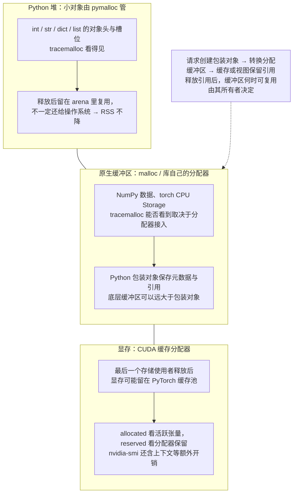
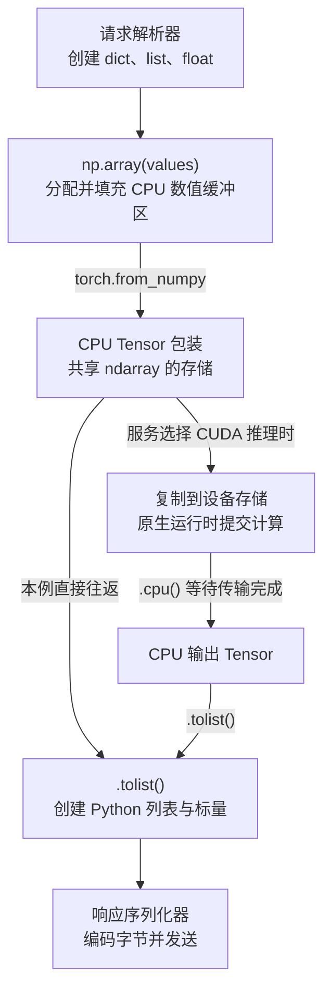
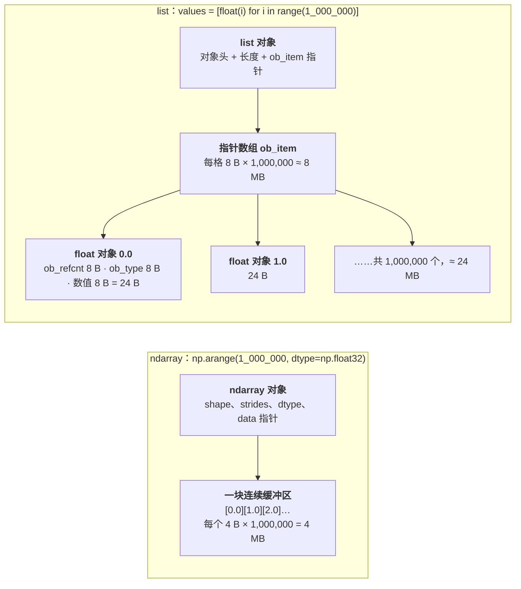
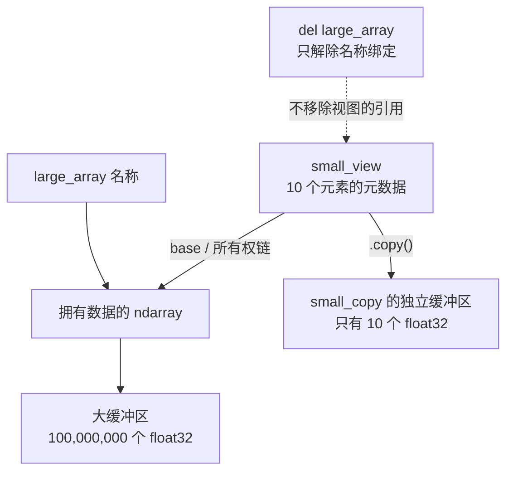
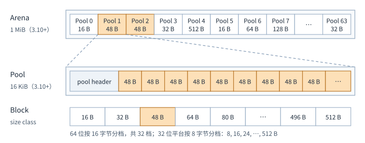
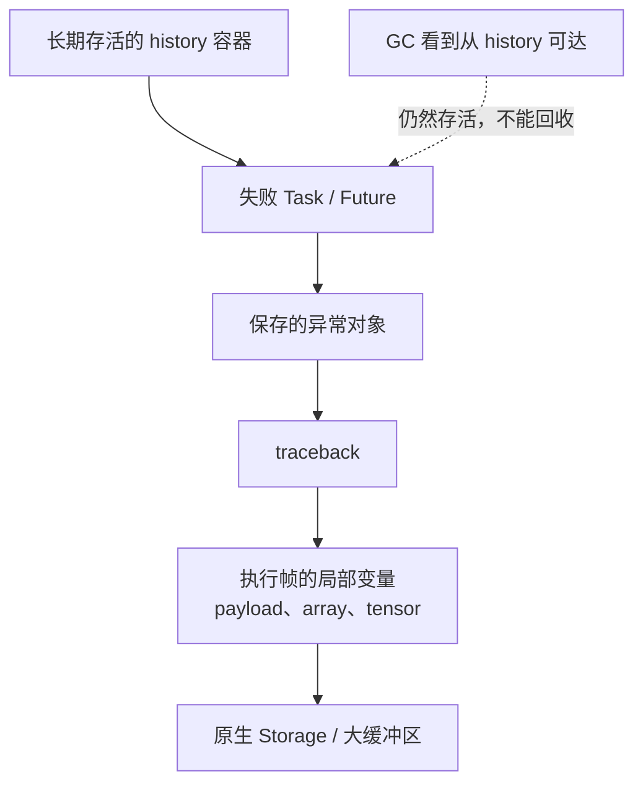

一个推理服务上线后，进程的常驻内存（RSS）每小时稳定上涨 300 MB，三天后被 OOM killer 杀掉。值班的人打开 `tracemalloc`，它记录的已追踪分配总共只涨了 20 MB。剩下的 280 MB 在哪？这类问题在 AI-Infra 服务里几乎是必修课，答案通常不在任何一行"算得慢"的 Python 代码里，而在几个看不见的地方：原生缓冲区未必进入 `tracemalloc` 的追踪范围（现代 NumPy 通常会主动登记数据分配，PyTorch Storage 则不能指望它覆盖）；一个请求级的 `dict` 缓存没有上限，每个 key 挂着一段 tensor；一次 `arr[mask]` 以为是视图其实是拷贝；pymalloc 把释放的小对象内存留在自己的 arena 里不还给操作系统；CUDA 的缓存分配器同样把显存攥在手里——`nvidia-smi` 看到的数字与 PyTorch 实际在用的差一倍。

Python 在这类系统里不做最重的数值计算，它做的是组织请求、配置与任务对象，管理数据结构的生命周期，调用 NumPy / PyTorch，并把 CPU 内存、原生缓冲区与 GPU 显存连在一起。于是它的内存问题也换了形态：不是"某段代码慢"，而是对象太多、临时对象活得太久、容器无界增长、隐式拷贝、Python 对象与原生数据之间的隐式转换，以及三块内存的所有权边界不清。要定位开头那 280 MB，得先弄清一件事：

本文要回答的核心问题是：

> **在 AI-Infra 服务里，哪些内存由 Python 管理、哪些在原生缓冲区或设备上，哪些操作会创建副本或延长对象生命周期，内存持续增长时又该如何定位来源？[^q0]**

## 一、总览




### 1. 本文的范围

本文聚焦 Python 工程师在 AI-Infra 场景下必须掌握的内存知识，包括对象模型、内存分配、复制语义、垃圾回收、缓存生命周期，以及 Python 与原生运行时之间的内存边界。

下文用一个接收数值列表、转成张量再返回结果的请求贯穿这些层次。对象布局、引用计数与 pymalloc 主要按 **64 位 CPython 3.10–3.12 的常见带 GIL 构建**说明；这些不是 Python 语言对回收时机的保证。3.13/3.14 的 free-threaded 构建、GC 与分配器变化另行注明。Java 对照以 Java 25 为参照，比较的是所有权与诊断职责。

本文不重点讨论线程、进程、异步调度、动态批处理或 CPU 计算并行化。这些内容属于并发模型和任务协作的范畴。

全文按"对象 → 复制 → 缓冲区与数据布局 → 运行时边界 → 回收机制 → 生命周期 → 排查与实践"的顺序展开：先弄清一个 Python 对象占多少内存、赋值和切片何时产生副本，再看缓冲区协议和 NumPy/PyTorch 的数据布局如何决定隐式复制，然后划清 Python 内存、原生内存与 GPU 显存的边界，接着讨论引用计数、循环 GC、pymalloc 与缓存导致的生命周期问题，最后给出排查方法、设计原则、一个审查案例和一份检查清单。

### 2. 本文的章节安排

| 章 | 主题 | 内容 |
|---|---|---|
| 二 | 为什么 AI-Infra 需要理解 Python 内存 | 一个推理请求经过的内存路径 |
| 三 | Python 对象模型与内存开销 | 名称与引用、标量不是裸数据、容器开销、`__slots__`、数据类 |
| 四 | 复制、视图与对象共享 | 赋值不是复制、深拷贝代价、切片副本、视图不等于副本 |
| 五 | 缓冲区协议与底层内存共享 | bytes/bytearray/memoryview、零拷贝不是绝对概念 |
| 六 | 数据布局与隐式复制 | 连续与非连续内存、dtype 转换、列表与数组的边界 |
| 七 | Python 与原生运行时的内存边界 | Python 内存≠进程内存、CPU 内存与 GPU 显存、.cpu()/.numpy()/.tolist() |
| 八 | 引用计数、垃圾回收与内存分配器 | 引用计数、循环 GC、`__del__` 的陷阱、pymalloc |
| 九 | 缓存、引用与对象生命周期 | 无界缓存、闭包与回调、任务与异常对象、弱引用 |
| 十 | 常见内存问题的排查方法 | 三类增长、`sys.getsizeof`、tracemalloc、引用检查、进程级与 GPU 显存诊断 |
| 十一 | 工程实践中的设计原则 | 数据表示匹配数据性质、明确复制边界、控制生命周期、降低峰值 |
| 十二 | 一个简单的内存审查案例 | 对一段 predict 代码逐项审查 |
| 十三 | 内存优化检查清单 | 对象、复制、数据、生命周期、运行时五个层面 |
| 十四 | 附：Java 与 Python 内存管理对照 |  |
| 十五 | 本文小结 |  |
| 十六 | 自测 | 5 道题 |

Table: 本文的章节安排

## 二、为什么 AI-Infra 需要理解 Python 内存

先把真实推理简化成一次 CPU 数据往返。请求已经解析成字典，下面只看表示形式如何变化：

```python title="一次请求里的多次对象创建与格式转换"
import numpy as np
import torch

payload = {"values": [1.0, 2.0, 3.0]}
values = payload["values"]

array = np.array(values, dtype=np.float32)
tensor = torch.from_numpy(array)
result = tensor.tolist()
print(result)
# [1.0, 2.0, 3.0]
```

真实服务在这条链路中还会插入 GPU 推理。谁发起转换、谁持有结果，要沿调用路径逐段追：



这里有几处容易低估的成本：

1. JSON 解析创建大量 Python `dict`、`list`、`float` 对象；
2. `np.array()` 将 Python 对象转换为连续的 NumPy 内存；
3. `torch.from_numpy()` 对支持的 ndarray 创建 CPU Tensor 包装，共享底层存储；
4. 推理过程可能将数据复制到 GPU；
5. `tolist()` 又将底层数值转换回大量 Python 标量和列表对象；
6. JSON 序列化再次遍历这些对象。

如果请求数据规模较大，或者并发请求较多，内存峰值可能远高于输入数据本身。

因此，内存优化的第一步不是立即修改代码，而是回答以下问题：

- 当前对象由谁创建？
- 对象的底层数据存在哪里？
- 是否发生了复制？
- 对象会存活多久？
- 内存由 Python 管理，还是由原生库管理？
- 释放 Python 引用后，底层内存是否真的被归还？

## 三、Python 对象模型与内存开销

### 1. 名称、引用与对象

Python 变量本质上不是一个固定大小的内存槽位，而是指向对象的名称绑定。

```python title="b = a 之后 append 影响 a"
a = [1, 2, 3]
b = a

b.append(4)

print(a)
# [1, 2, 3, 4]
```

这里并没有创建两个列表。`a` 和 `b` 引用了同一个列表对象。

可以使用 `id()` 验证对象身份：

```python title="id(a) == id(b) 为 True"
print(id(a) == id(b))
# True
```

这意味着，理解 Python 内存时不能只看变量名，还要关注：

- 有多少个引用指向同一个对象；
- 对象是否可变；
- 引用是否被容器、闭包、任务或缓存长期持有。

CPython 会缓存常用小整数，编译器也可能合并同一个代码对象里的常量；字符串驻留又是另一项优化。**缓存范围与常量合并属于实现细节，不能用 `257 is 257` 证明是否新分配。** 用运行时构造把这两件事分开看：

```python title="比较值用 ==，不要依赖整数对象是否复用"
a = int("256")
b = int("256")
print(a == b, a is b)
# 常见 CPython：True True（小整数缓存）

a = int("257")
b = int("257")
print(a == b, a is b)
# 常见 CPython：True False；第二项不是 Python 语言保证
```

业务判断数值相等用 `==`，判断是否为单例 `None` 用 `is None`。对象身份只能说明当前这些引用是否指向同一对象，不能作为容量或生命周期协议。

### 2. Python 标量不是裸数据

在底层语言中，一个整数通常可以直接表示为固定大小的机器数据。但在 Python 中，整数是完整的对象：

```python title="value = 42 是一个完整对象"
value = 42
```

这个对象除了保存数值本身，还需要保存类型信息以及解释器管理所需的元数据。

因此，大量 Python 标量组成的列表会产生较高的额外开销：

```python title="一百万个 Python float 组成的列表"
values = [float(i) for i in range(1_000_000)]
```

这个列表包含：

- 列表自身的指针数组；
- 大量独立的 Python `float` 对象；
- 每个对象的类型和引用计数信息。

如果数据本质上是规则的数值集合，使用 NumPy 数组通常更适合：

```python title="同样一百万个数用 np.arange 存"
import numpy as np

values = np.arange(1_000_000, dtype=np.float32)
```

NumPy 数组通常将数据存储在连续的原生内存中，避免为每个数值创建独立的 Python 对象。

把两种存法摊开来比，差距来自"每个数是不是一个对象"：



在常见 64 位 CPython 构建上，左边大约是 8 MB 引用数组加 24 MB 独立 float 对象，还可能有列表预留容量与分配器开销。float 通常不由循环 GC 跟踪，但列表会被跟踪；不能把一百万个 float 都算成 GC 扫描对象。右边的 ndarray 包装则指向一块 4 MB 数值缓冲区（`float64` 为 8 MB），数值本身没有独立 Python 对象头。

`sys.getsizeof(1.0)` 常见为 24，`sys.getsizeof([0.0] * 1_000_000)` 常见为 8,000,056，但后一个表达式让所有元素引用**同一个** float，只能用来观察列表浅层大小，不能代表前面列表推导式的总占用。NumPy 的 `nbytes` 统计逻辑元素字节数，不等于该数组独占的内存量。

> [!NOTE] 与 Java 对照：对象数组与原语数组
> Java 的 `double[]` 在数组对象内保存连续数值，`Double[]` 保存到装箱对象的引用；Python `list[float]` 更接近后一种表示，但类型注解不会改变 list 的存储布局。Java 原语可以出现在局部变量、对象字段或数组元素中，并非统一“分配在栈上”；Python 的 NumPy / `array.array` 才提供紧凑数值缓冲区。

这并不意味着“所有列表都应该改成 NumPy 数组”。如果数据包含复杂的异构结构，例如请求元数据、配置项或插件描述，Python 容器仍然是合理选择。关键在于区分：

- 适合 Python 对象表达的数据；
- 适合连续数值内存表达的数据。

### 3. 容器自身也有额外开销

Python 容器通常保存的是对象引用，而不是对象内联数据。

```python title="列表保存的是三个引用"
items = [1, 2, 3]
```

列表内部保存的是指向三个整数对象的引用。

对于字典而言，除了键和值对象本身，还需要维护哈希表结构：

```python title="字典还要维护哈希表结构"
metadata = {
    "request_id": "abc",
    "model": "embedding",
    "priority": 1,
}
```

在请求量较大、对象生命周期较短的系统中，大量创建小型字典和列表会带来：

- 更高的内存占用；
- 更多的分配与释放操作；
- 更大的垃圾回收压力；
- 更高的对象遍历成本。

如果对象结构固定，可以考虑使用更紧凑的表示。

### 4. `__slots__` 减少实例字典

普通类实例通常拥有一个 `__dict__`，用于保存实例属性：

```python title="普通类实例带 __dict__"
class RequestContext:
    def __init__(self, request_id, model_name, deadline):
        self.request_id = request_id
        self.model_name = model_name
        self.deadline = deadline
```

当系统创建大量此类对象时，每个实例的属性字典都会产生额外开销。

可以使用 `__slots__`：

```python title="用 __slots__ 去掉实例字典"
class RequestContext:
    __slots__ = ("request_id", "model_name", "deadline")

    def __init__(self, request_id, model_name, deadline):
        self.request_id = request_id
        self.model_name = model_name
        self.deadline = deadline
```

`__slots__` 的主要作用是：

- 限定允许使用的属性；
- 通常减少实例内存占用；
- 避免为每个实例创建独立的 `__dict__`。

但它并不是无条件的优化。使用时需要注意：

- 不能随意添加未声明的属性；
- 某些依赖 `__dict__` 的工具可能无法正常工作；
- 继承关系复杂时需要谨慎设计；
- 如果对象数量很少，节省的内存可能没有实际意义。

对于大量创建、结构稳定、生命周期较短的请求元数据或任务节点，`__slots__` 比较适合。

> 关于 `__slots__` 与类对象模型的详细讨论，参见[《对象模型与协议》](/python-object-model-and-protocols.html)。

### 5. 使用数据类表达结构化对象

对于结构化数据，可以使用 `dataclass` 提高可读性：

```python title="dataclass(slots=True) 表达结构化对象"
from dataclasses import dataclass

@dataclass(slots=True)
class RequestContext:
    request_id: str
    model_name: str
    deadline: float
```

`slots=True` 可以让数据类使用槽位存储属性。

需要注意的是，数据类主要解决的是结构表达和代码维护问题。是否能够明显降低内存占用，仍然取决于对象数量、字段类型和实际生命周期。

> 关于 `dataclass` 的完整用法和与 Pydantic `BaseModel` 的对比，参见[《类型系统（下）》](/python-data-contract-design-dataclass-pydantic-and-settings.html)的"选型指南"一节。

## 四、复制、视图与对象共享

### 1. 赋值不是复制

```python title="backup = config 只是同一个字典的第二个名字"
config = {"timeout": 1.0}
backup = config

backup["timeout"] = 2.0

print(config["timeout"])
# 2.0
```

`backup = config` 只增加了一个引用，并没有创建新的字典。

如果确实需要隔离顶层键的修改，可以使用浅拷贝。重新初始化配置，避免把前一个实验已经改成 2.0 的值带进来：

```python title="浅拷贝后改顶层键不影响原字典"
config = {"timeout": 1.0}
backup = config.copy()
backup["timeout"] = 2.0
print(config["timeout"], backup["timeout"])
# 1.0 2.0
```

但浅拷贝只复制最外层容器：

```python title="浅拷贝只复制最外层：嵌套的 limits 仍共享"
config = {
    "limits": {
        "max_tokens": 1024,
    }
}

backup = config.copy()
backup["limits"]["max_tokens"] = 2048

print(config["limits"]["max_tokens"])
# 2048
```

嵌套字典仍然是共享的。

### 2. 深拷贝可能代价很高

```python title="copy.deepcopy 整棵复制"
import copy

backup = copy.deepcopy(config)
```

深拷贝递归处理对象图，用 memo 避免重复复制与无限递归；不可变对象、用户定义的 `__deepcopy__` 等可以保留共享，并不是“每个节点必建新对象”。它仍可能导致：

- 更高的 CPU 开销；
- 更高的瞬时内存峰值；
- 复制不必要的数据；
- 对包含锁、文件句柄或原生资源的对象产生问题。

在请求路径中，不应为了“安全”而盲目使用 `deepcopy()`。更好的方式通常是：

- 明确哪些字段需要复制；
- 只复制会被修改的部分；
- 使用不可变对象；
- 构造新的轻量对象；
- 通过类型和接口限制修改范围。

例如：

```python title="用字典展开构造新的 limits 而不深拷贝"
new_limits = {
    **config["limits"],
    "max_tokens": 2048,
}

new_config = {
    **config,
    "limits": new_limits,
}
```

这种方式虽然也会创建对象，但复制范围更加明确。

假设 `config` 里除了 `limits` 还有一个不会被修改的大对象 `config["vocab"]`，四种写法各自复制了哪一层：

| 写法 | 顶层 dict | `limits` dict | 其他嵌套值（`vocab`） | 改 `limits["max_tokens"]` 会影响 `config` 吗 |
|---|---|---|---|---|
| `backup = config` | 共享 | 共享 | 共享 | 会 |
| `config.copy()` | 新建 | 共享 | 共享 | 会 |
| `copy.deepcopy(config)` | 新建 | 新建 | 按类型协议递归处理（可变大对象可能很贵） | 不会 |
| `{**config, "limits": {**config["limits"], …}}` | 新建 | 新建 | 共享 | 不会 |

Table: 四种复制写法各复制了哪一层

最后一行只复制要改的那条路径，其余对象原样共享——既不会误改原配置，也不用为 `vocab` 付深拷贝的代价。

> [!NOTE] 与 Java 对照：浅拷贝与不可变容器
> `new HashMap<>(config)` 同样只复制顶层映射；`List.copyOf()` / `Map.copyOf()` 提供不可修改的容器，也不会递归冻结元素。Python 的浅拷贝、Java 的容器复制都要求先说明哪一层可修改，不能把“新容器”当成“独立对象图”。

### 3. 切片可能创建副本

对于列表，切片会创建新的列表：

```python title="列表切片创建新列表"
items = list(range(1_000_000))
part = items[:500_000]
```

`part` 是一个新列表，包含新的引用数组。虽然列表中的元素对象可能仍然共享，但顶层容器已经被复制。

如果只需要遍历一段数据，可以考虑使用迭代器：

```python title="用 islice 只遍历一段而不复制"
from itertools import islice

part = islice(items, 500_000)
```

`islice()` 不会立即创建一个新的大列表，而是按需产生元素。

但需要注意，迭代器也可能持有原始对象的引用。如果原始列表很大，迭代器的生命周期同样不应过长。

### 4. 视图不等于副本

对于 NumPy 数组，某些切片操作会产生视图：

```python title="NumPy 切片得到视图：改 view 会改 array"
import numpy as np

array = np.arange(10)
view = array[2:6]

view[:] = 100

print(array)
# [  0   1 100 100 100 100   6   7   8   9]
```

`view` 与 `array` 共享底层内存。

如果需要独立副本，需要显式调用：

```python title="用 .copy() 得到独立副本"
copy_array = array[2:6].copy()
```

视图能够减少内存复制，但也带来生命周期问题：一个很小的视图可能继续持有一个很大的底层数组。

```python title="一个 10 元素的视图钉住一亿元素的数组"
large_array = np.zeros(100_000_000, dtype=np.float32)
small_view = large_array[:10]
```

即使 `small_view` 只使用很少的数据，它仍然让整块底层存储保持存活。注意被保留的是存储及其所有权链，不要求原始变量名或每一层中间视图都存活。



- `small_view.nbytes` 只有 40，但它保留的存储是 400 MB。
- 只创建 `small_copy` 还不够；原视图仍在时，大缓冲区仍活着。要释放原视图等所有使用者，复制才换来了生命周期隔离。
- 对 NumPy 基本切片通常得到视图，布尔掩码 / 整数数组索引通常复制；`base` 不是通用共享检测器，需判断是否重叠时可用 `np.shares_memory()`。

如果只需要保留少量数据，可以显式复制：

```python title="只保留少量数据时显式复制"
small_copy = large_array[:10].copy()
```

因此，视图优化需要同时考虑：

- 是否避免了不必要的复制；
- 视图是否会延长大对象生命周期；
- 共享数据是否可能被意外修改。

## 五、缓冲区协议与底层内存共享

### 1. `bytes`、`bytearray` 与 `memoryview`

处理网络数据、文件内容或二进制输入时，常见对象包括：

- `bytes`：不可变字节序列；
- `bytearray`：可变字节序列；
- `memoryview`：对已有缓冲区的视图。

```python title="memoryview 改 bytearray 的第一个字节"
data = bytearray(b"abcdef")
view = memoryview(data)

view[0] = ord("X")

print(data)
# bytearray(b'Xbcdef')
```

`memoryview` 本身不复制底层字节，会保持导出缓冲区的对象存活；`release()` 或退出其上下文管理器可结束该视图的访问。切片生成的其他视图也各自需要结束生命周期。

例如：

```python title="parse_header 用 memoryview 切片不复制"
def parse_header(buffer: memoryview) -> memoryview:
    return buffer[:16]

data = bytearray(1024)
header = parse_header(memoryview(data))
```

这类方式适合高频处理二进制数据的场景，例如：

- 网络协议解析；
- 文件分片；
- 二进制序列化；
- 音视频或图像缓冲区处理；
- 推理输入的预处理。

在处理固定格式的二进制协议时，`struct` 模块可以与 `memoryview` 配合使用，在不复制输入字节的前提下解析字段（结果 tuple、int、float 仍需创建）：

```python title="struct.unpack_from 直接从 memoryview 解析字段"
import struct

data = bytearray(b"\x01\x00\x00\x00\x00\x00\x80\x3f")  # int32(1) + float32(1.0)
view = memoryview(data)
version, score = struct.unpack_from("<if", view)
```

### 2. 零拷贝不是绝对概念

“零拷贝”通常意味着多个组件共享同一块底层内存，但它必须满足具体条件：

- 数据格式兼容；
- dtype 兼容；
- 内存布局兼容；
- 生命周期足够长；
- 接收方支持外部缓冲区；
- 不需要跨设备复制。

以下代码可能共享底层内存：

```python title="torch.from_numpy 与 numpy 共享内存"
import numpy as np
import torch

array = np.zeros(8, dtype=np.float32)
tensor = torch.from_numpy(array)

tensor[0] = 1.0

print(array[0])
# 1.0
```

但如果数据类型或接口不兼容，转换可能发生复制：

```python title="torch.tensor 总是复制，dtype 转换会进一步改变表示"
array = np.zeros(8, dtype=np.float64)
tensor = torch.tensor(array, dtype=torch.float32)
```

`torch.tensor(array)` 即使 dtype 相同也会复制；这里还把 `float64` 转成了 `float32`。`torch.from_numpy()` 才是对支持的 CPU ndarray 共享存储的接口，不能从“dtype 恰好相同”倒推出所有构造函数都零拷贝。

| 操作 | 何时产生 / 谁消费 | 数据与所有者在哪里 | Java 对照 |
|---|---|---|---|
| `memoryview(data)` | 解析器按字节读已有输入 | 视图保留 buffer exporter，不复制数据 | `ByteBuffer.slice()` 共享底层缓冲区 |
| `torch.from_numpy(array)` | 数值预处理交给 PyTorch | CPU 存储共享，Tensor 保留 ndarray 的所有权链 | native buffer 包装；需遵守绑定库生命周期 |
| `torch.tensor(array)` | 显式构造独立 Tensor | 复制到新存储，device / dtype 由参数决定 | 分配目标缓冲区再复制 |
| `small_view.copy()` | 少量结果需长期缓存 | 新存储由副本持有，原存储可在其他使用者退出后释放 | 复制一段 `ByteBuffer` 以隔离生命周期 |

Table: 缓冲区交接时的创建动作、消费者与所有权

> [!NOTE] 与 Java 对照：视图不是堆外分配器
> Python 的 buffer protocol / `memoryview` 是访问已有存储的协议与视图，不等于 Java `allocateDirect()`。Java 的 `ByteBuffer.slice()` 也共享原存储；使用 FFM 的 `MemorySegment` 则要服从 `Arena` 生命周期，不能把 Python 视图延长所有者寿命的行为一一套过去。

因此，不能仅根据代码表面判断是否发生了复制。应当结合以下因素验证：

- 数据指针是否相同；
- dtype 是否一致；
- shape 和 stride 是否兼容；
- 数组或张量是否拥有独立存储；
- 转换接口的具体语义。

## 六、数据布局与隐式复制

### 1. 连续内存与非连续内存

底层数值库通常更喜欢连续内存。对数组转置或跨步切片后，得到的对象可能是非连续的：

```python title="转置后 C_CONTIGUOUS 从 True 变 False"
array = np.arange(12, dtype=np.float32).reshape(3, 4)
transposed = array.T

print(array.flags["C_CONTIGUOUS"])
# True

print(transposed.flags["C_CONTIGUOUS"])
# False
```

转置并没有搬动数据。数组对象记着一组**步长**（strides）：沿每一维前进一格，要在缓冲区里跳过多少字节。`array` 的步长是 `(16, 4)`——换一行跳 16 字节（4 个 `float32`），换一列跳 4 字节；`array.T` 与它共用同一块 12 个元素的缓冲区，只是把形状换成 `(4, 3)`、步长换成 `(4, 16)`。按行读两者，访问到的缓冲区下标是：

| 读第几行 | `array`（3×4，strides `(16, 4)`）读到的缓冲区下标 | `array.T`（4×3，strides `(4, 16)`）读到的缓冲区下标 |
|---|---|---|
| 0 | 0, 1, 2, 3 | 0, 4, 8 |
| 1 | 4, 5, 6, 7 | 1, 5, 9 |
| 2 | 8, 9, 10, 11 | 2, 6, 10 |
| 3 | — | 3, 7, 11 |

Table: 同一块缓冲区在原数组与转置视图下的读取顺序

左列每一行在内存里是挨着的，这就是 C 连续（C_CONTIGUOUS）；右列每一行都在缓冲区里跳着读，于是 `C_CONTIGUOUS` 为 `False`。

非连续数组不一定有问题。很多操作可以直接按步长读取。但某些底层接口要求连续内存，此时可能自动创建一个连续副本。

可以显式检查：

```python title="不连续时用 np.ascontiguousarray 补一份连续副本"
if not transposed.flags["C_CONTIGUOUS"]:
    transposed = np.ascontiguousarray(transposed)
```

显式转换的价值不只是“可能更快”，还在于：

- 复制发生的位置更明确；
- 更容易统计复制成本；
- 避免在不可控的底层调用中发生隐式复制；
- 便于在性能关键路径外完成准备工作。

### 2. dtype 转换也可能产生新内存

```python title="astype 创建新数组"
array = np.zeros(1024, dtype=np.float64)
float32_array = array.astype(np.float32)
```

`astype()` 通常会创建新的数组，因为每个元素都需要重新编码。

如果 dtype 已经符合要求，可以使用：

```python title="astype(copy=False) 尽量避免复制"
float32_array = array.astype(np.float32, copy=False)
```

但 `copy=False` 只是表达“尽量避免复制”，并不保证永远不复制。如果类型转换确实无法通过视图完成，底层仍可能创建副本。

类似地，`np.asarray()` 通常倾向于避免不必要的复制：

```python title="np.asarray 倾向不复制"
array = np.asarray(source, dtype=np.float32)
```

但当输入类型或 dtype 不兼容时，仍然可能发生转换。

### 3. Python 列表与数组之间的边界

以下代码会将 Python 列表转换为 NumPy 数组：

```python title="列表转成 float32 数组"
values = [1.0, 2.0, 3.0]
array = np.asarray(values, dtype=np.float32)
```

这个转换是必要的，因为列表中的 Python 对象并不是连续的 `float32` 内存。

相反，以下操作会将连续数组重新转换成大量 Python 对象：

```python title="tolist 把连续数组拆回大量 Python 对象"
values = array.tolist()
```

在推理服务中，`tolist()` 很容易成为内存和延迟问题的来源，尤其是输出规模较大时。

如果协议或下游接口允许，应优先使用：

- NumPy 数组；
- PyTorch 张量；
- 二进制序列化格式；
- 支持数组的结构化协议。

如果最终必须返回 JSON，就应明确接受这一步转换的成本，并避免在链路中重复转换。

## 七、Python 与原生运行时的内存边界

### 1. Python 内存不等于进程内存

一个进程的内存通常来自多个来源：

- Python 对象；
- Python 解释器和标准库；
- NumPy、PyTorch 等扩展；
- C/C++ 分配的原生内存；
- 内存映射文件；
- 线程栈；
- GPU 驱动的主机端状态与映射。

设备显存本身不计入进程的 CPU RSS，不能拿显存增长直接解释那 280 MB RSS 差额。

`tracemalloc` 跟踪通过 Python 分配接口或显式登记的内存块，不是整个进程的 malloc 拦截器。现代 NumPy 会把经其数据内存管理接口分配的缓冲区登记到独立追踪域；快照可用 `tracemalloc.DomainFilter(True, np.lib.tracemalloc_domain)` 筛选它们。外部传入的缓冲区、未接入追踪的扩展分配与 PyTorch 原生 Storage 则不能指望它完整覆盖。追踪启动之前已经存在的分配也不会被补记。

例如：

```python title="tracemalloc 统计已登记的活动分配"
import tracemalloc

tracemalloc.start()

# 执行一段业务逻辑

current, peak = tracemalloc.get_traced_memory()
print(f"current={current}, peak={peak}")
```

如果 RSS 持续增长，但 `tracemalloc` 中没有对应增长，问题可能发生在：

- C/C++ 扩展；
- 深度学习框架；
- 分配器保留或碎片；
- 内存映射；
- 驱动的主机端状态。

GPU allocator 要另看显存指标；操作系统文件缓存也不能不加区分地全部算到本进程 RSS。

### 2. CPU 内存与 GPU 显存是不同的资源

在深度学习系统中，至少需要区分：

1. Python 对象占用的内存；
2. 进程的 CPU 内存；
3. 原生库管理的 CPU 缓冲区；
4. GPU 显存；
5. GPU 框架的缓存分配器保留空间。

释放一个 Python 引用：

```python title="del tensor 只是释放一个引用"
del tensor
```

只表示当前 Python 作用域不再持有这个引用。它不一定意味着：

- 底层内存立即归还操作系统；
- GPU 缓存立即下降；
- 其他对象不再共享该存储；
- 异步设备操作已经完成。

如果还有其他引用存在，底层数据自然不会释放：

```python title="还有别的引用时 del 不会释放显存"
outputs = model(inputs)
saved = outputs
del outputs
```

此时 `saved` 仍然持有输出对象。

### 3. 谨慎使用 `.cpu()`、`.numpy()` 和 `.tolist()`

这些操作可能改变数据所在的位置、表示形式或所有权关系：

```python title=".cpu()、.numpy()、.tolist() 三步各换一次位置或表示"
cpu_tensor = gpu_tensor.cpu()
array = cpu_tensor.numpy()
values = array.tolist()
```

这条链路的边界应逐个确认：

| 调用 | 触发动作与消费者 | 存储 / 生命周期 |
|---|---|---|
| `gpu_tensor.cpu()` | GPU 输出交给 CPU 后处理 | 对 CUDA Tensor 分配 CPU 存储并传输；已在 CPU 上则可直接返回原对象 |
| `cpu_tensor.numpy()` | NumPy 消费 CPU 结果 | 默认要求 CPU、无需梯度、支持的 dtype / layout 等条件；成功时共享存储，并非总是复制 |
| `array.tolist()` | JSON 序列化消费 Python 值 | 创建列表与 Python 标量；大结果可能显著增加对象数与峰值 |

Table: 输出从设备回到响应时的传输、共享与对象化边界

需要梯度的 Tensor 通常先 `detach()`，但 detach 只断开 autograd 关系，不复制数据。`numpy(force=True)` 等版本相关便捷接口可能隐含设备迁移或状态解析，不能据此承诺零拷贝。

在调试代码中，下面这种写法尤其需要注意：

```python title="调试时 print(gpu_tensor.cpu().tolist()) 的代价"
print(gpu_tensor.cpu().tolist())
```

它可能为了打印少量信息而触发完整的数据传输和对象构造。

更稳妥的方式是：

```python title="只打印 shape、device、dtype"
print(gpu_tensor.shape)
print(gpu_tensor.device)
print(gpu_tensor.dtype)
```

如果只需要查看少量值，应限制范围：

```python title="只取前 8 个值再传回 CPU"
print(gpu_tensor.flatten()[:8].cpu().tolist())
```

## 八、引用计数、垃圾回收与内存分配器

前面几章讨论了 Python 对象的内存开销、复制语义和原生内存边界。但一个关键问题还没有回答：**Python 是如何决定何时释放一个对象的？**

### 1. 引用计数：CPython 的基本回收机制

在本文基准的带 GIL CPython 中，普通对象的引用计数降为零时通常立即开始销毁；`__del__` 复活对象等情况仍可能改变结果。下面用普通 list 观察计数，避免把 3.12 起的 immortal 对象等实现优化混进来：

```python title="sys.getrefcount 观察引用计数的增减"
import sys

a = [1, 2, 3]
print(sys.getrefcount(a))
# 2（a 本身 + getrefcount 的参数）

b = a
print(sys.getrefcount(a))
# 3

del b
print(sys.getrefcount(a))
# 2
```

对不含循环的普通对象，及时销毁是 CPython 引用计数的常见优势，但并非 Python 语言保证。free-threaded 构建存在偏置 / 延迟引用计数等不同实现；外部资源仍应使用 `with` 或显式 close。

但引用计数无法处理循环引用：

```python title="两个 Node 互相引用：引用计数回不到零"
class Node:
    def __init__(self):
        self.ref = None

a = Node()
b = Node()
a.ref = b
b.ref = a

del a
del b
# 两个 Node 对象的引用计数都不为零，但已经不可达
```

### 2. 循环垃圾回收器

为了处理循环引用，CPython 还会跟踪可能参与循环的容器等对象。按 3.10–3.12 的常见路径，它将被跟踪对象分为三代：

- **Generation 0**：新创建的对象，回收频率最高；
- **Generation 1**：经历一次 Gen 0 回收后存活的对象；
- **Generation 2**：经历一次 Gen 1 回收后存活的对象，回收频率最低。

回收一代时，GC 怎么知道上一节那两个 `Node` 已经不可达？它不从"根"出发找，而是只看这一代里的容器对象：先把每个对象的 `ob_refcnt` 复制一份，再减去**来自这一组对象内部**的引用。减完还大于零，说明有组外的引用（某个变量、别的代的对象）指着它，它和从它出发能到达的对象都活着；减到零、又没有活着的对象指向它，就是不可达的垃圾（CPython 的 `gcmodule.c` 里对应 `update_refs` → `subtract_refs` → `move_unreachable`）。用上一节的例子算一遍：

| 情形 | 对象 | `ob_refcnt` | 来自组内的引用 | 相减后 | 结论 |
|---|---|---:|---:|---:|---|
| `del a`、`del b` 之后 | Node A | 1（`B.ref`） | 1 | 0 | 不可达 |
| ^^ | Node B | 1（`A.ref`） | 1 | 0 | 不可达，两个一起回收 |
| 只执行了 `del b` | Node A | 2（名字 `a` + `B.ref`） | 1 | 1 | 有外部引用，存活 |
| ^^ | Node B | 1（`A.ref`） | 1 | 0 | 从存活的 A 可达，存活 |

Table: 循环 GC 用「引用计数减组内引用」判断两个互相引用的 Node 是否可达

所以 GC 的扫描成本与候选容器及其引用边的数量有关——这就是下面"存活对象多时 Gen 2 回收会造成尖刺"的原因。

可以查看和调整各代的阈值：

```python title="读取当前解释器的 GC 阈值，而不是照抄另一版本的默认值"
import gc
import sys

print(sys.version_info[:3], gc.get_threshold())
# CPython 3.12 常见阈值：(700, 10, 10)，应用可能自行调整
```

在 3.10–3.12 中，年轻代触发主要看被跟踪对象的净分配计数；代际收集次数决定升级收集，最老代还有额外启发式，不是每十次必然全堆扫描。它看的是对象计数，不直接按占用字节数触发。

> [!NOTE] 版本边界：不要跨版本照搬 GC 参数
> 本文发表日期之前发布的 **3.14.0** 采用增量方案，去掉了中间代，`threshold2` 不再参与调节；free-threaded 构建还会参考进程内存增长。这是具体版本的实现行为，不代表后续补丁版本永远不变。调优前应核对[当前完整版本的文档](https://docs.python.org/3.14/library/gc.html)与实际阈值。

> [!NOTE] 与 Java 对照：循环 GC 不是 JVM 整堆回收的翻版
> Java 的可达性 GC 是对象回收的主要机制，具体分代与并发策略由收集器决定；CPython 的循环 GC 补充引用计数，候选是被跟踪对象。Python float 等原子值通常无需循环扫描，GPU Storage 是否存活也不能只靠 GC 代际解释。

在 AI-Infra 服务中，需要注意以下几点：

- 循环 GC 需要遍历容器对象（`list`、`dict`、自定义类实例等），这会带来暂停；
- 如果系统中存活对象数量很大，Gen 2 回收可能导致明显的延迟尖刺；
- 某些高性能框架会禁用循环 GC（`gc.disable()`），依赖引用计数和手动管理来避免暂停。

### 3. `__del__` 终结器的陷阱

`__del__` 是 Python 的终结器方法，在对象被回收前调用。它看起来适合做资源清理，但实际使用中有严重的陷阱：

```python title="带 __del__ 的 Resource 类"
class Resource:
    def __init__(self, name):
        self.name = name

    def __del__(self):
        print(f"releasing {self.name}")
```

问题在于：

- **阻碍循环回收**：在 Python 3.4 之前，带有 `__del__` 的循环引用对象无法被 GC 回收（放入 `gc.garbage`）。Python 3.4+ 通过 PEP 442 改善了这一点，但 `__del__` 的调用顺序仍然不确定；
- **调用时机不可控**：`__del__` 可能在任意时刻被调用，甚至可能在解释器关闭时被调用，此时模块级变量可能已经被清理；
- **对象复活**：如果 `__del__` 中重新创建了对该对象的引用，对象不会被释放。

更安全的替代方案：

```python title="用 weakref.finalize 替代 __del__"
import weakref

class Resource:
    def __init__(self, name):
        self.name = name
        self._finalizer = weakref.finalize(self, Resource._cleanup, name)

    @staticmethod
    def _cleanup(name):
        print(f"releasing {name}")
```

这里 finalizer 只持有清理所需的 `name`，不会反向强引用 `self`，也可以显式调用 `_finalizer()` 提前清理。不要传绑定方法 `self._cleanup`，或把 `self` 放进参数；那会让清理器保留它本该观察的对象。finalize 仍不保证在进程被强杀时执行。

对于 AI-Infra 场景中的资源管理（GPU 句柄、网络连接、临时文件），优先使用上下文管理器（`with` 语句），而不是依赖 `__del__`。

### 4. pymalloc：CPython 的内存分配器

常见带 GIL 的 CPython 使用 pymalloc 优化不超过 512 bytes 的小额分配请求；门槛看的是每次分配请求大小，不是一个对象递归引用的数据总量。图保留 Arena / Pool / Block 三层结构：



- **Arena**：常见 64 位 3.10+ 构建启用大 arena（1 MiB）与大 pool（16 KiB）；较早版本或其他构建可为 256 KiB / 4 KiB。每个 arena 最多切成约 64 个 pool，实际还有对齐和管理开销，不能当作语言常量。
- **Pool**：上述大池配置为 16 KiB，其他构建可能为 4 KiB；按 size class 划分，一个 Pool 开头是 pool header，后面只切一种大小的 block。图里各 Pool 分到的档位只是示例，橙色是 48 B 这一档，放大的是 Pool 1。
- **Block**：64 位平台按 16 字节对齐分档，16, 32, 48, …, 512 bytes，共 32 档；32 位平台按 8 字节分档，8, 16, 24, …, 512 bytes。

关键行为：

- 小额分配走 pymalloc，大额请求回退到 raw allocator；自定义 allocator 和 `PYTHONMALLOC` 还可能改变路径；
- pool 空闲后可复用，arena 完全空闲才具备整体归还条件；实现也可能保留空 arena，不能承诺清空后 RSS 必降；
- 这意味着：即使大量 Python 小对象被释放，进程 RSS 可能仍然不下降。

这是实际排查中最容易引起困惑的现象：

1. del 大量 Python 对象
2. 引用计数归零，对象释放
3. pymalloc 回收 block/pool
4. 但 arena 中仍有少量存活对象
5. arena 不释放 → RSS 不降
6. 看起来像"内存泄漏"，实际是分配器保留

3.13+ 的 free-threaded 构建默认使用 mimalloc，不能直接套用上面的 pymalloc 分层；带 GIL 构建也可能被显式换成其他分配器。

> [!NOTE] 与 Java 对照：对象死亡与 RSS 下降是两件事
> JVM 收集器和 CPython allocator 都可能保留已释放空间供下次复用；能否归还 OS 取决于整块空间是否空闲、碎片与分配器策略。不能把“Java GC 后能还、Python 不能还”当作语言差异，应同时观察活动数据、分配器保留量和 RSS。

因此，在判断是否发生内存泄漏时，需要区分"分配器保留"和"对象仍被引用"。`tracemalloc` 可以帮助定位后者，但对分配器保留行为无能为力。

如果确实需要将内存归还 OS（例如在模型切换后释放大量临时数据），可以考虑 `gc.collect()` 后观察 RSS 变化，但不应期望 RSS 每次都下降到初始水平。

## 九、缓存、引用与对象生命周期

### 1. 无界缓存是常见的内存问题

下面的代码会让缓存持续增长：

```python title="无界的全局 cache 字典"
cache = {}

def remember(key, value):
    cache[key] = value
```

如果 `key` 持续变化，且没有淘汰策略，进程内存最终会不断上升。

更合理的方式是设置边界：

```python title="lru_cache(maxsize=1024) 给缓存设边界"
from functools import lru_cache

@lru_cache(maxsize=1024)
def load_config(model_name: str):
    return build_config(model_name)
```

但 `lru_cache` 也不是自动解决方案：

- `maxsize` 仍然需要合理设置；
- 参数必须可哈希；
- 缓存值会被强引用；
- 大对象缓存可能显著增加内存峰值；
- 配置变化后需要考虑失效机制。

缓存设计必须同时考虑：

- 命中率；
- 单项大小；
- 总容量；
- 生命周期；
- 失效条件；
- 并发访问；
- 更新策略。

### 2. 闭包和回调可能延长对象生命周期

```python title="闭包 handler 持有 large_model"
def create_handler(large_model):
    def handler(request):
        return large_model.predict(request)

    return handler
```

`handler` 闭包持有 `large_model` 的引用。只要 `handler` 存在，模型对象就不会被释放。

这通常是有意的，但类似机制也可能造成意外保留：

- 任务回调捕获完整请求对象；
- 日志函数闭包捕获大数据；
- 异常对象保留局部变量；
- 全局列表保存历史任务；
- 调试代码保存完整输出。

在高并发服务中，应避免让短生命周期回调捕获不必要的大对象。

> 关于闭包的工作机制和常见陷阱（如延迟绑定），参见[《作用域与闭包》](/python-scopes-and-closures.html)。

### 3. 任务对象和异常对象也可能持有引用

异步任务、Future、回调和异常对象可能间接持有：

- 请求上下文；
- 输入张量；
- 输出结果；
- 局部变量；
- traceback。

回到前面的数值请求：若把失败的 Task 放进全局 `history`，即使请求协程已经退出，下面的链仍可能存在：



- 并非所有完成 Task 都保留所有局部变量；这里展示的是失败异常仍持有 traceback 的具体路径，成功结果也可能单独保留大张量。
- `except Exception as error` 的异常目标会在离开 except 时自动清除；把 `error`、traceback 或 Task 另存到历史容器，才可能长期保留这条链。
- 诊断工具展示分配点，引用链决定为什么仍然活着。清理 history 或只保留轻量错误摘要，比反复 `gc.collect()` 更直接。

因此，任务完成后应及时清理不再需要的引用，避免将任务对象无限保存。

> 关于异步任务、Future 和回调的生命周期管理，参见[《Python 并发、异步与任务协作》](/python-concurrency-asynchrony-and-task-collaboration.html)。

这并不意味着要到处手动调用 `gc.collect()`。频繁强制垃圾回收可能增加延迟，甚至降低吞吐。更重要的是：

- 缩短对象生命周期；
- 避免无界引用集合；
- 清理完成任务；
- 限制缓存；
- 解除不必要的闭包和回调引用。

### 4. 弱引用适合非所有权关系

当一个容器只需要观察对象，而不应该延长对象生命周期时，可以考虑 `weakref`：

```python title="weakref.WeakValueDictionary 观察对象而不持有"
import weakref

class Model:
    pass

model = Model()
registry = weakref.WeakValueDictionary()
registry["default"] = model

del model
```

当对象最终被回收时，弱引用容器中的条目会自动消失；若对象处于不可达循环中，清理仍可能等循环 GC。

> [!NOTE] 与 Java 对照：弱键与弱值不是同一种缓存
> `WeakValueDictionary` 弱持有值，更接近 Java 中显式使用 `WeakReference<V>` 的注册表；`WeakHashMap` 弱持有的是键。两者都不负责保证业务对象存活，也不能替代容量与失效策略。

弱引用适合：

- 非所有权注册表；
- 对象索引；
- 调试辅助结构；
- 避免缓存反向持有对象。

但如果业务逻辑要求对象必须保持存活，就不应使用弱引用。

## 十、常见内存问题的排查方法

### 1. 先区分三类增长

看到进程内存上升时，首先要区分：

1. **仍然被业务对象引用**；
2. **分配器保留了内存，但对象已经释放**；
3. **原生库或设备运行时持有内存**。

它们的处理方法不同。

- 第一类需要查找引用链和生命周期；
- 第二类需要理解分配器行为；
- 第三类需要使用对应原生库的诊断工具。

不能仅凭 RSS 上升就判断发生了内存泄漏。

### 2. 使用 `sys.getsizeof()` 时要注意边界

```python title="sys.getsizeof 一个三元素列表"
import sys

value = [1, 2, 3]
print(sys.getsizeof(value))
```

`sys.getsizeof()` 通过类型提供的 `__sizeof__` 计算，不会递归遍历整个引用图。对 list，通常包含对象头和引用数组，不含元素对象：

```python title="getsizeof 不递归嵌套列表"
items = [[1, 2, 3], [4, 5, 6]]
print(sys.getsizeof(items))
```

这个结果不包含嵌套列表和其中元素的完整大小。

类型可以把自己拥有的存储算进去：NumPy 拥有数据的 ndarray 常把其数据区计入 `getsizeof()`，视图通常只计描述信息；`ndarray.nbytes` 则是逻辑元素字节数，可能与别的数组重叠。不能把每个视图的 `nbytes` 相加当成物理占用。

因此，它适合做局部观察，不适合直接作为复杂对象的总内存统计工具。

### 3. 使用 `tracemalloc` 定位已登记分配

```python title="tracemalloc 前后快照对比找分配点"
import tracemalloc

tracemalloc.start()

snapshot_before = tracemalloc.take_snapshot()

# 执行可能产生内存增长的操作

snapshot_after = tracemalloc.take_snapshot()

for statistic in snapshot_after.compare_to(
    snapshot_before,
    "lineno",
)[:10]:
    print(statistic)
```

它适合定位：

- 哪些 Python 代码行产生了较多分配；
- 哪些分配在操作前后持续增长；
- 哪些容器或对象可能被长期保留。

但它不能完整反映：

- NumPy 引用的外部缓冲区或未登记分配（NumPy 自管数据通常可追踪）；
- PyTorch 原生 Storage 分配；
- GPU 显存；
- 所有 C 扩展分配。

### 4. 检查对象是否仍被引用

可以使用垃圾回收模块观察对象：

```python title="gc.collect 返回不可达对象数"
import gc

unreachable = gc.collect()
print("unreachable objects:", unreachable)
```

如果需要追踪某个对象为什么没有被释放，可以使用 `gc.get_referrers()` 查看引用链：

```python title="gc.get_referrers 查看谁还引用着 obj"
import gc

obj = SomeLargeObject()
# ... 经过一系列操作后，怀疑 obj 被意外持有

referrers = gc.get_referrers(obj)
for r in referrers:
    print(type(r), id(r))
```

对于更复杂的引用图分析，`objgraph` 库可以生成可视化的引用关系图：

```python title="objgraph 展示增长最快的类型与引用图"
import objgraph

# 查看增长最快的对象类型
objgraph.show_growth(limit=10)

# 查看某个对象的引用链（需要安装 graphviz）
objgraph.show_backrefs(obj, max_depth=5, filename="refs.png")
```

也可以通过代码设计减少不必要的引用：

- 不保存完整请求；
- 只保存请求 ID；
- 不把输出张量挂在长期存活的任务对象上；
- 完成后清理临时缓存；
- 避免全局列表记录全部历史数据。

垃圾回收工具适合辅助诊断，但不应替代生命周期设计。

### 5. 观察进程级内存

进程 RSS 能够反映操作系统视角下的常驻内存，但不能直接告诉你增长来自哪里。

实际排查通常需要结合：

- Python 分配追踪；
- 进程 RSS；
- 原生库统计；
- GPU 内存统计；
- 请求数量和缓存大小；
- 长时间压力测试。

只有将这些指标放在同一时间线上，才能判断问题属于 Python 对象、原生内存还是设备缓存。

### 6. GPU 显存诊断

对于使用 PyTorch 的 AI-Infra 服务，GPU 显存问题需要使用专门的工具：

```python title="torch.cuda 的 memory_allocated、memory_reserved 与 memory_summary"
import torch

# 当前已分配的 GPU 显存
print(torch.cuda.memory_allocated())

# 历史峰值分配量
print(torch.cuda.max_memory_allocated())

# PyTorch 缓存分配器保留的总显存（可能大于已分配量）
print(torch.cuda.memory_reserved())

# 完整的显存统计摘要
print(torch.cuda.memory_summary())
```

需要注意的是，`torch.cuda.memory_reserved()` 包含缓存分配器当前管理的活动块与空闲块，通常大于 `memory_allocated()`。差值可能来自可复用缓存与碎片，不能只凭差值判定有无泄漏；持续增长仍需结合活动张量和压力阶段分析。`nvidia-smi` 还包括 CUDA 上下文、库工作区等额外占用，不等于 `memory_reserved()`。

> [!NOTE] 与 Java 对照：设备内存由运行时管理
> JVM 堆分析与 Python `tracemalloc` 都不能单独解释 CUDA allocator 的全部占用。无论通过 Java 绑定还是 Python 包装调用引擎，都要使用该引擎的设备统计，按其所有权和异步完成协议释放资源。

如果需要从命令行监控，可以使用：

```bash title="nvidia-smi 每秒查询显存占用"
nvidia-smi --query-gpu=memory.used,memory.free --format=csv -l 1
```

## 十一、工程实践中的设计原则

### 1. 让数据表示匹配数据性质

- 结构化元数据使用 Python 对象；
- 大规模连续数值使用 NumPy 或张量；
- 二进制数据尽量使用缓冲区接口；
- 避免在 Python 列表和连续数组之间来回转换。

### 2. 明确复制边界

对以下操作保持敏感：

- `list(...)`；
- `dict(...)`；
- 列表切片；
- `copy.copy()`；
- `copy.deepcopy()`；
- `np.array()`；
- `astype()`；
- `.clone()`；
- `.cpu()`；
- `.numpy()`；
- `.tolist()`；
- 序列化与反序列化。

每次操作都应思考：

> 这里是共享数据、创建视图，还是产生了完整副本？

### 3. 控制对象生命周期

- 请求对象只存活在请求范围内；
- 不把大对象挂到全局状态；
- 完成任务后移除任务引用；
- 限制缓存容量；
- 避免闭包捕获无关对象；
- 不为了日志保存完整输入和输出。

### 4. 不要把所有内存问题归因于 Python

当内存增长时，应分别检查：

- Python 对象；
- C/C++ 扩展；
- NumPy 缓冲区；
- 深度学习框架缓存；
- GPU 显存；
- 操作系统分配器。

不同层的内存需要使用不同的工具和指标诊断。

### 5. 优先降低峰值，而不只是降低平均占用

AI-Infra 服务经常受到峰值内存限制。即使平均内存占用正常，以下情况仍可能导致 OOM：

- 多个请求同时创建大对象；
- 输入和输出短时间同时存活；
- 转换过程中同时存在原始数据和副本；
- 模型初始化期间存在临时权重；
- 缓存更新时产生新的大对象。

因此，应重点关注：

- 峰值内存；
- 并发请求下的最坏情况；
- 转换过程中的临时副本；
- 失败和超时路径上的资源释放。

## 十二、一个简单的内存审查案例

假设服务中存在如下代码：

```python title="待审查的 predict：列表 → 数组 → 张量 → 列表"
def predict(payload):
    values = payload["values"]

    array = np.array(values, dtype=np.float32)
    tensor = torch.tensor(array, device="cuda")

    output = model(tensor)
    return output.detach().cpu().numpy().tolist()
```

这段代码可能存在以下问题：

1. `payload` 中的 Python 列表本身占用较多对象内存；
2. `np.array()` 创建 NumPy 数组；
3. `torch.tensor()` 创建独立张量存储；
4. 张量被复制到 GPU；
5. `output.cpu()` 将结果复制回 CPU；
6. `.numpy()` 创建或暴露 NumPy 表示；
7. `.tolist()` 创建大量 Python 标量和列表对象。

这并不意味着每一步都可以直接删除，因为接口边界可能确实需要这些转换。但可以进行以下审查：

- 是否可以直接从协议读取更适合的数值格式；
- 是否可以使用支持共享内存的转换方式；
- 是否可以避免不必要的 dtype 转换；
- 是否必须把完整输出转成 Python 列表；
- 是否可以限制返回结果规模；
- 是否可以让下游接口直接处理数组或二进制数据；
- 是否需要同时保留输入和输出的多个表示。

优化后的代码可能类似：

```python title="优化后的 predict：按需转 dtype 与连续性，避免 tolist"
def predict(array: np.ndarray):
    if array.dtype != np.float32:
        array = array.astype(np.float32, copy=False)

    if not array.flags["C_CONTIGUOUS"]:
        array = np.ascontiguousarray(array)

    tensor = torch.from_numpy(array).to(device="cuda")
    output = model(tensor)

    # 如果下游是可接收 Tensor 的进程内 pipeline，可直接交接
    return output
    # 如果必须返回给 HTTP 客户端，在明确的边界做一次转换
    # return output.detach().cpu().numpy().tolist()
```

推理服务还应在加载时调用 `model.eval()`，在执行边界使用 `torch.inference_mode()` / `torch.no_grad()`（它们与 eval 的职责不同），避免意外保存 autograd 图。gRPC / HTTP 发送前仍需按协议序列化，跨设备也仍有传输成本，不能把返回 Tensor 称为整个链路零拷贝。

这个版本并不适用于所有 API，但它展示了一个重要原则：

> 尽量在明确的边界完成必要转换，并避免在链路中反复改变数据表示。

## 十三、内存优化检查清单

在优化一条 Python AI-Infra 请求路径时，可以依次检查：

### 1. 对象层面

- 是否创建了大量不必要的 Python 小对象？
- 是否可以使用数组或张量表示连续数值？
- 是否需要使用 `__slots__`？
- 是否存在大量临时字典、列表或元组？

### 2. 复制层面

- 赋值是否被误认为复制？
- 是否发生了浅拷贝或深拷贝？
- 切片是否产生了新容器？
- NumPy 或张量操作是否创建了新存储？
- 是否存在重复的序列化和反序列化？

### 3. 数据层面

- dtype 是否发生转换？
- 数组是否连续？
- 是否可以使用视图？
- 视图是否意外延长了大对象生命周期？
- 是否可以复用已有缓冲区？

### 4. 生命周期层面

- 请求结束后，大对象是否仍被引用？
- 任务、Future 或回调是否保存了请求上下文？
- 缓存是否有容量和失效策略？
- 全局容器是否持续增长？
- 异常和日志对象是否保留了大对象？

### 5. 运行时层面

- Python 内存是否与原生内存混淆？
- CPU 内存是否与 GPU 显存混淆？
- 释放引用后，底层分配器是否仍保留内存？
- 是否使用了正确层级的监控和诊断工具？

## 十四、附：Java 与 Python 内存管理对照

这里仅保留跨主题的查阅入口，具体对象、复制、GC 与设备边界已在相应小节就近对照。

| 维度 | Java | Python（本文的 CPython 基准） |
|---|---|---|
| 对象回收 | 以可达性为基础；策略取决于 GC | 普通对象引用计数 + 被跟踪循环的 GC |
| 数值表示 | 原语字段 / 原语数组紧凑；装箱对象另计 | list 存引用；NumPy / array 等提供紧凑数值缓冲区 |
| 共享视图 | ByteBuffer slice；FFM 遵守 Arena 生命周期 | memoryview、ndarray view、from_numpy 遵守各自所有权 |
| 外部资源 | try-with-resources / AutoCloseable 优先；Cleaner 兜底 | with / close 优先；weakref.finalize 兜底 |
| allocator 与 RSS | GC 后保留 / 归还策略依赖收集器与碎片 | pymalloc / 原生 allocator 保留空间；free-threaded 另看 mimalloc |
| 排查工具 | JFR / MAT 看堆与保留链；native 指标另看 | tracemalloc 看已登记分配与栈；memray 等补充原生分配 |
| GPU 内存 | 由所绑定的 native / 设备运行时管理 | 同样由 CUDA / 推理框架 allocator 管理 |
| 非所有权关系 | WeakReference、弱键 WeakHashMap | weakref、弱值 WeakValueDictionary，不能混为一一对应 |

Table: Java 与 Python 的内存职责速查

## 十五、本文小结

Python 内存管理的核心，不只是调用 `del` 或手动触发垃圾回收，而是理解以下几个层次：

1. Python 名称与对象
2. 引用关系
3. 容器与实例开销
4. 复制、视图与共享
5. 内存分配与垃圾回收
6. 缓存和生命周期
7. 原生库与设备内存边界

在 AI-Infra 中，Python 工程师不一定需要自己实现底层内存分配器，但必须能够判断：

- 哪些对象由 Python 管理；
- 哪些数据存储在原生缓冲区中；
- 哪些操作会创建副本；
- 哪些引用会延长对象生命周期；
- 哪些内存由框架缓存；
- 哪些问题属于 Python，哪些问题属于原生运行时或设备运行时。

本文的核心结论是：

> **Python 内存优化的关键，不是简单地释放变量，而是减少不必要的对象创建和数据复制，明确对象生命周期，并正确理解 Python、原生库、进程和设备之间的内存所有权边界。**

对于 AI-Infra 系统而言，可以将这套方法概括为：

- 用合适的数据结构表达数据
- 用引用关系理解对象生命周期
- 用显式边界识别复制行为
- 用视图和缓冲区减少不必要的分配
- 用有界缓存控制长期占用
- 用分层工具定位内存来源

当 Python 专注于组织和管理，而连续数据、底层缓冲区和设备资源由合适的原生运行时负责时，系统才能在保持工程灵活性的同时，避免不必要的内存开销。

## 十六、自测

1. 一个 `torch.Tensor` 对象的内存分成哪几块、各由谁管理？

   <details markdown="1"><summary>答案</summary>

   Python 对象头与 `Tensor` 包装（几百字节，Python 引用计数管）；`TensorImpl` / `Storage` 等 C++ 对象（`intrusive_ptr` 管）；真正的数据缓冲区（CPU 上 allocator、GPU 上 CUDA caching allocator 管）。`del tensor` 只减引用计数，数据是否释放取决于是否还有其他 view / storage 引用。

   </details>

2. `x[::2]`、`x.view(-1)`、`x.numpy()`、`x.clone()`、`x.contiguous()` 哪些创建副本？

   <details markdown="1"><summary>答案</summary>

   对常见稠密 Tensor：基本切片 `x[::2]` 共享 storage；`view(-1)` 仅在步长兼容时返回视图，否则抛错；默认 `numpy()` 仅在 CPU、无需梯度、支持 dtype / layout 等条件满足时共享，否则报错。`clone()` 创建副本，`contiguous()` 在布局已满足时返回原对象，否则复制。共享视图可能让整个大缓冲区活着。

   </details>

3. 引用计数已经能立即回收，为什么还需要分代 GC？什么对象会拖到 GC 才释放？

   <details markdown="1"><summary>答案</summary>

   引用计数单独处理不了不可达循环（a→b→a）；相互引用的实例、捕获 self 且被 self 保存的回调、异常与帧之间的循环都可能等待循环 GC。单有 `__del__` 并不必然延迟回收，另存异常 / Task 形成的可达链也不会被 GC 强行清除。except 的异常目标离开处理块会自动清除。触发条件要按解释器与补丁版本核对，见第八章。

   </details>

4. `nvidia-smi` 显示显存 60 GB 但 `torch.cuda.memory_allocated()` 只有 30 GB，另外 30 GB 是什么？

   <details markdown="1"><summary>答案</summary>

   差额可能包括缓存 allocator 的空闲块 / 碎片、CUDA context、库工作区与其他未计入 PyTorch allocator 的分配。先对照 `memory_reserved()`，再查设备运行时；不能把全部差额认定为缓存或直接排除泄漏。`empty_cache()` 只能释放可释放的未用缓存，不释放活跃张量，也不保证回到初始占用。

   </details>

5. 服务 RSS 持续增长，怎么判断是 Python 对象、原生缓冲区还是设备内存？各用什么工具？

   <details markdown="1"><summary>答案</summary>

   `tracemalloc` 快照对比看已登记分配点（含现代 NumPy 自管数据）；RSS 涨而 traced 不涨，继续排查未追踪的 native 分配、allocator 保留与映射，用原生分配分析器和进程指标核对。设备内存单独看 `memory_summary()`、allocated / reserved 与 `nvidia-smi`。先分层，再判断引用保留、碎片还是缓存。

   </details>

[^q0]: **先分清所有权与量尺**：Python 包装对象通过引用连接 ndarray / Tensor 的原生存储，视图、缓存、闭包、Task 与 traceback 都可能延长它的寿命；普通对象及时销毁是 CPython 的常见行为，不是语言保证（[第三章](#三python-对象模型与内存开销)、[第四章](#四复制视图与对象共享)、[第九章](#九缓存引用与对象生命周期)）。`tracemalloc` 看已登记分配，现代 NumPy 自管数据会主动接入，PyTorch 原生 Storage 与设备分配需要其他统计；GPU 显存不计入 CPU RSS，`nvidia-smi` 也不等于 `memory_reserved()`（[第五章](#五缓冲区协议与底层内存共享)、[第七章](#七python-与原生运行时的内存边界)）。**副本与保留要一起看**：基本切片和支持条件下的 `numpy()` / `from_numpy()` 共享，`torch.tensor()`、`clone()` 与 `.tolist()` 创建新表示；连续性、dtype、设备变化还会触发复制（[第六章](#六数据布局与隐式复制)、[第十二章](#十二一个简单的内存审查案例)）。**增长时先分层**：对齐活动分配、引用链、RSS、设备 allocated / reserved 的时间线，再判断保留、碎片或泄漏；GC 与 allocator 策略需核对完整版本（[第八章](#八引用计数垃圾回收与内存分配器)、[第十章](#十常见内存问题的排查方法)、[第十三章](#十三内存优化检查清单)）。
