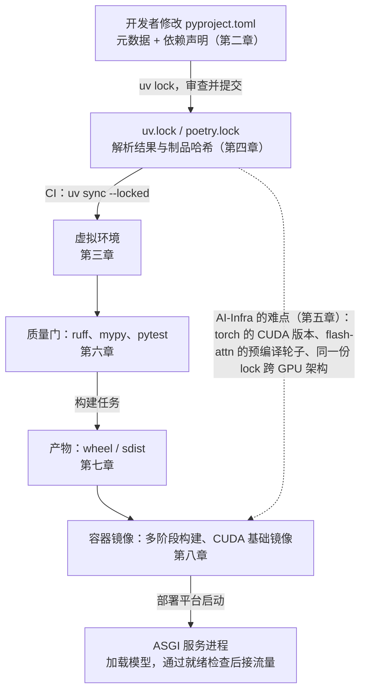
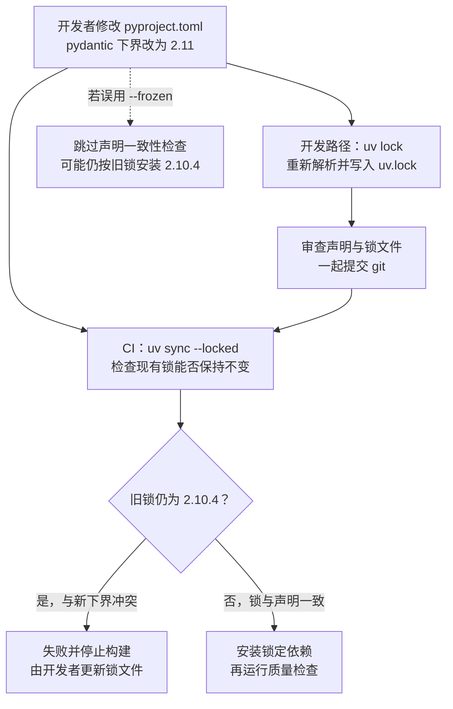
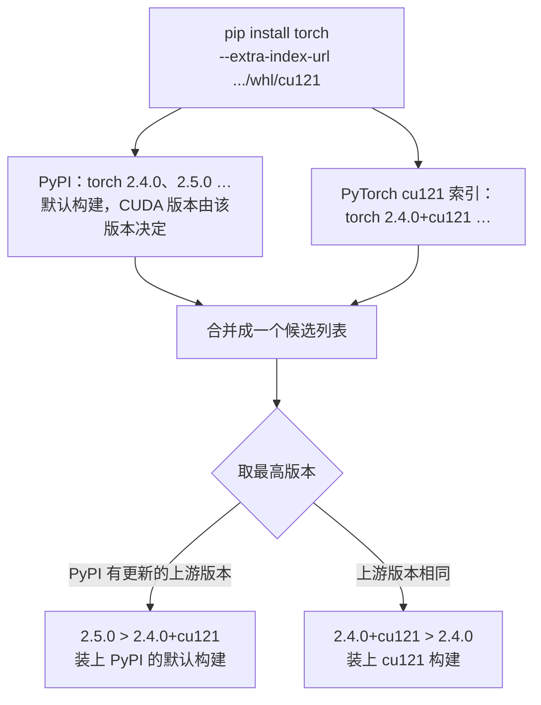
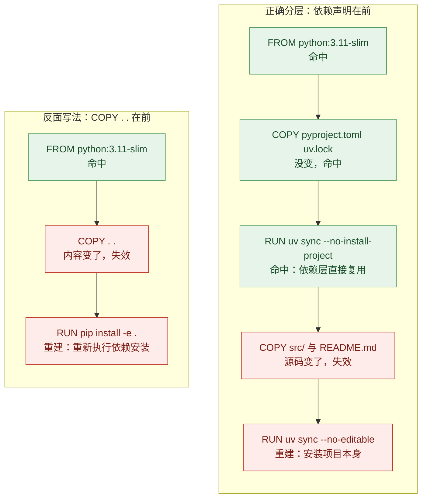
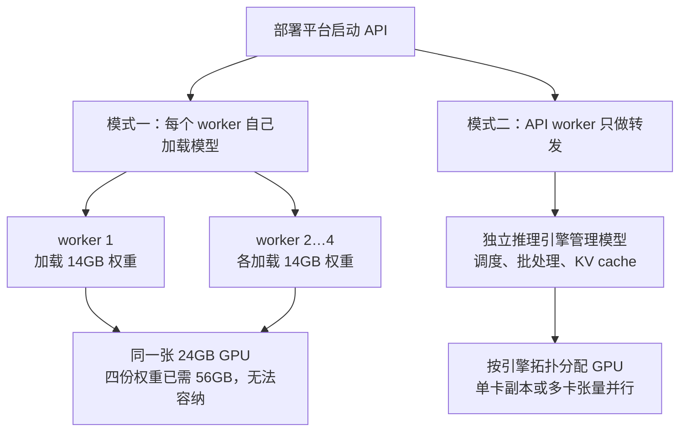

前面几篇讨论的都是"代码本身"：语言机制、类型与数据契约、并发、元编程、内存、测试与调试。这一篇讨论一件不同的事——**怎么把这些代码变成一个可以交付的东西**。

对 Java 开发者来说，这套东西是现成的：

| 关注点 | Java | Python |
|---|---|---|
| 依赖管理与构建 | Maven / Gradle | pyproject.toml + pip / uv / Poetry |
| 环境隔离 | JVM + classpath 天然隔离 | venv / conda（必须显式创建） |
| 应用框架与依赖注入 | Spring | **没有等价物**（按需组合） |
| 单元测试 | JUnit | pytest（见[《单元测试、问题定位与调试实践》](/python-unit-testing-troubleshooting-and-debugging.html)） |
| 日志 | SLF4J + Logback | `logging`（同上文） |
| 静态检查 | Checkstyle / SpotBugs | Ruff |
| 类型检查 | 编译器内建 | mypy / pyright（见[《类型系统（中）——类型信息的分发与消费》](/python-type-information-distribution-and-consumption.html)） |
| 打包产物 | jar / war | wheel / sdist |
| 部署运行 | Docker / Kubernetes | Docker + ASGI server |

Table: 工程化工具链：Java 与 Python 的对应

这张表里最值得注意的是**"没有等价物"那一行**。Python 没有 Spring 这样的单一核心框架来统摄一切，工程化是由若干相互独立的工具组合出来的。这意味着两件事：一是选择更自由，二是**没有人替你做决定**——项目的工程规范必须自己立。

Java 开发者常有的一个错觉是"Python 简单，随便装装就能跑"。在单机脚本上确实如此，但 AI-Infra 的场景会迅速打破这个错觉：

- 一个 `pip install torch` 装出来的版本，可能和线上 GPU 的 driver 不兼容；
- 同一份 `requirements.txt`，今天装出来的环境和三个月后装出来的不是同一个；
- 本地跑得好好的代码，打成包装到另一台机器上 `ImportError`；
- 一个 Docker 镜像因为把 torch 放错了层，体积从 2GB 变成 12GB，每次 CI 都要重新推。

这些问题都不是语言问题，而是**交付问题**。本文的核心问题就是：

> **怎么把一个 AI-Infra Python 项目变成可以复现、可以交付的东西——依赖怎么声明和锁定、环境怎么隔离、质量怎么把关、制品怎么打包、镜像怎么分层？[^q0]**

## 一、总览

以 `inference-service` 为例：开发者修改依赖声明后生成锁文件，CI 按锁安装并检查代码，构建任务产出 wheel 和镜像，部署平台再启动服务进程。各阶段消费的是上一阶段留下的文件或制品，不是开发者电脑上那份“已经装好”的环境。




### 1. 组织轴：可交付物的生命周期

本文的组织轴是**项目作为一个可交付物的生命周期**：声明依赖 → 隔离环境 → 锁定版本 → 检查质量 → 打成制品 → 交付运行。第二到第八章依次对应这条链上的每一步（其中第五章专门处理 AI-Infra 特有的 torch/CUDA 依赖难题），第九章把它们串成一个可复现的项目骨架。

| 交付对象 | 什么时候产生 | 谁消费 | 保存在哪里 | Java 对照 |
|---|---|---|---|---|
| `pyproject.toml` | 开发者声明项目与依赖时 | 解析器、构建后端和质量工具 | 源码仓库 | `pom.xml` 的部分职责 |
| `uv.lock` | `uv lock` / `uv add` 解析后 | CI、开发环境、镜像构建 | 源码仓库 | 更接近 Gradle 依赖锁定；Maven BOM 只覆盖部分职责 |
| `.venv/` | 创建环境并同步依赖后 | 本次环境里的 Python 进程 | 开发机或镜像文件系统，不提交 git | 应用 classpath 与依赖目录，隔离机制不同 |
| wheel / sdist | 构建后端打包后 | 安装器；sdist 还交给构建后端 | `dist/`、制品仓库 | jar / 源码包，不包含完整运行环境 |
| 容器镜像 | 镜像构建完成后 | 部署平台、容器运行时 | 镜像仓库与节点缓存 | Java 服务也常用容器交付 |

Table: 从项目声明到运行环境的交付对象

### 2. 本文的边界与版本基线

需要说明本文的边界。以下内容属于其他篇，本文只做交叉引用，不重复展开：

- **测试**（pytest、fixture、mock、覆盖率）与**日志配置** → [《单元测试、问题定位与调试实践》](/python-unit-testing-troubleshooting-and-debugging.html)
- **异步与并发**（asyncio、GIL、事件循环）→ [《并发、异步与任务协作》](/python-concurrency-asynchrony-and-task-collaboration.html)
- **类型检查配置**（mypy / pyright）与**类型信息分发**（`py.typed`、PEP 561）→ [《类型系统（中）——类型信息的分发与消费》](/python-type-information-distribution-and-consumption.html)
- **`import` 机制、`sys.path` 与 src 布局** → [《模块与导入系统》](/python-modules-and-the-import-system.html)
- **入口点做插件发现** → [《Python 的动态机制及工程实践》](/python-reflection-metaprogramming-and-plugin-architecture.html)

> **示例约定**：工具链以 Python 3.11–3.12、uv 0.5、PyTorch 2.4、setuptools 75 为基线；NGC 镜像示例使用镜像自带的 Python / torch，版本由镜像清单另行确定，不能把它当成 PyTorch 2.4 的同义物。GPU 兼容性仍需在目标节点验证。

### 3. 本文的章节安排

| 章 | 主题 | 内容 |
|---|---|---|
| 二 | `pyproject.toml`：项目元数据的单一入口 | [project]、可选依赖与分组、scripts 入口、build-system、工具配置聚合、对照 Maven |
| 三 | 虚拟环境与解释器隔离 | 为什么比 Java 更依赖隔离、venv 操作、隔离解决不了什么、conda vs venv |
| 四 | 依赖管理与可复现构建 | 对照 Maven 的五件事、抽象依赖与锁定依赖、`requirements.txt` 的局限、工具选型、版本上界、供应链安全 |
| 五 | AI-Infra 的依赖难题 | +cu121 本地版本、index-url 与 extra-index-url、CUDA 兼容矩阵、锁文件跨平台失效、把 torch 摘出去 |
| 六 | 代码质量工具链 | Ruff、渐进式引入与 noqa、pre-commit、与类型检查的分工、对照 Checkstyle/SpotBugs |
| 七 | 打包与分发 | wheel 与 sdist、纯 Python 包 vs 带扩展的包、类型信息随包分发、版本号与发布 |
| 八 | 容器化：Python 服务的交付形态 | 分层与缓存、torch 装在哪一层、容器里为何仍用 venv、ASGI 部署、FastAPI + uvicorn |
| 九 | 串起来：一个可复现的项目骨架 | 目录结构、`pyproject.toml`、Dockerfile、Makefile、CI |
| 十 | 附：Java 与 Python 工程化工具链对照 |  |
| 十一 | 本文小结 |  |
| 十二 | 自测 | 5 道题 |

Table: 本文的章节安排

## 二、pyproject.toml：项目元数据的单一入口

Python 曾经有过 `setup.py`、`setup.cfg`、`requirements.txt`、`Pipfile`、`MANIFEST.in` 并存的混乱时期。PEP 518 / 621 之后，`pyproject.toml` 成为标准的单一配置入口——它的地位相当于 Maven 的 `pom.xml`。

### 1. `[project]` 段：项目元数据

```toml title="[project] 段：名称、版本、依赖与 Python 版本"
[project]
name = "inference-service"
version = "0.1.0"
description = "A model inference service"
readme = "README.md"
requires-python = ">=3.11"
license = { text = "Apache-2.0" }
authors = [{ name = "Your Name", email = "you@example.com" }]

dependencies = [
    "fastapi>=0.115",
    "pydantic>=2.9",
    "httpx>=0.27",
    "uvicorn[standard]>=0.32",
]
```

几个关键字段：

- **`requires-python`**：声明包支持的解释器版本，供安装器筛选发行版。Ruff 可以据此推断目标版本，mypy 则应显式配置 `python_version`（未配置时通常使用运行 mypy 的 Python 版本）。
- **`dependencies`**：**抽象依赖**（abstract dependencies），只声明"需要什么"，不锁定具体版本。锁定是另一件事，见第四章。
- **`version`**：也可以交给构建后端动态生成（`dynamic = ["version"]`），从 `__init__.py` 的 `__version__` 或 git tag 读取。

> [!NOTE] 与 Java 对照：依赖声明与解释器要求
> `dependencies` 的职责接近 Maven 的 `<dependencies>`。`requires-python` 是安装兼容条件，不会安装解释器，也不等于 `maven.compiler.source`；Java 的源码级别、目标字节码和实际 JDK 同样需要分别配置。

### 2. 可选依赖与依赖分组

开发工具不应该进入生产环境。有两种表达方式，含义不同：

```toml title="optional-dependencies 与 dependency-groups 的区别"
# 方式一：optional-dependencies（PEP 621）
# 这是"包的可选特性"，会随包发布，用户可以 pip install inference-service[gpu]
[project.optional-dependencies]
gpu = ["nvidia-ml-py>=12.0"]
s3 = ["boto3>=1.35"]

# 方式二：dependency-groups（PEP 735，较新）
# 这是"开发时才用的依赖"，不随包发布
[dependency-groups]
dev = [
    "pytest>=8.3",
    "pytest-asyncio>=0.24",
    "pytest-cov>=6.0",
    "ruff>=0.8",
    "mypy>=1.13",
]
```

区别在于**是否属于包的对外契约**：

- `optional-dependencies` 是给**用户**的选项——"你如果要用 GPU 监控功能，就多装这几个包"；
- `dependency-groups` 是给**开发者**的——测试和 lint 工具，用户根本不需要知道。

不需要向用户公开的开发依赖，可以在工具支持 PEP 735 后放进 `dependency-groups`；它不会作为包的 extras 发布。

> [!NOTE] 与 Java 对照：extras 与开发依赖
> `dependency-groups` 和 Maven test scope 都能把测试工具与运行依赖分开，但 Python 分组由 uv 等工具消费。extras 是用户主动选择的一组附加依赖（`pkg[s3]`），不等于 Maven 用 `<optional>true</optional>` 限制依赖的传递。

### 3. `[project.scripts]`：命令行入口

```toml title="[project.scripts] 声明两个命令行入口"
[project.scripts]
inference-server = "inference_service.cli:main"
inference-bench = "inference_service.bench:main"
```

安装后会在环境的 `bin/` 目录生成可执行脚本，直接 `inference-server --port 8000` 即可运行。等号右边是 `模块路径:函数名`。

```python title="cli.py 里的 main：argparse 解析 --port"
# 入口骨架：省略解析参数之后的服务启动
# src/inference_service/cli.py
import argparse


def main() -> None:
    parser = argparse.ArgumentParser()
    parser.add_argument("--port", type=int, default=8000)
    args = parser.parse_args()
    ...
```

这个机制的底层是 Python 包的**入口点（entry points）**。除了生成 CLI，同一套机制还能用来做插件发现——让主程序自动找到已安装的第三方扩展。

> 入口点用于插件发现的完整做法（`[project.entry-points."my_ai.backends"]` 与 `importlib.metadata.entry_points()`），见[《Python 的动态机制及工程实践》](/python-reflection-metaprogramming-and-plugin-architecture.html)的"入口点：面向发行包的插件发现"一节。本文只关注它作为 CLI 入口的用法。

> [!NOTE] 与 Java 对照：命令入口
> 用途接近 `Main-Class` 或 appassembler 生成的启动脚本；Python 安装器为命令生成包装脚本，调用指定的零参数函数，解释器仍来自安装它的环境。

### 4. `[build-system]`：构建后端

```toml title="[build-system] 用 setuptools"
[build-system]
requires = ["setuptools>=75", "wheel"]
build-backend = "setuptools.build_meta"
```

这一段告诉 pip："要构建这个项目，先装 `requires` 里的东西，然后调用 `build-backend`"。常见的几个后端：

| 后端 | 适用场景 |
|---|---|
| `setuptools` | 默认选择，生态最成熟，纯 Python 和简单 C 扩展都能应付 |
| `hatchling` | 更现代、配置更简洁，纯 Python 项目的好选择 |
| `flit_core` | 极简，适合单模块小库 |
| `scikit-build-core` | **带 CMake 的 C++ / CUDA 扩展**，PyTorch 生态常用 |
| `maturin` | Rust 扩展（Pydantic v2 的 `pydantic-core` 就是它构建的） |

Table: 常见构建后端与适用场景

AI-Infra 项目如果要编译 CUDA kernel，基本都是 `scikit-build-core` 或自定义的 setuptools 扩展。这部分见第七章。

`src` 布局下还需要告诉 setuptools 去哪里找包：

```toml title="src 布局下告诉 setuptools 去 src/ 找包"
[tool.setuptools.packages.find]
where = ["src"]
```

> src 布局的原理和它与 `import` 机制的关系，见[《模块与导入系统》](/python-modules-and-the-import-system.html)的"项目布局、测试与 editable 安装"一章。

### 5. 工具配置的聚合

`pyproject.toml` 的另一个价值是把散落的工具配置集中起来。原先 Ruff 要 `.ruff.toml`、mypy 要 `mypy.ini`、pytest 要 `pytest.ini`，现在都能写在一处：

```toml title="Ruff、mypy、pytest 配置都集中在 pyproject.toml"
[tool.ruff]
line-length = 100
target-version = "py311"

[tool.ruff.lint]
select = ["E", "F", "I", "UP", "B", "SIM"]

[tool.mypy]
python_version = "3.11"
strict = true
warn_unreachable = true

[tool.pytest.ini_options]
testpaths = ["tests"]
asyncio_mode = "auto"
markers = ["slow: marks tests as slow"]
```

> [!NOTE] 与 Java 对照：工具配置的聚合
> 与把 Checkstyle、SpotBugs、Surefire 配置集中到 `pom.xml` 类似。`[tool.*]` 由各工具自己读取，写进同一个文件不代表它们会被自动执行。

> `[tool.mypy]` 的详细配置和渐进式引入策略见[《类型系统（中）——类型信息的分发与消费》](/python-type-information-distribution-and-consumption.html)；`[tool.pytest.ini_options]` 的 marker 与 `asyncio_mode` 见[《单元测试、问题定位与调试实践》](/python-unit-testing-troubleshooting-and-debugging.html)。

### 6. 对照 Maven：像什么，不像什么

**像的部分**：都是项目元数据 + 依赖声明 + 构建配置的单一入口，都用声明式格式，都支持插件/后端扩展。

**不像的部分**，这几点是 Java 开发者最容易踩空的：

| 维度 | Maven | pyproject.toml |
|---|---|---|
| 依赖解析 | Maven 内建，`mvn` 一个命令搞定 | **文件本身不含解析器**，靠 pip / uv / Poetry 去解析 |
| 版本锁定 | 固定发布版本与配置后按规则仲裁；范围和 SNAPSHOT 仍会漂移 | 应用通常提交锁文件（见第四章） |
| 继承与聚合 | parent pom、多模块 | **没有对应机制**，多包仓库靠工具（uv workspace）实现 |
| 环境切换 | profile | 没有内建 profile，靠环境变量或多份配置文件 |
| 传递依赖冲突 | 有明确的"最近优先"仲裁规则 | pip 的解析器会尽力求解，失败则报冲突 |
| 仓库 | 中央仓库 + 严格坐标（groupId:artifactId） | PyPI，**只有扁平的包名**，无命名空间 |

Table: pyproject.toml 与 Maven 不像的部分

最后一行值得多说一句：PyPI 没有 groupId 这样的命名空间，包名是全局先到先得的扁平空间。这直接导致了**名称抢注**和**typosquatting**（把 `reqeusts` 注册成恶意包）这类供应链风险。所以企业项目应该：固定依赖版本、使用锁文件与 hash 校验、定期扫描漏洞——这些在第四章展开。

## 三、虚拟环境与解释器隔离

### 1. 为什么 Python 比 Java 更依赖环境隔离

这是 Java 开发者最需要转换观念的一点。

> [!NOTE] 与 Java 对照：classpath 与包环境
> 两个独立 JVM 进程可以通过各自的 classpath 选不同依赖；同一 JVM 内还可以用不同 ClassLoader 隔离。普通 classpath 内若有同名类，也会发生遮蔽，不能把它理解成自动解决全部版本冲突。

Python 没有 classpath 的概念。`import` 的查找路径是 `sys.path`，而它默认包含**解释器全局的 `site-packages` 目录**。也就是说：

```text title="全局 site-packages：每个库只能装一个版本"
/usr/lib/python3.11/site-packages/     ← 所有项目共用这一个目录
├── pydantic/          版本只能有一个
├── torch/             版本只能有一个
└── ...
```

在同一个普通安装环境里，通常只保留同一发行包的一个版本；同一进程按相同模块名导入时还会复用 `sys.modules`。于是：

- 项目 A 需要 pydantic 1.x
- 项目 B 需要 pydantic 2.x

在同一个解释器里，这两个项目无法共存。装了 B 就会破坏 A——这就是所谓的"依赖地狱"。

虚拟环境的作用就是给每个项目一份独立的 `site-packages`。

### 2. venv 基本操作

```bash title="venv 创建、激活、退出"
# 创建（会在当前目录生成 .venv/）
python -m venv .venv

# 激活
source .venv/bin/activate           # Linux / macOS
.venv\Scripts\Activate.ps1          # Windows PowerShell

# 安装依赖
python -m pip install -e .     # 包本身与运行依赖
# 本文的 dev 使用 PEP 735 分组，用 uv sync 安装（第四章）

# 退出
deactivate
```

激活的本质很朴素——它只是改了几个环境变量：

```bash title="激活前后 which python 的变化"
# 激活前
$ which python
/usr/bin/python

# 激活后
$ which python
/path/to/project/.venv/bin/python
```

`activate` 把 `.venv/bin` 插到 `PATH` 最前面，于是 `python` 优先找到环境里的解释器。用 `python -m pip` 可以明确选择同一个环境的安装器（Python 3.12+ 的 uv 环境默认不带 pip，可直接用 uv）。解释器依据 `pyvenv.cfg` 确定环境，默认保留标准库路径、使用本环境的 `site-packages`，不加入全局第三方包目录；`--system-site-packages` 是显式例外。

因为激活只是改 `PATH`，所以**不激活也完全可以用**——直接给出完整路径即可：

```bash title="不激活直接用 .venv/bin/python"
.venv/bin/python -m pytest
.venv/bin/python -m pip install httpx
```

在 CI 脚本和 Dockerfile 里，这种写法比 `source activate` 更可靠，因为不依赖 shell 的状态。

> 用 uv 的话，`uv run pytest` 会自动使用项目的 `.venv`，连路径都不用写。见第四章。

### 3. 虚拟环境解决不了什么

这一点必须说清楚，否则会产生虚假的安全感。虚拟环境隔离的只是 **Python 包**，以下东西一概不隔离：

| 层次 | 是否被虚拟环境隔离 | 说明 |
|---|---|---|
| Python 包（纯 Python） | 隔离 | 各自的 `site-packages` |
| Python 包（含 C 扩展的二进制部分） | 隔离 | wheel 里的 `.so` 也在 `site-packages` 里 |
| **Python 解释器版本** | **不隔离** | `python -m venv` 用的是创建它的那个解释器 |
| **系统共享库**（glibc、libstdc++） | **不隔离** | 由操作系统提供 |
| **CUDA driver** | **不隔离** | 内核态驱动，全机唯一 |
| **系统工具**（gcc、cmake、git） | **不隔离** | 由 PATH 上的系统安装提供 |

Table: 虚拟环境隔离与不隔离的层次

例如 driver 低于所选 CUDA 运行时要求的最低版本，或扩展依赖不兼容的系统共享库，换一个 venv 并不能解决。CUDA 12.x 内还有次要版本兼容规则，不能仅凭 `nvidia-smi` 显示的 12.1 / 12.4 就判定失败，见第五章。

这是第五章的主题。而**解释器版本**的隔离需要额外工具：

```bash title="用 uv 或 pyenv 管理解释器版本"
# uv 可以直接管理解释器版本
uv python install 3.11
uv venv --python 3.11

# 传统方案：pyenv
pyenv install 3.11.10
pyenv local 3.11.10
```

> [!NOTE] 与 Java 对照：选择实际解释器
> uv / pyenv 管理 Python 版本的用途接近 SDKMAN / jenv 管理 JDK。声明兼容版本、安装解释器、让构建实际使用该解释器，是三个不同步骤。

### 4. conda vs venv：什么时候真的需要 conda

这是 AI 领域一个长期的选择困扰。区别在于**管理的范围**：

| | venv + pip | conda |
|---|---|---|
| 管理 Python 包 | 是 | 是 |
| 管理 Python 解释器本身 | 否（需 pyenv / uv） | **是** |
| 管理非 Python 的二进制依赖 | **否** | **是**（cudatoolkit、MKL、gcc、ffmpeg） |
| 包来源 | PyPI | conda-forge / defaults（也可混用 pip） |
| 依赖解析 | 只解 Python 包 | 解整个环境（含 C 库） |
| 环境体积 | 小 | 大 |

Table: venv + pip 与 conda 管理范围的对比

**真正需要 conda 的场景**，只有一个核心判据：**你需要环境自带非 Python 的二进制依赖，且无法通过系统包管理器或容器基础镜像提供**。典型情况：

- 在没有 root 权限的共享 HPC 集群上，需要特定版本的 `cudatoolkit`、MKL、编译器；
- 依赖 GDAL、GEOS、ffmpeg 这类系统库很难装对的科学计算包；
- 需要在同一台机器上并存多套完全不同的 CUDA toolkit。

**不需要 conda 的场景**（现在是多数）：

- 用 Docker 交付——基础镜像已经提供了 CUDA toolkit 和系统库，conda 是多余的一层；
- 纯粹的服务类项目，依赖都能从 PyPI 装上。

一个常见的坑是 **conda 和 pip 混用**：在 conda 环境里 `pip install` 会绕过 conda 的依赖解析，conda 不知道 pip 装了什么，后续 `conda install` 可能覆盖掉 pip 装的文件，导致环境损坏。如果必须混用，原则是：**先 conda 装完所有能装的，最后再用 pip 装剩下的，之后不再动 conda**。

**本文后续统一采用 venv + uv 的方案**，因为容器化交付是 AI-Infra 服务的主流形态，系统级依赖交给基础镜像更清晰。

## 四、依赖管理与可复现构建

### 1. 先对照 Maven：同样五件事，缺了一件

Java 开发者对依赖管理的心智模型来自 Maven：写 `pom.xml`、`mvn install`、出问题看 `dependency:tree`。Python 做的是同样的五件事，工具与文件各有对应，但有一处结构性差别：

| 事 | Maven | Python（uv / pip 生态） | 差别 |
|---|---|---|---|
| **声明**直接依赖 | `pom.xml` 的 `<dependencies>`，坐标 `groupId:artifactId:version`，版本几乎总是写死 | `pyproject.toml` 的 `dependencies = [...]`，只有包名（无命名空间），版本通常写范围 `>=2.9` | Python 没有 groupId：`requests` 全世界只有一个，谁先注册谁拿走（第二章末尾的扁平命名空间） |
| **解析**传递依赖 | 对依赖冲突按“最近优先”等规则仲裁；版本范围、SNAPSHOT、profile 与仓库内容也会影响结果 | pip / uv 的解析器在约束下求可用解，结果还受索引、平台和工具配置影响 | 两边都要固定输入，不能把仲裁规则当成可复现保证 |
| **锁定**解析结果 | `dependencyManagement` / BOM 集中约束版本；Gradle 另有依赖锁定 | `uv.lock` / `poetry.lock` / 带完整版本与 hash 的 requirements 文件 | Python 应用通常把解析结果单独提交；requirements 文件是否锁定，要看内容和生成方式 |
| **安装**到环境 | 下载到 `~/.m2/repository`（全局缓存，按坐标隔离），运行时按 classpath 取 | 装进当前 venv 的 `site-packages`（每项目一份；uv 有全局缓存做硬链接） | Java 靠坐标天然隔离多版本；Python 同一个环境里一个包只能有一个版本，隔离靠 venv |
| **审计** | `mvn dependency:tree`、`versions:display-dependency-updates`、OWASP dependency-check | `uv tree` / `pipdeptree`、`uv lock --upgrade`、`pip-audit` | 相同 |

Table: 依赖管理的五件事：Maven 与 Python 的对应

其余概念的用途对照：`jar` 与 `wheel` 都是分发制品（第七章），私有 Maven 仓库对应私有 index（本章 §6），BOM 和 constraints 都能集中约束版本。`uv sync --locked` 不等于 `mvn -o`：前者拒绝更改锁文件，仍可联网下载；离线还要加 `--offline`，并事先准备缓存。

第三行的差别决定了本章其余内容的组织：先分清"声明"与"锁定"两种依赖（§2），说明为什么常见的 `requirements.txt` 做不到复现（§3），再看工具怎么选（§4）、版本范围怎么写（§5）、传递依赖与供应链怎么管（§6）。

### 2. 抽象依赖与锁定依赖

这是整章最重要的概念区分，也是 `pip install -r requirements.txt` 给人虚假安全感的根源。

**抽象依赖**（abstract）回答"代码需要什么"：

```toml title="抽象依赖：pyproject.toml 里只写下界"
# pyproject.toml
dependencies = [
    "fastapi>=0.115",
    "pydantic>=2.9",
]
```

**锁定依赖**（concrete / pinned）回答"这次实际装了什么"：

```text title="锁定依赖：每个包都钉到具体版本"
# 锁文件（示意）
annotated-types==0.7.0
anyio==4.7.0
click==8.1.7
fastapi==0.115.6
h11==0.14.0
idna==3.10
pydantic==2.10.4
pydantic-core==2.27.2
sniffio==1.3.1
starlette==0.41.3
typing-extensions==4.12.2
```

注意锁文件里有一堆你从没听过的包——它们是**传递依赖**。`fastapi>=0.115` 这一行抽象依赖，展开后是十几个具体包。

两者的职责不同，**都需要，且不能互相替代**：

| | 抽象依赖 | 锁定依赖 |
|---|---|---|
| 写在哪 | `pyproject.toml` | `uv.lock` / `poetry.lock` / `requirements.lock` |
| 谁维护 | 人手写 | 工具生成，**不要手改** |
| 是否提交 git | 是 | 应用提交；库也可提交以复现自身开发环境 |
| 作用 | 表达兼容范围 | 保证可复现 |
| 库项目 | 对外声明兼容范围 | 可用于开发与 CI，不随库依赖元数据约束下游 |
| 应用/服务 | 必须有 | **必须有** |

Table: 抽象依赖与锁定依赖的职责

**库和应用的区别很关键**：库发布的依赖元数据应表达兼容范围；仓库里的开发锁文件可以另外固定维护者的测试环境。下游安装 wheel 时读取包元数据，不会自动遵循库仓库中的 `uv.lock`。应用则需要固定实际部署的解析结果。

### 3. 为什么 requirements.txt 不等于可复现

一个典型的 `requirements.txt`：

```text title="一个典型的 requirements.txt"
fastapi>=0.115
pydantic>=2.9
httpx>=0.27
```

它有三重不可复现：

1. **版本范围**：`>=0.115` 今天解析成 0.115.6，三个月后是 0.118.0，行为可能已经变了；
2. **传递依赖完全没约束**：即使你把直接依赖钉成 `==`，`starlette` 这类传递依赖仍然浮动；
3. **没有制品哈希**：同一版本可能有多个平台的 wheel 和 sdist，仅版本号不足以指定被批准的文件集合；镜像源也需要完整性校验。PyPI 不允许重传同一个文件名，不能用“可覆盖上传”解释这个问题。

即使把所有版本都写成 `==`（所谓 "fully pinned requirements"），仍缺第 3 点。真正的可复现需要 **hash 校验**：

```text title="带 --hash 的 requirements.lock"
# requirements.lock（pip-compile --generate-hashes 生成）
fastapi==0.115.6 \
    --hash=sha256:9ec46f7addc14ea472958a96aae5b5de65f39721a46aaf5705c480d9a8b8...
pydantic==2.10.4 \
    --hash=sha256:597e135ea68be3a37552fb524bc7d0d66dcf93d395acd93a00682f1efcb8...
```

```bash title="pip install --require-hashes 严格校验"
# 安装时严格校验，任何 hash 不匹配都会失败
pip install --require-hashes -r requirements.lock
```

`uv.lock` 和 `poetry.lock` 默认就带 hash，不需要额外开关。

### 4. 工具选型

Python 的依赖管理工具经历了长期的碎片化。当前的格局：

| 工具 | 定位 | 锁文件 | 管解释器 | 速度 | 建议 |
|---|---|---|---|---|---|
| **pip** | 安装器（不是项目管理器） | 无 | 否 | 中 | 底层基础，人人都会用到 |
| **venv** | 标准库虚拟环境 | — | 否 | — | 标准库，零依赖 |
| **pip-tools** | 从抽象依赖编译锁文件 | `requirements.txt` | 否 | 中 | 想留在 pip 生态时的稳妥选择 |
| **Poetry** | 全套项目管理 | `poetry.lock` | 否 | 慢 | 成熟但慢，早期项目多 |
| **PDM** | 全套项目管理 | `pdm.lock` | 部分 | 中 | 标准兼容性好，用户较少 |
| **uv** | 全套项目管理（Rust 实现） | `uv.lock` | **是** | **极快** | **新项目推荐** |
| **conda** | 环境管理（含非 Python 依赖） | `environment.yml` 是环境声明；精确锁定可用 conda-lock 等 | 是 | 慢 | 需要管理系统级依赖时 |

Table: Python 依赖管理工具的当前格局

**推荐 uv 的理由**，不只是快（虽然快得很夸张，装 torch 这种大包的差距是分钟级 vs 十几秒）：

- 一个工具覆盖 venv + pip + pip-tools + pyenv 的职责，减少工具链拼接；
- 锁文件跨平台（同一份 `uv.lock` 记录多平台的解析结果，见第五章为什么这点对 AI 项目重要）；
- 遵循 PEP 621 标准的 `pyproject.toml`，不像 Poetry 早期用自己的 `[tool.poetry]` 格式，迁移成本低；
- 能直接管理解释器版本。

常用命令：

```bash title="uv 常用命令：venv、add、sync、lock"
uv venv                        # 创建虚拟环境
uv add fastapi                 # 加依赖（同时更新 pyproject.toml 和 uv.lock）
uv add --dev pytest ruff       # 加开发依赖
uv sync                        # 按锁文件精确安装
uv sync --locked               # 锁文件与 pyproject 不一致就报错（CI 用这个）
uv sync --frozen               # 按锁文件装、跳过一致性检查（镜像构建等确定锁已核过的地方）
uv lock --upgrade              # 主动升级锁文件
uv run pytest                  # 在项目环境里执行命令，无需激活
```

**CI 里该用 `uv sync --locked`**——它检查锁文件是否与 `pyproject.toml` 一致，不一致就失败（`uv lock --check` 是只检查不安装的版本）。`--frozen` **跳过**一致性检查、直接使用现有锁文件，适合镜像构建这类锁已经在 CI 核过的地方。两者都不会自动进入离线模式。

例如只把 `pydantic>=2.9` 改成 `pydantic>=2.11`，忘了更新仍锁着 2.10.4 的 `uv.lock`，三条路径就会分开：



- 更新锁发生在开发阶段，应审查版本和来源的变化。
- CI 检查锁是否过期，不替开发者接受新的解析结果。
- 锁决定版本和候选制品，目标平台仍决定实际选择哪个 wheel。

> [!NOTE] 与 Java 对照：uv 的职责范围
> uv 集中了依赖解析、环境管理和命令执行，部分职责类似 Maven / Gradle；pip 主要负责安装。锁文件一致性、离线和完整性校验是不同要求，应分别配置。

### 5. 版本约束：上界该不该加

这是个有争议的话题，判断是**分情况**：

```text title="常见版本约束写法的含义"
# 以下是依赖字符串摘录，不是完整 TOML
"pydantic>=2.9"           # 只有下界，接受未来任何版本
"pydantic>=2.9,<3"        # 排除下一个大版本
"pydantic~=2.9.0"         # 等价于 >=2.9.0,<2.10.0（锁到小版本）
"pydantic~=2.9"           # 等价于 >=2.9,<3.0（锁到大版本）
"pydantic==2.10.4"        # 完全钉死
"pydantic!=2.10.0"        # 排除有 bug 的特定版本
```

**应用 / 服务**：抽象依赖用 `>=` 就够，因为可复现由锁文件保证，加上界只会让日后升级变麻烦。

**库**：这里才是真问题。加上界（`<3`）看似安全，实际会造成**依赖地狱的传播**——如果你的库写 `pydantic<3`，而下游项目还依赖另一个库要求 `pydantic>=3`，那两个库就无法共存，即使你的代码其实兼容 v3。

建议：

- **默认不加上界**；
- 只在**已知**不兼容时加，且用 `!=` 排除具体版本而不是砍掉整个未来；
- 依赖的库有明确破坏性历史（如 Pydantic v1→v2 那种级别）时，才加大版本上界；
- 靠 CI 定期跑最新依赖来提前发现问题，而不是靠上界预防。

### 6. 直接依赖、传递依赖与供应链安全

回到第二章末尾提到的 PyPI 扁平命名空间问题。几条实践：

**区分直接和传递依赖**。只把真正 `import` 的包写进 `pyproject.toml`。一个常见错误是把锁文件的内容抄进抽象依赖，导致一堆传递依赖变成直接依赖，日后无法自动升级。

```bash title="uv tree 与 pipdeptree 看依赖树"
# 看依赖树，确认谁引入了什么
uv tree
pip install pipdeptree && pipdeptree
```

**扫描漏洞**：

```bash title="pip-audit 扫描已知漏洞"
# 检查已知漏洞（对照 PyPI Advisory Database）
uv tool run pip-audit --path .venv/lib/python3.11/site-packages
# 上面是 Linux / Python 3.11 路径，按实际环境调整；也可以在目标环境安装后执行：
python -m pip install pip-audit
python -m pip_audit
```

**约束镜像源**。企业环境常用私有索引，注意 `--extra-index-url` 的**优先级陷阱**：pip 会在所有索引里找同名包并选版本最高的，这意味着公网上有人注册同名高版本包就可能被装进来（dependency confusion 攻击）。更安全的做法是用 `--index-url` 指定唯一索引，或用 uv 的 `index` 配置显式声明每个包的来源：

```toml title="uv 里声明唯一的内部索引"
[[tool.uv.index]]
name = "internal"
url = "https://pypi.internal.example.com/simple"
default = true
```

> [!NOTE] 与 Java 对照：仓库与包来源
> Maven 也要管理 `<repositories>`、mirrors 和仓库凭据；groupId 提供坐标命名空间，但不代表可以忽略仓库来源。Python 的扁平包名更需要明确索引选择，不能把多个源理解成有严格主备顺序的镜像。

## 五、AI-Infra 的依赖难题

前三章的内容对任何 Python 项目都适用。这一章讲的是 AI-Infra 特有的坑——它们是通用依赖管理知识覆盖不到的地方，也是新人最容易卡住的地方。

根源在于：**PyTorch 这类框架不是纯 Python 包，它捆绑了几个 GB 的、针对特定 CUDA 版本编译的二进制**。整个 PEP 440 版本体系和 PyPI 的分发模型都不是为这种情况设计的。

### 1. 本地版本标识：`+cu121` 是什么

你会看到这样的版本号：

```text title="torch 的四种本地版本标识"
torch==2.4.0+cu121
torch==2.4.0+cu124
torch==2.4.0+cpu
torch==2.4.0+rocm6.1
```

`+` 后面的部分叫**本地版本标识**（local version identifier，PEP 440）。它的语义是"同一个上游版本的本地变体"，原本设计给"打了私有补丁的重新构建"用，PyTorch 借用它来区分 CUDA 编译目标。

几个必须知道的性质：

- **PyPI 不接受带本地版本标识的包**。所以 `pip install torch==2.4.0+cu121` 从默认 PyPI 装不到，必须指定 PyTorch 自己的索引；
- **`==2.4.0` 可以匹配 `2.4.0+cu121`**：约束没有本地版本段时，匹配时忽略候选的本地版本；`==2.4.0+cu121` 则要求这个具体变体。排序时 `2.4.0 < 2.4.0+cu121 < 2.5.0`，匹配与排序不是同一件事；
- 锁里若只记录 `2.4.0+cu121`，它不会自动变成另一个 CUDA 目标；通用锁也可以按平台标记记录不同来源和构建，见本章 §4。

那 `pip install torch` 从默认 PyPI 装到的是什么？在 Linux 上是**捆绑了 CUDA 运行时的默认变体**（当前默认对应某个 CUDA 版本，随 torch 发布而变），体积极大（2GB+），因为它把 `nvidia-*` 系列的 CUDA 库作为依赖一起拉下来了：

```bash title="默认 PyPI 装 torch 会顺带拉进一堆 nvidia-* 库"
$ pip install torch
# 会顺带装进来一堆：
#   nvidia-cublas-cu12
#   nvidia-cudnn-cu12
#   nvidia-cuda-nvrtc-cu12
#   nvidia-cusparse-cu12
#   ...
```

这就是为什么一个只写了 `torch` 的项目，装出来的虚拟环境有 5–8GB。

### 2. `--index-url` 与 `--extra-index-url` 的区别

这两个参数的差别在 AI 项目里会造成实际故障，必须分清：

```bash title="--index-url 替换索引、--extra-index-url 追加索引"
# --index-url：替换默认索引（只从这里找）
pip install torch==2.4.0+cu121 --index-url https://download.pytorch.org/whl/cu121

# --extra-index-url：追加索引（在多个索引里都找，取版本最高的）
pip install torch --extra-index-url https://download.pytorch.org/whl/cu121
```

**`--extra-index-url` 在这里是危险的**：pip 不区分候选来自哪个索引，它把 PyPI 和 PyTorch 索引上的所有 `torch` 合成一个列表，再按 PEP 440 取满足约束的最高版本：



本地版本标识只在上游版本相同时才参与比较，所以结果取决于 PyPI 当天有没有更新的版本：今天装到 cu121，PyTorch 发了新版之后，同一条命令就装到 PyPI 上的默认构建，你以为装的是 cu121 专版，实际装的是别的。这类"明明指定了却没生效"的问题非常难查。

**结论：装 PyTorch 时用 `--index-url`，不要用 `--extra-index-url`。**

但这带来新问题——用了 `--index-url` 就只能从 PyTorch 索引找包，而你的 `fastapi`、`pydantic` 在那里没有。解决办法是按包指定索引来源。uv 直接支持：

```toml title="uv 按包指定索引来源：torch 走 PyTorch 索引"
[project]
dependencies = ["torch==2.4.0", "fastapi>=0.115"]

[[tool.uv.index]]
name = "pytorch-cu121"
url = "https://download.pytorch.org/whl/cu121"
explicit = true          # 只有显式指定的包才从这里找

[tool.uv.sources]
torch = { index = "pytorch-cu121" }    # 只有 torch 走这个索引
```

`explicit = true` 是关键——它避免了上面那个 dependency confusion 式的问题：这个索引不参与其他包的解析，只服务于 `[tool.uv.sources]` 里点名的包。

### 3. CUDA 兼容矩阵：三层，不是一层

新人最常见的误解是"CUDA 版本"只有一个。实际有三层，各自的兼容规则不同：

| 层 | 典型内容 | 来源与隔离 |
|---|---|---|
| 3. torch 与扩展的编译目标 | `torch 2.4.0+cu121`、GPU 架构、Python / C++ ABI | 安装到各自环境；同一 venv 通常只装一个 torch |
| 2. 用户态 CUDA 库 / toolkit | `libcudart.so`、cuBLAS、cuDNN；toolkit 另含 `nvcc` 和头文件 | 由 wheel 依赖或镜像提供；只运行预编译 wheel 通常不需完整 toolkit |
| 1. NVIDIA driver | 内核模块及用户态驱动接口 | 由宿主机及容器运行时提供，venv 无法隔离内核驱动 |

Table: CUDA 兼容矩阵的三层（自上而下：上层依赖下层）

先查所选运行时的**最低 driver 要求**，再查 torch / 扩展的发布说明。CUDA 11 之后提供同一大版本内的**次要版本兼容性**，但有最低驱动门槛，PTX JIT 或新特性还可能要求更高驱动：

- 较新 driver 运行较旧 CUDA runtime，通常属于驱动的向后兼容路径；
- `nvidia-smi` 显示 12.2 而 torch 是 cu124，不能仅凭两个数字下结论，需要核对次要版本兼容条件；
- 仅支持 CUDA 11 的旧驱动通常不能直接运行 CUDA 12 构建；特定硬件上的 forward compatibility 包属于另外的受限机制。

诊断命令：

```bash title="三层 CUDA 版本各自的诊断命令"
# 第 1 层：driver 支持的最高 CUDA 版本
nvidia-smi                     # 右上角 "CUDA Version: 12.2"

# 第 3 层：torch 实际链接的 CUDA 版本
python -c "import torch; print(torch.__version__, torch.version.cuda)"
# 2.4.0+cu121 12.1

# 能不能真的用起来
python -c "import torch; print(torch.cuda.is_available(), torch.cuda.device_count())"
```

`nvidia-smi` 显示的 CUDA Version 是**driver 能支持的最高版本**，不是"已安装的 toolkit 版本"——这是个经典的误读来源。

典型报错与对应层次：

| 报错 | 层次 | 原因 |
|---|---|---|
| `CUDA driver version is insufficient for CUDA runtime version` | 1 vs 3 | driver 太老，需升级 driver 或换低版本 torch wheel |
| `torch.cuda.is_available() == False` 但有 GPU | 1 / 3 | 可能是 CPU 构建、容器没挂 GPU、驱动不可用等，需继续诊断 |
| `undefined symbol: ...cudnn...` | 2 | cuDNN 版本与 torch 编译时不一致 |
| `no kernel image is available for execution` | 3 | GPU 架构（compute capability）不在 wheel 的编译目标里 |

Table: CUDA 兼容性典型报错与对应层次

最后一行值得注意：wheel 是针对特定的 GPU 架构列表编译的。很新的卡（如刚发布的架构）在旧 torch wheel 里可能没有对应的 kernel，即使 CUDA 版本都对得上也跑不了。

### 4. 为什么 AI 项目的锁文件经常跨平台失效

先区分**单平台导出的依赖清单**与 uv 的**通用锁文件**。在 macOS 上生成 `uv.lock`，并不意味着锁里只有 macOS 的结果；uv 默认会跨支持的 Python / 平台标记解析。但锁文件也不能凭空补出上游没有发布的 wheel，或替项目选择某种 CUDA 变体。

根因是**同一份抽象依赖在不同平台解析出不同结果**，而这在 AI 项目里比普通项目严重得多：

- torch 的变体取决于 CUDA 目标（`+cu121` / `+cpu` / `+rocm`）；
- CUDA 相关依赖的 wheel 支持范围与 torch 版本、操作系统和架构有关，macOS 不使用 NVIDIA CUDA 这套依赖；
- 某些版本的扩展只覆盖部分平台、Python 或 GPU 架构，其他组合需要现场编译，甚至不支持；
- Apple Silicon 上 torch 走 MPS 后端，依赖集完全不同。

应对方式：

**方式一：使用通用锁，并显式限定支持范围。** uv 用环境标记记录必要的解析分支；下面的 `environments` 是缩小解析范围，**不是开启跨平台锁的开关，也不是选择 CUDA 变体**：

```toml title="uv 的 environments：限定项目支持的目标环境"
[tool.uv]
environments = [
    "sys_platform == 'linux' and platform_machine == 'x86_64'",
    "sys_platform == 'darwin'",
]
```

**方式二：用环境标记声明平台差异**：

```toml title="用环境标记声明只在 Linux x86_64 装 flash-attn"
dependencies = [
    "torch==2.4.0",
    "flash-attn>=2.6; sys_platform == 'linux' and platform_machine == 'x86_64'",
]
```

**方式三：只支持一个交付目标。** 可把上面的 `environments` 只保留 Linux x86_64，并在生产同构的镜像中验证安装和构建。单纯在 Linux 执行 `uv lock` 不会自动把通用锁限制为 Linux：

```bash title="在与生产同构的容器里生成锁文件"
# 在与生产同构的容器里生成锁文件
docker run --rm -v "$PWD:/app" -w /app python:3.11-slim \
    sh -c "pip install uv==0.5.31 && uv lock && uv sync --locked"
```

### 5. 实践建议：把 torch 从项目依赖里摘出去

对固定运行在一套受控 GPU 镜像里的**应用**，可以让平台团队维护 torch / CUDA；可复用的库仍应正确声明运行依赖。这是与第八章容器化衔接的一种选择，另一种是把 torch 和指定索引一起锁在项目里，利用独立依赖层和下载缓存。

**问题**：如果 `pyproject.toml` 里写着 `torch==2.4.0`，那么：

- 冷缓存安装需要下载数 GB；缓存命中时不必每次重下；
- 若先 `COPY . .` 再装依赖，改业务代码也会让依赖层失效；
- 指定 CUDA 变体后，换交付目标需要审查依赖和镜像的兼容性。

**做法**：把 torch 及其 CUDA 依赖交给**基础镜像**，普通运行依赖里不放 torch，本地 GPU 开发另选 extra。Python 包元数据没有通用的“需要它，但安装器别装”的 provided 标记；这个应用的运行约定必须由镜像与测试补足。

```dockerfile title="Dockerfile 用自带 torch 的 NGC 基础镜像"
# 基础镜像已经带好了对应 CUDA 版本的 torch
FROM nvcr.io/nvidia/pytorch:24.10-py3
```

配合 uv 的方式之一是把 torch 放进可选依赖，日常开发装、镜像里不装：

```toml title="torch 放进可选依赖，本地装、镜像里不装"
[project]
dependencies = ["fastapi>=0.115", "pydantic>=2.9"]   # 不含 torch

[project.optional-dependencies]
# Linux x86_64 本地开发用；还要使用本章 §2 的 torch 索引配置
torch-cu121 = ["torch==2.4.0; sys_platform == 'linux' and platform_machine == 'x86_64'"]
```

```dockerfile title="镜像里 uv sync 只装业务依赖"
# 结构摘录：在上述 NGC 镜像的 /app 中使用镜像自带的解释器
# 默认隔离的 venv 看不到镜像预装 torch，需明确开放系统包可见性
RUN uv venv --python "$(command -v python)" --system-site-packages /app/.venv
RUN uv sync --frozen --no-install-project --no-dev
RUN /app/.venv/bin/python -c "import torch; print(torch.__version__, torch.version.cuda)"
```

**代价要说清楚**：镜像中的 torch 不再由项目锁文件保证。固定发行 tag 便于辨认版本，**按 digest 固定镜像才约束到内容**；下面只展示 tag 选择，生产还应记录并使用实际 digest：

```dockerfile title="基础镜像 tag 固定 vs latest"
# 明确版本；生产再附加 @sha256:<实际摘要>
FROM nvcr.io/nvidia/pytorch:24.10-py3

# 坏：不可复现，某天构建出来的东西就变了
FROM nvcr.io/nvidia/pytorch:latest
```

还要保证使用的是**预装 torch 的同一个 Python 安装**。若 torch 在另一个 conda 环境，`--system-site-packages` 也不会让任意解释器看到它。开放系统包后，项目 venv 中的同名依赖可能遮蔽镜像包；uv 的锁只管理项目安装的部分，需核对镜像清单，并在目标 GPU 节点验证导入、设备发现和最小推理。NGC 的镜像自带 torch 也未必等于本地 extra 的 2.4.0。

> [!NOTE] 与 Java 对照：运行平台提供依赖
> 思路类似 Java 的 provided scope：应用依赖运行环境提供某个组件。Python extras 不等于 provided，默认也没有容器替它校验约定，因此必须明确解释器路径、镜像 digest 和兼容性测试。

## 六、代码质量工具链

> [!NOTE] 与 Java 对照：编译检查与质量门
> `javac` 强制检查类型和部分不可达语句，但未使用导入等问题通常交给 IDE、Checkstyle 或其他工具。Python 的注解不由解释器强制，Ruff 与 mypy / pyright 的分工要在 CI 中显式安排。

Python 会检查语法，但不会在执行前根据注解拒绝所有类型不一致；导入、名称解析和业务路径也可能在运行时失败。因此静态检查与测试分别承担代码分析和行为验证，不能相互替代。

### 1. Ruff：格式化与 Lint 二合一

Python 的 lint 工具链曾经是这样拼起来的：

- **flake8**：语法风格检查（PEP 8）
- **pylint**：更严格的代码分析
- **isort**：import 排序
- **Black**：代码格式化
- **pyupgrade**：升级过时语法
- **autoflake**：删除无用导入

六个工具，六份配置，还要处理它们互相冲突（Black 和 flake8 对行长的分歧是经典问题）。

Ruff 用 Rust 实现，把上面这些的能力合并成一个工具，且快 10–100 倍：

```bash title="ruff check、--fix、format、--watch"
ruff check .              # Lint
ruff check --fix .        # Lint 并自动修复
ruff format .             # 格式化（兼容 Black 的风格）
ruff check --watch .      # 监听模式
```

配置集中在 `pyproject.toml`：

```toml title="pyproject.toml 里的 Ruff 配置：规则集与 per-file-ignores"
[tool.ruff]
line-length = 100
target-version = "py311"
src = ["src", "tests"]          # 让 isort 规则知道哪些是第一方包

[tool.ruff.lint]
select = [
    "E",      # pycodestyle 错误
    "W",      # pycodestyle 警告
    "F",      # Pyflakes（未使用变量、未定义名称）
    "I",      # isort（import 排序）
    "UP",     # pyupgrade（用新语法替换过时写法）
    "B",      # flake8-bugbear（常见 bug 模式）
    "SIM",    # flake8-simplify
    "ASYNC",  # flake8-async（异步代码的常见错误）
    "RUF",    # Ruff 自有规则
]
ignore = [
    "E501",   # 行长交给 formatter 处理，不用 lint 报
]

[tool.ruff.lint.per-file-ignores]
"tests/*" = ["S101"]            # 测试里允许 assert
"__init__.py" = ["F401"]        # __init__.py 里允许"未使用"的重导出
```

对 AI-Infra 项目，`ASYNC` 和 `B` 这两组规则的价值特别高：

- `ASYNC` 能查出在协程里调用阻塞函数（`time.sleep`、同步 `requests`）这类问题——这正是[《并发、异步与任务协作》](/python-concurrency-asynchrony-and-task-collaboration.html)讲的事件循环阻塞陷阱，Ruff 可以在 CI 里自动拦住一部分；
- `B008`（函数默认值里调用函数）、`B023`（闭包里的循环变量延迟绑定）都是 Python 特有的陷阱，靠 review 很难每次都发现。

`__init__.py` 那条 per-file-ignore 值得解释：`F401` 是"导入了但没使用"，但 `__init__.py` 里的导入往往是故意做**重导出**（对外暴露 API），并非无用。更规范的做法是配合 `__all__` 声明——见[《模块与导入系统》](/python-modules-and-the-import-system.html)的"模块是对象，包是带 `__path__` 的模块"一章。

### 2. 渐进式引入与 noqa 的边界

在已有代码库上一次性开全部规则，结果通常是几千条报错然后放弃。可行的路径：

**第一步，只开自动修复的规则并全量修复。** `I`（import 排序）、`UP`（语法升级）几乎 100% 能自动修，一次提交搞定：

```bash title="第一步：只开 I、UP 并全量自动修复"
ruff check --select I,UP --fix .
ruff format .
```

**第二步，开 `F` 和 `E`，把存量问题记录下来。** Ruff 支持生成基线：

```bash title="第二步：ruff check --statistics 看存量"
# 先看有多少
ruff check --statistics .
```

**第三步，新代码严格，旧代码宽松。** 用 `per-file-ignores` 给遗留模块开豁免，新模块不豁免。这比"全局降标准"好——至少新写的代码是干净的。

**关于 `noqa`**：它是必要的逃逸舱，但要有纪律。

```python title="noqa 好坏对照：写规则码与理由"
# 规则示意：torch 的导入副作用和 compute() 由具体项目决定
# 好：说明了为什么
import torch  # noqa: F401  # 需要导入以触发算子注册

# 坏：无从判断能不能删
value = compute()  # noqa
```

两条原则：**永远指定规则码**（`# noqa: F401` 而不是裸 `# noqa`），**永远写理由**。裸 `# noqa` 会屏蔽掉这一行所有现在和未来的规则，等于埋雷。可以用规则强制：

```toml title="PGH004 禁止裸 noqa"
[tool.ruff.lint]
select = ["PGH004"]      # 禁止裸 noqa
```

这和[篇二](/python-type-expression-and-the-typing-toolbox.html)里对 `# type: ignore` 的建议是同一个道理——逃逸舱要窄、要有记录。

### 3. pre-commit：把检查前移

CI 里发现格式问题再修，一来一回要几分钟。pre-commit 在 `git commit` 时本地跑检查，问题当场暴露。

```yaml title=".pre-commit-config.yaml：ruff、mypy 与基础钩子"
# .pre-commit-config.yaml
repos:
  - repo: https://github.com/astral-sh/ruff-pre-commit
    rev: v0.8.4
    hooks:
      - id: ruff
        args: [--fix]
      - id: ruff-format

  - repo: https://github.com/pre-commit/pre-commit-hooks
    rev: v5.0.0
    hooks:
      - id: trailing-whitespace
      - id: end-of-file-fixer
      - id: check-yaml
      - id: check-toml
      - id: check-added-large-files
        args: [--maxkb=1000]
      - id: check-merge-conflict

  - repo: https://github.com/pre-commit/mirrors-mypy
    rev: v1.13.0
    hooks:
      - id: mypy
        additional_dependencies: [pydantic>=2.9]
        args: [--config-file=pyproject.toml]
```

```bash title="安装 pre-commit 并首次全量运行"
pip install pre-commit
pre-commit install              # 安装 git hook
pre-commit run --all-files      # 首次全量跑一遍
```

对 AI 项目，`check-added-large-files` 特别值得开——防止有人把模型权重或数据集误提交进 git（几百 MB 的文件进了 git 历史就很难干净地移除了）。

两个注意点：

- **pre-commit 里的 mypy 有局限**。它跑在隔离环境里，看不到项目的全部依赖，所以要用 `additional_dependencies` 手动补关键依赖（Pydantic 尤其重要，它有 mypy 插件）。复杂项目里通常只在 CI 跑完整的 mypy，pre-commit 只做快速检查。
- **pre-commit 不能替代 CI**。它可以被 `git commit --no-verify` 绕过，所以 CI 里必须再跑一遍同样的检查。pre-commit 是"提前反馈"，CI 是"强制门禁"。

### 4. 与类型检查的分工

Ruff 和 mypy 的职责不重叠，都需要：

| | Ruff | mypy / pyright |
|---|---|---|
| 分析方式 | 单文件语法层面（AST） | **跨文件类型推导** |
| 能查出 | 风格问题、未使用变量、已知 bug 模式 | 类型不匹配、`None` 未处理、签名不符 |
| 查不出 | 类型错误 | 风格问题、代码异味 |
| 速度 | 极快（毫秒级） | 慢（需构建类型图） |
| 误报处理 | `# noqa: CODE` | `# type: ignore[code]` |

Table: Ruff 与 mypy / pyright 的分工

一个直观的例子：

```python title="Ruff 通过、mypy 报错：Optional 未处理"
from dataclasses import dataclass

@dataclass
class User:
    name: str

def get_user(uid: int) -> User | None:
    return User("Alice") if uid == 1 else None

user = get_user(1)
print(user.name)        # Ruff 通过；mypy 报错：user 可能是 None
```

反过来：

```python title="mypy 通过、Ruff 报错：一行多个 import"
import os, sys         # mypy 通过；Ruff 报错 E401（一行多个 import）
```

CI 里的完整检查链：

```bash title="CI 里的完整检查链：ruff、format、mypy、pytest"
ruff check .           # 风格与 bug 模式
ruff format --check .  # 格式（--check 只检查不改）
mypy src/              # 类型
pytest                 # 行为
```

> mypy 的详细配置和渐进引入策略，见[《类型系统（中）——类型信息的分发与消费》](/python-type-information-distribution-and-consumption.html)的“静态分析与推理”；测试相关见[《单元测试、问题定位与调试实践》](/python-unit-testing-troubleshooting-and-debugging.html)。

### 5. 对照 Checkstyle / SpotBugs

| 关注点 | Java | Python |
|---|---|---|
| 代码风格 | Checkstyle | Ruff（`E`、`W`） |
| 缺陷模式 | SpotBugs / Error Prone | Ruff（`B`、`SIM`、`ASYNC`） |
| 代码格式化 | google-java-format / spotless | Ruff format（或 Black） |
| import 整理 | IDE / spotless | Ruff（`I`） |
| 类型检查 | **编译器内建** | **mypy / pyright（外挂）** |
| 提交前钩子 | git hook + spotless | pre-commit |
| 强制手段 | 构建失败 | CI 失败 |

Table: 代码质量工具：Checkstyle / SpotBugs 与 Ruff 的对照

关键差异是 Java 编译器强制检查静态类型，Python 的注解检查需要项目主动运行 mypy / pyright。两边都要通过构建与 CI 规则，才能阻止未通过检查的代码交付。

这也是为什么本系列反复强调工程规范：**Python 给了你更大的自由度，代价是纪律必须自己建立**。团队应该在项目层面统一：Python 版本、格式化工具与配置、import 规则、类型注解覆盖要求、异常处理规范、日志规范、目录结构、测试覆盖率门槛。这些一旦写进 `pyproject.toml` 和 CI，就从"口头约定"变成了"机器强制"。

## 七、打包与分发

如果你的项目是一个服务，通常直接做成容器镜像交付（第八章），不需要发布到 PyPI。但只要你要**给别人用**——发布内部库、贡献开源项目、或者让另一个团队 `pip install` 你的包——就需要理解打包。

### 1. wheel 与 sdist

Python 有两种分发格式：

| | sdist（源码分发） | wheel（二进制分发） |
|---|---|---|
| 文件名 | `pkg-1.0.tar.gz` | `pkg-1.0-py3-none-any.whl` |
| 内容 | 源码 + 构建脚本 | **已构建好**的文件树 |
| 安装时 | **需要执行构建**（可能要编译器） | 解压 + 拷贝 |
| 速度 | 慢 | 快 |
| 平台相关性 | 源码包不编码 wheel 平台标签，但源码未必支持所有平台 | 可能与平台绑定 |

Table: sdist 与 wheel 的对比

```bash title="python -m build 产出 sdist 与 wheel"
# 构建两种产物
pip install build
python -m build
# 产物在 dist/
#   inference_service-0.1.0.tar.gz          ← sdist
#   inference_service-0.1.0-py3-none-any.whl ← wheel
```

wheel 的文件名编码了兼容性信息，这是理解 AI 包分发的关键：

以 `torch-2.4.0+cu121-cp311-cp311-linux_x86_64.whl` 为例，按 `-` 切开：

| 段 | 取值 | 含义 |
|---|---|---|
| 包名 | `torch` | |
| 版本 | `2.4.0+cu121` | 含本地版本标识 |
| Python 标签 | `cp311` | Python 版本：CPython 3.11 |
| ABI 标签 | `cp311` | CPython 3.11 ABI |
| 平台标签 | `linux_x86_64` | Linux x86_64 |

Table: torch wheel 文件名各段的含义

对比一个纯 Python 包 `fastapi-0.115.6-py3-none-any.whl`：

| 段 | 取值 | 含义 |
|---|---|---|
| Python 标签 | `py3` | 任意 Python 3 |
| ABI 标签 | `none` | 无 ABI 要求 |
| 平台标签 | `any` | 任意平台 |

Table: 纯 Python 包的 py3-none-any wheel 文件名

`py3-none-any` 不绑定平台和 CPython ABI，但仍受 `Requires-Python`、依赖和代码实际兼容性限制。`cp311-cp311-linux_x86_64` 则绑定 CPython 3.11 ABI 与 Linux x86_64；使用常规 CPython ABI 的扩展通常需按 Python 版本和平台分别构建，稳定 ABI 是例外。

**实践建议**：发布时**两种都传**。wheel 让多数用户装得快，sdist 是兜底——如果用户的平台/Python 版本没有对应 wheel，至少还能从源码构建。

### 2. 纯 Python 包 vs 带扩展的包

**纯 Python 包**很简单，`setuptools` 或 `hatchling` 直接搞定，产出 `py3-none-any` 的 wheel：

```toml title="纯 Python 包用 hatchling 构建"
[build-system]
requires = ["hatchling"]
build-backend = "hatchling.build"
```

**带 C / C++ / CUDA 扩展的包**要复杂得多，这是 AI-Infra 库的常见形态（`flash-attn`、`xformers`、自研算子库都是）。

用 `scikit-build-core` + CMake 的骨架：

```toml title="scikit-build-core 构建带 CUDA 扩展的包"
[build-system]
requires = ["scikit-build-core>=0.10", "torch"]
build-backend = "scikit_build_core.build"

[tool.scikit-build]
cmake.version = ">=3.26"
wheel.packages = ["src/myops"]
```

```cmake title="对应的 CMakeLists.txt 骨架"
# CMakeLists.txt（示意）
cmake_minimum_required(VERSION 3.26)
project(myops LANGUAGES CXX CUDA)

find_package(Python REQUIRED COMPONENTS Interpreter Development.Module)
find_package(Torch REQUIRED)

add_library(_C MODULE src/myops/csrc/fused_attention.cu)
target_link_libraries(_C PRIVATE ${TORCH_LIBRARIES})
install(TARGETS _C DESTINATION myops)
```

这里有几个 Java 开发者不熟悉的硬约束：

**ABI 兼容性**。编译出的 `.so` 绑定了具体的 CPython ABI，`cp311` 的扩展不能在 3.12 上用。（有一个 `abi3` 稳定 ABI 方案可以跨版本，但用了 PyTorch C++ API 之后通常不可行。）

**manylinux**。Linux 上的 wheel 如果链接了构建机的 glibc，拿到别的发行版可能因为 glibc 太老而跑不起来。解决方案是在标准化的 `manylinux` 容器里构建：

```bash title="在 manylinux 容器里构建并用 auditwheel 修复"
# 在 manylinux 容器里构建，保证 glibc 兼容性下限
docker run --rm -v "$PWD:/io" quay.io/pypa/manylinux_2_28_x86_64 \
    /io/scripts/build-wheels.sh

# 检查/修复 wheel 的外部依赖
pip install auditwheel
auditwheel show dist/myops-0.1.0-cp311-cp311-linux_x86_64.whl
auditwheel repair dist/*.whl --plat manylinux_2_28_x86_64
```

`auditwheel repair` 会把依赖的外部 `.so` 打进 wheel 并改写 rpath——但对 CUDA 库通常要显式排除（`--exclude libtorch.so` 等），否则 wheel 会膨胀到几 GB，而且和用户环境里的 torch 冲突。

**与 torch 的 ABI 绑定**。链接了 `libtorch` 的扩展，必须和用户装的 torch 版本 ABI 一致。这就是为什么 `flash-attn` 的 wheel 名字里往往还带 torch 版本，以及为什么它经常需要用户现场编译（编译一次几十分钟）。

> [!NOTE] 与 Java 对照：原生扩展的 ABI
> JNI 同样要处理操作系统、CPU 架构和动态库依赖。Python AI 库大量使用 C++ / CUDA 扩展，除了系统 ABI，还要核对 CPython、torch 与 CUDA 的编译组合；JVM / Python 解释器都不能消除 native 库的兼容要求。

### 3. 让类型信息随包分发

包发布出去之后，下游用 mypy 检查代码时能不能看到你的类型注解？默认**不能**——需要显式声明。

```text title="py.typed 与 _C.pyi 在包里的位置"
src/myops/
├── __init__.py
├── py.typed              ← 空文件，声明本包提供类型信息
├── core.py
└── _C.pyi                ← C 扩展的类型存根
```

```toml title="package-data 把 py.typed 与 .pyi 打进 wheel"
[tool.setuptools.package-data]
myops = ["py.typed", "*.pyi"]
```

这一步要检查最终 wheel。setuptools 69+ 默认尝试包含包内的 `.pyi` 和 `py.typed`，但其他后端、旧版本或排除配置可能不同；显式声明能表达意图，不能代替检查构建产物。

> `py.typed`、PEP 561 和存根分发，见[《类型系统（中）——类型信息的分发与消费》](/python-type-information-distribution-and-consumption.html)的“类型载体与分发”一节。

对带 CUDA 扩展的包，`.pyi` 存根几乎是必需的——类型检查器无法分析 `.so` 里的内容，只能靠存根知道 `myops._C.fused_attention` 的签名。

### 4. 版本号与发布

**版本号方案**。Python 的版本规范是 PEP 440，和 SemVer 大体兼容但有自己的预发布记法：

- **1.0.0**：正式版
- **1.0.0a1**：alpha
- **1.0.0b2**：beta
- **1.0.0rc1**：release candidate
- **1.0.0.post1**：发布后修订（只改包装，不改代码）
- **1.0.0.dev3**：开发版
- **1.0.0+cu121**：本地版本标识（第五章）

注意 PEP 440 的写法是 `1.0.0a1` 而不是 SemVer 的 `1.0.0-alpha.1`。

**单一版本源**。版本号写在两个地方就会不一致，让构建后端从代码里读：

```toml title="dynamic version 从代码里读版本号"
[project]
name = "myops"
dynamic = ["version"]

[tool.setuptools.dynamic]
version = { attr = "myops.__version__" }
```

```python title="__init__.py 里的 __version__"
# src/myops/__init__.py
__version__ = "0.1.0"
```

或者从 git tag 推导（`setuptools-scm` / `hatch-vcs`），这样打 tag 就等于定版本，不会忘记改代码：

```toml title="setuptools-scm 从 git tag 推导版本"
# 与上一例的 [project] name / dynamic = ["version"] 配合使用
[build-system]
requires = ["setuptools>=75", "setuptools-scm>=8"]
build-backend = "setuptools.build_meta"

[tool.setuptools_scm]
```

**发布流程**：

```bash title="构建、twine check、先发 TestPyPI 再正式发布"
python -m build                          # 构建
pip install twine
twine check dist/*                       # 检查元数据和 README 渲染
twine upload --repository testpypi dist/* # 先发到 TestPyPI 验证
twine upload dist/*                      # 正式发布
```

两条纪律：

- **先发 TestPyPI**。PyPI 不允许重用已上传的**文件名**，删除后也不能覆盖重传。已有版本下可以补传新的平台 wheel；修改同一个构建应递增版本，而不是试图覆盖旧文件。
- **用 Trusted Publishing 而不是 API token**。GitHub Actions 可以通过 OIDC 直接向 PyPI 认证，不需要在仓库里存长期 token，避免密钥泄露风险。

> [!NOTE] 与 Java 对照：包发布与试发布仓库
> `twine upload` 的用途类似 `mvn deploy`，TestPyPI 是独立的试发布服务，不等于支持覆盖更新的 SNAPSHOT 仓库。Maven Central 的正式 release 也有不可变规则，不能把 Central 与私有仓库的 snapshot 策略混为一谈。

## 八、容器化：Python 服务的交付形态

> [!NOTE] 与 Java 对照：包产物与服务交付物
> 普通 jar 不一定包含依赖，也依赖 JVM；可执行 fat jar 才把许多依赖一起打入。wheel 不含 Python 解释器，原生依赖还可能要求特定系统库。两种生态都可以用容器固定用户态运行环境。

本文选择**容器镜像作为推理服务的交付单位**。Python 也能通过虚拟环境、系统包或独立应用打包工具部署；容器的价值是把解释器、依赖和启动方式一起交给部署平台。

本章只讨论与 Python 直接相关的部分：镜像分层、依赖安装策略、进程模型。Kubernetes 层面的编排不在范围内。

### 1. 分层与缓存：依赖和代码要分开装

先看一个**反面例子**：

```dockerfile title="反面例子：COPY . . 后再 pip install"
FROM python:3.11-slim
WORKDIR /app
COPY . .                                  # ← 问题在这里
RUN pip install -e .
CMD ["uvicorn", "inference_service.main:app"]
```

问题是 `COPY . .` 把代码和依赖声明一起拷进来了。复制范围内业务代码变化，就会让这一层及后续依赖层失去缓存，于是 `pip install` 重新执行。若下载缓存也没保留，就可能重下数 GB；命中下载缓存只能省下载，仍省不了安装步骤。

正确做法是**先拷依赖声明，装完依赖，再拷代码**：

```dockerfile title="正确分层：先拷依赖声明装依赖，再拷代码"
FROM python:3.11-slim
WORKDIR /app

# 第一层：只拷依赖声明。只有依赖变化时这一层才失效
COPY pyproject.toml uv.lock ./
RUN pip install --no-cache-dir uv==0.5.31 && \
    uv sync --frozen --no-install-project --no-dev

# 第二层：拷代码。改代码只失效这一层
COPY src/ ./src/
COPY README.md ./
RUN uv sync --frozen --no-dev --no-editable

CMD [".venv/bin/uvicorn", "inference_service.main:app", "--host", "0.0.0.0"]
```

只改了 `src/` 里一行代码时，两种写法要重建的层：



关键点：

- `--no-install-project` 让第一步只装依赖、不装项目本身，这样项目代码还没拷进来也能跑；
- `--frozen` 直接按锁文件装、不做一致性检查——镜像构建前 CI 已用 `--locked` 核过锁文件（对应第四章）；
- `--no-dev` 排除测试和 lint 工具，它们不该进生产镜像；
- 第二次同步用 `--no-editable` 把项目安装进环境，不让生产环境依赖指向源码树的 editable 链接；`README.md` 也是本文包元数据声明的构建输入；
- `--no-cache-dir`（pip）避免把下载缓存留在镜像层里。

如果用 BuildKit，还可以让 pip/uv 的缓存跨构建复用，同时不进镜像：

```dockerfile title="BuildKit 缓存挂载让 uv 缓存跨构建复用"
RUN --mount=type=cache,target=/root/.cache/uv \
    uv sync --frozen --no-install-project --no-dev
```

### 2. torch 装在哪一层：镜像 8GB 的来源

一个装了 torch 的镜像轻松到 8–12GB。构成大致是：

| 组成 | 大小 | 备注 |
|---|---|---|
| python:3.11-slim 基础镜像 | ~150 MB |  |
| torch + nvidia-\* CUDA 库 | ~5-7 GB | 主要来源 |
| 其他 Python 依赖 | ~200 MB |  |
| 业务代码 | ~1 MB |  |
| 模型权重（如果打进镜像） | ~几 GB | 应该避免 |

Table: 一个装了 torch 的镜像的体积构成

四条针对性建议：

**其一，让 torch 层独立复用。** 可以选受控的 PyTorch 基础镜像，也可以在独立且稳定的依赖层里安装锁定的 torch。

```dockerfile title="用 NGC PyTorch 镜像或 CUDA runtime 镜像做基础"
# 推荐：torch 和 CUDA 已在基础镜像里，且被多个镜像共享缓存
FROM nvcr.io/nvidia/pytorch:24.10-py3

# 或者用 CUDA 运行时镜像自己装
FROM nvidia/cuda:12.1.1-cudnn8-runtime-ubuntu22.04
```

同一节点可按 digest 复用相同的镜像层，不同节点仍各需拉取。统一基础镜像更容易得到相同的 torch 层；自行安装时是否复用也取决于实际层内容和构建缓存，不能只看安装命令或包版本相同。

这与第五章"把 torch 从项目依赖里摘出去"是同一个决策的两面。

**其二，选对 CUDA 镜像变体。** `nvidia/cuda` 有三个变体：

| 变体 | 内容 | 用途 |
|---|---|---|
| `base` | 最小 CUDA 运行时 | 很少直接用 |
| `runtime` | CUDA 用户态运行库；cuDNN 取决于是否选择 `cudnn` tag | 无需编译扩展时的候选 |
| `devel` | + nvcc 编译器、头文件 | 需要现场编译扩展时用 |

Table: nvidia/cuda 镜像的三个变体

`devel` 比 `runtime` 大好几 GB。如果需要编译自定义算子，用多阶段构建：`devel` 阶段编译，`runtime` 阶段只拷产物。

**其三，模型权重不要打进镜像。** 权重应该在启动时从对象存储或挂载卷加载。理由：镜像不可变但模型要频繁换版本；几 GB 的权重让镜像推拉极慢；同一镜像应该能服务不同的模型。

**其四，用 `.dockerignore`。** 否则 `.venv/`（几 GB）、`.git/`、模型文件、`__pycache__` 都会进构建上下文：

```text title=".dockerignore：排除 .venv、.git、缓存与模型文件"
.venv/
.git/
__pycache__/
*.pyc
.pytest_cache/
.mypy_cache/
.ruff_cache/
*.pt
*.safetensors
models/
data/
```

### 3. 为什么容器里仍然建议用虚拟环境

这是个常见疑问：容器本身就是隔离的，为什么还要 venv？

理由是**多阶段构建时便于整体拷贝项目环境**。venv 仍依赖基础解释器、系统库和绝对路径，并非任意机器间可搬运的自包含目录。下面两阶段必须使用兼容的同一基础镜像和 `/app/.venv` 路径，生产应按 digest 固定：

```dockerfile title="多阶段构建：builder 里装 venv，运行阶段整体拷贝"
# ---------- 构建阶段 ----------
FROM python:3.11-slim AS builder
WORKDIR /app
RUN pip install --no-cache-dir uv==0.5.31
COPY pyproject.toml uv.lock ./
RUN uv sync --frozen --no-install-project --no-dev
COPY src/ ./src/
COPY README.md ./
RUN uv sync --frozen --no-dev --no-editable

# ---------- 运行阶段 ----------
FROM python:3.11-slim AS runtime
WORKDIR /app

# 项目已非 editable 安装；运行时还依赖基础镜像提供解释器与系统库
COPY --from=builder /app/.venv /app/.venv

ENV PATH="/app/.venv/bin:$PATH"

# 不要用 root 跑服务
RUN useradd --create-home --uid 10001 appuser
USER appuser

EXPOSE 8000
CMD ["uvicorn", "inference_service.main:app", "--host", "0.0.0.0", "--port", "8000"]
```

如果装在系统 Python 里，跨阶段拷包时更容易漏掉脚本或数据文件。venv 让应用环境的拷贝范围明确；原生扩展要求的运行库仍须在 runtime 镜像中提供。使用 NGC 预装 torch 时，还要处理第五章提到的系统包可见性。

注意 `ENV PATH="/app/.venv/bin:$PATH"` ——这就是第三章说的"激活只是改 PATH"，在 Dockerfile 里直接设 `PATH` 比 `source activate` 可靠，因为每条 `RUN` 都是新 shell，`source` 的效果不会保留。

### 4. ASGI 部署：uvicorn 与 worker 模型

传统 Java servlet 容器常用线程池处理请求。ASGI worker 通常运行事件循环；I/O 并发、Python CPU 工作和释放 GIL 的原生计算，需要分别判断。以下 GIL 说明针对 Python 3.10–3.12 常见的 CPython 构建。

```bash title="uvicorn 单进程与多 worker 启动"
# 单进程；开发、单副本部署均可使用
uvicorn inference_service.main:app --host 0.0.0.0 --port 8000

# 多进程
uvicorn inference_service.main:app --workers 4

# 或安装 gunicorn 与独立的 uvicorn-worker 包（Linux）
# pip install gunicorn uvicorn-worker
gunicorn inference_service.main:app \
    --worker-class uvicorn_worker.UvicornWorker \
    --workers 4 \
    --bind 0.0.0.0:8000
```

理解这套模型的要点：

**每个 worker 是独立进程，各有自己的 GIL 和事件循环。** 单个 worker 内部靠 asyncio 组织 I/O 等待；同步阻塞调用仍可能卡住事件循环。多进程可以并行执行 Python CPU 工作，但也增加内存开销。旧的 `uvicorn.workers` 模块已弃用，上例采用独立的 `uvicorn-worker` 包。

**worker 数怎么定，取决于瓶颈在哪：**

| 场景 | 建议 | 原因 |
|---|---|---|
| 纯 I/O 转发（调用远端模型服务） | worker 数 ≈ 2–4，靠 asyncio 撑并发 | I/O 等待不占 GIL，单 worker 就能扛很高并发 |
| Python 层 CPU 工作较多 | 按 CPU、内存与压测结果增加 worker | 原生 tokenizer 可能释放 GIL，不能只按操作名判断 |
| **worker 自己加载本地模型** | **先用 1 个 API worker，单独规划引擎进程与 GPU** | 避免同一张卡意外出现多份模型 |

Table: uvicorn worker 数按瓶颈的建议

**GPU 推理服务的 worker 数是个坑**。若应用的启动逻辑在每个 API worker 内加载同一个 14GB 模型，`--workers 4` 就会尝试建立四份模型副本，仅权重已有 56GB，还没算 KV cache 和临时张量；一张 24GB 卡放不下。



- 简单单卡服务可先用一个加载模型的进程，依靠异步请求组织与批处理提升吞吐；GPU 执行仍由推理引擎调度。
- API worker 只调用独立引擎时，增加 API worker 不必复制模型，副本数由引擎决定。
- vLLM、TGI 等还可能使用独立 API / 调度进程和多卡张量并行，不能概括成“每个 GPU 一个完整服务进程”。扩容前先明确进程、模型副本与 GPU 的映射。

> 单 worker 内部如何用 asyncio 组织并发、避免阻塞事件循环，见[《并发、异步与任务协作》](/python-concurrency-asynchrony-and-task-collaboration.html)。

**健康检查**要区分两种探针：

```python title="/healthz 与 /readyz 两种探针"
# 路由摘录：app、HTTPException 和 model_manager 由应用模块提供
@app.get("/healthz")          # liveness：进程还活着吗
async def healthz():
    return {"status": "ok"}

@app.get("/readyz")           # readiness：模型加载完了吗，能接流量吗
async def readyz():
    if not model_manager.is_loaded():
        raise HTTPException(status_code=503, detail="model loading")
    return {"status": "ready"}
```

这个区分对 AI 服务尤其重要——加载权重可能要几分钟。只有事件循环已能响应时，`/healthz` 才能返回；若 ASGI lifespan 还在阻塞加载，HTTP 探针也不可达。部署时应设置足够的 startup probe / 启动宽限期，再用 readiness 控制接流量，避免反复重启。

### 5. 为什么 AI-Infra 服务层收敛到 FastAPI + uvicorn

FastAPI + uvicorn 常用于 Python 推理 API，例如 vLLM 的 OpenAI 兼容服务；Ray Serve 也能集成 FastAPI。TGI 的路由层则主要用 Rust 实现，不能作为 FastAPI 的例子。选型的依据是**部署形态和工作负载的匹配度**：

**其一，生成请求常有长时间等待。** asyncio 适合维持等待中的连接，前提是引擎接口没有同步阻塞事件循环。传统 WSGI worker 通常在响应结束前占着一个执行槽；Django 也支持 ASGI，不能把框架名称直接等同于同步或异步能力。

**其二，流式响应是刚需。** token 逐个返回（SSE 或 chunked），需要框架原生支持异步生成器：

```python title="StreamingResponse 逐 token 返回"
# 路由摘录：app、CompletionRequest 与异步 engine 由应用提供
from fastapi.responses import StreamingResponse

@app.post("/v1/completions")
async def create_completion(request: CompletionRequest):
    async def token_stream():
        async for token in engine.generate(request.prompt):
            yield f"data: {token}\n\n"
    return StreamingResponse(token_stream(), media_type="text/event-stream")
```

**其三，Django 的核心价值用不上。** ORM、模板、admin、用户认证、数据迁移——模型服务通常没有关系数据库，不渲染页面，认证在网关层做。带上整套 Django 只是负担。

**其四，与类型系统的协同。** FastAPI 消费 Pydantic 模型做输入校验和 OpenAPI 生成，见[《数据契约设计——dataclass、Pydantic 与配置管理》](/python-data-contract-design-dataclass-pydantic-and-settings.html)。

需要说明的是，这个结论**只针对模型服务层**。如果你要做的是带管理后台、用户体系、复杂数据模型的平台类系统（比如训练任务管理平台），Django 依然是合理选择——它的 admin 和 ORM 能省掉大量工作。选型取决于负载特征，不存在普遍更优的框架。

## 九、串起来：一个可复现的项目骨架

把前面各章的决策合到一起，得到一个应用骨架。它假设 Linux x86_64、镜像自带 torch、业务代码能把不依赖 torch 的单元测试与 GPU 测试分开；实际模型加载、路由与测试实现仍需补齐。

### 1. 目录结构

```text title="inference-service 的完整目录结构"
inference-service/
├── pyproject.toml              # 元数据、依赖、工具配置（第二章）
├── uv.lock                     # 锁文件，提交进 git（第四章）
├── .python-version             # 解释器版本，uv 会读它（第三章）
├── .pre-commit-config.yaml     # 提交前检查（第六章）
├── .dockerignore               # 排除 .venv、模型、缓存（第八章）
├── Dockerfile                  # 多阶段构建（第八章）
├── Makefile                    # 常用命令入口
├── README.md
├── src/
│   └── inference_service/      # src 布局，见执行模型篇的项目布局一节
│       ├── __init__.py
│       ├── py.typed            # 类型信息随包分发（第七章）
│       ├── config.py           # Pydantic BaseSettings，见数据契约篇
│       ├── main.py             # FastAPI app
│       ├── cli.py              # [project.scripts] 入口（第二章）
│       ├── engine.py
│       └── backends/
│           ├── __init__.py
│           └── torch_backend.py
├── tests/
│   ├── conftest.py             # 见《单元测试、问题定位与调试实践》
│   ├── test_engine.py
│   └── test_api.py
└── scripts/
    └── benchmark.py
```

### 2. pyproject.toml

```toml title="完整的 pyproject.toml"
[project]
name = "inference-service"
version = "0.1.0"
description = "Model inference service"
readme = "README.md"
requires-python = ">=3.11,<3.13"

# 抽象依赖：不含 torch，torch 由基础镜像提供（第五章）
dependencies = [
    "fastapi>=0.115",
    "pydantic>=2.9",
    "pydantic-settings>=2.6",
    "uvicorn[standard]>=0.32",
    "httpx>=0.27",
]

[project.optional-dependencies]
# 本地开发时装：uv sync --extra torch-cu121
torch-cu121 = ["torch==2.4.0; sys_platform == 'linux' and platform_machine == 'x86_64'"]

[dependency-groups]
dev = [
    "pytest>=8.3",
    "pytest-asyncio>=0.24",
    "pytest-cov>=6.0",
    "ruff>=0.8",
    "mypy>=1.13",
    "pre-commit>=4.0",
]

[project.scripts]
inference-server = "inference_service.cli:main"

[build-system]
requires = ["setuptools>=75"]
build-backend = "setuptools.build_meta"

[tool.setuptools.packages.find]
where = ["src"]

[tool.setuptools.package-data]
inference_service = ["py.typed"]

# ---- torch 走 PyTorch 官方索引（第五章）----
[[tool.uv.index]]
name = "pytorch-cu121"
url = "https://download.pytorch.org/whl/cu121"
explicit = true

[tool.uv.sources]
torch = { index = "pytorch-cu121" }

# ---- 质量工具（第六章）----
[tool.ruff]
line-length = 100
target-version = "py311"
src = ["src", "tests"]

[tool.ruff.lint]
select = ["E", "W", "F", "I", "UP", "B", "SIM", "ASYNC", "RUF", "PGH"]
ignore = ["E501"]

[tool.ruff.lint.per-file-ignores]
"tests/*" = ["S101"]
"__init__.py" = ["F401"]

[tool.mypy]
python_version = "3.11"
strict = true
warn_unreachable = true

# 轻量 CI 不安装 torch，仅允许这个可选后端缺少外部类型信息
# GPU 作业应安装 torch 后检查后端，不能把这条豁免当成验证通过
[[tool.mypy.overrides]]
module = ["torch", "torch.*"]
ignore_missing_imports = true

[tool.pytest.ini_options]
testpaths = ["tests"]
asyncio_mode = "auto"
addopts = "-q --cov=inference_service --cov-report=term-missing"
markers = ["gpu: requires the production GPU runtime"]

[tool.uv]
environments = ["sys_platform == 'linux' and platform_machine == 'x86_64'"]
```

### 3. Dockerfile

```dockerfile title="完整的多阶段 Dockerfile"
# syntax=docker/dockerfile:1

# ---------- 构建阶段 ----------
# 示例给出发行 tag；生产用同一个已验证 digest 固定两阶段内容（第五章）
FROM nvcr.io/nvidia/pytorch:24.10-py3 AS builder

WORKDIR /app
RUN pip install --no-cache-dir uv==0.5.31
RUN uv venv --python "$(command -v python)" --system-site-packages /app/.venv

# 先装依赖：只有声明或锁变化才重跑这一层（第八章）
COPY pyproject.toml uv.lock ./
RUN --mount=type=cache,target=/root/.cache/uv \
    uv sync --frozen --no-install-project --no-dev

# 再拷代码
COPY src/ ./src/
COPY README.md ./
RUN --mount=type=cache,target=/root/.cache/uv \
    uv sync --frozen --no-dev --no-editable
RUN /app/.venv/bin/python -c "import torch; print(torch.__version__, torch.version.cuda)"

# ---------- 运行阶段 ----------
FROM nvcr.io/nvidia/pytorch:24.10-py3 AS runtime

WORKDIR /app
COPY --from=builder /app/.venv /app/.venv

ENV PATH="/app/.venv/bin:$PATH" \
    PYTHONUNBUFFERED=1 \
    PYTHONDONTWRITEBYTECODE=1

RUN useradd --create-home --uid 10001 appuser
USER appuser

EXPOSE 8000
# 本例 API worker 自己加载模型，先用单 worker（第八章）
CMD ["uvicorn", "inference_service.main:app", \
     "--host", "0.0.0.0", "--port", "8000", "--workers", "1"]
```

`--system-site-packages` 让 venv 运行时可以读取该 NGC Python 预装的 torch；两阶段使用相同镜像、解释器与 venv 绝对路径。`--no-editable` 已把业务包装进 venv，因此 runtime 不需再复制 `src/`。NGC 基础镜像本身带的工具仍在，不能把此例称为最小 runtime 镜像。

`PYTHONUNBUFFERED=1` 让 stdout / stderr 日志及时输出；`PYTHONDONTWRITEBYTECODE=1` 禁止运行时写 `.pyc`，避免只读目录写入和容器可写层增长。它不会删除构建阶段已有的 `.pyc`。构建时的导入检查不需要 GPU，也不能代替部署节点上的 GPU 最小推理检查。

### 4. Makefile

把常用命令固化下来，新人不用记一堆参数：

```makefile title="Makefile：install、lint、test、build、docker"
.PHONY: install lint format typecheck test check build docker

install:
	uv sync --locked
	uv run pre-commit install

lint:
	uv run ruff check .

format:
	uv run ruff format .
	uv run ruff check --fix .

typecheck:
	uv run mypy src/

test:
	uv run pytest

# CI 入口：一条命令跑完所有门禁
check: lint typecheck test
	uv run ruff format --check .
	uv lock --check

build:
	uv build

docker:
	docker build -t inference-service:$(shell git rev-parse --short HEAD) .
```

### 5. CI

```yaml title=".github/workflows/ci.yml"
# .github/workflows/ci.yml
name: CI

on: [push, pull_request]

jobs:
  check:
    runs-on: ubuntu-latest
    steps:
      - uses: actions/checkout@v4

      - uses: astral-sh/setup-uv@v4
        with:
          version: "0.5.31"
          enable-cache: true

      - run: uv python install 3.11
      # --locked：需要改写锁文件就失败；默认不选 torch extra（第四章）
      - run: uv sync --locked --python 3.11

      # 使用已核对的环境，避免后续命令再次自动同步
      - run: uv run --no-sync ruff check .
      - run: uv run --no-sync ruff format --check .
      - run: uv run --no-sync mypy src/
      - run: uv run --no-sync pytest -m "not gpu"
```

此作业不选择 `torch-cu121` extra，只跑不依赖 torch 的检查；CUDA 构建的 torch 并非必须有 GPU 才能安装。CPU 单元测试如果会导入 torch，应另配 CPU extra / 索引并安装，不能把“没有 GPU”当成“所有测试不需要 torch”。`-m "not gpu"` 也不会阻止 pytest 收集阶段导入模块：GPU 测试要延迟导入，或在缺依赖时用 `pytest.importorskip()` 跳过。

生产镜像还需要独立 GPU 作业，确认镜像 torch 与依赖兼容、设备可见、最小推理成功，并撤掉可选后端的类型检查豁免。GitHub Actions 中的 `@v4` 是可读示例，要求严格复现时也应锁定 action commit SHA。

### 6. 这套骨架回答了什么

回到本文开头列的那几个问题：

| 问题 | 由什么解决 |
|---|---|
| 依赖版本三个月后就变了 | 提交 `uv.lock`，CI 用 `uv sync --locked` 检查后安装 |
| 装到的 torch 与 GPU driver 不兼容 | 明确 torch 来源与镜像 digest，在目标节点做 GPU 验证 |
| 本地能跑、装到别的机器 `ImportError` | src 布局 + 安装产物测试；editable 安装不能覆盖所有漏打包问题 |
| 改一行代码就重装几 GB 依赖 | Dockerfile 分层 + BuildKit 缓存 |
| 镜像从 2GB 涨到 12GB | 基础镜像共享 torch 层 + `.dockerignore` + 权重外置 |
| 类型错误上线才发现 | `mypy src/` 进 CI 门禁 |
| 代码风格各写各的 | Ruff + pre-commit + `make check` |

Table: 工程骨架回答了开头的哪些问题

## 十、附：Java 与 Python 工程化工具链对照

| 关注点 | Java | Python | 关键差异 |
|---|---|---|---|
| 项目描述文件 | `pom.xml` / `build.gradle` | `pyproject.toml` | Python 的文件本身不含依赖解析器 |
| 依赖解析与安装 | Maven / Gradle 内建 | pip / uv / Poetry（外部工具） | 需自行选型 |
| 版本锁定 | 固定依赖 / BOM；Gradle 也有锁定机制 | `uv.lock` / `poetry.lock` | 两边都要固定解析输入与制品来源 |
| 包命名空间 | `groupId:artifactId` | **扁平包名** | PyPI 有抢注与混淆风险 |
| 环境隔离 | 独立进程的 classpath、ClassLoader | venv / conda（显式创建） | Python 普通安装环境通常保留同包一个版本 |
| 解释器/JDK 版本管理 | SDKMAN / jenv | uv / pyenv / conda | — |
| 多模块 | parent pom | 无内建机制（uv workspace） | — |
| 环境切换 | Maven profile | 环境变量 / 多份配置 | Python 无内建 profile |
| 代码风格 | Checkstyle | Ruff（`E`/`W`） | — |
| 缺陷模式 | SpotBugs / Error Prone | Ruff（`B`/`SIM`/`ASYNC`） | — |
| 格式化 | spotless / google-java-format | Ruff format / Black | — |
| **类型检查** | **编译器强制** | **mypy / pyright（可选外挂）** | **最根本的差异** |
| 单元测试 | JUnit | pytest | 见《单元测试、问题定位与调试实践》 |
| 日志 | SLF4J + Logback | `logging` | 同上文 |
| 提交前检查 | git hook + spotless | pre-commit | — |
| 构建产物 | jar / war（通常不含 JVM，普通 jar 也未必含依赖） | wheel / sdist（**不含解释器**） | 包产物与完整运行环境应分开 |
| 平台相关产物 | 罕见（JNI） | 常见（`cp311-linux_x86_64`） | AI 库几乎都是平台相关的 |
| 制品仓库 | Maven Central 的正式 release 不可覆盖；SNAPSHOT 使用其他仓库策略 | PyPI 不允许重用文件名 | 明确正式制品与试发布的规则 |
| 实际交付单位 | 应用包或容器镜像 | 环境、应用包或容器镜像 | 本文选择容器交付推理服务 |
| 应用框架 | Spring（统摄一切） | **无等价物** | 规范需自行建立 |

Table: Java 与 Python 工程化工具链对照

上表用于跨主题速查。版本锁定、环境隔离、质量检查和运行平台各有独立职责；具体差异见对应章节的就近说明。

## 十一、本文小结

这一篇和前六篇关注的东西不同。前面讲的是**代码怎么写对**——语言机制、类型与契约、并发、元编程、内存、测试；这一篇讲的是**代码怎么交付出去**。

对 Java 开发者，迁移时需要显式安排几件事：

- 没有 Maven 内建的依赖解析，所以要自己选工具、自己维护锁文件；
- 没有 classpath 隔离，所以要自己创建虚拟环境；
- 没有编译器把关类型，所以要自己把 mypy 装进 CI；
- 没有 Spring 定义项目结构，所以要自己立目录约定和代码规范；
- wheel 不包含解释器，原生扩展还有 ABI 要求，所以要处理运行环境和平台差异。

这份自由度是 Python 能在 AI 领域胜出的原因之一——它让 Python 可以做薄薄的一层壳，把重活交给 CUDA、C++ 和专用引擎，而不被框架的假设绑住。但同样的自由度也意味着，**一个没有工程纪律的 Python 项目会比同等的 Java 项目腐化得更快**。

如果这一篇只留三条，选：

1. **锁文件要提交，CI 用 `uv sync --locked` 检查后安装。** 抽象依赖表达兼容范围，锁文件记录解析结果；`--frozen` 只适用于已核对声明的冻结安装。
2. **明确 torch / CUDA 由谁交付。** 项目锁定或受控基础镜像都可行；使用镜像预装包时，要固定 digest、核对解释器可见性，并验证目标 GPU，不能仅靠 tag 推断兼容。
3. **静态检查是 Python 的编译器替代品，不是可选项。** `ruff check` + `mypy src/` 进 CI 门禁。Java 里编译不过就交付不了，Python 里这道门得你自己装。

## 十二、自测

1. `pyproject.toml` 里写 `torch>=2.4` 与锁文件里写 `torch==2.5.1`，各表达什么？只留一个行不行？

   <details markdown="1"><summary>答案</summary>

   前者声明兼容范围，后者记录本次解析的精确解。应用需要声明与锁共同工作，CI 用 `--locked` 检查一致性；库可以提交自身开发锁，但发布给下游的是依赖元数据，下游不自动使用库的锁。

   </details>

2. 把 torch 与 CUDA 交给基础镜像，有什么收益与代价？

   <details markdown="1"><summary>答案</summary>

   平台团队可统一维护并复用较大的 torch / CUDA 层；代价是项目锁不再描述完整运行环境，必须固定镜像 digest、保证解释器看得到预装包、验证与项目依赖的兼容性。也可以把 torch 锁在项目中并独立分层，基础镜像不是唯一办法。

   </details>

3. “本地测试全过、pip install 之后 import 报错”最常见的原因是什么？哪种项目布局能在本地就暴露它？

   <details markdown="1"><summary>答案</summary>

   flat 布局下测试可能直接导入源码树，掩盖未安装项目的问题。src 布局促使测试使用已安装的包；editable 安装仍可能掩盖 wheel 漏掉数据文件等问题，因此还应构建 wheel，在干净环境中做安装与导入测试。

   </details>

4. Docker 多阶段构建里三层各放什么、各在什么时候重建？

   <details markdown="1"><summary>答案</summary>

   基础层提供解释器、CUDA / torch；依赖层在声明或锁文件变化时重建；代码层在源码或构建输入变化时重建。先拷全部代码再装依赖，会让代码变化连带触发依赖重装。多阶段是选择保留哪些构建产物，分层则决定缓存如何复用，两者相关但不同。

   </details>

5. Java 项目里“编译不过就交付不了”，Python 项目里对应的门禁是什么？至少要哪几项？

   <details markdown="1"><summary>答案</summary>

   CI 里的静态检查与测试：`ruff check`（lint）、`ruff format --check`、`mypy src/`（类型）、`pytest`（含覆盖率阈值）、`uv lock --check`（锁文件一致）；任何一项失败就不产出制品。

   </details>

[^q0]: **依赖**：`pyproject.toml` 声明兼容范围，`uv.lock` 记录解析结果，CI 用 `uv sync --locked` 检查一致性后安装，`--frozen` 跳过该检查（[第四章](#四依赖管理与可复现构建)）。**环境**：项目通常用 venv 隔离；若读取镜像预装 torch，要明确使用同一 Python 的系统包、固定镜像 digest 并验证 GPU（[第三章](#三虚拟环境与解释器隔离)、[第五章](#五ai-infra-的依赖难题)）。**质量**：Ruff、mypy、pytest 分别检查代码规范、静态类型和运行行为（[第六章](#六代码质量工具链)）。**制品**：构建 wheel / sdist，再测试安装产物；解释器、系统 ABI 与 GPU 环境不由 wheel 单独解决（[第七章](#七打包与分发)）。**镜像**：按基础环境、依赖与源码的变化频率分层，多阶段只保留运行所需产物，进程数要与模型副本及 GPU 拓扑一起规划（[第八章](#八容器化python-服务的交付形态)）。[第九章](#九串起来一个可复现的项目骨架)给出应用骨架。
