[《PyTorch 整体介绍》](/pytorch-overall-introduction.html)从整体上介绍了 PyTorch：它不是只有 Python API 的库，而是连接模型代码、Tensor 编程模型、算子运行时、设备后端、Kernel 和硬件的一套计算平台。

这一次进入这张地图的核心数据抽象：

> **Tensor 到底是什么？**[^q0]

初学 PyTorch 时，Tensor 很容易被理解成“支持 GPU 的 NumPy 数组”。这个理解可以帮助开始使用，但不足以解释真实工程中的许多现象：

- 为什么 `transpose()` 通常不会复制数据？[^q1]
- 为什么 `view()` 有时成功，有时会报错？[^q2]
- 为什么 `reshape()` 有时是零拷贝，有时会产生一份新数据？[^q3]
- 为什么一个 Tensor 的 `shape` 相同，性能却可能完全不同？[^q4]
- 为什么把模型移动到 GPU 后，输入数据还需要单独移动？[^q5]
- 为什么 `float16` 不只是把每个数字占用的字节数减半？[^q6]
- 为什么一个看似普通的 in-place 操作会和 Autograd 冲突？[^q7]
- 为什么数据已经“释放”了，GPU 显存仍然显示被占用？[^q8]

这些问题背后都指向同一个事实：

> **Tensor 不只是数据本身，而是数据、形状、布局、类型、设备和生命周期的组合。**

## 一、总览：一个 Tensor 由哪些部分组成

先看全篇涉及的对象怎样连在一起：Python 里的一个 Tensor 往下是哪几层，哪些操作只在上层多建一个对象，哪些操作要在下层多分配一块数据。

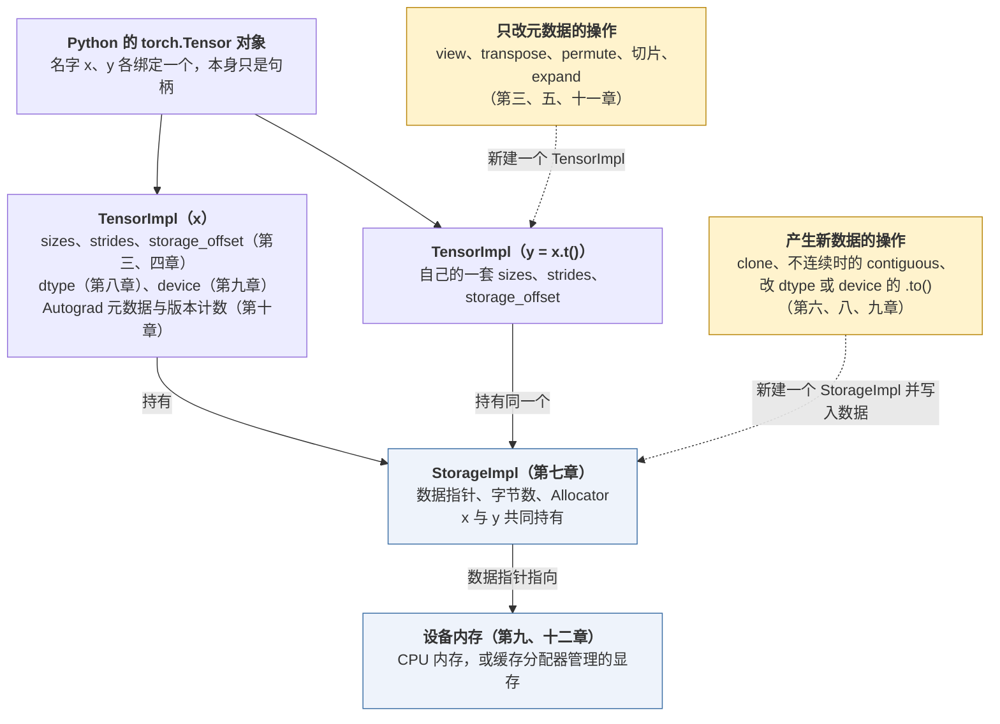

- **Python 的 torch.Tensor 对象**：每次运算返回一个新的 Python 对象，它内部只有一个指向 C++ `TensorImpl` 的引用计数指针，不存数据也不存形状。
- **TensorImpl**：一个 Tensor 的全部元数据，定义在 `c10/core/TensorImpl.h`——`sizes`、`strides`、`storage_offset` 说明怎样把一段存储读成多维数组，`dtype` 说明每个元素怎么解释，`device` 说明数据在哪，另有 Autograd 元数据和版本计数。每个 Tensor 一份，创建成本与数据量无关。
- **StorageImpl**：数据本体的所有者，定义在 `c10/core/StorageImpl.h`，只有数据指针、字节数和分配它的 Allocator，不知道形状。多个 `TensorImpl` 可以持有同一个 `StorageImpl`，最后一个持有者消失时它才释放。
- **设备内存**：`StorageImpl` 的数据指针指向的那块内存，在 CPU 上是主机内存，在 CUDA 上是 PyTorch 缓存分配器从驱动申请来的显存；释放后先回到缓存分配器。
- **只改元数据的操作**：新建一个 `TensorImpl`，填上新的 `sizes` / `strides` / `storage_offset`，继续指向原来的 `StorageImpl`；不分配数据、不拷贝，代价是结果可能不连续，并让原 Storage 继续存活。
- **产生新数据的操作**：新建一个 `StorageImpl`，把元素按新的顺序、新的 dtype 或在新的设备上写一遍；耗时和内存都与数据量成正比。

### 1. 本文的主线

本文会从一个简化的 Tensor 模型开始，逐步解释 Storage、Shape、Stride、Storage Offset、dtype、device、view、拷贝和 contiguous：先建立“逻辑视图 + 物理存储”的整体模型，再逐个展开描述 Tensor 的各个字段，然后讨论 view / clone / detach / in-place 与广播这几组容易混淆的操作，最后从 Tensor 视角解释显存问题，并动手实现一个简化版 Tensor 来验证这套模型。后面 Autograd、Dispatcher、Kernel 和性能分析文章，都会以本文建立的 Tensor 心智模型为基础。

### 2. 本文的章节安排

| 章 | 主题 | 内容 |
|---|---|---|
| 二 | Tensor 的整体模型 | 逻辑视图与物理存储、核心字段、元素数量与占用空间 |
| 三 | Shape：Tensor 的逻辑形状 | view / reshape / flatten、增删维度 |
| 四 | Stride：逻辑索引如何映射到内存 | stride 的定义、二维与三维例子、view 为何可能 |
| 五 | Transpose、Permute 与 View | 只改 metadata 的变换、转置后 view 为何失败 |
| 六 | Contiguous：连续布局与数据拷贝 | contiguous 的定义、Kernel 为何关心它、其他 layout |
| 七 | Storage、Storage Offset 与共享内存 | Storage、offset、切片 view、view 的生命周期影响 |
| 八 | dtype：如何解释每个元素 | FP16 与 BF16、dtype promotion、转换的拷贝成本 |
| 九 | Device：数据到底在哪里执行 | .to() 的两个维度、<span class="inline-tip" data-tip="host to device / device to host，主机内存到显存 / 显存回主机内存的拷贝">H2D</span> 搬运、device mismatch、Meta device |
| 十 | View、Clone、Detach 与 In-place | 四组操作的语义边界及其与 Autograd 的关系 |
| 十一 | Broadcasting | expand 与 repeat、广播不等于复制、排查方式 |
| 十二 | 从 Tensor 视角理解内存问题 | 数据 / 缓存 / 计算图内存、生命周期、成本模型 |
| 十三 | 实现一个简化版 Tensor | 用 Python 复现 stride、transpose 与 contiguous copy |
| 十四 | 本文小结 |  |
| 十五 | 自测 | 5 道题 |

Table: 本文的章节安排


## 二、Tensor 的整体模型

### 1. Tensor 不只是一个多维数组

假设有一个二维 Tensor：

```python title='一个 2×3 的二维 Tensor'
import torch

x = torch.tensor([
    [1, 2, 3],
    [4, 5, 6],
])
```

从数学上看，它是一个 `2 × 3` 的矩阵：

```text title='它对应的数学矩阵'
[[1, 2, 3],
 [4, 5, 6]]
```

但 PyTorch 还需要知道：

- 数据存储在哪里？
- 每个元素是什么类型？
- 逻辑上有几行几列？
- 从一个元素移动到下一个元素，需要跨过多少个存储位置？
- 这个 Tensor 是否与另一个 Tensor 共享底层数据？
- 数据位于 CPU 还是 GPU？
- 是否需要参与 Autograd？

因此可以把一个 Tensor 粗略表示为：

- **Tensor**
  - Storage：底层数据存储
  - sizes：每个维度的长度
  - strides：每个维度的步长
  - storage_offset：相对于 Storage 的起始偏移
  - dtype：元素类型
  - device：数据所在设备
  - layout：布局信息

这组信息共同决定了“如何解释一段内存”。

> [!NOTE] Java 经验参照：嵌套集合
> `List<List<Float>>` 描述的是对象之间的嵌套引用：外层列表存内层列表的引用，每个 `Float` 又是一个单独的装箱对象，元素分散在堆上。Tensor 的元素是一段连续存储里的原始数值，行和列只是 sizes、strides 对这段存储的解释。把 Tensor 想成嵌套集合，会漏掉后面要讲的零拷贝视图、连续性和设备这些性能与内存语义。

### 2. Tensor 的逻辑视图与物理存储

Tensor 有两个需要分开的层次：

- **逻辑层**
  - shape / sizes
  - 例如：2 行 3 列
- **物理层**
  - storage / offset / stride
  - 例如：数据如何放在一段连续内存中

逻辑形状相同的两个 Tensor，物理布局可以不同：

```python title='逻辑形状相同、物理布局不同：x 与转置得到的 y'
x = torch.tensor([[1, 2, 3], [4, 5, 6]])
y = torch.tensor([[1, 4], [2, 5], [3, 6]]).t()   # 先建一个 3×2，再转置

print(x.shape, y.shape)          # torch.Size([2, 3]) torch.Size([2, 3])
print(torch.equal(x, y))         # True：逐元素完全相同
print(x.stride(), y.stride())    # (3, 1) (1, 2)
print(x.is_contiguous(), y.is_contiguous())   # True False
```

两者的形状、打印出来的数字一模一样，但底层的六个格子排得不一样——把逻辑视图和底层存储并排画出来：

![逻辑形状相同（都是 2×3）、物理布局不同：x 的存储是 1 2 3 4 5 6、stride (3, 1)；y 的存储是 1 4 2 5 3 6、stride (1, 2)，每个逻辑下标 [i, j] 用 i·stride₀ + j·stride₁ 算出存储位置](/img/in-post/pytorch-tensor-same-shape-different-stride.svg)

`x` 的存储顺序就是行优先的 `1 2 3 4 5 6`，读 `x[i, j]` 去第 `i*3 + j` 格；`y` 的存储顺序是 `1 4 2 5 3 6`（它是那个 `3×2` 矩阵按行存的），读 `y[i, j]` 去第 `i*1 + j*2` 格。**同一个逻辑下标，两个 Tensor 走到的存储位置不同，靠的就是各自的 stride。** 转置 `.t()` 没有搬动任何数据，只是把 stride 从 `(2, 1)` 换成了 `(1, 2)`——这就是第四、五章要展开的机制。

> [!NOTE] Java 经验参照：多维数组
> Java 的 `float[][]` 是数组的数组：外层数组存每一行的引用，每一行是独立的 `float[]` 对象，各行长度可以不同，转置只能新建数组逐个抄。Tensor 的“多维”只存在于元数据里，数据是一段一维存储，所以转置可以只换 stride。Java 里最接近的写法是自己用一个 `float[]` 加下标公式 `i * cols + j`——stride 相当于把公式里的系数存成了每个 Tensor 自己的字段。

反过来的情况也成立：`x.t()` 形状变成 `3×2`、却和 `x` 用同一份存储。两件事合起来才是 Tensor 与普通二维数组的差异：

> Tensor 的逻辑维度和底层内存布局是两层独立的信息：形状相同不代表存储相同，形状不同也不代表存储不同。连接它们的是 stride。

### 3. Tensor 的核心字段

可以用一张图表示 Tensor 如何解释 Storage：

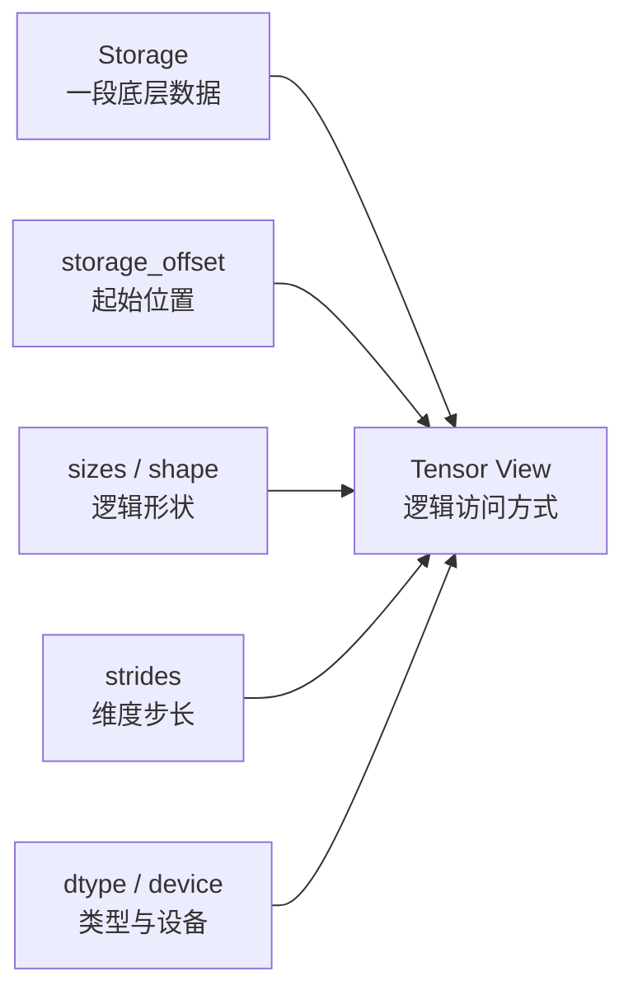

其中：

- `Storage` 提供真实的数据存储；
- `storage_offset` 决定 Tensor 从 Storage 的哪个位置开始；
- `sizes` 决定逻辑上有多少个元素；
- `strides` 决定多维索引如何映射到 Storage；
- `dtype` 决定如何解释每个元素的二进制内容；
- `device` 决定 Storage 位于 CPU、CUDA 还是其他设备。

这些字段在源码里对应两个 C++ 对象，都位于[《PyTorch 整体介绍》代码地图](/pytorch-overall-introduction.html#七第三张地图代码视角源码目录与库的分层)最底层的 `c10/core/`：Python 的 `torch.Tensor` 持有一个 `c10::TensorImpl`，`sizes`、`strides`、`storage_offset`、`dtype`、`device` 以及 Autograd 元数据都是它的成员；`TensorImpl` 再持有一个 `c10::StorageImpl`，里面只有数据指针、字节数和分配器。多个 `TensorImpl` 可以指向同一个 `StorageImpl`——这就是后文 view 的实现基础。

以 `x = torch.arange(6).reshape(2, 3)` 和它的转置 `y = x.t()` 为例，两个 Python 变量背后各有一个 `TensorImpl`，各自记着自己的 shape 和 stride，但两者的 `storage_` 指向同一个 `StorageImpl`，6 个 int64 只存了一份：

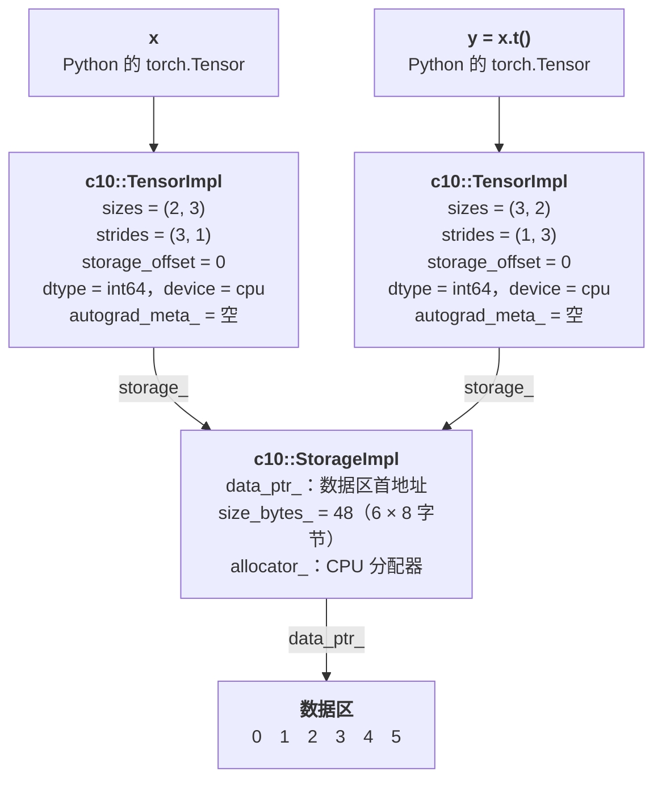

`x` 和 `y` 的区别全部在各自的 `TensorImpl` 里，`StorageImpl` 不知道有几个 Tensor 在用它，也不知道数据被解释成什么形状——它只管这 48 个字节在哪里、由谁分配和释放。

本篇讨论的是源码上最底层的抽象，之所以放在系列最前面，是因为 Autograd、算子分发、Kernel 和显存分析都建立在这几个字段之上。

### 4. Tensor 的元素数量与占用空间

逻辑元素数量可以通过 `numel()` 获得：

```python title='用 numel() 看逻辑元素数量'
x = torch.empty(2, 3, 4)

print(x.shape)  # torch.Size([2, 3, 4])
print(x.numel())  # 24
```

如果忽略对齐、Allocator 和额外元数据，数据区大小可以粗略估算为 `numel × dtype.itemsize`：一百万个元素在 float32 下约 4 MB，在 float16 或 bfloat16 下约 2 MB。

但真实显存占用还可能包括：

- Tensor 对象本身；
- Storage 和分配器元数据；
- Autograd 保存的中间结果；
- 梯度；
- Optimizer state；
- CUDA caching allocator 保留的内存；
- 临时 workspace。

因此，`numel × itemsize` 只能估算数据本体，不能直接等同于进程的完整内存占用。


## 三、Shape：Tensor 的逻辑形状

### 1. Shape、维度和元素数量

```python title='shape、dim()、numel() 三个值'
x = torch.empty(2, 3, 4)

print(x.shape)  # torch.Size([2, 3, 4])
print(x.dim())  # 3
print(x.numel())  # 24
```

这里 `dim()` 是维度数 3，`shape` 是每一维的长度 `(2, 3, 4)`，`numel` 是三者的乘积 2 × 3 × 4 = 24。`shape` 描述的是逻辑结构，不直接说明数据在内存中如何排列。

### 2. Shape 变换不一定复制数据

下面的操作通常只需要修改 Tensor 的元数据：

```python title='reshape 只改元数据'
x = torch.arange(6)
y = x.reshape(2, 3)
```

如果底层布局满足条件，`y` 可以和 `x` 共享 Storage。`reshape(2, 3)` 的参数就是目标 shape，元素总数必须和原来相等（2 × 3 = 6）；其中一个位置可以写 `-1`，由 PyTorch 按总数推算，例如 `x.reshape(2, -1)` 等价于 `x.reshape(2, 3)`。

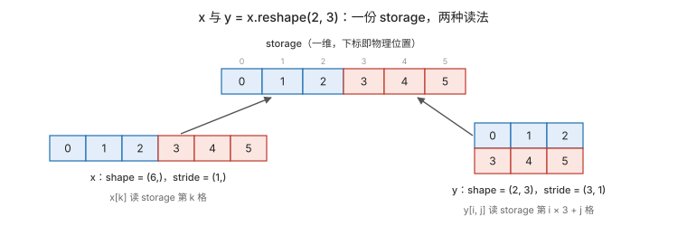

可以直接验证两者指向同一块 Storage：

```python title='验证 reshape 后共享 Storage'
print(x.untyped_storage().data_ptr() == y.untyped_storage().data_ptr())   # 比较 Storage，而不是 data_ptr()
```

（`x.data_ptr() == y.data_ptr()` 只在两者 `storage_offset` 相同时才等价——`x[1:]` 与 `x` 共享 Storage，但 `data_ptr()` 差一个元素。）但这不是 `reshape()` 的永久保证。它会尝试返回 view；如果现有布局不允许，就可能创建拷贝。

### 3. `view()`、`reshape()` 与 `flatten()`

**`view()`**

`view(*shape)` 的参数和 `reshape()` 一样是目标 shape，同样支持一个 `-1`。它只改 metadata、从不拷贝，因此要求现有 stride 能够支持目标形状：

```python title='view 要求 stride 支持目标形状'
x = torch.arange(6)
y = x.view(2, 3)
```

这个例子的结果和上一节的图完全一样：`y` 的 shape 是 `(2, 3)`、stride 是 `(3, 1)`，与 `x` 共用一份 storage。

如果布局不满足要求，`view()` 通常会直接报错，而不是自动复制。这里先给一个后面反复用到的词一个最短的定义：**contiguous**（连续）指 Tensor 的元素在底层存储里的顺序，和按行优先一个个数过去的逻辑顺序完全一致——上一章 `x` 是，`y` 不是。`view()` 能不能成功，本质上是在问"目标形状能不能用一组 stride 描述当前存储"；对 contiguous 的 Tensor 永远可以。第六章专门讲它。

**`reshape()`**

`reshape()` 更宽松：

```python title='reshape：能 view 就 view，否则拷贝'
y = x.reshape(2, 3)
```

它会在可能时返回 view，在不可能时创建拷贝。因此不能仅凭 `reshape()` 这个名字判断是否发生了内存复制。下图左边是连续的 `x`，`reshape(6)` 只换了一套 metadata；右边是转置得到的 `y`（转置见[第五章](#五transposepermute-与-view)），它的逻辑顺序 `0 3 1 4 2 5` 和 storage 里的顺序不一致，`reshape(6)` 只能新分配一块 storage 把元素按逻辑顺序抄过去：

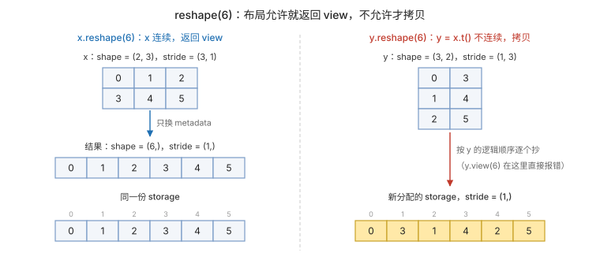

**`flatten()`**

```python title='flatten(1)：把后两维展平'
x = torch.randn(2, 3, 4)
y = x.flatten(1) 

print(y.shape)  # torch.Size([2, 12])
```

完整签名是 `flatten(start_dim=0, end_dim=-1)`：把第 `start_dim` 维到第 `end_dim` 维（两端都包含）合并成一个维度，其余维度不动。两个参数都省略时，整个 Tensor 被拉平成一维；`end_dim=-1` 表示最后一维。

这里 `flatten(1)` 即 `start_dim=1`：第 0 维（大小为 2）被保留，第 1 维和第 2 维（大小分别为 3 和 4）被合并，合并后的新维度大小是它们的乘积 $$3 \times 4 = 12$$。

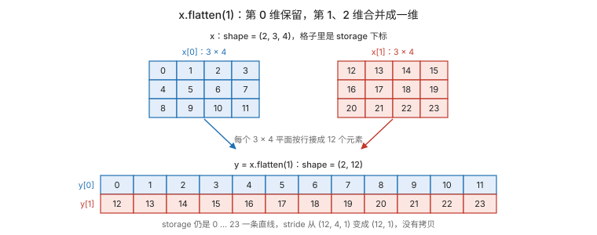

| 调用 | 合并的维度 | 结果 shape |
|---|---|---|
| `x.flatten()` | 第 0、1、2 维 | `(24,)` |
| `x.flatten(1)` | 第 1、2 维 | `(2, 12)` |
| `x.flatten(0, 1)` | 第 0、1 维 | `(6, 4)` |

Table: shape 为 (2, 3, 4) 的 x 用不同参数 flatten 的结果

这种 flatten(1) 的操作在深度学习中非常常见，通常用于卷积层（Convolutional Layer）到全连接层（Linear Layer）的过渡，目的是保留样本数量（Batch Size，即第 0 维），同时将特征图的所有像素和通道展平为一维特征向量。

`flatten()` 也可能返回 view，也可能创建新的 Tensor，取决于原始布局。

### 4. 增加和删除维度

```python title='unsqueeze 与 squeeze：加减长度为 1 的维度'
x = torch.randn(3, 4)

x1 = x.unsqueeze(0)
print(x1.shape)  # torch.Size([1, 3, 4])

x2 = x1.squeeze(0)
print(x2.shape)  # torch.Size([3, 4])
```

`unsqueeze(dim)` 在新 shape 的第 `dim` 个位置插入一个长度为 1 的维度，原来从这个位置起的维度依次后移。`x` 的 shape 是 `(3, 4)`，`unsqueeze(0)` 把 1 插在最前面，得到 `(1, 3, 4)`。`squeeze(dim)` 是反向操作：第 `dim` 维的长度是 1 就把它删掉，不是 1 则原样返回。

长度为 1 的维度不增加元素，只是多套了一层：原来用两个下标 `x[i, j]` 取到的元素，现在要用三个下标，其中新维度上的下标只能是 0。换成更小的 `x = torch.arange(6).reshape(2, 3)`，把 1 插在三个不同位置，相当于在三个不同层次上套一层括号：

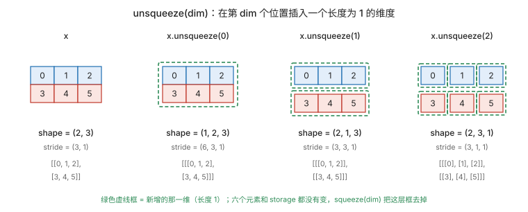

| 调用 | 结果 shape | 原来的 `x[i, j]` 现在写成 |
|---|---|---|
| `x.unsqueeze(0)` | `(1, 2, 3)` | `y[0, i, j]` |
| `x.unsqueeze(1)` | `(2, 1, 3)` | `y[i, 0, j]` |
| `x.unsqueeze(2)` | `(2, 3, 1)` | `y[i, j, 0]` |

Table: shape 为 (2, 3) 的 x 在三个位置 unsqueeze 的结果

`unsqueeze()` 和 `squeeze()` 都只改 sizes 和 strides，不复制数据。常见用途是凑出算子要求的维数：给单张图片补上 batch 维（`(C, H, W)` → `(1, C, H, W)`），或者给向量补一维以便广播。

`squeeze()` 不带参数时会删除**所有**长度为 1 的维度，结果的维数因此取决于输入 shape：

| 调用 | 结果 shape | 说明 |
|---|---|---|
| `x.squeeze(0)` | `(3, 1)` | 只删第 0 维 |
| `x.squeeze(1)` | `(1, 3, 1)` | 第 1 维长度是 3，不变 |
| `x.squeeze()` | `(3,)` | 长度为 1 的两个维度都被删掉 |

Table: shape 为 (1, 3, 1) 的 x 调用 squeeze 的结果

典型的问题是 batch 维：模型输出的 shape 是 `(batch, 1)`，`squeeze()` 平时得到 `(batch,)`，batch 恰好为 1 时却得到零维的 `()`，下游代码就会出错。写 `squeeze(1)` 明确指定要删的维度可以避免这种情况。

### 5. `reshape` 不改变元素语义

```python title='arange(6) reshape 成 2×3'
x = torch.arange(6)
y = x.reshape(2, 3)
```

`reshape()` 改变的是如何组织元素，而不是元素顺序本身：

```text title='reshape 前后的元素顺序不变'
x: [0, 1, 2, 3, 4, 5]

y: [[0, 1, 2],
    [3, 4, 5]]
```

如果业务语义要求交换维度，应该使用 `transpose()` 或 `permute()`，而不是把 `reshape()` 当成转置。同样把 2 × 3 变成 3 × 2，两者的结果并不相同：`reshape(3, 2)` 保持元素顺序、每两个切成一行，原来的行被拆散；`transpose(0, 1)` 让原来的行变成列。

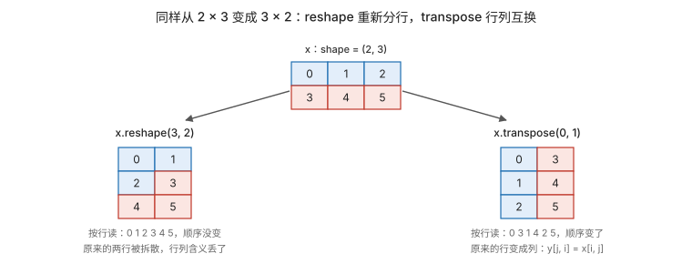


## 四、Stride：逻辑索引如何映射到内存

### 1. 什么是 stride？

对于一个 Tensor，stride 表示：

> **沿某个维度增加 1 时，底层存储位置需要前进多少个元素。**

```python title='一个 2×3 Tensor 的 shape 与 stride'
x = torch.arange(6).reshape(2, 3)

print(x)
# tensor([[0, 1, 2],
#         [3, 4, 5]])

print(x.shape)   # torch.Size([2, 3])
print(x.stride()) # (3, 1)
```

对于 `x[i, j]`，底层位置可以粗略计算为 `offset(i, j) = storage_offset + i × stride[0] + j × stride[1]`。这个例子里 `storage_offset = 0`、`stride = (3, 1)`，所以读 `x[1, 2]` 时，从 storage 的第 0 格出发，行下标 1 走 1 × 3 格，列下标 2 再走 2 × 1 格，落在第 5 格：

![读 x[1, 2] 的过程：从 storage_offset = 0 出发，i = 1 沿第 0 维走 1 × 3 格到第 3 格，j = 2 沿第 1 维走 2 × 1 格到第 5 格](/img/in-post/pytorch-tensor-stride-offset-walk.svg)

六个元素都按同一个公式计算：

| 元素 | 计算 | 底层位置 |
|---|---|---|
| `x[0, 0]` | 0 + 0 × 3 + 0 × 1 | 0 |
| `x[0, 1]` | 0 + 0 × 3 + 1 × 1 | 1 |
| `x[0, 2]` | 0 + 0 × 3 + 2 × 1 | 2 |
| `x[1, 0]` | 0 + 1 × 3 + 0 × 1 | 3 |
| `x[1, 1]` | 0 + 1 × 3 + 1 × 1 | 4 |
| `x[1, 2]` | 0 + 1 × 3 + 2 × 1 | 5 |

Table: 六个元素各自落在的底层位置

### 2. 二维连续 Tensor 的 stride

一个 `2 × 3` 的行优先连续 Tensor：

```text title='一个 2×3 行优先连续 Tensor'
[[a, b, c],
 [d, e, f]]
```

底层存储是 `[a, b, c, d, e, f]`，对应 `shape = (2, 3)`、`stride = (3, 1)`。含义是：

- 行索引增加 1，需要跨过 3 个元素；
- 列索引增加 1，只需要跨过 1 个元素。

把 storage 的线性下标和逻辑格子放在一起看，每个格子里写的就是它落在 storage 的哪个位置：

![x：shape=(2, 3)、stride=(3, 1)：storage 是一维的 a..f，逻辑视图 x[i, j] 用 i·3 + j 算出物理位置；j 增 1 物理位置 +1，i 增 1 物理位置 +3](/img/in-post/pytorch-tensor-stride-2d.svg)

### 3. 三维 Tensor 的 stride

```python title='看三维 Tensor 的 stride'
x = torch.empty(2, 3, 4)
print(x.stride())
```

典型结果是 `(12, 4, 1)`：从最后一维往前累乘，`stride[2] = 1`，`stride[1] = 4`，`stride[0] = 3 × 4 = 12`。对于索引 `x[i, j, k]`：

```text title='三维索引到底层位置的公式'
offset(i, j, k)
    = storage_offset
    + i × 12
    + j × 4
    + k × 1
```

把 24 个 storage 下标按 `i` 切成两个 `3 × 4` 平面，就能直观看到三个 stride 各自“跨过”多少元素：

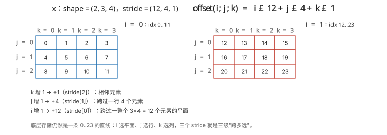

### 4. stride 让 view 成为可能

一个 view 不需要复制数据的关键，是新的 Tensor 能否通过新的 `sizes` 和 `strides` 正确解释原来的 Storage。

- **同一份 Storage**
    - Tensor A：sizes=(2,3), strides=(3,1)
    - Tensor B：sizes=(3,2), strides=(1,3)

A 和 B 可以具有不同的逻辑形状，但共享同一份底层数据。

这就是为什么一个 Tensor 的 `shape` 不能单独说明它的性能和存储行为，必须同时观察：

```python title='看一个 Tensor 必须同时打印的三样东西：shape、stride、is_contiguous'
print(x.shape)
print(x.stride())
print(x.is_contiguous())
```


## 五、Transpose、Permute 与 View

### 1. `transpose()` 通常只改变 metadata

```python title='transpose 只改 metadata：x 与 y 打印结果与 stride'
x = torch.arange(6).reshape(2, 3)
y = x.transpose(0, 1)

print(x)
# tensor([[0, 1, 2],
#         [3, 4, 5]])

print(y)
# tensor([[0, 3],
#         [1, 4],
#         [2, 5]])

print(x.shape)    # torch.Size([2, 3])
print(y.shape)    # torch.Size([3, 2])
print(x.stride()) # (3, 1)
print(y.stride()) # (1, 3)
```

`transpose(dim0, dim1)` 的两个参数是要互换的两个维度的编号（从 0 开始，也可以用负数从后往前数，`-1` 是最后一维），顺序无关，`transpose(0, 1)` 和 `transpose(1, 0)` 相同。这里 `x` 只有两个维度，第 0 维是行、第 1 维是列，`transpose(0, 1)` 就是行列互换：`y[j, i]` 和 `x[i, j]` 是同一个元素，shape 从 `(2, 3)` 变成 `(3, 2)`。二维 Tensor 上它等价于 `x.t()` 和 `x.T`。

对更高维的 Tensor，`transpose` 仍然只交换指定的两个维度，其余维度不动。例如 shape 为 `(2, 3, 4)` 的 Tensor，`transpose(0, 2)` 得到 `(4, 3, 2)`，`transpose(1, 2)` 得到 `(2, 4, 3)`。

实现上，`transpose` 只是把 sizes 和 strides 里这两个位置的值各自对调，因此 `y` 通过新的 shape 和 stride 解释同一份数据：`x[i, j]` 落在 `i × 3 + j × 1`，`y[i, j]` 落在 `i × 1 + j × 3`。用同一份 storage 把两个视图画出来，可以看到 `y` 只是把 stride 的两个分量交换了，逐行读 `y` 时在 storage 里是跳着走的：

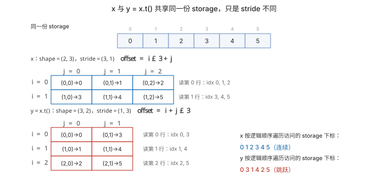

这是一种典型的 zero-copy view。

### 2. `permute()` 可以重新排列多个维度

```python title='permute(2, 0, 1)：一次重排多个维度'
x = torch.empty(2, 3, 4)
y = x.permute(2, 0, 1)

print(x.shape)  # (2, 3, 4)
print(y.shape)  # (4, 2, 3)
```

`permute(*dims)` 的参数是一份完整的新维度顺序：有几个维度就要写几个参数，每个维度编号恰好出现一次；**第 i 个参数写的是新的第 i 维取自旧的哪一维**。`permute(2, 0, 1)` 读作：新的第 0 维是原来的第 2 维（长度 4），新的第 1 维是原来的第 0 维（长度 2），新的第 2 维是原来的第 1 维（长度 3），所以 shape 从 `(2, 3, 4)` 变成 `(4, 2, 3)`。

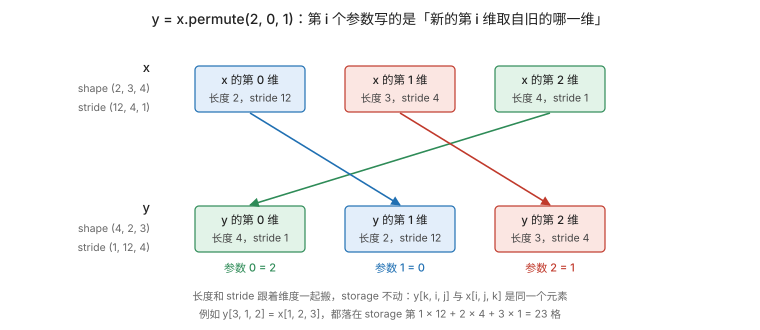

和 `transpose` 一样，`permute()` 只是按这个顺序重新排列 sizes 和 strides，storage 不动。元素的对应关系是 `y[k, i, j] = x[i, j, k]`。`transpose(0, 1)` 是 `permute` 的特例，三维时等价于 `permute(1, 0, 2)`。

这对图像、序列和批处理数据非常常见。例如不同模型可能采用：

- NCHW：batch, channel, height, width
- NHWC：batch, height, width, channel

把 NCHW 的图像批转成 NHWC 就是 `x.permute(0, 2, 3, 1)`：N 留在第 0 维，H、W 前移，C 挪到最后。

改变布局的逻辑解释不等于立刻复制数据，但后续算子可能更偏好某种物理布局。

### 3. 为什么转置后 `view()` 可能失败？

```python title='转置后 view(6) 报错'
x = torch.arange(6).reshape(2, 3)
y = x.transpose(0, 1)

z = y.view(6)
```

这段代码可能失败，因为 `y` 的 stride 已经不符合把它直接解释成一个连续的一维序列的条件。

`view(6)` 只允许改 metadata，因此它需要一个单一的 stride 就能从 `z[k]` 走到 `z[k+1]`。把 `y` 的逻辑顺序和实际 storage 下标对齐写出来，就能看到这个条件为什么不满足：

`view(6)` 要求：逻辑上相邻的元素，在 storage 中以同一个 stride 相邻。

| z 的下标 k | 0 | 1 | 2 | 3 | 4 | 5 |
|---|---|---|---|---|---|---|
| 对应 y 元素 | y[0,0] | y[0,1] | y[1,0] | y[1,1] | y[2,0] | y[2,1] |
| storage 下标 | 0 | 3 | 1 | 4 | 2 | 5 |
| 与前一个的差 | — | +3 | −2 | +3 | −2 | +3 |

Table: 转置后的 y 按逻辑顺序读，storage 下标的步长不是常数

相邻差值 +3、−2 交替，不是常数，无法用一个 `(stride,)` 表达，所以 `view` 报错。换句话说，`y` 需要的"连续顺序"是 storage 依次为 `0 3 1 4 2 5`，而 storage 的实际顺序是 `0 1 2 3 4 5`——两者不一致。

通常可以这样处理：

```python title='先 contiguous 再 view'
z = y.contiguous().view(6)
```

这里的过程是：

1. y：非连续 view
2. contiguous()：创建连续副本
3. view(6)：在新布局上创建一维 view

如果不希望显式拆开，也可以使用：

```python title='直接 reshape(6)'
z = y.reshape(6)
```

但 `reshape()` 是否复制，应根据实际布局判断，而不是假设。

### 4. View 和原始 Tensor 共享数据

```python title='改 view 会改到原 Tensor'
x = torch.arange(6)
y = x.view(2, 3)

y[0, 0] = 100
print(x)
# tensor([100, 1, 2, 3, 4, 5])
```

这说明 `y` 和 `x` 共享底层数据。

如果需要完全独立的数据副本，应明确使用：

```python title='clone 得到独立副本'
z = x.clone()
z[0] = 200

print(x[0])  # 100
print(z[0])  # 200
```

把三个 Tensor 和它们的 storage 画在一起：`x` 和 `y` 指向同一份 storage，对 `y[0, 0]` 的写入落在第 0 格，`x[0]` 读到的也是这一格；`z` 的 storage 是 `clone()` 时新分配的，之后的修改互不影响。

![对 view 写入与对 clone 写入的区别：y[0, 0] = 100 写在 x 和 y 共享的 storage 第 0 格，x[0] 随之变成 100；z = x.clone() 有自己的 storage，z[0] = 200 不影响 x](/img/in-post/pytorch-tensor-view-write-through.svg)

> [!NOTE] Java 经验参照：视图
> Java 数组本身没有视图：`Arrays.copyOfRange()` 是拷贝，要共享底层数据得另用一层抽象，例如 `ByteBuffer.slice()` / `duplicate()` 或 `List.subList()`，对它们写入同样会透到原数据。PyTorch 里视图是默认行为——切片、`view()`、`transpose()` 返回的都是共享 Storage 的 Tensor，返回值的类型也看不出它是不是视图，要独立副本必须显式 `clone()`。


## 六、Contiguous：连续布局与数据拷贝

### 1. 什么是 contiguous？

对于默认的行优先布局，Tensor 的逻辑索引顺序与底层存储顺序一致时，可以称为 contiguous：

```python title='arange(6).reshape(2, 3) 是 contiguous 的'
x = torch.arange(6).reshape(2, 3)
print(x.is_contiguous())  # True
```

转置通常会产生 non-contiguous view：

```python title='转置后不再 contiguous'
y = x.transpose(0, 1)
print(y.is_contiguous())  # False
```

### 2. `contiguous()` 做了什么？

```python title='contiguous() 得到连续副本'
z = y.contiguous()

print(z.is_contiguous())  # True
print(z.shape)            # torch.Size([3, 2])
```

如果原 Tensor 已经连续，`contiguous()` 通常可以直接返回自身或等价的引用；如果不连续，它会分配新的 Storage，并按照逻辑顺序复制数据。

以上一章的转置视图 `y` 为例，`contiguous()` 前后的两条 storage 如下：

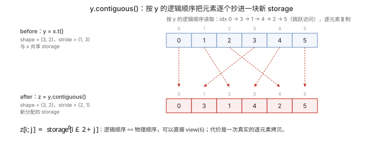

因此：

- **contiguous()**
  - 不是简单的“设置一个标志”
  - 而可能是真实的数据拷贝

### 3. 为什么 Kernel 关心 contiguous？

一个 Kernel 可以处理任意 stride，但通用 stride 访问通常更复杂：

1. 逻辑索引
2. 根据 stride 计算地址
3. 访问非连续内存

连续布局往往更有利于：

- 顺序访存；
- Cache 命中；
- GPU 合并访存；
- 向量化加载；
- 简化 Kernel 实现。

但把所有 Tensor 都提前 `contiguous()` 也不一定正确，因为这会增加：

- 内存分配；
- 数据拷贝；
- GPU 带宽消耗；
- 临时显存峰值。

正确的原则是：

> 不要为了“看起来整齐”无条件调用 `contiguous()`，要根据后续算子是否需要以及拷贝成本决定。

### 4. "layout" 到底指什么

前文几处出现的"布局 / layout"其实是三个不同层次的词，读源码和报错信息时要分清：

| 层次 | 在 PyTorch 里的名字 | 取值 | 回答什么问题 |
|---|---|---|---|
| **口语里的布局** | 本文说的"物理布局" | 由 `stride` + `storage_offset` 决定 | 逻辑下标怎么映到存储位置；`is_contiguous()` 只回答"是不是行优先连续"这一个具体问题 |
| **memory format** | `torch.contiguous_format` / `torch.channels_last` / `torch.preserve_format` | `x.to(memory_format=torch.channels_last)` | 对**同样是 strided** 的 Tensor，四维图像 `[N, C, H, W]` 在内存里按 NCHW 还是 NHWC 排——卷积 Kernel 对后者更快；它也是一种 stride 模式，`is_contiguous(memory_format=...)` 可以按它检查 |
| **`torch.layout`** | `x.layout` 属性 | `torch.strided`（默认）、`torch.sparse_coo`、`torch.sparse_csr`、`torch.jagged`（nested）、`torch._mkldnn` | 数据**根本不按 stride 组织**的情形：稀疏矩阵只存非零元素的坐标和值，nested 存变长序列——这些 Tensor 没有 `stride()` 可言 |

Table: "layout" 一词的三个层次：口语的物理布局、memory format、torch.layout

本文讨论的一切（stride、view、contiguous）都发生在第一、二层，也就是 `layout == torch.strided` 的前提下。所以工程中不应把 layout 简化成一个布尔值：`is_contiguous()` 只是在默认 strided 布局、默认 memory format 下回答一个具体问题，不代表 Tensor 的所有存储属性。


## 七、Storage、Storage Offset 与共享内存

### 1. Storage 是什么？

从概念上说，Storage 是一段承载实际元素数据的底层存储，而 Tensor 是对这段存储的一个带元数据解释。

多个 Tensor 可以共享同一个 Storage：

- **Storage**：`[0, 1, 2, 3, 4, 5]`
- **Tensor A**：`sizes=(2,3), strides=(3,1), offset=0`
- **Tensor B**：`sizes=(3,2), strides=(1,3), offset=0`

现代 PyTorch 的具体 Storage API 和底层实现会随版本变化。本文使用 Storage 这个概念，是为了说明“数据本体”和“Tensor 视图”之间的关系，不建议把某个内部类的当前细节当成稳定公共 API。

### 2. `storage_offset()`

一个 view 不一定从 Storage 的第 0 个元素开始：

```python title='切片 x[2:8] 的 storage_offset'
x = torch.arange(10)
y = x[2:8]

print(y.storage_offset())
# 可能为 2
```

`y` 逻辑上有六个元素，但它从原始 Storage 的位置 2 开始解释：

![y = x[2:8]：同一份 storage，只是 storage_offset = 2、shape=(6,)，六个逻辑元素直接落在 idx 2..7 上](/img/in-post/pytorch-tensor-slice-storage-offset.svg)

对于一维 Tensor，可以粗略写成 `y[i] = Storage[storage_offset + i × stride]`，这里就是 `Storage[2 + i]`。

### 3. 切片也可能只是 view

```python title='带步长的切片 x[2:8:2]：stride 与 storage_offset'
x = torch.arange(10)
y = x[2:8:2]

print(y)       # tensor([2, 4, 6])
print(y.stride())
print(y.storage_offset())
```

`y` 不一定拥有独立数据，而可能通过 offset 和 stride 指向原始 Storage。

因此，长期保存一个小切片，有时可能让一整块大 Storage 继续存活。这是理解内存生命周期时需要注意的边界。

### 4. View 的生命周期影响

```python title='从 1024³ 的大 Tensor 切出 10 个元素的小 view'
large = torch.empty(1024, 1024, 1024)
small = large[0, 0, :10]
```

即使 `small` 只包含 10 个元素，它可能仍然持有对 `large` Storage 的引用。如果 `small` 的生命周期很长，底层大块存储也可能无法释放。

如果确实需要让小结果独立，可以显式复制：

```python title='clone 让小结果不再持有大 Storage'
small = large[0, 0, :10].clone()
```

这不是说所有切片都应该 clone，而是要根据对象生命周期和内存成本做决定。

> [!NOTE] Java 经验参照：小视图持有大块存储
> 这和 `List.subList()` 让整个父列表保持可达是同一类问题：视图还活着，整块底层数组就不回收。Tensor 这边靠引用计数，结论相同——只要还有一个 `TensorImpl` 指向这个 Storage，它就不释放；区别是这里滞留的常常是以 GB 计的显存。


## 八、dtype：如何解释每个元素

### 1. dtype 不只是精度选项

`dtype` 决定了底层数据如何被解释，也直接影响：

- 单个元素占用的字节数；
- 可表示的数值范围；
- 有效精度；
- 算子支持情况；
- 内存带宽需求；
- 计算吞吐；
- 梯度和数值稳定性。

常见 dtype 包括：

- float32
- float16
- bfloat16
- float64
- int32
- int64
- bool

### 2. FP16 与 BF16

FP16 和 BF16 都通常占用 16 bit，但位分配不同：

- FP16：更多位用于尾数，指数范围较小
- BF16：指数范围接近 FP32，尾数精度较低

把三种格式的位域画在一起（每个字符代表 1 bit）：

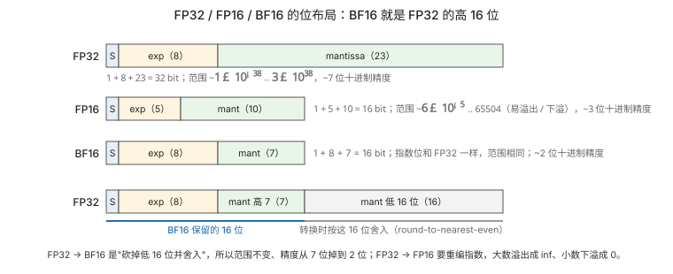

位域重合不等于"转换就是砍掉低 16 位"：`x.to(torch.bfloat16)` 按**最近偶数舍入**，低 16 位大于一半时会向上进位。例：`1.005` 的 FP32 尾数低 16 位超过一半，转 BF16 得 `1.0078125`（`1 + 2^-7`），而直接截断会得到 `1.0`；两者都离 1.005 一个 ulp 以内，但方向不同，累加起来偏差不一样。

因此二者的工程特性不同：

- FP16 可能更容易出现溢出或下溢；
- BF16 数值范围更接近 FP32，训练中通常更稳；
- 不同 GPU 对 FP16、BF16 的吞吐支持不同；
- 某些算子可能自动使用更高精度的累加。

不能只因为二者都是 16 bit，就认为它们可以无条件互换。

### 3. dtype promotion

当不同 dtype 的 Tensor 参与计算时，PyTorch 需要决定结果类型：

```python title='float32 加 float64 的结果 dtype'
x = torch.ones(3, dtype=torch.float32)
y = torch.ones(3, dtype=torch.float64)
z = x + y

print(z.dtype)
```

类型提升规则会受到：

- 输入 dtype；
- scalar 类型；
- 算子定义；
- device；
- 当前计算上下文；

等因素影响。

工程中不要只凭直觉猜测结果 dtype，尤其是在混合精度、索引和整数计算中，应通过显式检查和测试确认。

> [!NOTE] Java 经验参照：类型不匹配在什么时候暴露
> 写 Java 时，`float[]` 和 `double[]` 是两个类型，`float + double` 提升为 `double` 由编译器按语言规范确定，传错类型在编译期就报出来。Tensor 的静态类型都是 `torch.Tensor`，dtype 是运行时属性，类型提升在每次算子调用时才计算；dtype 不一致的代码要到运行时才表现出来——结果的 dtype 变了、数据区大小跟着变，或者算子直接报错。习惯了靠编译器把关的读者，需要在关键位置自己断言 dtype。

### 4. dtype 转换可能产生真实拷贝

```python title='float32 转 float16'
x = torch.randn(1024, 1024, device="cuda", dtype=torch.float32)
y = x.to(torch.float16)
```

`y` 通常需要一份新的数据，因为每个元素的二进制表示发生了变化。这与 `view()` 只改变 metadata 的情况不同。

可以用下面的方式检查：

```python title='验证 dtype 转换后 data_ptr 不同'
print(x.dtype)
print(y.dtype)
print(x.data_ptr() == y.data_ptr())
```

### 5. 计算 dtype 与存储 dtype

某些硬件和算子会使用低精度存储，但采用更高精度累加。例如矩阵乘法可能：

- 输入：FP16 / BF16
- 累加：FP32 或硬件支持的内部精度
- 输出：FP16 / BF16

具体行为取决于算子、硬件和配置。分析数值问题时，要区分：

- Tensor 的存储 dtype
- Kernel 的计算 dtype
- 累加使用的内部精度
- 输出 Tensor 的 dtype


## 九、Device：数据到底在哪里执行

### 1. CPU Tensor 与 CUDA Tensor

```python title='CPU Tensor 用 .to("cuda") 搬到 GPU'
cpu_x = torch.randn(2, 3)
gpu_x = cpu_x.to("cuda")

print(cpu_x.device)  # cpu
print(gpu_x.device)  # cuda:0
```

模型和输入必须位于兼容的设备上：

```python title='模型与输入都搬到 cuda'
model = model.to("cuda")
inputs = inputs.to("cuda")
outputs = model(inputs)
```

“模型在 GPU 上”不会自动把之后传入的所有输入都移动到 GPU；“输入在 GPU 上”也不会自动移动模型参数。

> [!NOTE] Java 经验参照：设备与堆外内存
> Java 数组在 JVM 堆上；`ByteBuffer.allocateDirect()` 分配的堆外内存不在 GC 堆里，但仍是主机内存，CPU 可以直接读写。CUDA Tensor 的 Storage 在显存里，CPU 上的代码不能直接解引用它的数据指针，读一个值也要先做一次设备到主机的拷贝。所以 `device` 是每个 Tensor 自带的属性，不同设备的 Tensor 一起运算时 PyTorch 不会替你搬运，而是报错。

### 2. `.to()` 的两个维度

`.to()` 既可以改变 device，也可以改变 dtype：

```python title='.to() 同时改 device 与 dtype'
x = x.to(device="cuda", dtype=torch.float16)
```

这两个变化都可能需要新的数据存储：

- CPU → CUDA：通常发生设备间拷贝
- float32 → float16 通常发生 dtype 转换和拷贝

如果目标 device 和 dtype 与当前一致，PyTorch 通常可以避免不必要的复制，但工程代码仍应以语义和实际测试为准。

### 3. CPU 到 GPU 的数据搬运

训练中的典型路径是：

1. 磁盘
2. CPU 内存
3. Pinned CPU Memory
4. GPU Memory
5. Kernel 执行

如果数据搬运跟不上 GPU 计算，GPU 就会等待输入。

把这条路径按 `pin_memory` 和 `non_blocking` 两个开关展开，可以看清哪一步是真正的同步点、哪一步可以和计算重叠：

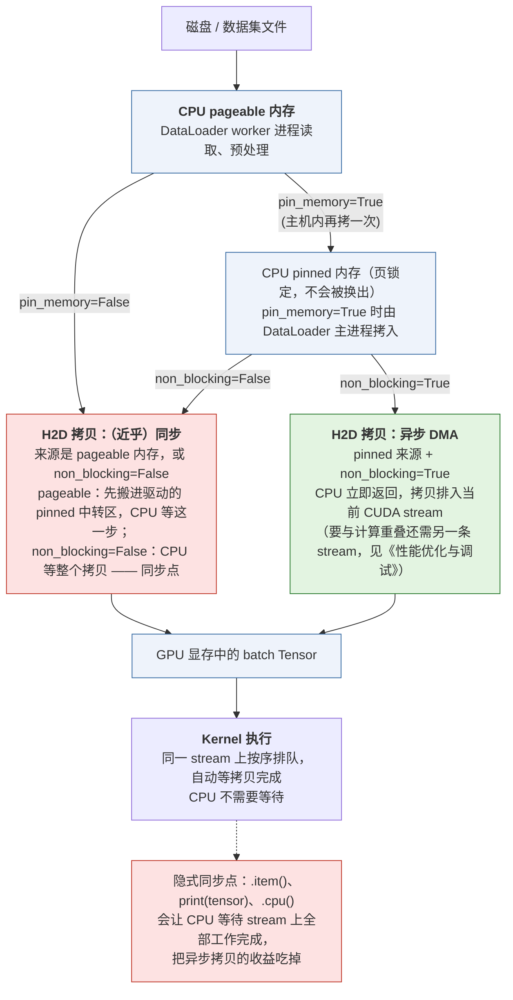

DataLoader 常见配置包括：

```python title='DataLoader 的 num_workers 与 pin_memory 配置'
loader = DataLoader(
    dataset,
    batch_size=64,
    num_workers=4,
    pin_memory=True,
)
```

配合：

```python title='配合 non_blocking=True 的搬运'
batch = batch.to("cuda", non_blocking=True)
```

可以在满足条件时改善 CPU-GPU 数据传输的重叠，但并不是打开两个参数就必然加速。实际收益取决于：

- CPU 内存是否 pinned；
- 数据预处理是否成为瓶颈；
- GPU 计算时间是否足够长；
- 是否存在隐式同步；
- 主机内存和 PCIe/NVLink 带宽。

### 4. Device mismatch

常见错误是：

```text title='Device mismatch 的典型报错'
Expected all tensors to be on the same device
```

排查时同时打印：

```python title='排查时同时打印模型、输入、标签的 device'
print(next(model.parameters()).device)
print(inputs.device)
print(targets.device)
```

还要检查：

- 模型内部动态创建的 Tensor；
- `register_buffer()` 注册的状态；
- loss 函数内部的权重；
- hidden state 和 mask；
- checkpoint 加载后的设备位置。

### 5. Meta Device 不是普通计算设备

Meta Tensor 只有逻辑视图、没有数据：它携带本文讨论过的全部元数据——`shape`、`stride`、`storage_offset`、`dtype`、`device`、`layout`、`requires_grad`——唯独不分配数据区。

对照前面的 `TensorImpl` / `StorageImpl` 对象图，要分清三层：`TensorImpl`（元数据）、`StorageImpl`（记录字节数和数据指针的对象）、`data_ptr_` 指向的数据区（真正放数字的那段内存）。Meta Tensor 的前两层都在，`TensorImpl` 的 `storage_` 照常指向一个 `StorageImpl`，这个 `StorageImpl` 也照常记着 `size_bytes_ = 24`；缺的只是第三层——它的 `data_ptr_` 是空指针，没有任何数据区：

```python title='meta device 上的 Tensor：有全部元数据，没有数据'
with torch.device("meta"):
    x = torch.empty(2, 3)

print(x.shape, x.stride(), x.dtype, x.device)   # torch.Size([2, 3]) (3, 1) torch.float32 meta
print(x.untyped_storage().nbytes())              # 24：StorageImpl 对象存在，记着"该有 24 字节"
print(x.data_ptr())                              # 0：StorageImpl 的 data_ptr_ 是空指针，数据区没有分配
x + 1                                            # 可以：shape / dtype 照常推断，结果仍是 meta
x.sum().item()                                   # 报错：没有数据可读
```

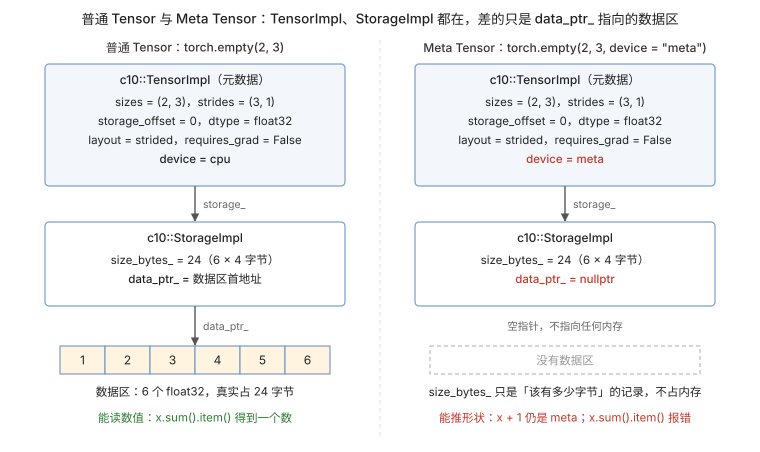

| | 普通 Tensor（CPU / CUDA） | Meta Tensor |
|---|---|---|
| shape · stride · offset · dtype · layout · requires_grad | 有 | 有，一样可读、一样参与形状推断 |
| device | `cpu` / `cuda:0` | `meta` |
| `StorageImpl` 对象 | 有，`size_bytes_` = `numel × itemsize` | 有，`size_bytes_` 一样照记 |
| `data_ptr_` 指向的数据区 | 有，真实占 `numel × itemsize` 字节 | **没有**：`data_ptr_` 是空指针，`data_ptr()` 返回 0，不占内存 |
| 能做什么 | 一切运算 | 只能做"算形状"的事：`x @ w` 得到正确 shape 的 meta 结果 |
| 不能做什么 | — | 读数值：`.item()`、`print(x)` 的数值部分、`.tolist()` |

Table: 普通 Tensor 与 Meta Tensor：元数据和 StorageImpl 都有，差的只是 data_ptr_ 指向的数据区

它适合：

- 大模型结构分析；
- 参数量估算；
- shape 推断；
- 初始化前的图变换；
- 编译和测试中的抽象执行。

Meta Tensor 不能像普通 CPU/CUDA Tensor 一样直接读取数值。它说明了“Tensor 的数据”和“Tensor 的元数据”可以在一定程度上分离。


## 十、View、Clone、Detach 与 In-place

### 1. View 与 Clone

```python title='view 与 clone 各建一个'
x = torch.arange(6)
view = x.view(2, 3)
copy = x.clone()
```

二者的语义不同：

| 操作 | 是否共享底层数据 | 主要用途 |
|---|---|---|
| `view()` | 通常共享 | 改变解释方式 |
| `reshape()` | 可能共享，也可能复制 | 更宽松地改变形状 |
| `transpose()` | 通常共享 | 交换两个维度 |
| `permute()` | 通常共享 | 重排多个维度 |
| `clone()` | 不共享 | 创建独立副本 |
| `contiguous()` | 不连续时复制 | 获得连续布局 |

Table: View 与 Clone 的语义

### 2. View 与 Detach 是两个维度的问题

`view()` 解决的是存储解释方式：

- 是否共享 Storage？
- shape 和 stride 如何变化？

`detach()` 解决的是 Autograd 关系：

- 是否继续连接当前计算图？

```python title='detach() 的用法'
x = torch.randn(3, requires_grad=True)
y = x * 2
z = y.detach()
```

`z` 可能与 `y` 共享数据，但不再沿原来的 Autograd 关系传播梯度。

因此不能把“view = 不需要梯度”或“detach = 创建数据副本”作为一般规律。两者处理的是不同层次。

### 3. In-place 操作

带下划线的方法通常表示 in-place 操作：

```python title='带下划线的 in-place 方法'
x.add_(1)
x.zero_()
x.copy_(other)
```

它们会直接修改已有 Storage，而不是返回一份新的结果数据。

优点可能是：

- 减少内存分配；
- 减少临时 Tensor；
- 降低峰值内存。

代价可能是：

- 破坏其他 view 看到的数据；
- 让代码的数据流不明显；
- 与 Autograd 保存的中间值冲突；
- 限制编译器优化；
- 让调试和并发访问更复杂。

### 4. In-place 与 Autograd

```python title='in-place 修改 Autograd 需要的输入可能报错'
x = torch.randn(3, requires_grad=True)
y = x * x
# x.add_(1) 可能触发 Autograd 相关错误
```

Autograd 可能需要保存某些 Tensor 的旧值。如果这个 Tensor 在 backward 之前被原地修改，保存的值就不再可靠。

并不是所有 in-place 操作都会报错，也不是所有场景都禁止 in-place。正确的原则是：

> 在需要梯度的计算中，只有明确理解数据依赖和 Autograd 保存关系后，才使用 in-place 优化。


## 十一、Broadcasting：不复制数据的逻辑扩展

### 1. 广播解决什么问题？

```python title='(2, 3) 与 (3,) 相加：广播'
x = torch.ones(2, 3)
y = torch.ones(3)
z = x + y
```

`y` 的逻辑形状可以扩展为 `(2, 3)`，从而与 `x` 逐元素相加。

广播通常遵循从最后一个维度开始对齐的规则：

```text title='广播从最后一维开始对齐'
(2, 3)
(   3)
------
(2, 3)
```

两个维度兼容的条件通常是：

- 两者相等；
- 其中一个为 1；
- 某个维度不存在。

先说为什么要有这一步：逐元素相加要求两边每个位置一一对应，`(2, 3)` 有 6 个位置、`(3,)` 只有 3 个，不能直接对。最直白的办法是把 `y` 抄两份拼成 `(2, 3)` 再加——多占一份内存、多一次拷贝。`expand` 做的是同一件事的零成本版本：**不抄数据，只造一个看起来是 `(2, 3)` 的视图**，让第 0 行和第 1 行都指向 `y` 那 3 个格子。对 `(2, 3) + (3,)` 这个例子，效果相当于先把 `y` 右对齐补成 `(1, 3)`（顺带说明写法：`(3,)` 里的逗号表示"一元组"，它是一维的、缺的是**前面**的维度，所以补成一行三列而不是三行一列），再用 `expand` 得到一个 `shape=(2,3)`、`stride=(0,1)` 的视图，物理上不多占一个字节。

第一步“在前面补一个长度为 1 的维度”，结果和[前面介绍的 `unsqueeze`](#4-增加和删除维度)一样：`(3,)` 补成 `(1, 3)` 等于 `y.unsqueeze(0)`。所以这次广播可以手写成两个已经学过的操作，都只改元数据、不拷贝：

```python title='广播 = unsqueeze 补维 + expand 扩展'
y = torch.ones(3)

y1 = y.unsqueeze(0)      # 第一步补维：shape (3,) → (1, 3)，stride (1,) → (3, 1)
y2 = y1.expand(2, 3)     # 第二步扩展：shape (1, 3) → (2, 3)，stride (3, 1) → (0, 1)

torch.equal(x + y, x + y2)                      # True：与自动广播结果相同
y2.untyped_storage().data_ptr() == y.untyped_storage().data_ptr()   # True：仍是 y 那 3 个格子
```

反过来，如果想让 `(3,)` 当成“三行一列”去广播，自动规则帮不上忙（它只会在前面补维），要自己写 `y.unsqueeze(1)` 得到 `(3, 1)`。

要说明的是，上面是**等价写法**，不是 PyTorch 内部真的调用了这两个函数。查源码可以看到，`x + y` 既不调用 `unsqueeze`，也不生成 `expand` 视图，而是在遍历元素之前直接算出同样的 shape 和 stride：

| 场景 | 源码位置 | 怎么处理前面缺的维度 |
|---|---|---|
| `x + y` 自动广播：算结果 shape | [`infer_size_impl`](https://github.com/pytorch/pytorch/blob/37e9156f58a51d220ebb7a17b42acfa1b4121430/aten/src/ATen/ExpandUtils.cpp#L17-L45) | 从最后一维往前逐维比较，缺的维度当作长度 1：`sizeB = (dimB >= 0) ? b[dimB] : 1` |
| `x + y` 自动广播：算每个输入的 stride | [`TensorIteratorBase::compute_strides`](https://github.com/pytorch/pytorch/blob/37e9156f58a51d220ebb7a17b42acfa1b4121430/aten/src/ATen/TensorIterator.cpp#L1258-L1279) | 前面缺的维度 stride 直接填 0；长度为 1 而结果不为 1 的维度 stride 也填 0。不创建任何新 Tensor |
| 手写 `y.expand(2, 3)` | [`inferExpandGeometryImpl`](https://github.com/pytorch/pytorch/blob/37e9156f58a51d220ebb7a17b42acfa1b4121430/aten/src/ATen/ExpandUtils.cpp#L65-L117) | 同样把缺的维度当作长度 1，再把被扩展的维度 stride 置 0。所以 `y.expand(2, 3)` 不必先 `unsqueeze` 也能用 |

Table: 广播在源码里的实现：三处都把缺的维度当作长度 1、stride 置 0，没有调用 unsqueeze

三处得到的结果一致：`y` 按 `shape = (2, 3)`、`stride = (0, 1)` 被读取。`unsqueeze(0)` + `expand` 是理解这个结果最省事的方式，自动广播则连视图对象都省掉了。


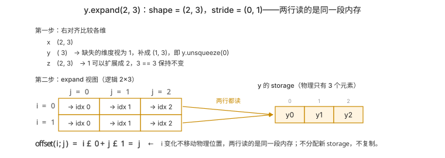

### 2. `expand()` 与 `repeat()`

```python title='expand 与 repeat 的对比'
x = torch.tensor([[1], [2]])

a = x.expand(2, 3)
b = x.repeat(1, 3)
```

二者表面结果相似，但存储语义不同：

| 操作 | 是否通常复制数据 | 语义 |
|---|---|---|
| `expand()` | 否 | 通过 stride 为 0 的 view 表示重复访问 |
| `repeat()` | 是 | 创建实际重复的数据 |

Table: expand() 与 repeat() 的存储语义

`expand()` 可以节省内存，但它产生的 view 不能简单当作普通连续 Tensor；某些 in-place 操作也会受到限制，因为多个逻辑位置可能对应同一个物理位置。

### 3. 广播不等于真实复制

- 逻辑上：`y` 看起来扩展成了更大的形状，运算时按 `(2, 3)` 的每个位置取值；
- 物理上：底层数据仍然只有一份，第 0 行和第 1 行读的是同一段内存。

所以"扩展"改的是**怎么读**（shape 和 stride），不是**存了什么**——目的只有一个：让两个形状不同的操作数能逐元素对应起来，而不为此复制数据。

这也是 stride 重要的原因：一个维度的 stride 为 0 时，索引增加并不一定导致物理地址增加。

### 4. 广播错误的排查方式

遇到：

```text title='广播失败的典型报错'
The size of tensor a must match the size of tensor b
```

不要只看 Tensor 的元素数量，要打印完整信息：

```python title='排查时打印每个 Tensor 的 shape、stride、dtype、device'
for name, value in {
    "x": x,
    "y": y,
}.items():
    print(name, value.shape, value.stride(), value.dtype, value.device)
```

shape 相乘相等，不代表两个 Tensor 可以逐元素广播。


## 十二、从 Tensor 视角理解内存问题

### 1. 数据内存、缓存内存和计算图内存

一个训练进程中的内存，至少可以分为：

1. Tensor 数据
2. 梯度
3. Optimizer State
4. Autograd 保存的中间结果
5. Kernel 临时 workspace
6. Allocator 缓存

把这几类放进同一块 GPU 显存里看，并标出 `memory_allocated()` 与 `memory_reserved()` 各自覆盖的范围：

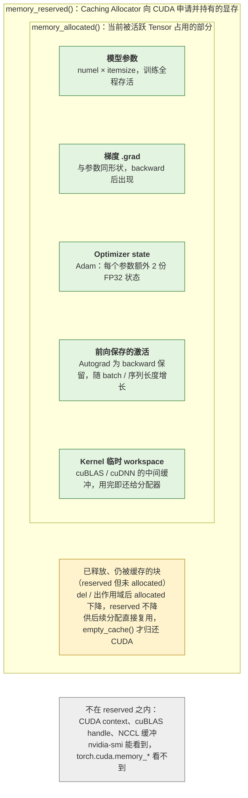

因此，下面两个数字不是同一个概念：

```python title='memory_allocated 与 memory_reserved 是两个概念'
torch.cuda.memory_allocated()
torch.cuda.memory_reserved()
```

- `allocated`：当前 Tensor 等对象实际使用的显存；
- `reserved`：PyTorch 分配器向 CUDA 申请并保留的显存。

释放一个 Tensor 后，`allocated` 可能下降，但 `reserved` 不一定立即下降，因为缓存分配器可能保留内存供后续复用。

### 2. 为什么删除 Tensor 后显存仍然存在？

可能原因包括：

- 还有其他 Python 引用；
- 某个 view 仍然持有底层 Storage；
- Autograd 图仍然被保存；
- CUDA caching allocator 仍然保留内存；
- Kernel 尚未完成，存在异步执行；
- 其他 Tensor、梯度或 Optimizer state 仍在使用。

因此，`del x` 只删除一个 Python 名称，不代表底层数据一定立即归还操作系统或 GPU 驱动。

> [!NOTE] Java 经验参照：内存何时释放
> Java 把引用置为 `null` 之后，对象何时回收由 GC 决定，时机不确定。`del x` 同样只是去掉一个引用，但 CPython 对象和 `TensorImpl` / `StorageImpl` 都用引用计数：最后一个引用消失时 Storage 立即释放（对象陷在引用环里时才要等 Python 的循环垃圾回收）。释放出来的显存回到 PyTorch 的缓存分配器而不是驱动——这一层类似 JVM 回收对象后，堆空间不一定还给操作系统——所以 `nvidia-smi` 看到的占用不降。

### 3. Tensor 生命周期比变量名更重要

```python title='把 model(batch) 直接存进列表'
outputs.append(model(batch))
```

如果 `model(batch)` 参与 Autograd，这个列表可能不只是保存输出值，还会间接保留计算图和中间 Tensor。

如果只需要记录数值，可以考虑：

```python title='只留数值：detach().cpu()'
outputs.append(model(batch).detach().cpu())
```

如果只需要日志指标：

```python title='只留日志指标：detach().item()'
loss_value = loss.detach().item()
```

具体做法要根据是否需要梯度和后续设备访问来决定。

### 4. 复制、迁移和视图的成本模型

分析一个 Tensor 操作时，可以先问四个问题：

- 是否创建新的 Storage？
- 是否复制了数据？
- 是否发生了设备迁移？
- 是否延长了原始 Storage 的生命周期？

例如：

| 操作 | 新 Storage | 数据复制 | 可能影响生命周期 |
|---|---:|---:|---:|
| `view()` | 通常否 | 否 | 是，共享原 Storage |
| `transpose()` | 通常否 | 否 | 是，共享原 Storage |
| `clone()` | 是 | 是 | 否，数据独立 |
| `contiguous()` | 视布局而定 | 视布局而定 | 可能 |
| `.to("cuda")` | 通常是 | 是 | 否，设备不同 |
| `detach()` | 通常否 | 否 | 共享关系仍需注意 |

Table: 复制、迁移和视图的成本模型

这张表是分析思路，不是对所有特殊后端和布局的绝对保证。


## 十三、实现一个简化版 Tensor

### 1. 实践目标

为了把前面的概念串起来，可以使用 Python 和 NumPy 实现一个只支持 CPU 的简化版 Tensor。

它不需要实现完整的数学运算，只需要支持：

- 一维 Storage；
- sizes；
- strides；
- storage offset；
- `view()`；
- `transpose()`；
- 索引访问；
- contiguous 检查。

目标数据结构：

```python title='MiniTensor 的数据结构：storage、sizes、strides、storage_offset'
class MiniTensor:
    def __init__(
        self,
        storage,
        sizes,
        strides,
        storage_offset=0,
    ):
        self.storage = storage
        self.sizes = tuple(sizes)
        self.strides = tuple(strides)
        self.storage_offset = storage_offset
```

### 2. 从多维索引计算物理位置

```python title='storage_index：从多维索引算物理位置'
def storage_index(self, index):
    if len(index) != len(self.sizes):
        raise IndexError("dimension mismatch")

    offset = self.storage_offset
    for i, size, stride in zip(index, self.sizes, self.strides):
        if not 0 <= i < size:
            raise IndexError("index out of range")
        offset += i * stride
    return offset
```

对于 `sizes = (2, 3)`、`strides = (3, 1)`、`offset = 0`，访问 `[1, 2]` 时 `offset = 0 + 1 × 3 + 2 × 1 = 5`。

### 3. 实现 transpose

```python title='MiniTensor.transpose：交换 sizes 与 strides'
def transpose(self, dim0, dim1):
    sizes = list(self.sizes)
    strides = list(self.strides)

    sizes[dim0], sizes[dim1] = sizes[dim1], sizes[dim0]
    strides[dim0], strides[dim1] = strides[dim1], strides[dim0]

    return MiniTensor(
        self.storage,
        sizes,
        strides,
        self.storage_offset,
    )
```

这个实现没有复制 Storage，只是交换了 sizes 和 strides。这正是 PyTorch view 操作的核心思想之一。

### 4. 实现 contiguous copy

```python title='MiniTensor.contiguous：按逻辑顺序抄一份'
def contiguous(self):
    if self.is_contiguous():
        return self

    values = [self[index] for index in self.iter_indices()]
    return MiniTensor.from_flat(values, self.sizes)
```

这个实现刻意把非连续 Tensor 按逻辑顺序重新写入一段新的连续 Storage，从而体现：

1. non-contiguous view
2. 按逻辑顺序读取
3. 创建新的连续 Storage
4. 返回 contiguous Tensor

### 5. 这个项目不实现什么？

为了控制范围，MiniTensor 不实现：

- CUDA；
- Autograd；
- dtype promotion；
- broadcasting 的全部规则；
- sparse layout；
- 内存分配器；
- 并行 Kernel。

它的意义不是替代 PyTorch，而是把一个真实框架中的关键数据结构缩小到可以观察的范围。


## 十四、本文小结

Tensor 是 PyTorch 编程模型的核心数据抽象。理解它，不能只停留在：

```python title='只看 shape、dtype、device 是不够的'
x.shape
x.dtype
x.device
```

还要同时关注：

- Storage
- sizes
- strides
- storage_offset
- dtype
- device
- layout

### 1. Tensor 的基本模型

分析工程问题时，可以把 Tensor 近似成一个“带布局的设备内存视图”：

```text title='Tensor 的基本模型：一段设备内存加上对它的解释'
Tensor
    = Storage：一段设备内存
    + Shape：对这段内存的形状解释
    + Stride、Storage Offset：地址计算规则
    + Dtype、Device：元素类型与所在设备
    + 可选的 Autograd 关系
```

这不是 Tensor 的完整定义，但足以回答：

- 一个操作是否复制数据；
- 为什么转置可以很便宜；
- 为什么某些 Kernel 需要 contiguous；
- 为什么设备迁移成本很高；
- 为什么保存一个小 view 可能持有大块内存。

### 2. View 与拷贝

- **view / transpose / permute**：通常只改变 metadata
- **clone / dtype conversion / device transfer**：通常需要新的数据存储
- **reshape / contiguous**：是否复制取决于当前布局和目标要求

### 3. 性能分析的第一组问题

遇到一个 Tensor 操作时，先问：

1. 是否创建了新的 Storage？
2. 是否复制了数据？
3. 是否改变了 device 或 dtype？
4. 是否改变了 stride 和 contiguous 状态？
5. 是否与其他 Tensor 共享底层数据？
6. 是否延长了某块内存的生命周期？
7. 是否影响 Autograd 或后续 Kernel？

### 4. 一张 Tensor 地图

把全文的字段放回一张图：上面是读者看到的逻辑层，下面是内存里的物理层，两层由 stride / offset 连接，算子执行时要同时看两层。

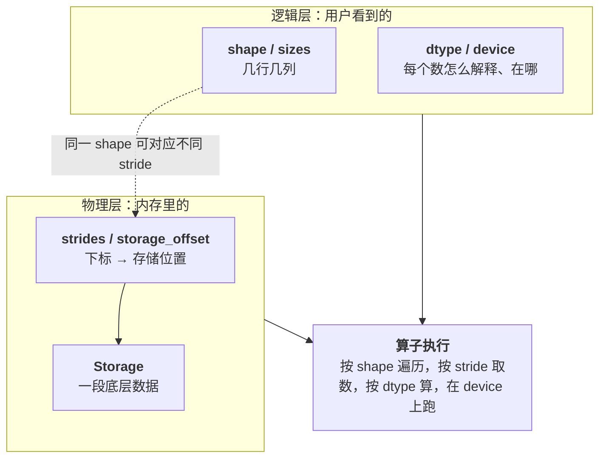

### 5. 本篇涉及的源码位置

本篇讨论的机制在源码中的位置（对应[《PyTorch 整体介绍》第七章「代码视角——源码目录与库的分层」](/pytorch-overall-introduction.html#七第三张地图代码视角源码目录与库的分层)的代码地图）：

| 路径 | 内容 |
|---|---|
| `c10/core/TensorImpl.h` | Tensor 元数据：`sizes_and_strides_`、`storage_offset_`、`data_type_`、`device_opt_`、`key_set_` |
| `c10/core/StorageImpl.h` | 底层存储：数据指针、字节数、所属 Allocator |
| `aten/src/ATen/native/TensorShape.cpp` | `view`、`reshape`、`transpose`、`permute`、`squeeze` 等只改 metadata 的操作 |
| `aten/src/ATen/native/TensorProperties.cpp`、`TensorConversions.cpp` | `contiguous()`、`.to()`：何时拷贝、何时只改 metadata |
| `aten/src/ATen/ExpandUtils.h` | 广播规则 `infer_size` 与 `expand` |
| `c10/core/ScalarType.h`、`aten/src/ATen/native/TypeProperties.cpp` | dtype 定义与 `result_type`（dtype promotion） |
| `c10/cuda/CUDACachingAllocator.cpp` | 缓存分配器：为什么 `del` 之后显存仍被占用 |
| `torch/_tensor.py`、`torch/csrc/autograd/python_variable.cpp` | Python `torch.Tensor` 对象与它包装的 C++ Tensor |

Table: 本篇涉及的源码位置

[《自动求导与动态计算图》](/pytorch-autograd-and-dynamic-computation-graph.html)将进入 Tensor 之上的梯度系统：

> **Autograd 如何把一次次 Tensor 运算连接成动态计算图，并在 backward 阶段沿图传播梯度？**

## 十五、自测

1. 形状 `[2, 3, 4]` 的连续 Tensor，strides 是什么？`x.transpose(0, 2)` 之后 shape 与 strides 是什么、连续吗？

   <details markdown="1"><summary>答案</summary>

   strides `(12, 4, 1)`（行主序，元素单位）；转置后 shape `[4, 3, 2]`、strides `(1, 4, 12)`，不连续——没复制数据，只交换了元数据。

   </details>

2. `x.view(-1)`、`x.reshape(-1)`、`x.flatten()` 在 `x` 不连续时各做什么？

   <details markdown="1"><summary>答案</summary>

   `view` 在新形状**无法**用一组 stride 在现有内存排列上解释时报错——不连续不等于一定报错：`torch.arange(12).view(2, 6)[:, ::2]`（strides `(6, 2)`）不连续，但 `view(-1)` 可以得到 stride `(2,)` 的一维视图；`transpose` 之后那种维度顺序被打乱的布局才做不到。`reshape` 在能 view 时 view、否则复制一份连续的再 view；`flatten` 等同 `reshape`。所以 `reshape` 的返回值是否共享内存不确定，写代码时要意识到。

   </details>

3. `x[0]`（第一行）与 `x[:, 0]`（第一列）各创建了什么？两者哪个连续？

   <details markdown="1"><summary>答案</summary>

   都是 view：新 `TensorImpl`、共享 `Storage`；`x[0]` 是 `storage_offset = 0`、strides 去掉第一维，连续；`x[:, 0]` 的 stride 是原第一维的 stride，不连续。两者都让整个 `x` 的 Storage 活着。

   </details>

4. `x.to("cuda")`、`x.to(torch.float16)`、`x.to(x.device)` 各复制吗？返回的是新 Tensor 还是自己？

   <details markdown="1"><summary>答案</summary>

   跨设备与改 dtype 都要复制（新 Storage）；`to` 到相同 device 与 dtype 时直接返回 `self`（同一个对象），除非传 `copy=True`。所以 `.to()` 的“是否新对象”依赖运行时条件。

   </details>

5. 一个 10 GB 的 Tensor 取了 `y = x[0, 0]`（单元素 view）后 `del x`，显存释放了吗？怎么真正释放？

   <details markdown="1"><summary>答案</summary>

   没有——`y` 的 `TensorImpl` 持有同一个 `StorageImpl`，10 GB 活着；`y = x[0, 0].clone()`（或 `.item()` 取标量）再 `del x` 才释放。这是“是否延长某块内存的生命周期”那一问。

   </details>

[^q0]: Tensor 是六样东西的组合：数据（`StorageImpl` 里的字节缓冲区，可被多个 Tensor 共享）、形状（`sizes`）、布局（`strides` + `storage_offset`）、类型（`dtype`）、设备（`device`）与生命周期（`TensorImpl` / `StorageImpl` 的引用计数）。Python 的 `torch.Tensor` 是句柄，指向 C++ 的 `TensorImpl`，后者持有 `Storage`。详见[第二章](#二tensor-的整体模型)。
[^q1]: `transpose()` 只交换两维的 `size` 与 `stride`，产生一个新的 `TensorImpl`，与原 Tensor 共享同一个 `Storage`；数据一个字节都没动，代价是结果不再连续。详见[第五章](#五transposepermute-与-view)。
[^q2]: `view()` 要求新形状能用一组 stride 在**现有内存排列**上直接解释出来（不复制）；对连续 Tensor 总能做到，对 `transpose` 之后这类维度顺序被打乱的不连续 Tensor 往往做不到，于是报错（但不连续不等于必报错：等步长的切片 `x[:, ::2]` 就能 `view(-1)`）。详见[第五章](#五transposepermute-与-view)。
[^q3]: `reshape()` = "能 `view` 就 `view`，不能就先 `contiguous()` 复制一份再 `view`"，所以它的返回值是否与原 Tensor 共享内存取决于输入是否连续。详见[第五章](#五transposepermute-与-view)与[第六章](#六contiguous连续布局与数据拷贝)。
[^q4]: `shape` 只是逻辑形状，性能由 stride（是否连续、内存访问模式）、`dtype`（字节数与能否走 Tensor Core）和 `device` 决定；同一 shape 的连续与非连续 Tensor 会走不同的 kernel 路径。详见[第四章](#四stride逻辑索引如何映射到内存)与[第六章](#六contiguous连续布局与数据拷贝)。
[^q5]: `device` 是每个 Tensor 自己的属性，`model.to("cuda")` 只搬模块注册的参数与 buffer；输入是另一个 Tensor，没人替它搬，算子要求所有输入在同一设备上。详见[第九章](#九device数据到底在哪里执行)。
[^q6]: `dtype` 决定每个元素的解释方式：位宽只是其一，还有能表示的范围与精度（fp16 最大 65504、bf16 尾数只有 7 位，FP32→BF16 按最近舍入而非截断）、混合运算时的类型提升规则，以及能选到哪些 kernel。详见[第八章](#八dtype如何解释每个元素)。
[^q7]: Autograd 在前向时会保存某些中间 Tensor 供反向使用，in-place 操作改写了这些被保存的数据，PyTorch 用版本计数器检测到后报错。原则：只在明确数据依赖时才用 in-place。详见[第十章](#十viewclonedetach-与-in-place)。
[^q8]: 两个原因：某个小 view 仍持有同一个 `Storage`，整块数据就活着；`del` 之后释放的块也只是回到 CUDA caching allocator 的缓存（`memory_reserved` 不降），`empty_cache()` 才归还驱动。详见[第十二章](#十二从-tensor-视角理解内存问题)。
