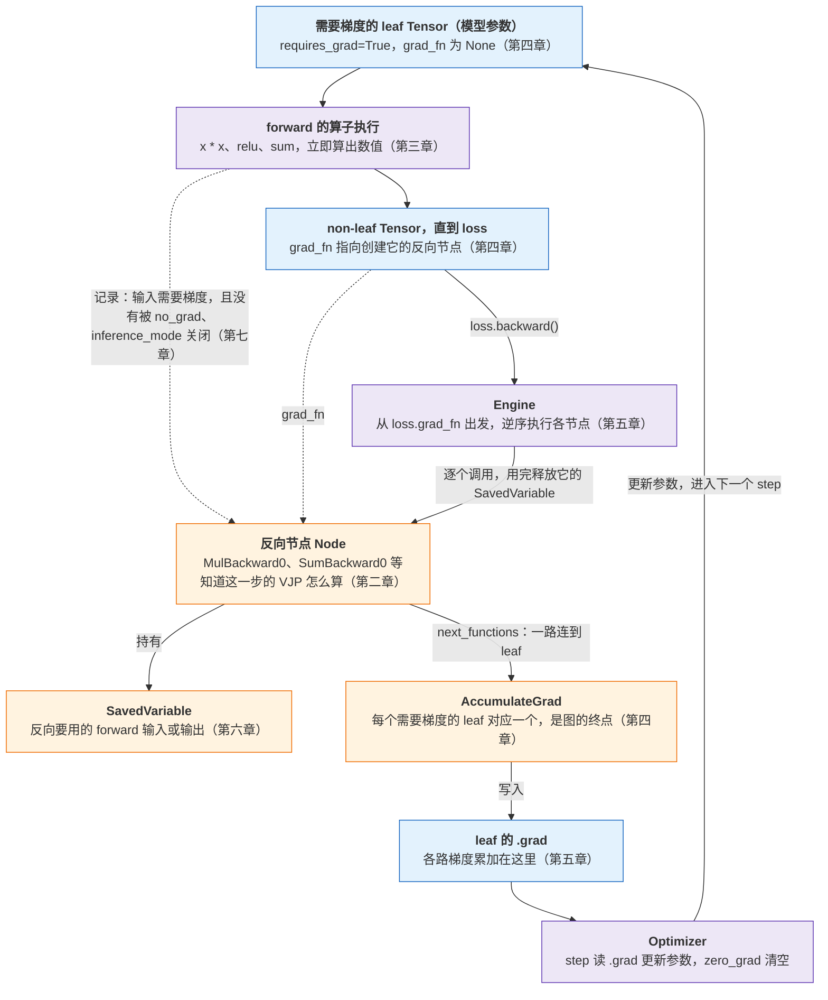
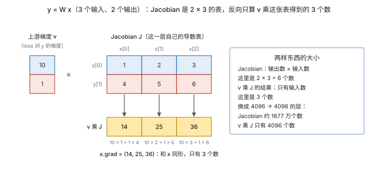
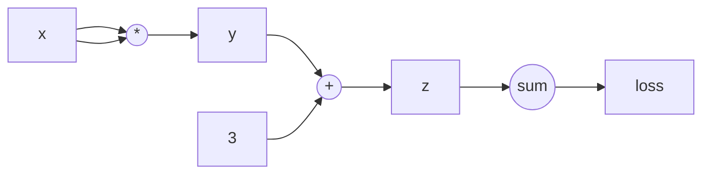
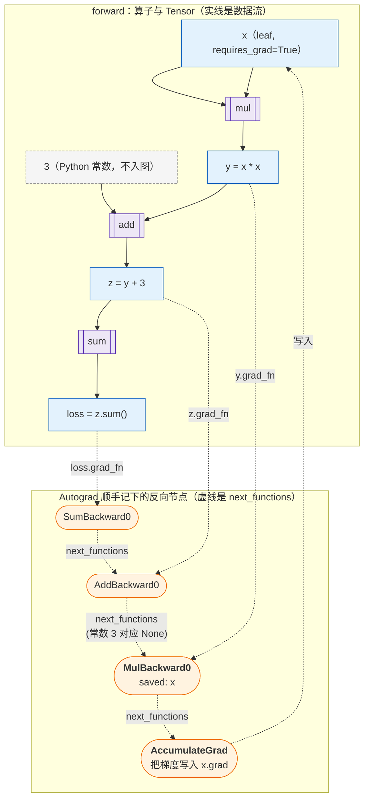
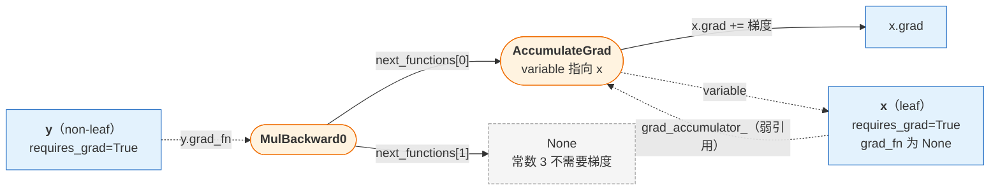
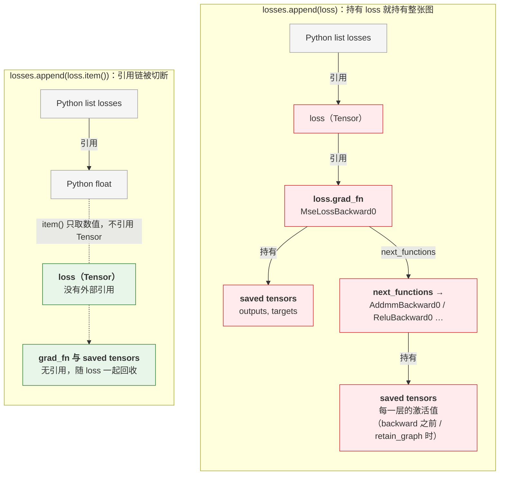
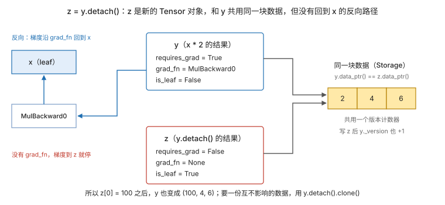
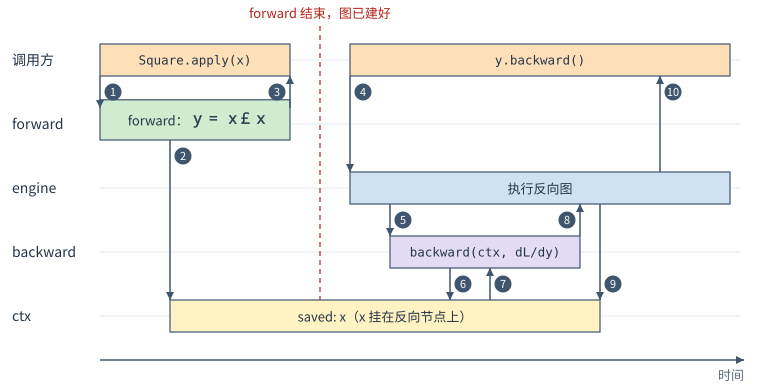
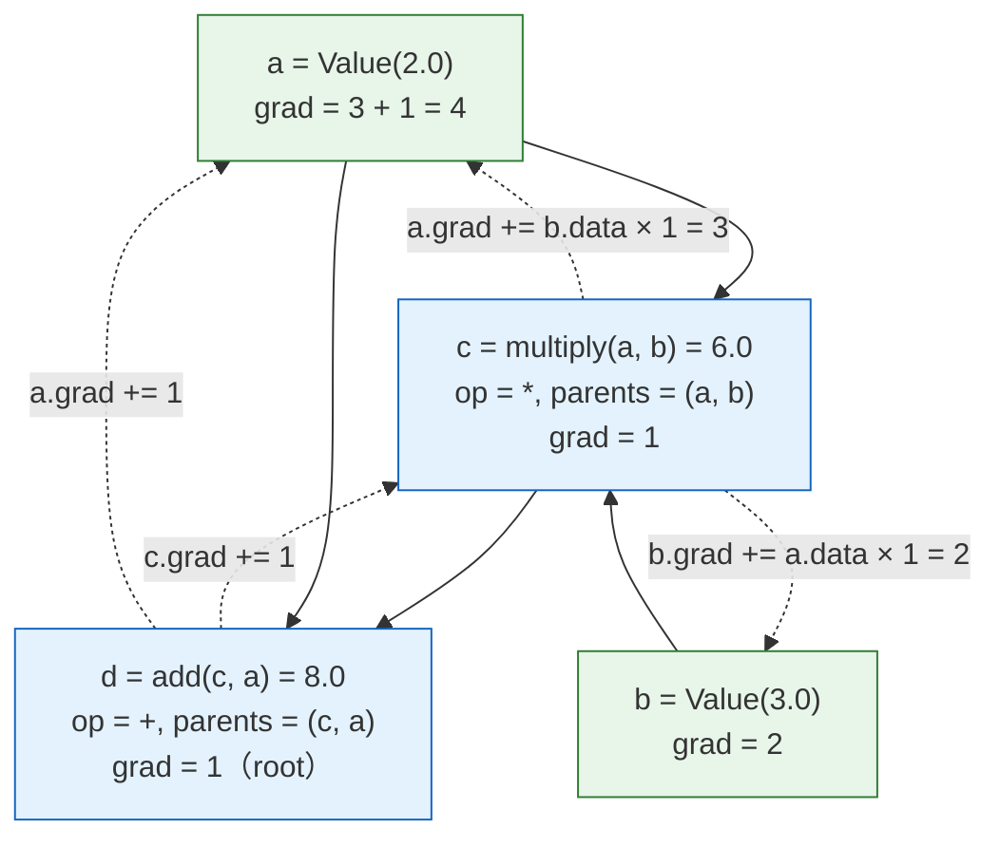

[《Tensor 与内存布局》](/pytorch-tensor-and-memory-layout.html)介绍了 Tensor 的核心模型：它不是一组孤立的数字，而是由 Storage、Shape、Stride、Storage Offset、dtype、device 和 layout 共同描述的一种数据抽象。

但 Tensor 只有数据和布局，还不能完成模型训练。训练还需要回答一个问题：

> **模型输出发生变化时，参数应该沿着什么方向、以多大的幅度变化？[^q0]**

这需要计算梯度。PyTorch 通过 Autograd 把数学上的求导过程变成了一个可以执行的运行时系统：

1. Tensor 运算
2. 动态记录运算关系
3. 形成计算图
4. 从结果反向遍历
5. 计算并累积梯度
6. Optimizer 更新参数

初学者通常只需要记住：

```python title='初学者记住的两行：backward 与 step'
loss.backward()
optimizer.step()
```

但 AI-Infra 工程师还需要理解：

- `requires_grad` 决定了什么？[^q1]
- leaf Tensor 和 non-leaf Tensor 有什么区别？[^q2]
- `grad_fn` 指向什么？[^q3]
- 梯度为什么会累积？[^q4]
- 计算图什么时候创建，什么时候释放？[^q5]
- 为什么保存一个 Tensor 可能让整张图无法回收？[^q6]
- `detach()`、`no_grad()` 和 `inference_mode()` 有什么区别？[^q7]
- 自定义算子如何向 Autograd 提供 backward？[^q8]
- 为什么某些 in-place 操作会破坏反向传播？[^q9]

## 一、总览：从数学求导到运行时系统

一个训练 step 里，Autograd 涉及的对象连成一个环：forward 一边算数值一边建反向节点，`loss.backward()` 让引擎沿这些节点走回参数，梯度落在参数的 `.grad` 上，Optimizer 读它更新参数，下一个 step 再建一张新图。



- **leaf Tensor**：没有 `grad_fn` 的 Tensor，也就是不由"被 Autograd 记录的运算"产生的 Tensor。它分两种：`requires_grad=True` 的 leaf（模型参数都是）是反向传播的终点，梯度最终写到它的 `.grad` 上；`requires_grad=False` 的 leaf（输入数据、标签）不参与反向传播，`.grad` 一直是 `None`。图里画的是前一种。
- **non-leaf Tensor**：运算的结果，forward 执行到那一行时产生。它的 `grad_fn` 指向一个反向节点；`loss` 是最后一个 non-leaf。
- **反向节点（`Node`）**：forward 每执行一个需要梯度的算子就创建一个，C++ 基类是 `torch/csrc/autograd/function.h` 的 `Node`。内置算子的节点由 `tools/autograd/derivatives.yaml` 里的公式生成，自定义算子的节点调用 `autograd.Function.backward`（第八章）。节点之间用 `next_functions` 连接，这些节点和边就是计算图。
- **`SavedVariable`**：节点为了算 VJP 而保存的 forward 输入或输出（激活值）。它从 forward 活到 backward 用完，是训练显存里随 batch 增长的那部分；in-place 报错也来自它的版本检查（第十章）。
- **Engine**：`loss.backward()` 进入 `torch/csrc/autograd/engine.cpp` 的 `Engine::execute`。它从 `loss.grad_fn` 出发，按依赖关系逆序调用每个节点，把上游梯度变成传给下一个节点的梯度。
- **`AccumulateGrad` 与 `.grad`**：leaf 自己的 `grad_fn` 是 `None`，但每个需要梯度的 leaf 在反向图里对应一个 `AccumulateGrad` 节点，用到它的算子节点通过 `next_functions` 指向这个节点。它把传到这里的梯度累加（`+=`）到 leaf 的 `.grad`。`.grad` 一直留在参数上，直到 `zero_grad()` 清掉。
- **Optimizer**：不属于 Autograd，只读 `.grad`。图和保存值在 backward 后释放，`.grad` 和参数留下来。

### 1. 本文的主线

本文会先从链式法则和向量–Jacobian 积（Vector-Jacobian Product，VJP）开始，再逐层解释动态计算图、Autograd Node、梯度累积、图的生命周期和自定义 `autograd.Function`。中间会专门讨论三种常用的梯度控制方式（`detach()`、`no_grad()`、`inference_mode()`）以及它们和 `model.eval()` 的组合。最后会实现一个 Mini-Autograd，用一个很小的系统复现 PyTorch 反向传播的核心思想，并整理 Autograd 最常见的几类问题和排查顺序。

### 2. 本文的章节安排

| 章 | 主题 | 内容 |
|---|---|---|
| 二 | 从数学求导到自动求导 | 梯度、链式法则、Jacobian 与 VJP、为什么从标量 Loss 开始 |
| 三 | 动态计算图 | 计算图是什么、Eager 下如何动态创建、每次 forward 都是新图 |
| 四 | `requires_grad`、Leaf Tensor 与 `grad_fn` | 三个核心属性各决定什么、与 Parameter 的关系 |
| 五 | `backward()`：反向传播与梯度累积 | 一次 backward 的过程、梯度累积、`zero_grad`、图的释放 |
| 六 | 计算图中的保存值与生命周期 | saved tensors、保存输出等于保存整张图、`saved_tensors_hooks` |
| 七 | `detach()`、`no_grad()` 与 `inference_mode()` | 三种梯度控制方式的区别及与 `model.eval()` 的组合 |
| 八 | 自定义 `autograd.Function` | `save_for_backward`、多输入与不可导输入、工程边界 |
| 九 | 实现一个 Mini-Autograd | Value 节点、加法与乘法、拓扑排序、backward |
| 十 | Autograd 常见问题与排查方法 | 几类典型报错与梯度异常 |
| 十一 | 本文小结 |  |
| 十二 | 自测 | 5 道题 |

Table: 本文的章节安排

## 二、从数学求导到自动求导

### 1. 梯度解决什么问题？

假设有一个非常简单的函数 `y = x²`。当 `x = 3` 时，`y = 9`。如果希望调整 `x` 让 `y` 变小，就需要知道 **`y` 对 `x` 的变化有多敏感**。这个敏感程度就是导数 `dy/dx = 2x`；当 `x = 3` 时，`dy/dx = 6`。如果目标是最小化 `y`，就可以沿着负梯度方向调整 `x`：`x_new = x - learning_rate × gradient`。

神经网络中的参数通常有数百万甚至数十亿个，手工为每个参数推导和实现梯度是不现实的。Autograd 的任务就是自动完成这个过程。

### 2. 链式法则

上一节的 `y = x²` 一步就算完了导数。但神经网络不是一步：输入先过第一层、结果再过第二层、再过 loss——几十层函数**套在一起**，loss 对第一层参数的导数没有现成公式可查。链式法则回答的就是"套起来的函数怎么求导"：把每一层自己的导数（局部导数，每层都容易算）**相乘**，就是整条链的导数。有了它，不管套多少层，只要每种基本运算会算自己那一小步，整体就能算出来——这正是 Autograd 能自动化的前提。

对于复合函数 `z = f(y)`、`y = g(x)`，有 `dz/dx = dz/dy × dy/dx`。例如 `y = x²`、`z = 3y + 1`，可以拆成：

```text title='按链式法则拆开算出 dz/dx = 6x'
dz/dy = 3
dy/dx = 2x

dz/dx = 3 × 2x = 6x
```

这正是反向传播的基本结构：从结果开始，沿着计算关系反向应用局部导数——先拿到 `dz/dy = 3`，再乘上 `dy/dx = 2x`。之所以从结果往回走而不是从输入往前走，第 4 节会说：loss 是一个数，从它出发每一步传回去的都只是"一个和输入同形的梯度"，而不是一张大表。

### 3. 从标量到向量

实际模型很少只有一个标量输入和一个标量输出。更常见的情况是 `y = f(x)`，其中 `x` 和 `y` 都是向量或 Tensor。这一节用一个能手算的例子把三件事讲清楚：多个输入、多个输出时"导数"长什么样；它为什么大到存不下；反向传播实际算的是什么。

#### 3.1 一个能手算的例子

取 3 个输入、2 个输出的线性变换 `y = W x`：

```python title='3 个输入、2 个输出：y = W x'
import torch

W = torch.tensor([[1., 2., 3.],
                  [4., 5., 6.]])
x = torch.tensor([1., 0., -1.], requires_grad=True)

y = W @ x
print(y)  # tensor([-2., -2.], grad_fn=<MvBackward0>)
```

把矩阵乘法按分量写开，就是两个普通的算式：

```text title='按分量写开的两个算式'
y[0] = 1·x[0] + 2·x[1] + 3·x[2]
y[1] = 4·x[0] + 5·x[1] + 6·x[2]
```

#### 3.2 Jacobian：每个输出对每个输入各有一个导数

一个输入、一个输出时，导数是一个数。现在有 2 个输出、3 个输入，"某个输出对某个输入的导数"一共有 `2 × 3 = 6` 个。例如 `x[1]` 增加 1，`y[0]` 增加 2、`y[1]` 增加 5，所以 `∂y[0]/∂x[1] = 2`、`∂y[1]/∂x[1] = 5`。把 6 个数按"行是输出、列是输入"排成一张表，这张表就叫 **Jacobian**（雅可比矩阵），记作 `J`：

| | `x[0]` | `x[1]` | `x[2]` |
|---|---:|---:|---:|
| `y[0]` | 1 | 2 | 3 |
| `y[1]` | 4 | 5 | 6 |

Table: y = W x 的 Jacobian：第 i 行第 j 列是 ∂y[i] / ∂x[j]，这个例子里它正好等于 W

一般地，`y` 有 `m` 个分量、`x` 有 `n` 个分量，`J` 就是 `m × n` 的矩阵，`J[i, j] = ∂y[i] / ∂x[j]`。PyTorch 可以把这张表直接算出来，结果和上表一致：

```python title='用 torch.autograd.functional.jacobian 算出整张表'
J = torch.autograd.functional.jacobian(lambda t: W @ t, x)
print(J)
# tensor([[1., 2., 3.],
#         [4., 5., 6.]])
```

这张表的问题是大。一个 `[4096] → [4096]` 的线性层，Jacobian 是 `4096 × 4096`，约 1677 万个数，**一个样本、一层**就 64 MB（float32）；几十层、每层的 `J` 都存下来，训练根本跑不动。

#### 3.3 训练只需要"上游梯度乘这张表"

训练要的不是这张表，而是 **loss 对 `x` 的梯度**。loss 是一个标量，所以这个梯度和 `x` 同形，只有 3 个数。

假设 `y` 后面还接了别的运算，最后得到 loss，并且反向传播已经算出了 loss 对 `y` 的梯度 `v = (10, 1)`。它的意思是：`y[0]` 增加 1，loss 增加 10；`y[1]` 增加 1，loss 增加 1。这个从后面传回来的梯度叫**上游梯度**。

现在问 loss 对 `x[0]` 的梯度。`x[0]` 通过两条路影响 loss，把两条路加起来（这就是上一节的链式法则，只是路变成了两条）：

```text title='x[0] 影响 loss 的两条路'
x[0] → y[0] → loss：  10 × 1 = 10
x[0] → y[1] → loss：   1 × 4 =  4
                       合计   14
```

`x[1]`、`x[2]` 同理，得到 `10 × 2 + 1 × 5 = 25` 和 `10 × 3 + 1 × 6 = 36`。写成矩阵运算，就是行向量 `v` 乘矩阵 `J`：



这个乘积叫 **Vector-Jacobian Product（VJP，向量–Jacobian 积）**，数学上写作 `vᵀJ`。

`vᵀJ` 和图里的"v 乘 J"是同一个运算，`ᵀ`（转置）只是书写约定。数学上向量默认写成一列，`v` 是 `2 × 1`，`J` 是 `2 × 3`，`2 × 1` 的矩阵不能放在 `2 × 3` 的左边相乘；转置成一行（`1 × 2`）之后才能乘，结果是 `1 × 3`，正好是 `x` 的 3 个分量。图里把 `v` 的两个数分别对着 `J` 的两行（`y[0]`、`y[1]`），算的就是这个"行向量乘矩阵"。PyTorch 的一维 Tensor 不区分行和列，所以下面的代码直接写 `v @ W`，不需要转置。

用 PyTorch 验证，`backward()` 得到的正是这三个数：

```python title='backward 得到的 x.grad 等于 v 乘 J'
v = torch.tensor([10., 1.])
loss = (v * y).sum()      # 构造一个 loss，使 loss 对 y 的梯度正好是 v
loss.backward()

print(x.grad)  # tensor([14., 25., 36.])
print(v @ W)   # tensor([14., 25., 36.])
```

#### 3.4 算 VJP 不需要把 Jacobian 存成一个矩阵

VJP 的定义是 `vᵀJ`，定义里有 `J`。这一节的标题说的是另一件事：**计算**这个结果时，不需要先在内存里构造一个 `m × n` 的矩阵 `J`，再做一次矩阵乘法。区分两点：

- `J` 在数学上一直存在，每种运算的 `J` 长什么样由这种运算的公式决定。
- 实现上，每种运算都有一条专门的反向公式：输入是上游梯度 `v`，输出就是 `vᵀJ` 的结果。这条公式是把 `J` 的结构代进 `vᵀJ` 之后化简得到的，执行时只用到手上已有的 Tensor。

线性变换 `y = W x` 是最特殊的一种：它的 `J` 就是 `W`，而 `W` 本来就在内存里，所以反向直接拿 `W` 来乘，没有另外构造任何东西。上面验证里的 `v @ W` 就是这样。

多数运算的 `J` 并不是某个现成的 Tensor。以 ReLU 为例，把它的 `J` 真的算出来：

```python title='ReLU 的 Jacobian：一个对角矩阵，绝大部分是 0'
x2 = torch.tensor([1., -2., 3.], requires_grad=True)
print(torch.autograd.functional.jacobian(torch.relu, x2))
# tensor([[1., 0., 0.],
#         [0., 0., 0.],
#         [0., 0., 1.]])
```

`y[i]` 只依赖 `x[i]`，所以只有对角线上可能不是 0：`x[i] > 0` 的位置是 1，其余是 0。`v` 乘这样一个对角矩阵，结果就是 `v` 的每个分量各乘对角线上对应的那个数。所以反向只需要 `v` 逐元素乘一个 0/1 掩码，这个 `3 × 3` 的矩阵从头到尾没有出现过。输入有 4096 个分量时，差别是 1677 万个数的矩阵对 4096 个数的掩码。

| 运算 | Jacobian 的样子 | 反向时实际算什么 | 用到的已有 Tensor |
|---|---|---|---|
| 线性变换 `y = W x` | 就是 `W`（`m × n`） | `v` 乘 `W`，一次矩阵乘法，代价与前向同阶 | `W` |
| 逐元素运算 `y = relu(x)` | `n × n` 对角矩阵：`x[i] > 0` 的位置是 1，其余是 0 | `v` 逐元素乘 0/1 掩码 | 前向的输出 `y`（用来判断哪些位置大于 0） |
| 求和 `y = x.sum()` | `1 × n`，全是 1 | 把标量 `v` 复制成 `x` 的形状 | 无，只需要 `x` 的 shape |

Table: 三种运算的 Jacobian 与反向时实际执行的计算

ReLU 的反向可以直接验证。`backward()` 的参数就是上游梯度 `v`：

```python title='ReLU 的反向：上游梯度逐元素乘 0/1 掩码'
y2 = torch.relu(x2)
y2.backward(torch.tensor([5., 6., 7.]))

print(x2.grad)  # tensor([5., 0., 7.])   x2[1] < 0，这一位的梯度被挡住
```

PyTorch 把每个算子的这条公式写在 [`tools/autograd/derivatives.yaml`](https://github.com/pytorch/pytorch/blob/37e9156f58a51d220ebb7a17b42acfa1b4121430/tools/autograd/derivatives.yaml) 里。上表三行对应的条目如下，`grad` 就是上游梯度 `v`：

```yaml title='derivatives.yaml 里这三种运算的反向公式（节选）'
- name: mv(Tensor self, Tensor vec) -> Tensor      # y = W x，self 是 W，vec 是 x
  vec: self.conj().t().mv(grad)                    # 对 x 的梯度：W 转置后乘 v

- name: relu(Tensor self) -> Tensor
  self: threshold_backward(grad, result, 0)        # result 是前向输出，大于 0 的位置保留 grad

- name: sum(Tensor self, *, ScalarType? dtype=None) -> Tensor
  self: grad.expand_symint(self.sym_sizes())       # 把 grad 扩成 self 的形状
```

第一条写的是 `Wᵀv`，和 `vᵀW` 是同一组数（一个按列写，一个按行写）。[《Dispatcher 与算子系统》](/pytorch-dispatcher-and-operator-system.html#二开发态1定义算子)会讲这个文件怎样参与算子定义。

#### 3.5 小结

- **Jacobian**：所有输出对所有输入的完整导数表，大小是"输出数 × 输入数"。
- **VJP**：上游梯度 `v` 乘这张表的结果，大小只有"输入数"，和 `x` 同形。
- **反向传播**：从 loss 出发，每经过一个运算就算一次 VJP，把得到的梯度当作下一个运算的上游梯度继续往回传。全程只搬运和数据同形的梯度，不把任何一层的 Jacobian 构造成矩阵。PyTorch 的 `backward()` 做的就是这件事。

### 4. 为什么 backward 通常从标量 Loss 开始？

```python title='从标量 loss 调 backward'
loss.backward()
```

这里的 `loss` 通常是一个标量。标量的反向传播可以理解为：算出 `loss` 对**每个参数**的偏导。

如果对一个非标量 Tensor 直接调用 `backward()`：

```python title='对非标量 Tensor 直接 backward'
x = torch.randn(3, requires_grad=True)
y = x * 2
y.backward()
```

通常会报错，因为 PyTorch 不知道应该从哪个方向将 `y` 的梯度传回来。

可以显式提供外部梯度：

```python title='显式传入外部梯度 ones_like(y)'
y.backward(torch.ones_like(y))
```

这相当于计算 `sum(y)` 对 `x` 的梯度。

所以 `backward()` 不只是“计算这个 Tensor 的梯度”，更准确地说是：

> 从当前结果出发，给定一个上游梯度，沿图计算各个输入的 VJP（向量–Jacobian 积）。

## 三、动态计算图：每次执行都记录一条新路径

### 1. 什么是计算图？

考虑下面的计算：

```python title='四行计算：x*x、+3、sum'
x = torch.tensor(2.0, requires_grad=True)
y = x * x
z = y + 3
loss = z.sum()
```

其 forward 关系可以简单表示为：



图中的节点可以表示：

- 输入 Tensor；
- 中间 Tensor；
- 算子；
- 输出 Tensor；
- 反向传播需要的局部信息。

加上反向传播需要的信息，可以表示为下面这张图：



上半是 forward 真正执行的算子（双边框）和它们产出的 Tensor（矩形），实线是数据流；下半是 Autograd 在执行每个算子时**顺手创建**的反向节点（圆角），每个 non-leaf Tensor 的 `grad_fn` 指向自己那一个，节点之间用 `next_functions` 串起来——backward 正是沿着下半的虚线从 `loss` 一路走回 `x`。两半是两套对象：`mul` 是算出 `y` 的那次运算，`MulBackward0` 是知道"怎么把 `y` 的梯度变成 `x` 的梯度"的节点，它还保存了反向要用的 `x`。

### 2. Eager Mode 下的图是动态创建的

[《PyTorch 整体介绍》](/pytorch-overall-introduction.html)介绍过，PyTorch 默认采用 Eager-first 的编程体验。在 Eager Mode 下，代码执行到哪一行，对应的 Tensor 操作就可以立即执行；如果需要梯度，Autograd 同时记录必要的反向关系。

```python title='Eager Mode 下边执行边记录'
x = torch.randn(3, requires_grad=True)
y = x * 2
z = y.relu()
loss = z.sum()
```

大致过程是：

1. 执行 x * 2
2. 创建乘法结果 y
3. 记录 y 如何由 x 得到
4. 执行 relu
5. 创建 z
6. 记录 z 如何由 y 得到
7. 执行 sum
8. 创建 loss
9. 记录 loss 如何由 z 得到

计算图不是预先写死的一张全局静态图，而是当前这次 forward 执行产生的运行时结构。

### 3. 每次 forward 通常都会创建新图

```python title='训练循环里每次 forward 都建新图'
for inputs, targets in loader:
    outputs = model(inputs)
    loss = criterion(outputs, targets)
    loss.backward()
```

通常每个训练 step 都会经历：

1. 本次 forward 创建图
2. 本次 backward 遍历图
3. 图中的中间信息被释放
4. 下一次 forward 创建新图

这种设计让 Python 控制流可以直接影响计算图：

```python title='Python 控制流直接决定图的形状'
def f(x: torch.Tensor) -> torch.Tensor:
    if x.sum() > 0:
        return x * x
    return x + x
```

不同输入可能走不同分支，因此不同执行过程可能产生不同的计算关系。

> [!NOTE] Java 经验参照：异常栈里找不到出错的那行 forward 代码
> 排查 Java 服务时，异常栈会一路指到出错的那行业务代码。backward 里报错（梯度出现 NaN、in-place 修改导致的版本检查失败）时，Python 栈只到 `loss.backward()` 为止：forward 的栈帧早已返回，反向节点是引擎按依赖关系逐个调用的，不是调用栈的回放。要找回是哪一行 forward 创建了出错的节点，打开 `torch.autograd.set_detect_anomaly(True)`，它在 forward 时为每个节点记下创建处的调用栈，报错时一并打印；开销明显，只在排查时开。

### 4. 动态图的优点和成本

优点：

- Python 控制流自然可用；
- 中间结果容易检查；
- 模型结构容易修改；
- 失败位置通常比较直观；
- 适合研究和快速迭代。

成本：

- 每次执行都可能构建运行时图；
- Python 调度和对象创建有额外开销；
- 保存中间 Tensor 可能延长图生命周期；
- 编译器需要额外捕获和分析；
- 动态控制流可能导致 graph break。

`torch.compile()` 的一个重要目标，就是在保留这种编程体验的同时，捕获其中适合优化的计算部分。它并不改变 Autograd 的基本数学含义，但可能改变计算图被捕获和执行的方式。

## 四、`requires_grad`、Leaf Tensor 与 `grad_fn`

### 1. `requires_grad`

```python title='创建一个 requires_grad=True 的标量'
x = torch.tensor(2.0, requires_grad=True)
```

这表示：只要后续计算在梯度记录开启的上下文中进行，并且结果参与反向传播，Autograd 就需要追踪与 `x` 有关的计算关系。

```python title='z = x² + 1 反向后 x.grad = 4'
x = torch.tensor(2.0, requires_grad=True)
y = x * x
z = y + 1
z.backward()

print(x.grad)  # tensor(4.)
```

这里 `y = x²`、`z = y + 1`，手算 `∂z/∂x = 2x = 4`，与 `x.grad` 一致。

`requires_grad=True` 并不意味着 Tensor 现在已经有梯度，也不意味着每个后续操作都一定会被记录。是否记录还会受到：

- 输入是否需要梯度；
- 是否处于 `no_grad()` 或 `inference_mode()`；
- 运算是否可微；
- Tensor 是否参与当前计算结果；

等条件影响。

### 2. Leaf Tensor 与 non-leaf Tensor

先给定义。PyTorch 判断 leaf 只看一件事：**这个 Tensor 有没有 `grad_fn`**。没有 `grad_fn` 就是 leaf（`is_leaf=True`），有 `grad_fn` 就是 non-leaf（源码：[`VariableHooks::is_leaf`](https://github.com/pytorch/pytorch/blob/37e9156f58a51d220ebb7a17b42acfa1b4121430/torch/csrc/autograd/variable.cpp#L517-L523)）。`grad_fn` 记录"这个 Tensor 是哪个运算算出来的"，[本章第 4 节](#4-grad_fn-与-accumulategrad)细讲。按这条规则，Tensor 分成三种情况：

| 情况 | `requires_grad` | `grad_fn` | `is_leaf` | 例子 |
|---|---|---|---|---|
| 不需要梯度的 Tensor | `False` | `None` | `True` | 输入数据、标签；它们之间的运算结果；`detach()` 的结果 |
| 用户直接创建、需要梯度的 Tensor | `True` | `None` | `True` | `torch.tensor(2.0, requires_grad=True)`；`nn.Parameter` |
| 由需要梯度的 Tensor 算出来的结果 | `True` | 有 | `False` | `y = x * 2`；每一层的输出；loss |

Table: leaf 与 non-leaf 的三种情况

前两种都是 leaf，区别在于要不要梯度。第三种是 non-leaf：只要一个运算的输入里至少有一个需要梯度，Autograd 就给结果挂上 `grad_fn`，这个结果就是计算图中间的节点。

```python title='三种情况各验证一次'
import torch
from torch import nn

a = torch.ones(2)                    # 不需要梯度
b = a * 2                            # 不需要梯度的 Tensor 之间的运算结果
print(b.is_leaf, b.requires_grad, b.grad_fn)   # True False None

x = torch.tensor(2.0, requires_grad=True)      # 用户直接创建、需要梯度
print(x.is_leaf, x.grad_fn)                    # True None

layer = nn.Linear(4, 2)                        # 模型参数是 nn.Parameter
print([p.is_leaf for p in layer.parameters()]) # [True, True]

y = x * 2                                      # 由需要梯度的 Tensor 算出来
print(y.is_leaf, y.grad_fn)                    # False <MulBackward0 object at 0x...>
```

这个区分直接决定梯度存在哪里：**`backward()` 只把梯度写进"需要梯度的 leaf"的 `.grad`**，也就是上表第二种，并且它要实际参与了 loss 的计算。训练时这一种就是模型参数，Optimizer 更新的也正是它们。第一种（输入数据、标签）虽然也是 leaf，反向传播不会为它计算梯度，`.grad` 一直是 `None`。

#### 是不是 leaf 看的是结果，不是创建方式

"用户直接创建的是 leaf、运算出来的是 non-leaf"只是常见情况，不是判定规则。规则只有"有没有 `grad_fn`"，所以两个方向都有反例。

**运算结果也可以是 leaf。** 只要这次运算没有被 Autograd 记录，结果就没有 `grad_fn`：

| 情况 | 例子 | 结果 |
|---|---|---|
| 所有输入都不需要梯度 | `c = a + b`，`a`、`b` 的 `requires_grad` 都是 `False` | `c.is_leaf` 为 `True` |
| 在关闭梯度记录的上下文里运算 | `with torch.no_grad(): q = x * 2`，即使 `x` 需要梯度 | `q.is_leaf` 为 `True` |
| 显式切断 | `z = y.detach()` | `z.is_leaf` 为 `True` |

Table: 运算结果仍是 leaf 的三种情况

`no_grad()` 和 `detach()` 在[第七章](#七detachno_grad-与-inference_mode)细讲。

**自己创建的 Tensor 也可能不是 leaf。** 常见的写法是创建时写了 `requires_grad=True`，后面又接了一次设备转移或类型转换：

```python title='创建后再接一次 .to()：得到的是 non-leaf，.grad 是 None'
w = torch.randn(3, 3, requires_grad=True).to(torch.float64)   # .cuda() 同理
print(w.is_leaf, w.grad_fn)     # False <ToCopyBackward0 object at 0x...>

w.sum().backward()
print(w.grad)                   # None，并给出 UserWarning
```

`requires_grad=True` 的那个 Tensor 是 `torch.randn(...)` 的返回值，它才是 leaf。`.to()`、`.cuda()` 是可微算子，对它再算一次得到的 `w` 带着 `grad_fn`（`ToCopyBackward0`），是 non-leaf。梯度写到了那个没有变量名的临时 Tensor 上，`w.grad` 是 `None`，把 `w` 交给 Optimizer 也不会被正确更新。正确的写法是让"需要梯度"成为最后一步：

```python title='两种正确写法：创建时直接指定 dtype / device，或最后再 requires_grad_()'
w = torch.randn(3, 3, dtype=torch.float64, requires_grad=True)
print(w.is_leaf)    # True

w = torch.randn(3, 3).to(torch.float64).requires_grad_()
print(w.is_leaf)    # True
```

模型参数不会遇到这个问题，原因见[本章第 5 节](#5-requires_grad-与-parameter)。

### 3. non-leaf 的 `.grad` 默认是 `None`

non-leaf Tensor 参与了反向传播，梯度确实流经它，但 Autograd 用完就丢，不写进它的 `.grad`。这是确定的默认行为，没有例外：

```python title='non-leaf 的 .grad 默认是 None'
x = torch.tensor(2.0, requires_grad=True)
y = x * 2
z = y * 3
z.backward()

print(x.grad)  # tensor(6.)
print(y.grad)  # None，同时 PyTorch 会给出一条 UserWarning
```

读 `y.grad` 时 PyTorch 会警告"正在访问 non-leaf Tensor 的 `.grad`"，提醒这个值不会被填充。

想让某个 non-leaf Tensor 保留梯度，唯一的办法是对它显式调用 `retain_grad()`。它在这个 Tensor 的 `grad_fn` 上注册一个钩子，反向传播经过时把梯度复制一份写进 `.grad`（源码：[`VariableHooks::retain_grad`](https://github.com/pytorch/pytorch/blob/37e9156f58a51d220ebb7a17b42acfa1b4121430/torch/csrc/autograd/variable.cpp#L592-L632)；对 leaf 调用它什么都不做）。

`retain_grad()` 要在 backward 之前调用。上面那段代码 `z.backward()` 已经跑过，图里保存的中间值被释放了，接着再 `z.backward()` 会报 "Trying to backward through the graph a second time"。重新前向一遍：

```python title='backward 之前调 retain_grad() 才能拿到 y.grad'
x = torch.tensor(2.0, requires_grad=True)
y = x * 2
y.retain_grad()          # 在 backward 之前
z = y * 3
z.backward()

print(y.grad)            # tensor(3.)
```

每个调用了 `retain_grad()` 的 Tensor 都会多保留一份和它同形的梯度，因此调试时可以使用，生产热路径中不要无差别对大量中间 Tensor 调用。

### 4. `grad_fn` 与 `AccumulateGrad`

```python title='leaf 没有 grad_fn，non-leaf 有'
x = torch.tensor(2.0, requires_grad=True)
y = x * 3

print(x.grad_fn)  # None
print(y.grad_fn)  # <MulBackward0 object at 0x...>
```

`grad_fn` 指向一个反向节点，记录"这个 Tensor 是哪个运算算出来的"。leaf 不是被记录的运算的结果，所以 `grad_fn` 是 `None`；non-leaf 的 `grad_fn` 指向创建它的那个节点。

`x.grad_fn` 是 `None`，不代表 `x` 在反向图里没有节点。梯度最终要写进 `x.grad`，做这件事的是一个专门的节点 **`AccumulateGrad`**：每个需要梯度的 leaf 对应一个，用到这个 leaf 的算子节点通过 `next_functions` 指向它。



用 `next_functions` 可以直接看到这个节点：

```python title='next_functions 里能看到 x 的 AccumulateGrad'
print(y.grad_fn.next_functions)
# ((<AccumulateGrad object at 0x...>, 0), (None, 0))
#   第一个输入 x：需要梯度的 leaf，对应 AccumulateGrad
#   第二个输入 3：不需要梯度，对应 None，反向传播不往这边走

acc = y.grad_fn.next_functions[0][0]
print(acc.variable is x)   # True：这个节点知道要把梯度写给谁
```

这样三种 Tensor 在反向图里的位置就齐了：

| Tensor | Python 里的 `grad_fn` | 在反向图里对应什么 | 源码字段（`AutogradMeta`） |
|---|---|---|---|
| non-leaf | 创建它的反向节点 | 这个反向节点，位于图的中间 | `grad_fn_` |
| 需要梯度的 leaf | `None` | 一个 `AccumulateGrad` 节点，位于图的终点 | `grad_accumulator_` |
| 不需要梯度的 leaf | `None` | 没有节点，`next_functions` 里是 `None` | 无 |

Table: 三种 Tensor 在反向图里对应的节点

`AccumulateGrad` 的三个细节，都能在源码里对上：

- **用到时才创建**。leaf 刚创建时没有这个节点；第一次有需要记录的运算用到它时才创建，之后复用（源码：[`grad_accumulator`](https://github.com/pytorch/pytorch/blob/37e9156f58a51d220ebb7a17b42acfa1b4121430/torch/csrc/autograd/variable.cpp#L293-L320)）。
- **leaf 对它是弱引用**。真正持有这个节点的是用到它的算子节点；图释放后它也跟着释放，下一次 forward 再建。
- **写入方式是累加**。`.grad` 为空时直接放上新梯度，否则加到旧值上（源码：[`accumulate_grad.h`](https://github.com/pytorch/pytorch/blob/37e9156f58a51d220ebb7a17b42acfa1b4121430/torch/csrc/autograd/functions/accumulate_grad.h)）。[第五章](#2-梯度默认会累积)的"梯度默认会累积"就来自这里。

这些对象属于 Autograd 的运行时实现细节，不应该依赖具体类名编写业务逻辑。它们的价值主要在于调试和理解计算图。


### 5. requires_grad 与 Parameter

`nn.Parameter` 是 Tensor 的一个特殊封装，目的是告诉 `nn.Module`：**这个 Tensor 是模型参数**。

```python title='nn.Parameter 默认 requires_grad=True'
from torch import nn

weight = nn.Parameter(torch.randn(4, 2))
print(weight.requires_grad)  # True
```

`nn.Parameter` 一定是 leaf，即使传进去的是一个运算结果。它在构造时会先把传入的 Tensor 从原来的计算图上切下来（相当于 `detach()`），再设置 `requires_grad`，所以之前的运算历史不会带进来（源码：[`Parameter.__new__`](https://github.com/pytorch/pytorch/blob/37e9156f58a51d220ebb7a17b42acfa1b4121430/torch/nn/parameter.py#L51-L67) 调用的 [`_make_subclass`](https://github.com/pytorch/pytorch/blob/37e9156f58a51d220ebb7a17b42acfa1b4121430/torch/csrc/autograd/python_variable.cpp#L639-L667)）。这也是[本章第 2 节](#2-leaf-tensor-与-non-leaf-tensor)那个 `.to()` 的问题不会出现在模型参数上的原因：

```python title='把一个 non-leaf 包成 nn.Parameter：得到的是 leaf'
t = torch.randn(2, requires_grad=True) * 2
print(t.is_leaf)                 # False

p = nn.Parameter(t)
print(p.is_leaf, p.grad_fn)      # True None
```

当 Parameter 被赋值为 Module 的属性时，Module 会将它注册到参数集合中。Optimizer 再从 Module 的参数中取得它们并更新。

这说明两个机制是分开的：

- **requires_grad**：是否参与梯度计算
- **Parameter 注册**：是否被 Module 和 Optimizer 发现

一个普通 Tensor 可以参与梯度计算，但不会因为 `requires_grad=True` 就自动成为模型参数。

## 五、`backward()`：反向传播与梯度累积

### 1. 一次 backward 的过程

```python title='一次 backward：y = x²，loss = y + 1'
x = torch.tensor(2.0, requires_grad=True)
y = x * x
loss = y + 1
loss.backward()
```

可以抽象为：

1. loss（反向）
2. 加法节点（反向）
3. 乘法节点（反向）
4. x

每个节点需要做两件事：

1. 接收从后继节点传来的上游梯度；
2. 使用自己的局部导数，计算传给前驱节点的梯度。

对于乘法节点 `y = x * x`，局部导数是 `∂y/∂x = 2x`。

### 2. 梯度默认会累积

```python title='连续两次 backward：3 + 4 累积到 x.grad'
x = torch.tensor(2.0, requires_grad=True)
y = x * 3

y.backward()
print(x.grad)  # tensor(3.)

y = x * 4
y.backward()
print(x.grad)  # tensor(7.)
```

第二次 backward 没有覆盖第一次梯度，而是累加了新的梯度：`3 + 4 = 7`。

这也是为什么训练循环通常需要清空梯度：

```python title='训练循环三步：zero_grad、backward、step'
optimizer.zero_grad()
loss.backward()
optimizer.step()
```

或者：

```python title='zero_grad(set_to_none=True)'
optimizer.zero_grad(set_to_none=True)
```

`.grad` 是挂在参数上的状态，它在一个 step 里依次经过：

1. forward 计算 loss；
2. backward 把梯度累加进 `parameter.grad`；
3. Optimizer 读取 `.grad` 更新参数；
4. `zero_grad()` 清理 `.grad`。

#### `.grad` 只放原始梯度，不放 Optimizer 的状态

`.grad` 里只有一种东西：loss 对这个参数的原始梯度，或者多次 backward 累加的结果。Adam 的动量、SGD 的 momentum 这些"历史信息"不在 `.grad` 里，它们由 Optimizer 自己保存在 `optimizer.state[param]` 里。

Autograd 和 Optimizer 是两个独立的部件：Autograd 只负责算出梯度并写进 `.grad`；Optimizer 只负责读 `.grad`、更新自己的状态、再改参数。以 Adam 为例，一个参数对应三处数据：

| 数据 | 存在哪里 | 谁写入 | 什么时候变 | 保存 checkpoint 时在哪里 |
|---|---|---|---|---|
| 参数值 | 参数 Tensor 本身 | `optimizer.step()` | 每次 step | `model.state_dict()` |
| 当前梯度 | `param.grad` | `loss.backward()` | 每次 backward 累加；`zero_grad()` 清掉 | 不保存 |
| 一阶矩 `exp_avg`（梯度的滑动平均，即动量） | `optimizer.state[param]` | `optimizer.step()` | 每次 step；`zero_grad()` 不动它 | `optimizer.state_dict()` |
| 二阶矩 `exp_avg_sq`（梯度平方的滑动平均） | `optimizer.state[param]` | `optimizer.step()` | 同上 | `optimizer.state_dict()` |
| 步数 `step` | `optimizer.state[param]` | `optimizer.step()` | 每次 step 加 1 | `optimizer.state_dict()` |

Table: 一个参数在 Adam 训练中对应的数据：位置、写入者和生命周期

下面这段代码把三处数据都打印出来：

```python title='Adam 走一步之后：.grad 仍是原始梯度，动量在 optimizer.state 里'
import torch
from torch import nn

torch.manual_seed(0)
model = nn.Linear(2, 1)
optimizer = torch.optim.Adam(model.parameters(), lr=1e-3)
p = model.weight

print(len(optimizer.state))    # 0：第一次 step 之前，Optimizer 还没有任何状态

loss = model(torch.ones(1, 2)).sum()
loss.backward()
optimizer.step()

print(p.grad)
# tensor([[1., 1.]])           step 之后 .grad 还是原始梯度，没有被改成动量

print(optimizer.state[p])
# {'step': tensor(1.),
#  'exp_avg': tensor([[0.1000, 0.1000]]),       (1 - 0.9) × 梯度
#  'exp_avg_sq': tensor([[0.0010, 0.0010]])}    (1 - 0.999) × 梯度²

optimizer.zero_grad()
print(p.grad)                        # None：梯度被清掉
print(optimizer.state[p]['exp_avg']) # tensor([[0.1000, 0.1000]])：状态原样保留
```

这段代码对应三个结论：

- **`step()` 不改 `.grad`**：Adam 读走梯度后，把一阶矩、二阶矩写进自己的 `state`，`.grad` 保持不变（源码：[`Adam._init_group`](https://github.com/pytorch/pytorch/blob/37e9156f58a51d220ebb7a17b42acfa1b4121430/torch/optim/adam.py#L140-L193) 在第一次 step 时为每个有梯度的参数创建这三项）。
- **`zero_grad()` 不清状态**：它只清 `.grad`。Adam 的状态从第一次 step 起一直存在，直到 Optimizer 对象被销毁。
- **恢复训练要存两份**：`model.state_dict()` 里只有参数，`optimizer.state_dict()` 里才有 `exp_avg`、`exp_avg_sq` 和 `step`。只存前者，恢复后 Adam 的动量从零开始。

不同 Optimizer 的状态不同：不带 momentum 的 SGD 没有任何状态（`optimizer.state` 是空的）；带 momentum 的 SGD 每个参数存一个 `momentum_buffer`；Adam 每个参数存上面三项。Adam 的两个矩各和参数同形，所以用 Adam 训练时，每个参数除了自身和梯度，还要多占两份同样大小的内存。完整的显存账见[《混合精度、显存的账与多卡》](/pytorch-in-use-mixed-precision-memory-ledger-and-multi-gpu.html#1-16-字节--参数)，Optimizer 状态的更多细节见[《Module 与训练系统》](/pytorch-module-and-training-system.html#6-optimizer-state)。

#### 顺序排错的后果

这个顺序排错时，常见的后果有四种：

1. 梯度重复累积；
2. 参数没有梯度；
3. 梯度清零的时机错误；
4. 梯度裁剪作用在错误的阶段。

> [!NOTE] Java 经验参照：梯度是对象上的字段，不是返回值
> 按 Java 的习惯，容易把 `loss.backward()` 想成一个返回梯度的方法，结果像局部变量一样用完即弃。实际上 `backward()` 没有返回值，它的作用是修改参数对象上的 `.grad`，相当于对一个可变字段做 `+=`；这个字段的生命周期跟着参数，跨 step 存活，不清理就带着上一步的值。

### 3. 为什么梯度累积是有用的？

梯度累积并不只是一个容易忘记清零的陷阱，它也可以用于模拟更大的 batch：

```python title='用梯度累积模拟更大的 batch'
optimizer.zero_grad(set_to_none=True)

for micro_batch in micro_batches:
    loss = model_loss(micro_batch)
    loss.backward()

optimizer.step()
```

如果每个 micro-batch 的 loss 已经按需要缩放，那么多个 micro-batch 的梯度可以累积后再更新一次参数。

这在显存不足以容纳大 batch 时很有用，但需要同时考虑：

- loss 是否需要除以累积步数；
- BatchNorm 等状态是否仍按 micro-batch 更新；
- 梯度裁剪应该发生在累积之后还是每个 micro-batch；
- AMP 的 scaler 如何配合；
- 分布式训练中的梯度同步成本。

### 4. `optimizer.zero_grad(set_to_none=True)`

`zero_grad()` 清梯度有两种做法，由参数 `set_to_none` 决定。从 PyTorch 2.0 起默认值是 `True`：

| 写法 | 清理后 `param.grad` 是什么 | 含义 |
|---|---|---|
| `zero_grad(set_to_none=True)`（默认） | `None` | 这个参数现在没有梯度 |
| `zero_grad(set_to_none=False)` | 一个全 0 的 Tensor | 这个参数有梯度，值是 0 |

Table: zero_grad 的两种清理方式

设为 `None` 更省：不用把整块梯度内存写一遍 0，下一次 backward 也不用做"旧值 + 新值"，直接把新梯度放上去。

两种做法在大多数训练循环里结果相同，因为每个参数每一步都会参与 forward，backward 会给它写上新梯度。**差别出现在某个参数这一步没有参与 forward 的时候**，例如多个任务头轮流训练、条件分支只走了一边。这时 backward 不会碰这个参数：

- 用 `None` 清理：它的 `.grad` 保持 `None`。Optimizer 遍历参数时遇到 `grad is None` 直接跳过（源码：[SGD](https://github.com/pytorch/pytorch/blob/37e9156f58a51d220ebb7a17b42acfa1b4121430/torch/optim/sgd.py#L89)、[Adam](https://github.com/pytorch/pytorch/blob/37e9156f58a51d220ebb7a17b42acfa1b4121430/torch/optim/adam.py#L152) 都是 `if p.grad is not None:` 才处理），这个参数这一步完全不动。
- 用 0 清理：它的 `.grad` 是全 0 的 Tensor。Optimizer 认为它有梯度，照常执行更新。梯度本身是 0，但 weight decay、momentum、Adam 的动量这些不只看当前梯度的项仍然会改动参数。

下面用带 weight decay 的 SGD 验证。`w` 和 `u` 第一步都参与，第二步只有 `w` 参与：

```python title='第二步没用到 u：None 时 u 不动，0 时 u 仍被 weight decay 改小'
import torch
from torch import nn

def run(set_to_none):
    w = nn.Parameter(torch.tensor([1.0]))
    u = nn.Parameter(torch.tensor([1.0]))
    optimizer = torch.optim.SGD([w, u], lr=0.1, weight_decay=0.1)

    (w * 2 + u * 3).sum().backward()      # 第 1 步：w 和 u 都参与
    optimizer.step()

    optimizer.zero_grad(set_to_none=set_to_none)
    (w * 2).sum().backward()              # 第 2 步：只有 w 参与
    before = u.item()
    optimizer.step()
    print(u.grad, round(before, 4), '->', round(u.item(), 4))

run(True)    # None 0.69 -> 0.69              u 被跳过
run(False)   # tensor([0.]) 0.69 -> 0.6831    u 仍被 weight decay 改小
```

所以原来那句"业务代码不能无条件假设 `parameter.grad` 一定是 Tensor"指的是两件事：

1. **读 `.grad` 之前要判空**。统计梯度范数、写日志、手动改梯度的代码，如果直接写 `p.grad.norm()`，遇到这一步没参与 forward 的参数、被冻结的参数，或者在 `zero_grad()` 之后、`backward()` 之前读取，都会因为 `None` 报错。应当写成：

   ```python title='读 .grad 之前先判空'
   for name, p in model.named_parameters():
       if p.grad is None:
           continue
       print(name, p.grad.norm())
   ```

2. **两种清理方式可能给出不同的训练结果**。如果模型里有参数不是每一步都参与 forward，同时又用了 weight decay、momentum 或 Adam，那么选 `None` 还是 0 会改变这些参数的更新，需要明确想要哪一种行为。

### 5. 多次 backward 与计算图释放

```python title='对同一张图 backward 两次'
x = torch.tensor(2.0, requires_grad=True)
y = x * x

y.backward()
y.backward()
```

第二次调用通常会失败，因为第一次 backward 后，为了节省内存，图中保存的中间信息已经被释放。

如果确实需要对同一张图多次反向传播，可以使用：

```python title='retain_graph=True 允许多次 backward'
y.backward(retain_graph=True)
y.backward()
```

但 `retain_graph=True` 会延长计算图生命周期、增加内存占用。它应该是有明确理由的选择，而不是遇到错误时盲目添加。

## 六、计算图中的保存值与生命周期

### 1. backward 为什么需要保存中间值？

有些算子的局部导数依赖 forward 阶段的输入或输出。

例如 `y = x²`，反向时需要 `∂y/∂x = 2x`，因此 Autograd 需要保留 `x`，或者保留足以计算梯度的信息。对于 ReLU `y = max(0, x)`，反向时需要知道 forward 阶段哪些位置大于 0。不同算子会保存不同的中间信息。

`SavedVariable` 和**激活值**（activation）不是同一个东西，但两者指向的数据大部分重合：

- **激活值**是模型层面的说法，指 forward 过程中每一层算出来的中间结果。
- **`SavedVariable`** 是 Autograd 内部的一个 C++ 类（源码：[`saved_variable.h`](https://github.com/pytorch/pytorch/blob/37e9156f58a51d220ebb7a17b42acfa1b4121430/torch/csrc/autograd/saved_variable.h)）。每个 `grad_fn` 节点用它把"反向时要用的 Tensor"存住：它持有对这个 Tensor 的引用，并记下保存那一刻的版本号，反向时用来检查这个 Tensor 有没有被原地修改过。

一个 `SavedVariable` 里存的可以是激活值，也可以不是；一个激活值也不一定被存。存什么由每个算子的导数公式决定，在 Python 里可以通过 `grad_fn` 上以 `_saved_` 开头的属性看到：

| 算子 | 导数需要什么 | `grad_fn` 上保存了什么 | 存的是不是激活值 |
|---|---|---|---|
| `y = a * b` | 另一个操作数 | `_saved_self`（`a`）、`_saved_other`（`b`） | 看 `a`、`b` 是什么：上一层的输出是激活值；权重、输入数据不是 |
| `y = a.exp()` | 输出本身（导数就是 `y`） | `_saved_result`（`y`） | 是，存的是这个算子自己的输出 |
| `y = relu(a)` | 输出里哪些位置大于 0 | `_saved_result`（`y`） | 是 |
| `y = a + b` | 不需要任何 Tensor | 没有保存 Tensor | 这个激活值没有被 `+` 保存 |

Table: 几个算子在 grad_fn 上保存的内容（PyTorch 2.15 实测）

```python title='查看 grad_fn 上保存了哪些 Tensor'
import torch

a = torch.tensor([1., 2.], requires_grad=True)
b = torch.tensor([3., 4.], requires_grad=True)

m = a * b
print(m.grad_fn._saved_self is a, m.grad_fn._saved_other is b)   # True True：存的就是输入本身，没有复制

e = a.exp()
print(torch.equal(e.grad_fn._saved_result, e))                    # True：存的是输出

s = a + b
print([n for n in dir(s.grad_fn) if n.startswith('_saved')])      # ['_saved_alpha']：只有一个标量系数，没有 Tensor
```

所以准确的说法是：**训练时被图保存下来的 Tensor，绝大部分是激活值；`SavedVariable` 是保存它们用的容器。** 这些被保存的激活值从 forward 一直保留到 backward 用完为止，是训练时显存占用中随 batch 和序列长度线性增长的那部分，通常比参数本身大得多。[《性能优化与调试》](/pytorch-performance-optimization-and-debugging.html#八空间维度显存)分析显存构成时，激活值是主要对象；那里的 Activation Checkpointing 做的事就是不保存、反向时重算。

### 2. 保存输出可能保存整张图

```python title='把 loss Tensor 存进列表：整张图都活着'
losses = []

for inputs, targets in loader:
    loss = criterion(model(inputs), targets)
    losses.append(loss)
```

如果这些 `loss` 仍然连接着 Autograd 图，那么列表可能间接持有每个 step 的计算图和中间 Tensor，导致显存持续增长。

要分两个时刻看。**backward 之前**（或者根本没有 backward——例如验证循环忘了 `no_grad`）：`loss` → `grad_fn` → `SavedVariable` → 每层激活，整条链都活着，列表每 append 一次就多锁住一份激活，这是显存一步步涨的那种情形。**普通 `loss.backward()` 之后**：引擎在用完每个节点的 saved tensors 时就把它们释放了（这正是"第二次 backward 报错"的原因），此时列表持有的 `loss` 只剩下一串空壳节点——几百字节的元数据，不再是激活值；只有 `retain_graph=True` 才会让激活在 backward 后继续活着。下图画的是第一个时刻。左边 `losses.append(loss)` 只多持有了一个标量 Tensor，但它的 `grad_fn` 顺着 `next_functions` 连到整张图，图上每个节点的 saved tensors（激活值）都因此无法释放；右边 `loss.item()` 把引用链在第一步就切断，backward 结束后整张图正常回收：



如果只需要记录数值，应转换为不再连接图的标量：

```python title='只存数值：detach().item()'
losses.append(loss.detach().item())
```

如果需要保留 Tensor 但不需要梯度：

```python title='保留 Tensor 但断开图：detach().cpu()'
losses.append(loss.detach().cpu())
```

> [!NOTE] Java 经验参照：集合持有引用造成的泄漏
> 这和 Java 里往一个长寿命的 `List` 不断 `add` 对象导致堆内存上涨是同一类问题：一个引用让它背后的整个对象图保持可达。两点不同：被拖住的大头是 GPU 上的激活值，JVM 式的堆分析工具看不到它；CPython 以引用计数为主，引用链一断，图和保存值立刻释放，不需要等一次 GC。

### 3. `saved_tensors_hooks`

在某些内存受限场景，保存的 Tensor 可以通过 hooks 进行自定义处理，例如：

```python title='saved_tensors_hooks 的导入'
from torch.autograd.graph import saved_tensors_hooks
```

概念上可以实现：

1. 保存到 GPU 的中间 Tensor（pack）
2. 压缩或搬到 CPU（unpack）
3. backward 时恢复

这类机制可以换取显存空间，但会引入：

- 额外的数据搬运；
- 压缩和解压成本；
- 更复杂的生命周期；
- 可能的数值变化。

它适合明确的内存优化场景，不应作为默认编程方式。

### 4. 计算图与 Tensor 生命周期

需要同时区分两类生命周期：

- **Tensor 对象生命周期**
  - 由 Python 引用和 Storage 关系影响
- **Autograd 图生命周期**
  - 由输出、grad_fn、保存值和 backward 过程影响

一个 Tensor 可能：

- 与其他 Tensor 共享 Storage；
- 通过 `grad_fn` 连接到图；
- 被某个 Python 容器长期持有；
- 让 Autograd 保存的中间值继续存活。

因此，内存问题不能只看变量名是否被删除，还要看 Tensor 是否仍然连接着 Storage 或计算图。

这两类生命周期对应 Tensor 的两个互不依赖的维度。[《Tensor 与内存布局》](/pytorch-tensor-and-memory-layout.html)讨论的是布局维度：Storage、Shape、Stride、Offset、dtype、device；本文讨论的是 Autograd 维度：`requires_grad`、`grad_fn`、计算图、梯度。一个 Tensor 可以：

- 共享底层 Storage，但不共享 Autograd 关系（`detach()` 的结果，见第七章）；
- 连接同一张计算图，但拥有不同的 view 布局；
- 发生 dtype 或 device 转换，同时改变数据存储和梯度路径。

分析问题时先分清：这是数据布局问题，还是梯度关系问题？

## 七、`detach()`、`no_grad()` 与 `inference_mode()`

### 1. `detach()`：切断一个 Tensor 的 Autograd 关系

```python title='detach 后 requires_grad 变 False'
x = torch.tensor(2.0, requires_grad=True)
y = x * 2
z = y.detach()

print(y.requires_grad)  # True
print(z.requires_grad)  # False
```

`z` 和 `y` 的关系是：**两个不同的 Tensor 对象，共用同一块数据，Autograd 信息各管各的**。



| | `y` | `z = y.detach()` |
|---|---|---|
| 数据 | 一块内存 | 同一块内存，没有复制 |
| `requires_grad` | `True` | `False` |
| `grad_fn` | `MulBackward0` | `None` |
| `is_leaf` | `False` | `True` |
| 反向传播 | 梯度经过 `y` 回到 `x` | 梯度到 `z` 为止，不会回到 `x` |

Table: y 与 y.detach() 的对比

"共用同一块数据"意味着原地修改 `z` 会同时改掉 `y`：

```python title='z 和 y 共用数据：原地改 z，y 也变'
x = torch.tensor([1., 2., 3.], requires_grad=True)
y = x * 2
z = y.detach()

print(z.data_ptr() == y.data_ptr())   # True：同一块内存

z[0] = 100.
print(y)                              # tensor([100.,   4.,   6.], grad_fn=<MulBackward0>)
print(y._version, z._version)         # 1 1：两者共用一个版本计数器
```

版本计数器记录这块数据被原地修改了多少次。`detach()` 让 `z` 和 `y` 共用同一个计数器（源码：[`detach`](https://github.com/pytorch/pytorch/blob/37e9156f58a51d220ebb7a17b42acfa1b4121430/torch/csrc/autograd/VariableTypeManual.cpp#L451-L469) 调用 [`make_variable_non_differentiable_view`](https://github.com/pytorch/pytorch/blob/37e9156f58a51d220ebb7a17b42acfa1b4121430/torch/csrc/autograd/variable.h#L878-L900)，把 `y` 的版本计数器设给结果），所以通过 `z` 做的原地修改 Autograd 看得见：如果某个算子反向时要用 `y` 原来的值，`backward()` 会报 "one of the variables needed for gradient computation has been modified by an inplace operation"，不会悄悄算出错误的梯度。

所以 detach 改变的只是 Autograd 关系，它不等于 clone，也不复制数据。如果需要既切断梯度、又得到一份互不影响的数据，可以使用：

```python title='既切断梯度又复制数据：detach().clone()'
z = y.detach().clone()
```

### 2. `torch.no_grad()`：临时关闭梯度记录

```python title='torch.no_grad() 下跑前向'
with torch.no_grad():
    output = model(inputs)
```

在这个上下文中执行的运算不会构建 Autograd 图：结果的 `requires_grad` 是 `False`、没有 `grad_fn`，即使输入需要梯度。适合不需要训练的计算。

#### 必须搭配 `with` 吗？

不是必须用 `with`，但必须让它"进入"才生效。`torch.no_grad()` 这个调用本身只是创建一个上下文管理器对象，真正关闭梯度的是进入它的那一步。有三种生效的写法：

```python title='no_grad 的三种写法，以及一种不生效的写法'
x = torch.ones(2, requires_grad=True)

# 写法一：with 语句，作用于缩进块
with torch.no_grad():
    print((x * 2).requires_grad)      # False

# 写法二：装饰器，作用于整个函数；写 @torch.no_grad 不带括号也可以
@torch.no_grad()
def predict(t):
    return t * 2

print(predict(x).requires_grad)       # False

# 写法三：torch.set_grad_enabled(False)，当作函数直接调用就生效，要自己负责恢复
torch.set_grad_enabled(False)
print((x * 2).requires_grad)          # False
torch.set_grad_enabled(True)

# 不生效：只调用、不进入
torch.no_grad()
print((x * 2).requires_grad)          # True，梯度记录没有被关闭
```

推荐前两种：离开 `with` 块或函数返回时会自动恢复原来的状态，抛异常也一样。写法三适合开关由变量决定的场合，通常也配合 `with` 使用：`with torch.set_grad_enabled(is_train):`。

#### 底层实现

`no_grad` 只做一件事：把当前线程的一个布尔标志 `grad_mode` 改成 `False`，退出时改回原值。

| 步骤 | 做了什么 | 源码 |
|---|---|---|
| 进入 | 记下当前值，再调用 `torch.set_grad_enabled(False)` | [`no_grad.__enter__`](https://github.com/pytorch/pytorch/blob/37e9156f58a51d220ebb7a17b42acfa1b4121430/torch/autograd/grad_mode.py#L81-L86) |
| 标志存在哪里 | 线程局部的 `AutogradState` 里的 `grad_mode_` 位 | [`GradMode`](https://github.com/pytorch/pytorch/blob/37e9156f58a51d220ebb7a17b42acfa1b4121430/c10/core/GradMode.cpp#L5-L11)、[`AutogradState`](https://github.com/pytorch/pytorch/blob/37e9156f58a51d220ebb7a17b42acfa1b4121430/c10/core/AutogradState.h) |
| 算子怎么用它 | 每个可微算子先问"输入里有没有需要梯度的"；标志为 `False` 时这个判断直接返回 `false`，于是不创建 `grad_fn`、不保存任何 Tensor | [`compute_requires_grad`](https://github.com/pytorch/pytorch/blob/37e9156f58a51d220ebb7a17b42acfa1b4121430/torch/csrc/autograd/functions/utils.h#L59-L65) |
| 退出 | 把标志恢复成进入前的值 | 同第一行 |

Table: no_grad 的实现：一个线程局部的布尔标志

也就是说，`no_grad` 下算子照常执行，只是跳过了"记录反向信息"这一段。得到的 Tensor 是普通 Tensor，离开 `no_grad` 之后可以正常参与需要梯度的计算。

```python title='推理常见组合：model.eval() 加 no_grad'
model.eval()
with torch.no_grad():
    output = model(inputs)
```

这里的两个操作职责不同：

- **model.eval()**：改变 Dropout、BatchNorm 等 Module 行为
- **no_grad()**：关闭梯度记录

不能用其中一个代替另一个。

> [!NOTE] Java 经验参照：ThreadLocal 开关
> `with torch.no_grad():` 的作用方式接近在 try-with-resources 里改一个 `ThreadLocal` 标志、退出时恢复原值：它只影响当前线程在这段代码里执行的运算。它不是模型对象的属性，也不是进程级的全局配置；在别的线程里跑的计算不受影响，需要在那个线程里自己进入 `no_grad()`。实测：在 `with torch.no_grad():` 块里新建一个线程，线程里 `torch.is_grad_enabled()` 仍是 `True`。

### 3. `torch.inference_mode()`：更强的推理上下文

```python title='torch.inference_mode() 下跑前向'
with torch.inference_mode():
    output = model(inputs)
```

`inference_mode()` 面向纯推理场景。用法和 `no_grad()` 一样：不是必须用 `with`，但必须进入才生效。

```python title='inference_mode 的两种写法，以及一种不生效的写法'
x = torch.ones(2, requires_grad=True)

with torch.inference_mode():          # 写法一：with 语句
    out = x * 2

@torch.inference_mode()               # 写法二：装饰器
def predict(t):
    return t * 2

print(out.requires_grad, out.is_inference())   # False True

torch.inference_mode()                # 不生效：只创建了对象，没有进入
print(torch.is_inference_mode_enabled())       # False
```

#### 底层实现：比 `no_grad` 多做了什么

`no_grad` 只改一个标志，算子仍然会经过 Autograd 这一层，只是在里面发现"不用记录"后放行。`inference_mode` 进一步让算子**完全绕过 Autograd 这一层**，并且让新建的 Tensor 不带 Autograd 需要的簿记信息。进入时做三件事（源码：[`c10::InferenceMode`](https://github.com/pytorch/pytorch/blob/37e9156f58a51d220ebb7a17b42acfa1b4121430/c10/core/InferenceMode.h#L54-L74)）：

| 做了什么 | 效果 |
|---|---|
| 把线程局部的 `grad_mode` 设为 `False`、`inference_mode` 设为 `True` | `no_grad` 的效果全部具备：`torch.is_grad_enabled()` 是 `False` |
| 把 Autograd 相关的 dispatch key 加入当前线程的"排除集合" | 算子分发时直接跳到后端实现，不进入 Autograd 的包装代码 |
| 把 `ADInplaceOrView` 这个 dispatch key 移出"包含集合" | 原地操作和 view 操作不再维护版本号和 view 关系 |

Table: 进入 inference_mode 时修改的线程局部状态

dispatch key 是 PyTorch 决定"一次算子调用依次经过哪几层处理"的机制，[《Dispatcher 与算子系统》](/pytorch-dispatcher-and-operator-system.html)会展开讲；这里只需要知道 Autograd 是其中一层，`inference_mode` 把这一层整个跳过了。

在这个模式里新建的 Tensor 叫 **inference tensor**。它和普通 Tensor 的差别在创建时就定下了（源码：[`TensorImpl` 构造函数](https://github.com/pytorch/pytorch/blob/37e9156f58a51d220ebb7a17b42acfa1b4121430/c10/core/TensorImpl.cpp#L165-L192)）：

| | 普通 Tensor（包括 `no_grad` 下创建的） | inference tensor |
|---|---|---|
| Autograd 相关的 dispatch key | 有 | 没有 |
| 版本计数器 | 有，每次原地修改加 1 | 没有，读 `_version` 会报错 |
| `is_inference()` | `False` | `True` |

Table: 普通 Tensor 与 inference tensor 的差别

省掉的就是这些簿记：不分配版本计数器、不维护 view 关系、算子少走一层分发。

#### 代价：inference tensor 离开后受限制

因为没有版本计数器，Autograd 无法检查一个 inference tensor 是否被原地修改过，所以离开 `inference_mode` 之后对它有两条限制：

```python title='inference tensor 离开 inference_mode 之后的限制'
x = torch.ones(2, requires_grad=True)
with torch.inference_mode():
    c = torch.ones(2)

(x + c).sum().backward()   # 可以：加法的反向不需要保存 c

(x * c).sum().backward()
# RuntimeError: Inference tensors cannot be saved for backward.
# 乘法的反向需要 c 的值，要把 c 保存进图里，这一步被拒绝

c.add_(1)
# RuntimeError: Inplace update to inference tensor outside InferenceMode is not allowed.
```

官方文档的说法是"inference tensor 不能参与 autograd"。源码里实际的检查更窄：只有当它需要**被保存下来供反向使用**时才报错（[`SavedVariable` 构造函数](https://github.com/pytorch/pytorch/blob/37e9156f58a51d220ebb7a17b42acfa1b4121430/torch/csrc/autograd/saved_variable.cpp#L28-L44)里的注释说明了这一点），而一个 Tensor 会不会被保存取决于具体算子的导数公式。写代码时按文档那条更严的规则来最省心：**`inference_mode` 里产生的 Tensor 不要再拿去参与训练**；确实需要，就先 `clone()` 得到一个普通 Tensor。

因此 `inference_mode` 适合明确隔离的推理路径，不适合包住一段之后还需要训练的混合逻辑；后者用 `no_grad()`。

### 4. 三者的区别

| 机制 | 是否创建新 Tensor | 是否复制数据 | 是否连接原计算图 | 典型用途 |
|---|---:|---:|---:|---|
| `detach()` | 是一个新的 Tensor 视图 | 通常否 | 否 | 将结果交给日志、缓存或非梯度逻辑 |
| `no_grad()` | 由内部操作决定 | 由内部操作决定 | 不记录新图；结果是普通 Tensor，之后可以参与训练 | 验证、评估、临时关闭梯度 |
| `inference_mode()` | 由内部操作决定 | 由内部操作决定 | 不记录新图；结果是 inference tensor，之后不能被保存进图、不能原地修改 | 独立的高性能推理路径 |
| `detach().clone()` | 是 | 是 | 否 | 需要独立数据和独立梯度关系 |

Table: detach()、no_grad()、inference_mode() 与 detach().clone() 的区别

### 5. `model.train()` 与 `model.eval()`

前面几节的例子都直接写了 `model.eval()`，这里单独说明它和 `model.train()` 是什么。

每个 `nn.Module` 上有一个布尔属性 `training`，新建的模型默认是 `True`。这两个方法只做一件事：改这个属性，并且递归改所有子模块的（源码：[`Module.train`](https://github.com/pytorch/pytorch/blob/37e9156f58a51d220ebb7a17b42acfa1b4121430/torch/nn/modules/module.py#L2899-L2937)）：

| 调用 | 效果 |
|---|---|
| `model.train()` | 把 `model` 和它所有子模块的 `training` 设为 `True` |
| `model.eval()` | 等价于 `model.train(False)`，全部设为 `False` |

Table: train() 与 eval() 的效果

它们不执行任何计算，也不碰 Autograd。这个属性的作用是让少数"训练和推理行为不同"的层在 `forward` 里读它、选择走哪条分支。最常见的是两种层：

| 层 | `training=True`（训练） | `training=False`（推理） |
|---|---|---|
| `Dropout(p)` | 随机把一部分位置置 0，其余位置乘 `1 / (1 - p)` | 什么都不做，原样输出 |
| `BatchNorm` | 用当前 batch 的均值、方差做归一化，并更新 `running_mean` / `running_var` | 用保存好的 `running_mean` / `running_var` 做归一化，不再更新它们 |

Table: Dropout 与 BatchNorm 在两种模式下的行为

`Linear`、`Conv2d`、`LayerNorm`、激活函数这些层不读 `training`，两种模式下行为相同。

```python title='train / eval 改的是 training 属性，Dropout 和 BatchNorm 据此改变行为'
import torch
from torch import nn

net = nn.Sequential(nn.Linear(4, 4), nn.Dropout(0.5), nn.BatchNorm1d(4))
print(net.training, [m.training for m in net])   # True [True, True, True]
net.eval()
print(net.training, [m.training for m in net])   # False [False, False, False]

x = torch.ones(1, 6)
drop = nn.Dropout(0.5)
torch.manual_seed(0)
print(drop(x))    # tensor([[0., 0., 2., 0., 0., 0.]])   训练：随机置 0，留下的乘 2
drop.eval()
print(drop(x))    # tensor([[1., 1., 1., 1., 1., 1.]])   推理：原样输出

bn = nn.BatchNorm1d(1)
bn(torch.tensor([[1.], [3.]]))
print(bn.running_mean)    # tensor([0.2000])   训练：统计量被更新
bn.eval()
bn(torch.tensor([[10.], [30.]]))
print(bn.running_mean)    # tensor([0.2000])   推理：统计量不变
```

`eval()` 和 `no_grad()` / `inference_mode()` 管的是两件互不相干的事，谁也替代不了谁：

| | 控制什么 | 状态存在哪里 | 不做什么 |
|---|---|---|---|
| `model.train()` / `model.eval()` | Dropout、BatchNorm 等层走哪条分支 | 每个 Module 对象的 `training` 属性 | 不关闭梯度：`eval()` 之后 forward 照样建图、照样占激活内存 |
| `no_grad()` / `inference_mode()` | Autograd 是否记录计算图 | 当前线程的标志 | 不改变层的行为：`train()` 状态下 Dropout 照样随机置 0 |

Table: eval() 与 no_grad() / inference_mode() 的职责对照

```python title='两者互不替代：只 eval 仍然建图，只 no_grad 时 Dropout 仍然生效'
net.eval()
out = net(torch.ones(2, 4))
print(out.requires_grad)        # True：eval() 没有关闭梯度

net.train()
with torch.no_grad():
    print(net[1](torch.ones(1, 6)))   # 仍有位置被置 0：no_grad 没有关掉 Dropout
```

只写 `eval()` 不关梯度，推理会白白占用内存；只关梯度不写 `eval()`，推理结果会带随机性，BatchNorm 的统计量还会被推理数据改掉。所以两者要一起写。

推理代码通常写成：

```python title='推理代码：eval 加 inference_mode'
model.eval()

with torch.inference_mode():
    predictions = model(inputs)
```

训练代码通常写成：

```python title='训练代码：train 之后 forward、backward'
model.train()

predictions = model(inputs)
loss = criterion(predictions, targets)
loss.backward()
```

梯度记录默认就是开启的，训练代码不需要写 `torch.enable_grad()`；它只在需要于 `no_grad()` 块内部临时重新打开梯度时才用。验证跑完之后要记得调回 `model.train()`，否则后面的训练会在 Dropout 关闭、BatchNorm 统计量冻结的状态下进行。`train()` / `eval()` 在 Module 体系里的更多细节见[《Module 与训练系统》](/pytorch-module-and-training-system.html#1-train-与-eval)。

## 八、自定义 `autograd.Function`

### 1. 为什么需要自定义 Autograd？

如果使用已有的 PyTorch 算子，Autograd 通常已经知道它们的反向规则：

```python title='内置算子已自带反向规则：sin 与乘法'
y = torch.sin(x)
z = y * y
z.sum().backward()
```

但当你实现了一个新的算子，或者希望用特殊方式计算 backward，就需要告诉 Autograd：

- forward 如何计算结果？
- backward 如何根据上游梯度计算输入梯度？

### 2. 一个平方算子

```python title='自定义 Square：forward 保存输入，backward 返回 2x·grad'
class Square(torch.autograd.Function):
    @staticmethod
    def forward(ctx, input):
        ctx.save_for_backward(input)
        return input * input

    @staticmethod
    def backward(ctx, grad_output):
        (input,) = ctx.saved_tensors
        return grad_output * 2 * input
```

调用：

```python title='调用 Square.apply 并验证 x.grad = 6'
x = torch.tensor(3.0, requires_grad=True)
y = Square.apply(x)
y.backward()

print(x.grad)  # tensor(6.)
```

这里：

- forward：y = x²
- 局部导数：dy/dx = 2x
- 上游梯度：grad_output = dLoss/dy
- 输入梯度：dLoss/dx = grad_output × 2x

`forward` 和 `backward` 并不是被同一段代码先后调用的：`forward` 由 `Square.apply()` 立即执行，`backward` 则要等到 `y.backward()` 时由 Autograd 引擎回调，两者之间靠 `ctx` 传递状态。下图横轴是时间，每个角色一行，竖箭头是跨角色的调用或返回，编号对应图下的步骤：



1. 调用方 `Square.apply(x)`，`forward` 立即执行；
2. `forward` 里 `ctx.save_for_backward(x)`，x 挂在反向节点上；
3. `forward` 返回 `y = x*x`，`y.grad_fn = SquareBackward`。到这里 forward 结束，图已建好；
4. 调用方 `y.backward()`，进入 engine；
5. engine 回调 `backward(ctx, dL/dy)`；
6. `backward` 读 `ctx.saved_tensors`；
7. 拿到 `(x,)`；
8. `backward` 返回 `dL/dy * 2x`；
9. 没有 `retain_graph=True` 时，engine 在这个节点返回后马上调 `release_variables()`，节点释放它的 saved tensors（节点对象本身还在，`y.grad_fn` 仍指着它）；
10. engine 再执行下一个节点 `AccumulateGrad`：`x.grad += …`，然后 `y.backward()` 返回。

第 9 步在第 10 步之前：saved tensors 是节点一返回就释放的，不用等梯度写进 `x.grad`（PyTorch 2.10 `torch/csrc/autograd/engine.cpp` 的 `evaluate_function`：`call_function` 之后紧接着 `fn.release_variables()`，然后才把输出交给下一个节点）。

> [!NOTE] Java 经验参照：不是事件监听器
> 「`backward` 由引擎回调」容易让人联想到 Java 的 `Listener` 或 `CompletableFuture` 回调，两者只有「由框架在稍后调用」这一点相同。监听器回答的是某个事件发生后调用哪些函数，彼此独立，返回值通常没人用；反向节点的调用顺序由计算图的依赖关系决定，每个节点接收上游梯度、按局部导数算出结果，这个返回值就是下一个节点的输入。节点也不是长期注册的：每次 forward 新建，backward 之后随图回收。

### 3. `ctx.save_for_backward()`

forward 阶段可以把 backward 所需的 Tensor 保存到 `ctx`：

```python title='forward 里 save_for_backward'
ctx.save_for_backward(input)
```

保存的 Tensor 会影响计算图和内存生命周期，因此不能把所有中间结果都无条件保存。

如果 backward 只需要一个标量配置，也可以保存普通属性：

```python title='标量配置直接存成 ctx 属性'
ctx.alpha = alpha
```

Tensor 和非 Tensor 状态的保存方式不同，应根据 backward 的需要选择。

### 4. 多输入和不可导输入

一个函数可能有多个输入：

```python title='多输入的 Scale：alpha 不可导，返回 None'
class Scale(torch.autograd.Function):
    @staticmethod
    def forward(ctx, input, alpha):
        ctx.alpha = alpha
        return input * alpha

    @staticmethod
    def backward(ctx, grad_output):
        return grad_output * ctx.alpha, None
```

这里 `alpha` 如果是普通数值，就不需要返回梯度；backward 返回值的位置必须与 forward 输入对应。

### 5. 自定义 Autograd 的工程边界

自定义 backward 至少需要验证：

- forward 数值是否正确；
- backward 梯度是否正确；
- 多种 shape；
- 多种 dtype；
- CPU 和 CUDA；
- contiguous 和 non-contiguous；
- 空 Tensor 和边界输入；
- 一阶梯度；
- 二阶梯度是否支持；
- 异常输入；
- 内存是否正确释放。

可以使用 `torch.autograd.gradcheck` 和 `torch.autograd.gradgradcheck` 进行数值验证。

## 九、实现一个 Mini-Autograd

### 1. 实践目标

PyTorch 的 Autograd 内部包含复杂的 C++ 和 Python 组件，但可以用一个很小的系统复现核心思想：

- 每个值知道它的父节点
- 每个运算保存局部梯度函数
- 从结果开始反向拓扑遍历
- 把梯度累加到父节点

为了聚焦计算图，本实践使用 Python 标量，不实现 Tensor、dtype、device 和广播。

### 2. Value 节点

```python title='Value 节点：data、grad、parents、backward_fn'
class Value:
    def __init__(self, data, parents=(), op=""):
        self.data = data
        self.grad = 0.0
        self.parents = set(parents)
        self.op = op
        self.backward_fn = lambda: None
```

每个 Value 包含：

- **data**
  - 当前数值
- **grad**
  - 当前累积梯度
- **parents**
  - 当前节点依赖的父节点
- **backward_fn**
  - 当前节点如何把梯度传给父节点

### 3. 实现加法

```python title='Mini-Autograd 的加法：梯度原样传给两个输入'
def add(left, right):
    result = Value(left.data + right.data, (left, right), "+")

    def backward():
        left.grad += result.grad
        right.grad += result.grad

    result.backward_fn = backward
    return result
```

因为加法对两个输入的局部导数都是 1（`d(left + right)/dleft = d(left + right)/dright = 1`），所以两个父节点都接收相同的上游梯度。

### 4. 实现乘法

```python title='Mini-Autograd 的乘法：梯度乘以对方的值'
def multiply(left, right):
    result = Value(left.data * right.data, (left, right), "*")

    def backward():
        left.grad += right.data * result.grad
        right.grad += left.data * result.grad

    result.backward_fn = backward
    return result
```

因为乘法对一个输入的局部导数是另一个输入的值：`d(left × right)/dleft = right`，`d(left × right)/dright = left`。

### 5. 拓扑排序

反向传播需要从结果开始，沿依赖关系逆序访问节点：

```python title='build_topological_order：DFS 后序'
def build_topological_order(root):
    visited = set()
    order = []

    def visit(node):
        if node in visited:
            return
        visited.add(node)
        for parent in node.parents:
            visit(parent)
        order.append(node)

    visit(root)
    return order
```

如果计算是 `a → multiply → b → add → c`，拓扑序是 `a, b, c`，反向遍历时则使用逆序 `c, b, a`。

### 6. 实现 backward

```python title='Mini-Autograd 的 backward：清零、root.grad = 1、逆序调用'
def backward(root):
    for node in build_topological_order(root):
        node.grad = 0.0

    root.grad = 1.0

    for node in reversed(build_topological_order(root)):
        node.backward_fn()
```

一个更完整的实现通常会避免重复构建拓扑序，这里为了突出概念保持简单。

### 7. 运行一个例子

```python title='运行例子：d = a × b + a'
a = Value(2.0)
b = Value(3.0)
c = multiply(a, b)
d = add(c, a)

backward(d)

print(d.data)  # 8.0
print(a.grad)  # 4.0
print(b.grad)  # 2.0
```

数学上：

```text title='手算验证 ∂d/∂a = 4，∂d/∂b = 2'
d = a × b + a

∂d/∂a = b + 1 = 4
∂d/∂b = a = 2
```

对应的 Value 图如下：实线是 `parents` 关系，虚线是逆拓扑序执行 `backward_fn` 时的梯度流。`a` 同时是 `c` 和 `d` 的父节点，两条路径的梯度在 `a.grad` 上累加（`+=`），这正是 `∂d/∂a = b + 1` 的来源：



Mini-Autograd 只有很少的代码，却已经包含了 Autograd 的核心结构：

1. Value
2. 父节点关系
3. 局部导数
4. 拓扑排序
5. 逆序传播
6. 梯度累积

### 8. Mini-Autograd 与 PyTorch Autograd 的差异

Mini-Autograd 没有实现：

- 多维 Tensor；
- Storage 和 stride；
- dtype 和 device；
- 广播；
- 原地操作检查；
- 高阶梯度；
- 多线程和异步设备执行；
- C++ Autograd Node；
- saved Tensor 生命周期管理。

它不是 PyTorch 的替代品，而是一个帮助理解反向传播的数据结构实验。

## 十、Autograd 常见问题与排查方法

Autograd 的问题大多集中在几类：链路没接上、链路被切断、保存值被改、状态没清、图已释放。按下表的顺序排查，每一步只回答一个问题，后面几个小节分别展开：

| 步 | 先看 | 若是 | 处理 |
|---|---|---|---|
| 1 | 目标 Tensor / 参数 `requires_grad=True`？ | 否 | 设 `requires_grad=True`；检查参数是否被误冻结 |
| 2 | `loss.grad_fn` 存在？沿路径打印 `requires_grad` / `grad_fn` | 否 | 链路被切断：`detach()`、`no_grad()`、`inference_mode()`、`.item()`、不可导操作 |
| 3 | 报 "modified by an inplace operation"？ | 是 | in-place 修改了被保存的值：移除 `add_()` 等或改用 out-of-place |
| 4 | 梯度是预期的整数倍、或随 step 单调变大？ | 是 | 忘了 `zero_grad()`，梯度在 `.grad` 上累积 |
| 5 | 第二次 backward 报 "Trying to backward through the graph a second time"？ | 是 | 图已释放：重新 forward；有明确理由时 `retain_graph=True` |
| 6 | 是 non-leaf 的 `.grad` 为 `None`？ | 是 | 正常现象；调试时用 `retain_grad()` |
| 7 | 以上都不是，数值 NaN / Inf | — | 检查输入、dtype、lr；`set_detect_anomaly(True)` 定位 |

Table: Autograd 问题的排查顺序

### 1. `element 0 of tensors does not require grad`

常见原因：

- 输入没有设置 `requires_grad`；
- 模型参数被错误地冻结；
- forward 在 `no_grad()` 中执行；
- 中间结果被 `detach()`；
- 使用了不可导操作；
- 取出了 Python 标量后继续计算。

排查时可以沿路径打印：

```python title='沿路径打印 requires_grad 与 grad_fn 排查'
print(inputs.requires_grad)
print(outputs.requires_grad)
print(outputs.grad_fn)
print(loss.requires_grad)
print(loss.grad_fn)
```

### 2. `grad is None`

需要先区分：

- 这是正常的 None
- 还是梯度链路断了？

可能原因：

- Tensor 是 non-leaf，默认不保留 `.grad`；
- Tensor 没有参与最终 loss；
- `requires_grad=False`；
- 中间调用了 `detach()`；
- backward 尚未执行；
- 梯度被设为 `None`。

对模型参数，可以检查：

```python title='检查每个参数的 requires_grad 与 grad 是否为 None'
for name, parameter in model.named_parameters():
    print(name, parameter.requires_grad, parameter.grad is None)
```

### 3. 计算图被意外保留

典型风险包括：

```python title='三种意外保留计算图的写法'
history.append(loss)
outputs_cache.append(outputs)
metrics[step] = hidden_state
```

如果这些对象还连接着图，可能造成内存不断增长。

根据需求选择：

```python title='按需求选 item / detach / detach().cpu()'
loss.item()
loss.detach()
loss.detach().cpu()
```

不要无条件使用 `detach()`，因为它会切断之后可能需要的梯度关系；也不要无条件使用 `clone()`，因为它会产生数据复制。

### 4. In-place 操作导致 backward 失败

```python title='对需要梯度的 leaf 做 in-place：立刻报错'
x = torch.randn(3, requires_grad=True)
y = x * x
x.add_(1)        # 立刻报错：a leaf Variable that requires grad is being used in an in-place operation
```

对需要梯度的 **leaf** Tensor 做 in-place，Autograd 在操作发生的那一刻就拒绝——不等到 backward。更隐蔽的是对**中间结果**做 in-place：

```python title='对中间结果做 in-place：backward 时才报错'
x = torch.randn(3, requires_grad=True)
a = torch.exp(x)
a.add_(1)        # 允许
a.sum().backward()   # 这里才报：modified by an inplace operation
```

`exp` 的反向需要它自己的输出 `a`，`SavedVariable` 保存了 `a` 并记下 version；`add_` 让 version +1，backward 时检查到不一致才报错。哪些算子会保存哪些输入由 `derivatives.yaml` 决定，所以同一个 in-place 有时安全、有时报错。

遇到 in-place 相关错误时，先移除 in-place 操作验证正确性，再判断是否有必要通过更安全的方式优化内存。

### 5. 梯度异常和数值稳定性

Autograd 只负责按照定义计算梯度，不保证梯度一定数值稳定。出现 NaN 或 Inf 时，还要检查：

- 输入是否包含 NaN/Inf；
- loss 是否溢出；
- dtype 是否过低；
- 学习率是否过大；
- 指数、对数和除法是否处在危险范围；
- 混合精度和 GradScaler 是否配置正确。

可以使用：

```python title='开启 set_detect_anomaly'
torch.autograd.set_detect_anomaly(True)
```

定位异常 backward，但它会增加大量开销，只适合调试阶段使用。

## 十一、本文小结

Autograd 的核心任务，是把数学上的链式法则变成一次沿动态计算图执行的反向遍历。

### 1. 计算图的基本结构

1. Tensor 运算
2. 记录父节点和局部导数
3. 形成动态计算图
4. 从结果节点逆序遍历
5. 计算和累积梯度

### 2. 关键对象

- **requires_grad**：是否需要追踪梯度
- **leaf Tensor**：没有 `grad_fn` 的 Tensor；其中 `requires_grad=True` 的（模型参数）在反向图里对应一个 `AccumulateGrad` 节点，梯度写进它的 `.grad`
- **grad_fn**：当前 Tensor 对应的反向关系
- **.grad**：保存到 Tensor 或 Parameter 上的梯度状态

### 3. 三种常用的梯度控制方式

- **detach()**：切断一个 Tensor 与原计算图的连接
- **no_grad()**：临时关闭新的梯度记录
- **inference_mode()**：面向纯推理的更强优化上下文

它们都不等价于 `model.eval()`。

### 4. 分析 backward 问题的顺序

1. 输入是否 requires_grad？
2. 中间结果是否仍有 grad_fn？
3. loss 是否参与了目标参数的计算？
4. 是否被 detach 或 no_grad 截断？
5. 是否发生了 in-place 修改？
6. 是否正确处理梯度累积和清零？

### 5. Mini-Autograd 的核心

父节点 + 局部导数 + 拓扑排序 + 逆序遍历 + 梯度累积 = 自动求导的核心骨架。

### 6. 本篇涉及的源码位置

本篇讨论的机制在源码中的位置（对应[《PyTorch 整体介绍》第七章「代码视角——源码目录与库的分层」](/pytorch-overall-introduction.html#七第三张地图代码视角源码目录与库的分层)的代码地图）：

| 路径 | 内容 |
|---|---|
| `torch/csrc/autograd/engine.cpp` | 反向执行引擎：依赖计数、ready queue、按设备的工作线程 |
| `torch/csrc/autograd/function.h` | `Node`：`grad_fn` 在 C++ 中的基类，`next_edges` 构成计算图 |
| `torch/csrc/autograd/variable.h` | `AutogradMeta`：`requires_grad`、`grad_`、`grad_fn_` 存放在这里，挂在 TensorImpl 上 |
| `torch/csrc/autograd/saved_variable.h` | `SavedVariable`：保存中间值与 version counter 检查（in-place 报错的来源） |
| `tools/autograd/derivatives.yaml` | 每个算子的导数公式 |
| `torch/csrc/autograd/generated/`（构建后才存在） | 由上者生成：`Functions.cpp`（反向节点）与 `VariableType*.cpp`（注册到 Autograd Key 的包装 Kernel） |
| `torch/autograd/function.py`、`torch/csrc/autograd/custom_function.h` | Python 与 C++ 的自定义 `autograd.Function` |
| `torch/autograd/graph.py`、`torch/autograd/gradcheck.py` | `saved_tensors_hooks`；`gradcheck` 的有限差分实现 |

Table: 本篇涉及的源码位置

[《nn.Module 与训练系统》](/pytorch-module-and-training-system.html)将进入 Tensor 和 Autograd 之上的模型组织层：

> **`nn.Module` 如何管理模型层次、Parameter、Buffer、state_dict，并把这些对象连接到训练循环？**

## 十二、自测

1. `y = x * 2; z = y.sum()` 之后 `z.grad_fn`、`y.grad_fn`、`x.grad_fn` 各是什么？`x.is_leaf` 呢？

   <details markdown="1"><summary>答案</summary>

   `z.grad_fn` 是 `SumBackward0`，`y.grad_fn` 是 `MulBackward0`，`x.grad_fn` 是 `None`（叶子，用户创建、`requires_grad=True`），`x.is_leaf == True`；`z.grad_fn.next_functions` 指向 `y.grad_fn`，再指向 `x` 的 `AccumulateGrad`。

   </details>

2. 为什么反向传播从不显式构造 Jacobian？每个 `Node.apply` 算的是什么？

   <details markdown="1"><summary>答案</summary>

   一个 `[B, 4096] → [B, 4096]` 层的 Jacobian 每个样本是 $$4096^2$$ 个数；`apply` 算的是 VJP——上游梯度向量乘局部 Jacobian，每种算子有自己的高效公式（`derivatives.yaml` 里那一行），只需要与输入同形的输出。

   </details>

3. `a = x.exp(); a.add_(1); a.sum().backward()` 为什么报错？错误来自哪个机制？

   <details markdown="1"><summary>答案</summary>

   `exp` 的反向需要它的输出 `a`（$$\partial e^x / \partial x = e^x$$），`SavedVariable` 保存了 `a` 并记下 version；`add_` 原地修改让 version +1，反向时检查不一致报 “modified by an inplace operation”。

   </details>

4. `torch.no_grad()` 与 `torch.inference_mode()` 差在哪？推理评测该用哪个？

   <details markdown="1"><summary>答案</summary>

   `no_grad` 只是不记录 `grad_fn`，产生的 Tensor 仍是普通 Tensor、可以之后参与求导；`inference_mode` 更进一步：不维护 version counter、不分配 AutogradMeta，产出的 Tensor 不能再作为**需要被保存**的输入进入 autograd（`x * c` 会在 `x` 求导时报错，因为 `c` 没有 version counter 无法保存；`x + c` 不保存 `c`，仍能正常求导），更快更省。纯推理用 `inference_mode`。

   </details>

5. 自定义 `autograd.Function` 的 `forward` 里用 `ctx.save_for_backward(x)` 与直接 `ctx.x = x` 差在哪？

   <details markdown="1"><summary>答案</summary>

   `save_for_backward` 走 `SavedVariable`：参与 version 检查、能被 `saved_tensors_hooks` 打包 / 卸载到 CPU、不制造循环引用；`ctx.x = x` 是普通属性，绕过全部机制，可能悬垂或泄漏（输出保存自己时形成环）。

   </details>

[^q0]: 方向与幅度由 **loss 对每个参数的梯度**给出，Autograd 负责算出它：前向时动态记录计算图，`loss.backward()` 沿图反向传播，每个节点算一次 VJP（上游梯度 × 局部 Jacobian，从不物化 Jacobian），叶子的梯度累加到 `.grad`；优化器再拿 `.grad` 决定每个参数走多远。详见[第二章](#二从数学求导到自动求导)、[第三章](#三动态计算图每次执行都记录一条新路径)、[第五章](#五backward反向传播与梯度累积)。
[^q1]: 决定这个 Tensor 参与的运算是否被记录进计算图：任一输入 `requires_grad=True`，输出就带 `grad_fn` 且 `requires_grad=True`；全为 `False` 则不建图、不保存中间值。它是「要不要追踪」的开关，不是「有没有梯度」。详见[第四章](#四requires_gradleaf-tensor-与-grad_fn)。
[^q2]: leaf 是用户创建、没有 `grad_fn` 的 Tensor（参数、输入）；non-leaf 是运算产生的、有 `grad_fn` 的。反向结束后只有 `requires_grad=True` 的 leaf 会填 `.grad`，non-leaf 的梯度算完即丢（要看得用 `retain_grad()` 或 hook）。详见[第四章](#四requires_gradleaf-tensor-与-grad_fn)。
[^q3]: 指向创建这个 Tensor 的反向节点（一个 `Node` 对象，如 `MulBackward0`）：它知道怎么算这一步的 VJP、保存了反向需要的输入（`SavedVariable`），并通过 `next_functions` 指向输入 Tensor 的 `grad_fn`——沿这条链走到头就是整张图。详见[第四章](#四requires_gradleaf-tensor-与-grad_fn)。
[^q4]: 因为 `backward()` 对 leaf 的 `.grad` 做的是 `+=` 而不是 `=`：同一个参数在图里被多处使用、或多次调用 `backward()`（梯度累积、多任务 loss）时，各路梯度要相加。代价是每个 step 前必须 `zero_grad()`，否则上一步的梯度混进来。详见[第五章](#五backward反向传播与梯度累积)。
[^q5]: 前向执行每个需要梯度的算子时就地创建节点（动态图，每次前向一张新图）；`backward()` 默认执行完就释放各节点保存的中间值（`retain_graph=False`），节点本身在没有 Tensor 引用它的 `grad_fn` 时随引用计数回收。详见[第三章](#三动态计算图每次执行都记录一条新路径)、[第六章](#六计算图中的保存值与生命周期)。
[^q6]: 因为 Tensor 通过 `grad_fn` 持有节点，节点通过 `SavedVariable` 持有前向中间值，中间值又通过自己的 `grad_fn` 持有上游节点——保存一个 non-leaf 输出（比如把 `loss` 存进 list 而不是 `loss.item()`），整条链连同所有保存的激活都活着，显存一步步涨。详见[第六章](#六计算图中的保存值与生命周期)。
[^q7]: `detach()` 作用于一个 Tensor：返回共享数据、但切断与图连接的新 Tensor。`no_grad()` 是线程局部的开关：作用域内的运算都不建图，但已有的图不受影响，产生的 Tensor 仍可被后续带梯度的运算使用。`inference_mode()` 更激进：除了不建图还省掉 version counter 与 view 元数据的维护，更快，但产生的 Tensor 之后**不能**再作为需保存的输入进入 autograd（`x * c` 报错，`x + c` 仍可）。详见[第七章](#七detachno_grad-与-inference_mode)。
[^q8]: 写一个 `torch.autograd.Function` 子类，实现 `forward`（用 `ctx.save_for_backward` 存反向需要的值）与 `backward`（接上游梯度，返回对每个输入的 VJP），用 `apply` 调用；自定义算子则通过 `torch.library.register_autograd` 挂上同样的两个函数。用 `gradcheck`（float64 有限差分）验证。详见[第八章](#八自定义-autogradfunction)。
[^q9]: 节点保存的输入带 version counter；in-place 操作修改被保存的 Tensor 后 version 变了，反向时 `SavedVariable` 检查到不一致就报 `one of the variables needed for gradient computation has been modified by an inplace operation`。哪些算子保存哪些输入由 `derivatives.yaml` 决定，所以同一个 in-place 有时安全、有时报错。详见[第六章](#六计算图中的保存值与生命周期)、[第十章](#十autograd-常见问题与排查方法)。
