前两篇讨论的是**单个算子**：[《Dispatcher 与算子系统》](/pytorch-dispatcher-and-operator-system.html)解释一次 `torch.add` 调用如何经过入口、分发、执行；[《C++ 扩展与自定义算子》](/pytorch-cpp-extension-and-custom-operators.html)把一个自定义算子接入了同样的路径。无论原生还是自定义，每个算子都是独立走完这条路的。

这一篇把视角从单个算子拉远到**一段程序**。写下：

```python title="贯穿全文的函数 f"
def f(x, weight, bias):
    y = x @ weight + bias
    if x.shape[0] > 64:
        return torch.relu(y)
    return torch.tanh(y)

compiled_f = torch.compile(f)
```

`torch.compile` 到底做了什么？[^q0] 它不是把 Python 翻译成 CUDA——这个说法既不准确，也会让人对它的能力和边界产生错误预期。更准确的描述是：**它尝试从 Python 程序中捕获可分析的 Tensor 计算部分，把它表示成图，经过若干次变换后生成更少、更大的 Kernel，并用一组运行时检查决定这份编译产物何时可以复用。**

本文用上面这个刻意简单的函数贯穿全文。它由两部分组成：一段直线的矩阵计算（三个算子、两个中间结果、一个前向一个反向），足以让编译器的每一段都有事可做；一个依赖输入 shape 的 Python 分支，足以暴露"从 Python 程序中捕获图"这件事的全部难点。

> **`torch.compile` 解决的不是"让 Python 变快"，而是"在保留 Eager 编程模型的前提下，把一段 Tensor 程序的执行方式从逐算子分发切换到整图优化"。**

本文示例输出基于 PyTorch 2.x 删减整理，用于说明结构；具体节点名、Kernel 名和日志格式随小版本变化，属于大纲中约定的"版本敏感的实现"，阅读时以对应版本为准。

## 一、总览：一个编译器、一种中间表示、一层运行时

以开头的 `compiled_f` 为例：每次调用先经过运行时的检查，只有检查不通过时，编译器流水线才运行一次。

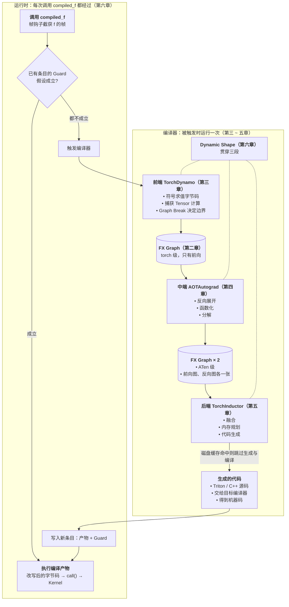

- **Guard**：捕获时记下的一组假设（输入的 shape、dtype、device，用到的 Python 对象等），和编译产物一起存成 `f` 的一个缓存条目，挂在函数的 code 对象上；每次调用先检查它。
- **编译产物**：分两层。一个函数可以有多份，各配一组 Guard。
  - 外层是改写后的 **Python 字节码**，不是机器码。它替换 `f` 原来的函数体，仍由 CPython 解释执行：调用编译好的图，捕获不了的部分保留原来的 Python。
  - 字节码调用后端生成的调度函数 `call()`，`call()` 再启动 Kernel。Kernel 才是**机器码**：融合之后的 Kernel（对 `f` 是 `add` 和 `relu` 合成的一个）由 Triton / C++ 编译器编出来；矩阵乘这类不参与融合的算子直接调厂商库。
- **TorchDynamo**：前端。已有条目的 Guard 都不成立时才运行：在 CPython 字节码层符号求值，把 Tensor 计算记成图；捕获不了的地方切一个 Graph Break，交还 Python。
- **FX Graph**：三段之间传递的中间表示，是内存里的 `torch.fx.Graph` 对象。每过一段结构不变，节点里的算子词汇从 torch 级降到 ATen 级。
- **AOTAutograd**：中端，IR 进、IR 出。AOT 是 Ahead-Of-Time（提前）的缩写：反向图不等到 `backward()` 时才动态构建，而是在编译时提前得到。它做三件事：提前得到反向图，把 in-place 操作改写成纯函数，把算子分解到更小的集合。
- **TorchInductor**：后端。决定哪些算子融合成一个 Kernel、Buffer 怎么复用，生成 Triton（GPU）或 C++（CPU）源码，再交给目标编译器；生成结果在磁盘上有缓存。
- **Dynamic Shape**：让一份产物覆盖一族 shape 的机制，三段都参与：前端把维度标成符号，中端在符号上推断，后端生成不把尺寸写死的代码。

### 1. 从 Eager 到图

[《Dispatcher 与算子系统》](/pytorch-dispatcher-and-operator-system.html)建立的模型是：每个算子独立经过 **入口 → 分发 → 执行**。对 `f` 而言，当 `x` 是 `[128, 32]` 时，Eager 模式下一次前向是：

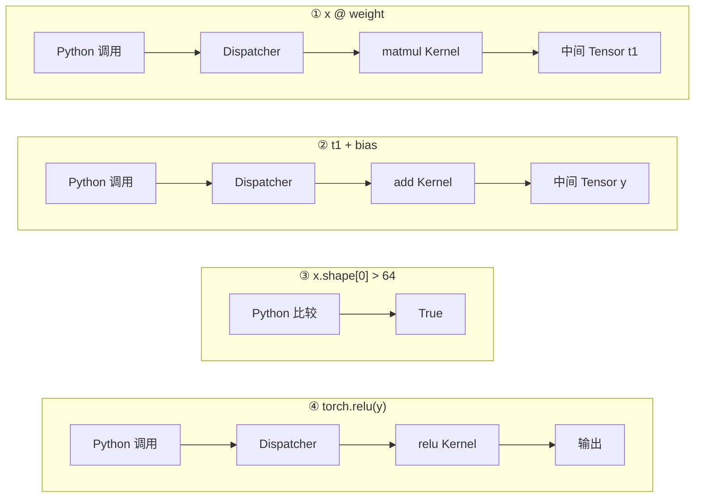

三次 Python 到 C++ 的往返、三次分发、三次 Kernel launch、两个中间 Tensor 的分配与读写。`add` 和 `relu` 都是逐元素操作，各自把 `t1`、`y` 从显存读一遍再写一遍——而它们本可以在一个 Kernel 里对每个元素连续完成。

Eager 无法做这种优化，原因是结构性的：**Dispatcher 每次只看到一个算子**。它执行 `add` 时不知道下一个是 `relu`；执行 `relu` 时 `add` 已经完成。要跨算子优化，必须有一个地方能同时看到多个算子——这就是**图**。

而那个 `if` 提醒：这段程序不全是 Tensor 计算，中间夹着 Python 逻辑。把图从这样的程序里提取出来，是编译器要解决的第一个问题。

### 2. 编译器：前端、中端、后端

有了图，剩下的问题就是经典编译器的问题。教科书式的编译器分三段：

| 阶段 | 输入 → 输出 | 做什么 |
|---|---|---|
| 前端 | 源语言 → 中间表示（IR） | 看懂程序，翻译成统一的内部表示 |
| 中端 | IR → IR | 与目标无关的变换：降低抽象层级、优化、规范化 |
| 后端 | IR → 目标代码 | 针对具体硬件生成代码 |

Table: 教科书式编译器的三段

`torch.compile` 的默认路径对得上这三段：

| 阶段 | 组件 | 输入 | 输出 | 回答的问题 |
|---|---|---|---|---|
| 前端 | TorchDynamo | Python 字节码 | FX Graph（torch 级）+ Guard | 程序里哪部分是可编译的 Tensor 计算？ |
| 中端 | AOTAutograd | torch 级 FX Graph | 前向图 + 反向图（都是 ATen 级 FX Graph） | 反向怎么提前得到？抽象层级怎么降低？副作用怎么消除？ |
| 后端 | TorchInductor | ATen 级 FX Graph | Triton / C++ 源码 | 哪些算子合并成一个 Kernel？内存怎么分配？ |
| 目标编译器 | Triton 编译器 / C++ 编译器 | 源码 | 机器码 | 真正的 GPU / CPU 指令 |

Table: torch.compile 的前端、中端、后端

目标编译器不属于 PyTorch，本文只在需要时提及。

> [!NOTE] Java 经验参照：三段式在 javac 与 JIT 里的位置
> `javac` 是前端（Java 源码 → 字节码）；HotSpot 的 C2 以字节码为输入，建自己的 IR、优化、生成机器码，相当于中端加后端。`torch.compile` 在位置上更像 JIT 而不像 `javac`：Dynamo 的输入同样是字节码（CPython 的），编译发生在进程运行期间。不同的是它的三段是三个独立组件，段与段之间传的 FX Graph 可以打印出来看，Dynamo 之后的部分还可以用 `backend` 参数整体换掉（本章 §5）。

三个阶段中，**中端最容易被忽视**，因为它不接触 Python 也不接触硬件。但它是唯一改变图的语义内容的阶段：进去一张前向图，出来前向加反向两张图；in-place 操作被改写成纯函数；`torch.*` 级的算子被降到 `aten::` 级并进一步分解。没有这一段，每个后端都得自己处理 Autograd 和副作用；有了它，后端只需面对一张纯函数式的 ATen 级图。

### 3. 中间表示：FX Graph

上表的"输入 / 输出"两列里反复出现同一个名字。三段之间传递的是**同一种数据结构**：`torch.fx.Graph`。前端产出它，中端消费并再次产出它，后端消费它。

这条流水线是：Python 字节码 → 前端 → FX Graph（torch 级）→ 中端 → FX Graph（ATen 级）× 2 → 后端 → Triton / C++。

它是三个组件唯一共享的契约。三个组件由不同团队、在不同时期开发，各自可以替换（`backend` 参数就是在替换中端之后的部分），能拼在一起全靠这一种 IR——就像[《Dispatcher 与算子系统》](/pytorch-dispatcher-and-operator-system.html)里的 Operator Table 是开发态与运行态的交汇点，开发者往里填、用户从里查，双方不需要知道彼此。

FX Graph 的设计非常克制：它只规定"程序是一串对 Tensor 的操作"，不规定操作是什么。所以每过一段，IR 的**结构不变，节点里的算子词汇下降**：前端产出的节点是 `torch.relu`、`operator.add` 这些用户 API；中端把它们降到[《Dispatcher 与算子系统》](/pytorch-dispatcher-and-operator-system.html)讨论的 `aten::relu`、`aten::add` Schema 层；后端再把 ATen 算子展开成循环。同一个容器，装了三个抽象层级的内容。

理解 FX Graph 是理解整条流水线的前提，所以第二章先讲它，之后再依次进入前端、中端、后端。

### 4. 运行时：编译是动态发生的

三段式描述的是编译器**运行一次**做什么。但 `torch.compile` 的编译不是一个发生在固定时刻的静态步骤。先区分三个事件：

```python title="包装、首次调用、命中缓存、重编译：三个事件"
x1 = torch.randn(128, 32)
x2 = torch.randn(128, 32)          # 与 x1 同 shape
x3 = torch.randn(32, 32)           # batch 从 128 变成 32

compiled_f = torch.compile(f)      # 事件 A：包装。什么都不发生，不是"编译"
y = compiled_f(x1, weight, bias)   # 事件 B：调用。第一次 → 运行编译器流水线，然后执行
y = compiled_f(x2, weight, bias)   # 事件 B：调用。假设仍成立 → 直接执行，流水线不运行
y = compiled_f(x3, weight, bias)   # 事件 B：调用。假设被打破 → 再次运行流水线，然后执行
```

**说明**：「假设」是编译时从那一次调用的输入里记下的条件，也就是总览里的 Guard。

- 第一次调用时 `x1.shape[0]` 是 128，`if x.shape[0] > 64` 在编译时就被算成 `True`，产物里只有 `relu` 这一支。所以这份产物带着一条假设：`x.shape[0] == 128`。
- `x2` 的 shape 与 `x1` 相同，假设成立，直接执行。
- `x3` 的 batch 是 32，假设不成立：按原程序它该走 `tanh`，已有产物算的却是 `relu`，不能用，只能重新编译一份。

dtype、device 变了，或者函数里读到的 Python 全局变量被改了，也会打破假设（[第六章 §2](#2-guard编译产物的有效条件)）。

`torch.compile(f)` 只是把 `f` 换成一个带控制逻辑的外壳。**编译器流水线在某次调用内部、按需运行**：第一次调用时，或之前的假设被打破时。绝大多数调用不触发编译，直接执行已有产物。

这就是本文的第二个维度。本章开头那张图的上下两个子图，就是这两个维度：

| 维度 | 回答的问题 | 时间 | 对应章节 |
|---|---|---|---|
| **编译器** | 流水线运行一次，做什么？ | 被触发时 | 三 ~ 五 |
| **运行时** | 每次调用，如何决定是否运行流水线、运行到哪、结果放哪？ | 每次调用 | 六 |

Table: 编译器与运行时两个维度

运行时这一层由四个机制构成：

- 编译到哪里停止？：→ Graph Break
- 编译产物在什么条件下有效？：→ Guard
- 输入 shape 变了是否必须重编？：→ Dynamic Shape
- 编译产物放在哪、下次怎么复用？：→ 编译缓存

它们并不都是"横跨三段"的：Graph Break 完全发生在前端，Guard 主要由前端产生，Dynamic Shape 贯穿三段，缓存两头都有。把它们放在一起讲的理由不是位置，而是**它们共同构成"调用一个编译过的函数时发生了什么"这条流程**——这与[《Dispatcher 与算子系统》](/pytorch-dispatcher-and-operator-system.html)区分开发态和运行态是同一个道理：静态结构和动态流程是两个轴。

> [!NOTE] Java 经验参照：编译器与运行时的分界
> HotSpot 里有同样的分界：C1 / C2 是编译器；何时触发编译、编译后的代码放在哪（code cache）、投机假设失效后如何去优化（deoptimization），由 VM 运行时负责。两边的编译都推迟到运行期间按需发生。触发方式不同：HotSpot 先解释执行，方法的调用与循环计数达到阈值后才交给后台编译线程，其间方法继续解释执行；`torch.compile` 没有热度探测，由用户标记函数，第一次调用就编译，这次调用要等编译完成才返回。

### 5. 两个容易混淆的名字：backend 与 FX

进入正文前必须澄清两个术语冲突。

**"backend"**。`torch.compile` 有一个 `backend` 参数：

```python title="torch.compile 的 backend 参数"
torch.compile(f)                         # 等价于 backend="inductor"
torch.compile(f, backend="eager")
torch.compile(f, backend="aot_eager")
```

这里的"backend"指的**不是**编译器术语里的后端，而是"**Dynamo 之后的一切**"——前端捕获完图，把图交给谁。三个内置选项对应把流水线截断在不同位置：

| `backend=` | Dynamo 之后做什么 | 对应编译器阶段 | 用途 |
|---|---|---|---|
| `"eager"` | 什么都不做，把捕获的图原样逐算子执行 | 只有前端 | 排查前端问题：图捕获得对不对、哪里断了 |
| `"aot_eager"` | 跑 AOTAutograd，得到前后向图后逐算子执行 | 前端 + 中端 | 排查中端问题：反向图、函数化是否正确 |
| `"inductor"`（默认） | 跑 AOTAutograd，再交给 Inductor 生成代码 | 前端 + 中端 + 后端 | 正常使用 |

Table: 三个内置 backend 对应的流水线截断位置

因此 AOTAutograd 在 PyTorch 的代码组织里被算在"backend"一侧，但在编译器结构里它是中端。本文用**前端 / 中端 / 后端**指编译器阶段，用代码格式的 `backend` 指 `torch.compile` 的参数。

**"FX"**。FX 是工具包的名字（模块 `torch.fx`），官方文档和论文都没有把它展开成全称，当专有名词读即可。它在 PyTorch 文档里指两件相关但不同的事：

| 含义 | 出现时间 | 是什么 |
|---|---|---|
| `torch.fx` 工具包 | 1.8，2021 年 | 一个独立的 Python 到 Python 的图变换工具：`symbolic_trace` 追踪、`Graph` 表示、`GraphModule` 执行 |
| FX Graph 作为 IR | 2.0 编译栈 | 编译栈内部各组件之间传递的中间表示，**数据结构**来自 `torch.fx`，但**追踪器**不是 `symbolic_trace` 而是 Dynamo |

Table: FX 的两种含义

混淆它们会导致一个常见误解："`torch.compile` 就是先 `symbolic_trace` 再优化"。但其实并不是。`symbolic_trace` 无法处理依赖 Tensor 的 Python 控制流——比如 `f` 里的那个 `if`——Dynamo 正是为了解决这个问题才在字节码层重新实现了捕获。第二章用 `symbolic_trace` 演示数据结构（因为它最简单），第三章展示它在 `f` 上如何失败、Dynamo 如何成功。

### 6. 本文的章节安排

| 章 | 主题 | 内容 |
|---|---|---|
| 二 | IR | FX Graph——所有组件共享的数据结构 |
| 三 ~ 五 | 编译器 | 前端 Dynamo 捕获 → 中端 AOTAutograd 变换 → 后端 Inductor 代码生成 |
| 六 | 运行时 | Graph Break / Guard / Dynamic Shape / 编译缓存 |
| 七 | 串起来 | `f` 的四次调用——运行时的每条分支 |
| 八 | 本文小结 | 两个维度的汇总表、容易混淆的名字、排查顺序、源码位置 |
| 九 | 自测 | 5 道题 |

Table: 本文的章节安排

## 二、IR：FX Graph

### 1. Graph、Node、GraphModule

`torch.fx` 用三个类表示一段 Tensor 程序：

| 类 | 角色 |
|---|---|
| `Graph` | 节点的有序列表，拓扑序即执行序 |
| `Node` | 一次操作：做什么（`op` + `target`）、输入是什么（`args` / `kwargs`）、附加信息（`meta`） |
| `GraphModule` | 一个 `nn.Module`，持有一个 `Graph`，并把它生成为可执行的 Python `forward` |

Table: torch.fx 的三个类

`Node.op` 只有六种：

- **placeholder**：函数输入
- **get_attr**：读取 Module 的参数或 Buffer
- **call_function**：调用一个自由函数（torch.relu、operator.add、aten.mm）
- **call_method**：调用 Tensor 方法（x.view）
- **call_module**：调用子 Module（self.linear）
- **output**：函数返回值

这个设计刻意极简：FX 只规定“程序是一串对 Tensor 的操作”，不规定操作是什么。这一点在后面很重要。

### 2. 用 `symbolic_trace` 看一眼

`torch.fx` 自带的追踪器是 `symbolic_trace`。它的原理是把输入替换成 `Proxy` 对象，运行一遍函数，`Proxy` 每被操作一次就往 `Graph` 里追加一个 `Node`。它不执行任何 Tensor 计算。

直接对 `f` 使用它会失败：

```python title="symbolic_trace 直接追踪 f：TraceError"
import torch
import torch.fx

gm = torch.fx.symbolic_trace(f)
# torch.fx.proxy.TraceError: symbolically traced variables cannot be used as inputs to control flow
```

`x.shape[0]` 在追踪时也是一个 `Proxy`，Python 执行 `if` 需要它给出一个 `bool`，而 `Proxy` 给不出——它不知道自己代表的 Tensor 是什么 shape。这个失败是第三章的起点。此处为了先看清数据结构本身，暂时只追踪 `f` 里没有分支的直线部分：

```python title="只追踪 f 的直线部分 f_body"
def f_body(x, weight, bias):
    return torch.relu(x @ weight + bias)

gm = torch.fx.symbolic_trace(f_body)
print(gm.graph)
```

```text title="gm.graph 打印出的 FX Graph"
graph():
    %x : [num_users=1] = placeholder[target=x]
    %weight : [num_users=1] = placeholder[target=weight]
    %bias : [num_users=1] = placeholder[target=bias]
    %matmul : [num_users=1] = call_function[target=operator.matmul](args = (%x, %weight), kwargs = {})
    %add : [num_users=1] = call_function[target=operator.add](args = (%matmul, %bias), kwargs = {})
    %relu : [num_users=1] = call_function[target=torch.relu](args = (%add,), kwargs = {})
    return relu
```

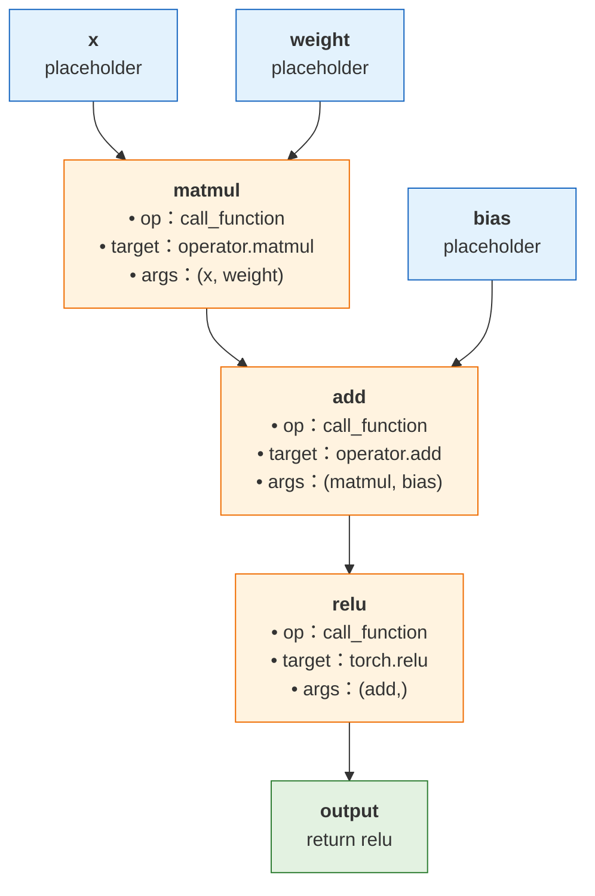

文本里的一行是图里的一个方框；`args` 里的 `%x`、`%matmul` 是图里的箭头；`num_users=1` 是这个节点的出边数。

`gm.code` 是这张图生成回来的 Python：

```python title="追踪前的 f_body 与 gm.code 生成回来的 forward"
# 追踪前：手写的原函数
def f_body(x, weight, bias):
    return torch.relu(x @ weight + bias)

# 追踪后：gm.code，从图生成回来
def forward(self, x, weight, bias):
    matmul = x @ weight;  x = weight = None
    add = matmul + bias;  matmul = bias = None
    relu = torch.relu(add);  add = None
    return relu
```

**说明**：两段代码算的是同一件事，写法有三处不同。

1. 多了 `self`。`GraphModule` 是一个 `nn.Module`，生成的是它的 `forward` 方法。
2. 一行嵌套表达式被拆成三行。图里每个节点生成一行，结果赋给与节点同名的变量（`matmul`、`add`、`relu`）。
3. 每行末尾多了 `x = weight = None` 这样的赋值。一个值最后一次被用到之后，生成的代码立刻把变量置空，让中间 Tensor 尽早释放。

和文章开头的 `f` 相比，这里没有 `if` 和 `tanh`。它们是写 `f_body` 时手工去掉的，不是追踪器去掉的；第三章会看到，Dynamo 对带分支的 `f` 捕获出的也是这三步。

三个 `placeholder`、三个 `call_function`、一个 `output`。这就是 FX Graph 的全部形态：一串节点，每个节点记录做什么、输入是谁。

### 3. Graph Rewrite：图是可以改写的

有了显式的图，就可以在执行前改写它。一个最小的 pass：把所有 `torch.relu` 替换为 `torch.nn.functional.gelu`：

```python title="最小的 pass：把 relu 替换为 gelu"
for node in gm.graph.nodes:
    if node.op == "call_function" and node.target is torch.relu:
        node.target = torch.nn.functional.gelu
gm.graph.lint()      # 检查图的结构完整性
gm.recompile()       # 重新生成 forward 的 Python 代码
```

编译栈内部大量工作就是这类 pass：算子分解、死代码消除、常量折叠、模式匹配融合。它们的共同形态是**遍历节点、匹配模式、替换子图**。

开头的函数 `f` 在编译栈里经历的改写如下，各行在后面的章节展开：

| 改写 | 发生在哪一段 | 改的是什么 | 对 `f` 做了什么 |
|---|---|---|---|
| 词汇下降与分解 | 中端 AOTAutograd | FX Graph | `operator.matmul` → `aten.mm`<br/>`operator.add` → `aten.add.Tensor`<br/>`torch.relu` → `aten.relu`（[第四章 §4](#4-词汇下降与函数化)） |
| 函数化 | 中端 AOTAutograd | FX Graph | `f` 没有 in-place 操作，无事可做 |
| 展开反向、切分 | 中端 AOTAutograd | FX Graph | 一张前向图变成前向、反向两张（[第四章 §2](#2-做法用-faketensor-跑一遍前向加反向)） |
| 图级模式匹配、常量折叠 | 后端 Inductor（`torch/_inductor/fx_passes/`） | FX Graph | `f` 里没有命中的模式。典型的命中例子是把卷积和紧跟的 BatchNorm 折成一个卷积 |
| Kernel 融合 | 后端 Inductor 的 Scheduler | Inductor IR，不是 FX Graph | `add` 和 `relu` 合成一个 Kernel（[第五章 §3](#3-融合决策)） |

Table: 函数 f 在编译栈里经历的改写

**说明**：「融合」有两种，只有第一种是改图。

1. 图级的模式融合改的是 FX Graph：把匹配到的几个节点换成一个节点，做法和上面 `relu` → `gelu` 的 pass 相同。
2. 把 `add` 和 `relu` 合成一个 Kernel 不改 FX Graph。Inductor 先把 FX 节点降成自己的循环级 IR，Scheduler 在这层 IR 上决定哪几个节点归为一组，每组生成一个 Kernel 的 Triton / C++ 源码，再由目标编译器编成机器码。顺序是：先定分组，再按分组生成源码，最后编译。

### 4. 一种结构，多套词汇

`call_function` 的 `target` 可以是任何可调用对象。这意味着同一个 `Graph` 数据结构可以承载不同抽象层级的算子：

| 词汇层级 | 节点 `target` 例子 | 谁产出 |
|---|---|---|
| torch 级 | `torch.relu`、`operator.add`、`torch.nn.functional.linear` | `symbolic_trace`、Dynamo |
| ATen 级 | `torch.ops.aten.relu.default`、`torch.ops.aten.mm.default` | AOTAutograd |
| Core ATen / prims | ATen 的一个较小子集，或更原始的 `prims.*` | 分解（decomposition）后 |

Table: 同一个 Graph 承载的三种词汇层级

编译器每过一段，图的**结构不变，词汇下降**：从用户写的 Python API，降到[《Dispatcher 与算子系统》](/pytorch-dispatcher-and-operator-system.html)讨论的 `aten::` Schema 层，再分解到更小的核心算子集。后端只需支持核心集就能覆盖所有上层 API——这是 Composite 算子思想在编译器里的延续。

### 5. FX 不是什么

- **不是执行引擎**。`GraphModule.forward` 只是普通 Python 代码，运行时每个节点仍然逐个走 Eager 的分发路径。FX 只是把程序变成了可分析、可改写的数据。
- **不是编译器**。它不做任何优化。优化是 Inductor 的工作。
- **不是唯一的追踪器**。`symbolic_trace` 是它自带的追踪器，但编译栈用 Dynamo。

现在进入编译器的前端：谁来生产这张图。

## 三、前端：TorchDynamo 捕获

### 1. 为什么 `symbolic_trace` 不够

第二章已经看到 `symbolic_trace(f)` 在 `if x.shape[0] > 64` 处报错。根本原因是 `Proxy` 只能记录对它自身的操作，不知道自己代表的 Tensor 有什么值、什么 shape；一旦 Python 需要从它身上得到一个具体答案（`bool`、`int`、索引），追踪就中断了。

无论分支条件依赖的是 Tensor 的 **shape**（`x.shape[0] > 64`）还是**值**（`x.sum() > 0`），`symbolic_trace` 都会报同一个错。而真实模型里到处都是这类代码：根据序列长度选择分支、根据配置决定是否走某一层、在循环中依赖 Tensor 形状。此外 `symbolic_trace` 是全有或全无的——遇到无法追踪的代码只能报错，不能**“把能编译的部分编译，剩下的保持 Eager”**。

Dynamo 的设计目标正好相反：**尽最大努力捕获，捕获不了的地方交还 Python**。要做到这一点，它必须工作在比 Python 函数调用更底层的位置。

### 2. 工作位置：字节码

Dynamo 通过 CPython 的帧求值钩子（PEP 523）介入：在解释器执行一个函数帧之前，先拿到它的字节码。然后它做的不是运行，而是**符号化地求值**这段字节码：

- 维护一个模拟的 Python 栈；
- 逐条解释字节码指令：
  - 遇到 Tensor 操作 → 用 FakeTensor 推断输出元数据，往 FX Graph 追加节点；
  - 遇到 Python 值操作 → 直接在模拟栈上计算（常量、列表、属性访问……）；
  - 遇到依赖 Tensor 值的分支 → 无法确定走哪条 → 停止捕获（第六章）；
  - 遇到无法分析的调用 → 停止捕获（第六章）。

把 `f` 的字节码逐条走一遍，可以看到三件事同时发生：模拟栈上放的不是真实 Tensor 而是 `VariableTracker`（下表记作 `T(·)`，内部持有 FakeTensor 和指向 FX 节点的 Proxy），Tensor 操作变成 FX 节点，Python 值操作在栈上直接折叠：

| 字节码 | 模拟栈（栈顶在右） | 产出的 FX 节点 |
|---|---|---|
| `LOAD_FAST x` | `[ T(x) ]` | `placeholder l_x_` |
| `LOAD_FAST weight` | `[ T(x), T(weight) ]` | `placeholder l_weight_` |
| `BINARY_OP @` | `[ T(matmul) ]` | `call_function matmul` |
| `LOAD_FAST bias` | `[ T(matmul), T(bias) ]` | `placeholder l_bias_` |
| `BINARY_OP +` | `[ T(y) ]` | `call_function add` |
| `STORE_FAST y` | `[ ]` | y 记入模拟的局部变量表 |
| `LOAD_FAST x` | `[ T(x) ]` | |
| `LOAD_ATTR shape` | `[ Size(128, 32) ]` | Python 值，栈上折叠 |
| `LOAD_CONST 0` | `[ Size(128, 32), 0 ]` | |
| `BINARY_SUBSCR` | `[ 128 ]` | FakeTensor 的元数据 |
| `LOAD_CONST 64` | `[ 128, 64 ]` | |
| `COMPARE_OP >` | `[ True ]` | 编译期算出，记 Guard |
| `POP_JUMP_IF_FALSE` | 跳转方向已静态决定 | 继续追踪 relu 分支 |
| `LOAD_GLOBAL torch` | `[ torch ]` | |
| `LOAD_ATTR relu` | `[ torch.relu ]` | Python 值，记 Guard |
| `LOAD_FAST y` | `[ torch.relu, T(y) ]` | |
| `CALL 1` | `[ T(relu) ]` | `call_function relu` |
| `RETURN_VALUE` | `[ ]` | `output (relu,)` |

Table: Dynamo 逐条解释 f 的字节码：模拟栈的变化与产出的 FX 节点

表里 `f` 的条件 `x.shape[0] > 64` 读的是 Tensor 的 **shape**，`COMPARE_OP` 在编译时就得到 `True`，所以能一路追踪下去。假设把条件换成 `if x.sum() > 0`（第六章的函数 `f_val`），读的是 Tensor 里的**数值**：`COMPARE_OP` 的结果是 `T(...)` 而不是 `True` / `False`，`POP_JUMP_IF_FALSE` 无法决定跳转方向，Dynamo 在这里 graph break。两种条件逐步对比：

| | `if x.shape[0] > 64` | `if x.sum() > 0` |
|---|---|---|
| 条件读的是 | shape，属于元数据 | Tensor 里的数值 |
| 编译时知不知道 | 知道：FakeTensor 带着 shape，`x.shape[0]` 是 Python 整数 `128` | 不知道：FakeTensor 不持有数据，`x.sum()` 是 `T(...)` |
| `COMPARE_OP` 的结果 | `128 > 64`，得到 Python 的 `True` | `T(...) > 0`，得到的还是 `T(...)` |
| `POP_JUMP_IF_FALSE` | 方向已定，继续追踪 `relu` 分支 | 方向未知，graph break |

Table: 两种分支条件走到 COMPARE_OP 时的区别

**说明**：

1. 两个都是 `if`，区别在条件的结果编译时有没有。`x.sum() > 0` 在 Eager 里算出来的也不是 `True` / `False`，而是一个只含一个 bool 的 Tensor；`if` 对它调用 `bool()`，从 Tensor 里读出那个数，才得到 Python 的真假。编译时 Tensor 里没有数据，这一步读不出来。
2. `x.shape[0] > 64` 走到 `else` 分支不属于这种情况。batch 是 32 时 `COMPARE_OP` 得到 Python 的 `False`，跳转方向同样已定，Dynamo 继续追踪 `tanh` 分支，得到另一张完整的图，没有 graph break（本章 §5）。
3. graph break 之后：到此为止的节点先编译成一张图，`if` 交还 Python 在运行时求值，两个分支各自在第一次走到时再编译成一张图（[第六章 §1 的例子](#1-graph-break捕获的边界)）。

FakeTensor 是[《Dispatcher 与算子系统》](/pytorch-dispatcher-and-operator-system.html)里 Meta Tensor 的扩展。两者都只有 shape、stride、dtype，不持有数据。Meta Tensor 不是一个单独的类，它是 device 为 `meta` 的普通 `Tensor`；FakeTensor 是 `Tensor` 的 Python 子类，内部包着一个 Meta Tensor，另外多了几个字段：

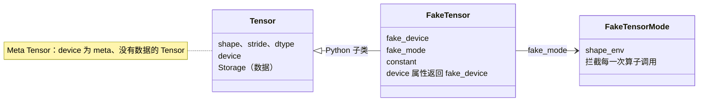

| 多出来的东西 | 字段 | 用处 |
|---|---|---|
| 假装的 device | `FakeTensor.fake_device` | Meta Tensor 的 device 一律是 `meta`，看不出原来在 CPU 还是 CUDA。FakeTensor 记下真实 Tensor 的 device，`x.device` 返回的是它，所以程序里按 device 写的分支照常走，两个输入 device 不一致时照常报错 |
| 所属的模式 | `FakeTensor.fake_mode`，指向一个 `FakeTensorMode` | 模式拦截每一次算子调用：用 Meta Kernel 算出输出的 shape、dtype，按输入的 device 定出输出的 `fake_device`，再把结果包成新的 FakeTensor |
| 符号 shape | `FakeTensorMode.shape_env` | shape 的某一维可以是符号 `s0` 而不是整数，Dynamic Shape 靠它（第六章 §3） |
| 常量的真实值 | `FakeTensor.constant` | 只有一个元素、编译时就知道值的 Tensor（如 `torch.tensor(3)`）保留真实值，编译时可以直接读出来 |

Table: FakeTensor 比 Meta Tensor 多出来的东西

Dynamo 用 FakeTensor 跑一遍程序，得到每个中间结果的元数据，但不做任何真实计算。这也是[《C++ 扩展与自定义算子》](/pytorch-cpp-extension-and-custom-operators.html)强调自定义算子必须注册 Fake 实现的原因：没有它，Dynamo 走到这个算子就无法继续推断。

> [!NOTE] Java 经验参照：Truffle 的部分求值
> 熟悉 GraalVM Truffle 的读者可以把这一步看作一种部分求值（partial evaluation）：把一部分输入当作已知量，能算的在编译期算掉，算不了的留作残余代码。Dynamo 把 Python 值当已知量在模拟栈上折叠，Tensor 操作作为残余进入 FX Graph。特化的对象不同：Truffle 特化的是语言解释器（被解释的程序当常量），Dynamo 特化的是用户函数本身。两边都要记下“当作已知量”的前提，在前提不成立时让产物失效；Dynamo 这边记下的就是 Guard。

### 3. 产出三样东西

一次成功的捕获产出：

- **① FX Graph**：torch 级的 Tensor 计算图
- **② Guard 列表**：捕获过程中依赖的所有假设（第六章）
- **③ 改写的字节码**：原帧的替代品：调用编译后的图，加上无法捕获部分的原始 Python

第三项常被忽略，但它是 Dynamo 与其他方案的根本区别：它**修改的是 Python 函数的执行方式**，而不是要求用户把模型导出成另一种格式。原函数仍然是 Python 函数，只是帧被替换了。

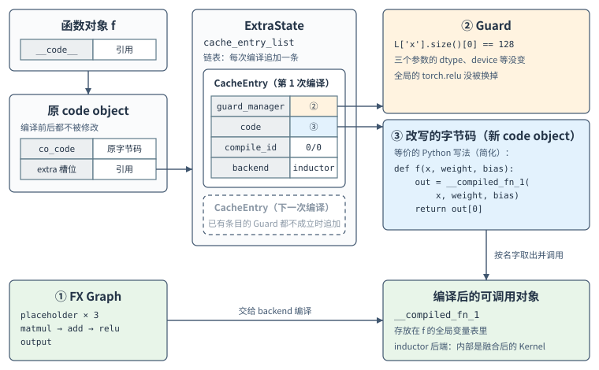

**说明**：

1. ② 和 ③ 成对存放。一次编译得到一条 `CacheEntry`，它的 `guard_manager` 是 ②，`code` 是 ③。条目挂在 `f` 的 code object 上（CPython 给每个 code object 留了 extra 槽位），不在函数对象上。
2. ① 不直接存放。FX Graph 交给 backend，编译出一个可调用对象，以 `__compiled_fn_` 开头的名字放进 `f` 的全局变量表；③ 按这个名字取出它并调用。
3. `f.__code__` 自始至终是原来的字节码。被替换的是每次调用时的**帧**，过程如下图。

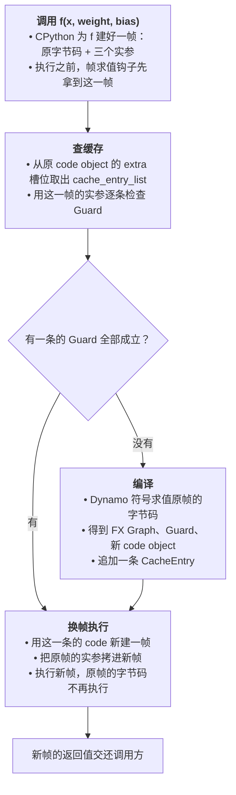

第一次调用时链表是空的，走“没有”一支。之后同 shape 的调用走“有”一支，开销只剩检查 Guard。源码位置：`torch/csrc/dynamo/eval_frame_cpp.cpp`（查缓存与回调）、`torch/csrc/dynamo/eval_frame.c` 的 `dynamo_eval_custom_code`（新建一帧执行）、`torch/csrc/dynamo/cache_entry.h` 的 `CacheEntry`。

> [!NOTE] Java 经验参照：编译单元
> HotSpot 以方法为单位编译（加上内联进来的被调方法，以及热循环的栈上替换入口）：方法的字节码变成机器码，语义单元不变。Dynamo 沿着这一次调用实际走过的路径追踪字节码，只把其中的 Tensor 操作抽成图；列表操作、字典查找、字符串格式化这些 Python 逻辑，要么在符号求值时折叠掉，要么留在改写后的字节码里继续由 CPython 执行。编译产物与残余的 Python 代码交织在同一个函数里，这种做法更接近追踪式 JIT，而不是 HotSpot 的方法级 JIT。

### 4. 看一眼 Dynamo 的图：只有被走到的分支

第一章说过，`backend` 参数决定 Dynamo 捕获完图之后交给谁。它除了接受 `"inductor"`、`"eager"`、`"aot_eager"` 这些内置名字，也接受任意一个函数：接收捕获到的 `GraphModule` 和示例输入，返回一个可调用对象。传一个只打印不优化的函数，就能直接观察 Dynamo 的图。

> [!NOTE] Java 经验参照：重载
> 这里没有用重载。Python 不按参数类型在多个同名函数里选一个，`torch.compile` 只有一个实现，`backend` 参数的类型标注是“字符串或可调用对象”：
>
> ```python
> def compile(model=None, *, fullgraph=False, dynamic=None,
>             backend: str | Callable = "inductor",
>             mode=None, options=None, disable=False): ...
> ```
>
> 函数体在运行时判断 `backend` 的类型：
>
> - 是字符串：按名字找到对应的函数。`"inductor"` 有专门的包装类，其余名字到 backend 注册表里查（`torch/_dynamo/backends/registry.py` 的 `lookup_backend`）。
> - 本来就是函数：直接使用。
>
> 所以内置名字只是注册表里已有函数的代号，`torch.compiler.list_backends()` 列出它们。Java 里要做同样的事，会写 `compile(String backend)` 和 `compile(BackendFn backend)` 两个重载，由编译器按实参的静态类型选；Python 写成一个函数加一次 `isinstance` 判断。源码里 `compile` 上面有两条 `@overload` 声明，那是给类型检查器看的，区分的是 `model` 传与不传时的返回类型，运行时不起作用。

```python title="print_backend：只打印不优化的自定义 backend"
def print_backend(gm: torch.fx.GraphModule, example_inputs):
    gm.graph.print_tabular()
    return gm.forward          # 不做优化，原样返回；效果等同于 backend="eager"

x = torch.randn(128, 32, device="cuda", requires_grad=True)
weight = torch.randn(32, 64, device="cuda", requires_grad=True)
bias = torch.randn(64, device="cuda", requires_grad=True)

torch.compile(f, backend=print_backend)(x, weight, bias)
```

`symbolic_trace` 在这个函数上失败了，Dynamo 则成功，而且图里**只有被走到的那个分支**：

```text title="Dynamo 捕获的图：只有被走到的分支"
opcode         name       target                      args                 kwargs
-------------  ---------  --------------------------  -------------------  --------
placeholder    l_x_       L_x_                        ()                   {}
placeholder    l_weight_  L_weight_                   ()                   {}
placeholder    l_bias_    L_bias_                     ()                   {}
call_function  matmul     <built-in function matmul>  (l_x_, l_weight_)    {}
call_function  y          <built-in function add>     (matmul, l_bias_)    {}
call_function  relu       <built-in method relu ...>  (y,)                 {}
output         output     output                      ((relu,),)           {}
```

`tanh` 不在图里，`if` 也不在图里。除了 `placeholder` 的命名（`L_x_` 表示"局部变量 x"，来自 Dynamo 对帧的分析），这张图与第二章 `symbolic_trace(f_body)` 的结果相同——Dynamo 把带分支的 `f` 捕获成了不带分支的 `f_body`。

发生了什么：Dynamo 符号求值到 `x.shape[0] > 64` 时，FakeTensor 告诉它 `x.shape[0]` 是 `128`，于是这个比较在**编译期**被算成 `True`，`POP_JUMP_IF_FALSE` 指令被静态决定，只有 `relu` 分支被继续追踪。

### 5. 代价：Guard

这张图**只对 `x.shape[0] == 128` 正确**。换一个 batch 为 32 的输入，正确的程序应该走 `tanh`，而这张图会算 `relu`。所以 Dynamo 在捕获的同时记录了它依赖的假设，称为 Guard：

```text title="Dynamo 记录的 Guard"
L['x'].size()[0] == 128        # 以及 dtype、device、requires_grad 等，第六章展开
```

下次调用时先检查 Guard，不满足就重新捕获——那一次如果 batch 是 32，会走到 `tanh` 分支，得到另一张图，配另一组 Guard。两张图、两组 Guard 并存，各自服务于满足自己假设的输入。（第六章会讲，动态 shape 模式下这条 Guard 会放宽为 `x.shape[0] > 64`，即分支条件本身。）

这就是两种追踪器的根本分歧：

| | `symbolic_trace` | Dynamo |
|---|---|---|
| 分支条件依赖 Tensor 元数据（`x.shape[0] > 64`） | 报错 | 用 FakeTensor 算出结果，**特化**到当前分支，记录 Guard |
| 分支条件依赖 Tensor 值（`x.sum() > 0`） | 报错 | 编译期算不出值，在此处**切断图**，条件交给 Python 运行时判断（第六章 Graph Break） |
| 产出 | 一张图，或失败 | 一张或多张图 + Guard + 改写的字节码；不支持处 graph break 回退而非失败 |

Table: symbolic_trace 与 Dynamo 的根本分歧

`symbolic_trace` 试图得到一张对所有输入都成立的图，做不到就放弃；Dynamo 只承诺得到一张对**当前输入**成立的图，并用 Guard 记下"当前输入"的范围。后者放弃了通用性，换来了"几乎不会因为代码写法而失败"——遇到不支持的结构就 graph break 回退到 Python（第六章 §1）。它仍然可能报错：`fullgraph=True` 下的 graph break、后端编译失败、`torch._dynamo.config` 的显式限制都会抛出；"永不失败"只对默认配置的常见代码近似成立。这是它能成为 `torch.compile` 默认前端的原因。

### 6. 两个时间点

```python title="两个时间点：包装与第一次调用"
compiled_f = torch.compile(f)     # 什么都没发生，只是包了一层
y = compiled_f(x, weight, bias)   # 第一次调用：捕获 → 编译 → 执行
```

`torch.compile` 是惰性的：装饰时不编译，第一次调用时才拿到真实输入、开始捕获。这意味着编译依赖于**第一次调用的输入**——上一节的 Guard `size()[0] == 128` 正是这样来的：如果第一次调用用的是 batch 32，捕获到的就会是 `tanh` 那张图。第一章 §4 说“编译是动态发生的”，指的就是这件事。

> [!NOTE] Java 经验参照：假设从哪里来
> HotSpot 的 C2 做投机优化时，依据的是解释执行和 C1 阶段积累的 profile：某个调用点见过哪些类型、分支走向的统计。Dynamo 没有收集 profile 的阶段，假设来自触发编译的那一次调用的实参（shape、dtype、device）和捕获时读到的 Python 值。样本只有一次，第一次调用的输入不典型时，产物的假设很快会被打破（第六章 §2、§3）。

### 7. 捕获到此为止

Dynamo 的图只有前向，并且是 torch 级的；`if` 已经被特化掉，后面两段看到的是一张直线图。它不知道反向长什么样，也不区分 `torch.relu` 和 `torch.nn.functional.relu`。把它变成后端可用的东西，是中端的工作。

## 四、中端：AOTAutograd 变换

前端产出的图是 torch 级、只有前向、可能含有 in-place 操作。后端想要的是 ATen 级、前向反向齐全、没有副作用的图。中端负责这之间的全部变换：**IR 进，IR 出**，不接触 Python 源码，也不接触硬件。

### 1. 问题：反向图从哪里来

[《自动求导与动态计算图》](/pytorch-autograd-and-dynamic-computation-graph.html)讲过，Eager 的反向图是**运行时动态构建**的：**前向每执行一个算子，Autograd 就挂一个 `grad_fn` 节点，`backward()` 时沿着这些节点回溯。**

这对编译器是个障碍。编译器希望前向和反向都是提前已知的整图，才能对两者都做融合和内存规划。但 Dynamo 捕获的只是前向的 Python 语义，反向还不存在。

AOTAutograd 的名字就是它的做法：**Ahead-Of-Time** 地运行一遍 Autograd。

### 2. 做法：用 FakeTensor 跑一遍前向加反向

1. 输入：Dynamo 的 torch 级前向图
2. 用 FakeTensor 执行这张图，同时让 Autograd 正常记录 grad_fn
3. 对输出调用反向，Autograd 引擎沿 grad_fn 回溯，每一步也被追踪成节点
4. 得到一张 joint graph：前向 + 反向在同一张 FX Graph 中
5. 切分（partition）为两张图：前向图、反向图

这里复用的正是[《自动求导与动态计算图》](/pytorch-autograd-and-dynamic-computation-graph.html)的 Autograd 引擎和[《Dispatcher 与算子系统》](/pytorch-dispatcher-and-operator-system.html)的 Autograd DispatchKey：追踪过程中每个算子仍然经过 Autograd 包装层、记录反向节点，只是底层执行的是 Meta Kernel 而非真实 Kernel。**AOTAutograd 没有重新实现求导规则，它借用了 Eager 的求导规则，只是把过程记录下来。**

把这一节的追踪和下一节的切分连起来，对 `f` 而言就是下图：joint graph 里前向节点和反向节点同在一张图上，切分器在两者之间找一条"割线"，割线穿过的中间值就是需要从前向传给反向的 saved tensors。

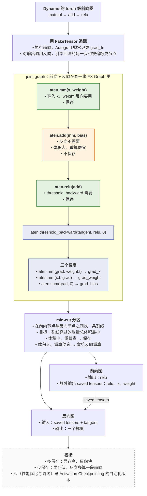

绿色节点的输出（或输入）被保存下来成为前向图的额外输出、反向图的额外输入；橙色节点的输出不保存——对 `f` 来说反向根本不需要它，而在更长的 pointwise 链里，这类值即使被需要也倾向于重算。

上图是过程。joint graph 本身是一个数据结构，`f` 的 joint graph 有哪些节点、哪些边、割线画在哪里，如下图：

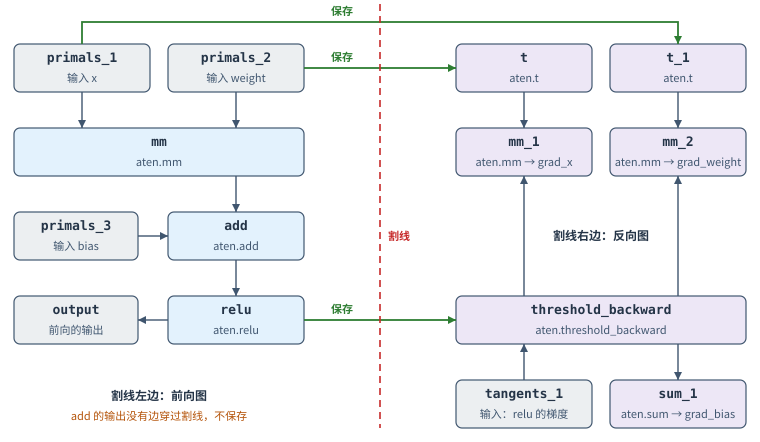

**说明**：

1. joint graph 是一张普通的 FX Graph。每个方框是一个 `Node`，方框里第一行是节点名，第二行是它调用的算子；箭头从产生值的节点指向使用这个值的节点。灰色方框是 `placeholder`，即图的输入。
2. 切分就是在这张图上画一条割线，把节点分成两组：左边的节点进前向图，右边的节点进反向图。
3. 穿过割线的边有三条：`primals_1` → `t_1`、`primals_2` → `t`、`relu` → `threshold_backward`。这三条边上的值就是 saved tensors：在前向图里它们是额外的输出，在反向图里它们是额外的输入。
4. `add` 的输出只被 `relu` 使用，没有边穿到右边，所以不保存。
5. 右边三个带 `grad_` 的节点是反向图的输出，依次是 `x`、`weight`、`bias` 的梯度。

### 3. 切分：什么该保存，什么该重算

前向和反向之间需要传递中间值——`relu` 的反向需要知道前向输出哪些位置为正。Eager 里这些值由 `grad_fn` 的 saved tensors 持有（见[《自动求导与动态计算图》](/pytorch-autograd-and-dynamic-computation-graph.html)）。编译后，它们成为前向图的额外输出、反向图的额外输入。

保存哪些中间值不是唯一解。保存得多，反向快但显存占用高；保存得少，反向需要重算部分前向。默认的切分器（min-cut partitioner）在两者之间求一个近似最优：**优先保存体积小的、重算代价高的值；体积大而重算便宜的值（典型如逐元素操作的结果）倾向于重算**。这是[《性能优化与调试》](/pytorch-performance-optimization-and-debugging.html)里 Activation Checkpointing 的自动化版本。

### 4. 词汇下降与函数化

AOTAutograd 同时完成两件事，让图对后端更友好：

**词汇下降**：torch 级节点在追踪时经过 Dispatcher，被记录为 ATen 级算子。`operator.matmul` 变成 `aten.mm.default`（因为输入是二维），`operator.add` 变成 `aten.add.Tensor`。同时应用一组**分解**（decomposition），把复合算子拆成更基础的算子，减少后端需要支持的算子数量。

**函数化**（functionalization）：把 in-place 操作和 view 上的写入改写成纯函数形式。`x.add_(y)` 变成 `x_new = aten.add(x, y)` 并追踪后续对 `x` 的引用。目的是让图没有副作用，编译器才能安全地重排、融合、复用内存。

函数化依赖 Schema 里的 alias 与 mutability 标注（[《Dispatcher 与算子系统》](/pytorch-dispatcher-and-operator-system.html)里的 `Tensor(a!)`）。这解释了[《C++ 扩展与自定义算子》](/pytorch-cpp-extension-and-custom-operators.html)为什么把“修改了输入却不声明”列为最危险的错误：函数化会认为算子是纯的，编译器据此重排，结果静默出错。

### 5. 看一眼前向图与反向图

编译栈的每一段都可以通过环境变量 `TORCH_LOGS` 打开日志，值是逗号分隔的日志类别名。本文后面会多次用到它，各段对应的类别在小结里汇总。查看 AOTAutograd 产出的两张图：

```bash title="TORCH_LOGS=aot_graphs 查看 AOTAutograd 的图"
TORCH_LOGS="aot_graphs" python demo.py
```

前向图（简化）：

```python title="AOTAutograd 的前向图（简化）"
def forward(self, primals_1, primals_2, primals_3):
    mm = torch.ops.aten.mm.default(primals_1, primals_2)
    add = torch.ops.aten.add.Tensor(mm, primals_3)
    relu = torch.ops.aten.relu.default(add)
    return (relu, primals_1, primals_2, relu)   # 输出 + 为反向保存的值
```

`return` 的 4 个值里，第 0 个是 `f` 的输出，后 3 个是为反向保存的值。这 3 个值不留在图里，也不放进全局变量：运行时包装把返回的元组切开，第 0 个交给调用方，后 3 个用 `ctx.save_for_backward(...)` 存进这一次调用产生的 `grad_fn` 节点。`backward()` 走到这个节点时，再把它们取出来，作为反向图的前三个参数（[§6 的图](#6-输出如何接回-eager)）。

反向图（简化）：

```python title="AOTAutograd 的反向图（简化）"
# !ref bw-sig
def forward(self, primals_1, primals_2, relu, tangents_1):
    # !ref bw-thb +1
    threshold_backward = torch.ops.aten.threshold_backward.default(
        tangents_1, relu, 0)
    # !ref bw-gx +1
    t = torch.ops.aten.t.default(primals_2)
    mm_1 = torch.ops.aten.mm.default(threshold_backward, t)
    # !ref bw-gw +1
    t_1 = torch.ops.aten.t.default(primals_1)
    mm_2 = torch.ops.aten.mm.default(t_1, threshold_backward)
    # !ref bw-gb
    sum_1 = torch.ops.aten.sum.dim_IntList(threshold_backward, [0])
    # !ref bw-ret
    return (mm_1, mm_2, sum_1)
```

**说明**：

1. [函数名也叫 `forward`](#bw-sig)。两张图都是 `GraphModule`，而 `GraphModule` 是 `nn.Module`；FX 为每个 `GraphModule` 生成的方法一律叫 `forward`，意思是“调用这个模块时执行的代码”，不是“前向传播”。区分两张图要看日志里的标题（`Forward graph` / `Backward graph`）。四个参数里，前三个是前向保存下来的值，`tangents_1` 是上游传来的、对输出 `relu` 的梯度，shape 是 `(128, 64)`。
2. [`threshold_backward`](#bw-thb) 是 `relu` 的反向：`relu` 大于 0 的位置，梯度原样通过；其余位置置 0。结果的 shape 仍是 `(128, 64)`。
3. [`t` 和 `mm_1`](#bw-gx) 算 `x` 的梯度：上一步的结果乘以 `weight` 的转置，`(128, 64) @ (64, 32)` 得到 `(128, 32)`。
4. [`t_1` 和 `mm_2`](#bw-gw) 算 `weight` 的梯度：`x` 的转置乘以第 2 步的结果，`(32, 128) @ (128, 64)` 得到 `(32, 64)`。
5. [`sum_1`](#bw-gb) 算 `bias` 的梯度：前向里 `bias` 被广播到 128 行，反向就沿第 0 维把 128 行加起来，得到 `(64,)`。
6. [`return`](#bw-ret) 按 `x`、`weight`、`bias` 的顺序返回三个梯度。

这六步就是[《自动求导与动态计算图》](/pytorch-autograd-and-dynamic-computation-graph.html)手推的链式法则。两张图的节点都已是 `torch.ops.aten.*`，与[《Dispatcher 与算子系统》](/pytorch-dispatcher-and-operator-system.html)的 Schema 一一对应。

### 6. 输出如何接回 Eager

到这里，前向图和反向图都还只是 FX Graph，是 IR，不能直接执行。两张图的来历相同：都是从同一次 FakeTensor 追踪得到的 joint graph 上切下来的。追踪只产出图，**编译指的是下一步：把图交给后端（默认是 Inductor）生成可以执行的代码**。这一步两张图各做一次，时间不同：

| | 什么时候交给后端编译 |
|---|---|
| 前向图 | 追踪和切分完成后立即编译 |
| 反向图 | 默认推迟到第一次 `backward()` 走到这里时才编译；保存的值里带符号 shape（Dynamic Shape）时，和前向图一起编译 |

Table: 前向图与反向图各在什么时候编译

依据是 `torch/_functorch/_aot_autograd/graph_compile.py` 的 `_aot_stage2b_bw_compile`。

AOTAutograd 把编译产物包进一个 `torch.autograd.Function`（[《自动求导与动态计算图》](/pytorch-autograd-and-dynamic-computation-graph.html)讨论过的自定义 Function）：前向调用编译后的前向图，并把保存的值存进节点；反向取出保存的值，调用编译后的反向图。

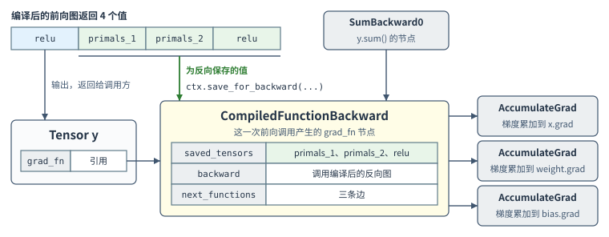

**说明**：

1. 编译后的前向图返回 4 个值。第 0 个成为 `y`，交给调用方；后 3 个由 `ctx.save_for_backward(...)` 存进节点的 `saved_tensors`。
2. `y.grad_fn` 指向的 `CompiledFunctionBackward` 是每次前向调用新建的一个节点，这一次调用保存的值只属于它。
3. `backward()` 沿 `SumBackward0` 走到这个节点，节点取出 `saved_tensors`，连同上游传来的梯度一起传给编译后的反向图，得到三个梯度。
4. 三个梯度沿 `next_functions` 的三条边交给 `x`、`weight`、`bias` 各自的 `AccumulateGrad`，累加到 `.grad`。

于是从 Eager Autograd 引擎的角度看，**整个编译区域是一个 `grad_fn` 节点**。用户调用 `loss.backward()` 时，引擎回溯到这个节点，调用它的反向——里面是编译好的 Kernel。编译区域外的算子仍由 Eager Autograd 正常处理。这就是编译与 Eager 能混合工作的机制。

## 五、后端：TorchInductor 代码生成

### 1. 输入与输出

Inductor 是编译器意义上的后端：IR 进，目标代码出。它也是 `torch.compile` 默认 `backend="inductor"` 的最后一段。它接收 ATen 级的 FX Graph（前向图和反向图各处理一次），每张图输出**一个 Python 源文件**，内含：

- 若干 Kernel 的源码，目标语言按 Tensor 所在的 device 选（见下表）；
- 一个 `call(args)` 函数：按顺序分配内存、调用 Kernel、释放内存、返回结果。

Kernel 的源码不另存文件，而是作为字符串写在这个 Python 文件里。Triton Kernel 是传给 `async_compile.triton(...)` 的字符串，C++ 函数是传给 `async_compile.cpp_pybinding(...)` 的字符串。文件被加载时，这两个函数再调用 Triton 编译器或系统的 C++ 编译器，把字符串编成可以执行的 Kernel。所以 CPU 上生成的也是一个 Python 文件，C++ 代码在它里面。

| device | 默认生成的 Kernel | 能不能换 |
|---|---|---|
| CUDA | Triton | 配置项 `torch._inductor.config.cuda_backend`，默认 `triton`，另有实验性的 `halide`、`pallas` |
| CPU | C++，用 OpenMP 做多线程、SIMD 做向量化 | 配置项 `cpu_backend`，默认 `cpp`，另有实验性的 `triton`、`halide`、`pallas` |
| Intel GPU（`xpu`） | Triton | 只有 `triton` |
| Apple GPU（`mps`） | Metal | |

Table: Inductor 在各种 device 上默认生成的 Kernel

所以 “GPU 用 Triton、CPU 用 C++” 是默认配置，不是固定搭配。依据是 `torch/_inductor/codegen/common.py` 的 `init_backend_registration` 和 `torch/_inductor/config.py`。

这个文件可以直接读。这是 Inductor 与许多编译器不同的地方：**它的产物是人可读的源码，而不是二进制**。从源码到二进制的那一步，交给下游的 Triton 编译器或 C++ 编译器（§5）。

### 2. 内部步骤

| 步骤 | 做什么 | 得到什么 |
|---|---|---|
| 1. 分解与 lowering | 把 ATen 节点进一步分解，再逐个换成 Inductor IR 的节点 | Inductor IR |
| 2. 调度（Scheduling） | 决定哪些 IR 节点合并成一个 Kernel | 融合后的节点序列 |
| 3. 内存规划 | 决定每个 buffer 何时分配、何时释放、能否复用 | 每个 buffer 的生命周期 |
| 4. 代码生成 | 为每个节点生成 Kernel 源码，再生成 `call()` | Triton / C++ 源码加 `call()` |

Table: Inductor 的四个内部步骤

Inductor IR 是 Inductor 自己的中间表示，定义在 `torch/_inductor/ir.py`，和 FX Graph 是两套数据结构。FX Graph 的节点记的是“调用哪个算子”。Inductor IR 的节点记的是“输出的每个元素怎么算”，是**循环级的**：一个逐元素算子不是“对 Tensor 做 add”，而是“对索引 `i`，输出 `a[i] + b[i]`”。`f` 用到其中三种节点：

| IR 节点 | 记的是什么 | `f` 里的例子 |
|---|---|---|
| `Pointwise` | 一个函数：给定输出的索引，算出该位置的值 | `add`、`relu` |
| `Reduction` | 同上，外加一个归约方式（求和、取最大值等） | 反向图里的 `sum` |
| `ExternKernel` | 不展开成循环，记下要调用的外部函数 | `mm` |

Table: f 用到的三种 Inductor IR 节点

这种表示让融合成为函数的复合：`relu(add(a, b))` 在索引 `i` 上就是 `max(a[i] + b[i], 0)`，是一个循环体。

四个步骤在 `f` 的前向图上的结果如下图：三个 ATen 节点进去，一个 cuBLAS 调用加一个 Triton Kernel 出来。

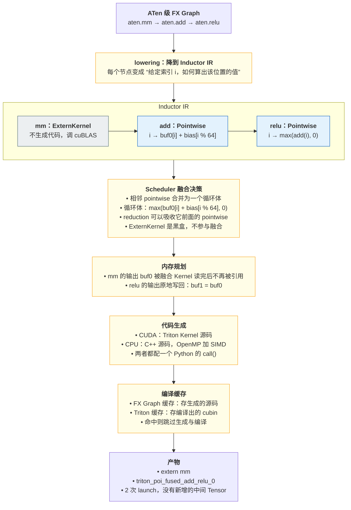

上图是步骤。第 2、3 步改动的是数据：IR 节点的个数和它们占用的 buffer。融合前后各有哪些节点、哪些 buffer，融合 Kernel 怎样读写这块内存，如下图：

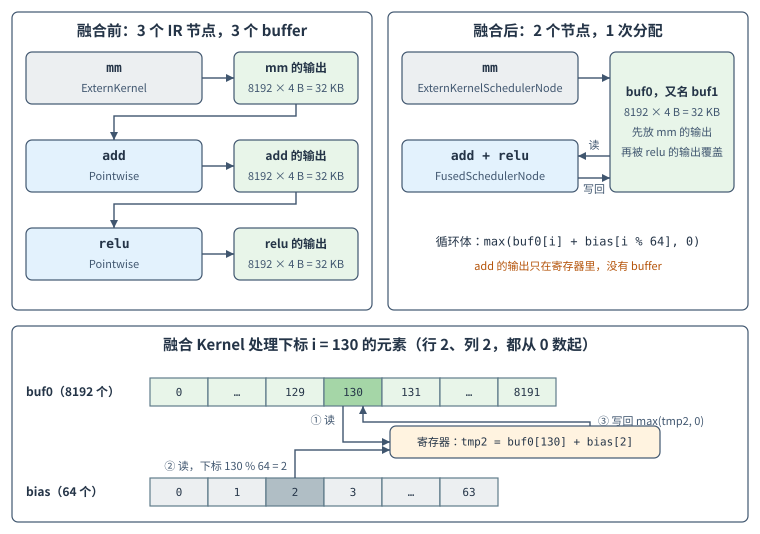

**说明**：

1. 融合前，三个 IR 节点各有一个输出 buffer。每个 buffer 是 `(128, 64)` 的 float32，共 8192 个元素、32 KB；后一个节点读前一个节点的 buffer。
2. 融合：`add` 和 `relu` 都是“给定下标，算出一个元素”的函数，把 `add` 的函数代入 `relu` 的函数，得到一个循环体 `max(buf0[i] + bias[i % 64], 0)`。两个节点合成一个 `FusedSchedulerNode`，`add` 的输出不再是 buffer，只是循环体里的一个临时值。
3. 内存规划：`mm` 的输出只被融合节点读，而且每个下标都是先读后写同一个位置，所以融合节点的输出直接写回 `mm` 的那块内存。三个 buffer 变成一次分配。生成代码里这块内存先叫 `buf0`、后叫 `buf1`，Kernel 的参数名是 `in_out_ptr0`（§4）。
4. 下半是一个元素的读写过程。`buf0` 在内存里是按行存放的一维数组，第 `r` 行第 `c` 列的下标是 `r × 64 + c`。`bias` 只有 64 个元素，前向里被广播到每一行，所以下标 `i` 的元素要加的是 `bias[i % 64]`。

依据是 `torch/_inductor/scheduler.py` 的 `Scheduler.fuse_nodes`（融合）、`BaseSchedulerNode.decide_inplace_update`（原地写回），以及 `torch/_inductor/codegen/wrapper.py` 的 `memory_plan_reuse`（buffer 复用）。

### 3. 融合决策

不是所有节点都能融合。基本规则：

| 节点类型 | 例子 | 融合行为 |
|---|---|---|
| Pointwise | add、relu、mul、cast | 与相邻的 pointwise / reduction 融合 |
| Reduction | sum、max、softmax 的归约部分 | 可吸收前面的 pointwise，作为归约的输入 |
| Extern Kernel（外部 Kernel） | mm、conv、attention | 不生成代码，直接调用厂商库（[《Dispatcher 与算子系统》](/pytorch-dispatcher-and-operator-system.html)的 cuBLAS / cuDNN 路径），**不参与融合** |
| 数据搬运 | copy、cat 的某些情形 | 视情况 |

Table: Inductor 的融合规则

对 `f`：`mm` 是 Extern Kernel，留给 cuBLAS；`add` 和 `relu` 是相邻的 pointwise，融合成一个 Kernel。Eager 的三个 Kernel 变成两个：

| | Kernel 序列 | launch 次数 | 中间 Tensor |
|---|---|---|---|
| Eager | matmul → add → relu | 3 | 2 个 |
| Inductor | cuBLAS mm → fused add+relu | 2 | 原地复用 |

Table: Eager 与 Inductor 对同一段代码的 Kernel 序列

### 4. 生成的代码长什么样

```bash title="TORCH_LOGS=output_code 查看生成代码"
TORCH_LOGS="output_code" python demo.py
```

Inductor 为每张图生成一个 Python 文件，Kernel 源码和 `call()` 都在这个文件里。前向图的文件里，融合 Kernel 那一段字符串的内容如下（简化，Triton）：

```python title="Inductor 生成的融合 Kernel（Triton，简化）"
@triton.jit
def triton_poi_fused_add_relu_0(in_out_ptr0, in_ptr0, xnumel, XBLOCK: tl.constexpr):
    xoffset = tl.program_id(0) * XBLOCK
    xindex = xoffset + tl.arange(0, XBLOCK)[:]
    xmask = xindex < xnumel
    x2 = xindex
    x0 = xindex % 64                                  # bias 的广播索引
    tmp0 = tl.load(in_out_ptr0 + (x2), xmask)         # mm 的结果
    tmp1 = tl.load(in_ptr0 + (x0), xmask)             # bias
    tmp2 = tmp0 + tmp1                                # add
    tmp3 = tl.full([1], 0, tl.int32)
    tmp4 = triton_helpers.maximum(tmp3, tmp2)         # relu
    tl.store(in_out_ptr0 + (x2), tmp4, xmask)         # 原地写回
```

同一个文件里的调度代码：

```python title="Inductor 生成的调度代码 call()"
def call(args):
    primals_1, primals_2, primals_3 = args
    args.clear()
    buf0 = empty_strided_cuda((128, 64), (64, 1), torch.float32)
    extern_kernels.mm(primals_1, primals_2, out=buf0)             # cuBLAS
    buf1 = buf0; del buf0                                         # 复用
    triton_poi_fused_add_relu_0[grid(8192)](buf1, primals_3, 8192, XBLOCK=256)
    del primals_3
    return (buf1, primals_1, primals_2, buf1)
```

这个文件不是[图「Dynamo 的三样产物存放在哪里」](#3-产出三样东西)里的 ③，也不存放在 `CacheEntry` 里。③ 是 Dynamo 改写的 `f` 的字节码，它和 `call()` 之间还隔着两层：

| 层 | 由谁生成 | 是什么 | 存放在哪里 |
|---|---|---|---|
| 1 | Dynamo | ③ 新的 code object，里面只有一次对 `__compiled_fn_…` 的调用 | `CacheEntry.code` |
| 2 | Dynamo | `__compiled_fn_…`：backend 返回的可调用对象 | `f` 的全局变量表 |
| 3 | AOTAutograd | 运行时包装，核心是一个 `torch.autograd.Function`：前向调用前向图的 `call()`，反向调用反向图的 `call()` | 被第 2 层调用 |
| 4 | Inductor | 一个 Python 模块：Kernel 源码加 `call()`。前向图、反向图各一个 | Inductor 缓存目录下的 `.py` 文件，加载成模块 |

Table: 从改写的字节码到 call() 的四层对象

一次调用自上而下经过这四层，只有第 4 层的 Kernel 是机器码。

Kernel 名字编码了它的来源：`poi` 是 pointwise（`red` 是 reduction，`per` 是 persistent reduction），`fused_add_relu` 是被融合的算子，`0` 是序号。

这里有几个值得对照前几篇的细节：

- **广播变成了索引算术**。[《Tensor 与内存布局》](/pytorch-tensor-and-memory-layout.html)讲 `bias` 广播到 `(128, 64)` 在 Eager 里靠 stride 为 0 的 view，[《Dispatcher 与算子系统》](/pytorch-dispatcher-and-operator-system.html)讲 TensorIterator 负责按 stride 遍历。这里两者都不存在了：`x0 = xindex % 64` 直接在生成代码里算出 `bias` 的读取位置。编译器把运行时的元数据解释**固化成了编译期的代码**。
- **Triton 部分没有 Dispatcher**。`call()` 里的 Triton Kernel 是直接 launch，不经过 Operator Table。`extern_kernels.mm` 则不然：它就是 `torch.mm`（`torch/_inductor/kernel/mm.py`：`aten_mm = ExternKernelChoice(torch.mm, "at::mm_out", op_overload=aten.mm.out)`），照常走一次 Dispatcher 到 cuBLAS——只是这一次没有 Autograd 包装（反向已由 AOTAutograd 单独编译），也没有 Python 层的参数解析。所以编译省掉的是**逐元素算子**的分发与 Python 开销，不是把 Dispatcher 整个绕开。
- **内存复用是静态决定的**。`buf1 = buf0` 不是运行时分配器的决定，而是编译器看到 `mm` 的输出在 `add` 之后不再被引用，直接原地写。
- **shape 被烧进了代码**。`128`、`64`、`8192` 都是常量。这是 Guard 存在的原因之一：输入 shape 一变，这份代码就不再正确。

把 `call()` 里的 buffer 生命周期画出来，可以看清"内存复用是静态决定的"这句话：三个逻辑中间值（`mm`、`add`、`relu` 的输出）最终只对应一次显存分配。

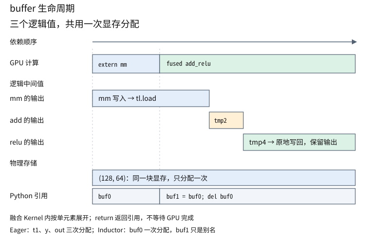

1. `extern mm` 把结果写进 `(128, 64)` 的 `buf0`。
2. `buf1 = buf0; del buf0` 只换了 Python 引用，没有释放显存。后续 Kernel 通过 `in_out_ptr0` 访问同一块存储。
3. 融合 Kernel 对每个元素先用 `tl.load` 读取 mm 的输出，再算 `add` 得到寄存器里的 `tmp2`，接着算 `relu`，用 `tl.store` 原地写回。该元素的 mm 输出在读取后不再需要。
4. `return` 返回 `buf1` 引用，不等待 GPU 计算完成。Eager 的 `t1`、`y`、`out` 需要三次分配；这里 `buf0` 只分配一次，`buf1` 只是别名。

图里的横轴只表示依赖顺序，不表示耗时；融合 Kernel 内按单个元素展开，不表示线程块之间有同步。`add` 的输出没有对应的显存，只在寄存器中短暂存在。这正是融合收益的来源（§6）。

### 5. Triton 是什么，为什么选它

Triton 是一种用 Python 语法编写 GPU Kernel 的语言和编译器。与 CUDA C++ 的差别在抽象层级：**CUDA 以线程为单位编程，开发者管理线程索引、共享内存、同步；Triton 以块（block）为单位，开发者描述一个块处理哪些元素，编译器负责线程映射、内存合并访问、指令调度。**

以一个长度 1024 的向量、`BLOCK = 256` 为例，两种模型的分工差别如下：

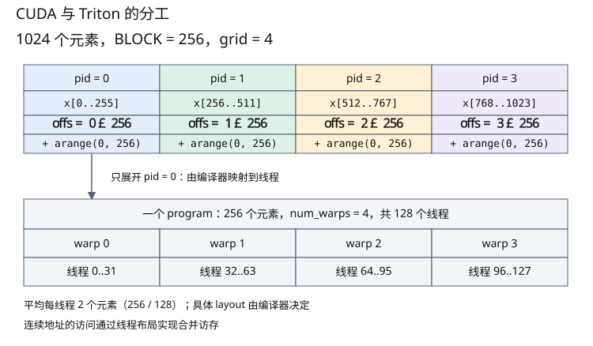

`x[0..1023]` 按 `BLOCK = 256` 划分，`grid = 4`，`pid = tl.program_id(0)`。图中只展开 `pid = 0`：`num_warps = 4`，共 `4 × 32 = 128` 个线程，平均每线程处理 `256 / 128 = 2` 个元素。具体元素落到哪个线程由编译器的 layout 决定；对这里的连续访问，编译器安排合并访存。

CUDA 手写时，要自己算线程索引、安排合并访存：

```cuda title="CUDA：手写线程索引"
i = blockIdx.x * blockDim.x + threadIdx.x;
if (i < n) y[i] = f(x[i]);
```

Triton 里只描述一个块处理哪些元素，线程映射交给编译器：

```python title="Triton：描述块内的元素与掩码"
offs = pid * BLOCK + tl.arange(0, BLOCK);  mask = offs < n
tl.store(y + offs, f(tl.load(x + offs, mask)), mask)
```

§4 那段生成代码里的 `xoffset = tl.program_id(0) * XBLOCK`、`xindex = xoffset + tl.arange(0, XBLOCK)` 正是上图的第一层；线程这一层在源码里完全不出现。

Inductor 选择 Triton 生成 GPU 代码的原因：

- 生成块级代码比生成正确高效的线程级 CUDA 简单得多；
- Triton 源码是 Python，可读、可调试、可手动修改后对照；
- Triton 自带自动调优（autotune），Inductor 的 `mode="max-autotune"` 会为矩阵乘等生成多个候选配置并测速；
- 不需要 [nvcc](# "tip: NVIDIA 的 CUDA C++ 编译器，随 CUDA Toolkit 安装。手写的 CUDA Kernel 要用它编译成 GPU 代码")，编译链路可控。

所以 GPU 路径上是两个编译器串联：Inductor 不生成机器码，它生成 Triton 源码；Triton 编译器（内部基于 MLIR 和 LLVM 这两个通用编译器基础设施）再把源码编成 NVIDIA GPU 的汇编 PTX。定位问题时按这条分界找：生成的源码不对，是 Inductor 的问题；源码对但 Kernel 慢，可能是 Triton 编译或调优的问题。

> [!NOTE] Java 经验参照：两个编译器串联不是分层编译
> HotSpot 的 C1、C2 都直接生成机器码。分层编译指同一个方法先由 C1 编译、够热之后再由 C2 重新编译，两份代码是先后替换的关系。Inductor 与 Triton 是上下游关系：前一个编译器的输出是后一个的输入，每次冷编译两个都要经过。更接近的参照是把 C 当作目标语言、再交给 C 编译器的那类编译器。

Triton 不是 Inductor 的唯一目标。CPU 路径生成 C++，用 OpenMP 做多线程并行、用 SIMD 内建函数做向量化。[《C++ 扩展与自定义算子》](/pytorch-cpp-extension-and-custom-operators.html)讨论的手写 CUDA Kernel 和 Triton Kernel 是两种不同的“自定义算子实现方式”，前者控制力更强，后者开发效率更高。

### 6. 融合的收益从哪里来

逐元素算子是**访存受限**的：计算一个 `a + b` 只需一次加法，但要读两个数、写一个数。GPU 的算力远高于显存带宽，这类 Kernel 的时间几乎完全由数据搬运量决定。

对 `N` 个元素的 `add` + `relu`：

| | 访存 | launch |
|---|---|---|
| Eager | add：读 N + bias、写 N；relu：读 N、写 N —— 合计约 4N 次（bias 只有 64 个数，可忽略） | 2 |
| Fused | 读 N + bias、写 N —— 合计约 2N 次 | 1 |

Table: 融合前后的访存与 launch 次数

（`bias` 是长度 64 的向量、被广播，两边都只读 64 个数；若两个输入都是完整的 `N` 元 Tensor，则是 Eager 5N 对 Fused 3N。）融合减少的是**中间结果在显存中的往返**，以及每次 launch 的固定开销。融合越长的 pointwise 链，收益越大。这是[《性能优化与调试》](/pytorch-performance-optimization-and-debugging.html)里“Memory Bandwidth 与 Arithmetic Intensity”的一个具体实例。

> [!NOTE] Java 经验参照：融合、内联与标量替换
> 融合在作用上像 JIT 的内联：去掉算子（方法）之间的边界，让编译器把相邻的操作放在一起优化。`add` 的结果只在寄存器里存在、不再占一块显存，则像逃逸分析之后的标量替换省掉一次对象分配。收益的来源不同：内联省的是调用开销，并为后续优化打开空间；pointwise 融合省的主要是中间结果在显存里的一次写和一次读，对访存受限的 Kernel，这是耗时的主要部分。

### 7. Inductor 不做什么

- 默认不把 `add`/`relu` 融合进 cuBLAS 的 `mm`——库调用是黑盒。`max-autotune` 模式下 Inductor 可以用 Triton 模板生成自己的矩阵乘并把后续 pointwise 作为收尾计算（epilogue）融合进矩阵乘的输出阶段，但这是可选路径。
- 不改变数值语义（浮点结合顺序的差异除外）。融合后的结果与 Eager 应当在浮点误差范围内一致。
- 不消除 Kernel launch 本身。`mode="reduce-overhead"` 会额外使用 CUDA Graphs——CUDA 提供的一种机制，把一串 Kernel launch 录制成一个图，之后整体重放，省掉每次 launch 的 CPU 侧开销。这与本文讨论的图编译是两回事：前者优化的是 launch 方式，后者优化的是 Kernel 本身。[《性能优化与调试》](/pytorch-performance-optimization-and-debugging.html)讨论。

到这里，前端、中端、后端已经走完：一段 Python 变成了两个 Kernel。接下来的问题是：这份编译结果什么时候能用，什么时候不能用。

## 六、运行时：编译何时发生、到哪停止、何时复用

前三章描述的是编译器流水线**运行一次**做什么。这一章切换到第一章 §4 的第二个维度：**每次调用** `compiled_f(...)` 时，运行时控制层如何决定要不要运行流水线、运行到哪、结果放哪。

需要这一层的原因是一个根本矛盾：编译产物是**静态**的——针对特定假设生成的代码；Python 程序是**动态**的——下次调用可能换了 shape、换了 dtype、走了另一个分支、改了一个全局变量。四个机制各自处理这个矛盾的一个侧面：

| 机制 | 回答的问题 | 在编译器的哪一段产生 | 在什么时候起作用 |
|---|---|---|---|
| Graph Break | 捕获到哪里停止？ | 前端 | 流水线运行时（捕获阶段） |
| Guard | 编译产物在什么条件下可复用？ | 前端为主；Dynamic Shape 的约束也来自中端 | **每次调用**，在流水线之外 |
| Dynamic Shape | shape 变了是否必须重编？ | 前端决定符号维度、中端在符号上推断、后端生成符号尺寸代码 | 流水线运行时决定，每次调用检查 |
| 编译缓存 | 编译产物存在哪、跨进程能否复用？ | 前端（Dynamo 条目）与后端（Inductor / Triton 缓存） | Dynamo 条目在调用入口查；磁盘缓存在流水线内部查，生成后写 |

Table: 运行时的四个机制

第三列说明它们不是“横跨三段”的同一类东西；第四列说明为什么要放在一起：它们共同构成了从“调用”到“执行”之间的那条控制流程。

### 1. Graph Break：捕获的边界

*产生于前端，作用于流水线的捕获阶段。*

Dynamo 遇到无法符号化求值的代码时，不报错，而是**在此处切断图**：

执行顺序变成：图 1（编译）→ 无法捕获的 Python（Eager 执行）→ 图 2（编译）→ …。

改写后的字节码依次调用图 1、原始 Python 片段、图 2。用户看不到任何差别，程序正常运行，只是编译收益被切碎了：每张子图单独优化，跨越断点的算子无法融合，每个断点处还有一次 Python 与编译代码之间的切换。

**例子**：把 `f` 的分支条件从 shape 换成 Tensor 的值。

```python title="f_val：分支条件依赖 Tensor 的值"
def f_val(x, weight, bias):
    y = x @ weight + bias
    if x.sum() > 0:
        return torch.relu(y)
    return torch.tanh(y)
```

Dynamo 把它切成三张图，一次调用执行其中两张：

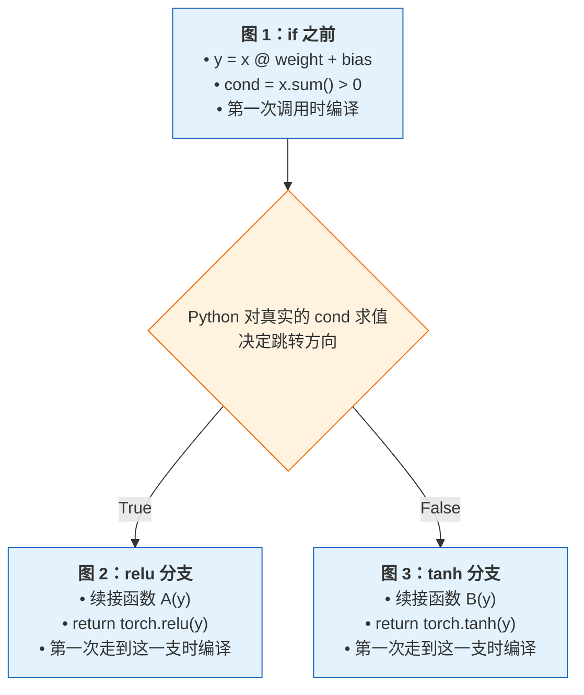

1. 图 1 是 `if` 之前的全部 Tensor 计算，条件 `x.sum() > 0` 也在里面：它的结果是一个 Tensor，可以放进图。图 1 输出 `y` 和这个条件。
2. 改写后的字节码拿到条件的真实值，由 Python 执行跳转。
3. 两个分支各被包成一个续接函数（resume function，名字以 `torch_dynamo_resume_in_f_val` 开头），`y` 作为参数传进去。续接函数是普通的 Python 函数，第一次被调用时才被 Dynamo 捕获、编译。一直走 `relu` 这一支，就只有图 1 和图 2；哪次走到 `tanh`，才编译图 3。
4. 所以不是「`if` 前后两张图」，也不是「两个分支各一张完整的图」，而是 `if` 之前一张、每个分支一张。`add` 在图 1，`relu` 在图 2，两者不能融合。

对应的源码是 `torch/_dynamo/symbolic_convert.py` 的 `generic_jump`：先把已捕获的节点编译成子图，再为「跳」和「不跳」两个目标各生成一个续接函数的调用。原来的 `f` 不会这样断开：它的条件只依赖 shape，编译时就能算出来，整个函数是一张图，另一个分支靠 Guard 失效后重新编译得到。

> [!NOTE] Java 经验参照：Graph Break 没有精确对应物
> HotSpot 里，一个方法编译不了（过大，或编译器放弃）时，整个方法留给解释器；编译后的方法走到没有覆盖的路径时，经 uncommon trap 去优化，从那一点起回到解释器。Graph break 两者都不是：它在编译时就把函数从内部切开，断点两侧各编成一张图，中间那段交给 CPython 执行，每次调用都按这个顺序走。它是编译产物的固定形态，不是运行时的临时回退。

常见触发原因：

| 原因 | 例子 | 为什么无法捕获 |
|---|---|---|
| 依赖 Tensor 值的 Python 控制流 | `if x.sum() > 0:` | 编译期不知道值，无法决定分支 |
| 把 Tensor 转成 Python 标量 | `x.item()`、`int(x.shape[0])` 在某些情形 | 值在编译期不存在 |
| 副作用调用 | `print(x)`、日志、写文件 | 无法放进图 |
| 未注册的 Python 自定义算子 | 直接调用一个 C 扩展函数 | 不是按[《C++ 扩展与自定义算子》](/pytorch-cpp-extension-and-custom-operators.html)的方式注册的 `torch.library` 算子，Dynamo 看不进去 |
| 不支持的 Python 特性 | 部分生成器、动态 `__getattr__`、某些第三方库调用 | 符号求值器不支持 |

Table: Graph Break 的常见触发原因

诊断工具：

```python title="torch._dynamo.explain：数图的数量与 break 原因"
explanation = torch._dynamo.explain(f)(x, weight, bias)
print(explanation.graph_count, explanation.graph_break_count)
for reason in explanation.break_reasons:
    print(reason)
```

```bash title="TORCH_LOGS=graph_breaks 查看 Graph Break"
TORCH_LOGS="graph_breaks" python demo.py
```

如果希望 graph break 直接报错而非静默降级——例如在性能敏感的推理路径上——用 `torch.compile(f, fullgraph=True)`。

修复思路是把“Python 侧的动态”改成“Tensor 侧的动态”：`if cond: a else: b` 改为 `torch.where(cond, a, b)`（两个分支都算，按掩码选结果）或 `torch.cond`（把两个分支作为子图放进图中，运行时选择）；`.item()` 尽量后移到编译区域之外；自定义算子按[《C++ 扩展与自定义算子》](/pytorch-cpp-extension-and-custom-operators.html)的方式注册。

### 2. Guard：编译产物的有效条件

*产生于前端（捕获时记录假设），作用于每次调用（流水线之外检查）。*

Dynamo 捕获时做的每一个假设都被记录为 Guard。对 `f` 的第一次调用，Guard 大致包括：

```text title="对 f 第一次调用记录的 Guard"
L['x']       是 Tensor，dtype=float32，device=cuda:0，requires_grad=True，size=[128, 32]，stride=[32, 1]
L['weight']  是 Tensor，dtype=float32，device=cuda:0，requires_grad=True，size=[32, 64]，stride=[64, 1]
L['bias']    是 Tensor，dtype=float32，device=cuda:0，requires_grad=True，size=[64]，stride=[1]
torch.relu   仍然是同一个函数对象（没有被 monkey patch）
全局梯度模式 与捕获时一致
```

其中 `size=[128, 32]` 这一条同时承担两个职责：它是 Inductor 把常量烧进代码的前提，也是第三章那个 `if` 分支被特化为 `relu` 的前提。

每次调用改写后的字节码，首先执行 Guard 检查（在 C++ 中实现，开销很小）：

- 全部通过：→ 直接运行编译产物
- 任一失败：→ 触发重新编译，产生新的编译产物和新的 Guard，作为同一个函数的第二个缓存条目

一个函数可以积累多个缓存条目（默认上限 8，配置项 `torch._dynamo.config.recompile_limit`）。超过上限，Dynamo 放弃对这个函数的编译，回退 Eager。

```bash title="TORCH_LOGS=recompiles 查看重编译"
TORCH_LOGS="recompiles" python demo.py
```

```text title="recompiles 日志：size mismatch 触发重编译"
Recompiling function f in demo.py:3
    triggered by the following guard failure(s):
    - tensor 'L['x']' size mismatch at index 0. expected 128, actual 256
```

Guard 是编译栈的**正确性基础**：Inductor 之所以能把 `128`、`64` 烧进代码，是因为 Guard 保证这份代码只在 shape 匹配时运行。它也是**性能陷阱**的主要来源：Guard 太严会频繁重编译，太多缓存条目会撞上上限退回 Eager。

> [!NOTE] Java 经验参照：Guard 与去优化
> Guard 相当于 JIT 投机优化的假设检查，Guard 失败相当于假设被打破。有三处不同：
>
> | | HotSpot | `torch.compile` |
> | :--- | :--- | :--- |
> | 检查在哪里 | 多数内嵌在编译后的机器码里，执行到那一点才检查；另有一类假设（如类层次）在类加载打破它时使代码失效 | 进入编译产物之前，在帧的入口统一检查 |
> | 失败之后 | 去优化：把当前栈帧转换成解释器帧，从失败的那一点继续解释执行，之后可能重新编译 | 这次调用不进入该产物：换一个 Guard 通过的条目，或重新编译 |
> | 产物数量 | 一个方法通常只有一份当前有效的编译版本，旧版本作废 | 多份产物并存，各带一组 Guard，按 Guard 选 |
>
> Table: 投机假设的检查与失效：HotSpot 与 torch.compile
>
> 这里没有“执行到一半退回”这一步，因为 Guard 只检查输入的元数据和 Python 状态，在入口就能全部判定；代价是依赖 Tensor 值的条件做不成 Guard，只能 graph break（本章 §1）。条目数超过上限后退回 Eager 也有对应：HotSpot 对反复去优化的方法同样会限制重新编译的次数。

### 3. Dynamic Shape：不为每个 shape 重编

*贯穿三段：前端决定哪些维度是符号，中端在符号上推断 shape 并产生约束，后端生成带符号尺寸的代码；约束作为 Guard 在每次调用时检查。*

如果 batch 大小每次都变，按上面的机制会为每个 batch 重编一次，很快撞上限。Dynamic Shape 机制的目标是让一份编译产物覆盖一族 shape。

默认策略是**自动动态**：

1. 第一次调用，`size=[128, 32]`：静态编译，所有维度都是常量。
2. 第二次调用，`size=[256, 32]`：第 0 维 Guard 失败。
   - 重编译，把第 0 维标记为符号 `s0`，其他维仍为常量。
   - 追踪到 `if s0 > 64` 时，`s0` 是符号，无法直接给出对所有输入都成立的判断。
   - 用当前值 `256` 决定走 `relu` 分支，并把 `s0 > 64` 记为 Guard。
3. 第三次调用，`size=[512, 32]`：Guard 检查 `s0 > 64`，通过，复用。
4. 第四次调用，`size=[32, 32]`：Guard 检查 `s0 > 64`，失败。
   - 重编译，这次走 `tanh` 分支，Guard 为 `s0 <= 64`。

把这条演化链画成状态机：节点是函数当前积累的编译产物，边是每次调用带来的转移；黄色边表示流水线真正运行，绿色边表示直接复用。注意每次重编译后 Guard 的形态都在变。

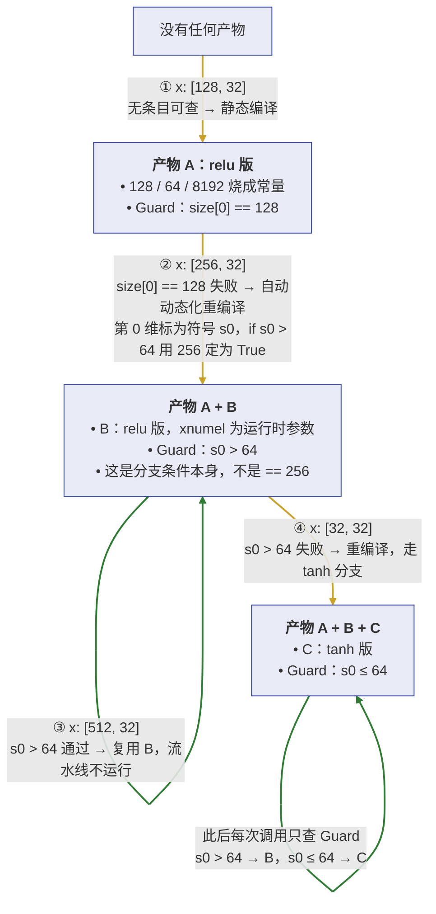

注意第二次编译时 Guard 从 `== 128` 变成了 `> 64`：Dynamo 在符号维度上追踪分支条件时，记录的是**让当前分支成立的约束**，而不是具体值。分支条件本身变成了 Guard。最终这个函数积累了三份编译产物：最初的静态 `relu` 版，以及动态的 `relu`、`tanh` 两版。后两版由 `s0 > 64` 这条分支 Guard 区分；完整 Guard 还包含其他元数据和 shape 约束。这保留了原始 Python 程序里那个 `if` 的语义，只是判断从 Python 解释器移到了 Guard 检查。

**走哪一种策略由 `torch.compile` 的 `dynamic` 参数决定**：

| `dynamic=` | 第一次编译 | shape 变了以后 |
|---|---|---|
| `None`（默认） | 所有维度都是常量 | 重编译一次，把变了的维度标成符号；之后这一族 shape 都复用 |
| `True` | 一开始就尽量把维度当作符号 | 多数情况不用重编译；有些算子或优化仍会把某一维特化成常量 |
| `False` | 所有维度都是常量 | 每个新 shape 都重编译一次；条目到 8 条后退回 Eager |

Table: dynamic 参数的三种取值

只想让某一维是符号，用 `torch._dynamo.mark_dynamic(x, 0)`；`mark_static` 反之。`TORCH_LOGS=dynamic` 可以看到哪一维被特化成了常量。

所以“换一个 batch size 就慢一次”有两种情形。默认配置下只慢一次，那是把这一维改成符号的重编译。每次都慢，说明这一维一直是常量：要么设了 `dynamic=False`，要么它被某个算子特化了。

代价是生成的代码不能再把 shape 当常量：Kernel 的 `xnumel` 变成运行时参数，索引算术里出现 `s0`，某些依赖具体值的优化（如按 shape 选择最优 tile 大小）不再可用。因此默认从静态开始，只在观察到变化后才动态化。

> [!NOTE] Java 经验参照：失败一次后放宽假设
> 这与 HotSpot 的做法同向：去优化之后重新编译时，C2 通常不再做刚被打破的那条投机，产出更通用、可能稍慢的代码。差别在旧产物的去留：HotSpot 把旧版本作废，这里静态的 `relu` 版仍然留在条目列表里，`[128, 32]` 的输入还可以命中它。

Dynamic Shape 的实现基础是 **SymInt**：一种可以是具体整数、也可以是符号表达式的整数类型。Tensor 的 `shape` 在编译期以 SymInt 表示，算子的 Meta 实现在 SymInt 上推断输出 shape，产生的约束（如 `s0 * 32 == s1`）成为 Guard。这是[《Dispatcher 与算子系统》](/pytorch-dispatcher-and-operator-system.html)里 Meta 实现的又一个用途。

真正困难的是**数据依赖的 shape**：`torch.nonzero(x)` 的输出长度取决于 `x` 的值，编译期无法推断（unbacked SymInt）。这类算子往往导致 graph break，或需要 `torch._check` 显式提供约束。

### 4. 编译缓存：把编译成本摊掉

*前端与后端各有一层：Dynamo 条目在每次调用的入口查；磁盘上的缓存在流水线内部查（AOTAutograd、Inductor 各查自己的一层），没命中才生成并写入。*

一次完整的冷编译——捕获、变换、生成、Triton 编译——对小函数是秒级，对大模型可能是分钟级。缓存分几层：

| 层 | 内容 | 作用范围 |
|---|---|---|
| Dynamo 缓存条目 | 改写后的字节码 + Guard，挂在函数的 code 对象上 | 进程内 |
| Inductor FX Graph 缓存 | 以图结构、输入元数据、配置为 key，缓存生成的源码 | 磁盘（默认 `/tmp/torchinductor_<user>`），跨进程 |
| Triton Kernel 缓存 | Triton 源码到 GPU 机器码（PTX / cubin）的编译结果 | 磁盘，跨进程 |
| Autotune 缓存 | `max-autotune` 选出的最优配置 | 磁盘，跨进程 |
| 远程缓存 | 上述内容的 Redis 等共享存储版本 | 跨机器，用于训练集群 |

Table: 编译缓存的几层

新版本还在推进把整套产物打包保存、下次启动整体加载的机制，这部分 API 变化较快，此处不展开。

缓存的失效条件与 Guard 同源：PyTorch 版本、Inductor 配置、输入元数据的任何变化都会导致 key 不同。在 AI-Infra 场景中，**编译缓存的命中率直接决定训练任务的启动时间**，是集群侧值得管理的资源。

> [!NOTE] Java 经验参照：编译缓存与 Code Cache
> 只有第一层（Dynamo 缓存条目）对应 HotSpot 的 Code Cache：都在进程内存里，进程退出就没有了。磁盘上的几层在 HotSpot 的默认配置里没有对应物——JIT 产物默认不落盘，JVM 每次启动都重新预热；它们更像 Gradle 构建缓存或 ccache：以输入内容为 key 保存编译结果，跨进程，可以放到远程。冷编译与预热的体感也不同：预热期间服务照常响应，只是慢；冷编译期间，第一次调用一直等到编译结束。

### 5. 四个机制的共同点

它们都在处理同一个矛盾：**编译产物是针对特定假设生成的静态代码，而 Python 程序是动态的**。Graph Break 缩小假设的范围（只编译能确定的部分），Guard 检查假设是否仍成立，Dynamic Shape 放宽假设（用符号代替常量），缓存让满足假设时不必重做工作。

| 机制 | 假设成立 | 假设不成立 |
|---|---|---|
| Graph Break | 能捕获 → 进图 | 不能捕获 → 切断，Eager 执行 |
| Guard | 检查通过 → 复用编译产物 | 检查失败 → 重编译（或超限退回 Eager） |
| Dynamic Shape | 符号约束满足 → 复用 | 约束不满足 → 重编译，进一步放宽 |
| 缓存 | key 命中 → 跳过生成与编译 | key 不命中 → 冷编译并写入 |

Table: 四个运行时机制在"假设成立 / 不成立"两种情况下的行为

## 七、串起来：`f` 的四次调用

两个维度在这一章合到一起。四次调用覆盖了运行时控制层的每条分支：**冷编译**（没有产物，运行整条流水线）、**命中**（Guard 通过，直接执行）、**失效后放宽假设重编译**（shape 变了，但仍走同一分支）、**失效后换分支重编译**（走到了另一条 Python 分支）。编译器流水线只在第一、三、四次里出现。

### 1. 第一次调用：冷编译

```python title="第一次调用：冷编译"
compiled_f = torch.compile(f)
y = compiled_f(x, weight, bias)       # x: [128, 32]
```

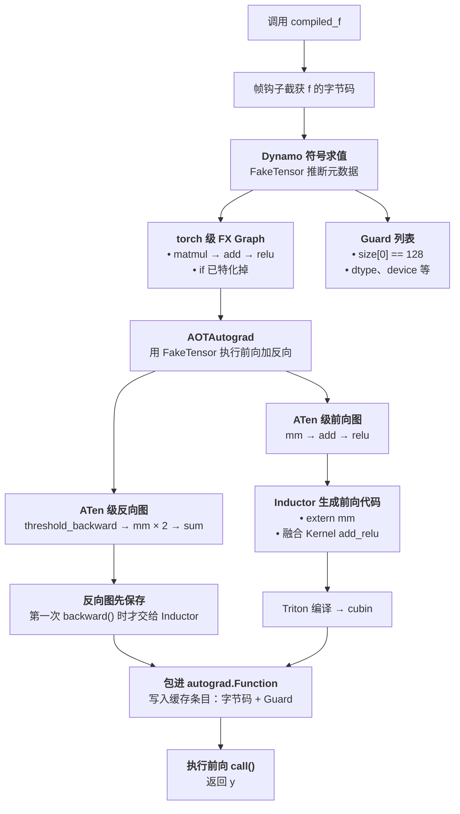

整个过程中，`x`、`weight`、`bias` 的真实数据只在最后一步被读取。之前的所有阶段都在 FakeTensor 上进行。

### 2. 第二次调用：热路径

```python title="第二次调用：同 shape 命中缓存"
y = compiled_f(x2, weight, bias)      # x2: [128, 32]，同 shape
```

- 帧钩子 → 找到缓存条目 → Guard 检查全部通过
-  → 运行改写后的字节码
-  → 调用 autograd.Function 的前向 → call(args)
-  → extern_kernels.mm（cuBLAS）
-  → triton_poi_fused_add_relu_0
-  → 返回 y，grad_fn 指向 CompiledFunctionBackward

Dynamo、AOTAutograd、Inductor 都不再参与。相比 Eager 的三次分发、三次 launch，这里是零次分发、两次 launch。

### 3. 反向

```python title="反向：y.sum().backward()"
y.sum().backward()
```

`y.sum()` 在编译区域外，由 Eager Autograd 处理。`backward()` 沿 `grad_fn` 回溯：`SumBackward0` 是普通 Eager 节点；下一个是 `CompiledFunctionBackward`。第一次走到这里时，反向图才交给 Inductor 编译（第四章 §6），之后的 `backward()` 直接复用；它调用编译后的反向 `call()`，内部是一个融合 Kernel 加两次 cuBLAS。再往前是 `x`、`weight`、`bias` 的叶子节点，梯度累加到 `.grad`。

[《自动求导与动态计算图》](/pytorch-autograd-and-dynamic-computation-graph.html)的 Autograd 引擎、[《nn.Module 与训练系统》](/pytorch-module-and-training-system.html)的参数与 Optimizer、本篇的编译产物，在这一步汇合：**编译改变的是节点内部的执行方式，没有改变 Autograd 图的拓扑和 Optimizer 看到的接口**。

### 4. 第三次调用：shape 变化，同一分支

```python title="第三次调用：shape 变化，同一分支"
y = compiled_f(x3, weight, bias)      # x3: [256, 32]
```

- Guard 检查：L['x'] size[0] 期望 128，实际 256 → 失败
-  → 重新走一遍流水线，这次第 0 维为符号 s0
-  → 追踪到 if s0 > 64：用当前值 256 判定为 True，走 relu，记 Guard s0 > 64
-  → 中端、后端与第一次相同，只是 shape 变成符号
-  → 新的编译产物：xnumel 为运行时参数；Guard 为 s0 > 64 及其他元数据
-  → 作为第二个缓存条目写入
-  → 执行

之后任何 batch 大于 64 的输入都命中第二个条目。第一个条目仍然保留，`[128, 32]` 的输入可能命中它（也可能命中动态的那个，取决于检查顺序）。

### 5. 第四次调用：走到另一条分支

```python title="第四次调用：走到 tanh 分支"
y = compiled_f(x4, weight, bias)      # x4: [32, 32]
```

- Guard 检查：条目 1 要求 size[0] == 128 → 失败
- 条目 2 要求 s0 > 64：→ 失败
-  → 重新走一遍流水线
-  → 追踪到 if s0 > 64：用当前值 32 判定为 False，走 tanh，记 Guard s0 <= 64
-  → 前端产出另一张图：matmul → add → tanh
-  → 中端：反向变为 tanh 的导数（1 - tanh²）
-  → 后端：融合 Kernel 变为 triton_poi_fused_add_tanh_0
-  → 作为第三个缓存条目写入
-  → 执行

与 §1 冷编译那张图对照，这一次的入口逻辑是"逐条查 Guard、都不命中才进流水线"：

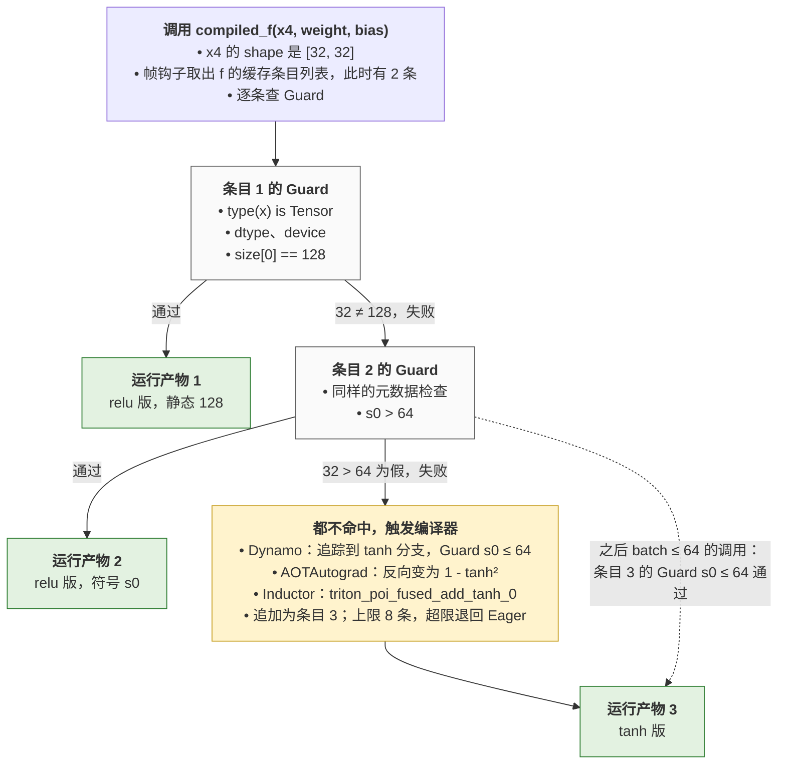

到这里，原始 Python 程序里的 `if` 被完整地"翻译"进了运行时控制层：两条分支各有一份编译产物，`s0 > 64` 这条 Guard 就是原来的分支条件。这也说明 Guard 检查不只是"防御性验证"，它是编译后程序控制流的一部分。

如果分支条件依赖的不是 shape 而是值（`if y.sum() > 0`），这一套就不成立了——Guard 无法在不执行计算的情况下检查一个 Tensor 的值。那种情形下 Dynamo 会在 `if` 处切断图（第六章 §1），条件由 Python 在运行时求值，两条分支各成一张独立的小图。

### 6. Eager 与编译的对照

| | Eager | `torch.compile`（热路径） |
|---|---|---|
| Python 层调用 | 3 次进入 C++ | 1 次（进入改写后的字节码） |
| Dispatcher 分发 | 3 次 × 2（Autograd 包装 + 再次分发） | 1 次（`extern_kernels.mm` 仍是 `torch.mm`，走 Dispatcher 到 cuBLAS；Triton Kernel 直接 launch） |
| 前向 Kernel launch | 3 | 2 |
| 中间 Tensor 分配 | 2 | 0（原地复用） |
| Autograd 节点 | 3 个（`MmBackward0`、`AddBackward0`、`ReluBackward0`） | 1 个（`CompiledFunctionBackward`） |
| 反向 Kernel launch | 4 ~ 5 | 3 |
| 第一次调用成本 | 无额外成本 | 秒级编译 |
| 对 shape 变化的反应 | 无感 | Guard 失败、重编译 |

Table: Eager 与 torch.compile 热路径的对照

对这个三算子的小函数，收益有限；对几十层、数百个 pointwise 算子的 Transformer，融合与内存规划的收益会显著放大。[《性能优化与调试》](/pytorch-performance-optimization-and-debugging.html)用 Profiler 量化这些差别。

### 7. 这是一条典型路径

以上是默认配置下的路径。前端、中端、后端是可以拆开组合的，同一套组件还能组成其他路径：

| 路径 | 前端 | 中端 | 后端 | 适用场景 |
|---|---|---|---|---|
| `backend="eager"` | Dynamo | — | 图原样逐算子执行 | 排查前端：graph break、捕获是否正确 |
| `backend="aot_eager"` | Dynamo | AOTAutograd | 两张图逐算子执行 | 排查中端：反向图、函数化是否正确 |
| `backend="inductor"`（默认） | Dynamo | AOTAutograd | Inductor | 正常使用 |
| `mode="reduce-overhead"` | 同默认 | 同默认 | Inductor + CUDA Graphs | 小 batch、launch 开销占主导的推理 |
| `mode="max-autotune"` | 同默认 | 同默认 | Inductor + Triton 矩阵乘模板与调优 | 追求峰值性能、可接受更长编译时间 |
| `torch.export` | Dynamo，不允许 graph break | AOTAutograd 的一部分（函数化、分解） | 不生成代码，产出 `ExportedProgram` | 序列化模型、脱离 Python 部署 |
| AOTInductor | 同 `torch.export` | 同 `torch.export` | Inductor 生成 C++ 与 Kernel → 共享库 | C++ 推理服务，无 Python 运行时 |

Table: 同一套组件可以组成的其他路径

`mode` 与 `backend` 的关系：`backend` 选择 Dynamo 之后接哪段流水线，`mode` 在 `inductor` 后端内部调整策略。两者可以同时指定。

`torch.compile` 与 `torch.export` 的区别值得单独说明：前者是**带回退的 JIT**——捕获不了就切断，保证程序能跑；后者是**无回退的 AOT**——必须捕获整图，否则报错，换来的是产物不依赖原始 Python 代码。两者共享 Dynamo 和 FX Graph，分歧在对 graph break 的态度。

更早的 TorchScript（`torch.jit.trace` / `torch.jit.script`）是 1.x 时代的图捕获方案，用一套独立的 IR 和解释器。它已不再是主要发展方向，本系列不展开。

## 八、本文小结

### 1. 回看总览的那张图

第一章开头的两层图，现在每个节点都有了具体内容：


编译器一维：

| 阶段 | 输入 | 输出 | 节点词汇 | 观察手段 |
|---|---|---|---|---|
| 前端 Dynamo | Python 字节码 | FX Graph + Guard + 改写字节码 | `torch.*`、`operator.*` | `backend=` 自定义、`TORCH_LOGS="graph_code"` |
| 中端 AOTAutograd | torch 级图 | 前向图 + 反向图 + `autograd.Function` | `torch.ops.aten.*` | `TORCH_LOGS="aot_graphs"` |
| 后端 Inductor | ATen 级图 | Triton / C++ 源码 + `call()` | 循环级 IR → 源码 | `TORCH_LOGS="output_code"` |

Table: 编译器三阶段的输入、输出与观察手段

运行时一维：

| 机制 | 管什么 | 怎么做 | 在哪一段 |
|---|---|---|---|
| Graph Break | 捕获的边界 | 能捕获的进图，不能的切断交还 Python | 产生于前端 |
| Guard | 复用的条件 | 记录假设，每次调用检查，失败则重编译 | 产生于前端，作用于每次调用 |
| Dynamic Shape | 假设的放宽 | 从静态开始，观察到变化后用符号代替常量 | 贯穿三段 |
| 缓存 | 成本的摊销 | 进程内条目 + 磁盘 + 远程，key 与假设同源 | 前端与后端各一层 |

Table: 四个运行时机制小结

### 2. `f` 经历了什么

- **Python**：`y = x @ weight + bias`；`if x.shape[0] > 64` 走 `relu(y)`，否则走 `tanh(y)`。
- **前端**：`if` 用 FakeTensor 的 shape 特化掉。
  - 图里只剩 `matmul → add → relu`，Guard 记下 `size[0] == 128`。
- **中端**：降到 `aten.mm` / `aten.add` / `aten.relu`。
  - `threshold_backward` 的结果分别送给两次 `mm` 和一次 `sum`；整体包成一个 `grad_fn`。
- **后端**：`mm` 交给 cuBLAS，`add + relu` 融合成一个 Triton Kernel。
  - 中间 Buffer 原地复用，shape 烧成常量。
- **运行时**：第二次同 shape 命中。
  - 第三次 batch 256 触发动态化，分支 Guard 变成 `s0 > 64`，追加第二份产物。
  - 第四次 batch 32 走 `tanh`，追加第三份产物。

原始程序里的 `if` 最终由运行时的分支 Guard 区分：最初的静态产物仍然保留，动态的两份产物分别对应 `relu` 和 `tanh`。这是理解 `torch.compile` 最重要的一个画面：**它没有把 Python 翻译成 CUDA，它把 Python 里能确定的部分固化进代码，把不能确定的部分变成运行时检查。**

### 3. 几个容易混淆的名字

| 名字 | 说明 |
|---|---|
| FX | 双重身份：`torch.fx` 是独立的图变换工具包；FX Graph 是编译栈的中间表示。数据结构相同，追踪器不同 |
| `symbolic_trace` vs Dynamo | 前者用 Proxy 在 Python 对象层追踪，遇到依赖 Tensor 的控制流报错；后者在字节码层符号求值，依赖元数据的分支特化并记 Guard，依赖值的分支切断 |
| 后端 vs `backend=` | 前者是编译器术语，指 Inductor 这一段；后者是 `torch.compile` 参数，指 Dynamo 之后的一切（含 AOTAutograd） |
| torch 级 vs ATen 级 | 同一 FX 结构下的两套算子词汇；AOTAutograd 完成下降 |
| Meta Tensor vs FakeTensor | FakeTensor 建立在 Meta 之上，额外记录“假装的”device；Dynamo 与 AOTAutograd 用它推断元数据 |
| Graph Break vs Guard 失败 | 前者是捕获时的边界，决定图有多大；后者是调用时的失效，决定是否重编译 |
| Inductor vs Triton | Inductor 是 PyTorch 的代码生成器，产出 Triton 源码；Triton 是独立的 GPU 语言与编译器，产出 PTX |
| `torch.compile` vs `torch.export` | 带回退的 JIT vs 无回退的 AOT；共享 Dynamo 与 FX Graph |

Table: 几个容易混淆的名字

### 4. 同一条流水线的两个出口

本文沿着 `torch.compile` 走完了训练场景下的 JIT 路径。第七章 §7 的表已经说明，同样的 Dynamo → FX → AOTAutograd → Inductor 组件还能组成另一条 AOT 路径：

| 场景 | 入口 | 特点 |
|---|---|---|
| 训练 / 研究 | torch.compile | JIT · 允许 graph break · 产物留在 Python 进程内 · 每次进程启动重新编译（有缓存） |
| 部署 / 推理 | torch.export | AOT · 必须整图捕获 · 产物 ExportedProgram 可序列化 |
|  | AOTInductor | 在 export 之上由 Inductor 生成 C++ 与 Kernel，编成共享库，C++ 运行时直接加载 |

Table: 训练/研究与部署/推理两条路径的入口与特点

两条路径的分歧只在对 graph break 的态度，共享的部分远多于不同的部分。推理引擎通常会在这套组件上做更多事：vLLM 用 `torch.compile` 配合 CUDA Graphs 消除 decode 阶段的 launch 开销，并用自定义 Inductor pass 融合注意力周边的算子——这些属于 Serving 系统的话题，本系列不展开。

### 5. 排查问题的顺序

1. `torch._dynamo.explain`：有几张图，为什么断；
2. `TORCH_LOGS="graph_breaks"`：每个断点的具体原因；
3. `TORCH_LOGS="recompiles"`：为什么重编译，哪个 Guard 失败；
4. `backend="eager"` / `"aot_eager"`：定位问题在哪一段；
5. `TORCH_LOGS="aot_graphs"`：前向 / 反向图是否符合预期；
6. `TORCH_LOGS="output_code"`：融合是否发生，Extern Kernel 是哪些；
7. Profiler：实际 launch 了什么，各花多少时间。

### 6. 本篇涉及的源码位置

本篇讨论的机制在源码中的位置（对应[《PyTorch 整体介绍》第七章「代码视角——源码目录与库的分层」](/pytorch-overall-introduction.html#七第三张地图代码视角源码目录与库的分层)的代码地图）：

| 路径 | 内容 |
|---|---|
| `torch/_dynamo/eval_frame.py`、`torch/csrc/dynamo/eval_frame.c` | `torch.compile` 入口；接管 CPython 帧求值的 C 扩展 |
| `torch/_dynamo/symbolic_convert.py`、`guards.py`、`output_graph.py` | 字节码符号执行、Guard 生成、FX Graph 输出 |
| `torch/fx/graph.py`、`node.py`、`graph_module.py`、`_symbolic_trace.py` | FX IR：`Graph`、`Node`、`GraphModule`；`symbolic_trace` |
| `torch/_functorch/aot_autograd.py`、`partitioners.py` | AOTAutograd：联合前反向图的生成；min-cut 切分决定保存什么、重算什么 |
| `torch/_subclasses/fake_tensor.py`、`torch/fx/experimental/symbolic_shapes.py` | FakeTensor；`SymInt` 与 `ShapeEnv`（动态 shape） |
| `torch/_decomp/`、`torch/_prims/`、`torch/_refs/` | 算子分解与参考实现：torch 级词汇下降到 ATen 级 |
| `torch/_inductor/compile_fx.py`、`graph.py`、`scheduler.py`、`codegen/triton.py`、`codegen/cpp.py` | Inductor：入口、lowering、融合决策、Triton 与 C++ 代码生成 |
| `torch/_inductor/codecache.py`、`torch/export/`、`torch/csrc/inductor/aoti_runtime/` | 编译缓存<br/>`torch.export`<br/>AOTInductor 运行时 |

Table: 本篇涉及的源码位置

最后一步是[《性能优化与调试》](/pytorch-performance-optimization-and-debugging.html)的起点：

> **编译之后到底快了多少，快在哪里——省下的是 Python 开销、分发开销、Kernel launch，还是访存？如何用 Profiler 和 Benchmark 给出可复现的答案？**

## 九、自测

1. `symbolic_trace`（torch.fx）与 Dynamo 都产出 FX Graph，遇到 `if x.sum() > 0:` 各怎么办？

   <details markdown="1"><summary>答案</summary>

   `symbolic_trace` 用 Proxy 在 Python 对象层追踪，对 Proxy 做 `bool()` 直接报错；Dynamo 在字节码层符号求值，这个分支依赖 Tensor **值**，切一个 graph break：分支前一张图、分支后一张图，中间回到 Python 执行。

   </details>

2. Guard 是什么？“Guard 失败”与“graph break”差在哪？

   <details markdown="1"><summary>答案</summary>

   Guard 是捕获时记下的假设（输入 shape、dtype、Python 常量、全局变量的值），每次调用先检查；失败就重编译一张新图（`recompile_limit` 次后退回 eager）。graph break 是捕获时的边界，决定图有多大；Guard 失败是调用时的失效，决定是否重编。

   </details>

3. 默认配置下，`torch.compile` 后第一次调用慢几十秒；第二次换了 batch size，又慢一次；第三次再换，不慢了。三次各发生了什么？如果每次换 batch size 都慢，原因是什么，怎么办？

   <details markdown="1"><summary>答案</summary>

   1. 第一次：冷编译。按当时的 shape 静态编译，batch 大小是常量，Guard 是 `size()[0] == 128`。
   2. 第二次：这条 Guard 失败，重编译。这一次自动把变了的那一维标成符号 `s0`（SymInt），Guard 变成关于 `s0` 的约束。
   3. 第三次：新的 batch 大小满足这条约束，直接复用，不再编译。
   4. 每次都慢：说明这一维一直是常量，每个新 shape 都是一次 Guard 失败加一次重编译。常见原因是设了 `dynamic=False`，或这一维被某个算子特化成了常量（用 `TORCH_LOGS=dynamic` 查）。
   5. 想连第二次的重编译也省掉：用 `dynamic=True`，或用 `mark_dynamic(x, 0)` 只标这一维。代价是 shape 不再是常量，少一些特化优化。

   详见[第六章「Dynamic Shape：不为每个 shape 重编」](#3-dynamic-shape不为每个-shape-重编)。

   </details>

4. Inductor 的“融合”省的是什么？举一个 `x.relu() * 2 + b` 的例子。

   <details markdown="1"><summary>答案</summary>

   省的是中间结果在显存里的往返和 Kernel launch。这个式子里的三个算子都是逐元素的：`* 2` 是每个元素乘以 2，不是矩阵乘法（矩阵乘法写作 `@`）。所以三个都是 Pointwise 节点，融合成一个 Triton Kernel。设 `x` 有 N 个元素，`b` 与 `x` 同 shape：

   | | Kernel | 访存 |
   |---|---|---|
   | Eager | `relu`、`mul`、`add` 三个 | `relu` 读 N 写 N，`mul` 读 N 写 N，`add` 读 2N 写 N，共 7N |
   | Inductor | 一个融合 Kernel | 读 `x` 和 `b` 共 2N，写 N，共 3N |

   Table: 三个逐元素算子融合前后的 Kernel 数与访存

   访存从 7N 降到 3N，launch 从 3 次降到 1 次。逐元素算子的时间由搬运的字节数决定，所以耗时大致按这个比例下降。

   如果中间换成矩阵乘法（`x.relu() @ w + b`），就融合不成一个 Kernel：`mm` 是 ExternKernel，默认交给 cuBLAS，不参与融合，前面的 `relu` 和后面的 `add` 被它隔开，各自成为一个 Kernel，一共三个（[第五章「融合决策」](#3-融合决策)）。

   </details>

5. “后端”与 `backend=` 参数指的是同一个东西吗？`backend="eager"` 做什么？

   <details markdown="1"><summary>答案</summary>

   不是：编译器术语的后端指 Inductor 这一段；`torch.compile(backend=...)` 指 Dynamo 之后的一切（含 AOTAutograd）。`backend="eager"` 只做 Dynamo 捕获然后原样执行图，用来隔离“是捕获的问题还是编译的问题”。

   </details>

[^q0]: 三段流水线。**前端 Dynamo**：在 CPython 字节码层做符号求值——不运行代码，而是解释每条字节码、把 Tensor 操作记进 FX Graph、把依赖元数据（shape、dtype、`requires_grad`）的分支特化并记成 Guard、把依赖 Tensor 值或不支持的操作切成 graph break；输出 FX Graph + Guard + 改写后的字节码（[第二章](#二irfx-graph)、[第三章](#三前端torchdynamo-捕获)）。**中端 AOTAutograd**：用 FakeTensor 跑一遍前向、追踪 autograd 得到反向图，把算子下降到 ATen 级词汇并做 functionalize（去掉 in-place），包成一个 `autograd.Function`（[第四章](#四中端aotautograd-变换)）。**后端 Inductor**：把 ATen 图变成循环级 IR，做融合与内存规划，生成 Triton（GPU）或 C++（CPU）源码编译成 kernel（[第五章](#五后端torchinductor-代码生成)）。**运行时**：每次调用先检查 Guard，通过就执行编译产物，失败就重编译（有上限）；Eager 代码一行不改（[第六章](#六运行时编译何时发生到哪停止何时复用)、[第七章](#七串起来f-的四次调用)）。快在哪：省掉 Python 与分发开销、减少 kernel launch、融合减少访存。观察手段：`TORCH_LOGS="graph_code,aot_graphs,output_code"`。
