本系列前面各篇都在一张卡上。[《性能优化与调试》](/pytorch-performance-optimization-and-debugging.html)末尾算过一笔账：Adam 训练下每个参数的静态显存是 16 字节，7B 参数的模型仅参数、梯度和优化器状态就要 112 GB，激活值还没算。一张 80 GB 的卡放不下。即使放得下，那一篇案例里的 38M 参数小模型在单卡上跑到 2207 samples/s 之后，GPU 已经饱和——再要快，只能加卡。

这一篇回答加卡之后的问题：

> **当一张卡放不下模型或跑不完数据时，PyTorch 如何把计算和状态切分到多个设备，并让通信与计算重叠？[^q0]**

分布式训练的资料通常按 API 组织：DDP 一章、FSDP 一章、张量并行一章、流水线并行一章。这样读完会记住一堆包装类，却答不出"FSDP 比 DDP 多的那份通信从哪来、什么条件下才多 50%"或者"张量并行为什么只能在节点内做"。本文换一条主线：

> **每种并行策略，都是对训练中的五类状态——数据、参数、梯度、优化器状态、激活值——各自做一个决定：复制还是分片。每个决定对应一种集合通信原语和一个通信时机；所有决定加起来，决定了显存占用和通信量。**

DDP、ZeRO 的三个阶段、FSDP、张量并行、流水线并行、上下文并行、专家并行，在这条主线上是同一张表的不同行。掌握了表的结构，新出现的并行策略也能立刻归位。

本篇主要从训练出发，把每种并行的**通用机制**（切什么、通信什么、正向反向各通信几次、通信量怎么算）讲透，再加上训练特有的部分（梯度同步、状态分片、反向重叠、流水线调度）。推理特有的内容本文不做介绍。

## 一、总览：为什么需要多卡

先把全文的机制连成一条链：进程怎样起来，五类状态由哪种策略复制或分片，通信最后落到哪里。

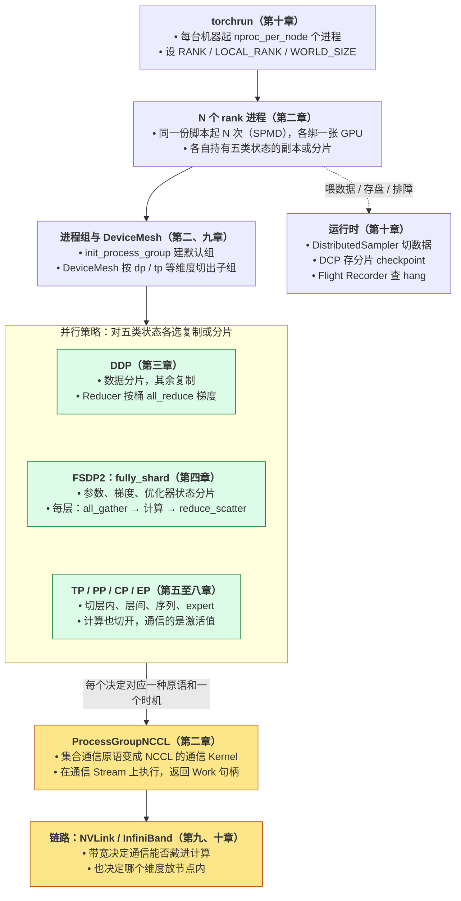

- **torchrun**：启动器。在每台机器上起 `nproc_per_node` 个进程，用环境变量告诉每个进程它的 rank；进程失败时整体重启。
- **rank 进程**：同一份脚本被启动 N 次，得到 N 个进程，每个进程有一个编号（rank），各绑一张 GPU。这种执行模型叫 SPMD（Single Program, Multiple Data）：Single 说的是程序只有一份，进程有 N 个。进程之间没有主从，谁也不调度谁；训练的五类状态（数据、参数、梯度、优化器状态、激活值）就存在这些进程各自的 GPU 上。
- **进程组与 DeviceMesh**：集合通信的参与者名单。默认组含全部 rank，`DeviceMesh` 把 rank 排成多维网格，每一维是一组子进程组，供 FSDP2、TP、CP 使用。
- **并行策略**：对每类状态做「复制还是分片」的决定。DDP 只分片数据；FSDP2 再分片参数、梯度和优化器状态，计算时把一层的参数凑齐；TP / PP / CP / EP 连计算本身也切开，各 rank 之间传的是激活值（[「分片之后：计算切不切」](#3-分片之后计算切不切)一节）。
- **ProcessGroupNCCL**：通信后端。策略发出的 `all_reduce`、`all_gather`、`reduce_scatter` 等在这里变成 GPU 上的 NCCL Kernel，跑在独立的通信 Stream 上，调用方拿到 `Work` 句柄。
- **链路**：节点内 NVLink、节点间 InfiniBand，带宽差一个量级；通信量除以带宽与计算时间的比较，决定一种配置能否接近线性扩展。
- **运行时**：`DistributedSampler` 让各 rank 看到互不重叠的数据，DCP 保存分片状态及其布局，Flight Recorder 记录每次集合通信，用于排查 hang。

### 1. 两个极限

单卡训练有两个独立的上限：

- **吞吐极限**：GPU 已饱和（[《性能优化与调试》第六章的「何时停止」](/pytorch-performance-optimization-and-debugging.html#9-何时停止)），每秒处理的样本数到顶，训练时间只能靠加卡缩短
- **容量极限**：模型状态 + 激活值超过显存，一张卡根本放不下

两个极限需要不同的解法。吞吐极限只需要**更多的卡各算一部分数据**，模型本身不用动；容量极限则必须**把模型状态或计算切开放到多张卡上**。前者是数据并行，后者是各种形式的模型并行。真实的大模型训练两个极限同时碰到，所以两类策略要组合使用。

### 2. 五类状态，两种选择

一次训练 step 涉及五类状态：数据、参数、梯度、优化器状态、激活值。它与 L1 工具箱里"显存四块"（权重、梯度与优化器状态、激活、KV cache）的口径不同：那里按**显存归属**分块，把梯度和优化器状态合成一块、把推理才有的 KV cache 单列；这里按**并行时能否独立决定复制还是分片**来分——梯度和优化器状态在 ZeRO 里是分开决定的，所以要拆成两类；数据不占显存大头但决定了"每张卡看什么"，所以要单列。对每一类，多卡训练都要回答同一个问题——每张卡持有完整的一份（**复制**），还是只持有 1/N（**分片**）。这里 **N 表示参与某个并行维度的进程数**（只有一个维度时就是总进程数 world size），**P 表示模型参数量**（个数，乘以每参数字节数才是字节）：

| 状态 | 大小 | 复制的含义 | 分片的含义 |
|---|---|---|---|
| 数据（一个 batch） | ∝ batch | 每卡算同样的数据，无意义 | 每卡算不同的 1/N，这是"并行"的来源 |
| 参数 | P | 每卡一份完整模型 | 每卡持有 1/N；用时凑齐（FSDP），或不凑齐、连计算一起切开（TP / PP / EP） |
| 梯度 | P | 每卡各算一份，必须同步 | 每卡只保留自己负责的 1/N |
| 优化器状态 | 2P（Adam 的 m、v） | 每卡各自更新，结果相同 | 每卡只更新自己负责的 1/N 参数 |
| 激活值 | ∝ batch × 序列长度 × hidden × 层数 | 每卡持有自己那份数据的激活 | 按序列或按 hidden 维切开 |

Table: 五类训练状态的复制与分片含义

复制和分片各有代价，而且代价刚好互补：

| 决定 | 显存 | 通信 |
|---|---|---|
| 复制 | N 份 | 需要让 N 份保持一致 → 同步（all-reduce） |
| 分片 | 1/N | 两种用法，见下一节：<br/>先凑齐再算 → 聚合（all-gather）、用完再分发（reduce-scatter）<br/>计算也切开 → 不聚合，rank 之间传部分结果（激活值） |

Table: 复制与分片各自的显存与通信含义

> [!NOTE] Java 经验参照：副本与分库分表
> 这两种选择和后端存储的两种扩展方式是同一个结构：加副本，每个节点一份完整数据，写入要同步到所有副本，扩的是吞吐而不是容量；分库分表，每个节点只有 1/N，扩的是容量，代价是跨分片查询：要么先把数据聚到一处再算，要么每个分片各自算完、只汇总结果（scatter-gather）。下一节的两种用法就是这两种查询方式。不同之处在于同步的频率：训练里每个 step 都要同步或聚合一次，而且是全体参与的集合通信，没有「异步复制、最终一致」这一档。

于是每个"复制还是分片"的决定，都同时决定了三件事：**这类状态占多少显存、需要哪种通信原语、通信发生在 step 的哪个时刻**。这就是本文的主线。

### 3. 分片之后：计算切不切

「复制还是分片」说的是状态**存**在哪。状态分片之后还有第二个问题：用它做计算时，**计算本身切不切**。两种做法：

| 对比项 | 先凑齐再算 | 计算也切开 |
|---|---|---|
| 代表 | ZeRO-3 / FSDP | TP、PP、CP、EP |
| 计算时的分片 | 用前 all_gather 成完整的一份，用完释放 | 一直是分片，不凑齐 |
| 每个 rank 执行的计算 | 完整的一层，和单卡时一样 | 一层的一部分（TP）<br/>一部分层（PP）<br/>序列的一段（CP）<br/>一部分 expert（EP） |
| 一条样本的一次前向 | 在一个 rank 上算完 | 要多个 rank 合作才算完 |
| rank 之间传什么 | 参数、梯度 | 激活值：各 rank 算出的部分结果 |
| 单层必须放进一张卡 | 是 | 否 |
| 通常的叫法 | 数据并行 | 模型并行 |

Table: 分片状态的两种用法：先凑齐再算与计算也切开

FSDP 的名字是 Fully Sharded **Data Parallel**：它分片的是状态的存储，计算没有切，所以和 DDP 一样属于数据并行。TP / PP / CP / EP 才是把一次前向拆到多张卡上。

**例子**：一个 Linear 层 y = xW，W 是 2 行 4 列，N = 2。

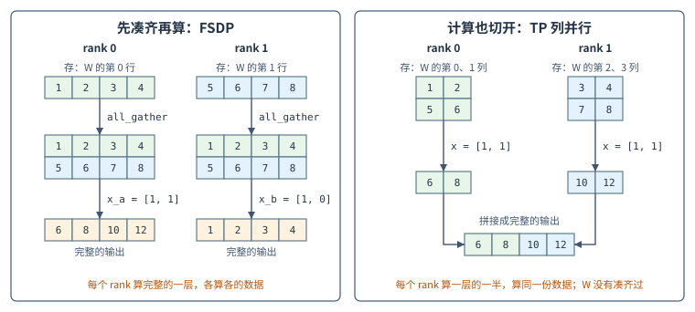

**说明**：

1. **FSDP**：两个 rank 各存 W 的一行。算这一层之前做一次 all_gather，两边都有了完整的 W；rank 0 用自己的输入 x_a = [1, 1] 算出 [6, 8, 10, 12]，rank 1 用自己的输入 x_b = [1, 0] 算出 [1, 2, 3, 4]。两个输出各自完整，互不相干。算完后各自丢掉收来的那一行。
2. **TP 列并行**：两个 rank 各存 W 的两列，不做 all_gather。两边拿同一个输入 x = [1, 1]，rank 0 算出 [6, 8]，rank 1 算出 [10, 12]，各是输出的一半，拼起来才是 [6, 8, 10, 12]。完整的 W 从头到尾没有在任何一张卡上出现过。

这个区别决定了两类策略各自解决什么问题：

- 先凑齐再算，省的是**静态显存**（参数、梯度、优化器状态），代价是每层多一次参数的 all_gather；单层的完整参数和它的激活值仍然要放进一张卡。
- 计算也切开，才能处理**单层就放不下**或**一条序列的激活值就放不下**的情况；代价是通信落在前向的关键路径上，下一步计算要等它。

CP 的参数是复制的，分片的是激活值（序列），但一条序列的前向同样要多个 rank 合作，所以归在右边一列。

### 4. 符号约定

后文的显存和通信量计算反复用到以下符号，集中声明一次：

- **P**：模型参数量（个）。bf16 参数占 2P 字节，fp32 占 4P 字节；Adam + 混合精度的静态状态共 16P 字节（[《性能优化与调试》第八章的「混合精度对显存的两面」](/pytorch-performance-optimization-and-debugging.html#2-混合精度对显存的两面)）
- **N**：某个并行维度上的进程数（并行度）；只有一个维度时等于 world size
- **B**：每个进程一次处理的序列数（per-rank batch）
- **S**：序列长度（token 数）
- **H**：hidden 维度
- **L**：Transformer 层数
- **K**：流水线并行的 stage 数
- **M**：流水线并行的 micro-batch 数
- **α, β**：一次通信的固定延迟、单位字节的传输时间（β = 1/带宽），第二章 §4

一个 Transformer 层的激活值大约是 B × S × H 的若干倍（不做 checkpointing 时约 34 倍，第十一章会用到），所以"激活值"在公式里都写成 ∝ B·S·H。

### 5. 三层结构

从底向上，分布式训练由三层组成：

1. **通信底座**（第二章）：进程 / Rank / 进程组 · 集合通信原语 · NCCL · 成本模型；
2. **并行策略**（第三至九章，建在通信底座上）：DDP · ZeRO / FSDP · TP · PP · CP · EP · 它们的组合；
3. **运行时与工程**（第十章，建在并行策略上）：torchrun 启动 · 数据切分 · Checkpoint · 拓扑 · 性能分析 · 故障排查。

并行策略是集合通信原语的组合方式；理解原语的语义和成本之后，每种策略的显存和通信量都能自己推出来。运行时那层是让策略在真实集群上跑起来、跑得快、出了问题能查的工程部分。

### 6. 本文的章节安排

| 章 | 主题 | 内容 |
|---|---|---|
| 二 | 通信底座：进程、进程组与集合通信 | SPMD、进程组与后端、集合通信原语、α + β 成本模型、通信也是异步的 |
| | **并行策略：复制还是分片** | |
| 三 | 并行策略（1）：DDP | 复制模型、切分数据、同步梯度；Reducer 与梯度桶 |
| 四 | 并行策略（2）：ZeRO 与 FSDP | 分片状态；FSDP2、prefetch、HSDP、offload、混合精度 |
| 五 | 并行策略（3）：TP | 切分一层内部（含 Sequence Parallel 与异步 TP） |
| 六 | 并行策略（4）：PP | 切分层与层之间（含训练调度） |
| 七 | 并行策略（5）：CP | 切分序列：Ring Attention |
| 八 | 并行策略（6）：EP | 切分 Expert |
| 九 | 并行策略的组合与选择 | 训练 vs 推理、决策顺序、多维 mesh、统一表 |
| 十 | 运行时与工程 | 启动、数据、Checkpoint、拓扑、性能与故障 |
| 十一 | 完整案例 | 把[《性能优化与调试》](/pytorch-performance-optimization-and-debugging.html)的 Transformer block 扩到 8 卡、再扩到 4 机 |
| 十二 | 本文小结 | |
| 十三 | 自测 | 5 道题 |

Table: 本文的章节安排

## 二、通信底座：进程、进程组与集合通信

### 1. SPMD 执行模型

PyTorch 分布式训练采用 **SPMD**（Single Program, Multiple Data，一份程序、多份数据）模型：**同一份 Python 脚本被启动 N 次，成为 N 个独立进程，每个进程绑定一张 GPU**。没有 master 进程调度 worker，没有中心节点持有全局状态；每个进程执行相同的代码，只是处理的数据不同、持有的状态分片不同。

几个基本概念：

| 概念 | 含义 | 取值 | 谁给的 |
|---|---|---|---|
| Node | 一台机器 | | |
| World Size | 进程总数 | 节点数 × 每节点进程数 | `torchrun` 设环境变量 `WORLD_SIZE` |
| Rank | 进程的全局编号，唯一标识一个进程 | 整数，0 ~ World Size − 1 | `torchrun` 设环境变量 `RANK` |
| Local Rank | 进程在**本机内**的编号 | 整数，0 ~ 每节点进程数 − 1 | `torchrun` 设环境变量 `LOCAL_RANK` |

Table: SPMD 的四个基本概念

Rank 用来在集合通信里指明「谁」，Local Rank 用来选**本机的哪张 GPU**。两者要分开，是因为多机时 Rank 不能当 GPU 编号用。以 2 台机器、每台 4 张卡为例：

| 机器 | `RANK` | `LOCAL_RANK` | 绑定的 GPU |
|---|---|---|---|
| node 0 | 0、1、2、3 | 0、1、2、3 | `cuda:0` ~ `cuda:3` |
| node 1 | 4、5、6、7 | 0、1、2、3 | `cuda:0` ~ `cuda:3` |

Table: 2 机 × 4 卡时每个进程的 RANK 与 LOCAL_RANK

node 1 上 Rank 为 5 的进程，本机只有 `cuda:0` ~ `cuda:3`，没有 `cuda:5`；它的 Local Rank 是 1，所以绑 `cuda:1`。单机时两个编号相等。`init_process_group` 不读 `LOCAL_RANK`，绑卡是脚本自己做的，见下面第 5、6 行。

一个最小的分布式脚本：

```python title="一个最小的分布式脚本"
import os, torch, torch.distributed as dist

# !ref spmd-init
dist.init_process_group(backend="nccl")             # 从环境变量读取 RANK / WORLD_SIZE / MASTER_ADDR / MASTER_PORT
rank, world = dist.get_rank(), dist.get_world_size()
local_rank = int(os.environ["LOCAL_RANK"])
torch.cuda.set_device(local_rank)

t = torch.ones(4, device="cuda") * rank             # 每个进程的数据不同
dist.all_reduce(t)                                  # 所有进程调用同一个集合通信
print(rank, t)                                      # 每个进程都得到 0+1+...+(world-1)

dist.destroy_process_group()
```

用 `torchrun --nproc_per_node=8 script.py` 启动，就会有 8 个进程运行这段代码。启动机制第十章 §1 细讲。

[`init_process_group`](#spmd-init) 读的 `MASTER_ADDR` / `MASTER_PORT` 名字里有 master，但它不是调度 worker 的主进程。这个地址上跑的是一个 **TCPStore**：一个键值存储服务，开在 rank 0 所在的机器上，各 rank 作为客户端连上去。它的用途只有一个：让互不认识的进程**找到彼此**（rendezvous）。

- 各 rank 启动后都连到这个地址，确认 World Size 个进程到齐。
- 建立 NCCL 连接时，一个 rank 生成 `ncclUniqueId` 写进 TCPStore，其余 rank 读出来，据此加入同一个 NCCL communicator。

连接建好之后，梯度、参数、激活值都在 GPU 之间直接传，不经过 TCPStore；它也不分配任务、不持有模型状态。所以「没有 master」指的是训练过程没有主从，启动时仍然需要一个大家都知道的地址。

SPMD 的关键后果是：**代码中每一处集合通信，都必须被所有参与的进程以相同的顺序调用**。如果 rank 0 走了 `if` 分支多调用了一次 `all_reduce`，而其他 rank 没有，rank 0 会永远等待——这是分布式训练中最常见的 hang 成因，第十章 §6 讨论。

> [!NOTE] Java 经验参照：SPMD 与微服务
> 微服务所在的那种「分布式」和 SPMD 在几个基本假设上相反：
>
> | | 微服务 | SPMD 训练 |
> |---|---|---|
> | 角色 | 异构：gateway / order / payment 各跑各的代码 | 同构：N 个 rank 跑同一份脚本 |
> | 交互 | RPC，调用方与被调方两两请求-响应 | 集合通信，组内所有进程同时参与，每步对齐一次 |
> | 一致性 | 服务间通常是最终一致，靠幂等与补偿 | 每步强一致：DDP 下各 rank 的参数始终相同 |
> | 协调者 | 注册中心、配置中心常驻 | 没有；rendezvous 之后各 rank 对等 |
>
> Table: 微服务与 SPMD 训练的对照
>
> Java 生态里更接近 SPMD 的是 Spark / Flink 一个 stage 内的 task：同一段代码在所有分区上跑。区别是 Spark 有 driver 调度 task、失败的 task 可以单独重跑，SPMD 两样都没有。

### 2. 进程组与后端

`init_process_group` 创建**默认进程组**（World），包含所有进程。集合通信总是在某个进程组内进行；不指定 `group` 参数时用默认组。

进程组由**通信后端**实现：

| 后端 | 设备 | 用途 |
|---|---|---|
| **NCCL** | GPU | NVIDIA 集合通信库，GPU 训练的唯一实际选择；直接走 NVLink / PCIe / InfiniBand，数据不经过 CPU |
| **Gloo** | CPU（也支持 GPU 但慢） | CPU 训练、调试、以及少数需要在 CPU 上做的控制面通信（如 `monitored_barrier`） |
| **MPI** | 两者 | 需要自行编译，HPC 环境使用 |

Table: 进程组的通信后端

后端决定了原语的实现方式和性能，不影响 Python 层的语义。

**子进程组**用于让一部分进程参与通信。多维并行（第九章）大量依赖它：例如 16 张卡做"2 路数据并行 × 8 路张量并行"，需要 2 个各含 8 卡的张量并行组和 8 个各含 2 卡的数据并行组。

```python title="dist.new_group 建子进程组"
tp_group = dist.new_group(ranks=[0, 1, 2, 3, 4, 5, 6, 7])       # 必须所有进程都调用，即使自己不在组里
```

手工管理这些组容易出错，PyTorch 2.x 提供了 **DeviceMesh** 把进程按多维网格组织：

```python title="init_device_mesh 把进程按 2×8 网格组织"
from torch.distributed.device_mesh import init_device_mesh

mesh = init_device_mesh("cuda", mesh_shape=(2, 8), mesh_dim_names=("dp", "tp"))
#   tp →   0  1  2  3  4  5  6  7
#   dp ↓   8  9 10 11 12 13 14 15
mesh["tp"].get_group()     # 本进程所在的 tp 组（同一行）
mesh["dp"].get_group()     # 本进程所在的 dp 组（同一列）
```

DeviceMesh 是 FSDP2、TP、CP API 的共同输入，第三至九章会反复用到。

### 3. 集合通信原语

集合通信（Collective Communication）是所有并行策略的构件。和点对点通信（一个进程发给另一个）不同，集合通信由组内**所有进程同时参与**，每个进程贡献一部分输入、得到一部分输出。

以 4 个进程为例，每个进程持有一个数据块，方框表示该 rank 上的数据：

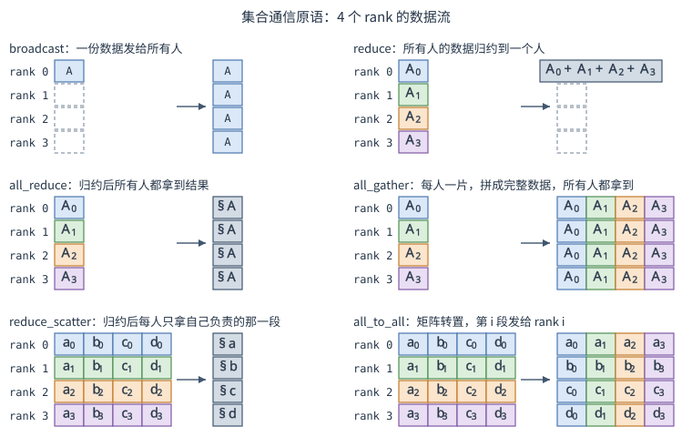

另外两个不搬数据的原语：

- `barrier`：所有人到齐后才继续。
- `send` / `recv`：点对点，一个 rank 发给另一个。

> [!NOTE] Java 经验参照：barrier 与 CyclicBarrier
> `dist.barrier()` 的语义与 `java.util.concurrent.CyclicBarrier.await()` 相同：所有参与者到齐才放行。区别是参与者是跨机器的进程而不是同一个 JVM 里的线程，所以「有人没来」时没有 `BrokenBarrierException` 通知其他人，只能靠超时发现。

对应的 API（`torch.distributed` 命名空间）：

```python title="对应的 torch.distributed API"
dist.broadcast(t, src=0)
dist.all_reduce(t, op=dist.ReduceOp.SUM)                  # 原地，op 可为 SUM / AVG / MAX / MIN / PRODUCT
dist.all_gather_into_tensor(out, t)                       # out.shape[0] == N * t.shape[0]
dist.reduce_scatter_tensor(out, t)                        # t.shape[0] == N * out.shape[0]
dist.all_to_all_single(out, t)
dist.barrier()
dist.send(t, dst=1);  dist.recv(t, src=0)
```

对照上图，每个原语在并行策略中的用途：

| 原语 | 主线中的角色 | 用在哪 |
|---|---|---|
| broadcast | 让复制的状态初始一致 | DDP 构造时分发参数 |
| all_reduce | 让复制的状态保持一致 | DDP 同步梯度；TP 合并部分和 |
| all_gather | 把分片的状态临时凑齐 | FSDP 前向 / 反向前聚合参数；Sequence Parallel |
| reduce_scatter | 把完整结果分回各分片 | FSDP 反向后归约梯度；Sequence Parallel |
| all_to_all | 重新划分维度 | EP 的 token 分发；Ulysses 序列并行 |
| send / recv | 相邻 stage 传递 | PP；CP 的 Ring Attention |

Table: 集合通信原语在并行策略中的用途

> [!NOTE] Java 经验参照：集合通信与 Spark 的聚合、shuffle
> 用过 Spark 的读者可以这样对应数据流向：
>
> | 原语 | Spark 里数据流向相同的操作 |
> |---|---|
> | all_reduce | `reduce` 得到一个结果，再 `broadcast` 给所有 executor |
> | all_gather | `collect()` 拿到全部分区，再 `broadcast` 回去 |
> | all_to_all | shuffle：每个上游分区把第 i 段发给下游分区 i |
>
> Table: 集合通信原语与 Spark 操作的数据流向对应
>
> 对应的只是数据流向。Spark 的结果先回到 driver 再下发；集合通信没有 driver，数据在 rank 之间直接走 GPU 到 GPU 的链路，输入输出都是每个进程显存里的 Tensor。

一个恒等式贯穿全文：

> **all_reduce = reduce_scatter + all_gather**

先做 reduce_scatter，每个 rank 得到归约结果的 1/N；再做 all_gather，把这 N 个 1/N 拼起来，每个 rank 都有完整的归约结果。NCCL 的 Ring all-reduce 内部正是这样实现的（下一节）。这个恒等式是理解 ZeRO / FSDP 的钥匙：**DDP 用 all_reduce 同步梯度；FSDP 把它拆成两半，只做 reduce_scatter 那一半，从而每个 rank 只保留 1/N 的梯度**。它也是 Sequence Parallel 的钥匙：TP 边界上的 all_reduce 拆成两半后，中间那段的激活值就是分片的。

### 4. 成本模型：α + β、Ring 与 Tree

**α + β 模型**

一次点对点传输的时间用 **α + β 模型**近似：

```text title="α + β 模型"
T(n) = α + β · n        α：延迟（固定开销，微秒级）    β：每字节传输时间 = 1 / 带宽    n：字节数
```

小消息由 α 主导，大消息由 β·n 主导。这和[《性能优化与调试》](/pytorch-performance-optimization-and-debugging.html)里 Kernel launch 的固定成本是同一个结构：**消息越小越浪费，所以要把小消息合并成大消息**——这就是 DDP 梯度桶（第三章 §2）存在的理由，也是 FSDP 分片单元不能太小（第四章 §4）的理由。

**Ring all-reduce 分步走一遍**

集合通信的成本取决于算法。最常用的 **Ring** 算法把 N 个进程排成环，每个进程只和左右邻居通信。以 N=4、数据切成 4 块为例，all_reduce 的 reduce_scatter 阶段：

每一步每人把一块发给右邻（rank 3 的右邻是 rank 0），同时收左邻发来的一块，累加到自己那份上。第 s 步 rank i 发的是块 (i−s) mod 4，也就是上一步刚累加完的那块：

| rank | 初始 | 第 1 步 | 第 2 步 | 第 3 步（结束） |
|---|---|---|---|---|
| rank 0 | a₀ b₀ c₀ d₀ | 发 d₀ → rank 1<br/>收 c₃：c₀+c₃ | 发 c₀+c₃ → rank 1<br/>收 b₂+b₃：b₀+b₂+b₃ | 发 b₀+b₂+b₃ → rank 1<br/>收 a₁+a₂+a₃：持有 **Σa** |
| rank 1 | a₁ b₁ c₁ d₁ | 发 a₁ → rank 2<br/>收 d₀：d₀+d₁ | 发 d₀+d₁ → rank 2<br/>收 c₀+c₃：c₀+c₁+c₃ | 发 c₀+c₁+c₃ → rank 2<br/>收 b₀+b₂+b₃：持有 **Σb** |
| rank 2 | a₂ b₂ c₂ d₂ | 发 b₂ → rank 3<br/>收 a₁：a₁+a₂ | 发 a₁+a₂ → rank 3<br/>收 d₀+d₁：d₀+d₁+d₂ | 发 d₀+d₁+d₂ → rank 3<br/>收 c₀+c₁+c₃：持有 **Σc** |
| rank 3 | a₃ b₃ c₃ d₃ | 发 c₃ → rank 0<br/>收 b₂：b₂+b₃ | 发 b₂+b₃ → rank 0<br/>收 a₁+a₂：a₁+a₂+a₃ | 发 a₁+a₂+a₃ → rank 0<br/>收 d₀+d₁+d₂：持有 **Σd** |

Table: Ring all-reduce 的 reduce_scatter 阶段：N=4 逐步

N−1 步后，每个 rank 持有**一块**的完整归约结果——这正是 reduce_scatter 的输出。再做 N−1 步 all_gather（同样的环，只是传递而不累加），每个 rank 就有全部四块的归约结果。

对大小为 n 字节的数据，成本：

```text title="Ring all_reduce 的成本"
reduce_scatter 阶段    N-1 步，每步每个 rank 发送并接收 n/N 字节
all_gather 阶段        N-1 步，每步每个 rank 发送并接收 n/N 字节

all_reduce 总时间  ≈ 2(N-1) · α  +  2 · (N-1)/N · β · n
```

带宽项 `2(N-1)/N · β · n` 在 N 很大时趋近 `2βn`——**与进程数无关**。这是 Ring 算法的价值：每个 rank 收发的总字节数约为数据量的 2 倍，不随 N 增长；单独的 all_gather 和 reduce_scatter 各约 1 倍。本文后面所有"通信量"都用这个口径：**每个 rank 收发的字节数**。

**Tree、NVLS 与协议**

延迟项 `2(N-1)α` 随 N 线性增长，几百卡时几十微秒的 α 累积成毫秒。NCCL 因此提供其他算法：

- **Ring**：带宽最优，延迟 O(N)；大消息、小规模的默认选择
- **Tree**：双二叉树，延迟 O(log N)，带宽略低；大规模或小消息时 NCCL 自动切换
- **NVLS**：NVLink SHARP：Hopper 起 NVSwitch 可以在交换机内做归约，GPU 只需发一次收一次；节点内 all_reduce 的最快路径
- **CollNet**：把 Tree / NVLS 与 IB 交换机的 SHARP 归约结合，跨节点

NCCL 还按消息大小选择**协议**：`LL`（8 字节数据 + 标志位一起发，延迟最低，小消息）、`LL128`（128 字节粒度，NVLink 上兼顾延迟与带宽）、`Simple`（大块传输，带宽最高，大消息）。算法和协议都由 NCCL 根据拓扑和消息大小自动选，`NCCL_ALGO` / `NCCL_PROTO` 可以强制指定，通常只用于基准实验。

**带宽层级**

β 由链路决定，层级差异巨大：

- **NVLink（节点内 GPU 间，H100）**：约 900 GB/s 双向，实际 all_reduce 总线带宽 300～450 GB/s
- **PCIe Gen5 x16**：约 64 GB/s 单向；GPU 与 CPU、或没有 NVLink 的 GPU 之间
- **InfiniBand NDR（节点间，每网卡）**：400 Gb/s ≈ 50 GB/s；一台 8 卡机器通常配 8 张网卡，每 GPU 一张
- **以太网 100 GbE**：约 12 GB/s

**节点内和节点间的带宽差近一个数量级**。这一个事实决定了第三至九章中"TP 只在节点内做"、"PP 用于跨节点"和 HSDP 的设计。

`nccl-tests` 报告两个带宽：**algbw**（算法带宽）= 数据量 / 时间，是用户视角的速度；**busbw**（总线带宽）= algbw × 2(N−1)/N（all_reduce 时），换算成链路实际承载的流量，用来和硬件规格比较。看 busbw 接近 NVLink 或 IB 的标称值，说明通信库和硬件都正常；看 algbw 才知道自己的 all_reduce 要多久。

### 5. 通信也是异步的

**Kernel** 在本系列里指 CUDA Kernel：一个由 CPU 提交、在 GPU 上执行的函数。它不是 ATen 算子：算子是 CPU 侧的函数，`torch.matmul` 这样一次算子调用，最后一步才是向 GPU 提交一个或几个 Kernel（[《性能优化与调试》](/pytorch-performance-optimization-and-debugging.html)里的 Kernel launch）。多卡训练的进程里，Kernel 按来源分成两类：

| 对比项 | 计算 Kernel | 通信 Kernel |
|---|---|---|
| 谁提交 | ATen 算子：矩阵乘、逐元素运算、归一化等 | NCCL：`dist.all_reduce` 等集合通信被调用时 |
| 做什么 | 读写本卡显存里的 Tensor，算出结果 | 把本卡 Tensor 的数据送给其他 rank，接收对方送来的数据<br/>归约类原语边收边做加法 |
| 排在哪条 Stream | 计算 Stream | PyTorch 为通信另建的 Stream |
| Profiler 里的名字 | 各算子自己的 Kernel 名 | `ncclDevKernel_` 开头 |

Table: 计算 Kernel 与通信 Kernel

所以 [《性能优化与调试》](/pytorch-performance-optimization-and-debugging.html)建立的异步模型在这里延伸：**NCCL 的集合通信也是 GPU 上的 Kernel**，运行在 PyTorch 为通信专门创建的 CUDA Stream 上，与计算 Stream 并行。

通信 Kernel 和集合通信原语不是一一对应。以 NCCL 2.28.9 为例（`src/device/generate.py`）：

- **归约类**（all_reduce、reduce_scatter）：按原语、归约运算、数据类型、算法各生成一个，名字如 `ncclDevKernel_AllReduce_Sum_f32_RING_LL`，即对 fp32 求和的 all_reduce。
- **不归约的**（all_gather、broadcast）：只搬数据，名字里没有运算和类型，如 `ncclDevKernel_AllGather_RING_LL`。
- **send / recv**：共用 `ncclDevKernel_SendRecv`。`all_to_all` 在 NCCL 里没有自己的原语，PyTorch 用一组 `ncclSend` / `ncclRecv` 实现，Profiler 里看到的也是这个 Kernel。
- **其余组合**：走通用的 `ncclDevKernel_Generic`。

名字末尾的算法和协议（`RING_LL`）表示这个 Kernel 为哪种组合做了特化，实际走哪种算法由 NCCL 按拓扑和消息大小选（上一节）。

```python title="async_op=True：通信在后台进行"
work = dist.all_reduce(t, async_op=True)     # 立即返回 Work 句柄，通信在后台进行
...                                          # 这里可以继续提交计算 Kernel
work.wait()                                  # 让当前 Stream 等待通信完成（是 Stream 间的依赖，不阻塞 CPU）
```

这三行代码涉及三个执行者——CPU 线程、计算 Stream、NCCL 通信 Stream——它们之间的关系放在一条时间轴上看最清楚：

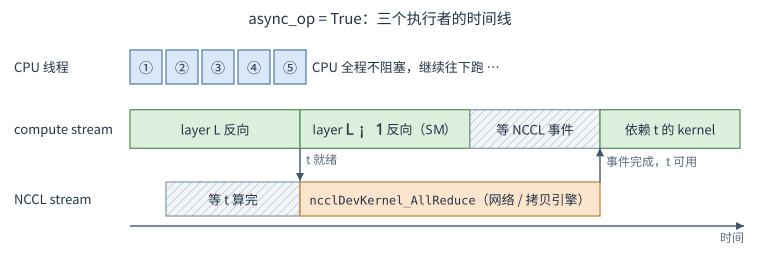

1. CPU 把 layer L 的反向 kernel 提交到 compute stream。
2. CPU 调 `all_reduce(t, async_op=True)`，立即拿到 Work 句柄，CPU 不阻塞；NCCL stream 上的 kernel 先等 layer L 把 t 算完。
3. CPU 提交 layer L-1 的反向 kernel。之后两条 stream 同时在 GPU 上跑：compute stream 算 layer L-1（占用 SM），NCCL stream 跑 `ncclDevKernel_AllReduce`（占用网络 / 拷贝引擎）。
4. CPU 调 `work.wait()`，同样立即返回。它只是让 compute stream 等 NCCL stream 上的一个事件。
5. CPU 提交依赖 t 的后续 kernel。它排在等待之后，事件完成、t 可用时才开始执行。

`async_op=False`（默认）等价于调用后立刻 `wait()`——注意即使如此 CPU 也**不**阻塞，只是让计算 Stream 排在通信之后。真正的 CPU 阻塞只发生在 `.item()`、`synchronize()` 这类[《性能优化与调试》](/pytorch-performance-optimization-and-debugging.html)讨论过的同步点。

> [!NOTE] Java 经验参照：Work 与 CompletableFuture
> `Work` 的角色像 `CompletableFuture`：发起异步操作时拿到句柄，之后再要求「完成后才继续」。但 `CompletableFuture.join()` 阻塞的是调用它的 Java 线程；NCCL 后端的 `work.wait()` 默认只在 GPU 上登记「计算 Stream 等通信 Stream 的一个事件」，Python 线程立即往下走。所以在 `wait()` 前后用 `time.time()` 计时量不出通信耗时，要看 Profiler 的 GPU 时间线。

这个机制是"通信与计算重叠"的基础：反向传播还在算后面几层的梯度时，前面几层的梯度已经在通信 Stream 上做 all_reduce。两条 Stream 同时占用 GPU 的不同资源（SM 算力 vs 网络/拷贝引擎），互不阻塞。第三章 §2 和第四章 §5 分别是 DDP 和 FSDP 对它的运用。

两个限制：

- 通信 Kernel 也占用少量 SM（NCCL 默认每个 channel 用一个 SM 做数据搬运，常见配置下共占用几个到十几个 SM），与计算 Kernel 竞争，重叠期间计算会慢几个百分点；
- "放到另一条 Stream"不等于重叠：如果下一步计算**依赖**通信结果（TP 的 all_reduce 就是这样），再多的 Stream 也只能等。真正的重叠要求重新安排依赖，让通信的输出不是紧接着的那步计算的输入——DDP 的桶、FSDP 的 prefetch、PP 的 micro-batch、异步 TP 的分块（第五章 §7）都是这个原则的不同实现。

## 三、并行策略（1）：DDP——复制模型、切分数据、同步梯度

### 1. 只分片数据

`DistributedDataParallel` 是最简单的并行策略，五类状态的决定是：

| 状态 | 决定 | 说明 |
|---|---|---|
| 数据 | 分片 | 每个 rank 处理 batch 的 1/N |
| 参数 | 复制 | |
| 梯度 | 复制 | 各自算，然后 all_reduce 求平均，使所有 rank 的梯度一致 |
| 优化器状态 | 复制 | 各自更新，因为梯度一致、初始参数一致，更新后参数仍一致 |
| 激活值 | 各自 | 随本 rank 的数据 |

Table: DDP 对五类状态的决定

数学上，N 个 rank 各算 batch/N 个样本的梯度再取平均，与单卡算整个 batch 的梯度完全等价。所以 DDP 训练在数值上等同于用 N 倍 batch 的单卡训练（浮点归约顺序的差异除外），学习率等超参数应按大 batch 调整。

```python title="DDP 的用法"
from torch.nn.parallel import DistributedDataParallel as DDP

model = Block(...).cuda(local_rank)
model = DDP(model, device_ids=[local_rank])           # 构造时从 rank 0 broadcast 参数，保证初始一致
optimizer = torch.optim.AdamW(model.parameters())

for x in loader:                                       # loader 用 DistributedSampler 切分数据（第十章 §2）
    loss = model(x).pow(2).mean()
    loss.backward()                                    # 反向过程中 DDP 自动 all_reduce 梯度
    optimizer.step()                                   # 每个 rank 各自更新，结果一致
    optimizer.zero_grad()
```

训练循环和单卡几乎一样，梯度同步藏在 `backward()` 里。

### 2. Reducer：把 all_reduce 藏进反向

DDP 的核心组件是 C++ 实现的 **Reducer**。它在构造时给每个参数注册一个 autograd hook（`Tensor.register_post_accumulate_grad_hook`，挂在[《自动求导与动态计算图》](/pytorch-autograd-and-dynamic-computation-graph.html)里计算图末端那个把梯度累积进 `.grad` 的节点上），当某个参数的梯度在反向中算完，hook 通知 Reducer。

如果每个参数算完就单独 all_reduce，会有几百到几千次小消息，被第二章 §4 的 α 项吃掉。Reducer 把参数分成**桶（Bucket）**，默认每桶 25 MB（`bucket_cap_mb`），一个桶内所有参数的梯度都就位后，对整个桶发起一次异步 all_reduce。从"参数 → hook → 桶 → all_reduce"的结构看：

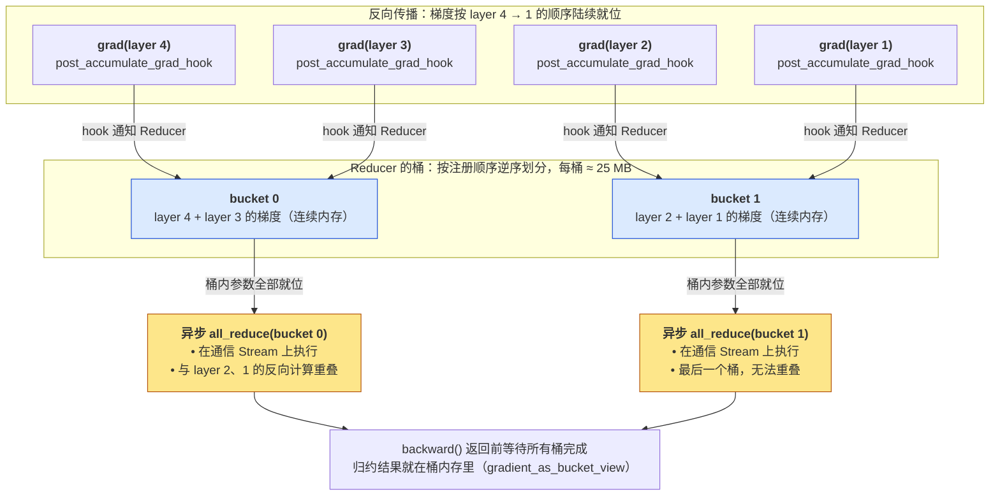

在时间轴上展开就是：

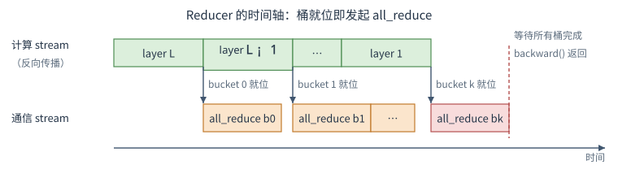

反向是从最后一层往前算的，所以桶按参数注册顺序的**逆序**划分，让最先算完梯度的参数落在第一个桶。第一次迭代 Reducer 会记录实际的梯度就位顺序，据此重建桶的划分。

这就是 DDP 的"通信与计算重叠"：除最后一个桶外，所有通信都隐藏在反向计算之后。反向越长、桶越多，隐藏得越好；模型很小时反向本身很短，通信藏不住，加速比下降。桶大小是权衡：桶越大，α 项越少，但第一个桶就位得越晚、最后一个桶暴露得越多。

`gradient_as_bucket_view=True` 让参数的 `.grad` 直接是桶内存的视图，省一次拷贝和一份梯度显存。`static_graph=True` 告诉 DDP 计算图每次迭代相同，可以跳过未使用参数的检查，并允许一次反向中多次调用同一模块的参数正确归约。

### 3. 显存账：DDP 不省显存

DDP 复制了参数、梯度和优化器状态，每个 rank 的静态显存与单卡相同：

- 每 rank 静态显存 = 16P 字节（Adam + 混合精度，[《性能优化与调试》第八章的「混合精度对显存的两面」](/pytorch-performance-optimization-and-debugging.html#2-混合精度对显存的两面)）；
- 7B 模型 → 每卡 112 GB → 无论多少张卡，DDP 都放不下。

DDP 解决的**只是吞吐极限**。它降低的是每卡的 batch，从而降低激活值显存，但静态部分一字节不少。

通信量：每 step 一次梯度 all_reduce，每 rank 收发约 2 倍梯度字节数（fp32 梯度即 2 × 4P = 8P 字节；后文简写为 **2P 量级**，指以状态大小为单位的倍数）。

### 4. 通信压缩：`register_comm_hook`

DDP 允许替换桶的通信逻辑：

```python title="register_comm_hook：bf16 压缩与 PowerSGD"
from torch.distributed.algorithms.ddp_comm_hooks import default_hooks, powerSGD_hook

# 方案一：梯度 cast 成 bf16 再 all_reduce，通信量减半
model.register_comm_hook(state=None, hook=default_hooks.bf16_compress_hook)

# 方案二（二选一——一个 DDP 实例只能注册一个 hook，重复注册会报错）：
# PowerSGD 低秩近似，通信量可降一个数量级，有精度代价
state = powerSGD_hook.PowerSGDState(process_group=None, matrix_approximation_rank=1, start_powerSGD_iter=1000)
model.register_comm_hook(state, powerSGD_hook.powerSGD_hook)
```

前者几乎无损（归约在 bf16 上做，累加误差略大于 fp32）；后者是有损压缩，适合带宽极度受限（跨数据中心、以太网）的场景。hook 拿到的是整个桶的 Tensor，返回一个 Future——自定义的通信策略都从这里进。

### 5. 几个必须知道的细节

**梯度累积**：如果每次 `backward()` 都同步，累积 4 次就通信 4 次。`no_sync()` 关闭中间几次的同步：

```python title="no_sync 做梯度累积"
for i, x in enumerate(loader):
    ctx = model.no_sync() if (i + 1) % 4 != 0 else contextlib.nullcontext()
    with ctx:
        model(x).pow(2).mean().backward()             # 前 3 次只累积，不通信
    if (i + 1) % 4 == 0:
        optimizer.step(); optimizer.zero_grad()      # 第 4 次 backward 同步累积后的梯度
```

**未使用的参数**：Reducer 等待桶内所有参数的梯度就位。如果某次前向有参数没参与计算（条件分支跳过了某个子模块），它的梯度永远不会来，桶永远不就位，`backward()` 挂起。`find_unused_parameters=True` 让 DDP 在每次前向后遍历计算图找出未使用的参数并标记为就位，代价是每步多一次图遍历。更好的做法是让模型结构静态。

**不等长的输入**：各 rank 的数据量不同时，先跑完的 rank 退出循环，其他 rank 的 all_reduce 永远等不到它。`Join` 上下文让先结束的 rank 继续参与"影子"集合通信直到所有人结束：

```python title="Join 处理不等长输入"
from torch.distributed.algorithms.join import Join
with Join([model]):
    for x in loader: ...
```

生产中更常见的做法是让 `DistributedSampler` 保证等长（第十章 §2）。

**BatchNorm**：每个 rank 只看到 batch/N 的样本，统计量是局部的。`nn.SyncBatchNorm.convert_sync_batchnorm(model)` 让 BN 在 all_reduce 统计量之后归一化。LayerNorm 按样本归一化，没有这个问题。

**随机性**：Dropout 等操作在各 rank 上应使用**不同**的随机数（否则相当于没有增加样本多样性），而参数初始化应**相同**（DDP 构造时的 broadcast 保证了这一点，即使各 rank 初始化不同）。

**`torch.compile`**：`torch.compile(DDP(model))` 时，Dynamo 的 DDPOptimizer 会在桶边界插入 graph break（见[《编译执行与图优化》](/pytorch-compilation-and-graph-optimization.html)），让编译后的图仍能在反向中触发 Reducer 的 hook。否则整张图的反向作为一个整体，所有梯度同时就位，桶的重叠机制失效。

### 6. 何时够用

模型能放进单卡、且激活值留有余量时，DDP 是首选：实现简单，通信量最小（2P 量级），几乎无额外计算开销。第十一章案例的第一步就是它。超出单卡容量，进入下一章。

## 四、并行策略（2）：ZeRO 与 FSDP——分片状态

### 1. ZeRO 的三级分片

DDP 中的冗余显而易见：N 个 rank 持有 N 份完全相同的参数、梯度和优化器状态。**ZeRO**（Zero Redundancy Optimizer，DeepSpeed 提出）的思路是逐级消除这些冗余，分三个阶段，每个阶段多分片一类状态：

| 阶段 | 分片的状态 | 每 rank 静态显存（字节） | N=8 时（以 16P 为基准） | 通信量 |
|---|---|---|---|---|
| DDP | 无 | 16P | 16P | 2P |
| **ZeRO-1** | 优化器状态 | 4P + 12P/N | 5.5P | 2P |
| **ZeRO-2** | + 梯度 | 2P + 14P/N | 3.75P | 2P |
| **ZeRO-3** | + 参数 | 16P/N | 2P | 3P |

Table: DDP 与 ZeRO 三级分片的显存与通信量

（16P 的构成：bf16 参数 2 + bf16 梯度 2 + fp32 主参数 4 + Adam 的 m、v 各 4 = 16 字节/参数。优化器状态这里指 fp32 主参数 + m + v 共 12P。）

每级的逻辑：

**ZeRO-1**：优化器状态是最大的一块（12P）。每个 rank 只负责更新 1/N 的参数，只需持有这 1/N 的优化器状态。但更新需要**完整**的梯度对应段——刚好是 reduce_scatter 的输出。所以把 DDP 的 all_reduce 换成 reduce_scatter（每个 rank 拿到自己负责段的归约梯度），更新自己那段参数，再 all_gather 把更新后的参数发给所有人。通信量 P + P = 2P，与 DDP 相同。

**ZeRO-2**：既然只更新 1/N 的参数，那么其余 (N−1)/N 的梯度在 reduce_scatter 之后就没用了，可以立刻释放。梯度显存从 2P 降到 2P/N。通信量不变。

**ZeRO-3**：参数也分片。每个 rank 只持有 1/N 的参数，前向算到某一层时 all_gather 这层的完整参数，算完释放；反向同样再 all_gather 一次，算完梯度后 reduce_scatter。通信量：前向 all_gather P + 反向 all_gather P + reduce_scatter P = **3P**，按元素数比 DDP 的 2P 多 50%。注意这是**元素数**：实际字节还要乘各自的 dtype——常见配置里参数用 bf16 all_gather、梯度用 fp32 reduce_scatter，按字节算是 2P×2 + P×4 = 8 B/参数，与 DDP 对 fp32 梯度 all_reduce 的 2×4 = 8 B/参数**相同**（§7 的 7B 例子就是这种配置）。"多 50%" 只在参数与梯度同 dtype 时成立。

结论用主线表达：**ZeRO-1/2 只改变了"归约后的梯度给谁"，是 all_reduce 恒等式的直接应用，不增加通信；ZeRO-3 把参数也分片，多出的 P 是"用到时凑齐"的代价**。

PyTorch 中 ZeRO-1 对应 `ZeroRedundancyOptimizer`（配合 DDP 使用），ZeRO-3 对应 **FSDP**（Fully Sharded Data Parallel）。ZeRO-2 对应 FSDP 的 `reshard_after_forward=False` 模式（§4）。生产中 FSDP 是主要选择。

### 2. FSDP 的执行流程

以一个 4 层模型、每层作为一个分片单元为例，FSDP 一个 step 的时间线：

- **前向**：layer 1：all_gather(参数₁) → 计算 → 释放完整参数₁（保留分片）；layer 2：all_gather(参数₂) → 计算 → 释放；layer 3、4 同理。
- **反向**：layer 4：all_gather(参数₄) → 计算梯度 → 释放参数₄ → reduce_scatter(梯度₄) → 只保留自己的 1/N；layer 3、2、1 同理。
- **优化器**：每个 rank 更新自己持有的 1/N 参数（fp32 主参数和 m、v 也只有这 1/N）。

任何时刻，显存中只有**一层**（或 prefetch 时两层）的完整参数，其余都是分片。峰值静态显存 ≈ 16P/N + 最大一层的完整参数。这就是 FSDP 能训练超过单卡容量的模型的原因。

每个分片单元在 step 中经历一个状态循环：

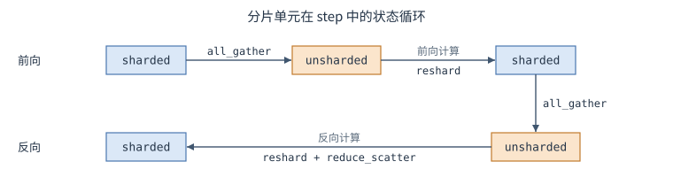

FSDP2 用两条专用 Stream 驱动这个循环：一条 all-gather Stream，一条 reduce-scatter Stream；all_gather 的输出先落到一块连续的通信缓冲区，再按参数切成视图交给模块。梯度的 reduce_scatter 完成后，本地分片梯度累加到 DTensor 参数的 `.grad` 上——优化器看到的就是普通的分片参数和分片梯度。

### 3. FSDP2：`fully_shard`

PyTorch 有两代 FSDP 实现。第一代 `FullyShardedDataParallel`（FSDP1）是一个包装类，把被包装模块的所有参数拍平成一个大 `FlatParameter` 再切分；第二代 **FSDP2** 以 `fully_shard` 函数为入口，按参数逐个切分，用 **DTensor** 表示分片后的参数。FSDP2 是 2.4 以后的推荐路径，本文以它为主线。

```python title="FSDP2：fully_shard 与 MixedPrecisionPolicy"
from torch.distributed.fsdp import fully_shard, MixedPrecisionPolicy
from torch.distributed.device_mesh import init_device_mesh

mesh = init_device_mesh("cuda", (world_size,))
mp = MixedPrecisionPolicy(param_dtype=torch.bfloat16, reduce_dtype=torch.float32)

with torch.device("meta"):                             # 先在 meta 设备上构造，不分配真实内存
    model = Transformer(...)
for block in model.blocks:
    fully_shard(block, mesh=mesh, mp_policy=mp)        # 每个 block 是一个分片单元
fully_shard(model, mesh=mesh, mp_policy=mp)            # 根模块：处理 embedding、输出层等剩余参数
model.to_empty(device="cuda")                          # 分片后再分配：每卡只分配自己的 1/N
model.init_weights()                                   # 各 rank 初始化自己的分片（需要模型提供确定性初始化）

optimizer = torch.optim.AdamW(model.parameters())      # 参数已是 DTensor，优化器只更新本地分片
```

meta 设备初始化是大模型的必要步骤：7B 模型 fp32 参数 28 GB，如果先在 CPU 上物化再分片，8 个进程会同时占用 224 GB 内存。

调用 `fully_shard(module)` 之后：

- `module` 对象本身不变、`model.xxx` 的访问路径不变（FSDP1 会包一层 wrapper），但 `type(module)` 会变：`fully_shard` 动态生成一个 `FSDP<原类名>` 子类混入 `FSDPModule`，改写对象的 `__class__`（`_fsdp_init` 里的做法），由此获得前向/反向 hook 和 `set_*` 系列控制方法；`isinstance(module, 原类)` 仍成立；
- `module` 的每个参数被替换为 `DTensor`，在 mesh 的 dp 维上按 dim 0 分片：`param.to_local()` 拿到本地分片，`param.full_tensor()` 触发 all_gather 得到完整参数；
- 前向 hook 负责 all_gather 和释放，反向 hook 负责 all_gather、释放和 reduce_scatter。

**DTensor** 是 PyTorch 2.x 的分布式 Tensor 抽象：一个逻辑上完整的 Tensor，附带一个 **Placement** 描述它在 DeviceMesh 每一维上是 `Shard(dim)`、`Replicate()` 还是 `Partial()`（各 rank 持有待归约的部分和）。FSDP2 的参数是 `Shard(0)`；TP 的参数按列或按行 `Shard`；两者组合就是 2D 的 Placement。DTensor 上的算子会根据输入的 Placement 自动插入需要的通信（例如两个 `Partial` 相加不需要通信，`Partial` 转 `Replicate` 需要 all_reduce），并推导输出的 Placement。DTensor 让"复制还是分片"从策略的隐含约定变成了 Tensor 元数据的一部分，§3 的 TP 和第十章 §3 的 Checkpoint 都建立在它上面。

FSDP2 相对 FSDP1 的实际差别：

| | FSDP2 | FSDP1 |
|---|---|---|
| 参数表示 | 逐参数 DTensor | FlatParameter（把一组参数拍平拼接） |
| 模块类型 | 不变，无 wrapper | `FullyShardedDataParallel` 包装类 |
| state_dict | 直接是 DTensor，无需特殊上下文 | 需要 `state_dict_type` 上下文切换 full / sharded / local |
| 显存 | 确定性释放，峰值更低 | 依赖 recordStream，释放时机不确定 |
| 灵活性 | 同一单元内可混合 frozen 参数、不同 dtype 参数 | FlatParameter 要求同 dtype、同 requires_grad |

Table: FSDP2 与 FSDP1 的差别

### 4. 分片单元与 wrap 策略

`fully_shard` 施加在哪些模块上，决定了分片单元的粒度，这是 FSDP 最重要的性能决定：

| 分片单元 | 后果 |
|---|---|
| 太大（整个模型一个单元） | all_gather 一次拿到全部参数 → 峰值显存 = 完整模型，FSDP 失去意义 |
| 太小（每个 Linear 一个单元） | 通信碎成上千次小 all_gather → 被 α 项吃掉，无法重叠 |
| 合适（Transformer block） | 参数量足够大（几十 MB 以上），数量适中（几十个） |

Table: 分片单元粒度的三种选择

上面代码里对每个 block 调用 `fully_shard`，再对根模块调用一次，是标准做法。根模块那次 `fully_shard` 管理不属于任何 block 的参数（embedding、最终 LayerNorm、输出投影）。

`reshard_after_forward` 参数控制前向后是否释放完整参数：

| `reshard_after_forward` | 行为 | 对应 |
|---|---|---|
| `True`（默认） | 前向后释放，反向再 all_gather 一次 | ZeRO-3，通信 3P，显存最省 |
| `False` | 前向后保留到反向 | ZeRO-2，通信 2P，显存多 2P（bf16 完整参数） |
| 整数 k | 前向后重新分片到 k 个 rank（而非 N） | 节点内保留、节点间释放的折中 |

Table: reshard_after_forward 的三种取值

### 5. 重叠：prefetch

按 §2 的时间线，每层计算前要等 all_gather 完成，通信不重叠。FSDP 用 **prefetch** 解决：在计算第 i 层时，就在 all-gather Stream 上发起第 i+1 层的 all_gather。

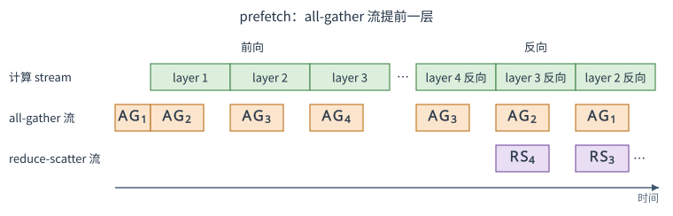

反向同理：算 layer i 的梯度时预取 layer i−1 的参数；layer i 的梯度一算完就交给 reduce-scatter 流，和前一层的反向重叠。

代价是显存中同时存在两层的完整参数。FSDP2 默认隐式 prefetch 下一层（按上一次迭代记录的执行顺序）；显式控制：

```python title="显式控制 forward/backward prefetch"
for i, block in enumerate(model.blocks):
    if i + 1 < len(model.blocks):
        block.set_modules_to_forward_prefetch([model.blocks[i + 1]])
    if i > 0:
        block.set_modules_to_backward_prefetch([model.blocks[i - 1]])
```

重叠是否真的发生，要在 Profiler 时间线里看 NCCL Kernel 是否与计算 Kernel 并排（第十章 §5）。

### 6. 梯度累积与 `torch.compile`

FSDP2 的梯度累积用 `set_requires_gradient_sync`：

```python title="set_requires_gradient_sync 做梯度累积"
for i, x in enumerate(loader):
    model.set_requires_gradient_sync((i + 1) % 4 == 0)      # False：反向后不 reduce_scatter，梯度以完整形态累积在本地
    model(x).pow(2).mean().backward()
    if (i + 1) % 4 == 0:
        optimizer.step(); optimizer.zero_grad()
```

不同步的那几步，梯度必须以**未分片**的形态保留（因为还没归约），显存多出 2P/N × (N−1) 量级；`set_reshard_after_backward(False)` 可以进一步在累积期间保留完整参数，省掉重复的 all_gather，用显存换通信。

与 `torch.compile` 组合的推荐方式是**先编译每个 block，再 `fully_shard`**：FSDP2 的 hook 在模块边界，天然是 graph break 的位置；编译的图在 block 内部，不跨越通信。

### 7. 通信量与 HSDP

FSDP 每 step 通信 3P，其中 2P 是 all_gather 参数（bf16，`param_dtype`），P 是 reduce_scatter 梯度（`reduce_dtype`，fp32 时字节数翻倍）。以 7B 模型、8 卡为例：

| 项 | 量 |
|---|---|
| all_gather × 2 | 2 × 7e9 × 2 B = 28 GB |
| reduce_scatter | 7e9 × 4 B = 28 GB（fp32 归约） |
| 每 rank 每 step | 56 GB 逻辑量；ring 实际每 rank 发送 (N-1)/N × 56 ≈ 49 GB（N=8），接收同量 |
| NVLink 300 GB/s | ≈ 190 ms（按 56 GB 粗算；这里的 300 GB/s 是 all_reduce 的总线带宽口径，已含 ring 的倍数） |
| IB 50 GB/s/GPU | ≈ 1.1 s |

Table: 7B 模型 8 卡 FSDP 每 step 的通信量与传输时间

（同一个 7B 模型用 DDP：fp32 梯度 all_reduce = 7e9 × 4 B × 2 = 56 GB——与上面 FSDP 的字节数一样多。§3 说的"3P 对 2P"是元素数，字节账取决于 dtype 配置。）

节点内 190 ms 可以藏在几秒的计算里；跨节点 1.1 s 就很难藏。**HSDP**（Hybrid Sharded Data Parallel）用一个 2D mesh 折中：

```python title="HSDP：2D mesh 分片加复制"
mesh = init_device_mesh("cuda", (num_nodes, gpus_per_node), mesh_dim_names=("replicate", "shard"))
fully_shard(block, mesh=mesh)    # 2D mesh：在 shard 维分片，在 replicate 维复制
```

以 4 节点 × 8 卡为例，这个 2D mesh 的排布和两类通信各走哪条链路：

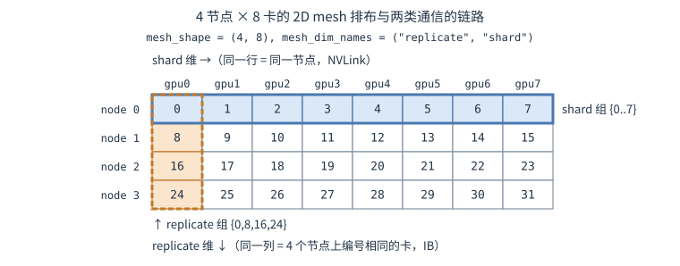

- shard 组 = 一行，如 {0..7}：参数在组内分片，all_gather / reduce_scatter 在行内进行，走 NVLink。
- replicate 组 = 一列，如 {0,8,16,24}：参数在组间复制，对自己持有的 1/8 梯度分片做 all_reduce，走 IB。

参数在节点**内**分片（all_gather 和 reduce_scatter 走 NVLink），在节点**间**复制：每个节点 reduce_scatter 之后，各 rank 只对自己持有的 **1/8 梯度分片**做跨节点 all_reduce。跨 IB 的流量因此从 FSDP 的 3P 降到 2P/8，而且可以按层与反向重叠。用主线的话说：同一类状态在不同的 mesh 维上做不同的决定。代价是每个节点持有完整的一份状态，显存不再随节点数下降。

> [!NOTE] Java 经验参照：分片乘副本
> HSDP 的布局就是 Kafka 的 partition × replica、Elasticsearch 的 shard × replica：先分片解决容量，再给每个分片加副本。目的不同：存储系统加副本是为了可用性，一个副本挂了由另一个接替；HSDP 的副本是为了让更多的卡各算一份数据，任何一个 rank 挂掉整个作业照样要重启。

### 8. CPU offload 与显存的再一次交换

FSDP 允许把分片后的参数、梯度和优化器状态放到 CPU 内存，只在计算时搬到 GPU：

```python title="CPUOffloadPolicy"
from torch.distributed.fsdp import CPUOffloadPolicy
fully_shard(block, mesh=mesh, offload_policy=CPUOffloadPolicy())
```

这是[《性能优化与调试》第八章的「内存：CPU 侧的空间什么时候重要」](/pytorch-performance-optimization-and-debugging.html#9-内存cpu-侧的空间什么时候重要)提到的 ZeRO-Offload：GPU 显存降到只剩激活值和当前层参数，代价是每层参数经过 PCIe 往返，PCIe 带宽（64 GB/s）比 NVLink 低一个数量级，通常只在显存实在不够、又不能加卡时使用。

### 9. 混合精度策略

`MixedPrecisionPolicy` 与[《nn.Module 与训练系统》](/pytorch-module-and-training-system.html)的 `autocast` 不同，它作用在**参数存储**层面：

- **`param_dtype`**：all_gather 时把 fp32 分片 cast 成 bf16 再通信 → 通信量减半，计算用 bf16；
- **`reduce_dtype`**：reduce_scatter 用的 dtype；fp32 更稳定，代价是梯度通信量翻倍；
- **本地分片**：始终是 fp32 主参数，优化器在 fp32 上更新（理由见[《性能优化与调试》第六章的「处方二的代价：数值稳定性」](/pytorch-performance-optimization-and-debugging.html#6-处方二的代价数值稳定性)）。

它比 autocast 更彻底（不需要每个算子判断是否 cast），且与 FSDP 的通信天然结合。两者可以叠加。

## 五、并行策略（3）：TP——切分一层内部

DDP 和 FSDP 都是**数据并行**：每个 rank 处理不同的数据，对**同一个完整模型**做前向和反向。FSDP 分片的只是状态的存储，计算时仍然要把一层的参数凑齐——所以单层的参数和它的激活值必须放进一张卡。当单层大到放不下（超大 hidden 维），或者 FSDP 的 3P 通信在跨节点时藏不住，就需要切分**计算本身**。

**张量并行**（Tensor Parallel，TP）把一个 Linear 层的权重矩阵切开，TP 组内的每个 rank 算一部分输出、**处理同一份数据**。

### 1. 两种切法：列并行与行并行

一个 Linear 层 Y = XW，X 是 [tokens, H_in]，W 是 [H_in, H_out]。切 W 有两种方向：

| 切法 | 每个 rank 持有 | 本地计算 | 输入 | 输出 | 通信 |
|---|---|---|---|---|---|
| 列并行（Colwise）<br/>按输出维切 | W = [W₀ \| W₁ \| W₂ \| W₃]<br/>W 的 H_out/N 列 | Yᵢ = X Wᵢ | X 完整（复制） | Yᵢ 是 Y 的第 i 段列<br/>Y = [Y₀ \| Y₁ \| Y₂ \| Y₃]：各 rank 的输出互不重叠，拼起来才是 Y | 无 |
| 行并行（Rowwise）<br/>按输入维切 | W = [W₀ ; W₁ ; W₂ ; W₃]<br/>W 的 H_in/N 行 | Zᵢ = Xᵢ Wᵢ | Xᵢ 是 X 的第 i 段列（分片） | Zᵢ 是完整形状的部分和<br/>Z = Z₀ + Z₁ + Z₂ + Z₃：各 rank 的输出必须相加 | all_reduce |

Table: 列并行与行并行的两种切法

列并行的输入是复制的、输出是分片的；行并行的输入是分片的、输出是部分和。**列并行的输出分片形状恰好是行并行需要的输入分片**——所以两者可以直接相连而不需要中间通信：

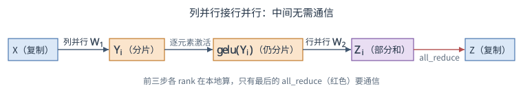

这正是 Transformer MLP 的结构：fc1（H → 4H）列并行，gelu 逐元素在分片上独立算，fc2（4H → H）行并行，末尾一次 all_reduce。中间 4H 维的激活从头到尾都是分片的，**不需要凑齐**。整个 MLP 前向只通信一次。

### 2. 反向也要通信：f 和 g

训练不只有前向。把列并行和行并行的边界看成两个算子 f 和 g（Megatron-LM 的记法）：

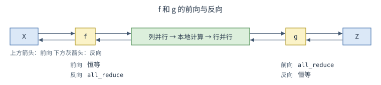

| 算子 | 前向 | 反向 |
|---|---|---|
| f | 恒等（X 已复制，直接用） | all_reduce（每个 rank 算出的 ∂L/∂X 只是自己分片贡献的部分，要求和） |
| g | all_reduce（部分和 → 完整 Z） | 恒等（∂L/∂Z 已复制，每个 rank 直接用） |

Table: f 和 g 在前向与反向中的通信

f 和 g 互为**共轭**：一个前向通信、反向不通信，另一个反过来。所以一个 MLP 在训练中通信两次：前向 g 处一次，反向 f 处一次。Attention 同理（下一节）。一个 Transformer 层 = Attention + MLP，**训练中每层每 step 共 4 次 all_reduce**（推理只有前向，每层 2 次）。

权重的梯度不需要通信：每个 rank 持有 Wᵢ，∂L/∂Wᵢ 只依赖本地的输入分片和输出梯度，算完就是最终值。用主线的话说，TP 的参数、梯度、优化器状态都是分片的，且分片之间**没有冗余**，所以不需要归约。

### 3. Attention 与 Embedding 的切分

**Attention 按 head 切**。q、k、v 的三个投影是列并行，每个 rank 得到 heads/N 个 head 的 q、k、v（H/N 列刚好是 heads/N 个 head 拼起来）；attention 计算在 head 之间独立，各 rank 本地完成；输出投影 proj 是行并行，末尾 all_reduce。要求 head 数能被 N 整除；GQA 时 kv head 数也要能整除。

这里有一个工程细节：[《性能优化与调试》](/pytorch-performance-optimization-and-debugging.html)的案例把 q、k、v 合并成一个 `qkv` Linear（3H 列）。对它做列并行，每个 rank 拿到的是 3H/N 列——是 q 的一段、k 的一段、v 的一段**交错**在一起，本地 `split(H, dim=-1)` 会切错。要么把 qkv 拆成三个 Linear，要么在切分时按 [q 段, k 段, v 段] 的顺序重排权重（Megatron 的做法）。第十一章案例会先做这个改动。

**Embedding 按 vocab 切**（行并行的变体）：每个 rank 持有词表的 1/N 行，查表时不在自己范围内的 token 输出 0，然后 all_reduce——只有一个 rank 贡献非零值，求和等于查表结果。

**输出层与 loss**：输出投影 H → V 列并行，logits 按 vocab 维分片为 [B, S, V/N]。logits 是训练中最大的单个激活（V 通常 32k～256k），all_gather 它代价很高。`loss_parallel` 直接在分片的 logits 上算 cross-entropy：每个 rank 算本地 vocab 段的 exp 和，all_reduce 一个 [B, S] 的标量场得到 softmax 分母，再各自算自己那段的 loss。通信量从 B·S·V 降到 B·S。

### 4. PyTorch 的 TP API

```python title="PyTorch 的 TP API：parallelize_module 与 tp_plan"
from torch.distributed.tensor.parallel import (
    parallelize_module, ColwiseParallel, RowwiseParallel, SequenceParallel, PrepareModuleInput, loss_parallel
)
from torch.distributed.tensor import Shard, Replicate

tp_mesh = mesh["tp"]

parallelize_module(model, tp_mesh, {
    "tok_embeddings": RowwiseParallel(input_layouts=Replicate()),         # vocab 切分
    "output":         ColwiseParallel(output_layouts=Shard(-1), use_local_output=False),   # logits 保持 vocab 分片
})
for block in model.blocks:
    parallelize_module(block, tp_mesh, {
        "attn.wq":   ColwiseParallel(),
        "attn.wk":   ColwiseParallel(),
        "attn.wv":   ColwiseParallel(),
        "attn.wo":   RowwiseParallel(),
        "mlp.fc1":   ColwiseParallel(),
        "mlp.fc2":   RowwiseParallel(),
    })
    block.attn.n_heads //= tp_mesh.size()          # 本地只有 heads/N 个 head，view 时用本地数

with loss_parallel():
    loss = F.cross_entropy(logits, targets)        # logits 是 vocab 分片的 DTensor
```

`parallelize_module` 把指定子模块的参数替换成对应 Placement 的 DTensor（`ColwiseParallel` → 权重 `Shard(0)`，`RowwiseParallel` → `Shard(1)`，注意 PyTorch 的 Linear 权重是 [out, in]），并在模块的输入/输出边界按 `input_layouts` / `output_layouts` 插入通信。默认 `use_local_output=True`，模块输出是普通的本地 Tensor，所以 attention 内部的 view / transpose 按本地 shape 写即可——这就是 `n_heads //= N` 那行的原因。

### 5. 通信量与适用范围

TP 每次 all_reduce 的数据是一层的输入/输出激活 [B, S, H]：

- 每次 all_reduce：B × S × H × 2 字节（bf16）；
- 每层每 step：4 次（前向 2、反向 2）→ 8 · B·S·H 字节，ring 下每 rank 实际收发约 2 × 8 · B·S·H · (N−1)/N；
- 每 step 总量：× L 层。

例：B=8, S=4096, H=4096, L=32 → 每次 all_reduce 268 MB，每 step 逻辑通信量 32 × 4 × 268 MB ≈ 34 GB。

与 FSDP 的关键区别：**FSDP 通信参数（∝ P），TP 通信激活（∝ B·S·H·L）**。更要紧的是时机：TP 的 all_reduce 在计算的**关键路径**上——下一个算子的输入依赖它，无法用 Stream 重叠（第二章 §5 的第二个限制）。34 GB 在 NVLink 300 GB/s 下是 110 ms 的纯暴露时间；在 IB 上是 700 ms 且加上 4L 次跨节点延迟。所以：

- TP 只在 NVLink 范围内做，TP 度 ≤ 节点内 GPU 数（8）
- TP 度越大，每卡的 GEMM 越小（[tokens, H] × [H, 4H/N]），GPU 利用率下降——N=8 通常已是效率下限

用主线表达 TP：

- **参数 / 梯度 / 优化器状态**：层内分片，分片间无冗余，不需要归约
- **激活值**：中间激活分片（4H 维、head 维），层的输入/输出复制（all_reduce 后每个 rank 都有完整值）
- **数据**：复制，TP 组内所有 rank 处理同一份数据

### 6. Sequence Parallel：把复制的激活也切掉

TP 下层的输入/输出激活是复制的。LayerNorm、Dropout、残差相加作用在这些复制的激活上，N 个 rank 算了 N 遍一样的东西，还各存了一份。**Sequence Parallel**（Megatron-LM 的 SP，与 CP 不同）把这些区域的激活按**序列维**切分，每个 rank 只持有 S/N 个 token 的 LayerNorm 输入输出。

进出 TP 区域时的转换，正是那个恒等式：

- **原来**：g 是 all_reduce（部分和 → 完整），f 是恒等；
- **现在**：g 是 reduce_scatter（部分和 → 序列分片，每 rank 只拿 S/N 个 token 的完整和），f 是 all_gather（序列分片 → 完整，进入列并行前凑齐所有 token）；
- **反向**：g 的反向是 all_gather，f 的反向是 reduce_scatter。

把一个 Transformer 子层（以 MLP 为例）从进到出画出来，哪段激活是序列分片、哪段是 hidden 分片、哪里发生通信：

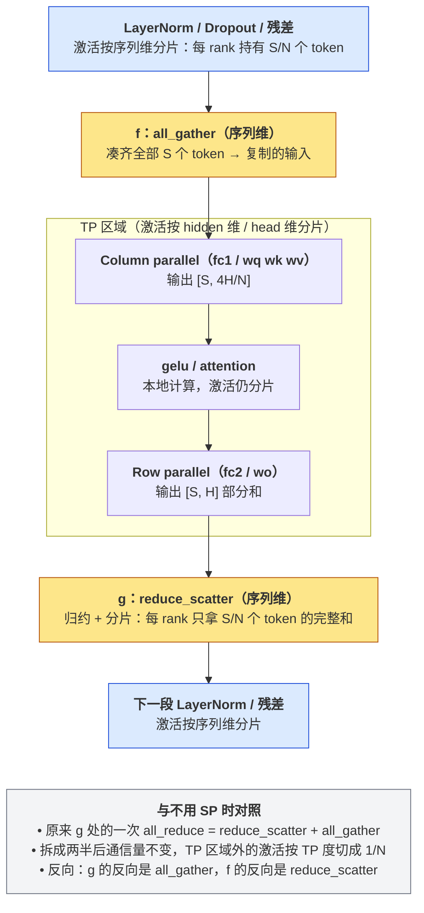

reduce_scatter + all_gather 的总通信量与一次 all_reduce 相同，所以 SP **不增加通信**，却把 TP 区域外所有激活的显存降到 1/N。它总是与 TP 一起开。

```python title="Sequence Parallel 的 tp_plan"
parallelize_module(block, tp_mesh, {
    "attn_norm": SequenceParallel(),                                          # LayerNorm 输入按 Shard(1)（序列维）
    "attn":      PrepareModuleInput(input_layouts=Shard(1), desired_input_layouts=Replicate()),   # f：all_gather
    "attn.wq":   ColwiseParallel(), "attn.wk": ColwiseParallel(), "attn.wv": ColwiseParallel(),
    "attn.wo":   RowwiseParallel(output_layouts=Shard(1)),                    # g：reduce_scatter 而不是 all_reduce
    "mlp_norm":  SequenceParallel(),
    "mlp":       PrepareModuleInput(input_layouts=Shard(1), desired_input_layouts=Replicate()),
    "mlp.fc1":   ColwiseParallel(), "mlp.fc2": RowwiseParallel(output_layouts=Shard(1)),
})
```

### 7. 异步 TP：让关键路径上的通信也能重叠

§5 说 TP 的 all_reduce 无法重叠，这在"整块通信、整块计算"的粒度上是对的。**异步 TP**（Async TP / 微流水线）把 all_gather + 矩阵乘、矩阵乘 + reduce_scatter 各拆成若干块，块间流水：

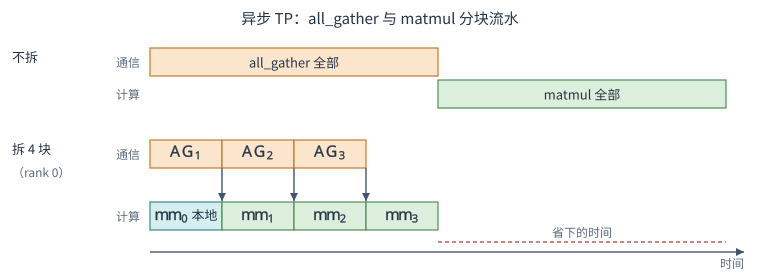

拆成 4 块之后，第 0 块是本 rank 自己的分片，不用等通信，matmul 马上开算；算它的同时去拿第 1 块，之后每块的传输都藏在上一块的 matmul 后面。PyTorch 的实现（v2.10.0 `torch/distributed/_symmetric_memory/__init__.py` 的 `_pipelined_multi_all_gather_and_consume`）就是这个顺序：先 `shard_consumer(shard, rank)` 算本地分片，再按 `(step + rank) % group_size` 依次拷贝远端分片并计算。

PyTorch 通过 **对称内存**（`torch.distributed._symmetric_memory`，节点内 GPU 直接读写彼此显存）实现块间的细粒度传输，Inductor 在编译时识别 SP 的 all_gather → matmul 和 matmul → reduce_scatter 模式并做替换：

```python title="启用对称内存与 micro-pipeline TP"
from torch.distributed._symmetric_memory import enable_symm_mem_for_group
enable_symm_mem_for_group(tp_mesh.get_group().group_name)
torch._inductor.config._micro_pipeline_tp = True
model = torch.compile(model)
```

这是[《编译执行与图优化》](/pytorch-compilation-and-graph-optimization.html)里的编译器与本篇通信的交汇点：图优化的对象不再只是算子，也包括通信。推理引擎在前向图上做的是同一件事。

## 六、并行策略（4）：PP——切分层与层之间

**流水线并行**（Pipeline Parallel，PP）把模型按层分成 K 段（stage），每段放在一张卡（或一个 TP 组）上，数据像流水线一样依次经过：

- **stage 0（卡 0）**：embedding + layer 1-8
- **stage 1（卡 1）**：layer 9-16
- **stage 2（卡 2）**：layer 17-24
- **stage 3（卡 3）**：layer 25-32 + 输出层 + loss

通信只有相邻 stage 之间的 send/recv：前向传边界激活 [B, S, H]，反向传它的梯度。每个 micro-batch 每个边界 2 × B·S·H × 2 字节，与 TP 的每层 4 次 all_reduce 比是零头，且点对点、不需要所有 rank 同步——**可以跨节点**。这是 PP 相对 TP 的优势。

用主线表达 PP：

- **参数 / 梯度 / 优化器状态**：按层分片，每 stage 只有自己的层，不需要任何归约
- **激活值**：按层分片，只有 stage 边界的激活需要传输
- **数据**：切成 micro-batch 依次流过所有 stage

### 1. 气泡

问题是**气泡（bubble）**：stage 1 必须等 stage 0 算完才能开始，反向同理。如果一个 batch 整体流过，任何时刻只有一个 stage 在工作，利用率 1/K。解法是把 batch 切成 M 个 **micro-batch**，让多个 micro-batch 在不同 stage 上同时流动。

### 2. 训练调度的演进

**GPipe**：所有 micro-batch 先做完前向，再做反向：

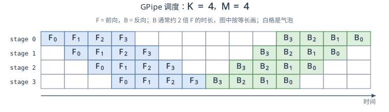

气泡占总时间的比例 ≈ (K−1) / (M+K−1)：M=4、K=4 时是 43%，M=32、K=4 时是 9%。

M 越大气泡越小，但 GPipe 要把 M 个 micro-batch 的激活全部保存到反向开始——激活显存 ∝ M。

**1F1B**：进入稳态后，每个 stage 做一次前向就紧接着做一次（更早的 micro-batch 的）反向：

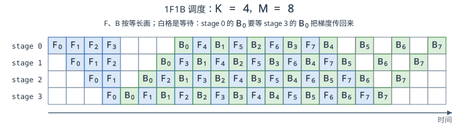

（图按真实时间轴画，M 取 8 才看得到稳态。stage 0 做完 F₃ 之后，B₀ 要等 stage 3、2、1 依次把梯度传回来才能开始，中间三格就是等待；总长和 GPipe 一样是 2(M+K−1) 格。）

气泡与 GPipe 相同，但任一时刻每个 stage 最多持有 K 个 micro-batch 的激活（而不是 M 个），**显存不随 M 增长**——于是可以放心增大 M 来压气泡。这是训练 PP 的默认调度。

**Interleaved 1F1B**：每个 rank 持有 v 段**不连续**的层（如 rank 0 持有 layer 1-4 和 17-20），相当于虚拟 stage 数变成 vK，气泡缩小到 1/v，代价是 stage 边界数变成 v 倍、P2P 通信量也 v 倍。

**Zero Bubble**：把反向拆成两半——对输入的梯度 B（关键路径，下游 stage 等它）和对权重的梯度 W（不在关键路径上，任何时候算都行）。W 被填进原来的气泡里，理论上可以把气泡压到零，代价是调度复杂、显存更高。

| 调度 | 气泡 | 激活显存（每 stage） | 通信 |
|---|---|---|---|
| GPipe | (K−1)/(M+K−1) | ∝ M | 每边界 2 次 / micro-batch |
| 1F1B | 同上 | ∝ K | 同上 |
| Interleaved 1F1B | 上者 / v | ∝ K（略高） | × v |
| Zero Bubble | → 0 | 更高 | 同 1F1B |

Table: 四种流水线调度的气泡、激活显存与通信

### 3. PyTorch 的 PP API

`torch.distributed.pipelining`（2.4 起以 prototype 状态进入主库）提供 stage 抽象和上述调度。手工切分是最可控的方式：

```python title="torch.distributed.pipelining 手工切分"
from torch.distributed.pipelining import PipelineStage, Schedule1F1B, ScheduleInterleaved1F1B

# 每个 rank 只构造自己那段模型；其他 stage 的层根本不存在于本进程
layers_per_stage = len(model.blocks) // num_stages
stage_mod = StageModule(model, start=rank * layers_per_stage, end=(rank + 1) * layers_per_stage,
                        has_embedding=(rank == 0), has_head=(rank == num_stages - 1))
stage = PipelineStage(stage_mod, stage_index=rank, num_stages=num_stages, device=device)
schedule = Schedule1F1B(stage, n_microbatches=16, loss_fn=loss_fn)

for x, y in loader:
    if rank == 0:                    schedule.step(x)                          # 第一个 stage 喂输入
    elif rank == num_stages - 1:     schedule.step(target=y, losses=losses)    # 最后一个 stage 算 loss
    else:                            schedule.step()                           # 中间 stage 只传递
    optimizer.step(); optimizer.zero_grad()
```

`schedule.step` 内部按调度表执行 micro-batch 的前向、反向和 stage 间的 send/recv；micro-batch 的梯度在本 stage 内累积，最后由普通的优化器更新。

也可以让框架自动切分——`pipeline()` 用 `torch.export` 追踪整个模型（[《编译执行与图优化》](/pytorch-compilation-and-graph-optimization.html)的导出机制），在指定的模块边界切开：

```python title="pipeline() 自动切分"
from torch.distributed.pipelining import pipeline, SplitPoint
pipe = pipeline(model, mb_args=(example_x,), split_spec={"blocks.8": SplitPoint.BEGINNING, "blocks.16": SplitPoint.BEGINNING, "blocks.24": SplitPoint.BEGINNING})
stage = pipe.build_stage(rank, device)
```

代价是模型必须可追踪，且完整模型要先构造出来（可以在 meta 设备上）。

### 4. 负载均衡

stage 划分不均匀时，最慢的 stage 决定节奏，其他 stage 等它。第一段有 embedding、最后一段有输出层和 loss（V 维的大矩阵乘），按层数平分往往不均匀；输出层的 logits 也让最后一段显存更高。常见做法是首尾 stage 少放一两层。1F1B 下还要考虑第一段保存激活最多（等最后一段的反向回来）。

PP 的代价不是通信而是气泡和负载不均。推理侧的 PP 面对另一组问题：没有反向所以没有 1F1B 的调度问题，但请求长度动态变化，气泡更难消除；KV Cache 按 stage 分布。

## 七、并行策略（5）：CP——切分序列

TP 和 PP 切的都是参数。当序列很长（32k、128k 以上）时，瓶颈变成**激活值**：每层激活 ∝ B·S·H，attention 的 score 矩阵 ∝ S²（SDPA 不物化它，但计算量仍 ∝ S²）。即使 B=1，S=128k 时一层的激活也是 GB 级；FSDP 不分片激活，TP 只分到 1/8。

**上下文并行**（Context Parallel，CP）把序列切成 N 段，每个 rank 持有 S/N 个 token 的全部激活。用主线表达：

- **激活值**：按序列维分片，每 rank 持有 S/N 个 token
- **参数 / 梯度 / 优化器状态**：复制（CP 组内），像 DDP 一样在反向中归约
- **数据**：同一批序列，每个 rank 处理其中一段

Transformer 中除了 attention，所有算子都是逐 token 的（Linear、LayerNorm、gelu 都不跨 token），序列分片后各 rank 独立算，不需要通信。**只有 attention 需要看到全部 token 的 K 和 V**。

### 1. Ring Attention

每个 rank 持有自己那段的 Q、K、V。计算本地 Q 对全部 K、V 的 attention，分 N 步：第 j 步用当前手里的 K、V 块算一块部分 attention，同时把这块 K、V 发给右邻、从左邻收下一块；N 步后每个 rank 的 Q 见过了所有 K、V：

1. step 0：rank i 用 K_i、V_i 算 Q_i 对块 i 的 attention，同时把 K_i、V_i 传给 rank i+1；
2. step 1：rank i 用 K_{i−1}、V_{i−1} 累加 Q_i 对块 i−1 的 attention，同时传下一块；
3. ……到 step N−1 完成。

以 N=4 为例，把每个 rank 在每一步手里持有的 K/V 块列成表，ring 的传递规律一目了然——Q 不动，K/V 每步整体右移一格：

| | step 0 | step 1 | step 2 | step 3 |
|---|---|---|---|---|
| rank 0 | KV₀ | KV₃ | KV₂ | KV₁ |
| rank 1 | KV₁ | KV₀ | KV₃ | KV₂ |
| rank 2 | KV₂ | KV₁ | KV₀ | KV₃ |
| rank 3 | KV₃ | KV₂ | KV₁ | KV₀ |

Table: Ring Attention：每步各 rank 持有的 K/V 块

- rank i 持有 Q_i 不动；K/V 块沿 ring 传给右邻（rank 3 → rank 0 回绕）。所以第 j 步 rank i 手里是 KV_{(i−j) mod 4}。
- 每一步：用手里的 K/V 块算局部 attention 并 online-softmax 累加，同时把这块 K/V send 给右邻 rank i+1、从左邻 rank i−1 recv 下一块 KV_{(i−j−1) mod 4}。传输与本步的 attention 计算重叠。
- 4 步后每个 Q_i 都见过 KV₀ ~ KV₃，得到与不切分时完全相同的结果。

```text title="第 j 步 rank i 的累加"
(out, m, l) ← merge(out, attn(Q_i, KV_{(i−j) mod 4}))   # online softmax
```

"分块算、在线累加"依赖 **online softmax**：每块得到局部的 max 和 exp 和，合并时按 max 差重新缩放——与 FlashAttention 在 SRAM 分块时的技巧完全相同，只是分块跨越的是 GPU 而不是显存层级。K、V 的传输（send/recv）与当前块的 attention 计算重叠，只要每块的计算时间大于传输时间，通信就被隐藏。

通信量：每层前向每 rank 收发 (N−1)/N × 2 × B·(S/N)·H × 2 字节 × N 块 ≈ 4·B·S·H·(N−1)/N 字节（K 和 V 各一份），反向再传一次 K、V 加上它们的梯度。与 TP 同一量级，但**可以重叠**，且 GQA 下 K、V 的 head 数少，通信量随之减少。

因果掩码带来负载不均：序列后段的 token 要 attend 的 key 更多，按顺序切块时最后一个 rank 的计算量是第一个的近 N 倍。解决办法是**zigzag 切分**：把序列切成 2N 块，rank i 拿第 i 块和第 2N−1−i 块，每个 rank 的因果计算量相等。

另一条路线是 **Ulysses**（DeepSpeed）：在 attention 前用 all_to_all 把"序列分片"转成"head 分片"，attention 按 head 本地算完，再 all_to_all 转回序列分片。通信量更少但 CP 度受 head 数限制。两者可以叠加。

### 2. PyTorch 的 CP API

```python title="PyTorch 的 CP API"
from torch.distributed.tensor.experimental import context_parallel
from torch.distributed.tensor.experimental._attention import set_rotate_method

cp_mesh = mesh["cp"]
set_rotate_method("alltoall")          # 或 "allgather"：K/V 块在 ring 上的传递方式

with context_parallel(cp_mesh, buffers=[x, position_ids], buffer_seq_dims=[1, 1], no_restore_buffers={x, position_ids}):
    loss = model(x, position_ids).pow(2).mean()      # 上下文内 SDPA 被替换为 ring attention；输入按序列维自动切分
    loss.backward()
```

`context_parallel` 是一个上下文管理器：进入时把 `buffers` 沿指定维切成本地分片，并把 `F.scaled_dot_product_attention` 替换成 ring 版本；模型代码不用改。API 在 `experimental` 命名空间，接口可能变化；生产训练框架（torchtitan）用的就是它。

CP 组内参数是复制的，所以 CP 通常与 FSDP 共用一个 mesh 维：FSDP 在 dp × cp 展平后的维度上分片参数，梯度归约自然覆盖了 CP 组。

推理侧的 CP 有不同的形态：Prefill 阶段切分序列，Decode 阶段切分 KV Cache，两者的通信模式与训练侧的 Ring Attention 不同，本文不展开。

## 八、并行策略（6）：EP——切分 Expert

MoE（Mixture of Experts）模型的 MLP 由 E 个 expert 组成，每个 token 由 router 选 top-k 个 expert 计算。参数量 ∝ E，但每个 token 的计算量只 ∝ k。E=64、k=2 时参数是稠密模型的 32 倍而计算只有 2 倍——这正是 MoE 的价值，也是它的分布式难点：**参数太多放不下，但每个 expert 的计算又太小不值得 TP**。

**专家并行**（Expert Parallel，EP）把 E 个 expert 分到 N 个 rank，每个 rank 持有 E/N 个 expert 的完整参数：

- **参数（expert）**：按 expert 分片，每 rank E/N 个完整 expert；
- **参数（attention 等稠密部分）**：不受 EP 影响，由 DP / TP 决定；
- **激活值**：token 被路由到 expert 所在的 rank 计算，再送回来。

一个 MoE 层的执行：

- **router**：每个 token 算出 top-k expert 及权重（本地）
- **dispatch**：all_to_all：把 token 的 hidden 发到它选中的 expert 所在 rank
- **expert 计算**：每个 rank 对收到的 token 跑本地 expert（grouped GEMM，E/N 个 expert 各一个小矩阵乘）
- **combine**：all_to_all：结果按原顺序送回 token 所属的 rank，按权重加和

从 rank 0 的一批 token 出发，看它们在 EP 组里走了一圈的路径（rank 1 的 token 走的是对称的路径）：

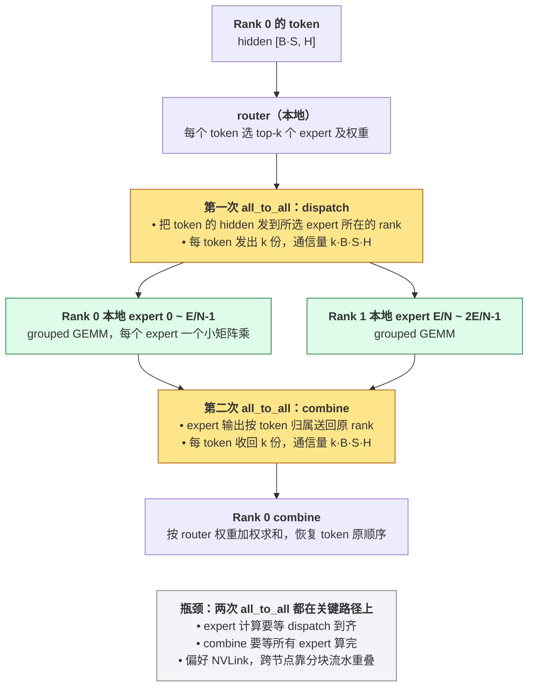

这是第二章 §3 中 all_to_all 的主要用途。通信量：每个 token 发 k 份 hidden 出去再收 k 份回来，每层 2 × k × B·S·H × 2 字节，与 TP 同一量级，且与 TP 一样在关键路径上——所以 EP 也偏好 NVLink，跨节点时要靠分块流水（先到的 token 先算）重叠。

训练特有的两个问题：

**负载不均**：router 是学出来的，热门 expert 收到的 token 可能是冷门的几十倍，持有它的 rank 成为 straggler。训练时加**负载均衡辅助 loss**鼓励均匀路由，或设 **capacity factor** 限制每个 expert 每 step 最多接收的 token 数（超出的 token 被丢弃、直接走残差）。

> [!NOTE] Java 经验参照：按 key 路由与热 key
> dispatch 相当于按 key 把记录 shuffle 到分片，key 是 router 选出的 expert 编号；热门 expert 就是热 key，持有它的 rank 就是倾斜的分片。数据系统处理倾斜靠加盐、拆分热 key，路由规则不变；这里的「哈希函数」是学出来的 router，所以可以直接用辅助 loss 改路由本身，或者用 capacity factor 丢掉超额的 token——后者在数据系统里不可接受，在训练里只是少了一点信号。

**两套数据并行组**：EP 通常与 DP 组合——例如 64 卡，EP=8、DP=8。稠密参数（attention）在全部 64 卡上复制，梯度在 64 卡的组里归约；expert 参数只在 8 个 DP 副本间复制（每个 expert 存在于 8 张卡上），梯度在**另一个** 8 卡的组里归约。两类参数走不同的进程组，FSDP 也要分别施加在两组参数上。这是 EP 在训练中比推理多出来的复杂度。

router 的具体算法、capacity factor 的取舍、grouped GEMM 与 token 重排的 kernel 实现属于模型与算子层的话题，本文只关注 EP 的通信与状态分布。

## 九、并行策略的组合与选择

### 1. 训练 vs 推理：同一组策略，不同的重心

同一组并行策略在推理中也全部用得上，但重心不同。本文的主线放在训练上，两者的差别集中在几点：

| | 训练 | 推理 |
|---|---|---|
| 显存构成 | 16P 静态状态 + 激活值 | 2P 参数 + KV Cache |
| 数据并行的成本 | DDP 复制 16P，需梯度同步；FSDP 分片状态，通信 3P | 复制 2P 参数，**零通信**——所以 DP 在推理中永远是最外层的免费倍增器 |
| 通信的对象 | 参数 / 梯度（∝ P，FSDP）和激活（∝ B·S·H，TP） | 只有激活 |
| 消息大小 | 大（Prefill 式，整个 batch 的激活） | Decode 时 S=1，消息 KB 级，α 主导 → `CustomAllreduce` 等低延迟实现 |
| PP 的难点 | 反向调度、激活显存（1F1B） | 请求动态到达、气泡难消除、KV Cache 按 stage 分布 |
| 重叠的余地 | 反向传播是天然的重叠窗口（DDP 桶、FSDP prefetch） | 前向的关键路径短，重叠靠分块流水 |
| 序列切分 | CP 切激活，与 FSDP 共用维度 | Prefill CP、Decode 切 KV Cache |

Table: 训练与推理在并行重心上的差别

推理没有优化器状态、没有反向，所以 ZeRO / FSDP 那一整节在推理中没有对应物；反过来，KV Cache 的分布和 decode 的小消息优化在训练中没有对应物。

### 2. 决策顺序

训练配置的经验顺序，从内到外：

- 1. 单层放不下、或激活太大而 FSDP 通信藏不住：→ TP（+ SP），限在 NVLink 域内（常见一机 8 卡，因此度 ≤ 8 是部署经验而非硬限制）
- 2. 序列太长：→ CP，与 FSDP 共用维度
- 3. MoE：→ EP，通常 EP × TP = 节点内卡数
- 4. 模型状态放不下：→ FSDP（节点内） / HSDP（跨节点）
- 5. 跨节点带宽不够、层数多：→ PP 跨节点，micro-batch 数 ≥ 4K
- 6. 剩下的所有卡：→ 数据并行维度，最外层

画成决策树，每个叶子标出它应该落在节点内还是跨节点——这也决定了它在 DeviceMesh 中的位置（§3）：

前三步决定**切计算**的维度（都从节点内开始）：

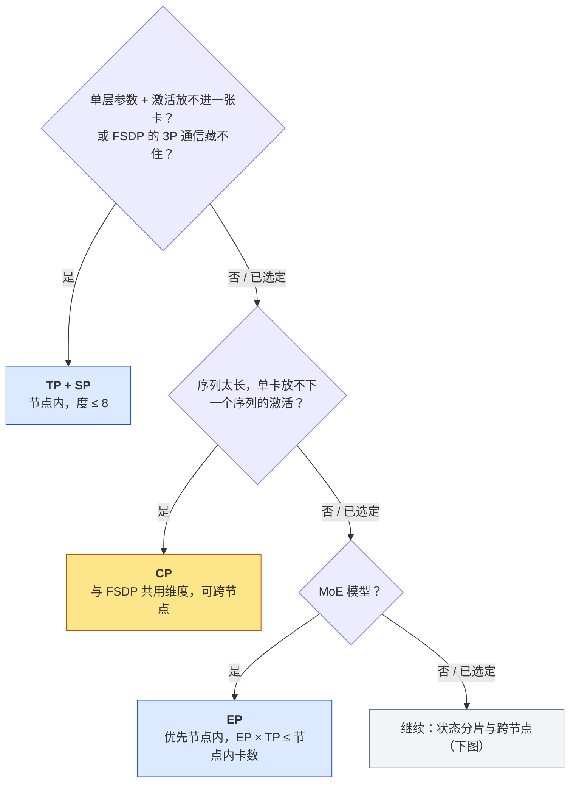

后三步决定**切状态**的维度和跨节点的方式，剩下的卡全部给数据并行：

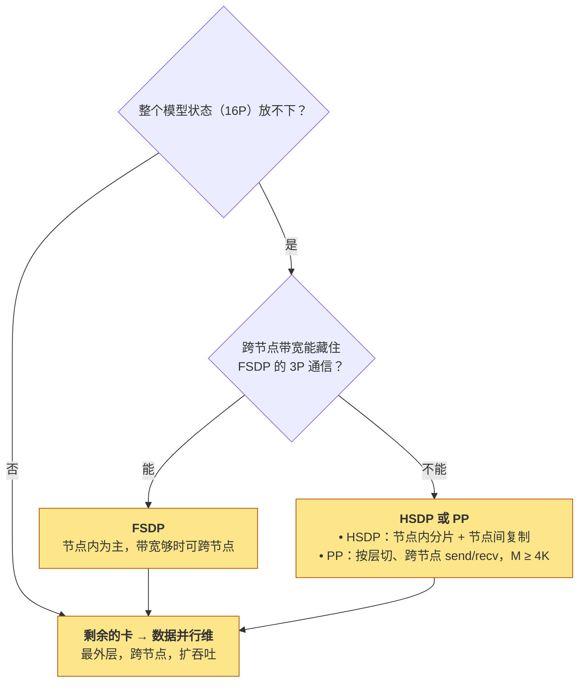

推理侧的决策顺序与此对照：第 4 步不存在（参数复制是免费的），第 6 步变成"DP 多实例"。

### 3. 多维并行的 mesh

各维度组合成 DeviceMesh，从内到外的顺序要与拓扑对齐——**最内层的维度（TP）必须落在同一节点**。以 2 机 16 卡为例：

```python title="2 机 16 卡的 dp × tp mesh"
mesh = init_device_mesh("cuda", (2, 8), mesh_dim_names=("dp", "tp"))
for block in model.blocks:
    parallelize_module(block, mesh["tp"], tp_plan)           # 先 TP：节点内 8 卡切分每一层
    fully_shard(block, mesh=mesh["dp"])                      # 再 FSDP：跨节点 2 路分片 + 数据并行
fully_shard(model, mesh=mesh["dp"])
```

参数变成 2D DTensor：在 tp 维按列/行 `Shard`，在 dp 维按 dim 0 `Shard`。加上 PP（`("pp", "dp", "tp")`）、CP（`("dp", "cp", "tp")`，FSDP 用 `mesh["dp", "cp"]` 展平的维）就是所谓 4D 并行。`torchrun` 的 rank 分配是节点内连续的，`init_device_mesh` 按 rank 顺序填 mesh，所以最后一维自然落在节点内——mesh 维度的顺序写反了，TP 会跨节点，性能差一个数量级。

### 4. 统一表

把第三至八章的所有策略放进一张表。P 为参数量，N 为该并行维度的度，通信量以状态大小为单位：

| 策略 | 计算 | 数据 | 参数 | 梯度 | 优化器状态 | 激活 | 通信原语 | 通信时机 | 每 rank 静态显存 | 通信量 / step |
|---|---|---|---|---|---|---|---|---|---|---|
| DDP | 不切 | 分片 | 复制 | 复制→归约 | 复制 | 各自 | all_reduce | 反向中，按桶 | 16P | 2P |
| ZeRO-1 | 不切 | 分片 | 复制 | 复制→归约 | 分片 | 各自 | reduce_scatter + all_gather | 反向末、更新后 | 4P + 12P/N | 2P |
| ZeRO-2 / FSDP `reshard_after_forward=False` | 不切 | 分片 | 复制（前向后保留） | 分片 | 分片 | 各自 | all_gather + reduce_scatter | 前向前、反向后 | 2P + 14P/N | 2P |
| ZeRO-3 / FSDP | 不切，用前凑齐 | 分片 | 分片 | 分片 | 分片 | 各自 | all_gather ×2 + reduce_scatter | 每层前向前、反向前后 | 16P/N | 3P |
| HSDP | 不切，用前凑齐 | 分片 | 节点内分片、节点间复制 | 同上 + 节点间归约 | 节点内分片 | 各自 | 节点内 AG/RS，节点间 AR（对分片） | 同上 | 16P/N_shard | 3P 节点内 + 2P/N_shard 节点间 |
| TP (+SP) | 切层内 | 复制 | 层内分片 | 层内分片 | 层内分片 | 中间分片；边界复制（SP：序列分片） | all_reduce（SP：RS + AG） | 每层前向 2 次、反向 2 次，关键路径 | 16P/N | 8·B·S·H·L |
| PP | 切层间 | micro-batch | 按层分片 | 按层分片 | 按层分片 | 按层分片 | send/recv | stage 边界 | 16P/N | 4·B·S·H·(K−1)，最小 |
| CP | 切序列 | 序列分段 | 复制 | 复制→归约 | 复制 | 序列分片 | send/recv（ring）或 all_to_all | 每层 attention 内，可重叠 | 16P（与 FSDP 共用维度时 16P/N） | ≈ 4·B·S·H·L（K、V） |
| EP | 切 expert | 分片 | expert 分片、稠密部分复制 | expert 在 EP 内无冗余 | 同参数 | token 路由到 expert | all_to_all ×2 | 每个 MoE 层，关键路径 | expert 部分 /N | 4·k·B·S·H·L_moe |

Table: 各并行策略的统一表

读这张表的方式：**先看"计算"列分清是数据并行（不切）还是模型并行（切），再看"参数"列决定了显存能否放下，最后看"通信原语"和"通信时机"列决定通信能否被计算隐藏**。任何新策略，只要填出它的行，性能特征就清楚了。

## 十、运行时与工程

### 1. 启动：`torchrun`

SPMD 需要有人把同一脚本启动 N 次、告诉每个进程它的 rank、并让它们找到彼此。这就是 `torchrun`（`torch.distributed.run`）：

```bash title="torchrun 单机与多机启动"
# 单机 8 卡
torchrun --nproc_per_node=8 train.py

# 2 机 16 卡：每台机器各执行一次，node_rank 不同
torchrun --nnodes=2 --nproc_per_node=8 --node_rank=0 \
         --rdzv_backend=c10d --rdzv_endpoint=node0:29400 train.py
```

`torchrun` 在每台机器上 fork 出 `nproc_per_node` 个进程，为每个进程设置环境变量：

- **RANK**：全局 rank
- **LOCAL_RANK**：本机内 rank
- **WORLD_SIZE**：总进程数
- **LOCAL_WORLD_SIZE**：本机进程数
- **MASTER_ADDR / MASTER_PORT**：rank 0 所在地址，用于初始化时的 rendezvous

`init_process_group()` 不带参数时读这些变量。所有进程通过 `MASTER_ADDR:MASTER_PORT` 上的 TCPStore 交换 NCCL 的通信 ID，之后的通信不再经过它。

`torchrun` 还提供弹性能力（`--max_restarts`）：某个进程失败时杀掉所有进程、从 checkpoint 重启。这反映了 NCCL 训练的故障模型——**任何一个 rank 挂掉，集合通信就无法完成，整个作业必须重启**。没有"部分失败继续运行"的选项。

> [!NOTE] Java 经验参照：故障模型
> 微服务把部分失败当常态，用熔断、重试、降级把故障隔离在一个实例里。这些手段在这里用不上：一次集合通信缺一个参与者就无法完成，没有可以降级返回的「部分结果」。训练作业的容错只有一种，全体停下、从最近的 checkpoint 重来；`--max-restarts` 只是把这个动作自动化。

### 2. 数据切分与随机性

数据并行要求每个 rank 看到不同的数据。`DistributedSampler` 把数据集的索引按 rank 交错切分：

```python title="DistributedSampler 与 set_epoch"
sampler = DistributedSampler(dataset, shuffle=True)               # 自动读取 rank / world_size
loader = DataLoader(dataset, batch_size=per_rank_batch, sampler=sampler, num_workers=4, pin_memory=True)

for epoch in range(epochs):
    sampler.set_epoch(epoch)                                       # 否则每个 epoch 的 shuffle 顺序相同
    for x in loader: ...
```

多维并行时，sampler 的 `num_replicas` 和 `rank` 应该是**数据并行维度**的度和编号（`mesh["dp"].size()`、`mesh["dp"].get_local_rank()`），而不是 world size——同一 TP 组或 PP 组内的 rank 必须拿到相同的数据。

两个陷阱：

- `set_epoch` 忘了调，每个 epoch 数据顺序一样；
- 各 rank 的数据量必须**相等**（`DistributedSampler` 默认 `drop_last=False` 时会填充到相等）。如果 rank 0 多跑一个 batch，它会多调用一次 `backward` 里的 all_reduce，其他 rank 已经进入下一个 epoch 或退出——hang（§6）。

随机性：参数初始化各 rank 应相同（DDP 的 broadcast 或 FSDP 的确定性 `init_weights` 保证），Dropout 等应不同（各 rank 用 `seed + rank`；TP 组内则必须相同，否则复制的激活不一致）。数据加载的随机性由 sampler 的 `seed` 控制，各 rank 必须相同，否则切分不互补。

> [!NOTE] Java 经验参照：DistributedSampler 与 consumer group
> 结果上它像 Kafka 的 consumer group：一个 topic 的 partition 被组内 consumer 互不重叠地分走。机制上相反：consumer group 由 group coordinator 分配并在成员变化时 rebalance；`DistributedSampler` 没有协调者，每个 rank 用相同的 `seed` 和 `epoch` 各自算出同一个全局排列，再按自己的 rank 取第 rank、rank + N、rank + 2N … 个索引。所以各 rank 的 seed、`set_epoch` 的参数必须一致，否则各算各的排列，切分就会重叠或遗漏，而且不会报错。

### 3. Checkpoint

单卡 checkpoint 是 `torch.save(model.state_dict())`。分布式下问题变复杂：FSDP 的参数是分片的，每个 rank 只有 1/N；TP 的参数按列/行切开。三种选择：

| 方式 | 做法 | 结果 |
|---|---|---|
| Full state_dict | 在 rank 0 上 all_gather 出完整参数再保存 | 一份文件；需要 rank 0 有足够 CPU 内存放下整个模型；保存慢 |
| Sharded state_dict | 每个 rank 保存自己的分片 | N 份文件；快；但加载时并行度必须相同 |
| DCP | `torch.distributed.checkpoint`：保存 DTensor 及其 Placement 元数据 | 加载时可以 reshard 到不同并行度 |

Table: 分布式 checkpoint 的三种选择

**DCP**（Distributed Checkpoint）是推荐方案。它保存每个 DTensor 的本地分片和全局 Placement，加载时根据新的 mesh 重新切分——8 卡训练的 checkpoint 可以在 16 卡上恢复，或从 FSDP+TP 的布局加载到纯 FSDP，或在单卡上加载做推理。

```python title="DCP 保存与加载"
import torch.distributed.checkpoint as dcp
from torch.distributed.checkpoint.state_dict import get_state_dict, set_state_dict

# 保存：每个 rank 并行写自己的分片
model_sd, optim_sd = get_state_dict(model, optimizer)               # 处理 FSDP / TP 的 DTensor，与并行策略无关
dcp.save({"model": model_sd, "optim": optim_sd}, checkpoint_id="ckpt/step_1000")

# 加载：可以是不同的并行配置
model_sd, optim_sd = get_state_dict(model, optimizer)
dcp.load({"model": model_sd, "optim": optim_sd}, checkpoint_id="ckpt/step_1000")
set_state_dict(model, optimizer, model_state_dict=model_sd, optim_state_dict=optim_sd)
```

`dcp.async_save` 先把分片拷到 CPU 再在后台线程写盘，训练只停顿拷贝的时间。`dcp_to_torch_save` 可以把 DCP 格式转成单文件的 `torch.save` 格式供非分布式加载。

优化器状态是 checkpoint 中最大的部分（12P 中的 8P 是 Adam 的 m、v）。7B 模型完整 checkpoint 约 100 GB，写盘时间和存储带宽是大规模训练中真实的工程约束。

> [!NOTE] Java 经验参照：checkpoint 与 Flink 的 savepoint
> DCP「按新的并行度重新切分」的能力，对应 Flink 从 savepoint 恢复时改并行度：两者保存的都是带布局元数据的分片状态，而不是「第 k 个进程的内存」。容错方式也相近，失败后回到上一个 checkpoint。不同的是训练没有可重放的输入日志和 exactly-once 语义：回滚之后把丢掉的那些 step 重新算一遍即可，所以 checkpoint 间隔只是「失败时重算多少」与「平时写盘多少」之间的权衡。

### 4. 多机拓扑

第二章 §4 给出了带宽层级。真实机器上的拓扑：

- **节点内**：8 张 GPU 通过 NVSwitch 全互联（DGX / HGX），任意两卡间 NVLink 带宽相同；没有 NVSwitch 的机器，部分卡对之间 NVLink 直连、其余走 PCIe，带宽不均匀。`nvidia-smi topo -m` 查看矩阵：`NV#` 表示 NVLink 链路数，`PIX` / `PXB` / `PHB` / `SYS` 表示经过 PCIe 的不同层级；
- **节点间**：每 GPU 一张 IB 网卡，GPU 与网卡在同一 PCIe switch 下时可以 GPUDirect RDMA（数据不经 CPU 内存）。

NCCL 启动时探测拓扑，据此构建 ring 和 tree。`NCCL_DEBUG=INFO` 打印它的决定：

```text title="NCCL_DEBUG=INFO 打印的 ring 与网卡"
NCCL INFO Channel 00/08 :  0  1  2  3  4  5  6  7          ← 一条 ring 的顺序
NCCL INFO NET/IB : Using [0]mlx5_0:1/IB ...                  ← 用了哪张网卡
NCCL INFO Connected all rings, Connected all trees
```

常用环境变量：

- **NCCL_SOCKET_IFNAME=eth0**：指定 TCP 用哪个网络接口（初始化和 Gloo 用；多网卡机器常见问题）
- **NCCL_IB_HCA=mlx5**：指定 IB 网卡
- **NCCL_P2P_DISABLE=1**：禁用 GPU 直连（排查 NVLink 硬件问题时）
- **NCCL_ALGO / NCCL_PROTO**：强制算法（Ring/Tree/NVLS）和协议（LL/LL128/Simple），见第二章 §4
- **NCCL_NET_GDR_LEVEL**：GPUDirect RDMA 的开启条件

多维并行的 mesh 布局必须与拓扑对齐（第九章 §3）。通信性能不达预期时，排查顺序是：先用 `nvidia-smi topo -m` 确认物理拓扑 → 用 `NCCL_DEBUG=INFO` 确认 NCCL 识别到的拓扑与之一致 → 用 nccl-tests 测裸通信带宽，区分是通信库问题还是应用问题 → 按消息规模判断是 α 主导还是 β 主导，决定优化方向。

### 5. 通信性能分析

[《性能优化与调试》](/pytorch-performance-optimization-and-debugging.html)的工具在分布式下继续可用，多了几个要看的东西。

**Profiler 时间线**中 NCCL Kernel 出现在独立的 Stream 泳道上，名字形如 `ncclDevKernel_AllGather_RING_LL` 或 `ncclDevKernel_ReduceScatter_Sum_bf16_RING_LL`。判断重叠：

- **重叠成功**：通信泳道上的 NCCL Kernel 与计算泳道上的 Kernel 在时间上并排；
- **重叠失败**：NCCL Kernel 期间计算泳道空白 → 计算在等通信，或 NCCL Kernel 与计算 Kernel 交替而不重叠。

**扩展效率**是评估分布式性能的核心指标：

```text title="扩展效率的定义"
扩展效率 = 吞吐(N 卡) / (N × 吞吐(1 卡))
```

低于 90% 时要找原因，通常按以下顺序：

1. **通信没有重叠**：Profiler 中 NCCL Kernel 期间计算空白 → 检查 prefetch、桶大小、`find_unused_parameters`；
2. **通信量超过带宽能藏的量**：通信时间 > 反向计算时间 → 换策略（FSDP → HSDP）、降低 `reduce_dtype`、增大 per-rank batch；
3. **Straggler**：某个 rank 慢，其他 rank 在 all_reduce 上等它 → Profiler 中大量 NCCL 时间但实际传输很短；原因：数据加载不均、某卡降频、CPU 争抢、NUMA 绑定错误、EP 的路由不均；
4. **per-rank batch 太小**：加卡后每卡 batch 变小 → 回到[《性能优化与调试》](/pytorch-performance-optimization-and-debugging.html)的 launch-bound；
5. **跨节点带宽**：`NCCL_DEBUG` 确认是否走了 IB；`nvidia-smi topo` 确认 GPU 与网卡的亲和。

NCCL 自带 `nccl-tests`（`all_reduce_perf` 等）可以在不跑模型的情况下测量集群的原始集合通信带宽（第二章 §4 的 busbw），是排除"网络本身有问题"的第一步。

### 6. 故障排查：hang

分布式训练的主要故障形态不是报错，而是**所有进程静止不动**——某些 rank 在等一个永远不会到来的集合通信。三类成因：

- **集合通信不匹配**：某个 rank 多调或少调了一次集合通信；或调用顺序不同；或 Tensor 形状不同。常见来源：条件分支、数据量不等（§2）、只在 rank 0 做的 logging 里含集合通信、异常在某个 rank 被吞掉；
- **计算图不一致**：DDP 中某个 rank 有参数未使用（第三章 §5）；
- **硬件 / 网络**：某张卡挂了、IB 链路断了、NCCL 内部错误。

排查顺序可以画成一棵决策树，从"是不是所有 rank 都卡住了"开始问：

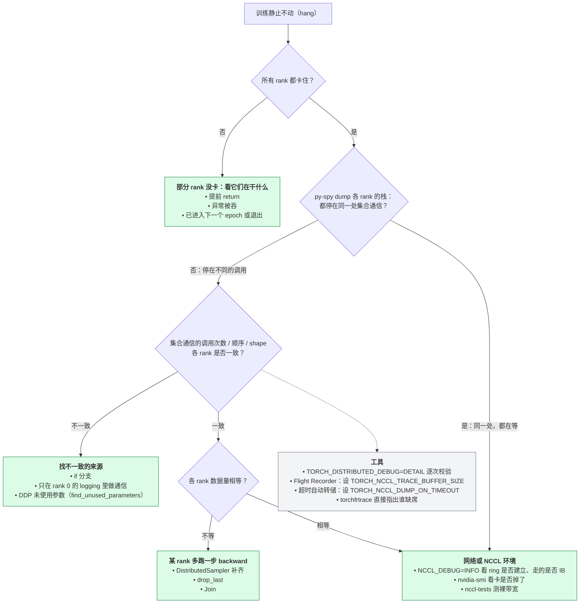

排查工具：

```python title="init_process_group 设超时"
dist.init_process_group(backend="nccl", timeout=timedelta(minutes=10))   # 默认 10 分钟后抛异常而非永远等待
```

```bash title="hang 排查的三个工具"
TORCH_DISTRIBUTED_DEBUG=DETAIL        # 在每次集合通信前校验所有 rank 的调用是否一致（很慢，仅调试用）
NCCL_DEBUG=WARN                       # NCCL 层面的错误
py-spy dump --pid <pid>               # 对每个 rank 打印 Python 栈，比较各 rank 停在哪一行
```

**Flight Recorder** 是 2.x 新增的工具：NCCL 后端记录最近若干次集合通信的元信息（哪个 rank、哪个原语、什么形状、是否完成），超时时 dump 出来：

```bash title="Flight Recorder：dump 与分析"
TORCH_NCCL_TRACE_BUFFER_SIZE=2000 TORCH_NCCL_DUMP_ON_TIMEOUT=1 TORCH_NCCL_DEBUG_INFO_TEMP_FILE=/tmp/nccl_trace_rank_ torchrun ...
torchfrtrace --prefix /tmp/nccl_trace_rank_          # 分析：哪个 rank 缺了哪次调用，或形状不匹配
```

它直接回答"谁没来"，比对着 N 个 rank 的日志猜要快得多。

> [!NOTE] Java 经验参照：hang 与死锁
> Java 的死锁是线程之间循环等待对方持有的锁，`jstack` 能直接报出环。集合通信的 hang 没有环，是 N 个参与者里有人**缺席**（没调用、调用顺序不同、已经退出），其余的人一直等。诊断动作相同：拿到所有参与者的栈再比较，`py-spy dump` 相当于 `jstack`，只是要对每个 rank 各做一次。`TORCH_DISTRIBUTED_DEBUG=DETAIL` 类似 `-ea`、`-Xcheck:jni`，开了很慢但能在出错的那次调用上报错。另外，这里的 Flight Recorder 与 JDK Flight Recorder（JFR）只是同名：它不采样 CPU 和内存，只记录最近若干次集合通信的元信息。

### 7. 为什么加卡不线性

大纲里的问题，现在可以系统回答。扩展效率低于 1 的原因，按主线分为四组：

- **通信时间**：带宽项 2βn 不随 N 减少；延迟项 2(N-1)α 随 N 增加；只有重叠部分是免费的
- **同步等待**：BSP 模型下每步所有 rank 必须到齐，最慢的决定速度；rank 越多，出现慢 rank 的概率越大
- **计算效率**：总 batch 不变时 per-rank batch = batch/N，Kernel 变小、GPU 利用率下降（[《性能优化与调试》第五章「CPU 侧——Python-bound 与 Launch-bound」](/pytorch-performance-optimization-and-debugging.html#五时间维度1cpu-侧python-bound-与-launch-bound)）；TP 度越大 GEMM 越小
- **算法效率**：总 batch 随 N 增大时，超过临界 batch 后每步的收益递减，需要更多 step 才能收敛——这是优化理论问题，不是系统问题

前三组是本文的范围，第四组是为什么"卡多了 loss 反而降得慢"的解释——分布式系统做到了线性吞吐，但每个样本的价值下降了。工程上用学习率缩放、warmup 和更长的训练来补偿。

> [!NOTE] Java 经验参照：Amdahl 定律与 USL
> 调过线程池或连接池的读者见过同样形状的曲线。按 Universal Scalability Law 的说法：不能与计算重叠的通信相当于串行部分（争用项），加多少卡都不缩短；同步等待相当于一致性代价（相干项），参与者越多越可能等到一个慢的，这一项会让曲线过了某个 N 之后掉头向下。注意 USL 惯用的系数也叫 α、β，与本文成本模型里的延迟 α、带宽倒数 β 不是同一组量。第四组原因（算法效率）不在这类模型里：它不降低吞吐，降低的是每个样本的价值。

## 十一、完整案例：从 8 卡到 4 机

接着[《性能优化与调试》](/pytorch-performance-optimization-and-debugging.html)的案例。终点是：12 层 Transformer block，H=512，约 38M 参数，B=64，bf16 + compile + SDPA，单卡 29 ms/step，2207 samples/s，峰值显存 8.4 GB。GPU 已饱和。数字为示意，比例关系反映真实规律。

### 1. 第一步：DDP，8 卡

模型放得下（8.4 GB），要的是吞吐。DDP：

```python title="第一步：DDP 加 torch.compile"
model = torch.compile(DDP(model, device_ids=[local_rank], gradient_as_bucket_view=True))
```

每卡 B=64，总 batch 512：

```text title="8 卡 DDP 的结果：扩展效率 95%"
8 卡 DDP    step: 30.5 ms    吞吐: 16800 samples/s    扩展效率: 95%    每卡峰值显存: 8.6 GB
```

通信账：fp32 梯度 38M × 4 B = 151 MB，ring all_reduce 每卡收发 2 × 7/8 × 151 ≈ 264 MB，NVLink 下约 0.8 ms，全部藏在约 19 ms 的反向里。多出的 1.5 ms 来自最后一个桶无法重叠、以及 NCCL Kernel 占用的少量 SM。Profiler 确认：NCCL Kernel 与反向 Kernel 并排，只有末尾 0.3 ms 的通信暴露。

显存只多了桶缓冲（`gradient_as_bucket_view=True` 时 `.grad` 就是桶的视图，几乎不额外占用），静态部分不变——DDP 不省显存（第三章 §3）。

### 2. 第二步：模型放大，单卡放不下

把模型放大到 H=4096、L=32、S=4096，约 6.4B 参数（加 embedding 约 7B）。静态显存 16P = 112 GB。DDP 在任何卡数下都是每卡 112 GB——不可行。换 FSDP2：

```python title="第二步：FSDP2 在 meta 设备上构造再分片"
mesh = init_device_mesh("cuda", (8,))
mp = MixedPrecisionPolicy(param_dtype=torch.bfloat16, reduce_dtype=torch.float32)
with torch.device("meta"):
    model = Transformer(H=4096, L=32)
for block in model.blocks:
    fully_shard(block, mesh=mesh, mp_policy=mp)
fully_shard(model, mesh=mesh, mp_policy=mp)
model.to_empty(device="cuda"); model.init_weights()
```

先算显存。静态 16P/8 = 14 GB，prefetch 时两层完整 bf16 参数 0.8 GB。激活值：不做 checkpointing 时 Transformer 每层每 token 约 34 × H 字节（bf16，SDPA 不物化 score 矩阵），H=4096 时 136 KB；每卡 B=8、S=4096 共 32k token，32 层 → **143 GB**，远超显存。[《性能优化与调试》第八章的「用时间换空间：Activation Checkpointing」](/pytorch-performance-optimization-and-debugging.html#7-用时间换空间activation-checkpointing)说 checkpointing 在那个案例里"不值得"，这里结论反过来：每个 block 做 checkpointing，只保存 block 输入（每层每 token 2H = 8 KB），激活值降到约 8.6 GB，加上重算时一层的完整激活 4.5 GB，共约 13 GB。代价是前向多算一遍，约增加 33% 计算。

```text title="8 卡 FSDP 的结果：每卡峰值显存 31 GB"
8 卡 FSDP   每卡 B=8    总 token 8 × 8 × 4096 = 262k / step
            step: 4.2 s     吞吐: 62k tokens/s     每卡峰值显存: 31 GB
            静态 14 GB + prefetch 0.8 GB + 激活 13 GB + workspace 与碎片约 3 GB
```

通信账：all_gather 2 × 14 GB（bf16 参数）+ reduce_scatter 28 GB（fp32 梯度）= 56 GB / rank / step，NVLink 下约 190 ms，占 4.2 s 的 4.5%。Profiler 时间线中 NCCL Kernel 与计算并排，暴露的只有第一层前向的 all_gather 和最后一层反向的 reduce_scatter，合计不到 40 ms。**通信已隐藏，瓶颈回到计算**：`aten::mm` 占 78%，Tensor Core 利用率接近上限。

对照单卡：单卡放不下，扩展效率无法定义；但 8 卡的 GPU 利用率与《性能优化与调试》单卡饱和时相当，FSDP 的 3P 通信没有成为代价。

### 3. 第三步：4 机 32 卡

再加 3 台机器。总 batch 保持 64 个序列不变（第十章 §7 的算法约束：总 batch 不能无限加大），每卡 B 从 8 降到 2。直接把 mesh 扩到 32：

```text title="32 卡 FSDP 直接扩：扩展效率掉到 62%"
32 卡 FSDP   每卡 B=2   step: 1.7 s    吞吐: 154k tokens/s    扩展效率（对 8 卡）: 62%    每卡峰值显存: 10 GB
```

效率掉了近四成。通信账：每卡收发的 56 GB **不随卡数减少**（第二章 §4 的带宽项），但每卡的计算随 B 缩到 1/4，只剩约 1.05 s；而 ring 现在跨节点，最慢一段是 IB，每 GPU 50 GB/s，56 GB 要 1.1 s——**通信时间超过了计算时间，无论怎么重叠都藏不住**。Profiler 确认：计算泳道有大段空白在等 all_gather 和 reduce_scatter。

用 HSDP：节点内分片，节点间复制：

```python title="改成 HSDP：(4, 8) 的 replicate × shard mesh"
mesh = init_device_mesh("cuda", (4, 8), mesh_dim_names=("replicate", "shard"))
fully_shard(block, mesh=mesh, mp_policy=mp)
```

```text title="32 卡 HSDP 的结果：扩展效率 94%"
32 卡 HSDP   每卡 B=2   step: 1.12 s    吞吐: 234k tokens/s    扩展效率: 94%    每卡峰值显存: 21 GB
```

通信账重算：节点内 all_gather 2 × 7/8 × 14 GB + reduce_scatter 7/8 × 28 GB ≈ 49 GB，走 NVLink 约 160 ms；跨节点 all_reduce 的是每卡持有的 1/8 梯度分片，3.5 GB × 2 × 3/4 ≈ 5.3 GB，走 IB 约 0.1 s。两者合计 0.26 s，远小于 1.05 s 的计算，可以完全重叠。代价：每个节点持有完整的一份状态，静态显存从 3.5 GB 回到 14 GB——这里 21 GB 有余量，可以接受。

### 4. 再往后：TP 与 CP 何时进场

如果模型再大一倍（14B，静态 224 GB，节点内 8 卡分片后每卡 28 GB，加激活约 45 GB），HSDP 仍可行；到 70B（静态 1.1 TB，节点内分片后每卡 140 GB）就放不下了，这时引入 TP=8 让节点内 8 卡切分每一层：每卡参数 2P/8，FSDP 再在跨节点的 dp 维上分片——mesh 变成 `("dp", "tp")`，参数是 2D DTensor（第九章 §3）。TP 的代价是每层 4 次关键路径上的 all_reduce，B=2、S=4096、H=8192 时每次 134 MB，NVLink 下 0.4 ms，80 层共 130 ms，占 step 的几个百分点，可以接受；换成跨节点则不可接受。

如果序列从 4k 拉到 128k，激活值（即使 checkpointing 后）∝ S 增长 32 倍，attention 计算 ∝ S² 增长 1000 倍，单卡放不下一个序列——CP 进场，把序列切到 8 卡，与 FSDP 共用 mesh 维度（第七章 §2）。

### 5. 优化报告

| 改动 | 吞吐 | 每卡显存 | 通信/step/rank | 暴露的通信 | 代价 |
|---|---|---|---|---|---|
| 单卡（[《性能优化与调试》](/pytorch-performance-optimization-and-debugging.html)的终点） | 2207 samples/s | 8.4 GB | 0 | 0 | — |
| 8 卡 DDP | 16800 samples/s（95%） | 8.6 GB | 264 MB | 0.3 ms | 总 batch 变 512，需调学习率 |
| 放大到 7B：8 卡 FSDP + checkpointing | 62k tokens/s | 31 GB | 56 GB | 40 ms | 通信 3P 全部隐藏；重算 +33% 计算 |
| 32 卡 FSDP | 154k tokens/s（62%） | 10 GB | 56 GB（跨 IB） | 0.6 s | 通信不随卡数减少，计算随 batch 减少 |
| 32 卡 HSDP | 234k tokens/s（94%） | 21 GB | 49 GB 内 + 5.3 GB 间 | 0.05 s | 显存不随节点数下降 |

Table: 多卡优化报告：每项改动的吞吐、显存与通信

每一步的决策依据都是第九章 §4 那张表的两列：**先看每卡显存放不放得下，再看通信时间能不能被计算隐藏**。第三步还展示了第十章 §7 的第一组和第三组原因同时发生：卡数翻四倍，通信量不变而计算量缩到四分之一，两条曲线交叉，扩展效率断崖式下跌。

## 十二、本文小结

### 1. 一条主线

- **五类状态**：数据 · 参数 · 梯度 · 优化器状态 · 激活值；
- **两种选择**：复制（显存 N 份，需同步）vs 分片（显存 1/N）；
- **分片的两种用法**：先凑齐再算（FSDP，数据并行，通信的是参数和梯度）vs 计算也切开（TP / PP / CP / EP，模型并行，通信的是激活值）；
- **三个后果**：显存占用 · 通信原语 · 通信时机；
- **一个恒等式**：all_reduce = reduce_scatter + all_gather。

DDP 全复制只分数据；ZeRO 三级逐个把优化器状态、梯度、参数分片；FSDP 是 ZeRO-3 的 PyTorch 实现，用 3P 通信换 16P/N 显存；TP 在层内分片、通信激活、每层训练 4 次 all_reduce 在关键路径上、必须 NVLink，SP 把它边界上的复制激活也切掉；PP 按层分片、通信最小、代价是气泡，1F1B 让显存不随 micro-batch 数增长；CP 切序列、只有 attention 通信、可重叠；EP 切 expert、all_to_all 路由 token。HSDP 和多维并行是在 DeviceMesh 的不同维上对同一状态做不同决定。

### 2. 三层结构

- **通信底座**：SPMD · 进程组 · 集合通信原语 · α+β 与 Ring / Tree 成本模型 · 通信是异步 Kernel、重叠要求重排依赖
- **并行策略**：第九章 §4 那张表
- **运行时**：torchrun · DistributedSampler · DCP · 拓扑对齐 · 扩展效率 · Flight Recorder

### 3. 两个判断

面对任何分布式配置，先问两个问题：

- **每卡显存放不放得下？** 看表的"参数"列：16P（DDP）→ 16P/N（FSDP / TP / PP）；激活看 CP；
- **通信能不能被计算隐藏？** 通信量 / 带宽 vs 计算时间；藏不住就换策略（FSDP → HSDP → TP 进节点内 → PP 跨节点）。

### 4. 与前几篇的连接

- [《自动求导与动态计算图》](/pytorch-autograd-and-dynamic-computation-graph.html)的 autograd hook：→ DDP Reducer 和 FSDP 的反向 hook 都挂在它上面
- [《nn.Module 与训练系统》](/pytorch-module-and-training-system.html)的 autocast / 主参数：→ MixedPrecisionPolicy：fp32 分片、bf16 通信与计算
- [《编译执行与图优化》](/pytorch-compilation-and-graph-optimization.html)的 graph break / 导出：→ DDP + torch.compile 在桶边界切图；pipeline() 用 export 切 stage；异步 TP 由 Inductor 改写通信
- [《性能优化与调试》](/pytorch-performance-optimization-and-debugging.html)的异步 Stream / 同步点：→ 通信 Stream 与计算 Stream 的重叠；Work.wait() 是 Stream 依赖而非 CPU 阻塞
- 同篇的 launch-bound：→ 加卡后 per-rank batch 变小，瓶颈回到 CPU 侧
- 同篇的 16 B/参数：→ 本文所有显存账的基准
- 同篇的 Activation Checkpointing：→ 单卡案例里不值得，7B 案例里必需
- 同篇的 CPU 内存 / PCIe：→ CPU offload 的约束

### 5. 本篇涉及的源码位置

本篇讨论的机制在源码中的位置（对应[《PyTorch 整体介绍》第七章「代码视角——源码目录与库的分层」](/pytorch-overall-introduction.html#七第三张地图代码视角源码目录与库的分层)的代码地图）：

| 路径 | 内容 |
|---|---|
| `torch/distributed/distributed_c10d.py` | `init_process_group`、集合通信的 Python API、进程组管理 |
| `torch/csrc/distributed/c10d/ProcessGroupNCCL.cpp`、`ProcessGroupGloo.cpp`、`Work.hpp` | NCCL / Gloo 后端；异步通信的 `Work` 句柄 |
| `torch/csrc/distributed/c10d/reducer.cpp`、`torch/nn/parallel/distributed.py` | DDP：Reducer 的梯度桶与 all-reduce 触发；Python 包装 |
| `torch/distributed/fsdp/_fully_shard/` | FSDP2：`fully_shard`、分片单元、预取、all-gather / reduce-scatter 的调度 |
| `torch/distributed/tensor/`、`torch/distributed/device_mesh.py` | DTensor 与 `DeviceMesh` |
| `torch/distributed/tensor/parallel/` | TP：`ColwiseParallel`、`RowwiseParallel`、`SequenceParallel`、`loss_parallel` |
| `torch/distributed/pipelining/`、`torch/distributed/tensor/experimental/_attention.py` | PP 的 stage 与调度；CP 的 `context_parallel` |
| `torch/distributed/checkpoint/`、`torch/distributed/run.py`、`torch/distributed/elastic/` | 分布式 Checkpoint；`torchrun` 与弹性启动 |

Table: 本篇涉及的源码位置

到这里，PyTorch 的执行系统从单卡讲到了多机。剩下最后一个问题：这样一个横跨 Python、C++、CUDA、编译器和分布式运行时的框架，如何保证每次改动不破坏正确性和性能？

> **一个复杂深度学习框架如何测试、构建和演进？**

## 十三、自测

1. DDP 在 8 卡上训 8B 模型（bf16 + AdamW），每卡显存大约多少？为什么放不下？

   <details markdown="1"><summary>答案</summary>

   每卡一份完整的参数、梯度、优化器状态：$$8.03 \times 10^9 \times 16 = 128$$ GB，再加激活——一张 80 GB 卡放不下。DDP 只切数据，其余四类全复制。

   </details>

2. FSDP 把参数切到 8 卡，前向到第 $$l$$ 层时做什么通信、用完后做什么？反向呢？

   <details markdown="1"><summary>答案</summary>

   前向：all-gather 第 $$l$$ 层的完整参数，算完释放（只留自己的 1/8 分片）；反向：再 all-gather 一次算梯度，然后 reduce-scatter 梯度让每卡只留自己分片的梯度，优化器只更新自己那 1/8。通信量约是 DDP 的 1.5 倍，换来显存 1/8。

   </details>

3. DDP 的梯度 all-reduce 为什么能与反向计算重叠？靠的是哪个机制？

   <details markdown="1"><summary>答案</summary>

   `Reducer` 把参数按反向顺序分桶，一个桶内所有梯度就绪（autograd hook 触发）就立刻在 NCCL stream 上发起 all-reduce，此时 autograd 引擎还在算更早的层——两条 stream 并行；最后一个桶做完才 `step`。

   </details>

4. TP 把 `nn.Linear(4096, 14336)` 按列切到 4 卡，每卡的权重形状是什么？输出怎么拼？接下来的 `Linear(14336, 4096)` 该怎么切？

   <details markdown="1"><summary>答案</summary>

   数学上 $$W_1$$ 是 $$[4096, 14336]$$，按列切每卡 $$[4096, 3584]$$；PyTorch 的 `nn.Linear` 权重存成 `[out, in]`，所以每卡的 `weight.shape` 是 `[3584, 4096]`（`ColwiseParallel` 对应 `Shard(0)`）。输出各是 `[B, 3584]`，不用拼——直接把后一个矩阵按行切：数学上 $$[3584, 4096]$$，`weight.shape` 为 `[4096, 3584]`（`RowwiseParallel` = `Shard(1)`），每卡算部分和，最后一次 all-reduce 得到完整输出。Megatron 的 MLP 就是 Colwise + Rowwise 配对，一层只通信一次。

   </details>

5. `dist.all_reduce(t)` 返回后立刻在计算 stream 上读 `t`，安全吗？异步版本呢？

   <details markdown="1"><summary>答案</summary>

   同步版本安全——ProcessGroupNCCL 在返回前让计算 stream 等待通信 stream 的 event；`async_op=True` 返回 `Work`，必须 `work.wait()` 后才能读，否则读到还没 reduce 完的数据（且 `wait()` 只是让当前 stream 等，不阻塞 CPU）。

   </details>

[^q0]: 把问题拆成**五类状态 × 一个决定**：数据、参数、梯度、优化器状态、激活值，每一类要么复制到每张卡、要么切分到多卡；每个决定对应一种集合通信原语与一个通信时机。**DDP**：数据分片、其余全复制，反向时按桶 all-reduce 梯度，`Reducer` 在梯度就绪时触发、与后续层的反向重叠（[第三章](#三并行策略1ddp复制模型切分数据同步梯度)）。**FSDP2**：参数、梯度、优化器状态都按单元切开，前向到某层前 all-gather 参数、用完释放、反向 reduce-scatter 梯度，每卡只常驻 1/N 的状态，靠预取重叠（[第四章](#四并行策略2zero-与-fsdp分片状态)）。**TP** 切一层内部的大矩阵，用 `DTensor` 与 `DeviceMesh` 表达分片（[第五章](#五并行策略3tp切分一层内部)）；**PP** 按层切 stage、micro-batch 流水（[第六章](#六并行策略4pp切分层与层之间)）；**CP** 切序列、ring 传 KV（[第七章](#七并行策略5cp切分序列)）；**EP** 切专家、all-to-all（[第八章](#八并行策略6ep切分-expert)）。**重叠的机制**：`ProcessGroupNCCL` 在独立的 NCCL stream 上发起异步通信、返回 `Work` 句柄，计算 stream 与通信 stream 之间用 event 同步——让两条 stream 同时有活干（[第二章](#二通信底座进程进程组与集合通信)）。组合与选择见[第九章](#九并行策略的组合与选择)，`torchrun` 与分片 checkpoint 见[第十章](#十运行时与工程)。
