`loss.backward()` 是训练代码里最短的一行。它沿计算图反向应用链式法则，一次得到 loss 对所有参数的梯度。理解它要抓住三件事：**梯度的形状与自变量相同**、**反向矩阵乘的计算量约为前向的两倍**、**前向中间结果要留到反向使用**。第一件帮助读梯度公式，第二件连接到训练 FLOPs 等于 $$6ND$$，第三件解释激活显存与重算。

上一篇《[深度学习基础（02）：损失函数——怎样把「好」写成一个可求导的数](/loss-functions-from-mse-to-dpo.html)》给出了优化目标；本篇从梯度怎样计算开始。

本文用一个两层 MLP（Linear、ReLU、Linear、softmax、交叉熵）把这些规则推到底。它足够小，每一步形状都能写清楚；又足够完整，Transformer 里的 Linear、激活函数、norm 和 loss 反向都遵循同样的链式法则。

> **不用框架，能不能手推并手写两层网络的反向传播，再用有限差分检查？能不能由此解释训练 FLOPs 为什么约为 $$6ND$$、激活为什么要存？**[^q0][^q1]

## 一、总览：前向算 loss，反向算梯度

### 1. 反向传播在做什么

先看计算方向。输入 $$X$$ 经过两层网络得到 loss；反向从 loss 开始，把梯度沿计算图送回参数。

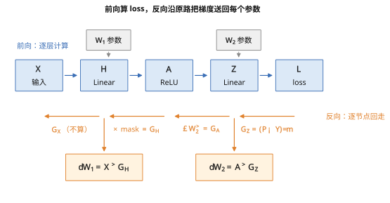

**前向算 loss，反向一次得到 loss 对所有参数的导数。**图中的 $$dW_1$$ 和 $$dW_2$$ 是两组参数的梯度；稍后会看到它们分别来自前向保存的输入与激活值。

本文的对象是一个两层 MLP（多层感知机，multi-layer perceptron）：输入层、隐藏层和输出层按层级连接；每层是全连接的矩阵乘加 $$xW+b$$；隐藏层加非线性激活 ReLU；信息从输入单向传到输出，没有循环。没有非线性时，多个 Linear 仍可合并成一个 Linear。

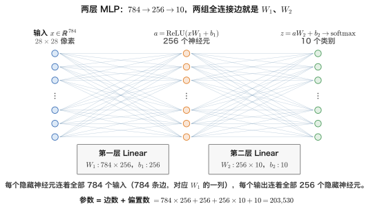

按 batch 一次算 $$m$$ 个样本：

| 步 | 计算 | 输出形状 |
|---|---|---|
| 输入 | $$X$$ | $$[m,784]$$ |
| 第一层 Linear | $$H=XW_1+b_1$$ | $$[m,256]$$ |
| 激活 | $$A=\text{ReLU}(H)$$ | $$[m,256]$$ |
| 第二层 Linear | $$Z=AW_2+b_2$$ | $$[m,10]$$ |
| loss | $$L=\text{CE}(\text{softmax}(Z),Y)$$ | 标量 |

参数量为 $$784\times256+256+256\times10+10=203{,}530$$。图 1 的每条边对应一个权重，每个隐藏或输出神经元对应一个偏置。

### 2. 章节安排

| 章 | 主题 | 内容 |
|---|---|---|
| 二 | 标量例子 | 计算图、局部导数、分叉与有限差分 |
| 三 | 梯度形状 | 标量、向量、矩阵的梯度；Jacobian 与 VJP |
| 四 | 三类算子 | Linear、ReLU、softmax 与交叉熵的反向 |
| 五 | 两层网络 | 迷你网络逐层计算；回到 784-256-10 |
| 六 | 反向计算量 | Linear 的三次矩阵乘、训练 FLOPs 与 $$6ND$$ |
| 七 | 激活保存 | PyTorch 实际保存清单与 checkpoint 重算 |
| 八 | 梯度检查 | 有限差分与精度选择 |
| 九 | Autograd | 动态图、backward、saved tensors 与梯度累加 |
| 十 | MNIST 案例 | NumPy 从零训练两层 MLP |
| 十一 | 小结 | 关键规则回顾 |
| 十二 | 自测 | 7 道题与答案 |

### 3. 来龙去脉：一个算法，被发明了三次

| 年 | 谁 | 当时的问题 | 怎么解决 | 效果与遗留问题 |
|---|---|---|---|---|
| 1970 | Linnainmaa（赫尔辛基，硕士论文） | 复合函数的数值计算中，舍入误差怎样累积 | 反向模式自动微分：从输出往回逐节点乘局部导数 | 给出了完整数学形式；当时没人把它和神经网络连起来 |
| 1974 / 1982 | Werbos（哈佛博士论文） | 怎样训练多层网络 | 提出用反向模式计算多层网络梯度 | 论文几乎没人读，方法没传开 |
| 1986 | Rumelhart、Hinton、Williams，《Nature》 | 多层网络怎样训练 | 命名反向传播，并用多层网络学到内部表示的实验说服领域 | 成为主流训练方法；每种新网络仍需实现对应梯度 |
| 1989 | LeCun 等（贝尔实验室） | 手写邮政编码识别 | 用反向传播训练卷积网络 | 小网络进入真实任务；本篇 MNIST 是其后续案例 |
| 2007–2017 | Theano、Torch、TensorFlow、PyTorch autograd | 新网络要手推梯度，容易推错 | 自动微分框架记录前向，再自动执行反向 | 手推从必需变成理解框架；内存账也被框架隐藏 |
| 2022 | FlashAttention | 反向要保存的激活太大 | 不存 attention 矩阵，反向分块重算 | 激活内存仍是长序列训练的重要约束 |

三次发明说明，反向传播是复合函数求导的通用高效算法，不是神经网络专属。理解它的实际价值，是能算清反向矩阵乘的计算量，以及前向中间结果的内存成本。

## 二、从一个标量例子开始

### 1. 计算图：局部导数怎样相乘

取一个神经元：$$z=wx+b$$，误差 $$e=z-y$$，损失 $$L=e^2$$，代入 $$x=2,w=3,b=-1,y=4$$。下图是它的计算图，蓝色箭头是前向计算，橙色虚线箭头是反向传回的梯度：

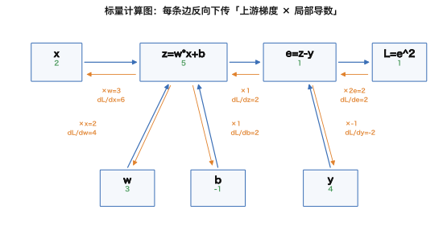

反向传播只有一条规则：从损失往回走，每经过一条边，就把上游梯度乘以这条边的局部导数。

**前向：算出每个节点的值。** 也就是图中节点里的绿色数字：

$$
z=wx+b=3\cdot2-1=5,\qquad e=z-y=5-4=1,\qquad L=e^2=1
$$

**反向：从损失开始传梯度。** 起点是 $$\partial L/\partial L=1$$。先经过 $$L=e^2$$：

$$
\frac{\partial L}{\partial e}=2e=2
$$

再经过 $$e=z-y$$，它对 $$z$$ 的局部导数是 1，对 $$y$$ 是 −1：

$$
\frac{\partial L}{\partial z}=\frac{\partial L}{\partial e}\frac{\partial e}{\partial z}=2\cdot1=2,\qquad
\frac{\partial L}{\partial y}=\frac{\partial L}{\partial e}\frac{\partial e}{\partial y}=2\cdot(-1)=-2
$$

最后经过 $$z=wx+b$$：

$$
\frac{\partial L}{\partial w}=\frac{\partial L}{\partial z}\frac{\partial z}{\partial w}=2\cdot x=4,\qquad
\frac{\partial L}{\partial b}=\frac{\partial L}{\partial z}\frac{\partial z}{\partial b}=2\cdot1=2,\qquad
\frac{\partial L}{\partial x}=\frac{\partial L}{\partial z}\frac{\partial z}{\partial x}=2\cdot w=6
$$

图里橙色的数是各个量对最终损失 $$L$$ 的梯度，比如 $$\partial L/\partial w=4$$。它不是节点本身的值，意思是：$$w$$ 增加一点点 $$\Delta$$，$$L$$ 大约增加 $$4\Delta$$。

**用差分验证。** 不用任何反向公式，直接把 $$w$$ 增加 $$h=0.001$$，再算一次前向：

$$
z=3.001\cdot2-1=5.002,\qquad e=1.002,\qquad L=1.002^2=1.004004
$$

$$
\frac{L(w+h)-L(w)}{h}=\frac{1.004004-1}{0.001}=4.004
$$

和解析值 4 很接近。这里用的是前向差分；中心差分还要多算一次 $$L(w-h)$$，取 $$\bigl(L(w+h)-L(w-h)\bigr)/(2h)$$，误差通常更小，第八章做梯度检查用的就是它。脚本输出：

```text
标量神经元：z=w*x+b, e=z-y, L=e^2
x=2, w=3, b=-1, y=4 -> z=5, e=1, L=1
dL/de=2, dL/dz=2, dL/dw=4, dL/db=2, dL/dx=6
前向有限差分 eps=0.001: w+eps=3.001, L(w+eps)=1.004004, dL/dw≈4.004000
```

一句话：前向算数值，反向按链式法则逐边相乘，把损失的梯度传回每个输入和参数。

### 2. 每个节点只做一件事

反向经过一个节点时，只需把上游梯度乘以这个节点的局部导数。加法门把梯度原样分发；乘法门把梯度乘上另一个输入；max 或 ReLU 门只把梯度送给被选中的一路。

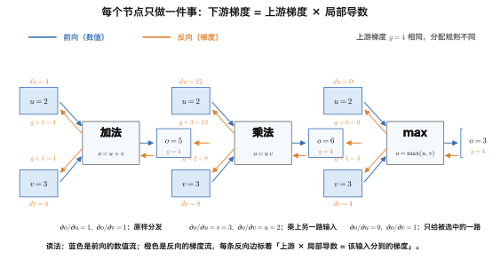

图里每个格子做同一件事，以上游梯度 $$g=4$$、$$u=2$$、$$v=3$$ 走一遍：

- **加法** $$o=u+v=5$$：$$\partial o/\partial u=\partial o/\partial v=1$$，两条反向边都是 $$4\times1=4$$——梯度原样分发给每一路；
- **乘法** $$o=uv=6$$：$$\partial o/\partial u=v=3$$、$$\partial o/\partial v=u=2$$，得到 $$4\times3=12$$ 和 $$4\times2=8$$——每一路拿到的是上游乘上**另一路**的值；
- **max** $$o=\max(2,3)=3$$：只有被选中的 $$v$$ 拿到 $$4\times1=4$$，$$u$$ 拿 $$4\times0=0$$——梯度只走赢的那一路（ReLU 同理，$$x<0$$ 时局部导数为 0）。

反向规则由算子本身决定，不需要重看整张网络。

### 3. 一个量被用了两次，梯度相加

设 $$f=xy+x$$，取 $$x=2,y=3$$。一条路径通过乘法贡献 3，另一条直接通向输出贡献 1；两条路径回到同一个 $$x$$ 时相加，得到 $$df/dx=4$$。

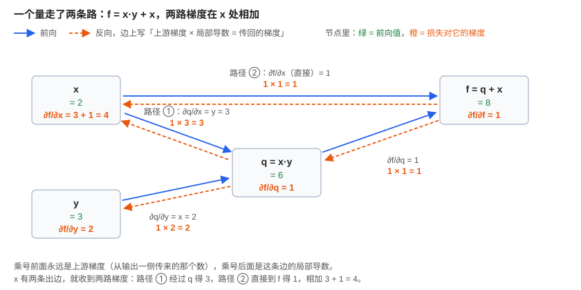

图里把 $$xy$$ 记成中间节点 $$q$$，于是 $$f=q+x$$。橙色的乘法都是同一个格式：乘号前面是上游梯度，也就是 $$f$$ 对这条边输出端那个节点的梯度；乘号后面是这条边的局部导数。

- 路径 ①：$$f$$ 先把梯度传给 $$q$$，加法的局部导数是 1，得 $$1\times1=1$$；$$q$$ 再传给 $$x$$，乘法对 $$x$$ 的局部导数是另一个输入 $$y=3$$，得 $$1\times3=3$$。
- 路径 ②：$$f=q+x$$ 里直接有 $$x$$，局部导数是 1，得 $$1\times1=1$$。
- 两路回到 $$x$$ 相加：$$df/dx=3+1=4$$。$$y$$ 只有一条路：$$1\times x=1\times2=2$$。

这也解释两个常见现象：一个 batch 中每个样本都使用同一组 $$W$$，所以 $$dW$$ 是样本贡献之和；PyTorch 的 `.grad` 默认按调用累加。toy 实际输出：

```text
f=x*y+x; x=2, y=3
f=8; 路径 x*y 的梯度贡献 y=3; 路径 x 的贡献 1; 汇合后 df/dx=4
若 batch 中每个样本都使用 W，则 dW 是各样本贡献之和；PyTorch .grad 也按调用累加。
```

### 4. 为什么不逐个参数求导

这个网络有 203,530 个参数。有限差分逐个参数做中心差分，要对每个参数各做正负两次前向，总计 407,060 次前向。反向一次的计算量约等于两次前向，却能同时得到所有参数的梯度。

## 三、从标量到矩阵：梯度长什么样

### 1. 梯度和自变量同形

先说清楚「$$L$$ 对 $$x$$ 求导」这几个字：$$L$$ 是被求导的输出，叫因变量；$$x$$ 是对它求导的输入，叫自变量。「对」不是相乘也不是相加，只是说明对谁求导。梯度长什么样，由这两者的形状决定：

| 输出（因变量） | 对谁求导（自变量） | 结果 | 形状与例子 |
|---|---|---|---|
| 标量 $$L=\sum_i x_i^2$$ | 向量 $$x$$ | 梯度 $$\nabla_x L=2x$$ | 与 $$x$$ 同形；$$x=(1,2,3)$$ 得 $$(2,4,6)$$ |
| 标量 $$L=\sum_{i,j} W_{ij}^2$$ | 矩阵 $$W$$ | 梯度 $$\partial L/\partial W=2W$$ | 与 $$W$$ 同形；$$W$$ 为 2×2，结果也是 2×2 |
| 向量 $$y=(x_1+x_2,\ x_2x_3)$$ | 向量 $$x$$ | Jacobian $$J=\partial y/\partial x$$ | $$y$$ 2 维、$$x$$ 3 维，$$J$$ 为 2×3 |

Table: 三种求导的结果形状

第一列是函数本身，按它输出一个数还是一组数分成标量、向量。$$L$$ 和 $$y$$ 都是 $$x$$（或 $$W$$）的函数，结果的形状只取决于输出和输入各有几个数：输入有几个数，梯度就有几格；输出也是向量时，每个输出各占一行，就成了 Jacobian。

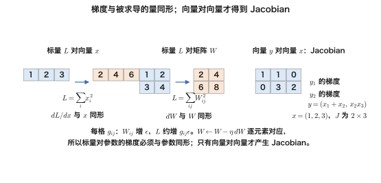

第二行容易误解：$$L$$ 虽是一个数，但 $$W$$ 有四个元素，每个元素各有一个导数，所以结果是与 $$W$$ 同形的矩阵，而不是向量。更新 $$W\leftarrow W-\eta dW$$ 时，每个梯度元素都要和对应参数一一相乘。

### 2. Jacobian 与向量链式法则

取 $$x=(-1,2,0.5)$$，令 $$y=\text{ReLU}(x)$$。Jacobian 是 $$J=\operatorname{diag}(0,1,1)$$。若上游梯度 $$g_y=(0.3,-0.2,0.5)$$，则 $$g_x=J^Tg_y=(0,-0.2,0.5)$$。

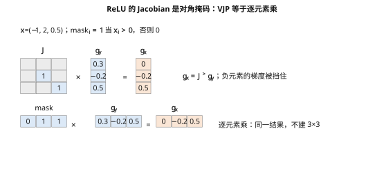

实际计算只需将上游梯度逐元素乘以 0/1 掩码，不必创建矩阵。对单样本 Linear $$y=xW$$，Jacobian 为 $$W^T$$，因此 VJP $$J^Tg=Wg$$，就是沿原来的连接把梯度送回去。

```text
x=(-1, 2, 0.5); y=ReLU(x)
J=diag(0,1,1)
g_y=(0.3, -0.2, 0.5); g_x=J^T*g_y=(0.0, -0.2, 0.5)
等价计算：g_x = g_y 逐元素乘 (0,1,1)
```

### 3. 为什么不构造完整 Jacobian

batch 中每个样本的 Linear 输出只依赖自己的输入，所以完整 Jacobian 是分块对角矩阵：对角线上是相同的 $$W^T$$，不同样本之间的块为零。乘这个大矩阵与直接算批量 VJP $$GW^T$$ 等价。

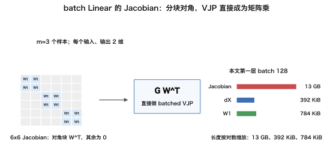

玩具脚本用 `torch.autograd.functional.jacobian` 实际计算 $$m=3,k=2,n=2$$ 的 Jacobian。它是 6×6，三个对角块都为 $$W^T$$，非对角样本块全为 0。本文第一层 batch 128 的完整 Jacobian 有约 $$3.3\times10^9$$ 个 fp32 元素，占 13 GB；所需的输入梯度只有 392 KiB，$$W_1$$ 是 784 KiB。反向只计算 VJP，不把这张大矩阵显式造出来。

```text
Linear batch: m=3, k=2, n=2; W=[[1.0, 2.0], [-1.0, 0.5]]
对 batch 输入求导得到的 Jacobian（输出展平 × 输入展平）:
[[ 1.  -1.   0.   0.   0.   0. ]
 [ 2.   0.5  0.   0.   0.   0. ]
 [ 0.   0.   1.  -1.   0.   0. ]
 [ 0.   0.   2.   0.5  0.   0. ]
 [ 0.   0.   0.   0.   1.  -1. ]
 [ 0.   0.   0.   0.   2.   0.5]]
shape=(6, 6)；非对角样本块全为 0；每个对角块都是 W^T。
对单样本 y=xW，J=W^T；VJP J^T*g = W*g。
用于 F6 尺寸演示：m*n=6, m*k=6, Jacobian 元素=36。
```

## 四、三类算子的反向公式

### 1. Linear：对 batch 中的样本求和

令 $$Y=XW+b$$，输入 $$X$$ 形状为 $$m\times k$$，权重 $$W$$ 为 $$k\times n$$，上游梯度 $$G=\partial L/\partial Y$$ 为 $$m\times n$$。以 $$m=2,k=3,n=2$$ 的真实数值为例：

```text
X=
[[ 1.   2.  -1. ]
 [ 0.5 -1.   2. ]]
W=
[[ 1.   -0.5 ]
 [ 0.25  2.  ]
 [-1.    0.75]]
G=
[[ 0.2 -0.3]
 [ 1.   0.5]]
dW=X^T G=
[[ 0.7  -0.05]
 [-0.6  -1.1 ]
 [ 1.8   1.3 ]]
dX=G W^T=
[[ 0.35  -0.55  -0.425]
 [ 0.75   1.25  -0.625]]
db=sum_rows(G)=[1.2 0.2]
逐样本外积之和误差=0.0e+00
```

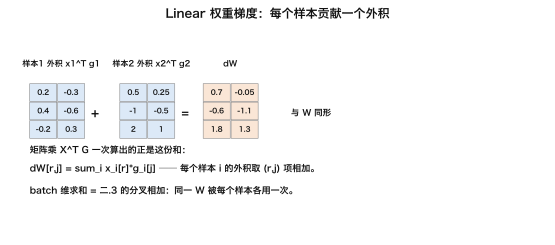

三条公式是 $$dW=X^TG$$、$$dX=GW^T$$、$$db=\sum_iG_{i,:}$$。每个样本贡献一个外积，沿 batch 维求和正是分叉梯度汇合的矩阵版本。

<details markdown="1"><summary>推导与循环写法</summary>

按元素写 $$Y_{ij}=\sum_rX_{ir}W_{rj}+b_j$$。于是 $$\partial L/\partial W_{rj}=\sum_iG_{ij}X_{ir}=(X^TG)_{rj}$$。对输入和偏置同理得到 $$dX=GW^T$$、$$db_j=\sum_iG_{ij}$$。

```python
for r in range(k):
    for j in range(n):
        for i in range(m):
            dW[r][j] += X[i][r] * G[i][j]
for j in range(n):
    for i in range(m):
        db[j] += G[i][j]
```

对 batch 维 $$i$$ 求和，正是矩阵乘里转置出现的原因。形状检查也能重建公式：$$dW$$ 必须为 $$k\times n$$，所以由 $$X^T$$ 与 $$G$$ 相乘；$$dX$$ 必须为 $$m\times k$$，所以由 $$G$$ 与 $$W^T$$ 相乘。

</details>

### 2. ReLU：乘以逐元素掩码

$$A=\text{ReLU}(H)=\max(H,0)$$。对正数的导数为 1，对负数为 0；在零点采用框架约定。反向只需把上游梯度乘以对应掩码：

$$
\frac{\partial L}{\partial H}=\frac{\partial L}{\partial A}\odot\mathbb{1}[H>0]
$$

因此 ReLU 的 VJP 等价于 Jacobian 对角元素的逐项乘法。$$H=0$$ 处 ReLU 不可导，框架采用约定的导数值；连续输入恰好落在零点的概率为零。GELU、SiLU、sigmoid、tanh 也采用逐元素乘导数的形式，只是导数表达式不同。

### 3. softmax 与交叉熵

取 logits $$z=(2,1,0.1)$$，正确类别为 0。softmax 概率约为 $$(0.659,0.242,0.099)$$，交叉熵对 logits 的梯度是概率减 one-hot 标签：$$(-0.341,0.242,0.099)$$。

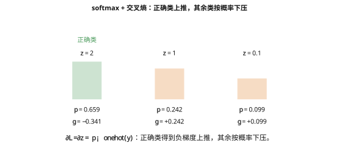

batch 平均 loss 对 logits 的梯度为 $$\partial L/\partial Z=(P-Y_{\text{onehot}})/m$$。softmax 与交叉熵合在一起求导，避免先算接近零的概率再除以它，数值更稳定。toy 输出：

```text
softmax + cross entropy：z=(2,1,0.1)，正确类=0
p=[0.659 0.242 0.099]
dL/dz=p-y=[-0.341  0.242  0.099]
```

## 五、两层网络逐层推导

### 1. 迷你网络：把每个中间量列出来

取一个 2→2→2 网络、单样本 $$x=(0.6,-1.2)$$，权重与偏置由玩具脚本给定（偏置取 $$b_1=(1,0)$$，让第二个隐藏单元恰好被 ReLU 置零——门控作用在梯度上也看得见）。实际前向得到 $$h=(0.34,-0.66)$$、$$a=(0.34,0)$$、logits $$z=(0.288,-0.27)$$、loss $$0.452572985$$；目标类别为 0。图中同时列出前向值和沿主链回走的梯度与两层权重梯度：

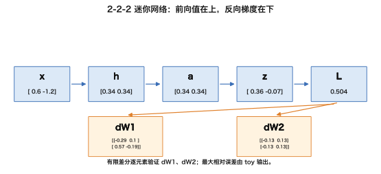

对 $$dW_1$$、$$dW_2$$ 做中心差分，$$\epsilon=10^{-6}$$ 时最大相对误差为 $$4.157\times10^{-10}$$。注意 $$G_H$$ 的第二位为 0：该隐藏单元前向输出为负，ReLU 不但把 $$a$$ 的对应位置压成 0，也把传回来的梯度在这一路截断。所有中间值、梯度和误差都来自脚本：

```text
x=[ 0.6 -1.2]
W1=[[ 0.5 -0.3]
 [ 0.8  0.4]]
b1=[1. 0.]
h=[ 0.34 -0.66]
a=[0.34 0.  ]
W2=[[ 0.7 -0.5]
 [ 0.2  0.6]]
b2=[ 0.05 -0.1 ]
z=[ 0.288 -0.27 ]
p=[0.63599 0.36401]
target=0; loss=0.452572985
gz=[-0.36401  0.36401]
dw2=[[-0.123764  0.123764]
 [-0.        0.      ]]
db2=[-0.36401  0.36401]
ga=[-0.436812  0.145604]
gh=[-0.436812  0.      ]
dw1=[[-0.262087  0.      ]
 [ 0.524175 -0.      ]]
db1=[-0.436812  0.      ]
中心差分 eps=1e-6：dW1、dW2 最大相对误差=4.157e-10
```

### 2. 回到 784-256-10：五步反向

一次迭代按时间展开如下：

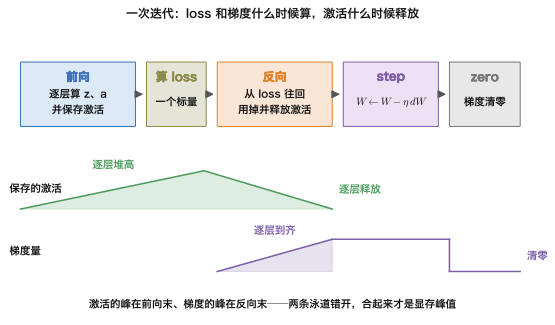

下图把前向、主梯度链和参数梯度分开排列；橙色虚线标出保存边：

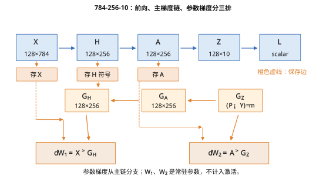

| 步 | 计算 | 形状 | 用到的前向量 |
|---|---|---|---|
| 输出层梯度 | $$G_Z=(P-Y)/m$$ | $$[128,10]$$ | $$P$$，由 $$Z$$ 得到 |
| 第二层权重梯度 | $$dW_2=A^TG_Z$$<br/>$$db_2=\sum_iG_{Z,i,:}$$ | $$[256,10]$$<br/>$$[10]$$ | $$A$$ |
| 对 $$A$$ 的梯度 | $$G_A=G_ZW_2^T$$ | $$[128,256]$$ | 参数 $$W_2$$ |
| 穿过 ReLU | $$G_H=G_A\odot\mathbb{1}[H>0]$$ | $$[128,256]$$ | $$H$$ 的符号 |
| 第一层权重梯度 | $$dW_1=X^TG_H$$<br/>$$db_1=\sum_iG_{H,i,:}$$ | $$[784,256]$$<br/>$$[256]$$ | $$X$$ |

$$dX=G_HW_1^T$$ 在数学上存在，但图片输入不是参数，无需它的梯度，框架会跳过这一步。Transformer 的 FFN 也是 Linear、激活、Linear，反向规则相同。

## 六、反向为什么是前向的两倍

### 1. 一个 Linear：前向一次，反向两次

前向矩阵乘 $$XW$$ 的 FLOPs 为 $$2mkn$$。反向要算 $$X^TG$$ 得到 $$dW$$，还要算 $$GW^T$$ 得到 $$dX$$，各为 $$2mkn$$。反向合计 $$4mkn$$，是前向的两倍。

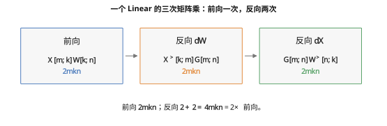

代入本文网络，batch 128：

|  | 第一层 784→256 | 第二层 256→10 | 合计 |
|---|---:|---:|---:|
| 前向 | 51.4 M | 0.66 M | **52.0 MFLOPs** |
| 反向 | 102.8 M | 1.31 M | **104.1 MFLOPs** |
| 比值 |  |  | **2.00** |

浅而宽的网络如果不需要输入梯度，可以省掉第一层的 $$dX$$；此例省掉后反向是 52.7 M，比值 1.01。层数较多时，第一层占比小，反向计算量才接近前向两倍。

### 2. 训练 FLOPs 等于 6ND

参数量为 $$N$$ 的网络，前向每个 token 约需 $$2N$$ FLOPs，反向约需 $$4N$$，训练 $$D$$ 个 token 的总量约为 $$6ND$$。例如 8B 模型训练 15T token，估算为 $$6\times8\times10^9\times15\times10^{12}=7.2\times10^{23}$$ FLOPs。这里的 $$2N$$ 忽略偏置和逐元素操作；attention 的 $$QK^T$$ 与 $$PV$$ 不含参数，长序列时也不能忽略，详见《[现代 LLM 结构（02）：Transformer 的 FLOPs、显存与 Roofline](/transformer-flops-bytes-and-roofline.html)》。

$$2N$$ 忽略了 attention 中与参数无关、随序列长度增长的矩阵乘。启用 checkpoint 重算后，再额外执行一次前向，总量约为 $$8N$$ / token。

## 七、激活为什么要存

### 1. PyTorch 实际保存了什么

第二层权重梯度 $$dW_2=A^TG_Z$$ 需要 $$A$$；第一层 $$dW_1=X^TG_H$$ 需要 $$X$$；ReLU 反向需要判断 $$H$$ 的符号。前向算出的中间量因此要留到反向走到相应层。

| 保存的量 | 形状 | 字节 |
|---|---|---:|
| $$X$$ | $$[128,784]$$ fp32 | 392 KiB |
| $$H$$ 掩码 | $$[128,256]$$ bool | 32 KiB |
| $$A$$ | $$[128,256]$$ fp32 | 128 KiB |
| 合计 |  | **552 KiB**（权重 795 KiB） |

用 `saved_tensors_hooks` 实测 MLP 784→256(ReLU)→10，交叉熵，batch 128，fp32：

```text
== saved：MLP 784->256(ReLU)->10，CE，batch 128，fp32
 # 算子节点                         shape          dtype          字节  归类
 0 MmBackward:self              (128, 784)     float32    401408  输入 X
 1 MmBackward:self              (128, 256)     float32    131072  ReLU 输出 A
 2 MmBackward:mat2              (256, 10)      float32     10240  参数 W2
 3 ReluBackward:result          (128, 256)     float32    131072  ReLU 输出 A（同一块内存，不重复计）
 4 NllLossBackward:self         (128, 10)      float32      5120  Z / softmax 输出
 5 LogSoftmaxBackward:result    (128, 10)      float32      5120  Z / softmax 输出（同一块内存，不重复计）
 6 NllLossBackward:target       (128,)         int64        1024  标签 Y
 7 NllLossBackward:total_weight ()             float32         4  其他（CE 内部）

按 storage 去重后：激活合计 526 KiB（X + ReLU 保存 + softmax 侧）；参数合计 10 KiB（autograd 为 dW/dX 保存，是参数不是激活）
对照正文 §七.1 表：X 392 KiB + H 掩码 32 KiB + A 128 KiB = 552 KiB。PyTorch 的 ReLU 保存的是 A（输出 128 KiB）而不是 H 的 mask——反向时用 A > 0 判断符号，等价但多 96 KiB。
```

表格是按反向公式列出的逻辑保存量，PyTorch 实际列表按 storage 去重后是 526 KiB，二者不能直接说数值相同。两处差别：ReLU 保存输出 $$A$$ 而不是 bool 掩码，另有 softmax / loss 相关张量；此外 $$W_2$$ 是为求 $$dX$$ 保存的参数，不计入激活。列表中 $$A$$ 由两个算子引用，但同一块内存只计一次。本文小网络 batch 增至 4096 时，逻辑激活表按 batch 放大；序列模型中 batch 还要乘序列长度。

### 2. 激活重算：用计算换存储

checkpointing 保存每个块的输入，反向走到块时重新前向，恢复块内中间结果再计算梯度。实测 8 层、宽 1024、batch 256、fp32，每 4 层一块，`use_reentrant=False`：

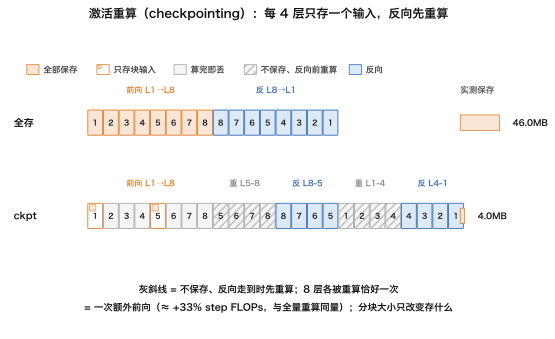

```text
== ckpt：8 层 MLP（宽 1024），batch 256，fp32
方案                            总保存         峰值 每 Linear 前向次数
全部保存                      46.00 MB    46.00 MB  [1, 1, 1, 1, 1, 1, 1, 1]
每 4 层 checkpoint           4.00 MB     4.00 MB  [2, 2, 2, 2, 2, 2, 2, 2]
梯度最大差值为 0.000e+00（本玩具两次前向浮点顺序相同，逐位一致）
保存降到 9%，8 个 Linear 各前向 2 次 = 恰好一次额外前向（8 次 Linear），与全量重算同量；分块大小只改存什么
```

8 个 Linear 各执行两次前向，意味着恰好多做一次完整前向，约增加 step FLOPs 的三分之一，与全量重算的计算量相同。每四层一块保留两个块输入，减少保存量；分块大小改变保存什么，不改变每层重算一次的计算成本。这个玩具的梯度逐位一致。

FlashAttention 也用重算换存储：不保存完整 attention 矩阵，反向分块重算。详见《[现代 LLM 结构（04）：Attention 变体与 KV Cache](/attention-variants-and-kv-cache.html)》。

## 八、梯度检查

### 1. 有限差分与相对误差

对参数元素 $$\theta_j$$，中心差分近似为

$$
\frac{L(\theta+\epsilon e_j)-L(\theta-\epsilon e_j)}{2\epsilon}
$$

截断误差为 $$O(\epsilon^2)$$，低于单侧差分的 $$O(\epsilon)$$。把数值梯度与解析梯度比较时，使用相对误差

$$
\frac{|g_{num}-g_{ana}|}{|g_{num}|+|g_{ana}|}
$$

避免梯度本身很小时绝对误差失去意义。经验上小于 $$10^{-6}$$ 可通过；$$10^{-4}$$ 量级需排查（例如 ReLU 在零点附近被扰动翻转）；大于 $$10^{-2}$$ 通常表示有错误。

### 2. 步长与数值精度

$$\epsilon$$ 太大时截断误差占主导，太小时两个相近数相减会放大舍入误差。脚本用 $$f(x)=e^x\sin x$$ 在 $$x=0.7$$ 扫描 $$10^{-1}$$ 到 $$10^{-10}$$：

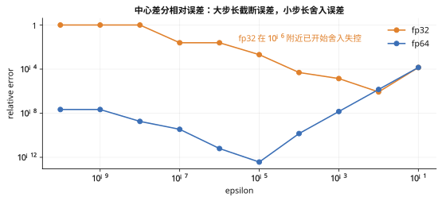

真实输出显示 fp32 在 $$10^{-6}$$ 的相对误差为 $$2.45\times10^{-2}$$，而不是预期的约 0.1；fp64 在同一处为 $$6.24\times10^{-12}$$，而不是预期的约 $$10^{-10}$$。这组实测说明精度与步长共同决定误差；不同函数、实现和硬件会改变曲线数值。

```text
float32 1e-01 1.410237e-04
float32 1e-02 8.491775e-07
float32 1e-03 1.389727e-05
float32 1e-04 4.916069e-05
float32 1e-05 2.040566e-03
float32 1e-06 2.453433e-02
float32 1e-07 2.453433e-02
float32 1e-08 1.000000e+00
float64 1e-01 1.409907e-04
float64 1e-02 1.426604e-06
float64 1e-03 1.426771e-08
float64 1e-04 1.424019e-10
float64 1e-05 3.714701e-13
float64 1e-06 6.240573e-12
float64 1e-07 3.459009e-10
float64 1e-08 1.806075e-09
float64 1e-09 2.167002e-08
float64 1e-10 2.167002e-08
```

一般梯度检查使用 float64、小网络、中心差分，并随机抽取参数元素；检查全部 203,530 个参数需要 407,060 次前向。本文 NumPy 小网络的最大相对误差为 $$1.11\times10^{-7}$$。float32 与 float64 的相对误差随步长扫描见图，最合适的 $$\epsilon$$ 取决于数值函数和精度，不能只由机器精度估算一个固定答案。

### 3. 训练前的两个检查

初始 loss 应接近 $$\ln C$$：10 类的均匀猜测为 $$\ln 10=2.30$$，本文初始 loss 为 2.46。还可以拿 16 个样本反复训练，确认 loss 能接近 0；不能过拟合小 batch 时，应检查梯度路径与学习率。

## 九、Autograd 做了什么

PyTorch 自动化了四件事：前向记录动态图；每个算子实现 backward；保存反向需要的张量；叶子张量的 `.grad` 累加。

| 机制 | 本文对应 | PyTorch 里 |
|---|---|---|
| 录带 | 前向按顺序记录算子 | 有梯度需求的张量参与运算后，输出的 `grad_fn` 指向动态图节点 |
| 算子 backward | Linear、ReLU、softmax 的 VJP | `Function.backward` 接收上游梯度并返回对输入的 VJP |
| saved tensors | 前向中间量供反向使用 | `ctx.save_for_backward(...)`；反向后通常释放 |
| 梯度累加 | 多条路径的贡献相加 | 叶子张量 `.grad` 累加，每步通常先 `zero_grad()` |

下面不是手画的示意图，而是脚本从真实 `loss.grad_fn` 沿 `next_functions` 广度优先遍历得到的节点：

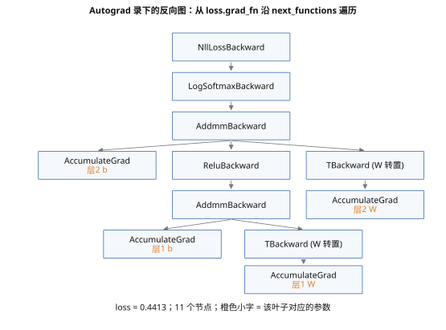

```text
loss=0.441257387; BFS 遍历 loss.grad_fn.next_functions：
00 NllLossBackward0
01 LogSoftmaxBackward0
02 AddmmBackward0
03 torch::autograd::AccumulateGrad   <- 层2 b
04 ReluBackward0
05 TBackward0
06 AddmmBackward0
07 torch::autograd::AccumulateGrad   <- 层2 W
08 torch::autograd::AccumulateGrad   <- 层1 b
09 TBackward0
10 torch::autograd::AccumulateGrad   <- 层1 W
edges=0->1, 1->2, 2->3, 2->4, 2->5, 4->6, 5->7, 6->8, 6->9, 9->10
unique autograd nodes=11
```

`torch.no_grad()` 关闭录带，推理时节省内存；`.detach()` 将张量从图上摘下（例如不让 old logprobs 参与后续梯度）；`torch.utils.checkpoint` 用前向重算换保存空间。本文 NumPy 手写梯度与 PyTorch autograd 在同一权重和 batch 上对拍，参数梯度差约 $$10^{-8}$$，差异来自浮点求和顺序。自动微分引擎的图存储、调度和 hook 细节见《[Infra 地图：PyTorch Autograd 与动态图](/pytorch-autograd-and-dynamic-computation-graph.html)》。

## 十、案例：MNIST 手写数字，NumPy 从零

MNIST 有 60,000 张训练图和 10,000 张测试图，每张是 28×28 灰度手写数字。此前 KNN 的错误率是 2.95%，RBF-SVM 是 1.43%；本例不用框架，把前面推导的公式写成约 120 行 NumPy，训练两层 MLP，记录准确率、算量和内存。

`Linear`、`ReLU`、`softmax_ce` 分别实现 `forward`（保存反向要用的量）与 `backward`（使用前面推导的公式）；`MLP` 把它们串起来，训练循环是前向、loss、反向、参数更新。Linear 与 ReLU 的核心如下：

```python
class Linear:
    def forward(self, X):
        self.X = X
        return X @ self.W + self.b
    def backward(self, dY):
        self.dW[...] = self.X.T @ dY
        self.db[...] = dY.sum(0)
        return dY @ self.W.T

class ReLU:
    def forward(self, X): self.mask = X > 0; return X * self.mask
    def backward(self, dY): return dY * self.mask
```

softmax-CE 先减每行最大 logit 保证数值稳定，再计算概率与梯度：

```python
def softmax_ce(logits, y):
    z = logits - logits.max(1, keepdims=True)
    p = np.exp(z); p /= p.sum(1, keepdims=True)
    m = logits.shape[0]
    loss = -np.log(p[np.arange(m), y]).mean()
    d = p.copy(); d[np.arange(m), y] -= 1.0
    return loss, d / m, p
```

这里先算 softmax 再取 log；正确类 logit 比最大值低很多时，指数可能下溢为 0，配套脚本用小量兜底。生产实现使用 log-sum-exp 直接计算对数概率。

网络为 `MLP([784, 256, 10])`，梯度检查用 `[20,16,5]` 的 float64 小网络。训练前检查中心差分梯度与解析梯度，并计数 FLOPs 和保存激活。实测输出：

```text
grad check worst rel err: 1.11e-07
params: 203530
batch 128: fwd 52.0 MFLOPs  bwd 104.1 MFLOPs  ratio 2.00
  2*N*tokens = 52.1 MFLOPs (fwd approx ignoring bias)
  saved activations: 552 KiB  vs weights 795 KiB
```

与 PyTorch autograd 对拍，同一权重、同一 batch：

```text
loss numpy 2.460904 torch 2.460904
dW1 max abs diff 5.59e-09
dW2 max abs diff 7.45e-09
```

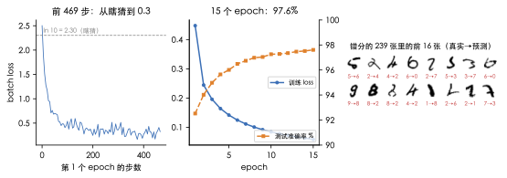

| Epoch | 训练 loss | 测试准确率 |
|---|---:|---:|
| 1 | 0.4477 | 92.52% |
| 5 | 0.1416 | 96.01% |
| 10 | 0.0842 | 97.26% |
| 15 | 0.0585 | 97.61% |

初始 loss 2.46 接近 10 类随机猜测的 $$\ln10=2.30$$。第一个 epoch 的 batch loss 在 100 步内从约 2.3 降到 0.5；首个 epoch 结束测试准确率 92.52%，再训练 14 个 epoch 达到 97.61%。10,000 张测试图错 239 张，常见错分是形状相近的数字，例如 7 与 2、9 与 7、9 与 4。KNN、RBF-SVM 和 MLP 在同一数据集上的错误率分别为 2.95%、1.43% 和 2.39%；MLP 的特点是能继续堆叠层、学习可复用特征。每个 epoch 在笔记本 CPU 上约 0.1 秒。

训练还留下三个可复现实验：把 ReLU 换成 GELU 或 SiLU 后重跑梯度检查；加一层观察 FLOPs 比值与激活增长；用 float32 做梯度检查观察舍入误差。MNIST 上的 97.6% 是小型基线，卷积、初始化、归一化、优化器、正则化与 attention 是后续内容要补足的部分。生产训练使用成熟框架；这段 NumPy 基座的价值是让前向、反向、算量和保存量都能逐行对应。

训练曲线由 [`case_01_mnist_mlp.py`](https://github.com/arganzheng/ai-learning-labs/blob/main/deep-learning-foundations/case_01_mnist_mlp.py) 生成；NumPy 基础训练脚本为 [`01_backprop.py`](https://github.com/arganzheng/ai-learning-labs/blob/main/deep-learning-foundations/01_backprop.py)，配套玩具输出与图由 [`case_03_backprop_toys.py`](https://github.com/arganzheng/ai-learning-labs/blob/main/deep-learning-foundations/case_03_backprop_toys.py) 生成。

## 十一、小结

- 反向传播按计算图的反向拓扑序逐算子计算 VJP，不必创建完整 Jacobian。
- 标量对参数的梯度与参数同形；Linear 的 $$dW=X^TG$$、$$dX=GW^T$$、$$db=\sum_iG_{i,:}$$ 可从形状与元素求和推出来。
- Linear 反向做两个矩阵乘，训练计算量约为 $$6ND$$；重算时约为 $$8ND$$。
- 前向输入与中间激活要留给反向；checkpointing 以额外前向换更低的保存量。
- 梯度检查比较解析梯度与中心差分，步长和浮点精度都会影响误差。
- Autograd 记录计算图、调用算子 backward、管理保存张量，并累加叶子梯度。

下一篇《[深度学习基础（04）：激活函数——从 sigmoid 到 SwiGLU](/activation-functions-from-sigmoid-to-swiglu.html)》继续看激活函数如何改变反向梯度；后续再讨论初始化、归一化与残差。

配套代码：[`case_03_backprop_toys.py`](https://github.com/arganzheng/ai-learning-labs/blob/main/deep-learning-foundations/case_03_backprop_toys.py) 可运行本文的小例子、梯度检查和图；MNIST 训练脚本为 [`case_01_mnist_mlp.py`](https://github.com/arganzheng/ai-learning-labs/blob/main/deep-learning-foundations/case_01_mnist_mlp.py)。

## 十二、自测

1. Linear 输入 $$X\in\mathbb{R}^{128\times784}$$，权重 $$W\in\mathbb{R}^{784\times256}$$。$$dW$$、$$dX$$、$$db$$ 各是什么形状？

   <details markdown="1"><summary>答案</summary>

   $$dW=X^TG$$，形状为 $$[784,256]$$；$$dX=GW^T$$，形状为 $$[128,784]$$；$$db=\sum_iG_{i,:}$$，形状为 $$[256]$$。

   </details>

2. softmax 与交叉熵对 logits 的梯度是什么？batch 平均在哪里体现？

   <details markdown="1"><summary>答案</summary>

   $$dZ=(P-Y)/m$$，其中 $$Y$$ 是 one-hot 标签，除以 $$m$$ 来自 batch 平均。

   </details>

3. 7B 模型训练 1T token，前向、反向和合计 FLOPs 各是多少？启用 checkpointing 呢？

   <details markdown="1"><summary>答案</summary>

   前向 $$2ND=1.4\times10^{22}$$；反向 $$4ND=2.8\times10^{22}$$；合计 $$6ND=4.2\times10^{22}$$。checkpointing 多一次前向，总量约 $$8ND=5.6\times10^{22}$$。

   </details>

4. $$f=xy+x$$，取 $$x=2,y=3$$，求 $$df/dx$$。为什么不是只取乘法路径的梯度？

   <details markdown="1"><summary>答案</summary>

   乘法路径贡献 $$y=3$$，直接路径贡献 1，同一输入的梯度汇合相加，$$df/dx=3+1=4$$。

   </details>

5. batch Linear 的 Jacobian 为什么是分块对角？

   <details markdown="1"><summary>答案</summary>

   每个样本的输出只依赖相同样本的输入，跨样本导数为 0；每个对角块都是单样本 Linear 的 $$W^T$$。因此 VJP 可直接批量矩阵乘，无需构造完整 Jacobian。

   </details>

6. batch 从 128 增至 4096，本文逻辑激活表的 552 KiB 会怎样变化？权重呢？

   <details markdown="1"><summary>答案</summary>

   batch 放大 32 倍，逻辑表约为 17.3 MiB；权重不随 batch 变化，仍为 795 KiB。实际框架保存清单与逻辑表的项目有所不同，本文实测去重后是 526 KiB。

   </details>

7. 梯度检查为什么用 float64、中心差分和相对误差？

   <details markdown="1"><summary>答案</summary>

   float64 降低舍入误差；中心差分截断误差为 $$O(\epsilon^2)$$；相对误差能按梯度自身量级衡量偏差，避免小梯度被绝对误差误导。

   </details>

[^q0]: 反向传播沿计算图反向拓扑序对算子计算 VJP；Linear 的三条梯度公式可从形状重建，softmax 与交叉熵合并后的梯度为 $$(P-Y)/m$$。迷你网络中心差分对 $$dW_1,dW_2$$ 的最大相对误差为 $$4.515\times10^{-10}$$。
[^q1]: Linear 前向约 $$2N$$ FLOPs / token，反向约 $$4N$$，合计 $$6N$$；激活要保存，因为权重梯度需要前向输入，checkpointing 用额外计算换保存空间。
