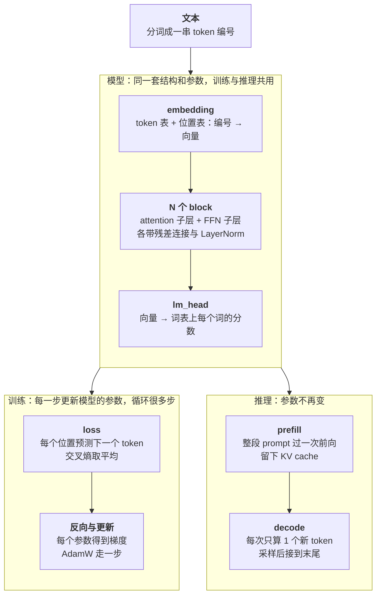

> **系列总览。** 从 Transformer 的静态结构开始，沿着一个 token 的旅程，再亲手写出并训练 GPT-2 风格的小模型。本系列由四篇正文与一篇系列总结组成。

## 总览：一个小模型从文本到续写

Transformer 的结构图里每个部件为什么在那里？训练与推理的一次前向分别做什么？一个最小 GPT 如何从公式落到代码，再从随机权重训练成会续写的模型？四篇文章围绕同一个 GPT-2 结构的小模型回答这些问题。下图是这个模型从文本到续写经过的环节：

图里的四块分别由这几篇展开：

- **文本**：一段文本先变成整数数组才能进模型。[《手搓 GPT（下）》](/nanogpt-train-py-and-training-a-model-that-writes.html)从 nanoGPT 的 `prepare.py` 读起。
- **模型**：[《Transformer 长什么样》](/transformer-architecture-from-a-sentence-to-the-next-token.html)逐个打开 embedding、attention、FFN、残差与 LayerNorm、lm_head，说明每个部件的作用和形状；[《手搓 GPT（上）》](/nanogpt-model-py-line-by-line.html)把同一套结构对到 nanoGPT `model.py` 的六个类上。
- **训练**：[《一个 token 的旅程》](/transformer-token-journey-training-and-inference.html)讲一步训练的数据流，包括 loss 怎么来、反向要保存什么、参数怎么更新；[《手搓 GPT（下）》](/nanogpt-train-py-and-training-a-model-that-writes.html)读 `train.py` 的训练循环，并实际训出一个会续写的模型。
- **推理**：[《一个 token 的旅程》](/transformer-token-journey-training-and-inference.html)讲 prefill、decode 与 KV cache；nanoGPT 的生成代码 `generate` 在[《手搓 GPT（上）》](/nanogpt-model-py-line-by-line.html)，它是不带 KV cache 的写法，每生成一个 token 都把整段重算一遍。

## 缩写



## 为什么写这个系列

主流语言模型都以 Transformer decoder 为主干，理解它们先要弄清同一套结构。但“知道它长什么样”和“能写出来”差得很远：知道 attention 与 FFN 大致怎么堆起来，不等于能说明每个部件承担什么作用、去掉或替换后会怎样。最直接的检验是能不能不看原文把它写出来、训出来。

现有材料常在这里断开：教材和课程能讲清结构或带读一段代码，却未必把静态结构、动态数据流、实现细节和训练过程接成一条可验证的路径；框架文档把不少细节封装在 API 里；只看公式又很难知道它们在代码中落在哪一行。本系列用同一个小模型把这些层次连起来，每一步都能在笔记本上验证。

## 适合哪些读者

### 想亲手写一个 Transformer 的人

你可能是算法方向的学生或转行者，读过 attention 的公式，却还没有从头写出并训练一个 Transformer。四篇正文按“图 → 数据流 → 代码 → 训练”展开，每一步都有可以在笔记本上运行的代码和数字，不需要 GPU。

### 想把结构知识落到实现上的工程师

你希望看懂 PyTorch 或 HuggingFace 中的实现，或者想确认一个结构改动会影响哪些计算。本系列从最小例子开始，逐步对照框架实现与真实 GPT-2 配置。

### 做模型系统、需要理解模型前向的工程师

理解 embedding、attention、FFN、训练、prefill 与 decode 的基本数据流，是继续阅读现代模型结构和推理系统的基础。已经熟悉 Transformer 的读者也可以直接进入[现代 LLM 结构系列](/llm-architecture-evolution-roadmap-from-gpt2.html)。

## 系列的整体主线

四篇沿同一条路线逐步增加细节：先画出静态结构，再追踪一个 token 在训练与推理中的数据流，然后把结构写成代码，最后读训练脚本并实际训出一个会续写的模型。全程使用小例子手算形状与结果，用 PyTorch 对拍数值，再与 nanoGPT、HuggingFace 的实现核对。

## 分章导读

### 01. Transformer 长什么样：从一句话到下一个 token

先从 GPT-2 small 的 decoder-only 总览看起，再回到[《Attention Is All You Need》](https://arxiv.org/html/1706.03762v4)的机器翻译 encoder-decoder 结构，对照 encoder-only、decoder-only、encoder-decoder 三条路线，解释 GPT-2 这条路线的来历。之后从 embedding、位置、attention、FFN、残差与 LayerNorm、lm_head 出发，逐个解释部件的作用；用 $$d = 4$$、3 个 token 的例子手算 attention 六步并与 PyTorch 对拍，再看 GPT-2 small 的数字、attention 头热力图、换序实验与参数量。

> **原始 Transformer 的 encoder-decoder 如何变成 GPT-2 的 decoder-only？一个 token 的编号进入 GPT-2，到词表上的概率分布出来，又经过哪些运算？**

实践：用 `attention_by_hand.py` 手算 attention 并与 PyTorch 对拍。

### 02. 一个 token 的旅程：训练侧与推理侧

沿着一个 token 走过训练、prefill 与 decode：为什么一次训练前向能得到 $$T$$ 个训练信号，反向需要保存哪些激活值，推理时 KV cache 又省了什么、花了什么。用带 cache 的极小 GPT 验证有无 cache 的输出逐 token 一致，并测量生成速度。

> **训练时一句话的 $$T$$ 个 token 进入模型，为什么一次前向就能得到 $$T$$ 个训练信号？推理时为什么前面的 token 不用重算？**

实践：在 `token_journey.py` 中比较有无 KV cache 的结果与耗时。

### 03. 手搓 GPT（上）：nanoGPT model.py 逐行解析

把《Transformer 长什么样》的结构与《一个 token 的旅程》的数据流落到 Karpathy 的 nanoGPT `model.py`：拆解 Q/K/V 合并投影、多头变形、mask、残差、初始化、生成与权重加载，并对照 HuggingFace GPT-2。

> **一个能加载 GPT-2 权重、能训练、能生成的 Transformer，最少需要写哪些东西？**

实践：运行 `nanogpt_walkthrough.py`，逐项对拍 vendored nanoGPT 与 HuggingFace 的输出。

### 04. 手搓 GPT（下）：nanoGPT train.py 与训一个会续写的模型

从文本预处理、随机窗口采样一路读到训练循环、梯度累积、优化器、checkpoint 与 DDP。用莎士比亚文本训练小模型，观察 loss 与生成结果，再改变层数，比较参数量、速度和验证 loss。

> **从一个 1.1 MB 的文本文件到一个能续写它的模型，中间每一步的代码在哪、为什么那样写？把层数从 4 改到 2 或 8，loss 和速度各会怎样？**

实践：运行 nanoGPT 的 `prepare.py` 与 `train.py`，查看 2 / 4 / 8 层实验日志。

## nanoGPT 贯穿实践线

四篇共享一条能运行的代码线：`attention_by_hand.py` 验证 attention，`token_journey.py` 把它放进带 KV cache 的极小 GPT，`nanogpt_walkthrough.py` 对照 `model.py`，最后用 `nanogpt/` 中的训练脚本和日志读懂 `train.py`。脚本及完整输出保存在 [ai-learning-labs/transformer-and-llm](https://github.com/arganzheng/ai-learning-labs/tree/main/transformer-and-llm)。

## 前置要求

- 了解矩阵乘法的形状规则、内积、softmax 与交叉熵；相关概念会在文中用到。
- 会读基本 Python 与 PyTorch 代码，能看懂 `nn.Linear`、`torch.matmul` 和 `softmax` 的调用。

不要求见过 Transformer 结构图、训练过模型、了解具体的位置编码或 attention 方法、写过 CUDA，也不需要 GPU。正文中的代码可以在 CPU 上运行；[《手搓 GPT（下）》](/nanogpt-train-py-and-training-a-model-that-writes.html)的训练实验在一台 MacBook 上约需 7 分钟。

## 章节目录

1. [Transformer 长什么样——从一句话到下一个 token](/transformer-architecture-from-a-sentence-to-the-next-token.html)
2. [一个 token 的旅程——训练侧与推理侧](/transformer-token-journey-training-and-inference.html)
3. [手搓 GPT（上）——nanoGPT model.py 逐行解析](/nanogpt-model-py-line-by-line.html)
4. [手搓 GPT（下）——nanoGPT train.py 与训一个会续写的模型](/nanogpt-train-py-and-training-a-model-that-writes.html)

[系列总结与通关自测](/transformer-principles-series-recap-and-self-test.html)

## 最终目标

读完本系列，能够解释 Transformer 各部件的作用，追踪训练与推理的数据流，在 nanoGPT 和 HuggingFace 实现中找到对应代码，并从文本预处理开始训练一个能续写的小模型。

## 读完之后

接下来可以读[《现代 LLM 结构：从 GPT-2 到今天的演进》](/llm-architecture-evolution-roadmap-from-gpt2.html)：从熟悉的 GPT-2 出发，继续看今天的模型改了哪些结构，以及这些改动怎样改变成本。
