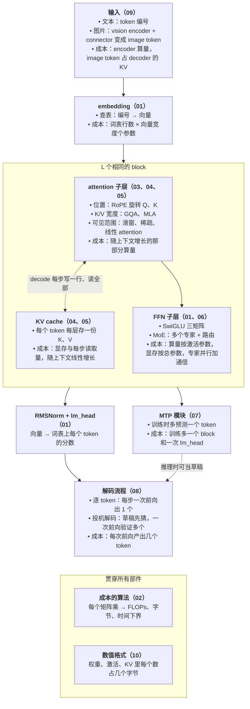
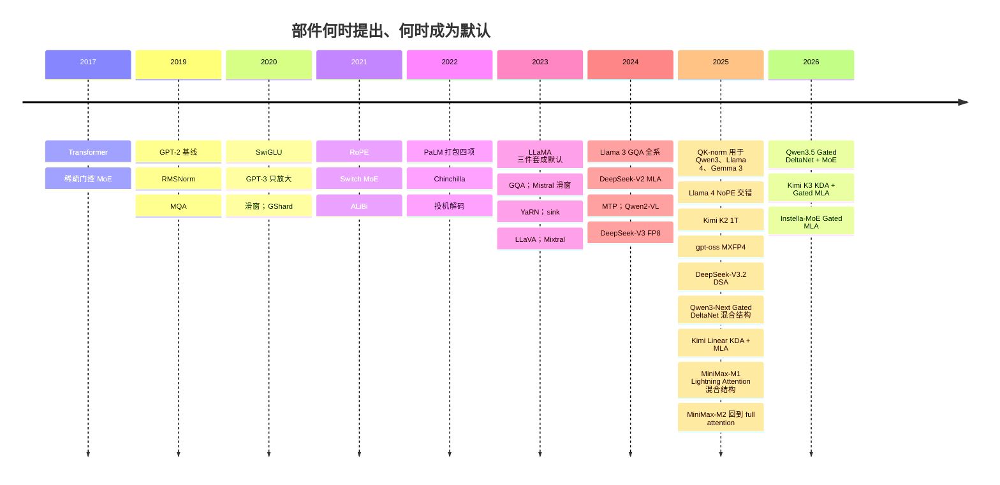
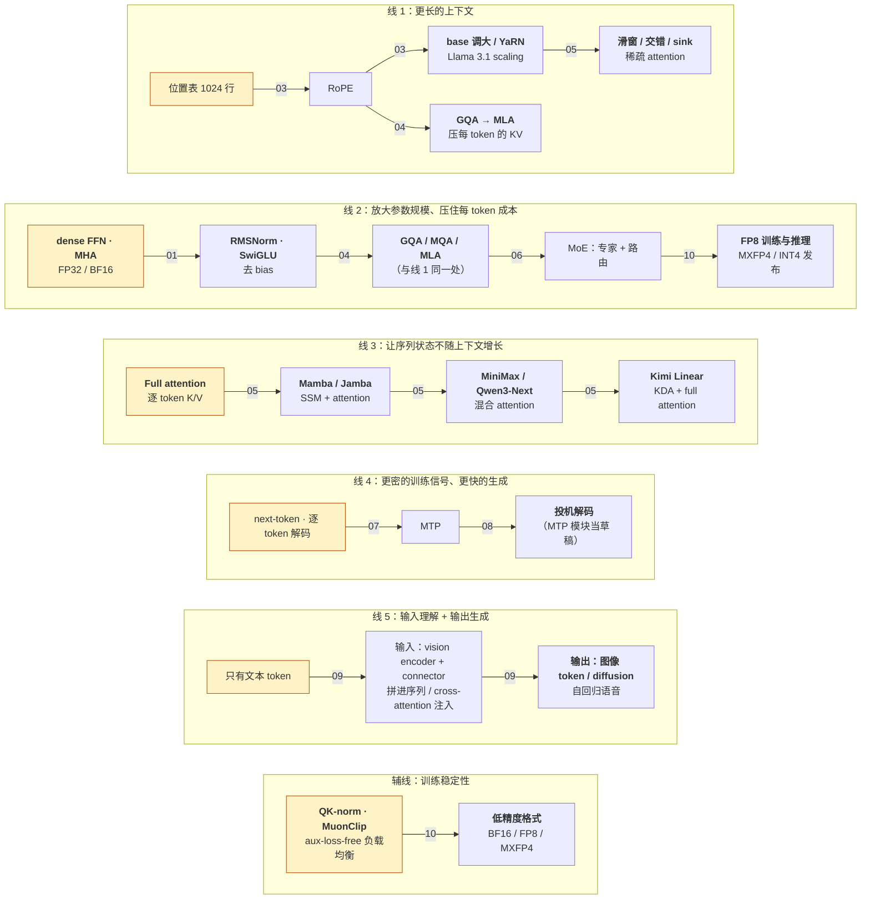

> **系列总览。** 从 GPT-2 的结构出发，沿着现代 LLM 的演进路线，读真实模型配置、拆解结构改动，再把它们换算成成本。

## 总览：结构改动落在前向的哪个部件、哪一笔成本

本系列从 GPT-2 出发，回答现代 LLM 的结构改了什么、为什么改、代价是什么。先读真实配置、建立路线图和参数量基线，再以算量与访存为共同坐标，逐篇展开位置编码、Attention、长上下文、MoE、MTP、投机解码、多模态和数值格式。下图把十篇讨论的改动放回一次前向经过的部件上：每个方框写改了什么、动的是哪一笔成本，括号里是篇号。



图里每个方框对应的篇目和要点：

- **输入**：文本是 token 编号；图片先过 vision encoder 与 connector 变成 image token，再拼进序列或经 cross-attention 层读入。encoder 的算量只花一次，image token 在 decoder 里的 KV 要占到请求结束。见[《多模态：vision encoder 的算量与 image token 的 KV 代价》](/multimodal-vision-encoder-cost-and-image-token-kv.html)。
- **embedding、RMSNorm 与 lm_head**：GPT-2 到 Llama 的五处改动里，RMSNorm、去 bias、lm_head 不再与 embedding 共享权重落在这里；从 `config.json` 数参数量也从这里开始。见[《从 GPT-2 到 Llama——五处改动与参数量》](/gpt2-to-llama-five-changes-and-parameter-count.html)。
- **attention 子层**：三个槽位各有一篇。位置怎么进 attention 分数、训练长度之外还认不认得，见[《位置编码与外推》](/positional-encoding-and-long-context.html)；K、V 投影多宽，见[《Attention 变体与 KV cache》](/attention-variants-and-kv-cache.html)；每个 token 能看到哪些历史 token，见[《长上下文的成本与结构手段》](/long-context-cost-and-structural-remedies.html)。
- **KV cache**：decode 时每层为每个历史 token 留一份 K、V，Llama-3-8B 是每 token 128 KiB，128K 上下文的一个请求 16 GiB。GQA、MLA 压的是每 token 的字节数（《Attention 变体与 KV cache》），滑窗、稀疏与线性 attention 改的是它随上下文增长的方式（《长上下文的成本与结构手段》）。
- **FFN 子层**：SwiGLU 把两个矩阵换成三个（《从 GPT-2 到 Llama——五处改动与参数量》）；MoE 把一份 FFN 换成多个专家加路由，每 token 的算量按激活参数算，显存按总参数算，专家分到多张卡后每层多两次 all-to-all 通信。见[《MoE 的路由、激活参数量与通信形态》](/moe-compute-and-communication.html)。
- **MTP 模块**：接在主干最后一层之后，只在训练时多预测一个 token；推理时丢掉，或者留下来给投机解码当草稿。见[《MTP——改训练目标而不改主干的多 token 预测》](/multi-token-prediction-mtp.html)。
- **解码流程**：不改模型结构，改的是一次前向产出几个 token——草稿先猜几个，目标模型一次前向全部验证。见[《投机解码——草稿、验证与收益条件》](/speculative-decoding-draft-verify-and-payoff.html)。
- **成本的算法**：上面每一处的「成本」都用同一套算法得出，把每个矩阵乘换成 FLOPs、字节数和时间下界。见[《前向的算量与访存量》](/transformer-flops-bytes-and-roofline.html)。
- **数值格式**：所有权重、激活和 KV 的字节数都要乘「每个数占几个字节」，BF16 是 2，FP8 是 1。见[《浮点格式、数值稳定性与混合精度》](/floating-point-formats-and-mixed-precision.html)。

同一组改动在后面三节换三个角度再排一遍：[「从 GPT-2 出发：可替换的槽位」](#从-gpt-2-出发可替换的槽位)一节按槽位列，[「时间线：这些改动是什么时候、为什么出现的」](#时间线这些改动是什么时候为什么出现的)一节按出现时间列，[「五条演进线与一条辅线」](#五条演进线与一条辅线)一节按回答的问题归类。

## 缩写



## 为什么写这个系列？

### 演进沿着几个方向走，每一处都是对某个具体问题的回答

从 GPT-2 到 Llama 的主要部件变化可归纳为五处（LayerNorm → RMSNorm、位置表 → RoPE、GELU 两矩阵 FFN → SwiGLU 三矩阵、MHA → GQA、去掉 bias），从 Llama 到 DeepSeek-V3 又改了三处（MLA、细粒度 MoE、MTP）。[《从 GPT-2 到 Llama——五处改动与参数量》](/gpt2-to-llama-five-changes-and-parameter-count.html)用真实配置把这些改动放在一张实践地图里，从《位置编码与外推》到《浮点格式、数值稳定性与混合精度》的八篇专项再逐项展开。把改动按它们回答的问题归类，是五条演进线与一条训练稳定性辅线：

| 方向 | 问题 | 改动 | 篇 |
|---|---|---|---|
| 更长的上下文 | 训练长度之外位置还认不认得；上下文拉长后 KV、prefill 与并发被什么限制 | RoPE 的 base 与 YaRN<br/>GQA / MLA<br/>滑窗、交错、sink、稀疏 attention | [03 位置编码与外推](/positional-encoding-and-long-context.html)<br/>[04 Attention 变体与 KV cache](/attention-variants-and-kv-cache.html)<br/>[05 长上下文](/long-context-cost-and-structural-remedies.html) |
| 放大参数规模、压住每 token 成本 | 参数规模与每 token 算量能不能解耦；每个数能不能少占几个字节 | SwiGLU<br/>GQA / MLA<br/>MoE<br/>FP8 训练与推理 | [01 五处改动](/gpt2-to-llama-five-changes-and-parameter-count.html)<br/>[04 Attention 变体与 KV cache](/attention-variants-and-kv-cache.html)<br/>[06 MoE](/moe-compute-and-communication.html)<br/>[10 浮点格式与混合精度](/floating-point-formats-and-mixed-precision.html) |
| 让序列状态不随上下文增长 | 能否不保留逐 token 的全量 K/V，同时保住足够的长程建模能力 | 线性 attention<br/>SSM<br/>线性 / full attention 混合架构 | [05 长上下文](/long-context-cost-and-structural-remedies.html) |
| 更密的训练信号、更快的生成 | 同一批数据能不能给更多监督；decode 的串行形态能不能打破 | MTP<br/>投机解码 | [07 MTP](/multi-token-prediction-mtp.html)<br/>[08 投机解码](/speculative-decoding-draft-verify-and-payoff.html) |
| 模态：输入理解与输出生成 | 图像、视频、音频如何进入模型，又如何从模型生成；成本在哪一环 | 输入：vision encoder + connector，图像 token 拼进序列或经 cross-attention 层读入<br/>输出：离散图像 token、自回归语音与 diffusion | [09 多模态](/multimodal-vision-encoder-cost-and-image-token-kv.html) |

Table: 现代 LLM 结构系列的五条演进线

多模态线不是从 Llama 或 DeepSeek 的文本结构改动推出来的：它既包括输入理解，也包括输出生成。五条线之外还有训练稳定性这条**辅线**——它影响模型能否稳定训大、能否可靠使用低精度，但不是一条新的推理结构。每篇统一按**问题 → 方法（改了什么、什么没改）→ 实现（形状、公式、最小代码）→ 效果（功能验证、质量指标或公开实验依据）→ 代价（相对基线增减了哪些资源项）→ 边界（什么场景有效）**的顺序讲；不是每篇都给成本表加一列——位置编码、数值稳定性、MTP 更适合给一张验证图或一组对照实验。

### 引擎与 kernel 的一切优化都以模型的算量和访存量为目标

推理引擎的 continuous batching、PagedAttention、prefix caching、PD 分离，训练框架的张量并行、流水并行、专家并行、激活重算，kernel 层的 FlashAttention、融合算子、低精度 GEMM——每一项都是对模型某个成本项的回应：

- 不知道 KV cache 是怎么算出来的，就不理解 PagedAttention 在管理什么；
- 不知道 decode 为什么是 memory-bound 的，就不理解为什么 weight-only 量化对 decode 有效、对 prefill 不保证加速；
- 不知道 MoE 每层只激活 8/256 的专家，就不理解它的部署为什么要考虑 all-to-all 而不只是 all-reduce。

[《前向的算量与访存量》](/transformer-flops-bytes-and-roofline.html)建立这套推导，后面每篇用它：面对一个新模型、新硬件、新方法，可以在看任何 benchmark 之前先算出它**应该**多快，再用测量去解释差距。

### “参数量”只是成本的一个维度

模型卡上通常只有一个数字：参数量。但一个 8B 的 dense 模型、一个 47B 总参数 13B 激活参数的 MoE 模型、一个 671B 总参数 37B 激活参数的 MoE 模型，它们的显存、算量、访存量、通信量之间的关系完全不同：

| | 参数量决定 | 激活参数量决定 | 上下文长度决定 | batch 决定 |
|---|---|---|---|---|
| 显存 | 权重 | — | KV cache | KV cache · 激活值 |
| 算量（FLOPs） | — | 每 token 的 GEMM | attention 项 | 总量 |
| 访存量 | decode 的下界 | — | KV 读取 | 摊薄权重读取 |
| 通信量 | 并行切分 | MoE 的 all-to-all | 序列并行 | — |

Table: 四类成本各由哪个变量决定

每一格都有自己的公式，公式里的变量各不相同。现代 LLM 结构系列把这张表的每一格填上。

### 现有材料的断层

- **教材与课程**（d2l 10.7、“Let's build GPT”）把结构与代码讲得很好，但止步于 GPT-2 的形态，不讲 GQA、MLA、MoE、MTP 为什么出现，也不算成本；
- **论文**给出了每个方法的定义和实验结果，但假设读者会自己算成本，而且每篇只讲一个方法，读者需要自己把它们放进同一个坐标系；
- **框架文档**（PyTorch、`transformers`、vLLM、Megatron）讲怎么用，把模型当作黑盒；
- **博客**里的“Transformer 数学”多数止步于参数量和 $$6ND$$，不覆盖 MLA、MoE、FP8、投机解码这些当前实践的重心。

本系列从真实配置与演进路线图开始，把每个方法放回它解决的问题里讲清实现，再用同一张成本表讨论数字，让读者可以对照模型与硬件自行推算。

## 适合哪些读者？

### 设计或调整模型结构的算法工程师

你在选 GQA 组数、选 MoE 的专家粒度、选 RoPE 的 base、决定是否用 MLA 或 MTP。现代 LLM 结构系列告诉你每个选择在解决什么、动了哪几行、效果如何，并把代价算成显存、算量、访存、通信的数字，让结构设计和硬件效率在同一张表上讨论。

### 做推理系统与训练基础设施的工程师

你在配置或改造 vLLM、SGLang、Megatron、DeepSpeed 这类系统，需要判断：这个模型在这几张卡上该怎么切、batch 和上下文的上限在哪、投机解码的收益上界是多少、MoE 该用 EP 还是 TP 还是两者组合。[《前向的算量与访存量》](/transformer-flops-bytes-and-roofline.html)给的是你做这些判断时要用的公式，各专项篇给的是数字；如果还不熟悉 Transformer，可以先读[《Transformer 原理与实现》](/transformer-and-llm-structure-implementation-and-evolution.html)系列。

### 写 kernel 的工程师

你要优化的 attention、GEMM、MoE、量化 kernel 的输入 shape 和访存模式都来自模型结构。理解 GQA 的组数如何改变 decode attention 的算术强度、MLA 的矩阵吸收如何把 attention 变成一个大 head dim 的 MQA、MoE 的 grouped GEMM 的 M 维为什么这么小，才知道该往哪个方向优化。

### 从后端转向 AI-Infra、需要一份“模型知识最小集”的工程师

你不打算成为算法工程师，但读引擎源码、看性能报告、参加技术讨论时，需要知道 head、layer、KV cache、prefill、decode、MoE、FP8 这些词背后的数量关系。[《从 GPT-2 到 Llama——五处改动与参数量》](/gpt2-to-llama-five-changes-and-parameter-count.html)与[《前向的算量与访存量》](/transformer-flops-bytes-and-roofline.html)是为此准备的最小集。

## 从 GPT-2 出发：可替换的槽位
{: #一承上gpt-2-是一组可替换的槽位}

《Transformer 原理与实现》系列的[《Transformer 长什么样》](/transformer-architecture-from-a-sentence-to-the-next-token.html)数出 decoder-only Transformer 有六种部件：token embedding、位置 embedding、attention 子层、FFN 子层、残差 + LayerNorm、lm_head。[《手搓 GPT（上）》](/nanogpt-model-py-line-by-line.html)把它们写成 330 行，[《手搓 GPT（下）》](/nanogpt-train-py-and-training-a-model-that-writes.html)训了出来。除了这六种部件，那份代码还隐含了四个当时没有讨论的约定：训练目标只有 next-token 一个、解码是逐 token 一次前向、权重与计算用一种浮点格式、输入只有文本。

把六种部件和四个约定拆开排成一列，就是下表的十二个**槽位**。从 GPT-2 到今天的每一处结构改动，都是往其中一个槽位里换一个新的填法——没有一处改动换掉了"embedding → L 个相同的 block → norm → lm_head"这个骨架：

| 槽位 | GPT-2 的填法（nanoGPT 里的名字） | 今天常见的填法 | 替换动机 | 在哪一篇 |
|---|---|---|---|---|
| 归一化 | LayerNorm（`ln_1`、`ln_2`、`ln_f`） | RMSNorm | 少一次均值、少一组参数，数值行为更简单 | [01 五处改动](/gpt2-to-llama-five-changes-and-parameter-count.html) |
| 位置 | 学出来的位置表（`wpe`，1024 行） | RoPE；再加 base 调大、YaRN、NoPE 层交错 | 相对位置怎么进 attention；训练长度之外还认不认得 | [03 位置编码与外推](/positional-encoding-and-long-context.html) |
| attention 的 K/V | MHA：K、V 与 Q 同宽（`c_attn` 是 $$d \to 3d$$） | GQA / MQA / MLA | 每个 token 的 KV cache 占多少字节 | [04 Attention 变体与 KV cache](/attention-variants-and-kv-cache.html) |
| attention 的可见范围 | 全局 causal mask（`bias` 下三角） | 滑窗、局部 / 全局交错、attention sink、稀疏 | 上下文拉长后 KV 线性、prefill 二次增长怎么办 | [05 长上下文的成本与结构手段](/long-context-cost-and-structural-remedies.html) |
| FFN | GELU 两矩阵、$$4d$$（`c_fc`、`c_proj`） | SwiGLU 三矩阵、约 $$3.5d$$ | 等参数、等算量下更低的 loss | [01 五处改动](/gpt2-to-llama-five-changes-and-parameter-count.html) |
| FFN 的份数 | 一份 dense FFN | MoE：多个专家 + 路由 | 参数量与每 token 算量能不能解耦 | [06 MoE](/moe-compute-and-communication.html) |
| bias | 线性投影与 LayerNorm 都带 bias | 全部去掉 | 训练更稳、GEMM 更纯 | [01 五处改动](/gpt2-to-llama-five-changes-and-parameter-count.html) |
| 输出层 | lm_head 与 `wte` 共享权重 | 大模型不共享 | 词表大小与模型规模的关系 | [01 参数量](/gpt2-to-llama-five-changes-and-parameter-count.html) |
| 训练目标 | 只预测下一个 token | MTP：同时预测后面几个 | 同一批数据能不能给更多监督 | [07 MTP](/multi-token-prediction-mtp.html) |
| 解码流程 | 每步一次前向、产出一个 token | 投机解码：草稿 + 一次前向验证多个 | decode 的串行形态能不能打破 | [08 投机解码](/speculative-decoding-draft-verify-and-payoff.html) |
| 输入模态 | 只有 token embedding | vision encoder + connector，再拼进序列或经 cross-attention 层读入 | 图片怎么变成 decoder 能处理的 token，代价在哪一环 | [09 多模态](/multimodal-vision-encoder-cost-and-image-token-kv.html) |
| 数值格式 | FP32（可选 BF16 autocast） | BF16 训练 → FP8 训练与推理 → MXFP4 / INT4 发布 | 每个数占几个字节，误差在哪里积累 | [10 浮点格式与混合精度](/floating-point-formats-and-mixed-precision.html) |

Table: GPT-2 的槽位、今天的填法与展开它们的篇目——现代 LLM 结构系列的目录就是这张表

> [!NOTE]
> 这张表没写出来的两点：
>
> - **规模不在表里**：从 124M 到 8B、70B、1T，$$d$$、$$L$$、$$V$$ 的放大不换任何槽位，但它决定每一处改动值不值得——GQA 在 124M 的模型上省不出什么，在 70B 上省的是几十 GB 的 KV。规模怎么选是[预训练系列](/pretraining-from-tokenizer-to-training-recipe.html)的 scaling law，规模带来的算量与字节在[《前向的算量与访存量》](/transformer-flops-bytes-and-roofline.html)。
> - **一处改动可以同时服务两个问题**：GQA 既省 10% 的参数也省 4 倍的 KV，MLA 既是 attention 变体也是长上下文手段。本系列把每处改动放在它**主要回答的问题**所在的线上，并在展开它的那一篇里说明次要收益；读者不必纠结一处改动"属于"哪条线。

## 时间线：这些改动是什么时候、为什么出现的
{: #二时间线这些改动是什么时候为什么出现的}

把表里的填法按出现时间排开，能看到两种节奏。一种是"论文先提出、几年后被某个有影响的开源模型采纳、再成为默认"——RMSNorm（2019）、SwiGLU（2020）、RoPE（2021）都是在 2023 年的 LLaMA 里被打包采纳之后，才变成开源模型的默认配置；MQA（2019）等到 2023 年的 GQA 才被大模型普遍接受。另一种是"一个实验室为了解决自己的问题一次打包多项"——PaLM（2022）同时用了 SwiGLU、去 bias、MQA、RoPE，DeepSeek-V2 / V3（2024）同时引入 MLA、细粒度 MoE、MTP 与 FP8 训练：



2025 年下半年，注意力替代路线开始以不同折中进入公开模型：

- [DeepSeek-V3.2](https://arxiv.org/html/2512.02556v1)报告了 DSA 稀疏 attention；
- [Qwen3-Next](https://www.alibabacloud.com/blog/602580)组合 Gated DeltaNet 与 gated attention；
- [Kimi Linear](https://arxiv.org/html/2510.26692)组合 KDA 与 MLA；
- [MiniMax-M1](https://arxiv.org/html/2506.13585)采用 Lightning Attention 与 softmax attention 混合结构，而[官方对 MiniMax-M2 的说明](https://www.minimax.io/news/why-did-m2-end-up-as-a-full-attention-model)称 M2 选择了 full attention。

它们不是一条线性替代链，而是质量、长上下文效率和系统成熟度之间的不同取舍。

截至 2026 年 10 月 10 日，公开资料里还可以看到几种结构方向：

- [Qwen3.5](https://huggingface.co/Qwen/Qwen3.5-35B-A3B/blob/main/config.json)采用 Gated Delta Networks 与稀疏 MoE；
- [Kimi K3](https://arxiv.org/html/2607.24653)把 KDA 与 Gated MLA 混合；
- [Instella-MoE](https://arxiv.org/html/2609.00791)报告了 Gated MLA。

2019–2022 年的主旋律是规模与数据，2023 年后结构改动重新活跃，推理成本与长上下文是其中的重要驱动力；这也是现代 LLM 结构系列把[《前向的算量与访存量》](/transformer-flops-bytes-and-roofline.html)放在所有专项之前的原因：不先知道什么贵，就看不出每处改动在省什么。

## 五条演进线与一条辅线
{: #三四条演进线}

按"回答什么问题"归类，时间线上的改动落在五条主线与一条辅线上。每条线给出问题、演进路径与对应的 config 字段；长上下文线与效率线会共同经过 attention 的 K/V 槽位，而替代 attention 的路线直接改变序列信息的保存方式：



每条线下面的「演进路径」按出现的先后编号，但编号不都是递进关系：

- 线 1 的前两步是递进，先有 RoPE，才谈得上调 base 和 YaRN；后两步是并列的两类手段，GQA / MLA 压每个 token 的 KV 字节，滑窗、稀疏 attention 改每个 token 能看到的范围。
- 线 2 的四步是四个独立的杠杆，可以叠着用，DeepSeek-V3 就是 MLA + MoE + FP8 训练。
- 线 3 是递进，从纯 SSM 走到 SSM 与 attention 混合，再到线性 / full attention 按比例混合。
- 线 4 的两步并列，放在一起是因为 MTP 模块可以直接当投机解码的草稿。
- 线 5 的输入、输出是两侧，互不依赖。

### 1. 更长的上下文（03 → 04 → 05）

**问题**：GPT-2 的上下文是 1024，因为位置表只有 1024 行；今天的模型要处理 128K 甚至更长。拉长上下文要同时解决两件事：

1. 训练长度之外的位置还认不认得——这是位置编码的事；
2. 上下文拉长之后 KV、prefill 与并发被什么限制——这与位置编码无关，换任何位置方案都不会消失。

**演进路径**：

1. 位置表 → RoPE：相对位置进 attention 分数，行数上限消失——[《位置编码与外推》](/positional-encoding-and-long-context.html)；
2. RoPE 的 base 从 10⁴ 调到 5×10⁵、YaRN、Llama 3.1 的 scaling：处理训练长度之外的相位分布——[《位置编码与外推》](/positional-encoding-and-long-context.html)；
3. GQA / MLA：每个 token 的 KV 从 512 KiB 压到 128 KiB、再到 70 KiB——[《Attention 变体与 KV cache》](/attention-variants-and-kv-cache.html)；
4. 滑窗、局部 / 全局交错、attention sink、稀疏 attention：改变每个 token 能看到的集合，把 KV 的线性项和 prefill 的二次项改成别的形状——[《长上下文的成本与结构手段》](/long-context-cost-and-structural-remedies.html)。

**对应的 config 字段**：

- `rope_theta`、`rope_scaling`、`max_position_embeddings`：RoPE 的基频、外推缩放与位置上限；
- `num_key_value_heads`（或 MLA 的 `kv_lora_rank`）：K/V 头数或压缩维数，决定每 token 的 KV 字节；
- `sliding_window` / `layer_types`：滑窗大小与局部 / 全局交错的层配置。

### 2. 放大参数规模、压住每 token 成本（01 → 04 → 06 → 10）

**问题**：参数规模扩大时，每 token 的算量、权重字节与 KV 一起涨。这条线追问的是：能不能把规模、每 token 计算与存储成本拆开看，在预算内提高模型能力。

**演进路径**：

1. LayerNorm → RMSNorm、GELU → SwiGLU、去掉 bias：部件简化，等参数等算量下更低的 loss，并讲清怎样从 config 数参数——[《从 GPT-2 到 Llama——五处改动与参数量》](/gpt2-to-llama-five-changes-and-parameter-count.html)；
2. MHA → GQA → MLA：省 K/V 投影的参数和 KV cache——[《Attention 变体与 KV cache》](/attention-variants-and-kv-cache.html)；
3. dense FFN → MoE：总参数与每 token 激活参数解耦、计算与权重驻留分离——[《MoE 的路由、激活参数量与通信形态》](/moe-compute-and-communication.html)；
4. FP32 → BF16 → FP8 与更低位宽：每个数占几个字节、误差在哪积累——[《浮点格式、数值稳定性与混合精度》](/floating-point-formats-and-mixed-precision.html)；更低位宽的量化方法在算法地图的[《高效推理与压缩》](/efficient-inference-and-compression-for-llms.html)。

**对应的 config 字段**：

- `rms_norm_eps`：RMSNorm 的 eps；
- `hidden_act: silu` 加三个 FFN 矩阵：SwiGLU 的激活与门控结构；
- `attention_bias` / `mlp_bias`：去 bias 的开关；
- `num_key_value_heads`：GQA 的 K/V 头数；
- `n_routed_experts` / `num_experts_per_tok` / `n_shared_experts`：MoE 的专家数与路由；
- `torch_dtype` 与 `quantization_config`：权重与计算的位宽。

### 3. 让序列状态不随上下文增长：线性 attention、SSM 与混合架构（05）

**问题**：full attention 为每个 token 保留 K/V，cache 随上下文长度 $$T$$ 线性增长；能否把越来越长的历史压进固定大小的递归状态，或只在少数层保留 full attention？

**演进路径**：

1. [Mamba](https://arxiv.org/html/2312.00752)：用输入选择机制构造 selective SSM，把历史压进固定大小的递归状态；
2. [Jamba](https://arxiv.org/html/2403.19887)：Mamba 与 Transformer attention 混合；
3. [MiniMax-01](https://arxiv.org/html/2501.08313)、[Qwen3-Next](https://www.alibabacloud.com/blog/602580)、[Kimi Linear](https://arxiv.org/html/2510.26692)：各自公开的线性 / full-attention 混合比例与折中。

前两条线都还保留逐 token 的 K/V，只是让它变小、变少；这条线的目标是让模型记住历史所需的状态不再随上下文长度增长。做法是换掉 attention 本身，把大部分层换成线性 attention 或 SSM。它们的层比例、状态和质量折中在[《长上下文的成本与结构手段》第四章「换掉 attention：线性 attention、SSM 与混合架构」](/long-context-cost-and-structural-remedies.html#四换掉-attention线性-attentionssm-与混合架构)里按模型配置逐项核算；MiniMax-M2 选择 full attention 的官方解释也放在那里。

**对应的 config 字段**：

- `layer_types`、`full_attention_interval`：每层是线性还是 full attention、多久一次 full attention；
- `linear_num_key_heads`、`linear_num_value_heads`：线性部分的 K/V 头数；
- 注意字段名并不统一：不同模型用不同的键名。

### 4. 更密的训练信号、更快的生成（07 → 08）

**问题**：

- 训练目标：GPT-2 每个位置只预测下一个 token——一批数据能给多少监督到此为止；
- 解码形态：每步一次前向产出一个 token——batch 小时每步都要把全部权重从 HBM 读一遍，Tensor Core 大多空转。

**演进路径**：

1. MTP：主干之上加预测模块，训练时同时预测后面几个 token，推理时可以丢掉——[《MTP——改训练目标而不改主干的多 token 预测》](/multi-token-prediction-mtp.html)；
2. 投机解码：不改结构、不改输出分布，用一个便宜的草稿（小模型、或留下来的 MTP 模块）先猜几个 token，再用一次前向把它们全部验证掉——[《投机解码——草稿、验证与收益条件》](/speculative-decoding-draft-verify-and-payoff.html)。

这两步相邻，因为 DeepSeek-V3 的 MTP 模块正是它自己投机解码的草稿来源。

**对应的 config 字段**：

- `num_nextn_predict_layers`：MTP 预测模块的层数；
- 投机解码不在模型 config 里——它是推理引擎的配置。

### 5. 模态：输入理解 + 输出生成（09）

**问题**：前几条线改文本模型内部的计算；模态线既研究模型如何读图片、视频、音频，也研究如何生成图像与语音。输入理解与输出生成有不同的编码、解码成本。

**演进路径**：

1. 输入侧：vision encoder 加 connector 把图片变成 decoder 能处理的向量，再选一种注入方式——当作 token 拼进序列，或在 decoder 里插 cross-attention 层去读；并核算 image token 的 KV——[《多模态：vision encoder 的算量与 image token 的 KV 代价》](/multimodal-vision-encoder-cost-and-image-token-kv.html)；更细的视觉架构与训练设计见[《多模态：从视觉编码器到扩散模型》](/multimodal-from-vision-encoders-to-diffusion.html)；
2. 输出侧：离散图像 token 的自回归步数与 KV、LM 内或旁路的 diffusion、解耦的理解 / 生成路径——[《自回归图像生成与统一模型》](/autoregressive-image-generation-and-unified-models.html)与[《多模态：从视觉编码器到扩散模型》](/multimodal-from-vision-encoders-to-diffusion.html)；语音 token 的生成成本——[《语音理解、语音生成与全双工》](/speech-understanding-generation-and-full-duplex.html)。

**对应的 config 字段**：

- `vision_config`：vision encoder 的深度与宽度；
- `mm_projector_type` / `projector_hidden_act`：connector 的结构与激活；
- `image_token_id`：图片 token 在词表里的位置；
- `spatial_merge_size`：patch 合并比例，决定每张图占多少 token；
- `cross_attention_layers`：cross-attention 注入在哪些层。

五条线之外还有一条**训练稳定性辅线**：QK-norm（[Qwen3 技术报告](https://arxiv.org/html/2505.09388)讨论其训练稳定作用）、MuonClip（[Kimi K2 技术报告](https://arxiv.org/html/2507.20534)）、[DeepSeek-V3 的 auxiliary-loss-free 负载均衡](https://arxiv.org/html/2412.19437)，以及[《浮点格式、数值稳定性与混合精度》](/floating-point-formats-and-mixed-precision.html)中的浮点格式与数值稳定性。它们不都改变前向结构，但会影响训练与推理能否稳定运行；训练配方整体见预训练系列的[《训练配方与稳定性》](/pretraining-recipe-and-training-stability.html)。

推理模型与 RL 后训练主要改变训练或后训练过程，不是本系列讨论的结构改动；详见[RL 后训练基础设施系列](/rl-post-training-infrastructure.html)与[后训练系列](/post-training-from-sft-to-verifiable-rewards.html)。

## 六个数字：从结构到成本

现代 LLM 结构系列的所有推导都从一个 `config.json` 出发。Llama-3-8B 的 `config.json` 里有六个数字：

- **hidden_size**：4096
- **intermediate_size**：14336
- **num_hidden_layers**：32
- **num_attention_heads**：32
- **num_key_value_heads**：8
- **vocab_size**：128256

先把这六个数字标到模型结构上——每个数字都是图里某个方框的一条边长（《Transformer 原理与实现》系列的[《Transformer 长什么样》](/transformer-architecture-from-a-sentence-to-the-next-token.html)解释每个方框是什么，[《从 GPT-2 到 Llama——五处改动与参数量》](/gpt2-to-llama-five-changes-and-parameter-count.html)解释它与 GPT-2 差在哪）：

```mermaid
%% 图：Llama-3-8B 的结构与 config.json 六个数字的对应：vocab_size 决定 embedding / lm_head 的行数，hidden_size 是贯穿全模型的向量宽度，num_hidden_layers 是同样的层重复几次，num_attention_heads / num_key_value_heads 决定 Q 与 K、V 投影的输出宽度，intermediate_size 是 FFN 中间的宽度
flowchart TB
    IN["token 编号"] --> EMB["<b>Embedding</b><br/>vocab_size × hidden_size = 128256 × 4096<br/>查一行 → 一个 4096 维向量"]
    EMB --> L
    subgraph L["× num_hidden_layers = 32 个相同的层"]
        direction TB
        subgraph ATT["attention 子层"]
            direction LR
            Q["<b>$$W_Q$$：4096 → 4096</b><br/>num_attention_heads 32 × head_dim 128"]
            KV["<b>$$W_K$$、$$W_V$$：4096 → 1024</b><br/>num_key_value_heads 8 × head_dim 128"]
            O["$$W_O$$：4096 → 4096"]
        end
        subgraph FFN["FFN 子层"]
            direction LR
            G["<b>$$W_{\text{gate}}$$、$$W_{\text{up}}$$：4096 → 14336</b><br/>intermediate_size"]
            D["$$W_{\text{down}}$$：14336 → 4096"]
        end
        ATT --> FFN
    end
    L --> NORM["RMSNorm"] --> HEAD["<b>lm_head</b><br/>hidden_size × vocab_size = 4096 × 128256<br/>→ 词表上每个 token 一个分数"]
```

图中有两点值得注意：

1. **$$W_Q$$ 是 4096 → 4096 而 $$W_K$$、$$W_V$$ 是 4096 → 1024**：Q 有 32 个头、K 和 V 只有 8 个头（GQA）。每个头都是 128 维，$$32 \times 128 = 4096$$，$$8 \times 128 = 1024$$；推理时每个 K/V 头被 4 个 Q 头共用——[《从 GPT-2 到 Llama——五处改动与参数量》](/gpt2-to-llama-five-changes-and-parameter-count.html)讲这一处为什么改，[《Attention 变体与 KV cache》](/attention-variants-and-kv-cache.html)讲它省了多少 KV。
2. **两个 head_dim 128 必须相同吗？** Q 与 K 的必须相同，因为 attention 分数是 $$q \cdot k$$ 的点积，长度不同乘不了；V 的 head_dim 原则上可以不同——它只参与加权求和，输出再由 $$W_O$$ 投回 hidden_size——DeepSeek-V3 的 MLA 就是 Q/K 每头 192 维（128 + 64 维 RoPE 部分）、V 每头 128 维。Llama 这类 GQA 模型三者都取 128，所以 `config.json` 只给一个 `head_dim`。

从这六个数字出发，不需要运行任何代码，可以算出：

- 它有 8.03B 参数，BF16 权重 16.06 GB；
- 每生成一个 token 需要约 15 GFLOPs（不含 attention 对上下文的那部分），而这部分在上下文 8K 时再加 4.3 GFLOPs，128K 时加 68.7 GFLOPs——超过权重那部分；
- 每个 token 的 KV cache 占 128 KiB；如果它没有用 GQA，会是 512 KiB；
- 在一张 H100 上，batch 为 1 的 decode 每步至少要 4.5–4.8 ms，因为要把约 15–16 GB 权重从 HBM 读一遍；要让 Tensor Core 忙起来，batch 得接近三百。

这些推导在[《从 GPT-2 到 Llama——五处改动与参数量》](/gpt2-to-llama-five-changes-and-parameter-count.html)与[《前向的算量与访存量》](/transformer-flops-bytes-and-roofline.html)里，方法是：给出公式、代入公开模型的真实超参数、得到数字，再解释这个数字对系统设计意味着什么。之后每个专项都只算自己相对这条基线的增量。一个 LLM 的成本由四组变量决定，多模态加第五组（训练侧的第六组在[预训练系列](/pretraining-from-tokenizer-to-training-recipe.html)）：

| 变量组 | 包括 | 在哪几篇 |
|---|---|---|
| 结构变量 | 层数 · hidden · FFN 宽度 · head 数 · KV 头数 · 专家数与 top-k | [01 五处改动](/gpt2-to-llama-five-changes-and-parameter-count.html)<br/>[04 Attention 变体与 KV cache](/attention-variants-and-kv-cache.html)<br/>[06 MoE](/moe-compute-and-communication.html) |
| 运行变量 | batch · 上下文长度 · prefill 还是 decode | [02 算量与访存量](/transformer-flops-bytes-and-roofline.html)<br/>[05 长上下文](/long-context-cost-and-structural-remedies.html) |
| 方法变量 | 草稿与接受率 · 验证几个 token | [08 投机解码](/speculative-decoding-draft-verify-and-payoff.html) |
| 模态变量 | 图片分辨率 · patch 与 merge 大小 · encoder 深度 · 注入方式 | [09 多模态](/multimodal-vision-encoder-cost-and-image-token-kv.html) |
| 数值变量 | 每个数占几个字节 · 在哪一步累加 · 误差怎么积累 | [10 浮点格式与混合精度](/floating-point-formats-and-mixed-precision.html) |

Table: 决定一个 LLM 成本的五组变量与对应篇目

## 系列的整体主线

本系列先从 GPT-2 与 Llama 的真实配置建立参数量基线，再把参数量换成算量、字节与时间，最后逐篇分析每一类改动各自改变了什么：

- GQA / MQA / MLA 改变 attention 的形状与 KV cache；
- MoE 改变 FFN 的参数分配与通信；
- 线性 attention、SSM 与混合结构改变历史信息的保存方式；
- MTP 改变训练目标；
- 投机解码改变生成流程；
- 多模态同时涉及输入编码与输出生成；
- 浮点格式改变每个数占几个字节。

Llama-3-8B / 70B、DeepSeek-V3、Mixtral 8x7B 与多模态模型贯穿其中。

需要先补齐 GPT-2 基本原理的读者，可以从[《Transformer 原理与实现》](/transformer-and-llm-structure-implementation-and-evolution.html)开始。本系列每篇都按**提出问题、写出公式、代入真实配置、解释对系统的意义，再用小实验或公开实验依据检验**的顺序展开。

## 分章导读

每篇一小节：讲什么、要回答的问题、配套的实践。问题的答案在文末脚注里，推导在各篇。

### 01. 从 GPT-2 到 Llama——五处改动与参数量

[《从 GPT-2 到 Llama——五处改动与参数量》](/gpt2-to-llama-five-changes-and-parameter-count.html)对照 GPT-2 与 Llama，讲清 RMSNorm、RoPE、SwiGLU、GQA、去 bias 五处改动；再读真实 `config.json`，逐项计算到 Llama-3-8B 的 8.03B 参数，并对照 `modeling_llama.py` 中的实现。最后用 `llm_cost.py` 第一版复算参数量。

> **给你一个 2025 年模型的 `config.json`，能不能指出它相对 GPT-2 在哪几个槽位换了什么、每一处回答什么问题、去哪一篇看推导？[^q0] 再给你一个 Llama 式 dense 模型的配置，不运行代码，能不能在五分钟内算出它的参数量，并说出这些参数在 attention、FFN、embedding 之间怎么分配？[^q1] 误差要在 1% 以内。**

实践：写一个读 `config.json` 输出逐层参数表的脚本，用 Llama-3-8B、Llama-3-70B 验证到与官方公布的参数量一致。这个脚本会在后面每一篇里长出新的列。

### 02. 前向的算量与访存量：prefill、decode 与 Roofline

[《前向的算量与访存量》](/transformer-flops-bytes-and-roofline.html)是全系列共用的成本工具箱：把《从 GPT-2 到 Llama——五处改动与参数量》数出的每一个矩阵乘换成时间。

- **算量**：一个 $$[m, k] \times [k, n]$$ 的矩阵乘是 $$2mkn$$ FLOPs，于是前向约 $$2N$$ FLOPs / token、训练约 $$6N$$。attention 对上下文的那部分每层每 token $$4ds$$，Llama-3-8B 的 32 层合计在 8K 时 4.3 GFLOPs，128K 时 68.7 GFLOPs，超过权重的 15 GFLOPs。
- **两种 GEMM 形状**：prefill 一次处理 $$s$$ 个 token，decode 每步只处理 $$B$$ 个，用的是同一组矩阵。
- **访存量**：权重每步读一遍（Llama-3-8B 约 15–16 GB），KV cache 每步读一遍（每 token 128 KiB × 上下文 × batch）。
- **Roofline**：算术强度 $$I = \text{FLOPs} / \text{bytes}$$，H100 的 ridge point 约 295 FLOP/byte；decode 权重 GEMM 的强度约等于 $$B$$，$$B = 1$$ 时差两个数量级——这就是「decode 是 memory-bound 的」的全部含义。
- **时间下界**：decode 每步约 4.5–4.8 ms，即单请求约 220 token/s 的上限。8K prefill 按因果三角约 140 TFLOP（不利用掩码约 158），峰值下 0.14–0.16 s，按 60% 的经验 MFU 约 0.24–0.27 s。「causal mask 让算量减半」要实现确实跳过被掩码区域才成立，完整矩阵乘完再加 mask 不会省下这部分 FLOPs。
- **训练侧**：激活值显存 $$sbh(34 + 5as/h)$$、重算、MFU 与 HFU。这一节只在训练相关篇目用到，第一遍可跳过。

> **Llama-3-8B 在一张 H100 上，batch 多大时 decode 从 memory-bound 变成 compute-bound？[^q2] 考虑 KV cache 之后，这个 batch 还能达到吗？[^q3]**

实践：脚本增加 FLOPs 与字节数两列，输入 batch、上下文长度和硬件参数，输出 prefill 和 decode 的理论时间下界；与 vLLM 或 `transformers` 实测对比，解释差距。

### 03. 位置编码与外推

位置编码首先解决顺序与相对距离的表示，不是专为长上下文发明。[《位置编码与外推》](/positional-encoding-and-long-context.html)从不带位置与掩码的 attention 的置换等变性出发，比较位置表、正弦编码与 RoPE，推导旋转点积里的相对位置和各维度的波长，再看 PI、NTK-aware、YaRN、Llama 3.1 分段缩放与 ALiBi。这里的**外推**（length extrapolation）指在比训练时更长的序列上推理：位置方案约束位置能否外推，但并不独自决定长文理解质量，也不消除长上下文的计算成本。

> **一个用 8K 训练的 RoPE 模型，为什么不能保证直接推理 32K？[^q4] 改 base 解决了什么？[^q5]**

实践：用 NumPy 验证 RoPE 的相对性，对照三种缩放方法的波长与频率变化。

### 04. Attention 变体与 KV cache：MHA、GQA、MQA 与 MLA 的推导

[《Attention 变体与 KV cache》](/attention-variants-and-kv-cache.html)专门讲 attention，因为它是 Transformer 里唯一成本随上下文长度增长的部分，也是过去几年结构改动最集中的地方。每一种变体都是在同一个目标下做取舍：**减少每个 token 的 KV cache 字节数，同时尽量不损失质量**。

- **GQA 与 MQA**：GQA 在[《手搓 GPT（上）》](/nanogpt-model-py-line-by-line.html)的 `CausalSelfAttention` 上只改三处（K/V 投影变窄、按 $$n_{kv}$$ 拆头、`repeat_interleave` 对齐），MQA 是 $$n_{kv} = 1$$。
- **KV cache 的字节数**：每 token $$2 L n_{kv} d_{head} \cdot \text{bytes}$$。Llama-3-8B 若是 MHA 是 512 KiB，GQA 压到 128 KiB，70B 为 320 KiB，128K 上下文时分别 16 GiB 和 40 GiB。GQA 还把 decode attention 的算术强度从约 1 提到约 $$g = n_h / n_{kv}$$。
- **MLA**：把 K 和 V 联合压缩到一个 512 维的 latent 外加 64 维的解耦 RoPE key，每 token 每层只缓存 576 个数，DeepSeek-V3 的 61 层每 token 约 68.6 KiB——128 个 head 却比 Llama-3-8B 还小。推理时的矩阵吸收让 attention 在 kernel 层等价于一个大 head dim 的 MQA。RoPE 为什么与低秩压缩不兼容、要单独缓存，用的是[《位置编码与外推》](/positional-encoding-and-long-context.html)的结论。
- **FlashAttention**：只推导 IO 复杂度，不讲 kernel。

> **DeepSeek-V3 有 128 个 attention head、61 层，KV cache 却比 32 头 32 层的 Llama-3-8B 小。这是怎么做到的？[^q6] 代价是什么？[^q7]**

实践：脚本增加 KV cache 列，支持 MHA / GQA / MQA / MLA 四种模式；给定显存预算，输出各模型在不同上下文长度下的最大并发数。

### 05. 长上下文的成本与结构手段

[《长上下文的成本与结构手段》](/long-context-cost-and-structural-remedies.html)承接《位置编码与外推》的外推与《Attention 变体与 KV cache》的 KV，分四步：

1. 先算显存、TTFT 与并发的限制；
2. 再比较 sliding window、全局 / 局部交错、attention sink、稀疏 attention 如何改变成本函数；
3. 然后转向线性 attention、Mamba 式 SSM 与混合架构，核对 Jamba、MiniMax-01、Qwen3-Next、Kimi Linear 的层比例，并用 Qwen3-Next 配置估算 128K / 1M 下的每序列 KV 与递归状态；
4. 最后连接到 chunked prefill、序列并行与精确检索的取舍。

> **一个 128K 请求贵在哪里？[^q8] 滑窗把哪项改成了什么函数？[^q9]**

实践：扫描上下文长度，计算每条请求的 KV、prefill FLOPs 与 attention 占比。8B 在 128K 下约 16 GiB KV，prefill 6.5 PFLOP，60% MFU 单卡等效约 11 秒。

### 06. MoE：路由、激活参数量与通信形态

[《MoE 的路由、激活参数量与通信形态》](/moe-compute-and-communication.html)讲混合专家模型。MoE 把「参数量」与「每 token 算量」解耦，是在给定计算预算下扩大模型规模的主流路线；它也把一个新的成本项——专家之间的通信——引入了模型前向。

- **最小实现**：一个 MoE 层的 router、top-k、专家计算、共享专家，把[《手搓 GPT（上）》](/nanogpt-model-py-line-by-line.html)的 `MLP` 换成它。
- **两种粒度**：Mixtral 8x7B 的 8 个宽专家取 top-2，DeepSeek-V3 的 256 个窄专家取 top-8 加 1 个共享专家。
- **参数量与激活参数量**：V3 总参数约 671B、每 token 激活 37B；算量按激活参数算、显存按总参数算。
- **decode 时的访存形态**：在独立、均匀路由的假设下，batch 为 $$B$$ 时期望被激活的专家数为 $$E [1 - (1 - k/E)^B]$$，V3 在 $$B = 32$$ 时约 163 个、$$B = 128$$ 时约 252 个。中等 batch 下读取的专家集合扩大，权重流量上的稀疏收益减弱。
- **专家并行（EP）**：两次 all-to-all 与字节数，EP 与 TP 的对比及两者的组合；是否跨卡 all-to-all 取决于部署方式。
- **grouped GEMM**：$$M$$ 维为什么小。
- **负载均衡**：三种做法。

> **DeepSeek-V3 每 token 只算 37B 参数，为什么部署它比部署一个 dense 70B 难得多？[^q10] 把"参数量"、"激活参数量"、"每步实际读取的参数量"三个数分开算。**

实践：脚本增加 MoE 支持——总参数、激活参数、给定 batch 下期望激活的专家数、EP 下每层的 all-to-all 字节数；用 Mixtral 8x7B 与 DeepSeek-V3 的公开超参验证。

### 07. MTP：改训练目标、不改主干的多 token 预测

[《MTP——改训练目标而不改主干的多 token 预测》](/multi-token-prediction-mtp.html)是本系列里改**训练目标**的一篇：它不改主干，但增加训练时的模块与一个损失项。next-token 每个位置只有一份监督信号、只学一步远；MTP 让位置 $$i$$ 额外预测 $$t_{i+2}$$，并逼主干表示编码更远的未来。

- **模块结构**：DeepSeek-V3 的顺序 MTP 模块是两个 RMSNorm + 一个 $$2d \to d$$ 投影 + 一个 block，embedding 与 lm_head 与主干共享。顺序模块接收移位后的真实 token 信息，不只是凭原位置表示预测两步以外。
- **训练目标**：$$\mathcal L = \mathcal L_{\text{main}} + \lambda \bar{\mathcal L}_{\text{MTP}}$$，以及顺序为什么优于并行头。
- **推理时的去向**：丢弃，或当投机解码的 draft（技术报告：接受率 85–90%，TPS 约 1.8 倍）。
- **对照实验**：在[《手搓 GPT（下）》](/nanogpt-train-py-and-training-a-model-that-writes.html)训出的 nanoGPT 上挂一个 MTP 模块。0.8M 参数的小模型上主任务无变化（一次小实验既不能证明也不能否定它在大模型上的收益），MTP 头对下下个字符命中 45%，代价是 +29% 参数、每步 +38% 时间。

> **每个位置多预测一个 token，训练时多花了什么、可能多得到什么？DeepSeek-V3 的 MTP 模块为什么要"顺序"而不是"并行"，推理时它去哪了？[^q11]**

### 08. 投机解码：草稿、验证与收益条件

[《投机解码——草稿、验证与收益条件》](/speculative-decoding-draft-verify-and-payoff.html)承接《MTP——改训练目标而不改主干的多 token 预测》的 MTP 模块与《前向的算量与访存量》的 memory-bound decode：既然小 batch 时多算几行几乎不花时间，就先用一个便宜的草稿猜 $$\gamma$$ 个 token，再由目标模型一次前向验证。

- **分布等式**：推导接受 / 拒绝重采样，输出分布严格等于目标模型，草稿只影响效率。
- **期望产出与加速比**：一轮期望产出 $$\frac{1 - \alpha^{\gamma+1}}{1 - \alpha}$$ 个 token；$$\alpha = 0.8$$、$$\gamma = 4$$、草稿成本 10% 时加速约 2.4×。
- **收益条件**：验证 $$\gamma + 1$$ 个 token 为什么几乎免费，又在 $$B \gtrsim \text{ridge}/(\gamma+1) \approx 60$$ 后失效甚至低于 1。
- **草稿从哪里来**：独立小模型、Medusa、EAGLE、n-gram、MTP 模块。MTP 模块只是草稿来源之一，不是投机解码的必要条件。

> **同一套投机解码，为什么 batch 1 时加速 2 倍，batch 64 时没有收益？[^q12]**

实践：脚本增加时间模型与期望加速比，扫描 batch 得到转折点。

### 09. 多模态：vision encoder 的算量与 image token 的 KV 代价

[《多模态：vision encoder 的算量与 image token 的 KV 代价》](/multimodal-vision-encoder-cost-and-image-token-kv.html)先算输入侧：图片经 vision encoder 与 connector 变成 token 后，encoder FLOPs、token 数与 decoder KV 各占多少；再看 cross-attention、M-RoPE、视频 / 音频输入与训练侧成本。输出侧一章对照离散图像 token 自回归、diffusion、理解 / 生成路径解耦与语音生成，并只在论文或技术报告给出依据时量化每幅图的 decode steps 或每秒音频 token。完整机制见多模态系列的总纲[《多模态：从视觉编码器到扩散模型》](/multimodal-from-vision-encoders-to-diffusion.html)、[《语音理解、语音生成与全双工》](/speech-understanding-generation-and-full-duplex.html)和[《自回归图像生成与统一模型》](/autoregressive-image-generation-and-unified-models.html)。

> **一张 1024×1024 的图片在 Qwen2-VL 里等于多少个 token？[^q13] 为什么"encoder 输出只有 21 MB"与"这张图在 decoder 里占 400 多 MB 显存"两句话同时成立？[^q14]**

实践：脚本增加 vision encoder 的参数与 FLOPs、image token 数、image token 在 decoder 中的三个字节数；成本表新增"一张 1024² 图片"一行，按三种注入方式对照。

### 10. 浮点格式、数值稳定性与混合精度

[《浮点格式、数值稳定性与混合精度》](/floating-point-formats-and-mixed-precision.html)从「每个数占几个字节」进入「每个字节里存了什么」。前面各篇的字节数估算以 BF16 的 2 字节为默认；这一篇解释为什么是 BF16，以及把它换成 FP16、FP8、INT8 时数值上会发生什么。

- **位布局**：FP32 / TF32 / FP16 / BF16 / E4M3 / E5M2 / INT8 / INT4 各自的最大值、最小正规数、机器精度。BF16 与 FP32 同范围，相邻可表示数在 1 附近的间隔是 $$2^{-7}$$、舍入到最近值的单位舍入误差是 $$2^{-8}$$；**BF16 牺牲尾数精度换取更大的表示范围**，FP16 反之，深度学习几乎总是选范围。
- **数值在哪些地方丢失**：大数吃小数、长求和、softmax 的指数溢出、方差的相消。
- **累加精度**：Tensor Core 的 FP32 累加器；FP8 Tensor Core 累加精度有限，DeepSeek-V3 每 128 个元素提升到 FP32。
- **混合精度训练**：为什么能工作，master weights 为什么不能省（Adam 单步更新 $$10^{-4}$$–$$10^{-3}$$ 量级，低于 BF16 的 $$2^{-8}$$），FP16 的 loss scaling；训练状态每参数 16 字节，8B 全量训练 128 GB。
- **FP8 训练**：E4M3 / E5M2 分工与分块 scaling。
- **推理中的数值**：QK-norm、RMSNorm 的 $$\epsilon$$、两个 kernel 的差异该多大、非确定性。

它是两条线的交接处：训练状态接到[预训练系列](/pretraining-from-tokenizer-to-training-recipe.html)与大规模训练系列，低比特表示接到[《高效推理与压缩》](/efficient-inference-and-compression-for-llms.html)系列的量化篇。

> **BF16 的相对精度只有 FP16 的 1/8，为什么它反而成了训练的默认格式？[^q15] 把它同时用在权重更新上会出什么问题？[^q16]**

实践：用 NumPy / PyTorch 逐位构造各种格式的数，验证最大值、最小值和机器精度；模拟一个 BF16 权重更新被吃掉的过程；对同一个 GEMM 用 FP32 / BF16 / FP8 计算并度量误差随 $$k$$ 的增长。

## `llm_cost.py` 贯穿实践线

现代 LLM 结构系列的贯穿物是**一张成本表和一组生成它的推导脚本**。脚本从《从 GPT-2 到 Llama——五处改动与参数量》的参数量开始，每篇增加几列，到《浮点格式、数值稳定性与混合精度》结束时，可以为任何一个给出 `config.json` 的模型、任何一组硬件参数输出下面这些列（预训练系列再加上训练侧的四列）：

| 篇 | 新增的账 | 输出 |
|---|---|---|
| [01 五处改动与参数量](/gpt2-to-llama-five-changes-and-parameter-count.html) | 参数量 | 逐层、逐矩阵的参数量<br/>attention / FFN / embedding 的分布 |
| [02 算量与访存量](/transformer-flops-bytes-and-roofline.html) | FLOPs 与字节数 | prefill 与 decode 的理论时间下界<br/>Roofline 位置 |
| [04 Attention 变体与 KV cache](/attention-variants-and-kv-cache.html) | KV cache | MHA / GQA / MQA / MLA 四种模式<br/>给定显存的最大并发 |
| [05 长上下文](/long-context-cost-and-structural-remedies.html) | 长上下文 | 上下文长度 → KV cache、prefill FLOPs、attention 占比 |
| [06 MoE](/moe-compute-and-communication.html) | MoE | 总参数<br/>激活参数<br/>期望激活专家数<br/>all-to-all 字节数 |
| [08 投机解码](/speculative-decoding-draft-verify-and-payoff.html) | 投机解码 | 时间模型<br/>期望产出<br/>加速比随 batch 的曲线 |
| [09 多模态](/multimodal-vision-encoder-cost-and-image-token-kv.html) | 多模态 | ViT 参数与 FLOPs<br/>image token 数<br/>image token 的 prefill FLOPs 与 KV |
| [10 浮点格式与混合精度](/floating-point-formats-and-mixed-precision.html) | 精度 | 各格式的字节数与训练状态<br/>误差随累加长度的增长 |

Table: llm_cost.py 在各篇增加的列

《位置编码与外推》与《MTP——改训练目标而不改主干的多 token 预测》不给成本表加列，各自用单独的验证实验。

三个模型贯穿现代 LLM 结构系列：**Llama-3-8B** 与 **Llama-3-70B** 代表 dense + GQA 的主流结构，**DeepSeek-V3** 代表 MLA + 细粒度 MoE + FP8 的另一条路线；Mixtral 8x7B 在《MoE 的路由、激活参数量与通信形态》里作为粗粒度专家的对照；《多模态：vision encoder 的算量与 image token 的 KV 代价》加入 LLaVA-1.5、Qwen2-VL、Llama-3.2-Vision 三个多模态模型，把「一张图」作为一行放进同一张表。每篇算出的数字都会填进同一张表，读完十篇时手上有一张这些模型在 H100 上的完整成本对照。表的骨架大致如下（BF16，H100 SXM，数字为理论值）：

|  | Llama-3-8B | Llama-3-70B | DeepSeek-V3 |
|---|---|---|---|
| 参数量 | 8.03B | 70.6B | 671B（激活 37B） |
| 权重字节数（BF16） | 16.1 GB | 141 GB | 1342 GB（FP8 为 671 GB） |
| 每 token 权重 FLOPs | ~15 GFLOPs | ~141 GFLOPs | ~74 GFLOPs |
| KV cache / token | 128 KiB | 320 KiB | 68.6 KiB |
| 128K 上下文的 KV cache | 16 GiB | 40 GiB | 8.6 GiB |
| batch 1 decode 时间下界 | 4.8 ms（单卡） | 不能单卡 | 不能单卡 |
| 投机解码 α=0.8 γ=4 | 2.4×（B ≲ 60） | 2.4×（B ≲ 60） | MTP 草稿 ~1.8× |

Table: 贯穿全系列的三个模型：参数量、权重字节、FLOPs、KV cache 与投机解码

脚本的价值不在这几个数字本身，而在换一个模型、换一张卡、换一种精度之后能立刻重算。

与它平行的源码与资料阅读线：

| 篇 | 源码与资料 |
|---|---|
| [《Transformer 原理与实现》](/transformer-and-llm-structure-implementation-and-evolution.html)四篇（本系列的起点） | d2l 10.7<br/>Karpathy nanoGPT（model.py、train.py）<br/>transformers modeling_gpt2.py<br/>Radford 等 2019（GPT-2） |
| [01 五处改动与参数量](/gpt2-to-llama-five-changes-and-parameter-count.html) | transformers modeling_llama.py<br/>Llama-3 的 config.json<br/>Qwen3 / Llama 4 / Kimi K2 / gpt-oss 的 config.json |
| [02 算量与访存量](/transformer-flops-bytes-and-roofline.html) | Kaplan 等 2020 与 Hoffmann 等 2022（scaling laws）的 FLOPs 估算<br/>Korthikanti 等 2022（激活重算） |
| [03 位置编码与外推](/positional-encoding-and-long-context.html) | Su 等 2021（RoPE）<br/>Chen 等 2023（Position Interpolation）<br/>Peng 等 2023（YaRN）<br/>Press 等 2021（ALiBi） |
| [04 Attention 变体与 KV cache](/attention-variants-and-kv-cache.html) | Shazeer 2019（MQA）<br/>Ainslie 等 2023（GQA）<br/>DeepSeek-V2 论文的 MLA 章节<br/>FlashAttention 论文的 IO 复杂度分析 |
| [05 长上下文](/long-context-cost-and-structural-remedies.html) | Mistral 7B<br/>Gemma 2<br/>Xiao 等 2023（StreamingLLM） |
| [06 MoE](/moe-compute-and-communication.html) | Fedus 等 2021（Switch Transformer）<br/>Mixtral 与 DeepSeek-V3 的技术报告<br/>transformers 的 modeling_deepseek_v3.py |
| [07 MTP](/multi-token-prediction-mtp.html) | Gloeckle 等 2024（多 token 预测）<br/>DeepSeek-V3 技术报告的 MTP 章节 |
| [08 投机解码](/speculative-decoding-draft-verify-and-payoff.html) | Leviathan 等 2023 与 Chen 等 2023（投机解码）<br/>Cai 等 2024（Medusa）<br/>Li 等 2024（EAGLE） |
| [09 多模态](/multimodal-vision-encoder-cost-and-image-token-kv.html) | Dosovitskiy 等 2020（ViT）<br/>Liu 等 2023（LLaVA-1.5）<br/>Qwen2-VL 与 Qwen2.5-VL 技术报告<br/>Alayrac 等 2022（Flamingo）<br/>Llama 3.2 Vision 与 InternVL2 的 config.json |
| [10 浮点格式与混合精度](/floating-point-formats-and-mixed-precision.html) | Micikevicius 等 2017（混合精度）<br/>Micikevicius 等 2022（FP8 格式）<br/>DeepSeek-V3 技术报告的 FP8 训练章节 |

Table: 各篇对应的源码与资料

## 前置要求与说明

- 建议先读完[《Transformer 原理与实现：从论文到手搓 GPT-2》](/transformer-and-llm-structure-implementation-and-evolution.html)，或已经熟悉 decoder-only Transformer、训练与推理的基本过程。
- 数学上用到矩阵乘法的形状规则、内积、softmax 与交叉熵。
- 会读基本的 Python 与 PyTorch 代码。
- GPU 的峰值算力与显存带宽这两个硬件参数在[《前向的算量与访存量》](/transformer-flops-bytes-and-roofline.html)里讲，不要求事先了解 Roofline。

不要求预先掌握 GQA、MLA、RoPE、MoE 或 FP8。

## 章节目录

1. [从 GPT-2 到 Llama——五处改动与参数量](/gpt2-to-llama-five-changes-and-parameter-count.html)
2. [前向的算量与访存量——prefill、decode 与 Roofline](/transformer-flops-bytes-and-roofline.html)
3. [位置编码与外推](/positional-encoding-and-long-context.html)
4. [Attention 变体与 KV cache](/attention-variants-and-kv-cache.html)
5. [长上下文的成本与结构手段](/long-context-cost-and-structural-remedies.html)
6. [MoE 的路由、激活参数量与通信形态](/moe-compute-and-communication.html)
7. [MTP——改训练目标、不改主干的多 token 预测](/multi-token-prediction-mtp.html)
8. [投机解码——草稿、验证与收益条件](/speculative-decoding-draft-verify-and-payoff.html)
9. [多模态：vision encoder 的算量与 image token 的 KV 代价](/multimodal-vision-encoder-cost-and-image-token-kv.html)
10. [浮点格式、数值稳定性与混合精度](/floating-point-formats-and-mixed-precision.html)

[系列总结与通关自测](/transformer-and-llm-series-recap-and-self-test.html)

## 最终目标

读完本系列，能够：

1. 从 `config.json` 估算参数量、权重字节与 KV/token；
2. 把运行点代入 FLOPs、访存和 Roofline；
3. 判断位置外推、长上下文、MoE、投机解码、多模态和数值格式各自改变了什么变量、带来什么代价，以及结论在哪些条件下成立。

[^q0]: 能，不需要看它的论文，逐字段对照即可。`num_key_value_heads` 小于 `num_attention_heads` 是 GQA，换的是 attention 的 K/V 槽位，回答每 token 的 KV 字节；`num_experts`、`num_experts_per_tok` 是 MoE，换的是 FFN 的份数，回答参数量与每 token 算量能否解耦；`rope_theta` 是位置槽位；`hidden_act: silu` 加三个 FFN 矩阵是 SwiGLU；`attention_bias: false`、`rms_norm_eps` 是去 bias 与 RMSNorm；`torch_dtype` 是数值格式。没出现的字段同样有信息：没有 `sliding_window` 或 `layer_types`，可见范围仍是全局 causal；没有 `num_nextn_predict_layers`，训练目标仍是 next-token；没有 `vision_config`，只有文本。字段与槽位的对应见本文[「五条演进线与一条辅线」](#五条演进线与一条辅线)一节，逐字段的例子见[《从 GPT-2 到 Llama——五处改动与参数量》](/gpt2-to-llama-five-changes-and-parameter-count.html)。
[^q1]: 能。从 `config.json` 读七个数 $$L$$、$$d$$、$$d_{ff}$$、$$n_h$$、$$n_{kv}$$、$$d_{head}$$、$$V$$，代入 $$N = L[d(2d + 2d_{kv}) + 3 d \cdot d_{ff} + 2d] + 2Vd + d$$（$$d_{kv} = n_{kv} d_{head}$$；lm_head 与 embedding 不共享时是 $$2Vd$$）。Llama-3-8B 算出 8,030,261,248，Llama-3-70B 算出 70,553,706,496，与实际参数量逐位一致。分配上，FFN 的三个矩阵占层内约 80%；embedding 加 lm_head 在 8B 上占 13%、70B 上占 3%；RMSNorm 可忽略。误差只可能来自漏算或多算一份 lm_head。详见[《从 GPT-2 到 Llama——五处改动与参数量》](/gpt2-to-llama-five-changes-and-parameter-count.html)。
[^q2]: 约 295。decode 中权重 GEMM 的算术强度恰好等于 batch 大小 $$B$$（每个权重被读一次、对 $$B$$ 个 token 各做 2 FLOPs），等于 H100 的 ridge point（$$989 / 3.35 \approx 295$$ FLOP/字节）时转折。详见[《前向的算量与访存量》](/transformer-flops-bytes-and-roofline.html)。
[^q3]: 达不到。$$B = 295$$、上下文 8K 时 KV cache 要 295 GiB，80 GB 的卡放不下；而且 KV 读取的算术强度只有 GQA 的组数 4，与 $$B$$ 无关，$$B$$ 越大 KV 流量占比越高。单卡 Llama-3-8B 的 decode 在任何放得下的 batch 下都是 memory-bound。详见[《前向的算量与访存量》](/transformer-flops-bytes-and-roofline.html)。
[^q4]: RoPE 把每个头的 128 维拆成 64 对，各以不同频率旋转，base 为 10000 时波长从 6.28 到约 5.4 万。训练长度 8K 时，最低频的 14 对还没转完一圈；推到 32K，这些维度出现训练时没见过的相位，attention 分布会失常。原因是相位没见过，不是位置装不下。详见[《位置编码与外推》](/positional-encoding-and-long-context.html)。
[^q5]: 把 base 从 10000 调到 500000，最低频波长拉到约 256 万，128K 内任意两个位置在数学上可区分，给长序列训练提供了可用的位置表示。它没解决的是：「见过」仍然要在长序列上真的训练；注意力随长度被稀释的问题不归它管；长上下文的算量与 KV 成本也不归它管。详见[《位置编码与外推》](/positional-encoding-and-long-context.html)。
[^q6]: KV cache 每 token 的字节数是 $$2 L n_{kv} d_{head} \times$$ 每个数的字节数，与 head 总数无关。Llama-3-8B 是 $$2 \times 32 \times 8 \times 128 \times 2$$ 字节 = 128 KiB。DeepSeek-V3 的 MLA 不存 K、V，每层只存一个 512 维的压缩 latent 加 64 维解耦 RoPE key，共 576 个数，61 层、BF16 下约 68.6 KiB，128 个头在 decode 时共用这一份。详见[《Attention 变体与 KV cache》](/attention-variants-and-kv-cache.html)。
[^q7]: 用算力换字节。K、V 要从 latent 升维恢复；把升维矩阵吸收进相邻投影后，decode 等价于 128 个头共用一个大 head dim KV 头的 MQA，attention 核心的 FLOPs 是非吸收路径的约 3.4 倍。RoPE 还必须拆成单独的 64 维，因为随位置变化的旋转不能被吸收进与位置无关的矩阵。decode 是 memory-bound 的，这笔交换划得来。详见[《Attention 变体与 KV cache》](/attention-variants-and-kv-cache.html)。
[^q8]: 贵在三处，以 Llama-3-8B 为例。KV cache 随上下文长度线性增长，128K 的一个请求 16 GiB，与权重一样大，决定并发数；prefill 的 attention 随长度平方增长，128K 约 6.5 PFLOP，单卡 60% MFU 约 11 秒，决定 TTFT；$$s \times s$$ 的 attention 分数矩阵 128K 时单头 32 GiB，只能靠 FlashAttention 不把它整个存下来。详见[《长上下文的成本与结构手段》](/long-context-cost-and-structural-remedies.html)。
[^q9]: 窗口大小为 $$W$$ 的滑窗把单序列的 KV 与每步 decode 的 attention 从 $$O(s)$$ 改成 $$O(W)$$，把整段 prefill 的 attention 从 $$O(s^2)$$ 改成 $$O(sW)$$；代价是窗口外的信息只能逐层间接传递。详见[《长上下文的成本与结构手段》](/long-context-cost-and-structural-remedies.html)。
[^q10]: 三个数分开算。总参数量 671B 决定显存：FP8 下也要 671 GB，一台 8 卡 H100（640 GB）放不下，必须多机。激活参数量 37B 决定每 token 的算量：74 GFLOPs，只有 dense 70B 的一半。每步实际读取的参数量决定 decode 的带宽：batch 为 1 时读 37B，但每个 token 各选 8 个专家，$$B = 32$$ 时期望已有约 163 个专家被读到，再大就趋近全部 671B。难处由此而来：显存逼着专家分到多机，每层两次 all-to-all；小 batch 下每个专家只分到几个 token，GEMM 碎成许多小矩阵；专家负载不均时最忙的卡拖住所有卡。dense 70B 用一台机器做张量并行就能跑，没有这三个问题。详见[《MoE 的路由、激活参数量与通信形态》](/moe-compute-and-communication.html)。
[^q11]: 多花的：每级一个 Transformer block 加一个 $$2d \to d$$ 投影的参数与前向、反向算力，再加一次 lm_head（embedding 与 lm_head 和主干共享，不另加参数）。可能多得的：同一批数据有更多监督信号，主干表示被逼着编码更远的未来；还有一个接受率 85–90% 的投机解码草稿。顺序而非并行：把真实的 $$t_{i+1}$$ 喂给预测 $$t_{i+2}$$ 的模块，因果链完整，loss 与主头同难度；并行头跳过中间 token，loss 偏高，会干扰主干。推理时可以丢掉，模型与普通 decoder-only 无异；也可以留下当草稿，多算一个 block，TPS 约 1.8 倍。详见[《MTP——改训练目标而不改主干的多 token 预测》](/multi-token-prediction-mtp.html)。
[^q12]: 投机解码一次前向验证 $$\gamma + 1$$ 个 token，相当于把每步处理的行数放大 $$\gamma + 1$$ 倍。batch 1 时 decode 是 memory-bound 的，多算的 FLOPs 落在空转的算力上，几乎不花时间；$$\alpha = 0.8$$、$$\gamma = 4$$ 时一轮期望产出 3.36 个 token，加速约 2.4 倍。batch 增大到约 $$295 / (\gamma + 1) \approx 60$$ 时，验证本身就越过 ridge point，多算的 FLOPs 开始花真实时间，加速比随 batch 下降。详见[《投机解码——草稿、验证与收益条件》](/speculative-decoding-draft-verify-and-payoff.html)。
[^q13]: 约 1369 个。Qwen2-VL 每 14×14 像素一个 patch，2×2 合并后每 28×28 像素一个 token，$$(1024 / 28)^2 \approx 1369$$。token 数由分辨率与合并比例决定，与文本长度无关。详见[《多模态：vision encoder 的算量与 image token 的 KV 代价》](/multimodal-vision-encoder-cost-and-image-token-kv.html)。
[^q14]: 两个数在流水线的不同位置，存活时间也不同。encoder 与 connector 的输出是 token 数 × 向量宽度 × 2 字节，按 70B 规格的 decoder（宽度 8192）约 21 MiB，prefill 之后就能释放。这些 token 进入 decoder 后，每层每个 KV 头都要存一份 K、V，每 token 320 KiB，1369 个 token 约 428 MiB，要占到请求结束。详见[《多模态：vision encoder 的算量与 image token 的 KV 代价》](/multimodal-vision-encoder-cost-and-image-token-kv.html)。
[^q15]: BF16 用 3 位尾数换来与 FP32 相同的 8 位指数，动态范围几乎一样，前向、反向的激活与梯度实际不会溢出或下溢，不需要 FP16 那套 loss scaling 与溢出检查；而训练对 $$2^{-8}$$ 量级的相对误差不敏感，梯度本来就带随机噪声。详见[《浮点格式、数值稳定性与混合精度》](/floating-point-formats-and-mixed-precision.html)。
[^q16]: 更新会被舍掉。每步的相对更新量在 $$10^{-4}$$ 到 $$10^{-3}$$ 量级，低于 BF16 的相对精度 $$2^{-8} \approx 0.004$$，加上去又被舍回原值，参数不动，训练停滞。所以必须保留 FP32 的 master weights，在 FP32 上做更新，再转成 BF16 副本参与计算。详见[《浮点格式、数值稳定性与混合精度》](/floating-point-formats-and-mixed-precision.html)。
