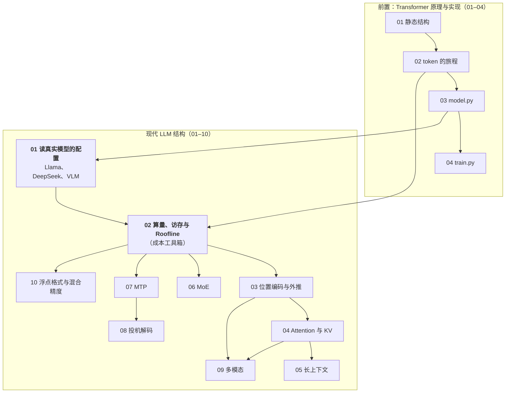

十篇正文从 GPT-2 到今天的模型，回答现代 LLM 改了什么、为什么、花了什么：[《从 GPT-2 到 Llama——五处改动与参数量》](/gpt2-to-llama-five-changes-and-parameter-count.html)先读 Llama / DeepSeek / VLM 的真实配置并数出参数量，[《前向的算量与访存量》](/transformer-flops-bytes-and-roofline.html)把参数量换成算量、字节与时间（后面所有专项共用的尺子），其余八篇再逐项展开位置外推、attention 与 KV、长上下文结构、MoE、MTP、投机解码、多模态与浮点格式。量化与 LoRA 不在本系列，分别见算法地图的[《高效推理与压缩》](/efficient-inference-and-compression-for-llms.html)与[《LoRA 专题》](/lora-for-sft-from-low-rank-hypothesis-to-serving.html)。完整路线见[系列总纲](/llm-architecture-evolution-roadmap-from-gpt2.html)。

本文不讲新内容，做三件事：把十篇正文压成一张表并逐篇回顾，把贯穿全系列的几条线拎出来，然后给一套三段式的通关自测——判断与计算、跨篇综合、面试题。各篇末尾的自测检验的是"这一篇读懂了没有"，这里检验的是"十篇能不能连起来用"。

> **读完这十篇，你应该能回答哪些问题？[^q0] 哪些数字与结论必须能脱口而出？[^q1] 怎么判断自己是"读过"还是"掌握"了？[^q2]**

先把整个系列放在一张图上——箭头是**推导或前置上的依赖**（箭头尾端的结论被箭头头端当作前提），不是阅读顺序：



## 一、总览：系列回答的问题与主线

系列的一句话主张是：**主流 LLM 共用同一种 decoder-only 主干，这种结构能用 300 行写出来；它之后的每一处演进都在回答一个能用数字说清的问题；它的成本由四组变量决定——结构、运行点、数值、方法——多模态加第五组，每一格都有公式，代入 `config.json` 就能算出数字，不必等 benchmark**。《Transformer 原理与实现》用同一份代码（$$d = 4$$ 的手算 → 带 KV cache 的极小 GPT → nanoGPT）从头到尾验证；本系列用同一种方法（写出公式 → 代入真实模型的超参 → 算出数字 → 解释对系统的意义）、同三个模型（Llama-3-8B / 70B 代表 dense + GQA，DeepSeek-V3 代表 MLA + 细粒度 MoE + FP8；Mixtral 8x7B 与四个多模态模型作对照）、同一张卡（H100 SXM：80 GB、3.35 TB/s、BF16 989 TFLOPS），把这张表逐格填满。

| 篇 | 回答的问题 | 一句话结论 | 必记的数字 / 公式 |
|---|---|---|---|
| [第一篇：从 GPT-2 到 Llama——五处改动与参数量](/gpt2-to-llama-five-changes-and-parameter-count.html) | 给一个 `config.json`，能认出每个槽位换了什么吗？能算出参数量和它的分配吗？ | GPT-2 是一组可替换的槽位，骨架从未变过<br/>改动沿五条演进线与一条辅线展开：长上下文、参数规模与每 token 成本、attention 替代、训练信号与生成、输入理解与输出生成、训练稳定性<br/>dense Transformer 没有隐藏参数，乘层数加词表精确到个位 | $$N = L[d(2d + 2d_{kv}) + 3d \cdot d_{ff} + 2d] + 2Vd + d$$<br/>8B = 8,030,261,248<br/>层内 FFN 约 80%（8B 80.8%、70B 82.4%）<br/>词表 8B 占 13%、70B 占 3% |
| [第二篇：前向的算量与访存量](/transformer-flops-bytes-and-roofline.html) | batch 多大 decode 才 compute-bound？考虑 KV 后达得到吗？ | decode 权重 GEMM 的算术强度等于 $$B$$，ridge 295<br/>8K 下 KV 读取把总强度压在 18 以下，单卡任何可行 batch 都 memory-bound | 每参数每 token 2 FLOPs<br/>attention 每层每 token $$4ds$$<br/>训练 $$6ND$$<br/>15.0 GB / 3.35 TB/s = 4.5 ms、约 220 token/s（按驻留的 16.06 GB 粗算是 4.8 ms、208）<br/>$$I_{weight} = B$$、$$I_{KV} = g$$<br/>$$B \times s \le 52$$ 万 token（按 64 GiB 粗算） |
| [第三篇：位置编码与外推](/positional-encoding-and-long-context.html) | 8K 训练的 RoPE 模型为什么不能保证直接推理 32K？改 base 解决了什么？ | 8K 训练时 14 对低频维度没转完一圈，推到 32K 出现没见过的相位<br/>改 base 让长距离可区分，「见过」仍靠长序列训练 | $$\lambda_i = 2\pi\,\text{base}^{2i/d_{head}}$$<br/>base 10000 时波长 6.28 到 5.4 万，base 500000 时最低频 256 万<br/>PI / NTK-aware / YaRN |
| [第四篇：Attention 变体与 KV cache](/attention-variants-and-kv-cache.html) | V3 128 头 61 层，KV cache 为什么比 32 头 32 层的 8B 小？代价？ | KV 只与 $$n_{kv}$$ 有关<br/>MLA 缓存 512 + 64 维 latent，decode 吸收后等价于 128 头共享一个 KV 头的 MQA，用 3.4 倍 attention FLOPs 换 57 倍字节 | $$\text{bytes/token} = 2 L n_{kv} d_{head} \cdot \text{bytes/elem}$$<br/>8B 128 KiB（MHA 512 KiB）、70B 320 KiB、V3 68.6 KiB（MHA 3.81 MiB）<br/>decode attention 强度 4 / 8 / 242 |
| [第五篇：长上下文的成本与结构手段](/long-context-cost-and-structural-remedies.html) | 一个 128K 请求贵在哪里？滑窗把哪项改成了什么函数？ | KV 线性、prefill attention 二次、$$s \times s$$ 的 logits 不能物化<br/>滑窗把单序列 KV 与单步 attention 改成 $$O(W)$$、整段 prefill 改成 $$O(sW)$$<br/>线性 attention / SSM 把历史压进递归状态（decode 用递归形式，训练与 prefill 用分块形式），混合架构折中质量与成本 | 8B 128K：16 GiB KV、约 6.5 PFLOP、60% MFU 约 11 s<br/>交叉点 8B 约 28.6K、70B 约 53.8K<br/>[Qwen3-Next 配置](https://huggingface.co/Qwen/Qwen3-Next-80B-A3B-Instruct/raw/main/config.json)算例：混合结构约 3.04 GiB，对照全 attention 12 GiB |
| [第六篇：MoE 的路由、激活参数量与通信形态](/moe-compute-and-communication.html) | V3 每 token 只算 37B，为什么比 dense 70B 难部署得多？ | 三个"参数量"分开：总参数定显存、激活参数定 FLOPs、每步实际读取的参数定 decode 带宽——中等 batch 下几乎读全部专家 | $$E[1 - (1 - k/E)^B]$$：$$B = 32$$ 时 163 个、读 434B<br/>FP8 671 GB 放不进 640 GB<br/>每 token 每层 dispatch 56 KiB + combine 112 KiB<br/>每专家 GEMM $$Tk/E$$ 行 |
| [第七篇：MTP](/multi-token-prediction-mtp.html) | 每个位置多预测一个 token，多花了什么、多得了什么？为什么顺序不并行？ | 信号密度 ×$$(1 + D)$$（$$D$$ 是额外预测的 token 数），主干被逼编码更远的未来<br/>顺序模块喂真实 $$t_{i+1}$$ 保持因果链（teacher forcing 的延伸）<br/>推理时丢弃或做投机 draft | 自有参数：2 个 RMSNorm + $$2d \to d$$ 投影 + 1 个 block<br/>$$\lambda$$ 0.3 → 0.1<br/>接受率 85–90%、TPS 1.8 倍<br/>nanoGPT 上主任务不变、$$t+2$$ 命中 45%、+29% 参数 |
| [第八篇：投机解码——草稿、验证与收益条件](/speculative-decoding-draft-verify-and-payoff.html) | 同一套投机解码，为什么 batch 1 加速 2 倍、batch 64 没有收益？ | 接受 / 拒绝重采样让输出分布严格等于目标模型<br/>验证 γ+1 个 token 只在 memory-bound 区间免费 | $$\mathbb{E}[\text{tokens}] = (1-\alpha^{\gamma+1})/(1-\alpha)$$<br/>α=0.8、γ=4、c=0.1：3.36 token、约 2.4×<br/>转折 batch ≈ ridge/(γ+1) ≈ 60<br/>完全 compute-bound 时 0.62× |
| [第九篇：多模态：vision encoder 的算量与 image token 的 KV 代价](/multimodal-vision-encoder-cost-and-image-token-kv.html) | 一张 1024² 的图在 Qwen2-VL 里等于多少 token？为什么 encoder 输出 21 MiB 与 KV 400 多 MiB 同时成立？ | 输入侧要算 encoder、image token 与 decoder KV 三笔，长期占用的是 KV<br/>输出侧分离散图像 token 自回归、diffusion、解耦视觉路径与语音 token，成本单位随结构而变 | 输入：$$n_{img} = \lceil H/28 \rceil \lceil W/28 \rceil$$，1024² → 1369<br/>encoder 11.8 TFLOP<br/>70B 规格 KV 428 MiB 是 encoder 输出 21 MiB 的 20 倍<br/>输出：[Emu3 论文](https://arxiv.org/html/2409.18869v1)的 512×512 图像为 4096 个自回归 token 步 |
| [第十篇：浮点格式、数值稳定性与混合精度](/floating-point-formats-and-mixed-precision.html) | BF16 相对精度只有 FP16 的 1/8，为什么成了默认？用在权重更新上会怎样？ | 指数位定范围、尾数位定精度<br/>前向反向要范围，更新要精度——所以 BF16 计算 + FP32 master weights | BF16 1/8/7、单位舍入 $$2^{-8} \approx 0.004$$<br/>FP16 最大 65504、$$e^x$$ 在 $$x > 11.09$$ 溢出<br/>E4M3 最大 448 无 inf<br/>$$k = 4096$$ 的点积在 BF16 中累加：噪声估计 25%，高斯输入实测 7.2%<br/>16 B/参数、8B 训练状态 128 GB |

Table: 十篇的核心问题、结论与必记公式

### 1. 本文的章节安排

| 章 | 内容 |
|---|---|
| 二 | 逐篇回顾：核心问题、结论、必记、常见误解 |
| 三 | 贯穿十篇的四条线：一条 Roofline、KV cache 与上下文长度、"参数量"拆成几个数、字节里存了什么 |
| 四 | 常见误区表 |
| 五 | 通关自测：A 判断与计算 11 题、B 跨篇综合 5 题、C 面试题 8 题、D 掌握判据 |
| 六 | 下一步 |
| 七 | 延伸阅读：本系列不讲什么、去哪里看 |

Table: 本文的章节安排

## 二、逐篇回顾

每篇四项：核心问题（与[总纲的「分章导读」一节](/llm-architecture-evolution-roadmap-from-gpt2.html#分章导读)一致）、结论（按问题逐条作答）、必记、常见误解。

### 01. 第一篇：从 GPT-2 到 Llama——五处改动与参数量

**核心问题**：

1. 给你一个 2025 年模型的 `config.json`，能不能指出它相对 GPT-2 在哪几个槽位换了什么、每一处回答什么问题、去哪一篇看推导？
2. 再给你一个 Llama 式 dense 模型的配置，不运行代码，能不能在五分钟内算出它的参数量（误差 1% 以内），并说出这些参数在 attention、FFN、embedding 之间怎么分配？

**结论**：

1. 能，逐字段对照即可。"embedding → $$L$$ 个 block → norm → lm_head"的骨架从未变过，每处演进都是往一个槽位里换填法；Llama 相对 GPT-2 换了五处：
   - LayerNorm → RMSNorm（`rms_norm_eps`），去掉减均值和 $$\beta$$
   - 位置表 → RoPE（`rope_theta`），位置不再占参数
   - GELU 两矩阵 → SwiGLU 三矩阵（`hidden_act: silu`、`intermediate_size`），宽度按三矩阵重定为 $$3.5d$$
   - MHA → GQA（`num_key_value_heads`），K/V 投影变窄，主要为省 KV cache
   - 所有投影去掉 bias（`attention_bias: false`）
2. 能，而且精确到个位。每层是 attention 四个矩阵（$$W_K$$、$$W_V$$ 的列数是 $$n_{kv} d_{head}$$）加 SwiGLU 三个矩阵 $$3 d \cdot d_{ff}$$，乘层数、加词表：Llama-3-8B 得 8,030,261,248，70B 得 70,553,706,496，405B 得 405.85B。分配上，层内约 80% 在 FFN，embedding + lm_head 在 8B 占 13%、70B 占 3%，RoPE、softmax 没有参数。
3. 这套读法到 MoE 为止：DeepSeek-V3 骨架相同，attention 换成 MLA、FFN 换成 257 个专家，总参数 671B、每 token 激活 37B，"参数量"不再单独对应成本。

**必记**：

- 读 config 认字段：`num_key_value_heads` 指向[《Attention 变体与 KV cache》](/attention-variants-and-kv-cache.html)，`rope_theta` / `rope_scaling` 指向[《位置编码与外推》](/positional-encoding-and-long-context.html)，`sliding_window` / `layer_types` 指向[《长上下文的成本与结构手段》](/long-context-cost-and-structural-remedies.html)，`num_experts` / `num_experts_per_tok` 指向[《MoE 的路由、激活参数量与通信形态》](/moe-compute-and-communication.html)，`num_nextn_predict_layers` 指向[《MTP——改训练目标而不改主干的多 token 预测》](/multi-token-prediction-mtp.html)，`vision_config` 指向[《多模态：vision encoder 的算量与 image token 的 KV 代价》](/multimodal-vision-encoder-cost-and-image-token-kv.html)，`torch_dtype` / `quantization_config` 指向[《浮点格式、数值稳定性与混合精度》](/floating-point-formats-and-mixed-precision.html)。
- $$N = L[d(2d + 2d_{kv}) + 3d \cdot d_{ff} + 2d] + 2Vd + d$$，$$d_{kv} = n_{kv} d_{head}$$；tied 时词表只算一份。
- 8B：attention 每层 41.94M、FFN 176.16M，32 层 6.98B，embedding 与 lm_head 各 525.3M。
- 层内 FFN 占比：8B 80.8%、70B 82.4%；词表占比：8B 13%、70B 3%、405B 约 1%，而 tied 的 Qwen2.5-0.5B 约 28%。
- 参与 GEMM 的是 7.5B（embedding 只查表）——每 token 15.0 GFLOPs 的来源。
- Llama 的 14336 来自 $$\frac{2}{3} \cdot 4d \times 1.3$$ 向上对齐到 1024 的倍数。

**常见误解**：用 $$4d$$ 当 $$d_{ff}$$、按两矩阵算 SwiGLU、漏掉不共享的 lm_head、把 K/V 当 MHA 算，各造成 5% 到 30% 的偏差；把 embedding 也乘 2 算进 FLOPs，多算约 7%。

### 02. 第二篇：前向的算量与访存量：prefill、decode 与 Roofline

**核心问题**：

1. Llama-3-8B 在一张 H100 上，batch 多大时 decode 从 memory-bound 变成 compute-bound？
2. 考虑 KV cache 之后，这个 batch 还能达到吗？

**结论**：

1. 约 295。decode 每步把参与 GEMM 的权重读一遍（约 15.0 GB，驻留 16.06 GB，与 batch 无关），对 $$B$$ 个 token 各做 2 FLOPs/参数，所以 BF16 decode 权重 GEMM 的算术强度在数值上等于 $$B$$；H100 的 ridge 是 $$989 / 3.35 \approx 295$$。这就是"decode 是 memory-bound 的"的全部含义。
2. 达不到。8K 上下文下 295 个请求的 KV 要 295 GiB，放不进放下权重后剩的 64 GB；而且 KV 读取的强度是常数 $$g = 4$$、不随 batch 摊薄，总强度趋于 18。单卡 8B 在任何可行 batch 下都 memory-bound，真正的约束是 $$B \times s \le 52$$ 万 token（按 64 GiB 粗算）。
3. prefill 在 ridge 右侧很远：8K 峰值下 0.14–0.16 s 是物理下限，按 60% 经验 MFU 约 0.24–0.27 s。

**必记**：

- $$T \ge \max(\text{FLOPs}/P_{peak},\ \text{Bytes}/BW)$$；ridge H100 295、A100 156、FP8 590。
- 每参数每 token 2 FLOPs，attention 上下文项每层每 token $$4ds$$：8B 权重项 15.0 G，attention 8K 4.3 G、128K 68.7 G。
- decode 理想下界约 4.5 ms、220 token/s（按驻留的 16.06 GB 粗算是 4.8 ms / 208）；70B 141 GB → 42 ms。
- $$I_{weight} = B$$、$$I_{KV} = n_h / n_{kv} = g$$；8K、$$B = 64$$ 时读 84.8 GB、25.3 ms、有效 batch 约 15。
- 训练 $$6ND$$（重算 $$8N$$）；激活 $$sbh(34 + 5as/h)$$，8K 时每层 11 GiB 其中 10 GiB 是 $$s^2$$ 项，32 层 354 GiB，超过四张 H100；MFU 40–50% 已是好成绩。

**常见误解**："模型多大"对 decode 的度量是字节，不是 FLOPs：FFN 砍一半，下界随字节降而不是随 FLOPs 降；INT4 的 FLOPs 不变，下界降到约 1.2 ms。kernel 写得再好也不能让 $$B = 1$$ 的 decode compute-bound。

### 03. 第三篇：位置编码与外推

**核心问题**：

1. 一个用 8K 训练的 RoPE 模型，为什么不能保证直接推理 32K？
2. 改 base 解决了什么？

**结论**：

1. 因为相位没见过，不是位置装不下。RoPE 把每个头的 128 维拆成 64 对，各以自己的频率旋转，让点积只依赖相对距离；base 10000 时波长从 6.28 到约 5.4 万，8K 训练时最低频的 14 对没转完一圈，推到 32K 这些维度出现训练时没见过的相位。
2. 把 base 从 10000 调到 500000，最低频波长拉到约 256 万，128K 内任意两个位置在数学上可区分，给长序列训练提供了可用的位置表示。它没解决三件事："见过"仍要在长序列上真的训练；高频维度不变，注意力随长度被稀释不归它管；KV 与 prefill 的成本不归它管。
3. PI、NTK-aware、YaRN 是在不重训的前提下把没见过的相位映射回见过的范围，改频率与温度的方式不同，均不保证任意长度下的质量。

**必记**：

- 波长 $$\lambda_i = 2\pi\,\text{base}^{2i/d_{head}}$$；$$\theta_i = \text{base}^{-2i/d_{head}}$$。
- PI 把所有 $$\theta_i$$ 除以 factor；NTK-aware 改 base，使最低频恰好插值 factor 倍、最高频不动；YaRN 按 $$r_i = L/\lambda_i$$ 分三段再修正温度。
- Llama 3.1 的 `factor 8 / low 1 / high 4 / 8192` 是 YaRN 的分段规则、不带温度。
- RoPE 每层的算量约 15 KFLOPs，不到权重 GEMM 的万分之一；它只作用在 Q、K 上，与 KV cache 兼容。

**常见误解**："把 base 改成 500000 就能免费用 128K"——改 base 只让长距离可区分，不等于补上长序列训练，更不减少 KV 或 prefill 算量。

### 04. 第四篇：Attention 变体与 KV cache：MHA、GQA、MQA 与 MLA 的推导

**核心问题**：DeepSeek-V3 有 128 个 attention head、61 层，KV cache 却比 32 头 32 层的 Llama-3-8B 小。

1. 这是怎么做到的？
2. 代价是什么？

**结论**：

1. KV cache 每 token $$2 L n_{kv} d_{head} \cdot \text{bytes/elem}$$，公式里没有 $$n_h$$。GQA 直接减 $$n_{kv}$$：$$g = n_h / n_{kv}$$ 同时把字节缩 $$g$$ 倍、把 decode attention 强度从 1 提到 $$g$$。MLA 不存 K、V，每层只存 512 维 latent 加 64 维解耦 RoPE key，共 576 个数，61 层 BF16 共 68.6 KiB，比自己用 MHA 的 3.81 MiB 小 57 倍，也比 8B 的 128 KiB 小。
2. 用算力换字节。decode 时把升维矩阵吸收进 $$W_Q$$、$$W_O$$，等价于 128 头共享一个 576/512 维 KV 头的 MQA，强度约 242，attention 核心 FLOPs 约 3.4 倍，所以 prefill 走非吸收路径；RoPE 必须拆成单独的 64 维，因为位置相关的旋转吸不进与位置无关的升维矩阵。
3. 物化的 $$S = QK^\top$$ 在 8K、32 头下每层 4 GiB，FlashAttention 分块 + online softmax 把 HBM 流量降到 $$O(s^2 d^2 / M)$$。

**必记**：

- 8B GQA 128 KiB/token（MHA 512 KiB）、70B 320 KiB、V3 68.6 KiB；128K 上下文 16 / 40 / 8.6 GiB。
- decode attention 强度：MHA 1、8B 4、70B 8、MLA 吸收后 242；不随 $$B$$、$$s$$ 变。
- 判断 MLA 看 `kv_lora_rank`；`num_key_value_heads: 128` 不能套 GQA 公式。
- 容量四乘子：结构定元素个数、量化定 bytes/elem（FP8 KV 8B 64 KiB、V3 34.3 KiB）、分页定碎片率、prefix 共享定复用倍数。
- 8B 单卡放下权重后剩约 64 GB（59.5 GiB）：8K 最大并发 59、128K 只有 3。

**常见误解**："head 多 KV 就大"——KV 只看 $$n_{kv}$$。"MLA 是免费的压缩"——它多算 3.4 倍 attention FLOPs、要维护两条等价路径与专用 kernel，且不能从 MHA checkpoint 直接转换。

### 05. 第五篇：长上下文的成本与结构手段

**核心问题**：

1. 一个 128K 请求贵在哪里？
2. 滑窗把哪项改成了什么函数？

**结论**：

1. 贵在三处，以 Llama-3-8B 为例：
   - KV cache 随 $$s$$ 线性增长，128K 的一个请求 16 GiB，与权重一样大，决定并发数
   - prefill 的 attention 随 $$s^2$$ 增长，128K 约 6.5 PFLOP，单卡 60% MFU 约 11 s，决定 TTFT
   - $$s \times s$$ 的 logits 128K 时单头 32 GiB，只能靠 FlashAttention 不物化；FlashAttention 不改变算量的阶
2. 窗口为 $$W$$ 的滑窗把单序列 KV 与每步 decode 的 attention 从 $$O(s)$$ 改成 $$O(W)$$，把整段 prefill 的 attention 从 $$O(s^2)$$ 改成 $$O(sW)$$，代价是窗口外的信息只能逐层间接传递。全局 / 局部交错不改阶，只把系数变成 $$1/k$$；MLA 也只改系数。
3. 线性 attention 与 SSM 把历史压进定长的递归状态。同一个算式有递归、并行、分块三种等价算法：decode 用递归，训练与 prefill 用分块（块内矩阵乘、块间只传状态）；混合结构的二次项只剩 full-attention 层那一部分。

**必记**：

- 8B / 70B 的 attention 与权重算量交叉点约 28.6K / 53.8K。
- 128K：KV 16 / 40 GiB，prefill 单卡等效 60% MFU 约 11 / 69 s，8B 的 prefill 里 attention 占 70%。
- chunked prefill 改调度与干扰，不消除总工作量；稀疏 attention 也不必然省 KV。
- 线性 attention 的 128K prompt 取块长 64 时串行 2,048 步，不是 131,072 步。
- Qwen3-Next 的二次项系数是全层 attention 对照的 1/4（12 / 48 层）；128K 时混合结构约 3.04 GiB，对照 12 GiB。

**常见误解**："滑窗与 MLA 都是减 KV，作用一样"——滑窗改阶但丢信息，MLA 改系数（57 倍）不改阶，两者可以叠加。"长上下文慢是调度问题"——8B 128K 的 11 s 是算量，chunked prefill 只是不让它独占 GPU。

### 06. 第六篇：MoE：路由、激活参数量与通信形态

**核心问题**：DeepSeek-V3 每 token 只算 37B 参数，为什么部署它比部署一个 dense 70B 难得多？把"参数量"、"激活参数量"、"每步实际读取的参数量"三个数分开算。

**结论**：

1. 三个数各管一项：
   - 总参数 671B 决定显存——FP8 下也是 671 GB，一台 8 卡 H100（640 GB）放不下
   - 激活参数 37B 决定 FLOPs——74 GFLOPs，是 70B 的一半
   - 每步实际读取的参数决定 decode 带宽——期望激活专家数 $$E[1 - (1 - k/E)^B]$$ 在 $$B = 32$$ 时 163 个、读 434B，$$B = 128$$ 时 252 个；"稀疏"节省了算量但没有节省访存
2. 出路是专家并行：简化模型下 EP32 每卡约 37 GB，EP320 每卡 19.6 GB（真实部署 attention 另做 TP4 × DP、共享专家也走路由，数字会不同）。
3. 难处是专家并行带来的三项代价：
   - 每层两次 all-to-all：每 token 每层 dispatch FP8 56 KiB + combine BF16 112 KiB，是 TP-8 all-reduce 的 6.7 倍
   - 每专家 GEMM 只有 $$Tk/E$$ 行，小 batch 下碎成许多小矩阵
   - 负载不均时最慢的卡决定全层时间；节点受限路由（每 token 最多 4 个节点）、aux-loss-free 均衡、冗余专家都围绕这一项
4. dense 70B 用一台机器做 TP 就能跑。对 V3，TP-8 会把 $$d_{ff} = 2048$$ 的专家切成 256 列，GEMM 太瘦，且不减少每卡读的专家数。

**必记**：

- Mixtral 8x7B：8 × 14336 取 top-2，总 46.7B、激活 12.9B；V3：256 × 2048 取 top-8 + 1 共享，每专家 44.04M，58 个 MoE 层。
- V3 期望激活专家数：$$B = 1 / 8 / 32 / 64 / 128$$ → 8 / 57.4 / 163 / 222 / 252；Mixtral $$B = 8$$ 就几乎读全部。
- V3 每步读取：$$B = 8$$ 时 164B（是激活 37B 的 4.4 倍），$$B = 32$$ 时 434B（11.6 倍）；434B 对 dense 70B，按参数是 6.2 倍，按字节（FP8 434 GB 对 BF16 141 GB）是 3 倍。
- all-to-all 每 token 每层 168 KiB = 8 × 7168 × 3 字节；4096 token 的 prompt 每层 672 MiB、58 层 38 GiB。
- 专家 GEMM 强度是 $$Tk/E$$，比 dense 低 $$E/k = 32$$ 倍；过 ridge 需一层里约 9600 个 token。

**常见误解**："激活 37B 就像 37B 的 dense 一样部署"——对 dense 70B，总参数是 9.5 倍，中等 batch 下每步读取的参数是 6–9 倍。"MoE 的通信也是 all-reduce"——EP 是 all-to-all，量与 $$k \cdot d$$ 成正比、与专家参数量无关。

### 07. 第七篇：MTP：改训练目标而不改主干的多 token 预测

**核心问题**：每个位置多预测一个 token，训练时多花了什么、可能多得到什么？DeepSeek-V3 的 MTP 模块为什么要"顺序"而不是"并行"，推理时它去哪了？

**结论**：

1. 多花的：每级一个 Transformer block 加一个 $$2d \to d$$ 投影、两个 RMSNorm 的参数与前向、反向算力，再加一次 lm_head；embedding 与 lm_head 和主干共享，不另加参数。
2. 可能多得的：next-token 每个位置一份信号、只学一步远，MTP 让位置 $$i$$ 额外预测 $$D$$ 个 token，信号是 $$1 + D$$ 倍，主干表示被逼编码更远的未来；另外得到一个接受率 85–90% 的投机草稿。
3. 顺序而非并行：模块的输入是主干的 $$h_i$$ 拼真实 $$t_{i+1}$$ 的 embedding，因果链完整（teacher forcing 的延伸），loss 与主头同难度；并行头跳过中间 token，loss 偏高，会干扰主干。
4. 推理时丢掉（模型与普通 decoder-only 无异），或留下当投机草稿，多算一个 block，TPS 约 1.8 倍。

**必记**：

- 目标 $$\mathcal L_{\text{main}} + \lambda \bar{\mathcal L}_{\text{MTP}}$$，$$\lambda$$ 0.3 → 0.1。
- 自有参数一个 block + $$2d^2$$：DeepSeek-V3 约 11.5B，占 671B 的 1.7%。
- nanoGPT 0.8M 实验：主头 1.9375 对 1.9364，主任务不变；MTP 头 val 1.81、$$t_{i+2}$$ 命中 45%；+29% 参数、+38% 每步耗时。

**常见误解**："MTP 头 loss 更低所以更强"（它知道 $$t_{i+1}$$ 且多一层，条件不同）；"小模型上没收益所以无效"（收益随规模出现）；"MTP 是多几个输出头"（顺序模块与并行头是两条路线）。

### 08. 第八篇：投机解码：草稿、验证与收益条件

**核心问题**：同一套投机解码，为什么 batch 1 时加速 2 倍，batch 64 时没有收益？

**结论**：

1. 验证 $$\gamma + 1$$ 个 token，等于把 GEMM 的 $$m$$ 从 $$B$$ 放大到 $$B(\gamma + 1)$$，而权重与 KV 只读一遍。batch 1 时 decode 是 memory-bound 的，多出的 FLOPs 落在空转的 Tensor Core 上，几乎不花时间：$$\alpha = 0.8$$、$$\gamma = 4$$、$$c = 0.1$$ 时一轮期望产出 3.36 个 token，加速约 2.4 倍。
2. $$B$$ 增大到约 $$295 / (\gamma + 1) \approx 60$$ 时验证本身越过 ridge，被拒绝 token 的计算成了真实成本，加速比随 batch 下降；完全 compute-bound 时是 $$3.36 / 5.4 \approx 0.62$$，低于 1。
3. 正确性与 batch 无关：逐位以 $$\min(1, p/q)$$ 接受、拒绝后从 $$\text{norm}(\max(0, p - q))$$ 重采样，每个位置输出 $$x$$ 的总概率恰好是 $$p(x)$$，输出分布严格等于目标模型，草稿只影响效率。

**必记**：

- 一轮期望产出 $$(1 - \alpha^{\gamma+1})/(1 - \alpha)$$，加速比 $$\mathbb{E}[\text{tokens}] / (\gamma c + 1)$$，前提是验证 $$\gamma + 1$$ 个与验证 1 个同样贵。
- $$\alpha = 0.8$$、$$\gamma = 4$$：$$\mathbb{E} = 3.36$$；$$c = 0.1$$ 时 2.4×，$$c = 0.02$$ 时 3.1×；$$\gamma$$ 从 4 加到 8 在 $$c = 0.1$$ 下加速比不变。
- 峰值算力下 $$B = 64$$ 的验证前向 $$T(5B) = 4.86$$ ms，刚过转折；按 60% MFU 折算有效 ridge 约 177，$$B = 64$$ 时加速掉到 1.6、$$B = 128$$ 低于 1。
- 草稿来源（独立小模型、Medusa、EAGLE、n-gram、MTP 模块）改变 $$\alpha$$ 与 $$c$$，改不了收益区间；DeepSeek-V3 的 MTP 模块当草稿：$$\gamma = 1$$、接受率 85–90%，约 1.8×。

**常见误解**："草稿模型差会让输出变差"（只会变慢，分布不变）；"投机解码总是加速"（大 batch、高吞吐负载下要关掉或缩到 $$\gamma = 1$$）；"MTP 是投机解码的必要条件"（它只是草稿来源之一）。

### 09. 第九篇：多模态：vision encoder 的算量与 image token 的 KV 代价

**核心问题**：

1. 一张 1024×1024 的图片在 Qwen2-VL 里等于多少个 token？
2. 为什么"encoder 输出只有 21 MB"与"这张图在 decoder 里占 400 多 MB 显存"两句话同时成立？

**结论**：

1. 约 1369 个。vision encoder 把图切成 $$p = 14$$ 的 patch（1024² 是 5476 个），2×2 merge 后每 28×28 像素一个 token。token 数由分辨率与 connector 的合并比例决定，与文本长度无关：MLP 不压缩（LLaVA 576）、2×2 merge 除 4、resampler 定长，同一张图从 576 到 6404 差 11 倍。
2. 两个数在流水线的不同位置，存活时间也不同。encoder 与 connector 的输出是 token 数 × $$d_{model}$$ × 2 字节，70B 规格下约 21 MiB，prefill 之后就能释放；这些 token 进入 decoder 后与文本没有区别，每层每个 KV 头存一份 K、V，每 token 320 KiB，1369 个约 428 MiB，活到请求结束。比值是 $$2 L n_{kv} d_{head} / d_{model} = 20$$。
3. 三段各一笔账：encoder 11.8 TFLOP，一次性、compute-bound、与 batch 无关；connector 几乎不花；decoder 的 prefill 190 TFLOP，与同样长度的文本相同。
4. cross-attention 注入（Llama 3.2 Vision）多 1.75B 参数，换来 decoder 序列不被图片撑长，图片 KV 从 800 MiB 降到 200 MiB。
5. 输出侧按生成机制分别计成本：
   - [Emu3](https://arxiv.org/html/2409.18869v1) 的 512×512 图像是 4096 个自回归 token 步
   - [Transfusion](https://arxiv.org/html/2408.11039) 报告的 16 是图像 patch 数，不是去噪迭代数
   - [Janus](https://arxiv.org/html/2410.13848) 把理解与生成的视觉路径解耦
   - [Qwen2.5-Omni](https://arxiv.org/html/2503.20215v1) 描述 Thinker-Talker 与音频解码结构，没有可用于固定成本估算的通用 tokens/s

**必记**：

- ViT 每层 $$12 d_{vit}^2$$ 参数，一张图 $$2 N_{vit} n_p + 4 L_{vit} n_p^2 d_{vit}$$ FLOPs：CLIP ViT-L/14-336 0.3B、577 个位置、0.38 TFLOP，attention 占 9%；Qwen2-VL 0.63B、5476 patch、11.8 TFLOP，attention 二次项占 42%。encoder 参数只是 decoder 的 4–10%。
- $$n_{img} = \lceil H/28 \rceil \lceil W/28 \rceil$$：336² → 144、1024² → 1369、1920×1080 → 2691。
- 70B 规格 1369 token：prefill 190 TFLOP（H100 峰值约 192 ms）、KV 428 MiB、encoder 输出 21 MiB。
- KV 与 encoder 输出的比值：70B 是 20，8B 是 16，Qwen2-VL-7B 是 8（1369 token 的 KV 75 MiB）。
- 一分钟 720p 1 fps 视频 35880 token；Whisper encoder 30 秒 1500 个位置。
- 训练侧：冻结 encoder 省下的主项是激活值（10 GB 量级），状态是小头（9 GB 对 LLM 的 122 GB）；图片解码把数据管线瓶颈搬到 CPU。

**常见误解**："多模态贵在 vision encoder"——encoder 12 ms 对 prefill 192 ms，且输出用完即弃；一张 1024² 图就是一段 1369 token、无法被 tokenizer 压短的 system prompt。"按图片张数预算"——原生动态分辨率下 $$n_p$$ 相差三个数量级，必须按像素预算。

### 10. 第十篇：浮点格式、数值稳定性与混合精度

**核心问题**：

1. BF16 的相对精度只有 FP16 的 1/8，为什么它反而成了训练的默认格式？
2. 把它同时用在权重更新上会出什么问题？

**结论**：

1. 指数位决定范围、尾数位决定精度；前向反向需要范围，对 $$2^{-8}$$ 量级的相对误差不敏感。BF16 用 3 位尾数换 3 位指数，范围与 FP32 相同，激活与梯度实际不会溢出或下溢，不需要 FP16 那套 loss scaling。
2. 更新会被舍掉。每步 $$\Delta w / w$$ 在 $$10^{-4}$$ 到 $$10^{-3}$$，低于 BF16 的单位舍入 $$2^{-8} \approx 0.004$$，$$1.0 + 0.001$$ 被舍回 1.0，参数不动。所以必须留 FP32 master weights，这是每参数 16 字节里的 4 字节。
3. 同一个道理管着累加：$$k = 4096$$ 的点积在 BF16 中累加，噪声按 $$u\sqrt{k}$$ 估计到 25%（高斯输入实测 7.2%；4096 个 1.0 同号相加只得 256），FP32 累加可忽略。FP8 Tensor Core 约 14 位的累加精度迫使 DeepSeek-V3 每 128 项提升到 FP32，与激活 $$1 \times 128$$、权重 $$128 \times 128$$ 的分块 scale 对齐。

**必记**：

- 位布局（符号 / 指数 / 尾数）：FP32 1/8/23、FP16 1/5/10、BF16 1/8/7、E4M3 1/4/3（最大 448，无 inf）、E5M2 1/5/2。
- 单位舍入 $$u = 2^{-(M+1)}$$（BF16 是 $$2^{-8}$$，FP32 是 $$2^{-24}$$），machine epsilon $$\varepsilon = 2^{-M}$$（BF16 是 $$2^{-7}$$）。
- FP16 最大 65504、最小正规数 $$6.1 \times 10^{-5}$$，$$e^x$$ 在 $$x > 11.09$$ 溢出；BF16 / FP32 的阈值是 88.7。
- 训练状态 16 B/参数（2 + 2 + 4 + 4 + 4）：8B 128.5 GB、70B 1128.9 GB、671B 10.7 TB；V3 配方 13 B/参数（master 与累积梯度仍 FP32、m/v BF16）约 8.7 TB。
- FP8 的常见分工：E4M3 存权重与激活，E5M2 存梯度；DeepSeek-V3 全部用 E4M3。
- 数值丢失的四个位置：大数吃小数、长求和、指数溢出（softmax 减最大值）、相消（Welford）；QK-norm 把 logit 上界压到 $$\sqrt{d_{head}} \cdot g_q g_k \approx 11.3 g_q g_k$$。

**常见误解**："BF16 精度差所以不如 FP16"——深度学习选范围不选精度。"两个 kernel 结果逐位不同就是 bug"——BF16 GEMM 相对 FP32 参考的逐元素误差在 $$10^{-3}$$ 到 $$10^{-2}$$ 是正常的；差异在 $$\varepsilon$$ 到 $$\varepsilon \sqrt{k}$$ 之间是噪声，大几个数量级或有系统性符号才是 bug。

## 三、贯穿全系列的几条线

### 1. 一条 Roofline，本系列都在它上面

[《前向的算量与访存量》](/transformer-flops-bytes-and-roofline.html)建立的坐标系被之后每一篇复用：ridge $$= P_{peak} / BW \approx 295$$，BF16 decode 权重 GEMM 的强度恰好是 $$B$$，KV 读取的强度是 $$g$$。后面各篇在这条线上的位置：

- [《Attention 变体与 KV cache》](/attention-variants-and-kv-cache.html)把 MLA 的价值说成"把 KV 读取的强度从常数 4 抬到 242"。
- [《长上下文的成本与结构手段》](/long-context-cost-and-structural-remedies.html)指出 prefill 的二次项无法靠 batch 摊薄，因为它本来就在 ridge 右侧。
- [《MoE 的路由、激活参数量与通信形态》](/moe-compute-and-communication.html)发现 $$I = B$$ 在 MoE 上不成立：每个专家只分到 $$Tk/E$$ 行，强度比 dense 低 32 倍，要过 ridge 需要一层里同时有约 9600 个 token，这是 EP320 在 decode 上汇聚全部请求的另一个理由。
- [《投机解码——草稿、验证与收益条件》](/speculative-decoding-draft-verify-and-payoff.html)把投机解码放回同一条线：转折点在 $$\text{ridge}/(\gamma + 1)$$，只在斜线段上兑现。《高效推理与压缩》里的 W4A16 同理把转折点放在 $$\text{ridge}/4$$，两者可以叠加。
- [《多模态：vision encoder 的算量与 image token 的 KV 代价》](/multimodal-vision-encoder-cost-and-image-token-kv.html)指出 encoder 的 5476 行 GEMM 在 ridge 右侧很远，用 batch 摊不掉。

一个附带结论贯穿始终：ridge 从 A100 的 156 涨到 H100 的 295、FP8 下 590，算力增长快于带宽，同一个模型同一个 batch 在新一代 GPU 上更容易 memory-bound。

### 2. KV cache 与上下文长度：从一个给定的数到最大的优化空间

每 token 的 KV 字节数在五篇里各被打开一层：

1. 《前向的算量与访存量》把 128 KiB/token 当给定值用，算出 8K、$$B = 64$$ 时 KV 读取是权重的四倍、有效 batch 只有 15。
2. 《Attention 变体与 KV cache》打开这个数，四个乘子独立叠加：
   - 结构（GQA 的 $$n_{kv}$$、MLA 的 $$d_c + d_h^R$$）定元素个数
   - 量化定 bytes/elem
   - 分页定碎片率
   - prefix 共享定复用倍数
3. 《长上下文的成本与结构手段》加上 $$s$$ 这个维度：KV 是线性项，定并发（70B 128K 一条请求 40 GiB）；attention 是二次项，定 TTFT（8B 128K 约 11 s）。滑窗改阶，交错与 MLA 只改系数。
4. [《位置编码与外推》](/positional-encoding-and-long-context.html)决定 $$s$$ 能不能变大，成本决定它该不该变大。
5. 《多模态：vision encoder 的算量与 image token 的 KV 代价》说明多模态请求的 KV 由分辨率而非文本长度决定：一张图等于 1369 个 token 的 KV，比 encoder 输出大 20 倍，且方差远大于文本。

KV 量化把 bytes/elem 从 2 减到 1，属于《高效推理与压缩》的[《KV cache 压缩：量化、驱逐与稀疏 attention》](/kv-cache-compression-quantization-eviction-and-sparse-attention.html)。

这条线的落点是容量规划：$$B \times s \le$$ 显存预算 / 每 token KV，显存填满时吞吐与上下文长度成反比，长上下文贵的原因不在调度，在 HBM 字节数。

### 3. "参数量"被拆成几个数

| 在哪一篇 | "参数量"被拆成什么 | 数字 |
|---|---|---|
| [《从 GPT-2 到 Llama——五处改动与参数量》](/gpt2-to-llama-five-changes-and-parameter-count.html) | 精确的 $$N$$ 与参与 GEMM 的 $$N_{gemm}$$：embedding 有参数但不进 GEMM | 8B：$$N = 8.03$$B、$$N_{gemm} = 7.5$$B |
| 《前向的算量与访存量》 | FLOPs/token $$= 2N_{gemm}$$，字节 $$= N \cdot \text{bytes/param}$$；对 decode，"多大"的度量是字节 | 15.0 GFLOPs、16.06 GB |
| 《MoE 的路由、激活参数量与通信形态》 | 总参数定显存、激活参数定 FLOPs、每步实际读取的参数定带宽 | V3：671B / 37B / 随 batch 从 37B 到 671B |
| [《浮点格式、数值稳定性与混合精度》](/floating-point-formats-and-mixed-precision.html) | bytes/param 从推理的 2 扩展到训练的 16 | 8B 训练状态 128 GB，是 ZeRO 与 FSDP 存在的理由 |
| 《多模态：vision encoder 的算量与 image token 的 KV 代价》 | 加进 encoder 的参数，它在显存账里不是主角 | 0.3–0.8B，是 decoder 的 4–10% |

Table: "参数量"在各篇里被拆成的几个数

两个专题系列再拆两次：量化让 bytes/param 变成 4.25 bit（《高效推理与压缩》），LoRA 让可训练参数变成 $$N$$ 的 0.52%（《LoRA 专题》）。

### 4. 字节里存了什么：数值贯穿结构与方法

《浮点格式、数值稳定性与混合精度》之前默认每个数 2 字节，但 FP8 早已出现在三处：

- 《前向的算量与访存量》给出 FP8 decode 强度 $$2B$$、ridge 590。
- 《Attention 变体与 KV cache》里 V3 的 KV 可用 FP8 存成 34.3 KiB。
- 《MoE 的路由、激活参数量与通信形态》的 dispatch 用 FP8、combine 用 BF16。

《浮点格式、数值稳定性与混合精度》解释这些选择：指数位定范围、尾数位定精度；常见分工是 E4M3 存权重与激活、E5M2 存梯度，V3 全部用 E4M3；V3 的 128 分块与每 128 项提升 FP32 累加是同一个设计。scale 的粒度怎样决定一个离群值拖累多少邻居、FP8 为什么比 INT8 对离群值宽容，属于推理量化，在《高效推理与压缩》的[《训练后量化：误差模型、GPTQ、AWQ 与旋转》](/post-training-quantization-gptq-awq-and-rotation.html)。

"数值决定结构细节"的例子有三个：QK-norm 给 attention logit 加上界、《位置编码与外推》里 YaRN 的 attention 温度、《Attention 变体与 KV cache》里 MLA 的 nope / rope 两段数值范围不同、KV 量化时要分开处理。

把这四条线合在一张依赖图上，就是本系列共用的成本模型——结构与数值决定三组量，运行点决定工作点，相除后与 ridge 比较：

```mermaid
%% 图：本系列共用的成本模型：结构与数值决定参数量、权重字节与 KV cache，运行点决定工作点，算术强度与 ridge 比较
flowchart TB
    S["结构：L、d、$$d_{ff}$$、$$n_{kv}$$、专家数与 top-k<br/>（参数量、KV cache、MoE 三篇）"]
    N["<b>参数量 N、激活参数量</b><br/>（参数量、MoE 两篇）"]
    K["KV cache / token = $$2 L\, n_{kv} d_{head}$$ · bytes/elem<br/>（KV cache 一篇）"]
    D["数值：bytes/param、bytes/elem<br/>（浮点格式一篇与量化专题）"]
    W["权重字节 = N · bytes/param"]
    F["<b>FLOPs / token ≈ 2N + 4dLs</b><br/>（算量与访存、长上下文两篇）"]
    R["运行点：batch B、上下文 s、prefill / decode<br/>（算量与访存、长上下文、MoE、投机解码、多模态）"]
    H["每步字节 = 权重字节 + B · s · KV/token"]
    I["算术强度 I = FLOPs / 字节"]
    G["ridge = 峰值算力 / 带宽（H100 BF16 约 295）"]
    T["memory-bound 或 compute-bound → 时间下界"]
    S --> N
    S --> K
    N --> W
    D --> W
    D --> K
    N --> F
    R --> F
    R --> H
    K --> H
    W --> H
    F --> I
    H --> I
    I --> T
    G --> T
```

| 概念 | 出现的篇 | 关系 |
|---|---|---|
| 算术强度与 Roofline | 《前向的算量与访存量》<br/>《Attention 变体与 KV cache》<br/>《长上下文的成本与结构手段》<br/>《MoE 的路由、激活参数量与通信形态》<br/>《投机解码——草稿、验证与收益条件》<br/>《多模态：vision encoder 的算量与 image token 的 KV 代价》 | 《前向的算量与访存量》建通用模型，其余分别改变 KV、长度、专家、算法或图像变量 |
| KV cache | 《Attention 变体与 KV cache》<br/>《长上下文的成本与结构手段》<br/>《多模态：vision encoder 的算量与 image token 的 KV 代价》<br/>《浮点格式、数值稳定性与混合精度》 | 表示宽度、保留长度、image token、存储位宽是不同变量 |
| 参数量 | 《从 GPT-2 到 Llama——五处改动与参数量》<br/>《前向的算量与访存量》<br/>《MoE 的路由、激活参数量与通信形态》 | 总参数、激活参数、GEMM 参数不是一个数（可训练参数见《LoRA 专题》） |
| 数值与量化 | 《浮点格式、数值稳定性与混合精度》<br/>→《高效推理与压缩》的《训练后量化：误差模型、GPTQ、AWQ 与旋转》 | 先范围 / 精度 / 累加，再 scale 粒度 / 校准 / 压缩 |
| 训练状态 | 《浮点格式、数值稳定性与混合精度》<br/>→《LoRA 专题》的[《低秩假设：为什么两个瘦矩阵够用，以及它省了哪几本账》](/lora-low-rank-hypothesis-gradients-and-accounts.html) | 前者算全量 16 B/参数，后者区分冻结底座与可训练低秩参数 |
| 位置与长度 | 《位置编码与外推》<br/>《Attention 变体与 KV cache》<br/>《长上下文的成本与结构手段》<br/>《多模态：vision encoder 的算量与 image token 的 KV 代价》 | 依次是位置外推、MLA 解耦 RoPE、长度的成本、扩展到 M-RoPE |

Table: 跨篇概念的正确阅读入口

## 四、常见误区

| 误区 | 为什么错 | 正确的说法 | 出处 |
|---|---|---|---|
| FFN 中间维度就是 $$4d$$ | Llama 用 SwiGLU 三矩阵，14336 = $$\frac{2}{3} \cdot 4d \times 1.3$$ 对齐到 1024 | 以 `intermediate_size` 为准，且数三个矩阵 | [《从 GPT-2 到 Llama——五处改动与参数量》](/gpt2-to-llama-five-changes-and-parameter-count.html) |
| 每 token FLOPs 就是 $$2 \times$$ 全部参数 | embedding 是查表，FLOPs 为零 | $$2 N_{gemm}$$，8B 是 $$2 \times 7.5$$B = 15 GFLOPs | [《从 GPT-2 到 Llama——五处改动与参数量》](/gpt2-to-llama-five-changes-and-parameter-count.html)<br/>[《前向的算量与访存量》](/transformer-flops-bytes-and-roofline.html) |
| decode 慢是因为算力不够 | $$B = 1$$ 时算力时间 0.015 ms，访存 4.5 ms | 强度等于 $$B$$，距 ridge 295 两个数量级，是 memory-bound | [《前向的算量与访存量》](/transformer-flops-bytes-and-roofline.html) |
| batch 开到 300 就能把 H100 用满 | 8K 下 295 个请求的 KV 要 295 GiB，且 KV 读取的强度是常数 $$g$$ | 总强度趋于 18，单卡任何可行 batch 都 memory-bound；约束是 $$B \times s \le 52$$ 万（按 64 GiB 粗算） | [《前向的算量与访存量》](/transformer-flops-bytes-and-roofline.html) |
| 把 base 改成 500000 就能免费用 128K | 改 base 只让长距离可区分，没见过的相位仍要训 | "见过"靠长序列训练<br/>高频维度不变<br/>二次项不减 | [《位置编码与外推》](/positional-encoding-and-long-context.html) |
| head 越多 KV cache 越大 | KV 公式里只有 $$n_{kv}$$，没有 $$n_h$$ | V3 128 头 68.6 KiB 比 8B 的 128 KiB 还小；看 `kv_lora_rank` | [《Attention 变体与 KV cache》](/attention-variants-and-kv-cache.html) |
| 滑窗与 MLA 都是"减 KV"，作用一样 | 滑窗改阶但丢信息；MLA 改系数（57 倍）不改阶 | 两者正交，可以叠加 | [《长上下文的成本与结构手段》](/long-context-cost-and-structural-remedies.html) |
| MoE 激活 37B，部署像 dense 37B | 显存按 671B 算，中等 batch 下每步几乎读全部专家 | 三个数分开：671B / 37B / 随 batch 从 37B 到 671B | [《MoE 的路由、激活参数量与通信形态》](/moe-compute-and-communication.html) |
| MoE 用 TP 切就行 | TP-8 把 2048 宽的专家切成 256 列，GEMM 太瘦，且不减少每卡读的专家数 | 大规模 EP 加 all-to-all；Mixtral 的 14336 宽专家单机 TP 才可行 | [《MoE 的路由、激活参数量与通信形态》](/moe-compute-and-communication.html) |
| 小模型上 MTP 没收益说明 MTP 无效 | 收益是规模依赖的（Gloeckle 等：0.3B、0.6B 反而变差，变大后反超，13B 时 HumanEval +12%） | 小模型只验证机制与代价 | [《MTP——改训练目标而不改主干的多 token 预测》](/multi-token-prediction-mtp.html) |
| 投机解码总是加速 | 验证 γ+1 个 token 只在 $$B(\gamma+1) \lesssim \text{ridge}$$ 时免费 | 转折 batch ≈ ridge/(γ+1) ≈ 60，之后加速比下降、大 batch 下低于 1 | [《投机解码——草稿、验证与收益条件》](/speculative-decoding-draft-verify-and-payoff.html) |
| 多模态的成本在 vision encoder | encoder 一次性 12 ms、输出用完即弃 | 贵的是 image token 的 KV，是 encoder 输出的 20 倍且活到请求结束 | [《多模态：vision encoder 的算量与 image token 的 KV 代价》](/multimodal-vision-encoder-cost-and-image-token-kv.html) |
| BF16 精度低，训练应该用 FP16 | FP16 范围窄，小梯度下溢，要 loss scaling | 深度学习选范围不选精度；BF16 + FP32 master weights | [《浮点格式、数值稳定性与混合精度》](/floating-point-formats-and-mixed-precision.html) |
| 权重量化让模型全面加速 | prefill 是 compute-bound，反量化是纯开销 | W4A16 只在 decode 且 $$B \lesssim \text{ridge}/4$$ 时兑现；W8A8 才对 prefill 有效 | 《高效推理与压缩》的[《训练后量化：误差模型、GPTQ、AWQ 与旋转》](/post-training-quantization-gptq-awq-and-rotation.html) |

Table: 常见误区与正确说法

## 五、通关自测

### A. 判断与计算（11 题）

1. 一个 dense 模型：$$L = 48$$、$$d = 6144$$、$$d_{ff} = 16384$$、$$n_h = 48$$、$$n_{kv} = 8$$、$$d_{head} = 128$$、$$V = 128256$$、不共享。参数量约多少？词表占比？

   <details markdown="1"><summary>答案</summary>

   - 每层 attention $$6144 \times (2 \times 6144 + 2 \times 1024) = 88.1$$M，FFN $$3 \times 6144 \times 16384 = 302$$M，一层约 390M，48 层 18.7B。
   - 词表 $$2 \times 128256 \times 6144 = 1.58$$B。
   - 合计约 20.3B，词表占 7.8%——落在 8B 的 13% 与 70B 的 3% 之间。

   </details>

2. Qwen2-VL 处理一张 1920×1080 的截图：多少个 image token？进入 Llama-3-8B 规格的 decoder（每 token KV 128 KiB、$$d_{model} = 4096$$）后 KV 多大、encoder 输出多大、比值多少？

   <details markdown="1"><summary>答案</summary>

   - token 数：$$\lceil 1920/28 \rceil \times \lceil 1080/28 \rceil = 69 \times 39 = 2691$$。
   - KV：$$2691 \times 128$$ KiB $$\approx 336$$ MiB。
   - encoder 输出：$$2691 \times 4096 \times 2$$ 字节 $$\approx 21$$ MiB。
   - 比值：$$2 L n_{kv} d_{head} / d_{model} = 2 \times 32 \times 1024 / 4096 = 16$$。

   </details>

3. Llama-3-8B、单卡 H100、BF16 KV：能同时服务 32 条 32K 上下文的 decode 请求吗？若不能，32K 下最多几条，那一步的下界与算术强度约多少？（KV 预算按 64 GiB 粗算。）

   <details markdown="1"><summary>答案</summary>

   - 放不下：$$32 \times 32768 \approx 105$$ 万 token，超过 64 GiB 预算的 52 万。
   - 最多 16 条（恰好用满，实际留余量是 15）。
   - 那一步读 KV 64 GiB + 权重 16.06 GB ≈ 84.8 GB，下界约 25 ms。
   - 每 token 的 attention 项在 32K 上下文是 $$0.524\text{M} \times 32768 \approx 17.2$$ G（不是 8K 的 4.3 G），FLOPs 约 $$16 \times (15.0 + 17.2)$$ G = 0.52 TFLOP，强度约 6——比 8K、$$B = 64$$ 的 15 还低，同样 25 ms 只产出 16 个 token。

   </details>

4. 一个 decoder：$$L = 28$$、$$n_h = 28$$、$$n_{kv} = 4$$、$$d_{head} = 128$$、BF16。每 token KV 多少？若为 MHA 呢？decode 读 KV 的算术强度各是多少？一条 32K 请求的 KV 多大？

   <details markdown="1"><summary>答案</summary>

   - 每 token KV：$$2 \times 28 \times 4 \times 128 \times 2$$ 字节 $$= 56$$ KiB（这是 Qwen2-VL-7B 的 decoder）。
   - 若为 MHA：$$n_{kv} = 28$$，392 KiB。
   - 强度：$$g = 7$$ 对 1。
   - 32K 请求：$$56\ \text{KiB} \times 32768 = 1.75$$ GiB。

   </details>

5. 如果 DeepSeek-V3 把 `kv_lora_rank` 从 512 改成 1024（解耦 RoPE 仍 64 维），每 token 的 KV cache 多少？相对 MHA 的压缩比变成多少？

   <details markdown="1"><summary>答案</summary>

   每层 $$1024 + 64 = 1088$$ 个数，$$61 \times 1088 \times 2$$ 字节 $$\approx 129.6$$ KiB；MHA 是 3.81 MiB，压缩比从 57 倍降到约 30 倍（$$3.81 \times 1024 / 129.6 = 30.1$$）——与 Llama-3-8B 的 128 KiB 相当。

   </details>

6. Llama-3-8B 在 64K 上下文下，每 token 的 attention FLOPs 与权重 FLOPs 各多少？attention 占比多少？

   <details markdown="1"><summary>答案</summary>

   attention $$0.524 \times 10^6 \times 65536 \approx 34.3$$ GFLOPs，权重 15.0 GFLOPs，占比约 70%——介于 32K 的 53% 与 128K 的 82% 之间，已过 28.6K 的交叉点。

   </details>

7. Mixtral 8x7B 在 $$B = 4$$、DeepSeek-V3 在 $$B = 16$$ 时，一层里期望被激活的路由专家数各约多少？

   <details markdown="1"><summary>答案</summary>

   Mixtral $$8 \times [1 - 0.75^4] \approx 5.5$$ 个（占 68%）；V3 $$256 \times [1 - 0.96875^{16}] \approx 102$$ 个（占 40%）——在 $$B = 8$$ 的 57.4 与 $$B = 32$$ 的 163 之间。

   </details>

8. DeepSeek-V3 在 EP 下 prefill 一条 2048 token 的 prompt：每层 dispatch + combine 共多少字节？58 个 MoE 层合计多少？

   <details markdown="1"><summary>答案</summary>

   每 token 每层 56 + 112 = 168 KiB，$$2048 \times 168$$ KiB = 336 MiB 每层；58 层约 19 GiB——4096 token 时的 38 GiB 减半，与序列长度成正比、与专家参数量无关。

   </details>

9. 一行 attention logit 的最大值是 12，FP16 下不减最大值直接算 $$e^x$$ 会怎样？减掉最大值后呢？BF16 下呢？

   <details markdown="1"><summary>答案</summary>

   - FP16 不减最大值：$$e^{12} > 65504$$（阈值 $$\ln 65504 \approx 11.09$$），溢出成 inf，softmax 变 NaN。
   - 减最大值后：指数最大为 $$e^0 = 1$$，安全。
   - BF16：与 FP32 的阈值都是 88.7，12 不溢出，但减最大值仍是标准做法。

   </details>

10. 投机解码 $$\alpha = 0.6$$、$$\gamma = 3$$、$$c = 0.1$$：一轮期望产出几个 token？加速比多少？在 H100 上转折 batch 约多少？

    <details markdown="1"><summary>答案</summary>

    - 期望产出：$$\mathbb{E} = (1 - 0.6^4)/(1 - 0.6) \approx 2.18$$。
    - 加速比：$$2.18 / (3 \times 0.1 + 1) \approx 1.67$$ 倍，远不如 $$\alpha = 0.8$$、$$\gamma = 4$$ 的 2.4 倍。
    - 转折 batch：验证 $$\gamma + 1 = 4$$ 个 token，$$295 / 4 \approx 74$$。

    </details>

11. 在[《MTP——改训练目标而不改主干的多 token 预测》](/multi-token-prediction-mtp.html)的 nanoGPT 实验里把 $$D$$ 改成 2：MTP 模块多了什么？第 2 级的输入是什么？训练时每个位置有几个目标？

    <details markdown="1"><summary>答案</summary>

    - 多一个 block + 一个 $$2d \to d$$ 投影 + 两个 norm（embedding / lm_head 仍共享）。
    - 第 2 级吃第 1 级的输出 $$h'_i$$ 与真实 $$t_{i+2}$$ 的 embedding，预测 $$t_{i+3}$$。
    - 每个位置三个目标：$$t_{i+1}$$（主头）、$$t_{i+2}$$、$$t_{i+3}$$，信号是 $$1 + D = 3$$ 倍；取 batch 时要多拿 2 个 token。

    </details>

### B. 跨篇综合（5 题）

1. Llama-3-8B 用 INT4 g128 部署在一张 H100 上：给 KV cache 剩多少显存、能放多少 token？换成 FP8 KV 呢？128K 上下文各能放几条请求？

   <details markdown="1"><summary>答案</summary>

   - 《高效推理与压缩》的[《训练后量化：误差模型、GPTQ、AWQ 与旋转》](/post-training-quantization-gptq-awq-and-rotation.html)：INT4 g128 实为 4.25 bit，权重 4.27 GB，剩约 75.7 GB。若 embedding 与 lm_head 保留 BF16，是层内 6.98B × 4.25 bit ≈ 3.7 GB 加两张表 2.1 GB，约 5.8 GB。
   - [《Attention 变体与 KV cache》](/attention-variants-and-kv-cache.html)：BF16 KV 128 KiB/token，75.7 GB 约放 58 万 token，128K 可放 4 条；FP8 KV 64 KiB，约 115 万 token，8 条。
   - 对照[《长上下文的成本与结构手段》](/long-context-cost-and-structural-remedies.html)里 BF16 权重下剩的约 64 GB（8K 放 59 条，约 48 万 token；128K 放 3 条）：量化权重只把 KV 容量提高不到两成，量化 KV 才是翻倍。

   </details>

2. Llama-3-70B 服务一条 128K 的请求：prefill 至少多久？这条请求的 KV 多大？decode 一步至少读多少字节？

   <details markdown="1"><summary>答案</summary>

   - [《长上下文的成本与结构手段》](/long-context-cost-and-structural-remedies.html)：prefill 约 41 PFLOP（权重 18.5 + attention 22.5），单卡 60% MFU 69 s，8 卡 TP 完美线性也接近 9 s。
   - [《Attention 变体与 KV cache》](/attention-variants-and-kv-cache.html)：KV 320 KiB × 131072 = 40 GiB，单张 H100 一半显存。
   - [《前向的算量与访存量》](/transformer-flops-bytes-and-roofline.html)：每步读权重 141 GB + KV 43 GB ≈ 184 GB，按 3.35 TB/s 约 55 ms（单卡等效，实际必须多卡切分）。

   </details>

3. 在 Llama-3-8B、$$B = 1$$ 上同时开 W4A16 与投机解码（$$\alpha = 0.8$$、$$\gamma = 4$$、$$c = 0.1$$）：理论上每 token 多快？两者的转折 batch 叠加后变成多少？

   <details markdown="1"><summary>答案</summary>

   - 《高效推理与压缩》的[《训练后量化：误差模型、GPTQ、AWQ 与旋转》](/post-training-quantization-gptq-awq-and-rotation.html)：INT4（4.25 bit）让每次前向的下界降到 1.27 ms。
   - [《投机解码——草稿、验证与收益条件》](/speculative-decoding-draft-verify-and-payoff.html)：一轮产出 3.36 个 token、成本 1.4 次前向。两者相乘，每 token 约 $$1.27 \times 1.4 / 3.36 \approx 0.53$$ ms、约 1900 token/s。
   - [《前向的算量与访存量》](/transformer-flops-bytes-and-roofline.html)的 Roofline：验证的 $$\gamma + 1 = 5$$ 行乘 INT4 的 4 倍强度，权重 GEMM 过 ridge 的 batch 是 $$295 / (4 \times 5) \approx 15$$。两个方法兑现的是同一份空转算力，叠加后收益区间缩得更窄。

   </details>

4. DeepSeek-V3 里 FP8 出现在权重、KV cache、dispatch 三处，每处改变了什么、没改变什么？

   <details markdown="1"><summary>答案</summary>

   - 权重，见[《MoE 的路由、激活参数量与通信形态》](/moe-compute-and-communication.html)：FP8 权重 671 GB 仍放不进 8 卡 640 GB，只是让 EP16 成为放得下的最小规模。
   - KV cache，见[《Attention 变体与 KV cache》](/attention-variants-and-kv-cache.html)：FP8 KV 让 68.6 KiB 变 34.3 KiB，128K 上下文 4.3 GiB。
   - dispatch，见《MoE 的路由、激活参数量与通信形态》：dispatch 用 FP8 是 56 KiB，combine 仍用 BF16 是 112 KiB。
   - 没改变 Roofline 上的距离，见[《前向的算量与访存量》](/transformer-flops-bytes-and-roofline.html)：FP8 让 decode 权重强度变 $$2B$$、ridge 变 590，仍需 $$B \approx 295$$。
   - 字节减半的前提，见[《浮点格式、数值稳定性与混合精度》](/floating-point-formats-and-mixed-precision.html)：E4M3 无 inf，最大 448、最小正规数 $$2^{-6}$$，正规数范围不到 5 个十进制数量级，所以要 $$1 \times 128$$ / $$128 \times 128$$ 的分块 scale 与每 128 项提升 FP32 累加。

   </details>

5. 用 LoRA 微调 Qwen2-VL-7B（ViT 0.63B、connector 45M、LLM 7.6B），冻结 ViT：权重侧显存大约多少？冻结 ViT 省的主要是什么？一张 1024² 图的样本比纯文本样本多占什么？

   <details markdown="1"><summary>答案</summary>

   - 《LoRA 专题》的[《低秩假设：为什么两个瘦矩阵够用，以及它省了哪几本账》](/lora-low-rank-hypothesis-gradients-and-accounts.html)：冻结 BF16 底座 15.2 GB + LoRA 状态（16 B/参数只作用在几十 M 上）不到 1 GB。
   - [《多模态：vision encoder 的算量与 image token 的 KV 代价》](/multimodal-vision-encoder-cost-and-image-token-kv.html)：冻结 ViT 只省 9 GB 状态，主要省的是 ViT 前向 5476 个 patch × 32 层约 10 GB 的激活值，反向到 connector 就停。
   - [《浮点格式、数值稳定性与混合精度》](/floating-point-formats-and-mixed-precision.html)：全量 16 B/参数是 122 GB 的对照。
   - 这张图变成 1369 个 token，进入 decoder 后与文本同价——激活值随序列长度线性增长，且同一 batch 里 144 与 5476 并存，打包要按 token 数装箱。

   </details>

### C. 面试题（8 题）

1. 给你一个新模型的 `config.json` 和一张 H100 的规格表，五分钟内你会算哪几个数来判断它能不能单卡部署、能开多大 batch、单请求最快多少？

   <details markdown="1"><summary>答案</summary>

   **答案要点**：

   1. 参数量：逐矩阵公式代入，盯住 `num_key_value_heads`、`intermediate_size`、`tie_word_embeddings`、有没有 `kv_lora_rank` 与专家字段。
   2. 权重字节 $$N \times$$ bytes/param，与 80 GB 比，剩余给 KV。
   3. 每 token KV $$2 L n_{kv} d_{head} \times 2$$，剩余显存 / KV 得 $$B \times s$$ 上限。
   4. decode 下界 = 权重字节 / 3.35 TB/s，倒数是单流 token/s 上限。
   5. prefill 下界 = $$(2 N_{gemm} s + 4dL s^2/2)$$ / (989 TFLOPS × MFU)。
   6. MoE 要再算期望激活专家数决定每步读多少。

   **追问方向**：

   - 为什么 $$B \approx 295$$ 达不到
   - GQA 组数对 decode attention 强度的影响
   - 实测与下界差在哪

   **好答案与一般答案的区别**：一般答案只算参数量和权重字节；好答案把 KV、两个阶段的下界与 Roofline 位置一起给出，并说清哪些是理论下界、差距怎么归因。

   </details>

2. 为什么 decode 是 memory-bound 的？工程上有哪几条出路，各改了成本模型里的哪个变量？

   <details markdown="1"><summary>答案</summary>

   **答案要点**：

   1. 权重每步读一遍 $$2N_{gemm}$$ 字节，只做 $$2 N_{gemm} B$$ FLOPs，强度 $$= B$$，$$B = 1$$ 距 ridge 295 两个数量级。
   2. 提 $$B$$——continuous batching，但 KV 读取强度是常数 $$g$$、不随 batch 摊薄，8K 下总强度封顶 18。
   3. 减字节——权重量化改 $$W_{bytes}$$（转折 $$\text{ridge}/4$$）、GQA / MLA / KV 量化改每 token KV。
   4. 一步多出 token——投机解码改 $$m$$（转折 $$\text{ridge}/(\gamma + 1)$$）。
   5. 多卡 TP 让每卡读 $$1/n$$ 权重，ridge 不变。

   **追问方向**：

   - 新一代 GPU 上为什么更容易 memory-bound（ridge 156 → 295 → 590）
   - MoE 上 $$I = B$$ 为什么不成立

   **好答案与一般答案的区别**：一般答案说"带宽瓶颈"；好答案写出 $$I = B$$ 与 $$I_{KV} = g$$ 两个式子，并把每条出路对应到改哪个变量、在哪个区间有效。

   </details>

3. 设计一个新模型要选 attention 变体：GQA 组数怎么定，什么情况下值得上 MLA？从系统角度给判据。

   <details markdown="1"><summary>答案</summary>

   **答案要点**：

   1. KV/token $$= 2 L n_{kv} d_{head} \times$$ bytes 直接决定并发与长上下文成本，8B 的 8 个 KV 头把 512 KiB 压到 128 KiB。
   2. $$g = n_h / n_{kv}$$ 同时是 decode attention 的算术强度。
   3. GQA 可从 MHA 均值池化 uptrain，kernel 是标准 FlashAttention。
   4. MLA 用 512 + 64 维 latent 再压 57 倍、强度 242，但 attention FLOPs 3.4 倍、要吸收 / 非吸收两条路径与专用 kernel、必须解耦 RoPE、不能从 MHA 转换。
   5. 同等 KV 预算下 GQA 只能给 2 个 KV 头，MLA 是"头很多但共享低秩底座"，DeepSeek-V2 消融显示 MLA 更优。

   **追问方向**：

   - 为什么 RoPE 与低秩压缩不兼容
   - MLA 的 prefill 为什么走非吸收路径

   **好答案与一般答案的区别**：一般答案说"MLA 更省显存"；好答案把 KV 字节、算术强度、FLOPs、kernel 复杂度四项放在同一把尺子上给出取舍条件。

   </details>

4. DeepSeek-V3 为什么部署时要用几百卡的专家并行，而不是像 dense 70B 那样单机 TP？

   <details markdown="1"><summary>答案</summary>

   **答案要点**：

   1. 三个参数量分开：671B 定显存（FP8 也放不进 640 GB）、37B 定 FLOPs、每步读取随 batch 趋近 671B（$$B = 32$$ 读 434B）。
   2. TP-8 不减少每卡读的专家数，且把 $$d_{ff} = 2048$$ 切成 256 列，GEMM 太瘦。
   3. EP 让每卡只读自己的专家，EP32 每卡约 37 GB、EP320 每卡 19.6 GB（均为均匀分布的简化模型，报告的真实部署见[《MoE 的路由、激活参数量与通信形态》的「大规模 EP 的动机」一节](/moe-compute-and-communication.html#4-大规模-ep-的动机)）。
   4. 代价是每层两次 all-to-all（每 token 每层 168 KiB，TP-8 all-reduce 的 6.7 倍）、专家 GEMM 只有 $$Tk/E$$ 行、最慢的卡定全层时间。
   5. 节点受限路由（最多 4 个节点）、aux-loss-free 均衡、冗余专家是围绕这些代价的设计，且节点受限路由是训练时定的。

   **追问方向**：

   - EP 下 prefill 的通信为什么可能是计算的 3 倍
   - Mixtral 为什么单机 TP 可行
   - grouped GEMM 过 ridge 需要多少 token

   **好答案与一般答案的区别**：一般答案说"参数太多放不下"；好答案算出访存那一行——中等 batch 下 MoE 每步读的字节是 dense 70B 的 3–5 倍，并说明 EP 与 TP 在 GEMM 形状上的差别。

   </details>

5. 训练 loss 变成 NaN，或者你写的 kernel 与参考实现对不上，排查的顺序与判据是什么？

   <details markdown="1"><summary>答案</summary>

   **答案要点**：

   1. 先定位数值丢失的四类位置：softmax 指数溢出（FP16 阈值 11.09，是否减了最大值）、大数吃小数、长求和的累加精度（是否低精度累加或 split-K 以 BF16 交换）、方差的相消（Welford、RMSNorm 在 FP32 算均方并加 $$\epsilon$$）。
   2. 混合精度三要素是否齐：低精度计算、FP32 master weights、FP32 累加；FP16 还要 loss scaling。
   3. FP8 看 scale 粒度与 E4M3 饱和。
   4. 对不上时用 FP32 / FP64 参考值分别度量误差：在 $$\varepsilon$$ 到 $$\varepsilon \sqrt{k}$$ 之间是噪声，大几个数量级是低精度累加或丢 scale，有系统性符号是算法差异（$$\epsilon$$、RoPE 频率精度、softmax scale 位置）。
   5. 非确定性来自 atomicAdd 与 split-K，同一 prompt 两次 greedy 不同通常是正常噪声翻转了接近的 top-1 / top-2。

   **追问方向**：

   - attention logit 增长与 QK-norm 的上界
   - `torch.testing.assert_close` 的容差为什么按 dtype 设
   - 确定性模式的代价

   **好答案与一般答案的区别**：一般答案说"降 lr、开 FP32"；好答案先分类丢失位置，再用格式决定的理论量级判断差异是噪声还是 bug。

   </details>

6. 服务要从 8K 上下文升到 128K，Infra 上要准备什么、成本会怎么变？

   <details markdown="1"><summary>答案</summary>

   **答案要点**：

   1. 位置编码：模型是否在长序列上训过，`rope_scaling` 的分段规则要在 inv_freq 里实现对，解析错误是 32K 后 perplexity 发散的常见根源。
   2. KV 线性项：8B 一条 128K 请求 16 GiB、70B 40 GiB，单卡 8B 从 8K 的 59 并发降到 3；显存填满时吞吐与上下文成反比。
   3. prefill 二次项：8B 128K 6.5 PFLOP、11 s，是 TTFT 下界，chunked prefill 防止它独占 GPU 让 decode 请求停顿 11 s。
   4. 序列并行 / Ring Attention 把单请求的 KV、激活与 TTFT 切到多卡，引入每层传一遍 K、V 的通信。
   5. 结构侧可选滑窗、交错、MLA、FP8 KV 与 prefix 共享，各自改系数或阶。

   **追问方向**：

   - 交叉点 28.6K 意味着什么
   - PagedAttention 与 prefix caching 对容量的乘数作用
   - sink + 滑窗的位置怎么编号

   **好答案与一般答案的区别**：一般答案只说"显存要更多"；好答案把位置编码、线性项、二次项、调度四个层面分开，并给出 128K 下的具体数字。

   </details>

7. 一个 VLM 服务的容量规划与纯文本服务有什么不同？该按什么预算？

   <details markdown="1"><summary>答案</summary>

   **答案要点**：

   1. token 数由分辨率与 connector 决定而不是 tokenizer：Qwen2-VL 一张图 $$\lceil H/28 \rceil \lceil W/28 \rceil$$，144 到 16384 相差两个数量级，同一张 1024² 图在不同模型里 576 到 6404。
   2. image token 进 decoder 后与文本同价：prefill $$2N n_{img}$$、KV $$n_{img} \times$$ 每 token 字节，70B 规格一张图 428 MiB、活到请求结束，是 encoder 输出的 20 倍。
   3. encoder 是一次性、compute-bound、串行前置的 12 ms，可单独预算与重叠，但缩短不了。
   4. 请求 KV 需求的方差远大于文本，要按像素而不是张数预算，多图与视频线性叠加（一分钟 720p 约 36K token）。
   5. decoder 的 attention 变体把图片代价放大 4–9 倍（MHA 512 KiB 对 GQA 56 KiB），cross-attention 注入把图片 KV 降到四分之一，但多 1.75B 参数、需要单独的 KV 管理。

   **追问方向**：

   - 为什么 encoder 输出 21 MiB 与 KV 428 MiB 同时成立
   - tile 方案与原生动态分辨率对 batch 的影响
   - 训练侧图片解码为什么先撑爆 CPU

   **好答案与一般答案的区别**：一般答案强调 encoder 的算量；好答案说出"一张图等于一段 1369 token、无法被压短的 system prompt"，并按 KV 与方差做容量规划。

   </details>

8. Emu3、Transfusion 与 Qwen2.5-Omni 的生成成本分别用什么单位衡量？哪些具体数字有论文直接支持？

   <details markdown="1"><summary>答案</summary>

   - [Emu3 论文](https://arxiv.org/html/2409.18869v1)给出 512×512 图像 4096 个离散 token，因此该设置下是 4096 个自回归 token 步。
   - [Transfusion 论文](https://arxiv.org/html/2408.11039)报告 16 个图像 patch，但这不是 diffusion 去噪步数。
   - [Qwen2.5-Omni 论文](https://arxiv.org/html/2503.20215v1)描述 Thinker-Talker 与滑窗 DiT，没有给出通用的音频 tokens/s。

   后两者不应据此改写成固定生成速率。

   </details>

### D. 掌握判据

| 水平 | 表现 |
|---|---|
| 读过 | 能说出十篇各讲什么<br/>能对着一个 `config.json` 说出每个字段落在哪个槽位<br/>知道 $$2N$$、ridge、KV cache、GQA / MLA、RoPE、MoE、MTP、BF16、投机解码、image token 这些名词与它们大致的数量级 |
| 掌握 | A 组能不翻书算出 9 题以上<br/>B 组能说出每题用了哪几篇的什么<br/>拿到一个 `config.json` 和一张 GPU 规格表能在动手前给出参数量、权重字节、KV/token、decode 与 prefill 下界、Roofline 位置 |
| 能教人 | C 组每题能给出全部要点并预判追问<br/>能在 nanoGPT 上改出 GQA / RoPE / MoE / MTP 的最小实现并说出代价<br/>能解释十篇里每个反直觉结论（MoE 稀疏收益随 batch 减弱、128 头 KV 更小、改 base 不省训练、投机解码在大 batch 下反而变慢、图片贵在 KV 不在 encoder）为什么成立，并说出它在哪个区间失效 |

Table: 掌握程度的判据

通关标准：A 组至少 9 题、B 组至少 4 题、C 组每题能说出一半以上要点。没过的部分回到[第二章](#二逐篇回顾)对应篇的"必记"，再回该篇正文。

## 六、下一步

本系列算的是"模型作为计算对象"的账，几个方向紧邻但不在范围内：

- **这个模型怎么训出来**——tokenizer 与词表、算力怎么分给参数与数据、15T token 从哪来、超参表里的数字从哪来，是同一张成本表的训练侧，在紧接着的[《预训练：从 tokenizer 到训练配方》](/pretraining-from-tokenizer-to-training-recipe.html)，用同样的方法算。
- **多模态的训练与对齐方法、扩散模型**——[《多模态：vision encoder 的算量与 image token 的 KV 代价》](/multimodal-vision-encoder-cost-and-image-token-kv.html)只把 vision encoder、connector 与 image token 当作计算对象算账；视觉-语言对齐怎么训、数据怎么配、扩散模型完全不同的成本结构，在[《多模态：从视觉编码器到扩散模型》](/multimodal-from-vision-encoders-to-diffusion.html)。
- **量化与参数高效微调**——权重、激活与 KV 怎么压到更少的位、误差怎么控制，在算法地图的[《高效推理与压缩》](/efficient-inference-and-compression-for-llms.html)；LoRA 的四本账、选参与上线，在[《LoRA 专题》](/lora-for-sft-from-low-rank-hypothesis-to-serving.html)。
- **kernel 实现、推理引擎的调度与内存管理、分布式并行的实现**——FlashAttention 的分块怎么写、PagedAttention 的 block 怎么管、TP / PP / EP 怎么切分与同步。本系列给出这些机制所依据的数字（IO 复杂度、KV 字节数、all-to-all 的量），不讲机制本身。

回到总纲：[《现代 LLM 结构：从 GPT-2 到今天的演进》](/llm-architecture-evolution-roadmap-from-gpt2.html)。

## 七、延伸阅读

本系列只讨论模型作为一个**计算对象**的结构与成本。以下内容与它紧邻，但不在范围内：

- **预训练**：tokenizer 与词表、scaling law、数据工程、训练配方与稳定性——这个模型**怎么训出来**的账，在紧接着的[《预训练：从 tokenizer 到训练配方》](/pretraining-from-tokenizer-to-training-recipe.html)。
- **后训练**：SFT（supervised fine-tuning，监督微调）、RLHF（reinforcement learning from human feedback，基于人类反馈的强化学习） / DPO（Direct Preference Optimization，直接偏好优化）、蒸馏、评测。把一个基座模型变成对话模型的方法不在本系列。
- **深度学习基础的推导**：反向传播、初始化与归一化、优化器、正则化的公式。推导在算法地图的 L3 系列。
- **kernel 实现**：FlashAttention 的分块与 online softmax 如何写、量化 GEMM 如何反量化、MoE 的 permute 与 grouped GEMM 如何实现。本系列只推导它们的 IO 复杂度与收益区间，把实现当作黑盒。
- **推理引擎的调度与内存管理**：continuous batching、PagedAttention 的 block 管理、prefix caching、PD 分离。本系列给出这些机制所依据的数字，不讲机制本身。
- **分布式并行的实现**：TP / PP / EP / 序列并行如何切分与同步、集合通信的算法。本系列在[《MoE 的路由、激活参数量与通信形态》](/moe-compute-and-communication.html)讨论 EP 的通信**量**，不讨论通信**怎么做**。
- **框架 API**：`transformers`、PyTorch、vLLM 的使用方式。实践部分会调用它们做验证，但不解释它们。
- **非 Transformer 结构**：状态空间模型（Mamba 一类）、线性 attention、扩散模型。它们改变了成本结构的基本形态，值得单独讨论，不进入本系列。
- **多模态的训练与对齐方法**：《多模态：vision encoder 的算量与 image token 的 KV 代价》只把 vision encoder、connector 与 image token 当作计算对象来算账，不讨论视觉-语言对齐怎么训、数据怎么配；扩散模型（图像 / 视频生成）的成本结构与自回归 LLM 完全不同，不进入本系列。这两部分在算法地图的 L7 系列[《多模态：从视觉编码器到扩散模型》](/multimodal-from-vision-encoders-to-diffusion.html)里展开。

[^q0]: 十篇各自的核心问题，答案在[第二章](#二逐篇回顾)逐条给出：

    1. 给一个 `config.json`，认出每个槽位换了什么，并算出参数量与它的分配（逐字段对照；逐矩阵公式精确到个位）
    2. batch 多大 decode 才 compute-bound，考虑 KV 后达得到吗（约 295；达不到）
    3. 8K 训练的 RoPE 模型为什么不能保证直接推理 32K，改 base 解决了什么（14 对低频没转完一圈；只让长距离可区分）
    4. 128 头 61 层的 KV cache 为什么比 32 头 32 层的小，代价是什么（576 维 latent；3.4 倍 attention FLOPs）
    5. 一个 128K 请求贵在哪里，滑窗把哪项改成了什么函数（KV 线性、prefill 二次、logits 不能物化；$$O(s) \to O(W)$$、$$O(s^2) \to O(sW)$$）
    6. 每 token 只算 37B 的 MoE 为什么比 dense 70B 难部署（总参数、激活参数、每步读取的参数是三个数）
    7. 每个位置多预测一个 token，多花多得了什么，为什么顺序、推理时去哪（一个 block；信号 $$1 + D$$ 倍；因果链；丢弃或当草稿）
    8. 投机解码为什么 batch 1 加速 2 倍、batch 64 没有收益（验证 $$\gamma + 1$$ 个 token 只在 ridge 以下免费）
    9. 一张 1024² 的图等于多少 token，为什么 21 MiB 与 428 MiB 同时成立（1369；encoder 输出用完即弃，KV 活到请求结束）
    10. BF16 为什么成了训练默认格式，用在权重更新上会怎样（选范围不选精度；更新被舍掉，要 FP32 master weights）
[^q1]: 按主题分组，详见[第一章](#一总览系列回答的问题与主线)的表与[第三章](#三贯穿全系列的几条线)：

    - 参数与字节：8B = 8.03B、16.06 GB、每 token 15.0 GFLOPs、KV 128 KiB/token
    - Roofline：ridge 295、$$I_{weight} = B$$、$$I_{KV} = g$$；decode 下界 4.5 ms、约 220 token/s（按驻留的 16.06 GB 粗算是 4.8 ms / 208）；$$B \times s \le 52$$ 万 token（按 64 GiB 粗算）
    - KV：$$\text{bytes/token} = 2 L n_{kv} d_{head} \cdot \text{bytes/elem}$$，V3 68.6 KiB 对 MHA 3.81 MiB（57 倍）
    - 位置：$$\lambda_i = 2\pi \cdot \text{base}^{2i/d_{head}}$$，8K 训练时 14 对没转完一圈
    - 长上下文：交叉点 28.6K，128K prefill 约 11 s、KV 16 GiB
    - MoE：$$E[1 - (1 - k/E)^B]$$，$$B = 32$$ 时 163 个专家、读 434B
    - MTP 与投机解码：接受率 85–90%、约 1.8 倍；$$\mathbb{E}[\text{tokens}] = (1 - \alpha^{\gamma+1})/(1 - \alpha) = 3.36$$、转折 $$\text{ridge}/(\gamma + 1) \approx 60$$
    - 多模态：1024² → 1369 token，KV 是 encoder 输出的 20 倍
    - 数值：BF16 单位舍入 $$2^{-8}$$、FP16 的 $$e^x$$ 在 11.09 溢出、E4M3 最大 448、训练状态 16 B/参数
[^q2]: 用第五章的三段自测：A 组 11 题判断与计算（至少 9 题）、B 组 5 题跨篇综合（至少 4 题）、C 组 8 道面试题（每题说出一半以上要点）；D 组的表给出"读过 / 掌握 / 能教人"三级的表现。详见[第五章](#五通关自测)。
