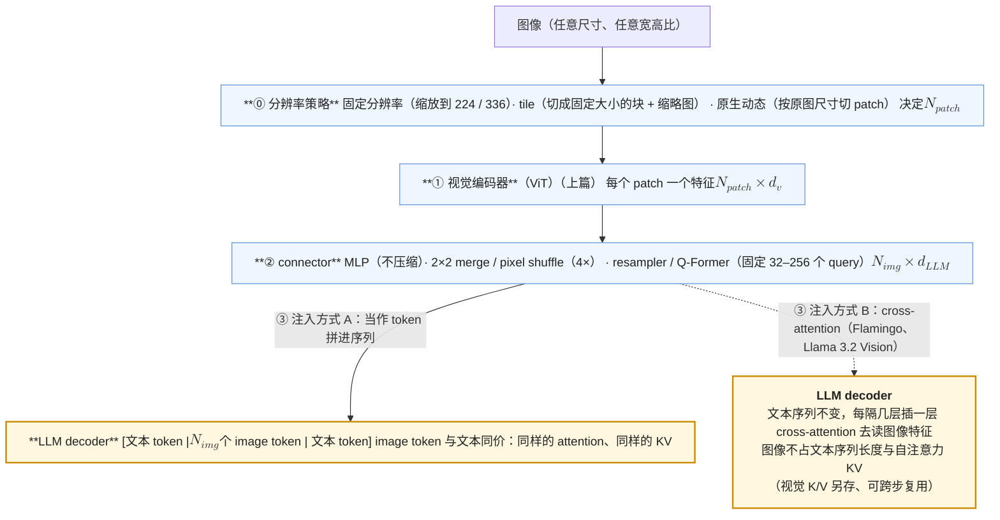
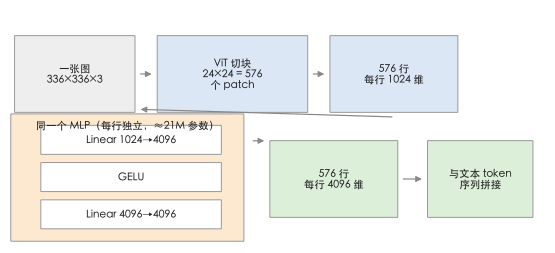
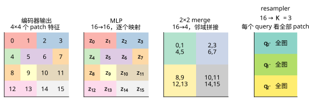
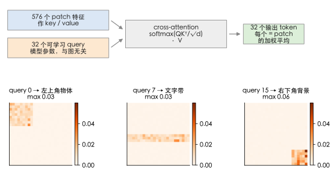
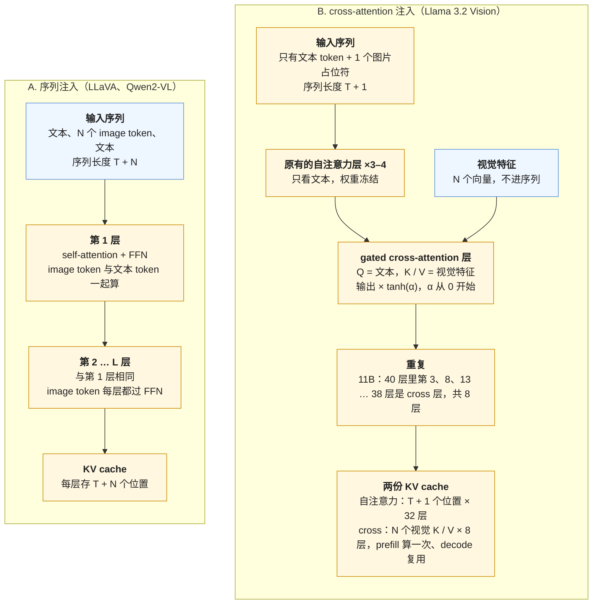
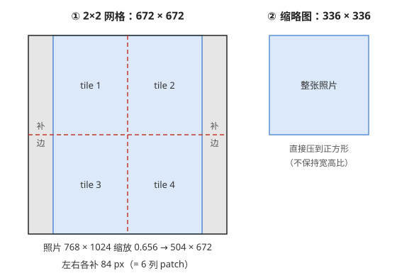
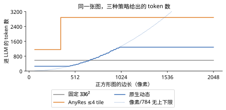

VLM 由四个部件组成：分辨率策略 → 视觉编码器 → connector → 注入方式。上篇《[多模态（01）：VLM 的结构（上）：视觉编码器——CLIP、SigLIP 与自监督 ViT](/vision-encoders-clip-siglip-and-self-supervised-vit.html)》讲了视觉编码器，本篇讲其余三个。

编码器把一张图变成了几百个 $$d_v$$ 维向量（CLIP-L 是 1024 维）。LLM 的输入是 $$d$$ 维向量（7B 模型是 4096 维）——两边维度不同、"语言"也不同，中间要有一个转接头。这一步有三个设计选择：**connector**——用什么把编码器的 $$d_v$$ 维特征映射到 LLM 的 $$d$$ 维输入空间，顺便要不要压缩 token 数；**注入方式**——图片 token 是像文本一样进入 LLM 的输入序列（decoder-only 注入），还是通过额外的 cross-attention 层被 LLM "看"（cross-attention 注入）；**分辨率策略**——固定尺寸、切 tile、还是让编码器接受原生分辨率。三个选择合起来回答一个问题：一张图在 LLM 里占多少 token、保留了多少信息、花了多少算力。

《[现代 LLM 结构（09）：多模态：vision encoder 的算量与 image token 的 KV 代价](/multimodal-vision-encoder-cost-and-image-token-kv.html)》已经算过这三个设计选择的**成本**：三类 connector 的 token 数表、两种注入的 FLOPs 与 KV 对照、M-RoPE 的三维位置、视频与音频的 token 数。这一篇讲成本背后的**动机与效果**：为什么 2024 年后主流从 Q-Former 回到 MLP、cross-attention 注入为什么被 Llama 3.2 选中又被多数人放弃、原生分辨率解决了 tile 的什么问题。每个选择都是一次"信息 vs token"的交换，这一篇把交换的两边都说清楚。

本篇要回答的核心问题是：

> **LLaVA 的一个 MLP 与 BLIP-2 的 Q-Former 相差什么？[^q0] 为什么 Qwen2-VL 要让 ViT 接受原生分辨率？[^q1]**

## 一、总览：三个设计选择、一张对照表

### 1. 主流 VLM 的结构选择

| 模型 | 分辨率 | 编码器 | connector | 压缩 | 注入 | 一张图的 token |
|---|---|---|---|---|---|---|
| Flamingo（2022） | 固定 | <span class="inline-tip" data-tip="normalizer-free network，Flamingo 用的无归一化 CNN 编码器">NFNet</span> | Perceiver resampler | 固定 64 | cross-attention（gated） | 64（不进序列） |
| BLIP-2（2023） | 224 | EVA ViT-g | Q-Former（32 query） | 固定 32 | decoder 序列 | 32 |
| LLaVA-1.5（2023） | 336 | CLIP-L/14-336 | 2 层 MLP | 无 | decoder 序列 | 576 |
| Qwen-VL（2023） | 448 | ViT-bigG | cross-attention resampler（256 query） | 固定 256 | decoder 序列 | 256 |
| LLaVA-NeXT（2024） | AnyRes ≤ 4 tile + 全图 | CLIP-L/14-336 | MLP | 无 | decoder 序列 | ≤ 576 × 5 + 换行 ≈ 2.9K |
| InternVL 1.5 / 2（2024） | 448 tile ≤ 40 + 缩略图 | InternViT-6B / 300M | pixel shuffle + MLP | 4× | decoder 序列 | 256 / tile |
| Qwen2-VL（2024） | 原生动态 | 675M ViT，2D RoPE | 2×2 merge + MLP | 4× | decoder 序列 | $$HW / (28^2)$$，可设上下限 |
| Llama 3.2 Vision（2024） | 560，≤ 4 tile | ViT-H/14 | 投影 | 无 | **cross-attention**（每 4 层插 1 层） | 不进序列 |
| Idefics3（2024） | tile | SigLIP-SO400M | pixel shuffle | 4× | decoder 序列 | 169 / tile |
| Molmo（2024） | tile（≤ 12） | CLIP-L/14-336 | 2×2 pooling + MLP | 4× | decoder 序列 | 144 / tile |
| Gemma 3（2025） | 896 固定 + pan & scan | SigLIP-SO400M-896 | 平均池化 | 16× | decoder 序列 | 256 |
| Qwen2.5-VL（2025） | 原生动态 | 675M ViT，窗口 attention | 2×2 merge + MLP | 4× | decoder 序列 | 同 Qwen2-VL |

Table: 主流 VLM 的结构选择

上面这张表（表 1）把 12 个主流 VLM 按四个部件摆在一起看。列的顺序就是一张图走过的顺序：先按分辨率策略缩放或切块，再进编码器，经 connector 映射，最后注入 LLM。编码器在上篇讲过，本篇讲每一行剩下的三列：connector、注入方式、分辨率策略。下面这张结构图（图 1）把四个部件与两条注入路径画在一起：



> [!NOTE]
> cross-attention 在本篇出现在两个地方，容易混。一处在 connector 里面：resampler / Q-Former 用一组 query 对全部 patch 做 cross-attention，把几百个 patch 压成几十个 token。另一处是注入方式 B：LLM 每隔几层插一层 cross-attention，去读图像特征。所以 cross-attention 不是 connector 的替代品，走 cross-attention 注入的模型也有 connector——表 1 里 Flamingo 用的是 Perceiver resampler，Llama 3.2 Vision 用的是投影。

从上表可以看出三个趋势：

1. 注入方式几乎全部收敛到 decoder 序列；
2. connector 从「固定 query 的 resampler」（Flamingo、BLIP-2、Qwen-VL）转向「MLP + 空间压缩」（2×2 merge / pixel shuffle / pooling）；
3. 分辨率从固定转向 tile 或原生动态。

### 2. LLaVA 的 MLP 与 BLIP-2 的 Q-Former 相差什么

先回答上面的第一个问题：LLaVA 的一个 MLP 与 BLIP-2 的 Q-Former 相差什么？两者差在**信息瓶颈的位置**。

MLP（多层感知机——两层线性变换夹一个非线性激活的小网络）对每个 patch 特征独立做一个映射：576 个 patch 进去、576 个 token 出来，空间结构与全部信息保留，代价是 token 多。

Q-Former（BLIP-2 提出的 connector，用一组可学习的 query 向量通过 cross-attention 从图像特征里抽取信息）用 32 个可学习的 query 对全部 patch 做 cross-attention，把任意数量的 patch 压成 32 个 token：token 少，但 32 个向量装不下一张图的细节——尤其是 OCR、小物体、精确位置。

常见的说法「query 与内容无关、没有自适应」要说准：固定的是 query 的**个数与初始向量**，attention 权重 $$QK^\top$$ 随每张图的 key 变化，读出的内容当然随图变——在第二章的 toy 代码里，同一个 query 把两个 patch 的 key 对调，输出从 3.48 变成 6.52。它的真正限制是**预算固定**（32 个槽位分给整张图）与**空间结构丢失**。

实证上，LLaVA-1.5 用 MLP 在 12 个 benchmark 上超过了用 Q-Former 的 BLIP-2 与 InstructBLIP，之后 Q-Former 基本退出主流。

2024 年的折中是 MLP + **空间压缩**（2×2 merge）：压缩 4 倍但保持空间结构，每个输出 token 对应一个确定的 2×2 patch 区域。

第二个问题：Qwen2-VL 为什么让 ViT 接受原生分辨率？是为了解决 tile 方案的三个问题：

1. **边界**：tile 之间没有 attention，一个跨 tile 的物体或一行文字被切断；
2. **失真**：把任意宽高比的图 resize 或 pad 到正方形 tile 会拉伸或浪费；
3. **token 效率**：小图也要占满一个 tile 的 576 个 token，大图的 tile 网格与内容的实际密度不匹配。

原生分辨率让 token 数**与图片的像素数成比例**（每 $$28 \times 28$$ 像素一个 token），一张 $$224 \times 224$$ 的图 64 个 token、一张 $$1344 \times 896$$ 的文档 1536 个 token，全图在一个 attention 里。代价是 ViT 的 attention 是 $$O(N^2)$$——Qwen2.5-VL 用窗口 attention 缓解——以及位置编码要换成 2D RoPE。第五章展开。

### 3. 本文的章节安排

| 章 | 主题 | 内容 |
|---|---|---|
| 二 | connector | 用 16 个 patch 特征把 MLP、2×2 merge、池化、resampler 各跑一遍（形状、参数、丢不丢信息；代码 + 图）<br/>为什么 resampler 退出<br/>压缩率的极限 |
| 三 | 注入方式 | decoder 序列 vs cross-attention 的结构、参数、文本能力保持、上下文占用；Llama 3.2 的选择与代价 |
| 四 | 固定分辨率与 tile | AnyRes 的网格选择（一个 20 行的选网格函数）<br/>缩略图的作用<br/>tile 数与 token 预算<br/>边界问题 |
| 五 | 原生动态分辨率 | Qwen2-VL 的做法：2D RoPE、可变 patch 数、2×2 merge、上下限<br/>窗口 attention<br/>NaFlex |
| 六 | 视频与多图 | 帧采样与时间合并<br/>M-RoPE 的三个轴<br/>token 预算在帧间的分配<br/>交错图文 |
| 七 | 信息 vs token 的交换 | 五张图在三种策略下的 token 数（表 + 图）<br/>一张"任务 × 分辨率 × 压缩"的效果矩阵<br/>每 token 多少像素 |
| 八 | 成本 | 回指 [《现代 LLM 结构》的多模态成本篇](/multimodal-vision-encoder-cost-and-image-token-kv.html) 的账<br/>三个设计选择各改了什么<br/>训练侧的影响 |
| 九 | 动手（建议） | 分辨率—token—精度的三角 |
| 十 | 本文小结 |  |
| 十一 | 自测 | 5 道题 |

Table: 本文的章节安排

## 二、connector：从编码器空间到 LLM 空间

编码器说自己的语言（视觉特征），LLM 只认词表里的 embedding——connector 就是中间的翻译。本章的问题是：翻译要不要附带压缩、要不要做选择，四种做法的差别就在这两点。

### 1. MLP projector

最简单的转接头：每个向量各自过一个小网络，从 $$d_v$$ 维变成 $$d$$ 维。LLaVA（Liu 等 2023）用一个线性层（一个矩阵乘），LLaVA-1.5 改成两层 [MLP](# "tip: multi-layer perceptron，多层感知机：线性层 → 非线性激活 → 线性层。GELU 是一种平滑的激活函数，作用类似 ReLU")：$$z_i = W_2\, \text{GELU}(W_1 h_i)$$，对每个 patch 特征 $$h_i \in \mathbb{R}^{d_v}$$ 独立作用，输出 $$z_i \in \mathbb{R}^d$$。参数量 $$d_v d + d^2$$：CLIP-L（1024）到 Vicuna-7B（4096）是 $$1024 \times 4096 + 4096^2 \approx 21M$$，相对 7B 可以忽略。token 数不变。

本章用同一份缩小的输入把四种 connector 各跑一遍：一个 $$4 \times 4 = 16$$ 个 patch 的网格，编码器特征 $$d_v = 8$$ 维，LLM 输入 $$d = 12$$ 维（真实是 576 个 patch、1024 → 4096）：

```python title="MLP projector：16 个 patch 进、16 个 token 出"
h = torch.randn(16, 8)                                               # 编码器输出：16 个 patch 特征 [16, d_v]
mlp = torch.nn.Sequential(torch.nn.Linear(8, 12), torch.nn.GELU(), torch.nn.Linear(12, 12))
z_mlp = mlp(h)                                                       # [16, 12]：16 个 token 进去、16 个出来
```

```text title="MLP projector 的形状与参数量"
MLP projector：(16, 8) → (16, 12)；参数 264（d_v·d + d² 量级）
```

真实尺寸走一遍（LLaVA-1.5）：一张 336×336×3 的图 → 24×24 = 576 个 patch → 576 个 1024 维向量 → 每行独立过同一个 MLP → 576 个 4096 维向量 → 与文本 token 首尾相接进 decoder：



为什么**每个 patch 共用一个 MLP** 就够了？这个 MLP 干的事是坐标变换：把「CLIP 眼里的这个 patch」换算成「LLM 空间里的一个向量」。它不做摘要——576 个进去 576 个出来，一个不少——所以不需要按位置区别对待，同一个换算对所有 patch 适用；要丢要留交给后面 LLM 的 attention 决定。

它的性质：**逐 token、不做压缩**（输出维度 $$d \ge d_v$$，没有把多个 patch 合并；但"可逆"不是保证——$$W_1$$ 可以不满秩、GELU 不是单射，toy 上 $$x = -2$$ 与 $$x \approx -0.0988$$ 过 GELU 得到同一个值——它保留的是**空间粒度**，不是数学意义的信息无损）、**保留空间结构**（第 $$i$$ 个输出对应第 $$i$$ 个 patch，位置由 LLM 的位置编码给出）、**不做任何选择**（所有 patch 一律进 LLM，让 LLM 的 attention 决定看哪）。LLaVA-1.5 的实验证明，就凭这个 MLP 加 558K 对齐数据 + 665K 指令数据，在 12 个 benchmark 上超过用 Q-Former 的 InstructBLIP 与用 129M 数据的 BLIP-2——**LLM 的 attention 比一个小的 resampler 更会挑信息**。

### 2. 空间压缩：2×2 merge、pixel shuffle、pooling

576 个 token 对 $$336^2$$ 可以接受，但高分辨率下 token 数爆炸（tile 5 个 = 2880，原生 $$1344^2$$ = 9216）。空间压缩把相邻的 $$k \times k$$ 个 patch 特征合成一个 token：

- **2×2 merge / concat**（Qwen2-VL）：把 $$2 \times 2$$ 的四个 $$d_v$$ 维特征**拼接**成 $$4 d_v$$ 维，再过 MLP 到 $$d$$。信息全部保留（拼接不丢），只是让 LLM 用一个 token 处理原来四个的内容；MLP 的参数量变为 $$4 d_v d + d^2$$。代码就是一次 reshape：

  ```python title="2×2 merge：一次 reshape"
  grid = h.view(4, 4, 8)                                                                  # 16 个特征摆回 4×4 的网格
  merged = grid.view(2, 2, 2, 2, 8).permute(0, 2, 1, 3, 4).reshape(-1, 32)                # [4, 32]：每个新 token = 2×2 邻域的 4 个特征首尾相接
  z_merge = torch.nn.Linear(32, 12)(merged)                                               # [4, 12]
  ```

  ```text title="2×2 merge 的形状：16 → 4 个 token"
  2×2 merge：(16, 8) → 拼接 (4, 32) → MLP (4, 12)；token 数 16 → 4，拼接不丢任何数（32 个数原样在）
  ```
- **pixel shuffle**（InternVL）：同一件事的另一个名字——来自超分辨率里的 space-to-depth 操作，把 $$H \times W \times C$$ 重排成 $$H/2 \times W/2 \times 4C$$（PyTorch 里叫 `pixel_unshuffle`，与上面手工拼接的结果只差通道顺序，验证过 `True`）。InternVL 把 $$448^2$$ 的 1024 个 patch 压成 256 个。
- **平均 / 注意力池化**（Gemma 3、Molmo）：$$k \times k$$ 个特征**平均**（或加权平均）成一个 $$d_v$$ 维向量再投影。有信息损失——平均丢掉了四个 patch 之间的差别。toy 上量一下：`grid.view(2, 2, 2, 2, 8).mean((1, 3))` 得到 $$[4, 8]$$，被抹掉的部分（每个 patch 与其 2×2 均值的差的均方）是原方差的 77%——对随机特征这是灾难，对真实图片相邻 patch 高度相似、损失小得多，但文字这种相邻 patch 差别大的内容会受伤。Gemma 3 用 $$4 \times 4$$ 的平均池化把 $$896^2$$ 的 4096 个 patch 压到 256——16 倍。



压缩率的极限在哪？经验上 **4×（2×2）几乎无损**——一个 $$28 \times 28$$ 像素的区域用一个 LLM token 表示，对文字（一个字约 $$20 \times 20$$ 像素）够用；**16×（4×4）在 OCR 与细节任务上开始掉**，Gemma 3 用 pan & scan（对大图或非方形图再切块）补偿；更高的压缩（64×）只在缩略图或视频帧上用。[《现代 LLM 结构》的多模态成本篇](/multimodal-vision-encoder-cost-and-image-token-kv.html)第三章给了 2×2 merge 的精确布局。

### 3. resampler：Q-Former 与 Perceiver

第三类不按位置映射，而是"提问"。先回忆 attention 的三步（《[LLM 时代的经典机器学习（09）：去重——MinHash 与 LSH 的概率](/deduplication-minhash-and-lsh-probabilities.html)》的核回归 = attention）：一个 **query** 向量与每个 **key** 向量算相似度、softmax 成权重、按权重加权平均对应的 **value** 向量。自注意力里 query、key、value 都来自同一串 token；**cross-attention** 里 query 来自一边、key / value 来自另一边——"用 A 去查 B"。

**Perceiver resampler**（Flamingo，Alayrac 等 2022）：$$K$$ 个**可学习的** query 向量（$$K = 64$$，是模型参数，与输入图片无关）对编码器的全部 patch 特征做若干层 cross-attention（key / value 是 patch 特征），输出 $$K$$ 个向量。任意数量的 patch → 固定 $$K$$ 个 token。toy 上 $$K = 3$$：

```python title="resampler：K = 3 个可学习 query 的 cross-attention"
queries = torch.nn.Parameter(torch.randn(3, 12))                     # 与图片内容无关的 3 个 query（模型参数）
att = torch.softmax(Wq(queries) @ Wk(h).T / 12 ** 0.5, dim=-1)       # [3, 16]：每个 query 在 16 个 patch 上的注意力权重
z_res = att @ Wv(h)                                                  # [3, 12]：按权重加权平均 patch 的 value
```

```text title="resampler 的输出与 query 的注意力分布"
resampler（K = 3 个 query）：(16, 8) → (3, 12)；不论图有多少 patch，永远输出 3 个 token
   第 0 个 query 的注意力分布（16 个 patch）：[0.07 0.06 0.08 0.07 0.07 0.04 0.06 0.05 0.02 0.05 0.09 0.07 0.07 0.08 0.07 0.05]
```

每个输出 token 是全部 16 个 patch 的加权平均，权重由"这个 query 问什么"与"这个 patch 是什么"共同决定；训练让 query 学会问"图里主要物体是什么"一类的通用问题。真实尺寸的样子（构造的 toy：patch 特征带上空间结构——左上角一个物体、中间一条文字带、右下角一块背景，三个 query 各被构造为对其中一块有亲和度。演示的是「每个 query 读图里不同区域」会长什么样，不是训练好的 BLIP-2 权重）：



注意输出个数与图片大小**完全无关**：patch 有 576 个还是 9216 个，query 还是那 $$K$$ 个，输出还是 $$K$$ 个 token——这正是它的卖点与瓶颈。

**Q-Former**（BLIP-2，Li 等 2023）：结构类似（$$K = 32$$ 个 768 维 query，BERT-base 规模约 188M 参数，12 层，每层是 self-attention + 对 patch 的 cross-attention 交替），但训练分两阶段——先用图文对比 / 匹配 / 生成三个目标训 Q-Former 让 query 学会提取"与文本相关"的特征，再接 LLM 训第二阶段。

**Perceiver resampler 与 Q-Former 的差别**：Flamingo 用 $$K = 64$$ 个 latent，Perceiver 式的堆叠——latent 对视觉特征做 cross-attention，再在 latent 之间叠 self-attention 层（而不是像 Q-Former 那样以 BERT 初始化、自带文本空间）。并且 Flamingo 把视觉信息的注入放在别处完成：冻结的 LLM 每层之间再插 gated cross-attention（第三章），resampler 只负责把任意多的视觉特征压成固定的 64 个。

**Qwen-VL 的 resampler**：单层 cross-attention，256 个 query，加了 2D 绝对位置编码在 key 上以保留位置信息。

resampler 的问题：（1）**固定预算**——32 或 64 个 token 装不下高分辨率图的信息，OCR 与细节任务上明显落后；（2）**预算固定、选择由 attention 权重隐式完成**——query 数与初始值对所有图相同，读什么由 $$QK^\top$$ 随图决定，但没有机制按图片复杂度增减槽位；（3）**空间结构丢失**——输出的 $$K$$ 个 token 没有明确的空间对应，LLM 难以做定位与 grounding；（4）**多了一个要训的模块**——Q-Former 的第一阶段训练需要 129M 图文对，且它的表示与 LLM 的表示之间又有一个 gap。

LLaVA-1.5 之后的实证（Cambrian-1 的系统对照、MM1 的消融）一致：在同样的数据与 LLM 下，MLP（+ 空间压缩）优于 resampler，尤其在需要细节的任务上。resampler 在 2024 年后只剩两种用法：**视频**（帧太多，需要激进压缩到固定预算）与 **cross-attention 注入**（下一章，Flamingo 式结构本身就是 resampler + cross-attention）。

### 4. connector 需要多大

MM1（McKinzie 等 2024）的消融：connector 的类型（MLP / 池化 / C-Abstractor）对最终效果的影响**远小于**分辨率与 token 数的影响。connector 只要不丢信息、不引入瓶颈就够了；真正决定效果的是进 LLM 的 token 承载了多少信息（分辨率）与 LLM 有多少 token 可以看（token 数）。这是本篇后半的主题。

## 三、注入方式

connector 解决的是「翻译成 LLM 的向量」，注入方式解决的是「翻译好的向量放在哪里」：塞进文本序列里当普通 token，还是不进序列、让文本 token 隔着层来 attend。前者什么都不用改，后者不占上下文但要动 LLM。

两种注入的差别落在 LLM 的每一层上，下面这张图把一张图片在两条路径里经过的地方画出来：



### 1. decoder 序列注入

图片 token 与文本 token 拼成一个序列送进 LLM，图片 token 占据序列位置、参与 causal attention、有自己的位置编码、产生 KV。LLM 结构不改，只是输入里有一段"看不懂但能 attend"的 token。LLaVA 起的所有主流 VLM 都是这个。

性质：**简单**（LLM 零改动）、**复用一切**（LLM 的后训练、推理引擎、量化、投机解码全部直接用）、**多图与交错自然**（图片 token 在文本里出现在哪就是哪）。代价：**图片 token 占上下文**——一张高分辨率图 1–3K token，十张图就是 10–30K，与文本竞争窗口；**每层都要为图片 token 算 attention 与 FFN**——[《现代 LLM 结构》的多模态成本篇](/multimodal-vision-encoder-cost-and-image-token-kv.html) 算过一张 576 token 的图在 7B LLM 里的 prefill 约 8 TFLOPs、KV 约 72 MB（Llama 结构）。

### 2. cross-attention 注入

Flamingo 与 Llama 3.2 Vision：图片特征**不进**序列。LLM 的每 $$k$$ 层（Flamingo 每层、Llama 3.2 每 4 层）之间插入一个新的 **cross-attention 层**——文本 token 作为 query，图片特征作为 key / value——再加一个 gate——cross-attention 层的输出乘一个可学习的标量 $$\tanh(\alpha)$$，$$\alpha$$ 初始为 0，于是训练开始时这一层输出为零、LLM 的行为与没插层时完全一样，随训练 $$\alpha$$ 逐渐打开。图片特征只作为被 attend 的对象，不产生 KV、不占位置。

性质：**不占文本上下文**（图片再多也不消耗文本窗口；但视觉 K/V 仍要算、仍要存——HF `MllamaTextCrossAttention` 用 `past_key_values` 缓存 `k_proj/v_proj(cross_attention_states)`，decode 时复用，所以"图片不产生 KV"是错的，它只是不在文本自注意力的 KV 里）；**LLM 的文本能力可以严格不变**（条件是原来的层被冻结、且纯文本输入时跳过视觉层——Meta 正是这样训的，Llama 3.2 Vision 在纯文本任务上与 Llama 3.1 完全相同；这是训练选择不是结构自带的保证）；**图片特征可以更多**（不进序列，几千个特征的成本只在 cross-attention 层）。代价：**新增参数**（Llama 3.2 90B 的 cross-attention 层约 20B——每 4 层一个，每个不只 $$4d^2$$：Q、O 各 $$d^2$$、K、V 各 $$d\,d_{kv}$$、外加一个完整的 SwiGLU FFN $$3d\,d_{ff}$$，$$d = 8192$$ 时约 855M/层，20 层 17B，加 ViT-H 与投影正好对上 90B − 70B）；**需要单独训**（这些层从零开始，需要大量图文数据）；**多图与交错的处理复杂**（哪张图对哪段文本可见需要额外的 mask 逻辑）；**推理引擎要特殊支持**（vLLM 为 Llama 3.2 Vision 单独实现了 encoder-decoder 式的 attention 路径）。

### 3. 为什么主流是序列注入

拿一个具体模型算一次账。Llama 3.2 11B Vision 的文本部分就是 Llama 3.1 8B（32 层、hidden 4096、8 个 KV head × 128 维），另插 8 个 cross-attention 层；一张切满 4 个 $$560 \times 560$$ tile 的图片，编码器输出 $$4 \times (40^2 + 1) = 6404$$ 个视觉特征（数字取自 Hugging Face 上 `Llama-3.2-11B-Vision-Instruct` 的 `config.json`，2024-09 发布）。右列是假设：把同样 6404 个特征按序列注入塞进同一个 8B 文本模型。

| 一张 4-tile 图片 | cross-attention 注入（实际） | 同样 6404 个特征走序列注入（假设） |
|---|---:|---:|
| 占用文本上下文 | 1 个位置（<code>&lt;&#124;image&#124;&gt;</code> 占位符） | 6404 个位置 |
| 视觉特征经过的层 | 8 个 cross 层，只做 K、V 投影 | 32 层，attention + FFN 全算 |
| 视觉特征的线性层 FLOPs | $$8 \times 2 \times 2 \times 4096 \times 1024 \times 6404 \approx 0.86$$ T | $$2 \times 6.98\text{B} \times 6404 \approx 89$$ T |
| 视觉部分的 KV cache（bf16） | $$8 \times 2 \times 1024 \times 2\,\text{B} \times 6404 \approx 200$$ MiB | $$32 \times 2 \times 1024 \times 2\,\text{B} \times 6404 \approx 800$$ MiB |
| 新增的 LLM 参数 | 8 × 218M ≈ 1.7B | 0（只有 connector） |

Table: Llama 3.2 11B Vision 一张图片的两种注入成本

表里的 6.98B 是 8B 模型每层线性层参数（$$2 \times 4096^2 + 2 \times 4096 \times 1024 + 3 \times 4096 \times 14336 \approx 218$$M）乘 32 层，不含词表；218M 也正是一个 cross 层的参数量——它带着一整套 Q、K、V、O 与 SwiGLU FFN。表里没算两边都有的部分：视觉编码器本身，以及 attention 里与序列长度平方相关的项。

读这张表要注意两点：

1. cross-attention 注入省的是**每个视觉特征的成本**，约 100 倍——视觉特征不过 FFN、只在 8 层出现。所以它敢每张图给 6404 个特征，序列注入的模型通常要先压到 1–3K（LLaVA-NeXT 约 2.3K、Qwen2-VL 推荐配置 ≤ 1280）。
2. 省下来的成本换成了 1.7B 要从零训练的参数，以及一套推理引擎里单独的 attention 路径；90B 版本里这部分约 20B，第 2 节拆开过这个数。

Llama 3.2 Vision 是 2024 年唯一的主流 cross-attention 模型，它的选择有明确的动机：Meta 要保证视觉版本的文本能力**与 Llama 3.1 完全一致**（产品承诺），且愿意为此付出 20B 参数与单独的训练。多数团队没有这个约束，序列注入的简单性与生态兼容性胜出。NVLM（NVIDIA 2024）做了直接对照：同数据下 decoder 序列注入（NVLM-D）在 OCR 与推理任务上优于 cross-attention（NVLM-X），后者训练更快；他们的折中是混合结构（NVLM-H：缩略图进序列、高分辨率 tile 走 cross-attention）。

一个中间形态值得知道：**序列注入 + 图片 token 不产生 loss、用双向 attention**。PaliGemma 让图片 token 之间用双向 attention（prefix 部分非因果），文本部分因果——图片内部的 patch 本来就没有先后顺序，双向让每个 patch token 看到全图。这不改变注入方式，只改 mask。

## 四、固定分辨率与 tile

### 1. 固定分辨率

LLaVA-1.5 把任何图 resize（保持宽高比、pad 到正方形）到 $$336^2$$，576 个 token。简单、成本固定，但对文档（一页 A4 缩到 336 像素宽——每个字 3 像素）与宽图（pad 浪费一半）不可用。TextVQA / DocVQA 上的表现由此受限。

### 2. AnyRes：切 tile

LLaVA-NeXT（2024）：把图按预设的网格（$$1 \times 2$$、$$2 \times 2$$、$$3 \times 1$$……从一组候选里选能装下最多有效像素的）切成若干 $$336^2$$ 的 tile，每个 tile 独立过编码器得 576 个 token；再加一个全图 resize 到 $$336^2$$ 的**缩略图**（global view）提供全局上下文。$$2 \times 2$$ + 缩略图最多约 2.9K 个 token（第 3 节有一张照片的逐步计算）。InternVL 1.5 把上限推到 40 个 tile（$$448^2$$，压缩后每 tile 256 token → 最多 10K token），Molmo 12 个。

缩略图的作用被反复证实：没有它，模型看到的是四块互不相连的局部，对"这张图整体是什么"的判断变差；有它，全局与局部都有。tile 之间在 LLM 里通过 attention 交互，但**编码器内部**tile 是独立的——一个跨 tile 边界的物体，两半各自被编码，编码器不知道它们是同一个东西。对文字行尤其明显：一行字被切成两段。

### 3. 网格选择与 token 预算

AnyRes 的网格候选是超参数：LLaVA-NeXT 发布的 `llava-v1.6` 配置（`image_grid_pinpoints`）只有 5 个——$$1 \times 2$$、$$2 \times 1$$、$$2 \times 2$$、$$3 \times 1$$、$$1 \times 3$$（行 × 列，≤ 4 tile，没有 $$1 \times 1$$）；InternVL 用 1 到 40 个 tile 的所有宽高比组合。选择规则（LLaVA-NeXT 的 `select_best_resolution`）：对每个候选网格，把图保持宽高比缩放到刚好装进去，算"有效像素"（缩小后剩下的像素数，放大不算）与"浪费"（网格面积减有效像素），选有效像素最多、浪费最少的。选完以后还有两步会改 token 数：缩放后没占满网格的补边，对应的 patch 特征被裁掉（`unpad`）；特征网格每一行末尾加一个可学习的换行 token（`image_newline`），让 LLM 知道一行在哪里结束。按 Hugging Face `LlavaNextProcessor` 的算法写出来：

```python title="tokens_anyres：LLaVA-NeXT 的网格选择与 token 数"
def tokens_anyres(h, w, side=336, patch=14):
    grids = [(1, 2), (2, 1), (2, 2), (3, 1), (1, 3)]                     # (行, 列)
    best, best_key = None, None
    for r, c in grids:
        gh, gw = r * side, c * side
        # !ref scale
        scale = min(gw / w, gh / h)
        # !ref eff
        eff = min(int(w * scale) * int(h * scale), w * h)
        # !ref waste
        waste = gw * gh - eff
        key = (eff, -waste)
        if best_key is None or key > best_key:
            best, best_key = (r, c), key
    r, c = best
    n = side // patch                                                    # 每个 tile 24 × 24 个 patch
    # !ref grid
    fh, fw = r * n, c * n
    # !ref unpad +5
    if w / h > fw / fh:
        pad = (fh - int(h * fw / w)) // 2
        fh -= 2 * pad
    else:
        pad = (fw - int(w * fh / h)) // 2
        fw -= 2 * pad
    # !ref total
    return fh * fw + fh + n * n
```

拿一张 $$768 \times 1024$$（宽 × 高）的竖版照片走一遍。先对 5 个候选网格各算一次[缩放](#scale)、[有效像素](#eff)与[浪费](#waste)：

| 网格（行 × 列） | 网格像素（宽 × 高） | 缩放 | 缩放后 | 有效像素 | 浪费 |
|---|---|---:|---|---:|---:|
| 1 × 2 | 672 × 336 | 0.328 | 252 × 336 | 84,672 | 141,120 |
| 2 × 1 | 336 × 672 | 0.438 | 336 × 448 | 150,528 | 75,264 |
| **2 × 2** | **672 × 672** | **0.656** | **504 × 672** | **338,688** | 112,896 |
| 3 × 1 | 336 × 1008 | 0.438 | 336 × 448 | 150,528 | 188,160 |
| 1 × 3 | 1008 × 336 | 0.328 | 252 × 336 | 84,672 | 254,016 |

Table: 768 × 1024 照片在 5 个候选网格上的有效像素与浪费

$$2 \times 2$$ 的有效像素最多，选中。照片在 $$672 \times 672$$ 的网格里是这样放的：



4 个 tile 与缩略图各过一次编码器，各得 $$24 \times 24$$ 个 patch 特征；4 个 tile 的特征按位置拼回[一张 $$48 \times 48$$ 的特征网格](#grid)，再[裁掉补边](#unpad)，最后[加上每行的换行 token 与缩略图](#total)：

| 部分 | 形状 | token 数 |
|---|---|---:|
| 缩略图 | 24 × 24 | 576 |
| 4 个 tile 拼成的特征网格 | 48 × 48 | （2304） |
| 裁掉左右补边：84 px ÷ 14 = 每边 6 列 | 48 × 36 | 1728 |
| 每行末尾一个换行 token | 48 行 | 48 |
| 合计 | | 2352 |

Table: 768 × 1024 照片在 LLaVA-NeXT 里的 token 数

进 LLM 的顺序是缩略图的 576 个在前，tile 特征按行展开在后。常被引用的「$$2 \times 2$$ + 缩略图 = 2880」是 $$5 \times 576$$ 的上限，只有正方形图（没有补边）才接近，而且还要加 48 个换行 token：一张 $$1024 \times 1024$$ 的图是 2928。

再看两个极端：一张 $$1080 \times 2400$$ 的手机截图选 $$3 \times 1$$（3 行 1 列，宽 336 × 高 1008），特征网格 $$72 \times 24$$，上下裁掉 18 行补边后是 $$54 \times 24$$，加 54 个换行和 576 个缩略图 token，共 1926；一张 $$64 \times 64$$ 的小图标所有网格都要放大，有效像素都是 4096，于是选浪费最少的 $$1 \times 2$$，放大 5 倍后裁成 $$24 \times 24$$，共 $$576 + 24 + 576 = 1176$$ 个 token——全是放大出来的冗余。token 预算随 tile 数线性增长，一张 $$4000 \times 3000$$ 的文档照片在 InternVL 里可能用掉 25 个 tile = 6400 token。

tile 方案的优点是编码器**完全不变**（每个 tile 是标准的 $$336^2$$ 或 $$448^2$$ 输入，位置编码不需要插值），可以直接用任何现成的 CLIP / SigLIP。这是它在 2024 年流行的工程原因。

## 五、原生动态分辨率

### 1. Qwen2-VL 的做法

Qwen2-VL（Wang 等 2024）让 ViT 直接处理任意大小的图：

1. **可变 patch 数**：图按原尺寸（resize 到 28 的倍数，保持宽高比，像素总数限制在 $$[\text{min}, \text{max}]$$ 之间——默认 $$256 \times 28^2$$ 到 $$1280 \times 28^2$$）切成 $$14 \times 14$$ 的 patch，patch 数 $$N = HW / 14^2$$ 随图变化。
2. **2D RoPE**：ViT 的位置编码从可学习的绝对位置换成 2D [RoPE](# "tip: rotary position embedding，旋转位置编码：不给每个位置一个可学习向量，而是把 query / key 向量按位置旋转一个角度，两个 token 的注意力分数只依赖它们的相对位置。位置可以是任意整数，所以不需要为新分辨率「插值」出新的位置向量")（[《现代 LLM 结构》的多模态成本篇](/multimodal-vision-encoder-cost-and-image-token-kv.html)第六章），head_dim 的一半编码行号、一半编码列号，任意 $$H \times W$$ 无需插值。
3. **2×2 merge**：ViT 输出后相邻 $$2 \times 2$$ 的 patch 特征拼接过 MLP，token 数变为 $$N / 4 = HW / 28^2$$。
4. **M-RoPE**：进入 LLM 后，图片 token 的位置用三维（时间、高、宽）编码，文本 token 三维相同——让 LLM 知道每个图片 token 的二维位置。

算法是三行：

```python title="tokens_native：Qwen2-VL 的原生分辨率 token 数"
def tokens_native(h, w, unit=28, lo=256, hi=1280):
    n = round(h / unit) * round(w / unit)                                # 每 28×28 像素一个 token
    return int(min(max(n, lo), hi))                                      # 夹在上下限之间
```

上面的 `lo=256, hi=1280` 是 Qwen2-VL 模型卡里**推荐的部署配置**，不是 processor 的默认——公开 `preprocessor_config.json` 的默认是 `min_pixels = 3136`（4 个 token）、`max_pixels = 12845056`（16384 个 token）。而且真实 processor 不是"算完 token 再夹"：它先把像素数夹到 [min, max] 内**缩放图片**、再 round 到 28 的倍数，所以小图会被放大、大图会被缩小，而不是 token 数被截断。按推荐配置：$$224 \times 224$$ 会被放大到约 $$448 \times 448$$ 得 256 个 token；$$1344 \times 896$$（一页文档）按 28 取整是 1536 个 token，超上限，图片被缩到 $$1204 \times 812$$，得 1247 个 token。**token 数与（缩放后的）像素数成正比**，预算以 processor 输出的 `image_grid_thw` 为准。

按 Hugging Face `Qwen2VLImageProcessor` 里的 `smart_resize` 对四张图各算一遍（推荐配置 `min_pixels` = $$256 \times 28^2$$、`max_pixels` = $$1280 \times 28^2$$；最后一列是不设推荐上下限、用 `preprocessor_config.json` 默认值的结果）：

| 原图（宽 × 高） | resize 后（宽 × 高） | ViT patch 网格（高 × 宽） | 2×2 merge 后 | token 数 | 默认配置的 token 数 |
|---|---|---|---|---:|---:|
| 224 × 224 小图 | 448 × 448（放大到下限） | 32 × 32 = 1024 | 16 × 16 | 256 | 64 |
| 768 × 1024 照片 | 756 × 1036 | 74 × 54 = 3996 | 37 × 27 | 999 | 999 |
| 1344 × 896 文档 | 1204 × 812（缩到上限内） | 58 × 86 = 4988 | 29 × 43 | 1247 | 1536 |
| 1080 × 2400 手机截图 | 672 × 1484（缩到上限内） | 106 × 48 = 5088 | 53 × 24 | 1272 | 3354 |

Table: Qwen2-VL 原生分辨率下四张图的 patch 网格与 token 数

表里能读出三点：

1. resize 只把边长调到 28 的倍数，宽高比基本不变（$$768 \times 1024$$ → $$756 \times 1036$$）；超上限时两条边按同一比例缩、再向下取整到 28 的倍数，所以文档落在 1247 而不是正好 1280。
2. ViT 看到的是 merge 之前的 patch 网格（几千个），LLM 看到的是 merge 之后的四分之一。第 3 节说的 ViT attention 成本按前者算。
3. 同一张 $$768 \times 1024$$ 照片，LLaVA-NeXT 给 2352 个 token（第四章第 3 节），Qwen2-VL 给 999 个；差别来自两处：LLaVA-NeXT 多一份 576 个 token 的缩略图；它每个 token 对应 $$14 \times 14$$ 像素，Qwen2-VL 合并后每个 token 对应 $$28 \times 28$$。

每张图在序列里还要多两个文本 token：前面的 `<|vision_start|>` 与后面的 `<|vision_end|>`。

### 2. 它解决了什么

对照 tile 的三个问题：**边界**——全图在一个 ViT 的 attention 里，跨区域的物体与文字行完整；**失真**——不 pad 不拉伸（只 resize 到 28 的倍数，误差 < 14 像素）；**效率**——一张 $$224 \times 224$$ 的小图在默认配置下 64 个 token 而不是 576，一张宽的横幅按实际比例给 token。Qwen2-VL 在 DocVQA（94.5）、InfoVQA、OCRBench 等文档任务上相比 tile 方案有明显优势，且 token 用得更少。

### 3. 代价与 Qwen2.5-VL 的窗口 attention

ViT 的 attention 是 $$O(N^2 d)$$。$$N = 5120$$ 个 patch（$$1280 \times 4$$，merge 之前）时 attention 的 FLOPs 是 $$4 \times 5120^2 \times 1280 \approx 134$$ GFLOPs 每层（$$QK^\top$$ 与 $$AV$$ 各 $$2N^2d$$），32 层 4.3 TFLOPs，与 patch 的线性部分（$$2 \times 675M \times 5120 \approx 6.9$$ TFLOPs）同量级——不可忽略，且激活内存 $$N^2$$ 增长。Qwen2.5-VL 把 ViT 的大部分层改成**窗口 attention**（$$112 \times 112$$ 像素的窗口，即 $$8 \times 8$$ 个 patch，只有 4 层保留全局 attention），把 attention 成本变成线性。这与 Swin Transformer 的思路一致，效果上几乎无损。

另一个代价是**工程**：可变 token 数的 batch 需要 padding 或 packing（Qwen2-VL 用 packing——多张图的 patch 拼成一个序列，用 attention mask 隔开，与 《[后训练（01）：SFT：指令数据、chat template、loss mask 与参数高效微调](/sft-data-chat-template-loss-mask-and-peft.html)》讲的 SFT packing 同一个技术）。

### 4. NaFlex 与趋势

SigLIP 2 的 NaFlex 变体让预训练的编码器本身支持原生宽高比与可变分辨率（训练时就用多种分辨率与宽高比，位置编码按实际网格插值）——让"原生动态"不再需要自己从头训 ViT。2025 年新发布的 VLM（Kimi-VL 的 MoonViT、InternVL 3 的部分配置）越来越多走原生动态路线；tile 方案因为工程简单仍广泛存在。

## 六、视频与多图

### 1. 视频：帧的采样与合并

视频是图的序列，token 数 = 帧数 × 每帧 token。1 分钟视频以 1 fps 采样 60 帧，每帧 256 token = 15K token；以 2 fps 就是 30K。三个控制手段：

- **帧率**：Qwen2-VL 默认 2 fps 采样；长视频降到 0.5 fps 或按总 token 预算自适应。
- **时间合并**：相邻两帧的 patch 在时间维上合并（Qwen2-VL 的 3D patch：$$2 \times 14 \times 14$$，两帧合成一组 patch），token 数减半；视频编码器（如 InternVideo）可以在更长的时间窗上合并。
- **每帧分辨率**：视频帧用比单图更低的分辨率与更高的压缩（Qwen2-VL 视频帧的 token 上限单独设）。

Qwen2.5-VL 用**绝对时间**的 M-RoPE（时间维的位置 id 与真实秒数对齐，而不是帧序号），让模型知道两帧之间隔了多久——对"第 30 秒发生了什么"一类的定位任务重要。

### 2. M-RoPE 的三个轴

[《现代 LLM 结构》的多模态成本篇](/multimodal-vision-encoder-cost-and-image-token-kv.html)第六章讲了 M-RoPE 的结构：head_dim 分成三段，分别编码时间、高、宽。文本 token 三个 id 相同（退化为 1D RoPE）；图片 token 时间 id 固定、高宽 id 是二维网格位置；视频 token 时间 id 随帧递增。它让 LLM 用同一套位置编码处理三种模态，且图片内部的相对位置（"左边的物体"）在 RoPE 的相对性下有意义。后续 token 的位置 id 从图片占据的最大 id + 1 开始，所以一张 $$32 \times 32$$ token 的图只"消耗"32 个位置而不是 1024 个——对长上下文外推有利。

具体看一个小例子：两个文本 token，接一张 merge 后只有 $$2 \times 3$$ 个 token 的小图，再接两个文本 token。按 Hugging Face `Qwen2VLForConditionalGeneration.get_rope_index` 的规则，每个 token 的三个位置 id 是：

| token | 时间 t | 高 h | 宽 w |
|---|---:|---:|---:|
| 文本 1 | 0 | 0 | 0 |
| 文本 2 | 1 | 1 | 1 |
| <code>&lt;&#124;vision_start&#124;&gt;</code> | 2 | 2 | 2 |
| 图 (0, 0) | 3 | 3 | 3 |
| 图 (0, 1) | 3 | 3 | 4 |
| 图 (0, 2) | 3 | 3 | 5 |
| 图 (1, 0) | 3 | 4 | 3 |
| 图 (1, 1) | 3 | 4 | 4 |
| 图 (1, 2) | 3 | 4 | 5 |
| <code>&lt;&#124;vision_end&#124;&gt;</code> | 6 | 6 | 6 |
| 文本 3 | 7 | 7 | 7 |
| 文本 4 | 8 | 8 | 8 |

Table: M-RoPE 的位置 id：两段文本夹一张 2 × 3 token 的图

规则就三条：

1. 文本 token 三个 id 相同，逐个加 1——与普通 1D RoPE 完全一样。
2. 图片 token 的三个 id 都从「前一个 token 的 id + 1」（这里是 3）起算：t 对整张图固定，h 加行号，w 加列号。所以同一行的 token h 相同、同一列的 w 相同，「左边的物体」「上面一行字」在 RoPE 的相对位置里有意义。
3. 图片之后的 token 从三个轴里最大的 id + 1 开始（这里最大是 w 的 5，所以 `<|vision_end|>` 是 6）。6 个图片 token 只推进了 3 个位置；一张 $$32 \times 32$$ token 的图 1024 个 token，只推进 32 个位置。

head_dim 的分段也是配置里写死的：Qwen2-VL-7B 的 `config.json` 里 `mrope_section = [16, 24, 24]`，head_dim 128 的 64 对旋转频率里，16 对用 t、24 对用 h、24 对用 w。

视频把 t 用起来。Qwen2-VL 的视频先按 2 帧一组做 3D patch（`temporal_patch_size` = 2），每组一个 t；Qwen2.5-VL 把 t 换成真实时间：$$t = \text{组序号} \times \frac{2}{\text{fps}} \times 2$$（`tokens_per_second` = 2，即每秒推进 2 个 t）。同一段 4 秒视频，两种采样率下每组 token 的 t（相对图片起点）：

| 采样 | 帧数 → 组数 | Qwen2-VL 的 t | Qwen2.5-VL 的 t |
|---|---|---|---|
| 2 fps | 8 帧 → 4 组 | 0, 1, 2, 3 | 0, 2, 4, 6 |
| 1 fps | 4 帧 → 2 组 | 0, 1 | 0, 4 |

Table: 4 秒视频在两种采样率下的时间位置 id

Qwen2-VL 里 t 差 1 可能是 1 秒也可能是 2 秒，取决于采样率；Qwen2.5-VL 里 t 差 2 永远是 1 秒，所以模型能回答「第 3 秒发生了什么」。

### 3. 多图与交错

decoder 序列注入下多图是自然的：每张图的 token 出现在它在文本里的位置，`<image>` 占位符被替换。挑战在**token 预算的分配**——十张图各 1000 token 就是 10K；InternVL、Qwen2-VL 对多图场景自动降低每张图的分辨率上限。交错图文（网页、论文、漫画）的训练数据（MMC4、OBELICS）让模型学会图与它附近文本的对应。

## 七、信息 vs token 的交换

### 1. 五张图、三种策略

把固定分辨率、第四章的 `tokens_anyres` 与第五章的 `smart_resize` 对几张常见的图各算一遍：

| 图 | 固定 $$336^2$$ | AnyRes（LLaVA-NeXT） | 原生动态（Qwen2-VL 推荐配置） |
|---|---:|---:|---:|
| 手机截图 1080 × 2400 | 576 | 1926 | 1272（缩到上限内） |
| A4 文档照片 3000 × 2100 | 576 | 2242 | 1218（缩到上限内；不设上限约 8000） |
| 小图标 64 × 64 | 576 | 1176 | 256（放大到下限） |
| 横幅 400 × 1600 | 576 | 1944 | 798 |
| 普通照片 768 × 1024 | 576 | 2352 | 999 |

Table: 几张常见图片在三种分辨率策略下的 token 数



固定策略对什么图都是 576——小图浪费、大图糊；AnyRes 是台阶，一张 400 像素的图就要 2880；原生动态让 token 数跟着像素走。同样一张普通照片，三种策略给 LLM 的 token 数是 576 : 2352 : 999，prefill 的算力与 KV 也按这个比例。图里的 AnyRes 台阶用的是简化算法（tile 数 × 576 + 576）；正方形图没有补边可裁，与实际 processor 只差每行一个换行 token（1152 对 1176、2880 对 2928）。

### 2. 一张效果矩阵

把公开报告里的数字放在一起（不同模型的 LLM 不同，只看趋势）：

| 任务 | 需要的信息 | 固定 336 / 576 token | tile ≤ 5 / ~2.9K token | 原生动态 / 可变 | 16× 压缩 / 256 token |
|---|---|---|---|---|---|
| 自然图片理解（VQAv2、MMBench） | 全局语义 + 主要物体 | 足够（LLaVA-1.5 ~80 VQAv2） | 小幅提升 | 小幅提升 | 足够（Gemma 3） |
| 文档 OCR（DocVQA） | 小字可读 | 不够（~60） | 好（~85–90） | 最好（Qwen2-VL 94.5） | 需 pan & scan 补偿 |
| 图表（ChartQA） | 数字、线条、图例 | 中（~60） | 好（~80） | 好（~83） | 中 |
| 场景文字（TextVQA） | 中等大小文字 | 中（~60） | 好（~75） | 好（~85） | 中 |
| 计数 / 定位 | 空间结构完整 | 中 | 边界问题 | 好 | 差 |
| 数学图形（MathVista） | 结构 + 推理 | 依赖 LLM | 小幅 | 小幅 | 小幅 |

Table: 分辨率策略与任务需求的效果矩阵

结论：**自然图片任务对分辨率与 token 数不敏感**——LLM 的推理能力是瓶颈；**文档、图表、文字任务对分辨率极度敏感**——是 tile 与原生动态方案的主要受益者；**空间 / 计数任务受益于原生动态**（边界完整）。一个 VLM 的设计要看它的目标负载：通用助手可以用 Gemma 3 式的固定 256 token（便宜），文档理解必须高分辨率。

### 3. 每 token 的信息密度

另一个看法：一个 LLM token 该对应多少像素？LLaVA-1.5：$$336^2 / 576 = 196$$ 像素/token（$$14 \times 14$$）；Qwen2-VL：$$28 \times 28 = 784$$；Gemma 3：$$896^2 / 256 = 3136$$（$$56 \times 56$$）。经验上 $$28 \times 28$$（一个汉字或两三个英文字母的大小）是文字任务的甜点；$$56 \times 56$$ 对自然图片够、对文字勉强；$$14 \times 14$$ 浪费——相邻 patch 的信息高度冗余，2×2 merge 几乎无损正是因此。

## 八、成本

### 1. 三个设计选择各改了什么

回指 [《现代 LLM 结构》的多模态成本篇](/multimodal-vision-encoder-cost-and-image-token-kv.html) 的账：

- **connector** 决定 $$N_{img}$$（进 LLM 的 token 数）。LLM 侧的成本——prefill FLOPs $$2 P N_{img}$$、KV $$N_{img} \times$$ 每 token KV——全部随 $$N_{img}$$ 线性。2×2 merge 把这部分除以 4。connector 自身的 FLOPs 可忽略。
- **注入方式** 决定图片 token 是否产生 KV、是否占用位置。cross-attention 注入下图片特征不进 KV，每层的成本是 $$2 \times N_{text} \times N_{img} \times d$$ 的 cross-attention（只在插入的层），比序列注入的每层 $$2 P N_{img}$$（FFN 也要算）便宜；但新增的 cross-attention 层参数在 decode 时也要读。
- **分辨率策略** 决定编码器的成本与 $$N_{img}$$ 的范围。tile：编码器成本 $$\times$$ tile 数；原生：编码器 attention $$O(N^2)$$ 需要窗口化。

### 2. 训练侧

VLM 训练的显存主要由 LLM 决定（与文本 SFT 相同），图片 token 增加序列长度——2880 token 的图 + 500 token 的文本 = 3.4K 的序列，激活内存是纯文本 SFT 的 6–7 倍。编码器是否解冻决定它的优化器状态是否存在（675M 参数 × 16 字节 = 10.8 GB）。数据加载是另一个瓶颈：图片解码与 resize 是 CPU 密集的（[《现代 LLM 结构》的多模态成本篇](/multimodal-vision-encoder-cost-and-image-token-kv.html) 第八章），高分辨率下每个样本几十毫秒，需要足够的 dataloader worker 或预处理。

## 九、动手（建议）

一张 24 GB 的卡，两组对照：

- **分辨率**：Qwen2.5-VL-3B-Instruct，调 `min_pixels` / `max_pixels`（比如 $$256 \times 28^2$$、$$1024 \times 28^2$$、$$4096 \times 28^2$$）在 DocVQA 验证集的 500 题子集与 MMBench 的 500 题子集上各测准确率，并记录每题的平均图片 token 数与 prefill 时间。
- **connector 与 tile**：LLaVA-1.5-7B（固定 336）与 LLaVA-NeXT-7B（AnyRes）在同样的 DocVQA 子集上比；用 `lmms-eval` 统一协议。

该看的：DocVQA 随 token 预算的曲线是否陡而 MMBench 是否平；token 数与 prefill 时间的线性关系；LLaVA-NeXT 相比 LLaVA-1.5 在 DocVQA 上的提升是否远大于在 MMBench 上的。再挑几张跨 tile 边界有文字行的图，比较 AnyRes 与原生动态的输出。不引用任何未跑过的数字。

配套代码：第二章四种 connector 的形状与信息损失、第七章的 token 预算曲线等图由 [`multimodal/02_connectors_and_resolution.py`](https://github.com/arganzheng/ai-learning-labs/blob/main/multimodal/02_connectors_and_resolution.py) 产生（`connectors` / `budget` 两个子实验），CPU 一秒跑完；其中的 `tokens_anyres` 是不裁补边、不加换行 token 的简化版。第四、五、七章表里的 token 数按 Hugging Face `LlavaNextProcessor` 与 `smart_resize` 的算法计算。

## 十、本文小结

| 项 | 规则 | 备注 |
|---|---|---|
| MLP projector | 逐 patch 映射，不压缩，保留空间结构 | LLaVA-1.5 凭它超过 BLIP-2；参数可忽略 |
| 空间压缩 | 2×2 merge / pixel shuffle（拼接这一步不丢数，其后 $$4d_v \to d$$ 的 MLP 是否降维看模型）；池化（有损） | 4× 经验上几乎无损<br/>16× 需补偿<br/>$$28 \times 28$$ 像素/token 是文字甜点 |
| resampler | 固定 $$K$$ 个 query 的 cross-attention | 固定预算、内容无关、丢空间结构；退出主流，仅视频与 cross-attn 注入 |
| connector 大小 | 类型影响远小于分辨率与 token 数（MM1） | 不丢信息即可 |
| 序列注入 | 图片 token 进序列，LLM 零改动，复用生态 | 占上下文；每层全算 |
| cross-attn 注入 | 每 $$k$$ 层插 gated cross-attention，图片不进序列（视觉 K/V 另存可复用） | 冻结原层则文本能力严格不变<br/>+20B 参数（含每层 FFN）<br/>引擎需特殊支持<br/>Llama 3.2 唯一主流 |
| tile | 切 $$336^2$$ / $$448^2$$ 块 + 缩略图；编码器不变 | 边界切断、pad 失真、小图浪费；InternVL ≤ 40 tile |
| 原生动态 | 2D RoPE、$$N = HW/14^2$$、2×2 merge、M-RoPE、上下限 | token ∝ 像素<br/>文档任务最好<br/>ViT attention $$O(N^2)$$ → 窗口化 |
| 视频 | 帧率 × 每帧 token<br/>时间合并 ×2<br/>绝对时间 M-RoPE | 1 分钟 2 fps 256/帧 = 30K |
| 任务敏感性 | 自然图不敏感<br/>文档 / 图表 / 文字极敏感<br/>空间受益原生 | 设计看目标负载 |

Table: VLM 结构的规则小结

## 十一、自测

1. LLaVA-1.5（CLIP-L/14-336 + MLP）一张图多少 token？换 2×2 merge 呢？换 Q-Former（32 query）呢？各丢了什么？

   <details markdown="1"><summary>答案</summary>

   576；144（拼接四个相邻 patch，信息不丢、空间结构保留）；32（内容无关的固定 query，细节与空间结构丢失）。

   </details>

2. 为什么 Q-Former 在 2024 年后退出主流？它还剩什么用途？

   <details markdown="1"><summary>答案</summary>

   固定 $$K$$ 个 query 预算固定、丢空间结构（读什么仍由 attention 随图决定），OCR、小物体、定位这类需要细节的任务上输给不压缩的 MLP（LLaVA-1.5 凭 MLP 超过 BLIP-2）；剩下用在视频（帧多必须压）与 cross-attention 注入。

   </details>

3. tile 方案（切 $$448^2$$ 块）处理一张 $$1344 \times 896$$ 的文档图会遇到哪三个问题？

   <details markdown="1"><summary>答案</summary>

   边界：tile 之间没有 attention，跨 tile 的一行文字被切断；失真：任意宽高比 resize / pad 到正方形；token 效率：小图也占满一个 tile 的 token，大图 tile 数与内容密度不匹配。

   </details>

4. Qwen2-VL 的原生动态分辨率要改 ViT 的哪两处？代价是什么？

   <details markdown="1"><summary>答案</summary>

   位置编码换成 2D RoPE（任意 $$H \times W$$ 的 patch 网格），去掉固定分辨率的位置表；token 数 $$N = HW / 14^2$$ 随像素变化，需上下限。代价：ViT 的 attention 是 $$O(N^2)$$，大图很慢——Qwen2.5-VL 用窗口 attention 缓解。

   </details>

5. Llama 3.2 Vision 选 cross-attention 注入，得到了什么、付出了什么？

   <details markdown="1"><summary>答案</summary>

   冻结原层后文本能力严格不变（文本路径没有任何改动，图片不进序列、不占文本上下文；视觉 K/V 另存可复用，不是没有 KV）；付出 +20B 参数的 cross-attention 层（每层含 FFN）、推理引擎需要特殊支持、图文交互不如序列注入深。

   </details>

6. 一张 $$768 \times 1024$$（宽 × 高）的照片进 LLaVA-NeXT，选哪个网格、最后多少个 token？进 Qwen2-VL（推荐配置）呢？

   <details markdown="1"><summary>答案</summary>

   $$2 \times 2$$（有效像素 338,688 最多）；特征网格 $$48 \times 48$$ 裁掉左右各 6 列补边成 $$48 \times 36 = 1728$$，加 48 个换行与 576 个缩略图 token，共 2352。Qwen2-VL resize 到 $$756 \times 1036$$，merge 后 $$37 \times 27 = 999$$。

   </details>

7. Qwen2-VL 里文本 token 的 id 是 9，后面接一张 merge 后 $$4 \times 6$$ 个 token 的图（不计 vision_start / end）。图片最后一个 token 的 (t, h, w) 是多少？图片之后的第一个 token 的 id 是多少？

   <details markdown="1"><summary>答案</summary>

   图片 id 从 10 起：最后一个 token 在第 3 行第 5 列，(t, h, w) = (10, 13, 15)；之后的 token 从最大 id 15 + 1 = 16 开始。24 个图片 token 只推进了 6 个位置。

   </details>

[^q0]: LLaVA 的 MLP 对每个 patch 独立映射、不丢信息、保留空间结构、把「看哪里」交给 LLM 的 attention；BLIP-2 的 Q-Former 用 32 个可学习 query（个数固定，读取内容仍随图变）把整张图压成 32 个 token，装不下细节、丢了空间结构、且多了一个要单独训的模块——LLaVA-1.5 的实证让主流转向 MLP，2024 年的折中是 MLP + 2×2 merge，压缩 4 倍、经验上几乎无损。详见[第二章](#二connector从编码器空间到-llm-空间)、[第三章](#三注入方式)。
[^q1]: 因为 tile 方案切断跨块的物体与文字行、pad 与拉伸造成失真、小图也要占满一个 tile 的 token；原生分辨率让 token 数与像素数成正比、全图在一个 attention 里，用 2D RoPE 取代需要插值的绝对位置编码，代价是 ViT 的 $$O(N^2)$$ attention（Qwen2.5-VL 用窗口 attention 解决）与可变长度的 batch 工程。三个设计选择合起来是一次「信息 vs token」的交换：自然图片对 token 数不敏感，文档与文字任务要每 $$28 \times 28$$ 像素一个 token。详见[第四章](#四固定分辨率与-tile)、[第五章](#五原生动态分辨率)、[第七章](#七信息-vs-token-的交换)。
