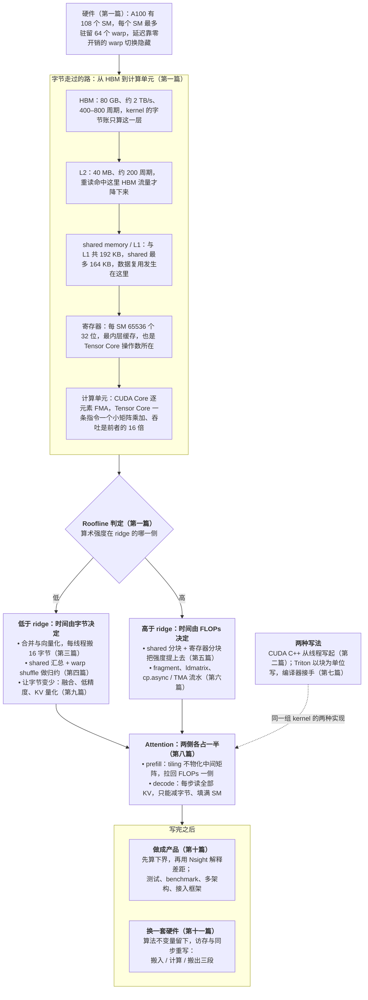

## 内容简介

《GPU Kernel 工程：从 CUDA 执行模型到 FlashAttention》是一组共十一篇的系列文章，面向已经理解 PyTorch 运行时、准备向下进入 GPU 执行层的工程师，系统讲解如何读懂、写出和优化运行在 GPU 上的 kernel。

它回答的问题是：

> **一个 kernel 为什么快、为什么慢，以及如何把它写到接近硬件极限？[^q0]**

站在框架和推理系统的层面看，kernel 始终是一个黑盒：Profiler 告诉你"这个算子是 memory-bound 的"，论文告诉你"FlashAttention 把 HBM 流量压下去了"，推理引擎的文档告诉你"用了 PagedAttention 所以显存碎片少了"。这些结论是对的，但它们都建立在一个没有展开的前提上——**kernel 内部发生了什么**。

这个系列把黑盒打开。它会从 GPU 的硬件结构出发，建立一套用数字说话的分析方法，然后沿着 AI 负载里最重要的几类 kernel 逐个写过去：

| kernel 类型 | 讲什么 |
|---|---|
| elementwise | 访存合并与向量化，memory-bound 的极限是什么 |
| reduction | 共享内存与 warp 协作，softmax 与 LayerNorm 怎么写 |
| GEMM | 分块、寄存器、双缓冲，compute-bound 的极限是什么 |
| Tensor Core | mma 指令与 CUTLASS，硬件矩阵单元怎么用 |
| Triton | 同样的 kernel 用块级编程重写，编译器替你做了哪一层 |
| Attention | FlashAttention 与 PagedAttention 的推导和实现 |
| 量化与融合 | 低精度 GEMM、RoPE、SiLU-mul、MoE 的 kernel 层含义 |

Table: 系列覆盖的 kernel 类型

每一个 kernel 都遵循同一套方法：**先算它理论上应该多快，再测它实际多快，再用 profiler 解释差距，再动手缩小差距**。

系列使用两种写法：CUDA C++ 和 Triton。前者是 PyTorch ATen、vLLM `csrc/`、FlashAttention、CUTLASS 的语言；后者是 `torch.compile` 生成代码和 vLLM 中大量融合算子的语言。两者会在同一组 kernel 上并行推进、互相对照。

## 总览：优化的对象与路径

一个 kernel 的快慢只由两件事决定：字节从 HBM 走到计算单元要花多少时间，计算单元做完这些 FLOP 要花多少时间。所有手段都落在这条路径上的某一级，或者落在「少走一趟」上。下图把十一篇放回这条路径：上半是硬件与字节经过的层级，中间是 Roofline 的判定，下半是两侧各自的手段与两种写法，括号里是篇号。

图里每个方框对应的篇目与要点：

- **硬件与分析框架**：GPU 的晶体管买的是吞吐，延迟靠零开销的 warp 切换隐藏，所以驻留 warp 的状态同时住在寄存器文件里、驻留数受寄存器总量硬性限制。这一篇不写 kernel，只建立「一段计算理论上最快能多快」的算法。见[《GPU 为什么这样设计——硬件结构与 Roofline》](/gpu-architecture-and-roofline.html)。
- **字节走过的层级**：每一级的带宽差一个数量级，优化的本质是把数据尽量停在靠上的那几级、少往 HBM 跑。层级的容量与延迟见《GPU 为什么这样设计》的[「内存层次：容量、带宽、延迟」一节](/gpu-architecture-and-roofline.html#五内存层次容量带宽延迟)。
- **Roofline 判定**：$$I = F / B$$、$$T = \max(F / P_{peak},\, B / BW)$$、$$\text{ridge} = P_{peak} / BW$$。A100 的 BF16 ridge 是 156 FLOP/byte，低于它优化字节、高于它优化 FLOPs，两条屋顶都没碰到就是 latency-bound。见《GPU 为什么这样设计》的[「Roofline 模型」一节](/gpu-architecture-and-roofline.html#六roofline-模型)。
- **低于 ridge 的一侧**：elementwise 把带宽吃到 85–92% 就到头了，之后只能融合或少做，见[《访存合并与 elementwise kernel》](/memory-coalescing-and-elementwise-kernels.html)；归约类算子要把跨 warp 的汇总搬到 shared、warp 内的归约搬到寄存器，见[《共享内存与 reduction》](/shared-memory-reduction-and-softmax.html)；让字节本身变少是量化与融合在做的事，见[《量化与融合 kernel》](/quantization-and-fused-kernels.html)。
- **高于 ridge 的一侧**：分块是把算术强度从 0.25 提到 32 的手段，见[《GEMM——从 naive 到分块》](/gemm-from-naive-to-tiled.html)；接上 Tensor Core 之后操作数变成按硬件布局分散在 32 个线程寄存器里的 fragment，装载与流水随之改写，见[《Tensor Core、CUTLASS 与 CuTe》](/tensor-cores-cutlass-and-cute.html)。
- **Attention**：同一个算子在两侧各占一半——prefill 靠 tiling 把 naive 实现从字节一侧拉回 FLOPs 一侧，decode 每步读全部 KV、只能靠减字节与填满 SM。见[《Attention Kernel——FlashAttention 与 PagedAttention》](/attention-kernels-flashattention-and-pagedattention.html)。
- **两种写法**：CUDA C++ 从线程写起，先把执行模型建立在直觉上，见[《CUDA 编程模型与第一个 kernel》](/cuda-programming-model-and-first-kernel.html)；Triton 把线程拿掉、以块为单位写，编译器接手上面那些手工活，剩下的 10% 才是手写的理由，见[《Triton——块级编程与编译器的边界》](/triton-block-level-programming.html)。
- **做成产品**：剖析的前提是先有下界，同一个 1.6 TB/s 对 RMSNorm 是「做到头了」、对 4096³ 的 BF16 GEMM 说明在反复读同一份数据。见[《剖析、测试与贡献——把 kernel 做成产品》](/kernel-profiling-testing-and-contribution.html)。
- **换一套硬件**：把这套路径挪到昇腾上，算法不变量留下，访存与同步要重写。见[《从 CUDA 到昇腾——用 Ascend C 重写一个算子》](/ascend-cann-from-cuda-to-ascend-c.html)。

路径上流动的不只有输入输出张量。一个 kernel 跑起来时，shared 里的 tile、寄存器里的 fragment 与累加器、HBM 里的 KV block、磁盘上的 cubin 各有各的分配者和寿命，混起来就说不清「这一步到底在动哪一级存储」：

| 对象 | 谁分配 | 住在哪一级 | 活多久 | 哪一篇 |
|---|---|---|---|---|
| 输入 / 输出张量 | host 侧，PyTorch 的 Caching Allocator | HBM | 跨 kernel，由框架持有 | [《CUDA 编程模型与第一个 kernel》](/cuda-programming-model-and-first-kernel.html) |
| tile（A、B 的分块） | kernel 内的 `__shared__` 声明，或 Triton 编译器 | shared memory，每 SM 最多 164 KB | 一个 block 的一轮 K 循环 | [《共享内存与 reduction》](/shared-memory-reduction-and-softmax.html) [《GEMM——从 naive 到分块》](/gemm-from-naive-to-tiled.html) |
| 累加器 | 编译器分给每个线程的寄存器（8×8 外积约 128 个） | 寄存器 | 整个 K 循环，最后才写回 | [《GEMM——从 naive 到分块》](/gemm-from-naive-to-tiled.html) [《Tensor Core、CUTLASS 与 CuTe》](/tensor-cores-cutlass-and-cute.html) |
| fragment（`mma` 的操作数） | 编译器分配寄存器，`ldmatrix` 按硬件布局填 | 一个 warp 32 个线程的寄存器 | 一条 `mma.sync` 的前后 | [《Tensor Core、CUTLASS 与 CuTe》](/tensor-cores-cutlass-and-cute.html) |
| online softmax 的 $$(m, l)$$ | kernel 自己维护 | 寄存器，跨 warp 汇总时过一趟 shared | 一行或一个 Q 块的扫描过程 | [《共享内存与 reduction》](/shared-memory-reduction-and-softmax.html) [《Attention Kernel》](/attention-kernels-flashattention-and-pagedattention.html) |
| 量化 scale | 与权重一起由 host 放进 HBM，kernel 内读进寄存器 | HBM → 寄存器 | 与权重同寿 | [《量化与融合 kernel》](/quantization-and-fused-kernels.html) |
| KV cache 的 block | 推理引擎的 block 管理器 | HBM，kernel 经 block table 间接寻址 | 一个请求的生命周期 | [《Attention Kernel》](/attention-kernels-flashattention-and-pagedattention.html) |
| fatbin 里的 SASS 与 PTX | nvcc 编译时 | 嵌在可执行文件或 `.so` 里；缺 SASS 时由 driver JIT 并缓存到磁盘 | 随二进制文件，JIT 产物跨进程复用 | [《CUDA 编程模型与第一个 kernel》](/cuda-programming-model-and-first-kernel.html) |
| Triton 的 cubin 与 autotune 结果 | `@triton.jit` 首次调用时编译，`@triton.autotune` 按 key 搜一次 | cubin 缓存在磁盘（`~/.triton/cache/`），autotune 结果只在进程内的字典里 | cubin 跨进程，autotune 结果随进程消失 | [《Triton——块级编程与编译器的边界》](/triton-block-level-programming.html) |

Table: kernel 里的对象各由谁分配、住在哪一级存储、活多久

## 缩写



## 为什么写这个系列？

### AI-Infra 项目里最有价值的贡献落在 kernel 层

看一下 vLLM、SGLang、FlashInfer、PyTorch 的 changelog，性能相关的重大改进大多是某个 kernel 的新实现或优化：一个新的 attention 后端、一个融合的 MoE kernel、一个 FP8 GEMM、一个更快的采样 kernel。这些改动的门槛不在框架知识，而在 GPU 编程本身。

Python 层的调度、内存管理、API 设计当然重要，但贡献者多、竞争密。能写 kernel 的人少，而需求一直在增长——每一代新硬件、每一种新量化格式、每一个新模型结构都需要新的 kernel。

### "GPU 利用率 90%"什么都不说明

`nvidia-smi` 的利用率只说明 GPU 上有 kernel 在跑，不说明它跑得好不好。一个访存模式糟糕的 kernel 可以把 SM 占满、把利用率打到 100%，同时只用到带宽的 10%。要判断一个 kernel 好不好，必须知道：

- 它读写了多少字节，理论上需要多长时间；
- 它做了多少浮点运算，理论上需要多长时间；
- 两者哪个是上界，实际时间离上界差多远；
- 差距来自访存模式、占用率、同步、还是指令发射。

这些问题的答案都在 kernel 内部，需要 Roofline 模型和 Nsight Compute 来回答。这也是本系列贯穿始终的分析框架。

### Triton 降低了门槛，但没有消灭底层

Triton 让写一个融合 kernel 的成本从几百行 CUDA 变成几十行 Python，`torch.compile` 更是完全自动。这会让人觉得手写 CUDA 已经不必要。但事实是：

- Triton 的编程模型本身就是 GPU 执行模型的抽象——不理解 warp、shared memory、coalescing，写不出快的 Triton；
- Triton 的性能上限低于精心手写的 CUDA/CUTLASS，FlashAttention-3、DeepGEMM、vLLM 的量化 GEMM 都不是 Triton 写的；
- Triton 出问题时（性能不如预期、编译失败、数值不对），排查手段是看它生成的 PTX——需要读懂底层。

所以本系列的顺序是：**先用 CUDA 把执行模型建立在直觉上，再用 Triton 看编译器把哪些事情自动化了，最后在 Attention 上两条路线对照**。读者读完后可以按场景选择工具，而不是只会其中一种。

### 现有材料的断层

- **CUDA 官方文档**（Programming Guide、Best Practices）是权威参考，但不是学习路径，也不讲 AI 负载；
- **经典 GPU 编程课程**（PMPP 教材、Udacity CS344）建立了正确的基础，但停留在 2015 年前的硬件，没有 Tensor Core、TMA、Triton；
- **FlashAttention、CUTLASS 的论文和源码**是当前实践的前沿，但假设读者已经是 GPU 编程专家；
- **博客与教程**大多讲单个 kernel 的优化技巧，缺少从硬件到 Attention 的连续路径。

本系列想填补的是从"会写 vector add"到"能读 FlashAttention 源码并写出自己的 attention kernel"之间的那段路。

## 适合哪些读者？

### 理解 PyTorch 运行时、想继续向下的工程师

你已经理解 Tensor 的 stride（《PyTorch 深度实践》的[《Tensor 与内存布局》](/pytorch-tensor-and-memory-layout.html)）、Dispatcher 如何找到 CUDA kernel（[《Dispatcher 与算子系统》](/pytorch-dispatcher-and-operator-system.html)）、Profiler 如何显示 kernel 时间线（[《性能优化与调试》](/pytorch-performance-optimization-and-debugging.html)），也许还写过一个简单的 CUDA 扩展（[《C++ 扩展与自定义算子》](/pytorch-cpp-extension-and-custom-operators.html)）。你想知道的是：**那个 kernel 内部为什么是那个速度，如何让它更快**。

### 准备给 vLLM / SGLang / FlashInfer / PyTorch 贡献 kernel 的开发者

这些项目的 `csrc/` 目录和 Triton kernel 是本系列的源码阅读对象。读完后你应该能读懂它们的 attention、量化、MoE、norm kernel，并按同样的标准写新的。

### 做推理性能优化的工程师

你需要判断一个模型在特定硬件上的瓶颈是哪个 kernel、这个 kernel 离硬件极限有多远、值不值得为它写一个定制实现。本系列的 Roofline 方法和 Nsight Compute 读法是直接工具。

### 做硬件适配的工程师

新硬件（新一代 NVIDIA GPU、AMD、国产加速器）的适配工作，很大一部分是把已有 kernel 移植和重新调优。理解 kernel 为什么这样写，才知道换硬件后哪些假设失效。

## 系列的整体主线

前十篇按"从硬件到应用"的顺序推进，同时也是 kernel 复杂度递增的顺序：

| 篇 | 一句话 |
|---|---|
| [第一篇：GPU 为什么这样设计——硬件结构与 Roofline](/gpu-architecture-and-roofline.html) | 建立分析框架 |
| [第二篇：CUDA 编程模型与第一个 kernel](/cuda-programming-model-and-first-kernel.html) | 第一个 kernel 与它的测量 |
| [第三篇：访存合并与 elementwise kernel](/memory-coalescing-and-elementwise-kernels.html) | memory-bound 的极限 |
| [第四篇：共享内存与 reduction](/shared-memory-reduction-and-softmax.html) | softmax、LayerNorm、online softmax |
| [第五篇：GEMM——从 naive 到分块](/gemm-from-naive-to-tiled.html) | compute-bound 的极限 |
| [第六篇：Tensor Core、CUTLASS 与 CuTe](/tensor-cores-cutlass-and-cute.html) | 硬件矩阵单元 |
| [第七篇：Triton——块级编程与编译器的边界](/triton-block-level-programming.html) | 块级编程与编译器的边界 |
| [第八篇：Attention Kernel——FlashAttention 与 PagedAttention](/attention-kernels-flashattention-and-pagedattention.html) | FlashAttention 与 PagedAttention |
| [第九篇：量化与融合 kernel](/quantization-and-fused-kernels.html) | 推理系统的其余部分 |
| [第十篇：剖析、测试与贡献](/kernel-profiling-testing-and-contribution.html) | Nsight Compute、正确性、接入框架 |
| [第十一篇：从 CUDA 到昇腾](/ascend-cann-from-cuda-to-ascend-c.html) | Ascend C 的搬入/计算/搬出三段与概念映射 |

Table: 十一篇的主题与一句话概括

三条交织的线索：

| 线索 | 从硬件到 attention 的演进 |
|---|---|
| 硬件线 | SM 与 warp → 内存层次 → Tensor Core → Hopper 新特性 |
| 方法线 | Roofline → 带宽测量 → 占用率 → Nsight Compute 指标 → 决策树 |
| 应用线 | elementwise → norm → GEMM → attention → 量化/MoE → 一个完整的 decoder layer |

Table: 贯穿 CUDA 十篇的三条线索

两种写法在系列里的分工：

1. 前六篇的所有 kernel 用 CUDA 写；
2. [《Triton——块级编程与编译器的边界》](/triton-block-level-programming.html)用 Triton 把第三到五篇的 kernel 重写一遍；
3. [《Attention Kernel》](/attention-kernels-flashattention-and-pagedattention.html)与[《量化与融合 kernel》](/quantization-and-fused-kernels.html)两种写法并行；
4. [《剖析、测试与贡献》](/kernel-profiling-testing-and-contribution.html)的方法对两者通用；
5. [《从 CUDA 到昇腾》](/ascend-cann-from-cuda-to-ascend-c.html)换一套硬件与语言（Ascend C），用《访存合并与 elementwise kernel》那个算子做概念映射。

CUDA 仍是系列主线。

## 章节结构与分章导读

### 1. GPU 为什么这样设计：硬件结构与 Roofline

第一篇建立整个系列的分析框架。它不写任何 kernel，只回答一个问题：**在一块给定的 GPU 上，一段计算理论上最快能多快？**

这一篇会讨论：

- CPU 与 GPU 的设计目标差异：延迟优化与吞吐优化；
- 硬件怎么组织工作：warp（32 个 lane 一条指令，SIMT）、block（分派到 SM 的单位）；以及一张硬件层级与编程模型名字（grid / block / thread）的对应图，作为通往[《CUDA 编程模型与第一个 kernel》](/cuda-programming-model-and-first-kernel.html)的桥；
- SM、warp、SIMT 的硬件实现；一块 A100 或 H100 有多少 SM、每个 SM 有多少 warp 调度器、能同时驻留多少线程；
- 内存层次：寄存器、共享内存/L1、L2、HBM，各层的容量、带宽和延迟的数量级；
- Tensor Core 的位置和它与 CUDA Core 的关系；
- Roofline 模型：算术强度、带宽屋顶、算力屋顶、拐点；
- 用 Roofline 判断一个算子是 memory-bound 还是 compute-bound，以及它离屋顶有多远；
- 硬件代际的关键差异：Volta 引入 Tensor Core、Ampere 的异步拷贝与稀疏、Hopper 的 TMA/wgmma/线程块集群、Blackwell 的第五代 Tensor Core 与 FP4；本系列以 Ampere 为基线、标注 Hopper 特性；
- 工具链地图：nvcc、PTX、SASS、`cuobjdump`、Nsight Systems、Nsight Compute，各自看什么。

核心问题是：

> **把 A100 的 312 TFLOPS 和 2 TB/s 放在一起，得到拐点约 156 FLOP/byte。一个 BF16 的 elementwise 加法算术强度是多少？一个 4096×4096 的 GEMM 呢？这决定了后面每一篇的优化目标是什么。[^q1]**

这一篇也会划清本系列的边界：在**系统**层面，一个训练或推理程序的瓶颈可能在 Python 开销、kernel launch、同步等待，也可能在 kernel 本身；本系列只关注 kernel 内部，那里只剩 memory 和 compute 两类瓶颈，但要把它们量化到字节和 FLOP。

### 2. CUDA 编程模型与第一个 kernel

第二篇讲 CUDA 编程模型本身，写出第一个 kernel，并建立**测量**的习惯。

这一篇会覆盖：

- host 与 device；`__global__`、`__device__`、`__host__`；
- kernel、grid、block、thread；`blockIdx`、`blockDim`、`threadIdx`；索引计算与边界检查；
- block 和 grid 的维度怎么选；一个 block 在硬件上如何被分成 warp；
- 设备内存：`cudaMalloc`、`cudaMemcpy`、`cudaFree`，以及为什么 PyTorch 不直接用它们（Caching Allocator 的存在理由）；
- stream 与 event；kernel launch 的异步语义；`cudaDeviceSynchronize` 的代价；
- 错误处理：`cudaGetLastError`、异步错误为什么在后面才报出来；
- 编译：nvcc 做了什么，`-arch=sm_80`、`-gencode`、fatbin 与 JIT，PTX 前向兼容；
- warp 的执行方式：分支发散、`__syncwarp`、warp 内的 lockstep 直觉与 Volta 之后独立线程调度的差别；
- 第一个 kernel：vector add；测它的带宽，与[《GPU 为什么这样设计》](/gpu-architecture-and-roofline.html)算出的理论带宽比，解释差距。

核心问题是：

> **vector add 的 kernel 只有五行，它跑出了理论带宽的多少？没跑满的部分去了哪里？[^q2]**

这一篇结束时读者会有一个 benchmark 脚手架：warmup、多次计时、CUDA event 计时、L2 flush 的必要性，这套脚手架会用到[《剖析、测试与贡献》](/kernel-profiling-testing-and-contribution.html)。

### 3. 访存合并与 elementwise kernel

第三篇专注于 memory-bound kernel 的极限。AI 负载里大部分非 GEMM 算子——激活函数、残差加、dtype 转换、RoPE、掩码——都是 elementwise，把它们写到带宽极限是最基本的功课。

这一篇会覆盖：

- 内存事务：一个 warp 的 32 个线程访问内存时硬件如何合并成事务；对齐、连续、跨步访问的代价差异；
- 向量化访存：`float4`、`half2`、`__nv_bfloat162`，每线程处理多个元素；
- grid-stride loop：为什么 grid 大小不必等于元素数；
- 非连续 Tensor：stride 参数怎么传进 kernel，broadcast 怎么处理；ATen 的 TensorIterator 在 host 侧为 kernel 准备了什么；
- 读 ATen 的 elementwise 实现：`aten/src/ATen/native/cuda/CUDALoops.cuh` 里的 `vectorized_elementwise_kernel` 和 `elementwise_kernel`，它们如何在运行时选择向量化路径；
- 多 dtype 的模板化：CUDA kernel 的模板参数与 `AT_DISPATCH` 宏的配合——运行期 dtype 如何变成编译期类型；
- 融合的动机：三个 elementwise kernel 融合成一个，带宽需求怎么变；
- 占用率对 memory-bound kernel 的意义：为什么要有足够多的 warp 在飞才能隐藏访存延迟。

核心问题是：

> **一个 elementwise kernel 跑出了 90% 带宽，还有什么可优化的？答案是"没有了，要么融合，要么少做"。这是一条重要的边界。[^q3]**

实践：从 naive 到向量化到 grid-stride，把 elementwise kernel 推到带宽的 90% 以上，并支持 stride 和 broadcast。

### 4. 共享内存与 reduction：softmax、LayerNorm 与 online softmax

第四篇进入需要线程协作的 kernel。reduction 是所有 norm、softmax、loss、统计类算子的核心，也是 FlashAttention 的关键部件之一。

这一篇会覆盖：

- 共享内存：声明、容量、生命周期、与 L1 的关系；
- `__syncthreads()` 与 block 内同步；
- bank conflict：什么是 bank、什么访问模式冲突、padding 与 swizzle；
- reduction 的逐步优化：从 naive 的交错寻址，到顺序寻址、循环展开、warp shuffle（`__shfl_down_sync`）、每线程处理多元素；
- warp 级原语：`__shfl_*_sync`、`__ballot_sync`、`__reduce_add_sync`（Ampere+）；cooperative groups 简介；
- 原子操作：`atomicAdd` 的代价、什么时候用、什么时候避免；
- 一行一个 block 还是一行一个 warp：按行 reduction 的 block 形状选择；
- softmax：三遍还是两遍？online softmax 的推导——一遍扫描同时维护 max 和 sum，这是 FlashAttention 的数学基础；
- LayerNorm 与 RMSNorm：Welford 算法、数值稳定性、fused residual + norm；
- 读源码：ATen 的 `Reduce.cuh` 与 `SoftMax.cu`，vLLM 的 `csrc/layernorm_kernels.cu`。

核心问题是：

> **一个 4096 维的 RMSNorm，读一次写一次，理论上是 memory-bound 的。为什么 naive 实现能慢 10 倍？shared memory 和 warp shuffle 各解决了哪部分？[^q4]**

实践：写出 RMSNorm 和 softmax 两个 kernel，推到带宽极限；实现 online softmax 并验证与两遍实现的数值一致性。

### 5. GEMM：从 naive 到分块

第五篇是全系列的转折：从 memory-bound 走向 compute-bound。GEMM 是 Transformer 中计算量的绝对主体，也是唯一能真正把 Tensor Core 用起来的算子。这一篇不用 Tensor Core，用 CUDA Core 把分块的原理讲透。

这一篇会覆盖：

- GEMM 的算术强度随分块大小的变化：为什么 naive 实现是 memory-bound，分块后变成 compute-bound；
- 第一版：每线程算一个输出元素——它的访存量是多少；
- 共享内存分块：把 A 和 B 的 tile 加载到 shared memory，复用；
- 寄存器分块：每线程算一个 `TM×TN` 的小块，寄存器成为最内层缓存；
- 全局内存到共享内存的加载模式：向量化、转置、避免 bank conflict；
- 双缓冲与软件流水：加载下一个 tile 的同时计算当前 tile；Ampere 的 `cp.async` 异步拷贝；
- 边界处理：M、N、K 不是 tile 整数倍时怎么办；
- tile 大小的选择：寄存器压力、共享内存容量、占用率之间的三角关系；
- 到这里能达到 cuBLAS 的多少：CUDA Core 上大约能到 70–80%，剩下的差距来自 Tensor Core（下一篇）；
- split-K 与 stream-K：K 维很大、M×N 很小时的并行策略，为 decode 阶段的 GEMV 铺垫。

核心问题是：

> **一个 4096³ 的 FP32 GEMM，naive 实现要读多少字节？128×128 分块后要读多少？寄存器分块再压多少？每一步的算术强度是多少，对应 Roofline 上的哪个位置？[^q5]**

实践：六个版本的 SGEMM，从 naive 到双缓冲，每一版给出带宽/算力利用率和 Roofline 上的位置。

### 6. Tensor Core、CUTLASS 与 CuTe

第六篇把上一篇的分块结构接到硬件矩阵单元上。Tensor Core 是 GPU 之所以能跑大模型的原因，但它的编程接口和 CUDA Core 完全不同。

这一篇会覆盖：

- Tensor Core 做什么：一条指令完成一个小矩阵的乘加（如 `16×8×16`），输入 FP16/BF16/TF32/FP8/INT8，累加 FP32；
- 三代编程接口：`wmma` API（易用但受限）、`mma.sync` PTX 指令（Ampere 主力）、`wgmma`（Hopper，warp group 级别，异步）；
- fragment 布局：一个 warp 的 32 个线程各持有矩阵的哪几个元素，为什么这个布局这么奇怪；
- `ldmatrix`：从共享内存按 fragment 布局加载；
- Hopper 的 TMA：用一条指令把多维 tile 从全局内存搬到共享内存，解放线程去做计算；
- warp specialization：生产者 warp 负责搬数据，消费者 warp 负责计算；
- CUTLASS 3.x 的分层：`device` → `kernel` → `collective` → `tiled MMA/copy` → CuTe；
- CuTe 的 `Layout` 与 `Tensor`：用代数方式描述分块和线程映射，为什么它是 FlashAttention-3 和大量新 kernel 的基础；
- 读一个 CUTLASS GEMM 实例：把它的模板参数与[《GEMM——从 naive 到分块》](/gemm-from-naive-to-tiled.html)的 tile 概念一一对应；
- PyTorch 与 vLLM 如何使用：ATen 的 `matmul` 走 cuBLAS/cuBLASLt，vLLM 的 `csrc/libtorch_stable/quantization/w8a8/cutlass/` 用 CUTLASS 写 FP8/INT8 GEMM。

核心问题是：

> **同样是 128×128 的分块，用 CUDA Core 和用 Tensor Core 写出来的 kernel 结构差在哪里？为什么 Tensor Core 版本必须关心 fragment 布局和 `ldmatrix`？[^q6]**

实践：用 `mma.sync` 写一个 BF16 GEMM，达到 cuBLAS 的 80% 以上；读 CUTLASS 的一个 GEMM 配置并用 CuTe 打印它的 layout。Hopper 部分（wgmma、TMA）以源码阅读为主，标注为需要 sm_90 硬件。

### 7. Triton：块级编程与编译器的边界

第七篇换一种写法。Triton 把"线程"从编程模型中拿掉，程序员以 block 为单位思考，编译器负责线程映射、共享内存分配、向量化和流水。这一篇用 Triton 重写《访存合并与 elementwise kernel》《共享内存与 reduction》《GEMM——从 naive 到分块》三篇的 kernel，看它自动化了什么、没有自动化什么。

这一篇会覆盖：

- Triton 的编程模型：`program_id`、`tl.arange`、`tl.load`/`tl.store` 与 mask、块级张量操作；
- `BLOCK_SIZE` 作为 `tl.constexpr`：与 CUDA 模板参数的对应；
- `num_warps`、`num_stages`：Triton 暴露给用户的两个硬件旋钮；
- `@triton.autotune`：配置搜索、缓存、key；
- 三个 kernel 的 Triton 版本：elementwise、softmax、matmul——逐个与 CUDA 版本对照代码量和性能；
- Triton 的 matmul 为什么能接近 cuBLAS：编译器自动做了 shared memory 分块、`mma` 指令选择、软件流水；
- 编译流水线：Python AST → Triton IR → TritonGPU IR → LLVM IR → PTX → cubin；每一层在做什么优化；
- 读 Triton 生成的 PTX 和 TTGIR：怎么看它选了什么 layout、用了几个 stage；
- `torch.compile`（Inductor）生成的 Triton kernel 长什么样，怎么把它 dump 出来读；
- vLLM 里的 Triton kernel：`fused_moe` 的 grouped GEMM、prefix-prefill attention；
- Triton 做不了或做不好的：细粒度 warp 控制、特殊指令、跨 block 通信、部分 Hopper 特性的支持进度。

核心问题是：

> **Triton 的 matmul 比手写 CUDA 少 80% 的代码，性能只差 10%。那 10% 在哪里？什么场景下这 10% 值得手写？[^q7]**

实践：Triton 重写三个 kernel，建立 CUDA 与 Triton 的性能对照表；用 `TRITON_DEBUG` 环境变量看生成的中间表示。

### 8. Attention Kernel：FlashAttention 与 PagedAttention

第八篇是前七篇的汇合点。Attention 同时包含 GEMM（QK^T、PV）、reduction（softmax）和特殊的内存访问模式（KV cache），是 Transformer 推理中最重要、也最难写好的 kernel。

这一篇会覆盖：

- 标准 attention 的访存问题：`S = QK^T` 是 `N×N` 的，写出再读回是 O(N²) 的 HBM 流量；
- FlashAttention 的推导：分块 + online softmax（见[《共享内存与 reduction》](/shared-memory-reduction-and-softmax.html)）+ 不物化 S；每个 tile 的计算与访存，为什么它是 IO-aware 的；
- FlashAttention-2 的改进：调整并行维度、减少非矩阵运算、warp 间分工；
- FlashAttention-3（Hopper）：wgmma、TMA、warp specialization、FP8——把[《Tensor Core、CUTLASS 与 CuTe》](/tensor-cores-cutlass-and-cute.html)的 Hopper 特性用在 attention 上；
- 反向传播的 recompute：为什么训练时不保存 S 而是重算；
- 推理的两种形态：prefill（长 Q，GEMM 主导）与 decode（Q 长度为 1，memory-bound）；
- PagedAttention：KV cache 分页后 kernel 如何通过 block table 间接寻址；vLLM `csrc/attention/` 的实现结构；
- Flash-decoding / split-KV：decode 时序列长、batch 小，怎么让足够多的 SM 有活干；
- GQA/MQA 在 kernel 层的含义：多个 Q head 共享 KV，怎么利用它减少 KV 的读取；
- 变长 batch：`cu_seqlens`、padding-free 的 attention；
- 因果掩码与 sliding window 在分块中的处理；
- Triton 版 FlashAttention 走读：与 CUDA 版本的结构对照；
- 后端生态：FlashAttention、FlashInfer、xFormers、cuDNN attention、Triton 实现，vLLM 如何选择。

核心问题是：

> **一个序列长度 4k、head dim 128 的 attention，标准实现和 FlashAttention 分别读写多少 HBM？decode 阶段每生成一个 token 要读多少 KV cache，这决定了什么？[^q8]**

本篇不讨论 KV cache 的分页**管理**（block 的分配、换入换出、prefix 共享属于推理引擎的调度层），只讨论分页之后 kernel 如何**访问**它。

实践：从头写一个 FlashAttention 的前向 kernel（Triton 版完整、CUDA 版覆盖核心循环），支持因果掩码和 GQA，与 PyTorch 的 `scaled_dot_product_attention` 对照正确性和性能。

### 9. 量化与融合 kernel：推理系统的其余部分

第九篇覆盖 LLM 推理里除 attention 和标准 GEMM 之外的 kernel。它们单个不复杂，但数量多、变化快，是 vLLM 和 SGLang 里贡献最活跃的区域。

这一篇会覆盖：

- 低精度格式在 kernel 层的含义：FP16/BF16/FP8（E4M3、E5M2）/INT8/INT4 的位布局、动态范围、累加精度；
- weight-only 量化 GEMM：INT4 权重在 kernel 内反量化为 BF16 再进 Tensor Core；打包格式、scale 与 zero point 的处理；为什么 decode 阶段它是赢的（memory-bound）而 prefill 阶段可能不是；
- Marlin、AWQ、GPTQ kernel 的结构：vLLM `csrc/quantization/` 目录导读；
- FP8 GEMM：per-tensor 与 per-token/per-channel scale，CUTLASS 的 FP8 支持，DeepGEMM 的思路；
- 量化本身的 kernel：动态量化的 per-token absmax reduction + cast 融合；
- 融合 kernel 的常见模式：
  - bias + activation；
  - residual add + RMSNorm；
  - SiLU-and-mul（`silu(x[:, :d]) * x[:, d:]`）；
  - RoPE：旋转位置编码的 in-place 更新，与 KV cache 写入的融合；
  - `reshape_and_cache`：把新 token 的 KV 写进分页 cache；
- MoE 的 kernel：token 按 expert 排序（permutation）、grouped GEMM、结果 unpermute 与加权求和；vLLM 的 `fused_moe` Triton kernel 与 `csrc/moe/`；
- 采样 kernel：top-k/top-p、拒绝采样（投机解码），为什么它们也会成为瓶颈；
- 数值验证：与参考实现对比时 tolerance 怎么定，低精度下什么差异是正常的。

核心问题是：

> **一个 INT4 weight-only GEMM，decode 时比 BF16 快 3 倍，prefill 时反而慢。用 Roofline 解释这个现象。[^q9]**

量化算法本身（如何校准、如何选 scale、精度损失多少）不在本篇范围；本篇只讲给定格式下 kernel 怎么写、为什么它的收益只在某个区间成立。

实践：写 fused residual+RMSNorm、SiLU-mul、RoPE 三个融合 kernel，和一个简化的 INT4 weight-only GEMM；把它们与前几篇的 attention、GEMM 组装成一个完整的 decoder layer 前向。

### 10. 剖析、测试与贡献：把 kernel 做成产品

CUDA 主线的[《剖析、测试与贡献》](/kernel-profiling-testing-and-contribution.html)讲把一个"能跑"的 kernel 变成"能合入"的 kernel 需要的全部工程：读 profiler、写测试、做 benchmark、处理多架构、接入框架。

这一篇会覆盖：

- Nsight Compute 的读法：GPU Speed of Light、Memory Workload Analysis、Warp State Statistics、Occupancy、Source Counters 各节看什么；
- 关键指标的含义：achieved vs theoretical occupancy、memory throughput、L1/L2 hit rate、shared memory bank conflicts、warp stall reasons（long scoreboard、MIO throttle、barrier、not selected）；
- 一棵决策树：从指标到优化方向——占用率低→寄存器/共享内存压力；stall 在 long scoreboard→访存延迟未隐藏；带宽饱和→只能融合；算力饱和→检查 Tensor Core 利用率；
- Nsight Systems 与 Nsight Compute 的分工：前者看 kernel 之间，后者看 kernel 内部；
- 正确性测试：参考实现、tolerance 选择、边界 shape（0、1、非对齐、超大）、所有 dtype、非连续输入；
- benchmark 方法：warmup、L2 flush、`triton.testing.do_bench`、`torch.utils.benchmark`、报告分布而不是平均值；性能回归的阈值；
- 多架构：`__CUDA_ARCH__` 条件编译、fatbin、运行时按 compute capability 选择实现、Hopper-only 路径的 fallback；
- 接入 PyTorch：用 `TORCH_LIBRARY` 注册为算子、补 Meta kernel、用 `torch.library.opcheck` 验证——只讲 kernel 开发者需要的最小集，不展开 Dispatcher 的原理；
- 接入 vLLM：`csrc/` 的组织、`torch_bindings.cpp`、`_custom_ops.py`、Python 侧的后端选择逻辑；
- 一个 kernel PR 的完整流程：issue 讨论、benchmark 数据、测试覆盖、review 关注点、CI 的硬件矩阵。

核心问题是：

> **Nsight Compute 报告 achieved occupancy 25%、long scoreboard stall 60%。这个 kernel 应该改什么？[^q10]**

实践分三步：

1. 用 Nsight Compute 剖析[《量化与融合 kernel》](/quantization-and-fused-kernels.html)组装的 decoder layer 里的每个 kernel，找出离 Roofline 最远的一个并优化；
2. 给它写完整的测试和 benchmark；
3. 用 `TORCH_LIBRARY` 注册并通过 `opcheck`。

### 11. 从 CUDA 到昇腾：用 Ascend C 重写一个算子

第十一篇把前十篇建立的编程模型挪到另一套硬件上，看哪些部分是 CUDA 特有的、哪些是 GPU 类加速器共有的。国内集群里昇腾已有相当规模，框架层能屏蔽大部分差异，算子层屏蔽不掉。

这一篇会覆盖：

- CANN 的分层与 CUDA 工具链的对照：Ascend C ↔ CUDA C++、AscendCL ↔ CUDA 运行时、msprof ↔ Nsight、`torch_npu` ↔ PyTorch CUDA 后端；Kernel Launch 与框架接入两条开发路径；
- AI Core 的结构：Scalar / Vector / Cube 三类计算单元，耦合架构与分离架构，核内存储层次（L1、L0A/L0B/L0C、Unified Buffer）与 MTE 搬运单元；
- 一个 Add 算子的全文逐段读：`Init` 的多核切分与 buffer 预分配、`Process` 的循环、`CopyIn / Compute / CopyOut` 三段流水；
- `TPipe`、`TQue`、`LocalTensor`：核内空间的分配（`AllocTensor` / `FreeTensor`）与段间的执行序约束（`EnQue` / `DeQue`），以及为什么 `TQue` 既不是 warp 也不是 stream；
- 切分：`blockDim` 为什么是"用几个核"、核内分块的容量约束、双缓冲为什么**可能**让搬运与计算重叠而不保证更快、官方样例回避的尾块与对齐；
- host 侧：AscendCL 与 CUDA 运行时的逐行对照，tiling 为什么放在 host，CPU 调试 / 仿真 / 真机三种运行模式各能回答什么；
- 从 Add 到 Matmul：Cube 的数据流、`TCubeTiling` 与 `Matmul` 高阶 API 和 CUTLASS 模板参数的类比；
- 一张 CUDA ↔ Ascend C 的概念映射表，分成一对一、要改写、没有对应物三类，加一份迁移清单。

核心问题是：

> **把[《访存合并与 elementwise kernel》](/memory-coalescing-and-elementwise-kernels.html)的 elementwise kernel 迁到昇腾上，哪些概念一对一映射、哪些没有对应物？为什么 Ascend C 要你显式写出搬入、计算、搬出三段，而 CUDA 不用？[^q11]**

本篇是独立对照篇，不是双硬件教程：只写一个 elementwise 算子，GEMM 只点到 Cube 与高阶 API 的入口；昇腾的代际谱系、多卡通信、昇腾侧的 FlashAttention 都不在范围内。写作环境没有 CANN 与昇腾硬件，因此文中不含真机性能数字，只给机制与应该怎么测。

实践：原样收录官方 Add 样例（CANN 8.0.0 文档链接的 `v0.2-8.0.0.beta1`），补一个确定性输入生成器、一个严格的逐元素验证器和一个可在普通 CPU 上运行的 NumPy 分块账本；有 CANN 时按 README 跑 CPU 调试 / 仿真 / 真机三种模式。

### 12. 系列总结与通关自测

最后一篇不讲新内容：把十一篇正文压成一张「问题 → 结论 → 必记数字」的表并逐篇回顾——上面每篇导读末尾抛出的问题在那里逐条作答——拎出贯穿全系列的几条线与常见误区，然后给一套三段式通关自测——十道判断与计算、五道跨篇综合、若干道面试题，答案各自折叠，附「读过 / 掌握 / 能教人」的判据。各篇末尾的自测检验的是一篇读懂了没有，这一篇检验的是十一篇能不能连起来用；读完正文再做。

## 贯穿全系列的实践线

系列的练手项目是**一个 Transformer decoder layer 的 kernel 全集**。选它是因为它覆盖了 LLM 推理里所有主要的 kernel 类型，而且体量足够小，每个 kernel 都能单独讨论：

| 篇 | kernel | 内容 |
|---|---|---|
| [《CUDA 编程模型与第一个 kernel》](/cuda-programming-model-and-first-kernel.html) | benchmark 脚手架 | 事件计时 · warmup · L2 flush |
| [《访存合并与 elementwise kernel》](/memory-coalescing-and-elementwise-kernels.html) | elementwise | residual add · 激活 · dtype cast |
| [《共享内存与 reduction》](/shared-memory-reduction-and-softmax.html) | RMSNorm · softmax | reduction · online softmax |
| [《GEMM——从 naive 到分块》](/gemm-from-naive-to-tiled.html) | SGEMM | 六个版本，到 cuBLAS 的 70–80% |
| [《Tensor Core、CUTLASS 与 CuTe》](/tensor-cores-cutlass-and-cute.html) | BF16 Tensor Core GEMM | mma.sync，到 cuBLAS 的 80%+ |
| [《Triton——块级编程与编译器的边界》](/triton-block-level-programming.html) | 以上三类的 Triton 版本 | 性能对照表 |
| [《Attention Kernel》](/attention-kernels-flashattention-and-pagedattention.html) | FlashAttention 前向 | 因果掩码 · GQA · Triton 完整版 + CUDA 核心循环 |
| [《量化与融合 kernel》](/quantization-and-fused-kernels.html) | RoPE · SiLU-mul · fused norm · INT4 GEMM | 组装成完整 layer |
| [《剖析、测试与贡献》](/kernel-profiling-testing-and-contribution.html) | 剖析 · 测试 · 注册 | Nsight Compute · opcheck · TORCH_LIBRARY |
| [《从 CUDA 到昇腾》](/ascend-cann-from-cuda-to-ascend-c.html) | 同一个 elementwise 的 Ascend C 版 | 搬入/计算/搬出三段 · 队列深度 · 概念映射 |

Table: 练手项目：decoder layer 各 kernel 的分篇安排

到《量化与融合 kernel》结束，读者手上有一个用自己写的 kernel 跑通的 decoder layer 前向，可以和 PyTorch eager 对照正确性、和 `torch.compile` 对照性能。它不是一个可用的推理引擎，但每一个 kernel 都能拿出来单独测、单独优化、单独讨论离 Roofline 有多远。

与它平行的源码阅读线：

| 篇 | 项目 | 文件 |
|---|---|---|
| [《访存合并与 elementwise kernel》](/memory-coalescing-and-elementwise-kernels.html) | ATen | `native/cuda/CUDALoops.cuh` `native/cuda/Loops.cuh` `native/cuda/MemoryAccess.cuh` |
| [《共享内存与 reduction》](/shared-memory-reduction-and-softmax.html) | ATen vLLM | `native/cuda/Reduce.cuh`、`native/cuda/SoftMax.cu` `csrc/layernorm_kernels.cu` |
| [《GEMM——从 naive 到分块》](/gemm-from-naive-to-tiled.html) | CUTLASS PyTorch | `examples` 的 SGEMM cuBLAS 调用路径 `native/cuda/Blas.cpp` |
| [《Tensor Core、CUTLASS 与 CuTe》](/tensor-cores-cutlass-and-cute.html) | CUTLASS vLLM | `include/cutlass/gemm/{device,kernel,collective}` `csrc/libtorch_stable/quantization/w8a8/cutlass/` |
| [《Triton——块级编程与编译器的边界》](/triton-block-level-programming.html) | Triton vLLM Inductor | `python/tutorials` `model_executor/layers/fused_moe/fused_moe.py` 生成的 kernel |
| [《Attention Kernel》](/attention-kernels-flashattention-and-pagedattention.html) | flash-attention vLLM FlashInfer | `csrc/flash_attn/src` `csrc/attention/` `include/flashinfer/attention/` |
| [《量化与融合 kernel》](/quantization-and-fused-kernels.html) | vLLM | `csrc/quantization/{marlin,awq,gptq,w8a8/fp8}/` `csrc/activation_kernels.cu` `csrc/pos_encoding_kernels.cu` `csrc/moe/` |
| [《剖析、测试与贡献》](/kernel-profiling-testing-and-contribution.html) | vLLM | `csrc/torch_bindings.cpp` `vllm/_custom_ops.py` `tests/kernels/` |
| [《从 CUDA 到昇腾》](/ascend-cann-from-cuda-to-ascend-c.html) | Ascend/samples | `operator/ascendc/0_introduction/3_add_kernellaunch/` `11_matmul_kernellaunch/` |

Table: 各篇平行的源码阅读线

## 前置要求与说明

### 前置要求

- 理解 PyTorch 运行时的基本结构：Tensor 的 shape/stride/dtype、算子如何分发到 CUDA 实现、Profiler 显示的 kernel 时间线是什么；最好写过一个简单的 CUDA 扩展；
- 知道 memory-bound 与 compute-bound 的区别，用过 `torch.profiler` 或 Nsight Systems 看过 kernel 时间线；
- 能写 C++：模板、RAII、lambda；
- 线性代数基础：矩阵乘法、softmax 的定义；
- 一块可用的 NVIDIA GPU：**Ampere（sm_80，如 A100、RTX 30 系）或更新**；Hopper 专属内容（wgmma、TMA、FlashAttention-3）以源码阅读为主，明确标注。

不要求：

- 写过 CUDA；
- 了解 CUTLASS 或 Triton；
- 了解 FlashAttention 的原理。

### 硬件与版本基线

- 硬件：以 **A100** 为默认分析对象（80 GB HBM2e，约 2 TB/s，BF16 Tensor Core 约 312 TFLOPS dense），Hopper 特性随文标注 **H100** 数字；文中给出的带宽和算力数字为公开标称值或数量级示意，实测会因具体型号、频率和功耗设置有差异；
- 软件：CUDA 12.x、PyTorch 2.x（源码阅读以 v2.10.0 为准）、Triton 3.x、CUTLASS 3.x；FlashAttention 以主线为准，vLLM 源码阅读以 v0.20.0 为准；
- 版本敏感处随文标注：Triton 对 Hopper 特性的支持进度、`AT_DISPATCH_V2`、vLLM attention 后端的默认选择、FlashAttention-3 的接口。

### 关于 AMD 与其他硬件

本系列以 NVIDIA CUDA 为主线：前十篇的所有代码、硬件数字与 profiler 指标都是 CUDA 侧的。

ROCm/HIP 的编程模型与 CUDA 高度对应（wavefront 64 vs warp 32、LDS vs shared memory、MFMA vs mma），Triton 对 AMD 的支持也在推进；正文会在相关位置提及差异，但不单独成篇。

国产加速器以**一篇独立对照篇**的形式进入系列：[《从 CUDA 到昇腾——用 Ascend C 重写一个算子》](/ascend-cann-from-cuda-to-ascend-c.html)用昇腾的 Ascend C 重写[《访存合并与 elementwise kernel》](/memory-coalescing-and-elementwise-kernels.html)那个 elementwise 算子，目的是把 CUDA 特有的概念和加速器共有的概念分开，不是把系列改写成双硬件教程。它只讲编程模型，不含真机性能数字（写作环境没有昇腾硬件），也不涉及昇腾的代际谱系与多卡通信。其他国产加速器不在范围内。

## 章节目录

1. [GPU 为什么这样设计：硬件结构与 Roofline](/gpu-architecture-and-roofline.html)
2. [CUDA 编程模型与第一个 kernel](/cuda-programming-model-and-first-kernel.html)
3. [访存合并与 elementwise kernel](/memory-coalescing-and-elementwise-kernels.html)
4. [共享内存与 reduction：softmax、LayerNorm 与 online softmax](/shared-memory-reduction-and-softmax.html)
5. [GEMM：从 naive 到分块](/gemm-from-naive-to-tiled.html)
6. [Tensor Core、CUTLASS 与 CuTe](/tensor-cores-cutlass-and-cute.html)
7. [Triton：块级编程与编译器的边界](/triton-block-level-programming.html)
8. [Attention Kernel：FlashAttention 与 PagedAttention](/attention-kernels-flashattention-and-pagedattention.html)
9. [量化与融合 kernel：推理系统的其余部分](/quantization-and-fused-kernels.html)
10. [剖析、测试与贡献：把 kernel 做成产品](/kernel-profiling-testing-and-contribution.html)
11. [从 CUDA 到昇腾：用 Ascend C 重写一个算子](/ascend-cann-from-cuda-to-ascend-c.html)
12. [系列总结与通关自测](/gpu-kernel-engineering-series-recap-and-self-test.html)

## 最终目标

读完这套系列之后，面对任何一个 GPU kernel——无论是自己写的、PyTorch 里的、还是 vLLM PR 里的——读者应该能够回答：

| 问题 | 看什么 |
|---|---|
| 它读写多少字节、做多少 FLOP？ | Roofline 上的位置 |
| 它理论上最快多少？实际多少？ | 带宽 / 算力利用率 |
| 差距来自哪里？ | Nsight Compute 的指标 |
| 访存模式对不对？ | 合并、向量化、bank conflict |
| 线程协作方式对不对？ | shared memory、shuffle、同步 |
| 用上 Tensor Core 了吗？用对了吗？ | mma 指令、fragment 布局、流水 |
| 用 Triton 写会怎样？ | 编译器能自动化到哪一层 |
| 它在别的架构上会怎样？ | 多架构与 fallback |
| 怎么证明它是对的、没变慢？ | 测试、tolerance、benchmark |

Table: 读完 GPU kernel 系列后应能回答的问题

最终目标是三种能力：

1. **阅读能力**：读懂 ATen、vLLM、FlashAttention、CUTLASS 中的 kernel 源码，理解每个设计决定的原因；
2. **诊断能力**：面对一个慢的 kernel，用数字而不是猜测定位它的瓶颈；
3. **实现能力**：为一个新的算子、新的量化格式或新的硬件写出接近硬件极限的 kernel，并把它以可合入的质量交付。

这是 AI-Infra 执行平面的最底层，也是贡献者最稀缺的一层。

[^q0]: 快慢由两个上限之一决定：**memory-bound** 时时间 = 搬运字节数 / 带宽，**compute-bound** 时时间 = FLOPs / 峰值算力，分界是硬件的算术强度拐点（A100 约 156 FLOP/byte）；一个 kernel 的算术强度低于拐点就只能靠少搬字节（融合、复用 shared memory、向量化访存、避免非合并访问），高于拐点才靠 Tensor Core、流水线与占用率。写到接近极限的方法是**先算后写**：用 roofline 算出这个 kernel 的理论下限，用 profiler 量出实际带宽 / 算力利用率，差距在哪就修哪——系列按 elementwise（带宽 90%+）、reduction / softmax、GEMM（分块、shared memory、Tensor Core、流水线）、attention（FlashAttention 的 online softmax 与 tiling）、Triton 逐类演示。
[^q1]: BF16 加法：每个元素读 2 个输入、写 1 个输出，共 6 字节，做 1 次 FLOP，算术强度 $$1/6\approx 0.17$$ FLOP/byte——比拐点 156 低三个数量级，彻底 memory-bound，优化目标只能是把带宽用满。$$4096\times4096$$ 的 BF16 GEMM：$$2\cdot4096^3\approx 1.37\times10^{11}$$ FLOPs，读写三个矩阵 $$3\cdot4096^2\cdot2 \approx 1.0\times10^8$$ 字节，算术强度约 **1365 FLOP/byte**——远高于拐点，compute-bound，优化目标是喂饱 Tensor Core（分块复用、流水线、占用率）。所以后面每一篇的目标不同：elementwise 与 reduction 看带宽利用率，GEMM 与 attention 看算力利用率（MFU），attention 的特殊之处是 naive 实现因为 $$T^2$$ 的中间矩阵从 compute-bound 退化成 memory-bound，FlashAttention 用 tiling 把它拉回来。
[^q2]: $$n = 2^{28}$$ 个 float 的 `c = a + b` 读两个写一个共 3 GiB，A100 的下界约 1.6 ms；五行 kernel 通常跑 1.7–2.0 ms，即理论带宽的 **80–92%**。没跑满的部分分四处，按影响排序：DRAM 的刷新、行切换与读写转向让可达带宽只有标称值的 85–92%；每线程只搬 4 字节，在飞的请求不够多；kernel launch 的延迟与最后一波填不满所有 SM 的尾部；以及计时本身——用 CPU 时钟量到的是异步 launch 的提交时间，必须改用 CUDA event。详见[《CUDA 编程模型与第一个 kernel》的「第一个 kernel 的测量」一节](/cuda-programming-model-and-first-kernel.html#九第一个-kernel-的测量)。
[^q3]: 没有了，要么融合，要么少做：90% 已经贴着 DRAM 85–92% 的物理上限，kernel 内部几乎没有余地。剩下的工作只有两件。一是确认没有隐藏的浪费——一个 warp 的 32 个地址是否落在最少的 32 B sector 里（AoS 结构体、最内维 stride 不为 1、未对齐都会多付 sector）、是否每线程 16 字节向量化、在飞字节数是否够（A100 约 1.2 MB，128-bit 加载下每 SM 至少约 22 个 warp）。二是让 kernel 消失——三个 elementwise 分开算每元素 16 B，融合成一个只要 8 B，这是 Inductor 融合全部收益的来源。详见[《访存合并与 elementwise kernel》的「融合：90% 之后」一节](/memory-coalescing-and-elementwise-kernels.html#七融合90-之后)。
[^q4]: 8192 行 × 4096 维 BF16 读写 128 MiB，下界约 67 µs，算术强度约 1；naive 实现跑 500–700 µs，慢在归约的形态而不是字节数：一个线程串行累加 4096 个数是一条 latency-bound 的依赖链，`atomicAdd` 到同一地址会串行化、结果还不可复现，两个 kernel 让中间结果往返 HBM，交错寻址的树形归约要 10 级、每级一次 `__syncthreads()`，再加 bank conflict。**shared memory 解决跨 warp 的汇总**：每个 warp 写一个数，再由一个 warp 读回 32 个数归约；**warp shuffle 解决 warp 内的归约**：`__shfl_xor_sync` 在寄存器里 5 步完成，不碰 shared、不需要同步。两者叠加把栅栏从 10 次降到 1 次，$$d \le 1024$$ 时甚至可以一行一个 warp、零 shared 零同步。详见[《共享内存与 reduction》的「reduction 的六个版本」一节](/shared-memory-reduction-and-softmax.html#四reduction-的六个版本)。
[^q5]: 4096³ 的 FP32 GEMM 是 137.4 GFLOP，最少读写 192 MiB，算术强度 683 远高于 FP32 的 ridge 10，理论 7.0 ms 由算力决定。但 naive 实现每次 FMA 配两次全局读，逻辑读取 512 GiB、$$I = 0.25$$，只能跑到峰值的 1–3%。shared 分块把读取降到 $$MNK(1/BM + 1/BN)$$：128×128 是 4 GiB、$$I = 32$$，过了 ridge；此时瓶颈换成 shared——一线程一输出时每次 FMA 要两条 `LDS`，对 shared 的强度只有 0.25，每 SM 每周期 128 B 的 shared 带宽成了 25% 的天花板。寄存器分块减的正是 shared 读取：8×8 外积读 16 个数做 64 次 FMA，对 shared 的强度 2，`LDS` 少 8 倍。六个版本在 Roofline 上依次右移并上移：naive 1–3%、32×32 分块 10–20%、寄存器分块 40–60%、加载优化 55–70%、`cp.async` 三级流水 70–80%，cuBLAS 85–95%。详见[《GEMM——从 naive 到分块》的「Roofline 汇总与 CUDA Core 的极限」一节](/gemm-from-naive-to-tiled.html#九roofline-汇总与-cuda-core-的极限)。
[^q6]: 差在计算单元与数据流。CUDA Core 版每线程持有 8×8 的累加器，以任意布局从 shared 读进寄存器逐元素 FMA；Tensor Core 版一条 `mma.sync.m16n8k16` 让一个 warp 做 4096 FLOP 的小矩阵乘加，操作数与累加器是 **fragment**——按硬件规定的布局分散在 32 个线程的寄存器里。必须关心它，是因为一条 `mma` 占 Tensor Core 8 个周期、其间只能发约 8 条其他指令：用普通 `LDS` 去凑这个布局要十几条指令还带大量 bank conflict，会把 Tensor Core 饿死。`ldmatrix` 一次为整个 warp 读 8 行 × 16 字节并分发到正确的线程，代价是 shared 必须按它的访问模式做 XOR swizzle，否则 64 B 行 4 路、128 B 行 8 路冲突。详见[《Tensor Core、CUTLASS 与 CuTe》的「fragment 布局与 ldmatrix」一节](/tensor-cores-cutlass-and-cute.html#三fragment-布局与-ldmatrix)。
[^q7]: 那 10% 是 Triton 暂时不做或做不好的四件事：流水与 warp specialization 的精细控制、epilogue 的布局转换、小 shape 的 tile 选择、指令级调度。所以它在 memory-bound 的 elementwise 与 softmax 上与手写相当，matmul 在大形状上到 cuBLAS 的 80–95%，而 $$M = 16$$ 这类 decode 形状只有约 60%。值得手写的场景有四类：占端到端 30% 以上的热点 GEMM 与 attention（10% 就是 3% 端到端）、需要特殊指令、需要压榨 Hopper 特性、需要跨 block 协作；其余场景少 80% 的代码量比那 10% 值钱。详见[《Triton——块级编程与编译器的边界》的「编译器的边界：那 10% 在哪里」一节](/triton-block-level-programming.html#六编译器的边界那-10-在哪里)。
[^q8]: $$N = 4096$$、$$d = 128$$、单 head BF16：标准实现物化 $$S$$ 与 $$P$$ 两个 $$N^2$$ 矩阵，各写一次读一次，合计约 **132 MiB**，而 FLOPs 只有 $$4N^2d = 8.6$$ GFLOP，$$I \approx 62$$，落在字节一侧（约 69 µs）。FlashAttention 分块后 $$Q$$ 读、$$O$$ 写各 1 MiB，$$K$$、$$V$$ 各重读 $$N / B_r$$ 次（$$B_r = 128$$ 时 32 次、64 MiB），共约 **66 MiB**，而且重读大多命中 L2，真实 HBM 流量接近 4 MiB——$$S$$、$$P$$ 只存在于 shared 与寄存器里，靠 online softmax 逐块累加，于是变成 compute-bound（约 28 µs）。decode 时 Llama-3-8B 每 token 的 KV 是 **128 KiB**，每个 K/V 元素只参与 $$g = 4$$ 次 FLOP，彻底由字节决定：一步的下界是 (权重字节 + $$B \times s \times 128$$ KiB) / 带宽，$$B \times s$$ 超过约 131k 时 KV 项开始超过权重项。所以 decode attention 的目标是带宽利用率——split-KV 填满 SM，分页只改地址不改字节，减字节只能靠 GQA 与 KV 量化。详见[《Attention Kernel》的「先算账：标准 attention 读写多少 HBM」一节](/attention-kernels-flashattention-and-pagedattention.html#二先算账标准-attention-读写多少-hbm)。
[^q9]: W4A16 只改一个变量：权重字节减到 1/4，计算仍在 BF16 Tensor Core 上做。decode 时 $$M \le 64$$，算术强度约 $$M$$，远低于 A100 的 ridge 156，时间 = 权重字节 / 带宽，字节减 4 倍时间就减到接近 1/4，实测约 3 倍，差的那部分是片上反量化与 scale 的开销。prefill 时强度已经过了 ridge，时间由 FLOPs 决定，省字节没有收益，反而每个权重元素在每个 tile 里都要反量化一次，所以更慢。在 Roofline 上，W4A16 把工作点沿横轴右移 4 倍（$$I \approx 4M$$），只有还在斜线上的点能上移，交叉点在 $$M \approx 156 / 4 \approx 40$$。详见[《量化与融合 kernel》的「weight-only 量化 GEMM（W4A16）」一节](/quantization-and-fused-kernels.html#三weight-only-量化-gemmw4a16)。
[^q10]: 先别改，这两个数字单独看不说明问题。判断顺序是：**第一步看 Speed of Light**——Memory 或 Compute Throughput 接近 90% 时，25% 占用率与 60% long scoreboard 是无害的表象（寄存器分块的 GEMM 常态就是低占用率 + 高 ILP），什么都不用改；只有两者都低（40–50% 以下）才是 latency-bound，stall 原因才有诊断价值。**第二步看占用率被什么限制**：寄存器（`__launch_bounds__`、减少活跃变量）、shared（缩小 tile 或改动态 shared）、还是 grid 太小（增大 grid 或 grid-stride）。**第三步不论如何先加 ILP**：memory-bound 靠在飞字节数压满带宽，不是靠线程数。**第四步改完重测**。前提是先算下界：同一个 1.6 TB/s，对 RMSNorm 是「做到头了」，对 4096³ BF16 GEMM 则说明在反复读同一份数据（tiling 正确只需 0.23 TB/s）。详见[《剖析、测试与贡献》的「从指标到优化方向」一节](/kernel-profiling-testing-and-contribution.html#五从指标到优化方向)。
[^q11]: 一对一的是 host 侧与全局内存这一层：`gridDim`/`blockIdx` ↔ `blockDim`/`GetBlockIdx()`、CUDA 运行时与 stream ↔ AscendCL 与 `aclrtStream`、Global Memory ↔ GM。要改写的是切分、访存与同步：shared 分块 ↔ `TPipe` + `TQue` + `LocalTensor`、`__syncthreads()` ↔ `EnQue`/`DeQue` 的次序约束、`float4` 向量化 ↔ `DataCopy` 的长度与对齐、`cp.async` 双缓冲 ↔ 队列深度。**没有对应物**的是 `threadIdx`、warp 与 shuffle（核内并行由向量 API 的长度表达），以及「直接读全局地址做计算」。最后一条正是要显式写三段的原因：Vector 与 Cube 单元只能对核内 buffer 做运算，GM 与核内之间的搬运由 MTE 单元执行、由代码指挥，所以 `CopyIn / Compute / CopyOut` 必须写出来；CUDA 的线程可以直接从全局地址读进寄存器计算，shared 分块只是一项可选优化。详见[《从 CUDA 到昇腾》的「概念映射总表与迁移清单」一节](/ascend-cann-from-cuda-to-ascend-c.html#九概念映射总表与迁移清单)。
