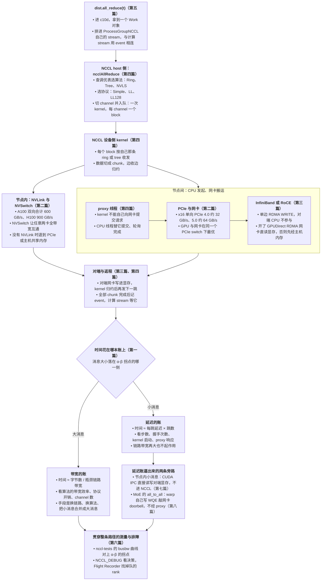

## 内容简介

《通信与互联：从 NCCL 到 RDMA》是一组共八篇的系列文章，面向已经跑过多卡训练或多卡推理、准备向下进入通信层的工程师，系统讲解 GPU 之间的数据是怎么流动的：经过哪些硬件链路、由哪些软件层驱动、每一层的代价是什么、出问题时到哪里去看。

它回答的问题是：

> **一次 all_reduce 从调用到完成，数据在 PCIe、NVLink、InfiniBand 上是怎么流动的？为什么有时候是带宽的问题，有时候是延迟的问题？[^q0]**

站在框架的层面看，通信是一行代码：`dist.all_reduce(t)`。它返回得很快，然后在某个时刻"完成"。Profiler 里它是一段 `ncclDevKernel_AllReduce_*` 的时间条；nccl-tests 给它一个 `busbw` 数字；训练日志偶尔告诉你它 timeout 了。这些信息都是真的，但都停在一个没有展开的前提上——**这行代码触发了什么**。

这个系列把这条路径展开。一次跨节点的 all_reduce，数据至少经过下面这些层，每一层都有自己的带宽、延迟和失败方式：

1. **dist.all_reduce(t)**：Python，进入 ProcessGroupNCCL
2. **ncclAllReduce(...)**：NCCL host 侧：选算法、选协议、切 channel、入队
3. **ncclDevKernel_AllReduce_***：NCCL 设备侧：每个 channel 一个 block，按 ring/tree 收发
4. **NVLink / NVSwitch**：节点内：GPU 直接读写对端显存
5. PCIe → NIC → InfiniBand 节点间：proxy 线程驱动 RDMA，GPUDirect 绕开主机内存
6. 对端 NIC → PCIe → GPU 再走一遍反向的路

带宽和延迟是这条路径上两种不同的账。一个 512 MB 的梯度 all_reduce，时间几乎全部花在数据搬运上，看的是链路带宽和算法的带宽效率；一个 decode 阶段几十 KB 的张量并行 all_reduce，时间几乎全部花在同步、握手和 kernel 启动上，带宽多少无关紧要。同一个 API，同一套 NCCL，两种完全不同的瓶颈——分不清这两种账，就分不清什么时候该换算法、什么时候该换硬件、什么时候什么都不用换。

系列贯穿的方法是：**先用代价模型算出理论时间，再用 nccl-tests 和 profiler 测出实际时间，再用拓扑、算法和协议解释差距，再动手缩小差距**。

## 缩写



## 为什么写这个系列？

### 单卡之外的一切都建立在通信之上

模型一旦放不进一张卡，通信就成了主线而不是配角。数据并行需要 all_reduce 或 reduce_scatter + all_gather 同步梯度；张量并行每一层前向都要一次 all_reduce；流水线并行靠 send/recv 传激活；MoE 靠 all_to_all 分发 token；FSDP 和 ZeRO 每一步都要把分片的参数 all_gather 回来。推理侧同样：张量并行的每一层都有 all_reduce，PD 分离要把 KV cache 从 prefill 节点搬到 decode 节点。

这些通信的**模式**各不相同——消息大小从几十 KB 到几 GB，参与者从 2 张卡到几千张卡，有的在关键路径上、有的可以和计算重叠——但它们的**底座**是同一套：NCCL、NVLink、PCIe、InfiniBand 或 RoCE、RDMA。这一层自成体系，值得独立于训练和推理来学。

### "通信占了 40%"之后呢？

一份 profiler 报告说通信占了迭代时间的 40%，这个数字本身不说明任何事情。可能的原因至少有：

- 消息太小，每次通信的固定开销（延迟）占主导，应该合并（bucket）或换协议；
- 消息够大，但算法带宽效率低，比如在 NVSwitch 机器上跑了不该跑的 Ring；
- 拓扑没有被正确识别，NCCL 走了 PCIe 而不是 NVLink，或者走了主机内存而不是 GPUDirect；
- 网卡与 GPU 不在同一个 PCIe switch 或 NUMA 节点下，跨了 CPU 的 root complex；
- 通信本身很快，但没有和计算重叠，或者重叠被一次不必要的同步打断；
- 某一张卡慢（straggler），所有人都在等它。

每一种原因对应完全不同的处理方式，而区分它们需要知道数据实际走了哪条路、每一段的理论上限是多少。这套判断能力是本系列要建立的。

### NCCL 几乎是黑盒，但它不该是

NCCL 是所有 NVIDIA GPU 上分布式训练和推理的事实标准，它的行为由几十个环境变量控制，源码约几万行 C++ 和 CUDA。大多数人对它的了解止于 `NCCL_DEBUG=INFO` 和几条"据说有用"的环境变量。但它的核心机制并不神秘：拓扑探测、图搜索、算法与协议的选择、channel 的切分、proxy 线程与网络插件——每一个都能在源码里找到对应的文件，都能用日志和 nccl-tests 验证。

读懂 NCCL 的价值不只是调参。它是理解一切上层通信设计的参照：PyTorch 的 ProcessGroupNCCL 为什么要有 watchdog 线程，vLLM 为什么要绕开 NCCL 自己写 all-reduce，为什么 NVLink 机器上的 all_reduce 几乎不受消息大小影响而 IB 上不是——答案都在 NCCL 的设计取舍里。

### 现有材料的断层

- **NCCL 官方文档**覆盖了 API 和环境变量，但不讲机制，也不讲为什么；
- **RDMA / InfiniBand 的教材**面向 HPC 与存储网络，不讲 GPU，也不讲 NCCL 如何使用 verbs；
- **PyTorch 分布式文档**讲怎么用 DDP 和 FSDP，把通信当作已经工作的黑盒；
- **论文**（ring all-reduce、double binary tree、NVLink SHARP）给出了算法和硬件的原理，但没有人把它们串成从 API 到链路的一条线；
- **博客与调优帖子**分享环境变量组合，往往缺少"为什么这样设置"以及"什么时候不该这样设置"。

本系列要填的是从"会调 `dist.all_reduce`"到"能说出这次调用的数据走了哪里、为什么是这个耗时、出了问题去哪里看"之间的那段路。

## 适合哪些读者？

### 跑过多卡训练、想弄清通信在做什么的工程师

你用过 DDP 或 FSDP，配过 `NCCL_SOCKET_IFNAME`，见过 `NCCL WARN` 和 `Watchdog caught collective operation timeout`。你想知道的是：**那些环境变量各自控制路径上的哪一段，那个 timeout 背后真正发生了什么**。

### 做推理系统、需要处理张量并行和 PD 分离的工程师

张量并行的 all_reduce 在 decode 阶段是延迟敏感的小消息，PD 分离的 KV 传输是带宽敏感的大块搬运，两者对通信层的要求几乎相反。本系列的[《推理侧的通信：custom all-reduce 与 KV 传输》](/inference-communication-custom-all-reduce-and-kv-transfer.html)专门处理推理侧，[《MoE 的通信：all-to-all、DeepEP 与 GPU 发起的通信》](/moe-communication-all-to-all-deepep-and-gpu-initiated.html)处理 MoE 专家并行的 all_to_all 与 DeepEP，前六篇是理解它们的基础。

### 负责 GPU 集群网络与调度的平台工程师

你需要决定网卡怎么配、GPU 与 NIC 的亲和怎么绑、RoCE 网络要不要开 PFC 和 ECN、一个任务的 8 张卡放在哪台机器上有区别吗。这些决定的依据全部在[《硬件互联：PCIe、NVLink、NVSwitch 与网络拓扑》](/hardware-interconnect-pcie-nvlink-and-topology.html)、[《RDMA 与 GPUDirect》](/rdma-and-gpudirect.html)和[《nccl-tests、调优与排障》](/nccl-tests-tuning-and-debugging-hangs.html)里。

### 准备读或改 NCCL、PyTorch c10d、vLLM 通信层源码的开发者

NCCL 的 `src/`、PyTorch 的 `torch/csrc/distributed/c10d/`、vLLM 的 `vllm/distributed/`，以及[《MoE 的通信》](/moe-communication-all-to-all-deepep-and-gpu-initiated.html)用到的 Megatron-LM `megatron/core/transformer/moe/` 与 DeepEP `csrc/kernels/` 是本系列的源码阅读对象。读完后你应该能读懂它们的主路径，并知道一个新的传输后端或一个新的 all-reduce 实现应该接在哪里。

## 系列的整体主线

一次 all_reduce 的数据从显存出发，要穿过 Python、NCCL 的 host 侧与设备侧、节点内的 NVLink、节点间的 PCIe 与网卡，到对端再反向走一遍回来。下图把这条路径画出来，每一段标出由哪一篇负责；路径走完之后，时间到底花在哪里，取决于消息大小落在 α-β 拐点的哪一侧——这就是贯穿全系列的「带宽的账」与「延迟的账」。

图里每一段对应的篇目与要点：

- **`dist.all_reduce(t)`**：这一行返回得很快，真正的工作排在 ProcessGroupNCCL 自己的 stream 上，与计算 stream 之间只有 event 的顺序约束。「异步到底指什么」「`wait()` 之后能不能改这个 tensor」是框架层的语义问题，与 NCCL 无关。见[《PyTorch 的通信栈》的「stream 语义」一节](/pytorch-communication-stack-processgroupnccl-and-streams.html#四stream-语义一次-all_reduce-的-streamevent-之舞)。
- **NCCL host 侧**：算法、协议、channel 数这三件事在 `ncclCommInitRank` 时就按拓扑算好、填成一张调优表，`ncclAllReduce` 只是按消息大小查表。这是整条路径上最关键的一次决策，也是同一份代码在不同机器上快慢差几倍的原因。见[《NCCL 架构：拓扑探测、channel、算法与协议》的「调优模型」一节](/nccl-architecture-topology-channels-algorithms-and-protocols.html#八调优模型nccl-如何估算时间)。
- **NCCL 设备侧 kernel**：一次集合通信是一个 kernel，channel 数就是 block 数，每个 block 在自己那条 ring 或 tree 上边收边归约。见[《NCCL 架构》的「执行期」一节](/nccl-architecture-topology-channels-algorithms-and-protocols.html#九执行期enqueuekernel-与-proxy)。
- **节点内的 NVLink 与 NVSwitch**：节点内带宽比节点间高一个数量级，所以分层算法总是先在节点内收完再出网卡；`nvidia-smi topo -m` 里的等级词就是这段路径的说明书。见[《硬件互联》的「NVLink 与 NVSwitch」一节](/hardware-interconnect-pcie-nvlink-and-topology.html#三nvlink-与-nvswitch)。
- **proxy 线程**：GPU kernel 不能自己向网卡提交请求，这件事决定了跨节点通信的延迟下界，也是很多性能问题与 hang 的所在。见[《NCCL 架构》的「执行期」一节](/nccl-architecture-topology-channels-algorithms-and-protocols.html#九执行期enqueuekernel-与-proxy)。
- **PCIe、网卡与 InfiniBand**：GPU 与网卡挂在同一个 PCIe switch 下时网卡可以直读显存，跨 root complex 时数据要先落一趟主机内存——拷贝次数、PCIe 链路和带宽上限因此完全不同。见[《RDMA 与 GPUDirect》的「GPUDirect RDMA」一节](/rdma-and-gpudirect.html#八gpudirect-rdma)。
- **对端与返程**：集合通信没有「发完就算完」，对端收完要归约、再发下一跳，整条路径上最慢的那一段决定全局。见[《NCCL 架构》的「算法与协议」一节](/nccl-architecture-topology-channels-algorithms-and-protocols.html#七算法与协议)。
- **两本账**：同一个 API，大消息看字节数除以带宽，小消息看跳数乘以每跳延迟；分不清这两本账，就分不清什么时候该换算法、什么时候该换硬件、什么时候什么都不用换。见[《集合通信原语与代价模型》的「α-β 模型」一节](/collective-communication-primitives-and-cost-model.html#四α-β-模型)。
- **两条旁路**：延迟的账被逼到极致时，上层会绕开这条主路——推理的张量并行用 CUDA IPC 直接读写对端显存，MoE 的 all_to_all 让 warp 自己敲网卡的 doorbell。见[《推理侧的通信》的「custom all-reduce 的实现」一节](/inference-communication-custom-all-reduce-and-kv-transfer.html#三看一看custom-all-reduce-的实现)与[《MoE 的通信》的「low-latency kernel 与 GPU 发起的通信」一节](/moe-communication-all-to-all-deepep-and-gpu-initiated.html#六deepep-的-low-latency-kernel-与-gpu-发起的通信)。
- **测量与排障**：这条路径上每一段都有对应的量法，从 `nvidia-smi topo -m` 到 `ib_write_bw` 到 nccl-tests 到 Flight Recorder。见[《nccl-tests、调优与排障》的「带宽曲线的读法」一节](/nccl-tests-tuning-and-debugging-hangs.html#三带宽曲线的读法)。

> [!NOTE] Java 经验参照：CompletableFuture 与 Work
> `dist.all_reduce(t, async_op=True)` 返回一个 `Work`，很像 `CompletableFuture`：提交之后立刻返回，拿到的是一张凭据，`wait()` 对应 `get()`。对得上的是「提交与完成分离」，也对得上「不去取结果就不知道有没有出错」——集合通信的错误同样要到 `wait()` 或 watchdog 才暴露。对不上的是 `wait()` 的含义：`CompletableFuture.get()` 阻塞的是调用它的那个 Java 线程，而 `Work.wait()` 默认不阻塞 CPU，它只是让当前 CUDA stream 上后续的 kernel 排在这次通信之后，CPU 立刻往下跑。所以「`wait()` 返回了」不等于「数据到了」，只等于「之后用这块数据的 kernel 不会提前跑」。

八篇文章按"从抽象代价到物理链路，再回到软件栈"的顺序推进：

1. [《集合通信原语与代价模型》](/collective-communication-primitives-and-cost-model.html) —— 建立分析框架：α-β 模型与 ring all-reduce 的推导
2. [《硬件互联：PCIe、NVLink、NVSwitch 与网络拓扑》](/hardware-interconnect-pcie-nvlink-and-topology.html) —— PCIe、NVLink、NVSwitch、IB/RoCE 的拓扑与带宽，NUMA 与亲和
3. [《RDMA 与 GPUDirect》](/rdma-and-gpudirect.html) —— 绕过 CPU 和主机内存的数据通路
4. [《NCCL 架构：拓扑探测、channel、算法与协议》](/nccl-architecture-topology-channels-algorithms-and-protocols.html) —— 一次 ncclAllReduce 的完整路径
5. [《PyTorch 的通信栈》](/pytorch-communication-stack-processgroupnccl-and-streams.html) —— ProcessGroupNCCL、stream/event 语义、异步与重叠
6. [《nccl-tests、调优与排障》](/nccl-tests-tuning-and-debugging-hangs.html) —— 带宽曲线的读法、环境变量、hang 与 timeout
7. [《推理侧的通信：custom all-reduce 与 KV 传输》](/inference-communication-custom-all-reduce-and-kv-transfer.html) —— custom all-reduce、KV 传输（NIXL / UCX / Mooncake）
8. [《MoE 的通信：all-to-all、DeepEP 与 GPU 发起的通信》](/moe-communication-all-to-all-deepep-and-gpu-initiated.html) —— all_to_all 的账、DeepEP 的 dispatch / combine、GPU 发起的 RDMA（IBGDA）

三条交织的线索：

- 代价线：α-β 模型 → 链路带宽与延迟 → 算法带宽效率 → 协议开销 → 实测曲线 → 小消息与大消息的两种账
- 路径线：NVLink / PCIe / IB → RDMA verbs → NCCL transport → ProcessGroupNCCL → vLLM 通信后端 → DeepEP 的 GPU 发起 RDMA
- 排障线：nvidia-smi topo → ibstat / ib_write_bw → NCCL_DEBUG → Flight Recorder → 决策树

前三篇建立"硬件能做到什么"的上限，《NCCL 架构》讲 NCCL 如何逼近这个上限，《PyTorch 的通信栈》讲框架如何使用 NCCL 而不浪费它，《nccl-tests、调优与排障》把前五篇变成可操作的测量与排障方法，《推理侧的通信》把这套方法用到推理的两个特殊场景上，《MoE 的通信》用到 MoE 的 all_to_all 上——它是训练与推理共有、也是最重的一种通信；最后的[《系列总结与通关自测》](/communication-and-interconnect-series-recap-and-self-test.html)检验这八篇能不能连起来用。

每一篇都有同样的四段结构：

- **算一算**：用代价模型给出这一层的理论上限：这段路径最快多久、最多多少字节每秒
- **看一看**：读源码或日志，弄清这一层实际怎么做决定：拓扑文件、NCCL 日志、c10d 的 C++
- **测一测**：用工具测出实际数字：nvbandwidth、ib_write_bw、nccl-tests、profiler
- **比一比**：解释理论与实测的差距，给出这一层的排障检查项

"两种账"的区分会贯穿每一篇。带宽的账看链路速率、算法的带宽效率、协议开销；延迟的账看步数、握手次数、kernel 启动、proxy 线程的响应。同一个问题在两本账上的答案往往相反——比如更多 channel 提高带宽却增加小消息的延迟，Tree 减少延迟却在某些拓扑上损失带宽——本系列会在每一处选择上把两本账都算一遍。

路径上流动的不只有张量。一次集合通信跑起来时，communicator、channel、ring 结构、proxy 线程、注册过的内存、QP、stream 与 event、`Work` 对象各有各的创建者和寿命，混在一起就说不清「这一步到底是谁在动什么」：

| 对象 | 谁创建 | 活在哪一侧 | 活多久 | 谁能看见 | 哪一篇 |
|---|---|---|---|---|---|
| `ncclComm`（communicator） | 每个 rank 自己调 `ncclCommInitRank`；PyTorch 里由 ProcessGroupNCCL 首次用到该设备时懒创建 | host 进程里的句柄，背后同时有 host 元数据与设备端状态 | 到 `ncclCommDestroy` 或 `ncclCommAbort` | 只有本进程；同一组 rank 靠同一个 `ncclUniqueId` 配成一个 comm | [《NCCL 架构》](/nccl-architecture-topology-channels-algorithms-and-protocols.html) [《PyTorch 的通信栈》](/pytorch-communication-stack-processgroupnccl-and-streams.html) |
| channel | communicator 初始化时由图搜索与建连阶段产生，条数上限是源码里的 `MAXCHANNELS`（64） | host 侧元数据，加两端的收发 buffer，buffer 大小由 `NCCL_BUFFSIZE` 定 | 与 communicator 同寿 | communicator 内部；kernel 按自己的 block 号取一条 | [《NCCL 架构》](/nccl-architecture-topology-channels-algorithms-and-protocols.html) |
| ring 与 tree 结构 | `src/graph/search.cc` 在探测出的拓扑上搜出来 | host 侧的 graph，随 kernel 参数下发到设备 | 与 communicator 同寿 | `NCCL_GRAPH_DUMP_FILE` 可以导出来看 | [《NCCL 架构》](/nccl-architecture-topology-channels-algorithms-and-protocols.html) |
| proxy 线程 | NCCL 在 communicator 建立时起的 CPU 线程（`src/proxy.cc` 的 `ncclProxyProgress`） | host | 与 communicator 同寿 | 用户 API 里没有它，只在日志、调试器的栈和 CPU 占用里看得到 | [《NCCL 架构》](/nccl-architecture-topology-channels-algorithms-and-protocols.html) [《nccl-tests、调优与排障》](/nccl-tests-tuning-and-debugging-hangs.html) |
| 注册内存 MR 与 rkey | net transport 第一次用到某段 buffer 时调 `ibv_reg_mr` | 网卡的地址翻译表，句柄在 host | 按页对齐进该网卡的 MR cache 并计引用，归零才真的注销 | 本端用句柄；拿到 rkey 的对端网卡可以直接写这段内存 | [《RDMA 与 GPUDirect》](/rdma-and-gpudirect.html) |
| QP 与 CQ | 建连时成对创建，每条连接每张网卡的 QP 数由 `NCCL_IB_QPS_PER_CONNECTION` 决定（默认 1） | 网卡，控制块在 host | 与这条连接同寿 | 只有这一对端点 | [《RDMA 与 GPUDirect》](/rdma-and-gpudirect.html) |
| NCCL 的内部 stream 与 event | ProcessGroupNCCL 按设备各建一条（`ncclStreams_`、`ncclEvents_`） | host 侧的 CUDA 对象，排的是设备上的次序 | 与进程组同寿 | 用户拿不到这条 stream，只能通过 `Work` 上的 event 与它建立顺序 | [《PyTorch 的通信栈》](/pytorch-communication-stack-processgroupnccl-and-streams.html) |
| `Work`（`WorkNCCL`） | 每次集合通信由 ProcessGroupNCCL 创建并返回 | Python 侧的对象，里面是起止两个 CUDA event | 到 `wait()` 之后由框架回收；watchdog 线程也扫它来判超时 | 调用方与 watchdog 线程 | [《PyTorch 的通信栈》](/pytorch-communication-stack-processgroupnccl-and-streams.html) [《nccl-tests、调优与排障》](/nccl-tests-tuning-and-debugging-hangs.html) |
| custom all-reduce 的 IPC buffer | 每个 rank 自己 `cudaMalloc`，再交换 `cudaIpcGetMemHandle` 拿到的句柄 | 显存；对端用 `cudaIpcOpenMemHandle` 映射进自己的地址空间 | 与推理实例同寿、地址固定，捕获进 CUDA Graph 前要先注册 | 同一节点、同一 TP 组的所有 rank | [《推理侧的通信》](/inference-communication-custom-all-reduce-and-kv-transfer.html) |
| DeepEP 的 `Buffer` | 建 `Buffer` 时一次性分配：NVLink 侧交换 IPC 句柄，RDMA 侧开一块 NVSHMEM 对称堆 | 显存，两块 buffer 在同一个对象里 | 与模型实例同寿，按最坏情况预留接收槽位 | 本 EP 组的所有 rank 看到同一个对称地址 | [《MoE 的通信》](/moe-communication-all-to-all-deepep-and-gpu-initiated.html) |

Table: 本系列反复出现的对象：谁创建、活在哪一侧、活多久、谁能看见

## 章节结构与分章导读

### 1. 集合通信原语与代价模型：α-β 模型与 ring all-reduce

[《集合通信原语与代价模型：α-β 模型与 ring all-reduce》](/collective-communication-primitives-and-cost-model.html)不碰任何硬件和 NCCL，只建立整个系列的分析框架：**给定 n 个参与者、S 字节的数据、一条带宽为 β、延迟为 α 的链路，一次集合通信理论上最快需要多久？**

这一篇会覆盖：

- 集合通信原语的定义与语义：broadcast、reduce、all_reduce、all_gather、reduce_scatter、all_to_all、scatter/gather、send/recv；它们之间的组合关系（all_reduce = reduce_scatter + all_gather）；
- 训练和推理各自需要哪些原语：数据并行的梯度 all_reduce、FSDP 的 all_gather / reduce_scatter、张量并行的 all_reduce、流水线的 send/recv、MoE 的 all_to_all、PD 分离的点对点 KV 传输；
- α-β 模型（Hockney 模型）：一条消息的传输时间 $$T = \alpha + S/\beta$$，α 是延迟（固定开销），β 是带宽；两项在什么消息大小下相等，这个拐点决定了"延迟主导"还是"带宽主导"；
- ring all-reduce 的推导：reduce_scatter 与 all_gather 各 $$n-1$$ 步，每步每个 rank 收发 $$S/n$$ 字节，总时间

$$
T_{\text{ring}} = 2(n-1)\,\alpha + \frac{2(n-1)}{n}\cdot\frac{S}{\beta}
$$

  带宽项随 n 增大趋于 $$2S/\beta$$，与参与者数量无关，这是 ring 在大消息上最优的原因；延迟项随 n 线性增长，这是 ring 在小消息、大规模上失败的原因；每个 rank 实际收发的字节数是 $$\frac{2(n-1)}{n} S$$，这个系数后面会反复出现；
- tree all-reduce：延迟 $$O(\log n)$$，朴素二叉树的带宽只有一半，double binary tree 如何用两棵互补的树把带宽补回来；
- algbw 与 busbw：nccl-tests 报告的两个带宽，前者是 $$S/T$$，后者对 all_reduce 乘上 $$2(n-1)/n$$ 校正为"链路实际承载的流量"，为什么只有 busbw 才能和硬件带宽直接比较；
- 分层与多级：节点内快、节点间慢时，两级算法的代价怎么算；
- 消息大小的谱：从 decode 阶段几十 KB 的 TP all_reduce，到几百 MB 的梯度 bucket，到几 GB 的 KV cache 传输，各落在 α-β 模型的哪一段。

核心问题是：

> **8 张卡做一次 1 GB 的 all_reduce，链路单向 25 GB/s，ring 算法理论上要多久？改成 64 KB 呢？这两个数字为什么分别对带宽和延迟敏感？[^q1]**

实践：写一个几十行的代价模型脚本，输入 n、S、α、β 和算法，输出理论时间与 busbw；后面每一篇的实测数字都要和它比。

### 2. 硬件互联：PCIe、NVLink、NVSwitch 与网络拓扑

[《硬件互联：PCIe、NVLink、NVSwitch 与网络拓扑》](/hardware-interconnect-pcie-nvlink-and-topology.html)给《集合通信原语与代价模型》的 α 和 β 填上真实数字。一台 8 卡服务器内部和一个多机集群之间，有哪些链路、各自多快、GPU 到 GPU 的路径怎么选，这些决定了通信的物理上限。

这一篇会覆盖：

- PCIe：lane、代际与带宽——x16 的理论单向带宽 PCIe 3.0 约 16 GB/s、4.0 约 32 GB/s、5.0 约 64 GB/s（**大块连续传输**时通常能到 80–90%，小包 DMA 远低于此）；root complex、PCIe switch、P2P 事务；为什么跨 root complex 的 P2P 可能慢甚至不可用；
- NVLink 与 NVSwitch：每代 NVLink 的链路数与每 GPU 总带宽——A100 第三代 12 链路合计 600 GB/s、H100 第四代 18 链路合计 900 GB/s、Blackwell 第五代 1.8 TB/s（均为双向合计，单向减半）；NVSwitch 让节点内任意两卡全带宽互通；NVLink 上的 all_reduce 为什么几乎不受消息大小影响；
- 网卡与网络：InfiniBand 的代际与端口速率——HDR 200 Gb/s（约 25 GB/s）、NDR 400 Gb/s（约 50 GB/s）；RoCE v2 在以太网上承载 RDMA，需要 PFC / ECN 保证无损；一台 8 卡 H100 服务器通常配 8 张 400 Gb/s 网卡，每卡一张，为什么是这个比例；
- 拓扑的读法：`nvidia-smi topo -m` 输出的矩阵与 `NV#` / `PIX` / `PXB` / `PHB` / `NODE` / `SYS` 六个等级各自的含义；`lspci -tv` 看 PCIe 树；`nvidia-smi topo -mp` 看 GPU 与 NIC 的亲和；
- NUMA 与亲和性：CPU socket、内存节点、PCIe 设备的归属；进程绑核（`numactl`）为什么会影响通信性能；NCCL 如何读取并使用亲和信息，`NCCL_IGNORE_CPU_AFFINITY` 在什么情况下需要；
- 主机内存在路径上的位置：pinned memory、staging buffer，什么时候数据必须经过主机内存，什么时候可以绕过；
- 集群级拓扑：fat-tree、rail-optimized 设计，为什么同一个 rail 上的 GPU 通信更快，这对任务调度意味着什么；
- 测带宽的工具：`nvbandwidth`、`p2pBandwidthLatencyTest`、`ib_write_bw` / `ib_read_bw`（perftest），各测哪一段。

核心问题是：

> **`nvidia-smi topo -m` 里 GPU0 到 GPU1 是 `NV12`、到 NIC0 是 `PIX`、到 NIC4 是 `SYS`。这三个词各自意味着什么带宽和什么路径？为什么 NCCL 会为 GPU0 选 NIC0 而不是 NIC4？[^q2]**

实践：写一个脚本解析 `nvidia-smi topo -m`、`lspci` 和 `/sys/bus/pci/devices/*/numa_node`，画出本机的 GPU–PCIe switch–NIC–NUMA 拓扑图，并用 `nvbandwidth` 与 `ib_write_bw` 测出每段链路的实际带宽，填入《集合通信原语与代价模型》里的代价模型。

### 3. RDMA 与 GPUDirect：绕过 CPU 和主机内存的数据通路

[《RDMA 与 GPUDirect：绕过 CPU 和主机内存的数据通路》](/rdma-and-gpudirect.html)讲节点间通信的软件基础。TCP/IP 的路径上有内核协议栈、多次拷贝和 CPU 参与，跑不满 400 Gb/s 的网卡；RDMA 让网卡直接读写应用内存，GPUDirect RDMA 让它直接读写显存。这一篇讲这两件事怎么工作、怎么用、怎么坏。

这一篇会覆盖：

- 为什么需要 RDMA：内核旁路（kernel bypass）、零拷贝、CPU 卸载；TCP 路径与 RDMA 路径的对比；
- verbs 编程模型：device、Protection Domain、Memory Region 注册（`ibv_reg_mr`）、Queue Pair（RC / UC / UD）、Completion Queue、Work Request 与 Work Completion；
- 两类操作：单边的 RDMA WRITE / READ（对端 CPU 不参与）与双边的 SEND / RECV；NCCL 为什么主要用 RDMA WRITE；
- 连接建立：QP 状态机、需要交换的信息（QPN、LID / GID、rkey、地址），带外交换用 TCP 还是 `rdma_cm`；
- InfiniBand 与 RoCE v2 的差别：链路层、寻址（LID vs GID）、拥塞控制（信用机制 vs PFC + ECN / DCQCN）；RoCE 上 `NCCL_IB_GID_INDEX` 为什么经常需要手工指定；
- 内存注册的代价：pin 页、建立地址翻译，为什么注册慢、注册多少、注册缓存（MR cache）为什么存在；
- GPUDirect RDMA：让网卡 DMA 直接访问显存，需要 `nvidia-peermem` 内核模块（或 DMA-BUF 路径）；PCIe 拓扑对它的限制——GPU 和 NIC 在同一 PCIe switch 下最优，跨 root complex 可能不可用或很慢；
- GDRCopy：用 CPU 直接读写显存映射的小数据，NCCL 用它降低小消息延迟；
- GPUDirect 家族的其余成员：GPUDirect P2P（节点内 GPU 互访）、GPUDirect Storage（NVMe 直读显存）；
- 诊断工具：`ibstat`、`ibv_devinfo`、`show_gids`、`rdma link`、`ib_write_bw` 加 `--use_cuda` 测 GPUDirect 路径；`lsmod | grep peermem`。

核心问题是：

> **一段显存里的数据要发到另一台机器的显存，走 TCP、走 RDMA 不开 GPUDirect、走 RDMA 开 GPUDirect，分别经过几次拷贝、经过哪些 PCIe 链路？各自的带宽上限是多少？[^q3]**

实践：用 `libibverbs` 写一个最小的 RDMA WRITE 程序（约两三百行 C），两台机器之间传一块 buffer；然后把 buffer 换成 `cudaMalloc` 的显存，验证 GPUDirect RDMA 路径；用 `ib_write_bw` 对照带宽，并观察 GPU 与 NIC 亲和不同时的差距。

### 4. NCCL 架构：拓扑探测、channel、算法与协议

[《NCCL 架构：拓扑探测、channel、算法与协议》](/nccl-architecture-topology-channels-algorithms-and-protocols.html)是全系列的中心。它沿着一次 `ncclAllReduce` 从初始化到 kernel 结束的完整路径，讲 NCCL 如何把前三篇的硬件能力组织成一次集合通信：

| 阶段 | 步骤 | 做什么 | 源码文件 |
|---|---|---|---|
| `ncclCommInitRank` | bootstrap | TCP 交换地址，所有 rank 互相认识 | `src/bootstrap.cc` |
| ^^ | topo detect | 读 `/sys` 与 NVML，建出 GPU / NIC / PCIe / CPU 的树 | `src/graph/xml.cc` `src/graph/topo.cc` |
| ^^ | paths | 算出任意两设备间的路径类型与带宽 | `src/graph/paths.cc` |
| ^^ | search | 在拓扑上搜出若干条 ring 与 tree | `src/graph/search.cc` `src/graph/rings.cc` `src/graph/trees.cc` |
| ^^ | connect | 为每个 channel 建立 transport（P2P / SHM / NET 等） | `src/transport/*.cc` `src/graph/connect.cc` |
| ^^ | tuning | 为每种算法 × 协议 × 消息大小估算时间，填成调优表 | `src/graph/tuning.cc` |
| `ncclAllReduce` | enqueue | 查调优表选算法与协议，切 channel，准备 kernel 参数 | `src/enqueue.cc` |
| ^^ | launch | 一个 kernel，nChannels 个 block，各跑一条 ring 或 tree | `src/device/all_reduce.h` `src/device/primitives.h` |
| ^^ | proxy | CPU 线程替 GPU 提交与轮询网络请求（跨机时） | `src/proxy.cc` |

Table: 一次 ncclAllReduce 的完整路径与对应源码文件

这一篇会覆盖：

- 初始化：`ncclGetUniqueId` 与 bootstrap（TCP，`NCCL_SOCKET_IFNAME` 控制走哪张网卡）、`ncclCommInitRank`、每个 rank 如何得知其他 rank 的位置；
- 拓扑探测：从 `/sys` 和 NVML 读出 GPU、NIC、PCIe switch、CPU 的树（`src/graph/xml.cc`、`topo.cc`），计算两两之间的路径与带宽（`paths.cc`）；`NCCL_TOPO_DUMP_FILE` 把它导出来看；
- 图搜索：在拓扑上搜索 ring 和 tree（`search.cc`、`rings.cc`、`trees.cc`），目标是最大化带宽；`NCCL_GRAPH_DUMP_FILE`；
- transport 选择：P2P（NVLink / PCIe 直接访问对端显存）、SHM（经主机共享内存）、NET（IB / Socket），以及 CollNet 和 NVLS；`NCCL_P2P_LEVEL`、`NCCL_NET_GDR_LEVEL` 用与 `nvidia-smi topo` 相同的等级词（`LOC` / `NVL` / `PIX` / `PXB` / `PHB` / `SYS`）控制某种路径最多能跨多远；
- channel：一个 communicator 有多个 channel，每个 channel 是一条独立的 ring 或 tree、对应 kernel 的一个 block、拥有自己的 buffer 和连接；channel 数决定并行度，`NCCL_MIN_NCHANNELS` / `NCCL_MAX_NCHANNELS`；
- 算法：Ring、Tree、CollNet（借助 IB SHARP 在网络中归约）、NVLS（借助 NVSwitch 归约，Hopper 起）、PAT（大规模 all_gather / reduce_scatter）；`NCCL_ALGO` 覆盖自动选择；
- 协议：Simple（数据与 flag 分离、需要内存屏障、带宽最高、延迟最高）、LL（8 字节数据搭 8 字节 flag、一次 16 字节原子写、无需屏障、带宽效率 50%、延迟最低）、LL128（128 字节里 120 字节数据、效率约 94%、依赖 NVLink 的写顺序保证）；这两个百分比是**线格式的带宽效率**——线上每搬一个字节里有多少是有效数据，由 8/16 与 120/128 直接算出，与消息大小和机型都无关；`NCCL_PROTO`；
- 调优表：NCCL 按消息大小、rank 数、拓扑估算每种算法与协议组合的时间，选最快的一种（`src/graph/tuning.cc`）；tuner 插件接口；
- enqueue 与 kernel：`src/enqueue.cc` 把集合操作切成任务、分配到 channel、启动一个 kernel；设备侧 `src/device/all_reduce.h` 与 `primitives.h` / `prims_simple.h` / `prims_ll.h` / `prims_ll128.h` 是每个 block 执行的收发原语；
- proxy 线程：GPU kernel 不能直接驱动网卡，`src/proxy.cc` 里的 CPU 线程替它提交 RDMA 请求、轮询完成；这条 CPU–GPU 协作路径是很多性能问题和 hang 的源头；
- group 语义：`ncclGroupStart` / `ncclGroupEnd` 把多个操作合成一次启动，send/recv 为什么必须成对放在 group 里。

核心问题是：

> **同一次 8 卡 all_reduce，NCCL 在 NVSwitch 机器上选了 NVLS + Simple，在没有 NVSwitch 的 NVLink 机器上选了 Ring + LL128，在纯 PCIe 机器上只剩 Simple / LL，跨 32 台机器时选了 Tree。它是根据什么做出这三个不同决定的？强行用 `NCCL_ALGO=Ring` 会付出什么？[^q4]**

实践：用 `NCCL_DEBUG=INFO NCCL_DEBUG_SUBSYS=INIT,GRAPH,TUNING` 跑一次 all_reduce，逐行解读日志里的拓扑、ring/tree 结构、channel 数与算法协议选择，并与《集合通信原语与代价模型》《硬件互联》的理论预测对照；导出 `NCCL_TOPO_DUMP_FILE` 和 `NCCL_GRAPH_DUMP_FILE`，改写拓扑文件观察 NCCL 的决策如何变化。

### 5. PyTorch 的通信栈：ProcessGroupNCCL、stream 语义与计算通信重叠

[《PyTorch 的通信栈：ProcessGroupNCCL、stream 语义与计算通信重叠》](/pytorch-communication-stack-processgroupnccl-and-streams.html)向上一层，讲 PyTorch 如何使用 NCCL。这一篇只讲通信层的视角：一次 `dist.all_reduce` 在 c10d 里经过了什么、NCCL kernel 在哪条 stream 上、"异步"到底意味着什么、重叠为什么会失效。并行策略本身（DDP 的 bucket 划分、FSDP 的分片规则）不在范围内。

这一篇会覆盖：

- c10d 的分层：Python 的 `torch.distributed.distributed_c10d` → C++ 的 `ProcessGroup` / `Backend` → `ProcessGroupNCCL`；Store（TCPStore）承担 rendezvous 与 `ncclUniqueId` 的分发；
- ProcessGroupNCCL 的对象模型：每个 device 一个 `ncclComm`，每个 collective 返回一个 `WorkNCCL`，`Work` 上记录了起止 CUDA event；communicator 的懒创建与 `ncclCommInitRankConfig` 的非阻塞初始化；
- stream 语义：`async_op=True` 时 NCCL 操作在 ProcessGroupNCCL 自己的内部 stream 上执行，与当前计算 stream 通过 event 建立依赖（PyTorch 2.12 里 `async_op=False` 则直接在当前 stream 上发起，不返回 `Work`）；`work.wait()` 是 stream 级等待，不阻塞 CPU；什么时候才真的阻塞 CPU；
- 输入 tensor 的生命周期：为什么需要 `recordStream` 或 `TORCH_NCCL_AVOID_RECORD_STREAMS` 的替代方案，Caching Allocator 与跨 stream 使用的冲突；
- `async_op=True` 与重叠：通信 kernel 与计算 kernel 在不同 stream 上并发的条件——SM 资源、`NCCL_NTHREADS`、`TORCH_NCCL_HIGH_PRIORITY`；重叠被打断的常见原因（隐式同步、`.item()`、显存分配触发的 `cudaFree`）；
- 合并（coalescing）：`all_reduce_coalesced`、`_coalescing_manager`、DDP 的 bucket 为什么能把延迟主导的小消息变成带宽主导的大消息；
- 函数式集合通信：`torch.distributed._functional_collectives` 让通信成为可编译的算子，`wait_tensor` 的语义，`torch.compile` 如何对通信做重排；
- 错误处理与超时：
  - 两个开关：`TORCH_NCCL_ASYNC_ERROR_HANDLING`、`TORCH_NCCL_BLOCKING_WAIT`；
  - watchdog 线程如何检测 timeout，检测到之后做什么（abort communicator、抛异常、`ncclCommAbort`）；
  - heartbeat monitor（`TORCH_NCCL_HEARTBEAT_TIMEOUT_SEC`）监视 watchdog 自己；
- 与 NCCL 之外后端的对照：Gloo（CPU）、UCC、以及 vLLM 用 ctypes 直接调用 NCCL 的 PyNccl 为什么绕开 ProcessGroupNCCL；
- 对称内存（`torch/csrc/distributed/c10d/symm_mem/`）：让 GPU 直接读写对端显存的低延迟通信原语，它和 NCCL 的关系。

核心问题是：

> **`work = dist.all_reduce(t, async_op=True)` 返回时，通信开始了吗？`work.wait()` 返回时，通信完成了吗？在此期间修改 `t` 会发生什么？[^q5]**

实践：写一个 micro-benchmark，在两条 stream 上让一个 GEMM 与一个 all_reduce 重叠，用 `torch.profiler` 的 trace 验证重叠是否真的发生；逐一引入 `.item()`、显存碎片、不当的 `wait()` 位置，观察重叠如何消失。

### 6. nccl-tests、调优与排障：从带宽曲线到 hang

[《nccl-tests、调优与排障：从带宽曲线到 hang》](/nccl-tests-tuning-and-debugging-hangs.html)把前五篇变成一套可操作的方法。它分两半：**性能**——怎么测、怎么读、怎么调；**正确性**——hang、timeout、死锁、结果错误怎么排。

这一篇会覆盖：

- nccl-tests 的用法：`all_reduce_perf` 等各原语的测试程序；`-b` / `-e` / `-f` 扫描消息大小，`-g` 每进程 GPU 数，`-n` / `-w` 迭代与预热，`-c` 校验结果；`mpirun` 多进程与单进程多卡两种启动方式（nccl-tests 本身没有 torchrun 模式，torchrun 下用等价的 PyTorch 脚本扫描）；
- 带宽曲线的读法：以消息大小为横轴、busbw 为纵轴，小消息端的平台是延迟主导（看 α），大消息端的平台是带宽主导（看 β），拐点位置与[《集合通信原语与代价模型》的「α-β 模型」一节](/collective-communication-primitives-and-cost-model.html#四α-β-模型)对照；曲线"该长什么样"——NVLink 节点内、单机 PCIe、跨机 IB 各一条参考线；
- 常见异常形状：大消息端上不去（链路没走对、GDR 没开、channel 太少）、小消息端太高（协议选错、跨了 NUMA）、中段有凹陷（算法切换点选得不好）、多机比单机慢很多（网卡亲和、NCCL_IB_HCA 没限定、走了 Socket）；
- 调优参数按它们作用的层分组，以及哪些应该动、哪些几乎永远不该动：
  - 算法与协议：`NCCL_ALGO`、`NCCL_PROTO`；
  - 并行度：`NCCL_MIN_NCHANNELS`、`NCCL_MAX_NCHANNELS`、`NCCL_NTHREADS`；
  - channel buffer：`NCCL_BUFFSIZE`；
  - 路径选择：`NCCL_P2P_LEVEL`、`NCCL_NET_GDR_LEVEL`、`NCCL_P2P_DISABLE`、`NCCL_SHM_DISABLE`；
  - 网络：`NCCL_IB_HCA`、`NCCL_IB_GID_INDEX`、`NCCL_IB_TC`、`NCCL_IB_QPS_PER_CONNECTION`、`NCCL_IB_SPLIT_DATA_ON_QPS`；
  - Socket 与 bootstrap：`NCCL_SOCKET_IFNAME`、`NCCL_SOCKET_NTHREADS`、`NCCL_NSOCKS_PERTHREAD`；
  - 其余开关：`NCCL_CROSS_NIC`、`NCCL_NVLS_ENABLE`、`NCCL_COLLNET_ENABLE`；
- 日志：`NCCL_DEBUG=WARN` 是生产默认、`INFO` 看决策、`TRACE` 看每次调用；`NCCL_DEBUG_SUBSYS` 按子系统过滤；`NCCL_DEBUG_FILE` 按 rank 分文件；
- hang 的分类：集合通信参数不一致（某个 rank 的 tensor 大小或 dtype 不同）、调用顺序不一致（某个 rank 多发或少发了一次集合通信）、send/recv 没有配对、两个 communicator 交叉等待、一个 rank 崩溃而其他 rank 在等、网络真的断了；
- 排查工具：
  - 看栈：`py-spy dump` 看每个 rank 的 Python 栈、`gdb -p` 看 C++ 栈、`cuda-gdb` 看 kernel 是否在自旋；
  - PyTorch 的 Flight Recorder（`TORCH_NCCL_TRACE_BUFFER_SIZE`、`TORCH_NCCL_DUMP_ON_TIMEOUT`，PyTorch 2.12 默认开启，dump 到 `~/.cache/torch/comm_lib_trace_rank_<rank>`，分析工具是 `torch/distributed/flight_recorder/fr_trace.py`）把所有 rank 最近的集合通信记录汇总对齐，直接指出哪个 rank 在哪一次操作上掉了队；
  - `TORCH_NCCL_DESYNC_DEBUG`；
- timeout 的语义：`init_process_group(timeout=...)` 到底约束什么、为什么 checkpoint 保存或数据加载卡住会表现为 NCCL timeout；
- 正确性问题：结果不一致（浮点归约顺序、`NCCL_ALGO` 不同导致数值不同）、NaN 的来源与 `TORCH_NCCL_NAN_CHECK`、多 communicator 与多 stream 下的数据竞争；
- 一棵决策树：从现象（慢 / hang / 错）到检查项到处理方式。

决策树大致是这个形状：

| 现象 | 具体形状 | 先查什么 |
|---|---|---|
| 慢 | 大消息 busbw 低 | `nvidia-smi topo -m` 的等级 `NCCL_DEBUG` 日志里的 transport GDR 是否生效 channel 数 |
| ^^ | 小消息延迟高 | 协议与算法 是否跨 NUMA proxy 线程被抢占 框架侧没有合并 |
| ^^ | 多机远差于单机 | 网卡亲和 `NCCL_IB_HCA` 是否回落到 Socket RoCE 的 PFC / ECN |
| hang | 所有 rank 停在同一处 | 网络或某个 rank 崩溃：`dmesg` `ibstat` 进程是否还在 |
| ^^ | 各 rank 停在不同处 | 调用不一致：Flight Recorder 对齐序号 `py-spy` 看栈 |
| ^^ | 只有部分 rank 停 | send / recv 不配对 多 communicator 交叉等待 |
| 错 | 结果不稳定 | 浮点归约顺序 算法差异 数据竞争（多 stream 未同步） |
| ^^ | 出现 NaN | `TORCH_NCCL_NAN_CHECK` 定位首次出现的 rank 与操作 |

Table: 从现象到检查项的排障决策树

> [!NOTE] Java 经验参照：CyclicBarrier 与集合通信的参与方
> 一次集合通信在语义上就是一个 `CyclicBarrier`：所有 rank 都到了才放行。Java 里把 barrier 的 parties 配错、或者让某个线程少调一次 `await()`，整组线程就一起停住；集合通信一样——某个 rank 少发一次 all_reduce，或者发的 tensor 形状、dtype 与别人不同，其余 rank 就停在 kernel 里自旋。对不上的是暴露方式：`CyclicBarrier` 的 `await()` 可以传超时，线程栈里能直接看到它停在哪；NCCL 的 kernel 在 GPU 上自旋、没有任何超时，CPU 早在入队时就返回了，唯一的计时器是框架侧的 watchdog，所以现象是默认 10 分钟后所有 rank 一起报 timeout，而不是出问题的那个 rank 报错（`ProcessGroupNCCL` 的默认超时是 10 分钟，见 `torch/csrc/distributed/c10d/ProcessGroupNCCL.hpp` 的 `kProcessGroupNCCLDefaultTimeout`；可以用 `init_process_group(timeout=...)` 调整）。

核心问题是：

> **一个 64 卡训练任务在第 3000 步 hang 住，所有 rank 的日志都停在 all_reduce。是谁的问题、是哪一次 all_reduce、为什么会等到 timeout 才暴露？[^q6]**

实践：在单机与两机环境跑完整的 nccl-tests 扫描并画出带宽曲线，与代价模型的预测对齐；人为制造三种 hang（参数不一致、顺序不一致、send/recv 不配对），用 py-spy 和 Flight Recorder 分别定位。

### 7. 推理侧的通信：custom all-reduce 与 KV 传输

[《推理侧的通信：custom all-reduce 与 KV 传输》](/inference-communication-custom-all-reduce-and-kv-transfer.html)把前六篇的方法用到推理系统的两个特殊场景上。它们的通信模式与训练截然不同：张量并行的 all_reduce 是 decode 阶段每层一次的几十 KB 小消息，延迟就是一切；PD 分离的 KV 传输是点对点的大块搬运，要在不干扰计算的前提下跑满链路。

这一篇会覆盖：

- decode 阶段 TP all_reduce 的账：batch 小、hidden 维度固定，每层一次 all_reduce 只有几十到几百 KB，按[《集合通信原语与代价模型》](/collective-communication-primitives-and-cost-model.html)的模型这是纯延迟主导；NCCL 在这个区间的固定开销（kernel 启动、proxy、协议握手）有多大；
- custom all-reduce：
  - vLLM 的 `csrc/custom_all_reduce.cuh` 用 CUDA IPC（`cudaIpcGetMemHandle` / `cudaIpcOpenMemHandle`）让每张卡直接读写对端显存；
  - one-shot（`cross_device_reduce_1stage`：每张卡读所有人的数据自己归约）与 two-shot（`cross_device_reduce_2stage`：先 reduce_scatter 再 all_gather）两种 kernel 各适合什么消息大小；
  - 用 flag 做跨卡同步而不用 NCCL；
  - 为什么只在节点内、NVLink 全互联、消息小于一个阈值时启用；
- 后端的选择链：`vllm/distributed/device_communicators/cuda_communicator.py` 里 all_reduce 的调度顺序——NCCL 对称内存（需显式开启）、quick reduce（ROCm）、FlashInfer（需显式开启）、custom all-reduce、torch 对称内存（NVLS 多播）、最后回落到 PyNccl；
- 通信组的管理：`vllm/distributed/parallel_state.py` 的 `GroupCoordinator` 如何管理 TP / PP / DP 组；
- PyNccl：`pynccl_wrapper.py` 用 ctypes 直接加载 `libnccl.so`（`VLLM_NCCL_SO_PATH`）调用 NCCL，为什么推理引擎不直接用 ProcessGroupNCCL——stream 控制、CUDA Graph 捕获、避免 watchdog；
- CUDA Graph 与通信：all_reduce 被捕获进 graph 需要满足什么条件，custom all-reduce 的 `register_graph_buffers` 在做什么；
- 对称内存与 NVLS 在推理上的应用：PyTorch 的 symmetric memory、NCCL 的 NVLS，与 custom all-reduce 各自的适用区间；
- PD 分离的 KV 传输：要传多少字节（每 token 每层 KV 的大小乘以序列长度乘以层数）、什么时候传（prefill 结束后一次性还是按层流水）、传给谁（TP 度不同的 prefill 与 decode 实例之间的映射）；
- KV 传输层的选择：
  - NIXL：NVIDIA 的推理数据传输库，后端包括 UCX、GPUDirect Storage 等，vLLM 的 `NixlConnector` 在 `vllm/distributed/kv_transfer/kv_connector/v1/nixl/`；
  - UCX：统一通信框架，可在 RDMA / TCP / 共享内存 / CUDA IPC 之间自动选路；
  - Mooncake Transfer Engine：`vllm/distributed/kv_transfer/kv_connector/v1/mooncake/`；
  - vLLM 的 `KVConnector` 抽象如何把 scheduler 侧的决策与 worker 侧的传输分开；
- 为什么 KV 传输不用 NCCL：点对点、动态目标、不需要归约、需要与计算完全解耦——单边 RDMA WRITE / READ 是更自然的原语；
- 推理侧的排障：TP all_reduce 延迟异常时先看走了哪个后端；KV 传输慢时先看是否走了 GPUDirect、GPU 与 NIC 亲和是否正确、注册内存是否命中缓存。

核心问题是：

> **8 卡 TP 的 decode，每层一次 128 KB 的 all_reduce，走传统 NCCL ring（未开 symmetric memory）要 30 微秒，custom all-reduce 要 10 微秒。这 20 微秒省在哪里？为什么这个方法不能用在训练的梯度同步上？[^q7]**

实践：在 vLLM 上用同一模型分别开关 custom all-reduce，用 profiler 测每层 all_reduce 的延迟并与 nccl-tests 对照；搭一个两实例的 PD 分离部署，用 NIXL 传 KV，测传输带宽并与[《RDMA 与 GPUDirect》](/rdma-and-gpudirect.html)里的 `ib_write_bw` 结果比较。

### 8. MoE 的通信：all-to-all、DeepEP 与 GPU 发起的通信

[《MoE 的通信：all-to-all、DeepEP 与 GPU 发起的通信》](/moe-communication-all-to-all-deepep-and-gpu-initiated.html)是系列的末篇，处理训练和推理共有的、也是最重的一种通信：MoE 的专家并行。一层 MoE 的每个 token 由 router 选出 top-k 个专家，专家分布在 EP 组的所有 rank 上，token 要被 dispatch 到持有那些专家的 rank、算完再 combine 回来——两次 all_to_all 形状的通信，但每个 rank 发给每个对端的字节数由路由结果决定、每步不同，发到对端还要按专家重排，decode 时每条流只有几 KB 而流的条数是 $$n(n-1)$$。它把[《集合通信原语与代价模型》](/collective-communication-primitives-and-cost-model.html)留下的 all_to_all 一句话、[《RDMA 与 GPUDirect》](/rdma-and-gpudirect.html)没展开的 GPUDirect Async、[《NCCL 架构》](/nccl-architecture-topology-channels-algorithms-and-protocols.html)里"GPU 不能提交 RDMA 请求所以要 proxy"三条线收在一起。

这一篇会覆盖：

- MoE 的通信形态是路由 → dispatch → 专家计算 → combine，具体要算的是：
  - 与[《集合通信原语与代价模型》](/collective-communication-primitives-and-cost-model.html)的 α-β 模型对接：每 token top-k × hidden × dtype 字节、跨节点比例 $$1 - 1/N$$、平坦 all_to_all 一轮 $$n-1$$ 条并发流、按节点去重后网卡上每 token 只走"目标节点数"份；
  - prefill（几百 MB、网卡带宽的账）与 decode（几 MB 切成上千条小消息、发起速率的账）两种形态；
  - EP 与 TP / DP 叠加时通信怎样相加；
- NCCL 路径：
  - 2.28.9 的 `ncclAlltoAll`（只有等长版本）在 `src/enqueue.cc` 的 `taskAppend` 里展开成 $$n$$ 对 send/recv、由 `ncclP2pSchedule` 轮转调度、跨节点每条消息经 proxy 线程发起；
  - PyTorch `all_to_all_single` 与 `input_split_sizes` / `output_split_sizes` 的语义，等长走 `ncclAlltoAll`、变长走 send/recv group；
  - 为什么变长 split 要先做一次 counts 交换加一次 host 同步（两次 α、不可捕获进 CUDA Graph），以及这在 decode 上为什么不够用；
- Megatron-LM 的三种 token dispatcher（`megatron/core/transformer/moe/token_dispatcher.py`）：
  - `MoEAllGatherTokenDispatcher`：all_gather 全部 token，字节数与 k 无关，小 EP 可用；
  - `MoEAlltoAllTokenDispatcher`：A2A(EP) + AG(TP)，`cuda_sync_point` 决定何时同步；
  - `MoEFlexTokenDispatcher` 配 `_DeepepManager`：`fused_a2a.py` 封装 DeepEP，TP × EP 当一个平坦组；
- DeepEP：
  - `Buffer` 的两块对称显存：NVLink buffer 用 CUDA IPC 指针表、RDMA buffer 用 NVSHMEM 对称堆；
  - normal kernel 的三步（`get_dispatch_layout` → `notify_dispatch` → `dispatch`，CPU 等一个 pinned 计数器）、每两个 SM 一个 channel 的 head / tail 队列、internode 五种 warp 角色——跨节点 token 先 RDMA 到对端同号 GPU 再 NVLink 转发（与[《NCCL 架构》](/nccl-architecture-topology-channels-algorithms-and-protocols.html)的 PXN、[《硬件互联》](/hardware-interconnect-pcie-nvlink-and-topology.html)的 rail-optimized 网络是同一件事）；
  - low-latency kernel 的 worst-case 接收槽位、计数随数据原子加、send / recv 两阶段与 `return_recv_hook`（RDMA 在没有 kernel 运行时进行）、kernel 内 FP8 转换；
- GPU 发起的通信：
  - `ibgda_device.cuh` 里 warp 自己写 WQE、更新 doorbell record、写映射进 GPU 地址空间的网卡 doorbell；
  - 它拿掉的是 proxy 的通知延迟、CPU 软件路径与串行化，留下的是硬件的 α；
  - IBRC / proxy 与 IBGDA 的对照，以及与《RDMA 与 GPUDirect》里 GPUDirect RDMA、《NCCL 架构》里 NCCL proxy 的对照表；
  - NCCL 2.28.9 自己的设备端 API 与 GIN（`src/include/nccl_device/`、GDAKI 后端）；
- 对称内存的一般化：PyTorch 2.12 NVSHMEM 后端的 `all_to_all_vdev` / `all_to_all_vdev_2d`——splits 在设备端、一个 kernel 交换 counts、用 get 拉数据，是"GPU 发起的变长 all_to_all"作为 torch 算子的形态；
- vLLM 的 all2all 后端：
  - `--all2all-backend` 的可选值：`allgather_reducescatter`（默认）、`deepep_high_throughput`、`deepep_low_latency`、`nixl_ep`、FlashInfer、MoRI；
  - `all2all.py` 各 manager 的 `dispatch` / `combine`、`prepare_finalize/deepep_*.py` 对 DeepEP 的调用；
  - EP = DP × TP 的组合与 `use_sequence_parallel_moe`、与[《推理侧的通信》](/inference-communication-custom-all-reduce-and-kv-transfer.html)里 custom all-reduce 的分工、EPLB；
- 排障与调优：
  - 专家热点如何体现为通信时间：最慢的 rank 决定完成时间，DeepEP 的 `*_wait_recv_cost_stats` 按来源 rank 分列等待时间；
  - DeepEP 的 SM 数与 `Config` 表、QP 数与本地专家数的关系；
  - `NVSHMEM_IB_ENABLE_IBGDA` 等只在源码与 README 里能查到的环境变量；
  - prefill / decode / hang 三张清单。

核心问题是：

> **一层 MoE 的 dispatch + combine，在 EP=64 跨 8 节点时，每个 token 要跨多少条链路、搬多少字节、走几步？为什么 NCCL 的 all_to_all 在 decode 时不够用，DeepEP 又是怎么把它做到几百微秒以内的？[^q8]**

实践：把《集合通信原语与代价模型》的代价模型扩展到 all_to_all（`moe_a2a_model.py`），输出 EP=8 / 16 / 64 在 prefill 与 decode 下网卡与 NVLink 各自的理论时间、按节点去重值多少，并与 DeepEP README 的官方数字对照反推 α；再用 `torch.distributed.all_to_all_single` 写一个最小 benchmark（`a2a_bench.py`），测出等长、变长、以及 counts 交换加同步的两步路径各多少微秒。

### 9. 系列总结与通关自测

最后一篇不讲新内容：把八篇正文压成一张「问题 → 结论 → 必记数字」的表并逐篇回顾，拎出贯穿全系列的几条线与常见误区，然后给一套三段式通关自测——十道判断与计算、五道跨篇综合、若干道面试题，答案各自折叠，附「读过 / 掌握 / 能教人」的判据。各篇末尾的自测检验的是一篇读懂了没有，这一篇检验的是八篇能不能连起来用；读完正文再做。

## 贯穿全系列的实践线

系列的练手项目是一套**通信诊断工具集**，取名 comm-probe。选它是因为通信层的学习几乎全部依赖测量：不亲手测出每段链路的带宽、不亲手复现一次 hang，前面讲的一切都只是名词。它逐篇生长：

| 篇 | 文件 | 内容 |
|---|---|---|
| [第一篇：集合通信原语与代价模型](/collective-communication-primitives-and-cost-model.html) | cost_model.py | α-β 模型 · ring/tree 预测 · algbw 与 busbw 换算 |
| [第二篇：硬件互联](/hardware-interconnect-pcie-nvlink-and-topology.html) | topo_map.py | 解析 nvidia-smi topo / lspci / NUMA · 画拓扑图 · 记录 nvbandwidth 与 ib_write_bw 实测 |
| [第三篇：RDMA 与 GPUDirect](/rdma-and-gpudirect.html) | rdma_write.c | libibverbs 最小 RDMA WRITE · 显存版（GPUDirect RDMA）· 与 ib_write_bw 对照 |
| [第四篇：NCCL 架构](/nccl-architecture-topology-channels-algorithms-and-protocols.html) | nccl_log_reader.py | 解析 NCCL_DEBUG=INFO 日志 · 提取 ring/tree/channel/算法协议决策 · 与预测比对 |
| [第五篇：PyTorch 的通信栈](/pytorch-communication-stack-processgroupnccl-and-streams.html) | overlap_bench.py | 计算与通信重叠的 micro-benchmark · profiler trace 检查 · 重叠失效的复现集 |
| [第六篇：nccl-tests、调优与排障](/nccl-tests-tuning-and-debugging-hangs.html) | sweep.sh · hang_lab/ | nccl-tests 扫描与画图 · 三种 hang 的复现与定位剧本 · 排障决策树 |
| [第七篇：推理侧的通信](/inference-communication-custom-all-reduce-and-kv-transfer.html) | tp_ar_bench.py · kv_xfer/ | vLLM 各 all_reduce 后端延迟对照 · PD 分离 KV 传输带宽测量 |
| [第八篇：MoE 的通信](/moe-communication-all-to-all-deepep-and-gpu-initiated.html) | moe_a2a_model.py · a2a_bench.py | all_to_all 的 α-β 模型（网卡 vs NVLink、节点去重、与 DeepEP README 对照）· all_to_all_single 等长 / 变长 / 两步的延迟 |

Table: comm-probe 逐篇生长的工具

八篇走完，读者手上有一套能在任何一台新机器上跑一遍的工具：先画出拓扑，再测每段链路，再跑 nccl-tests 与理论对照，再检查框架侧的重叠与后端选择，MoE 模型再算一遍 all_to_all 的账。它不是一个通信库，但每一次"通信慢了"或"通信卡了"，都能用它在一小时内把问题定位到某一层。

与它平行的源码阅读线（NCCL 以 2.28.9 的源码树为准；2.29 起 `transport/net_ib.cc` 拆为目录，更新版本的目录调整随文标注）：

| 篇 | 项目 | 源码位置 |
|---|---|---|
| [第一篇：集合通信原语与代价模型](/collective-communication-primitives-and-cost-model.html) | nccl-tests | `src/all_reduce.cu`、`src/common.cu`（algbw / busbw 的计算） |
| [第二篇：硬件互联](/hardware-interconnect-pcie-nvlink-and-topology.html) | NCCL | `src/graph/xml.cc`、`src/graph/topo.cc`、`src/graph/paths.cc`（拓扑的发现与路径带宽） |
| [第三篇：RDMA 与 GPUDirect](/rdma-and-gpudirect.html) | NCCL | `src/transport/net_ib.cc`、`src/misc/ibvwrap.cc`、`src/misc/gdrwrap.cc`（verbs 与 GDRCopy 的封装） |
| [第四篇：NCCL 架构](/nccl-architecture-topology-channels-algorithms-and-protocols.html) | NCCL | `src/init.cc`、`src/bootstrap.cc` `src/graph/{search,rings,trees,connect,tuning}.cc` `src/transport/{p2p,shm,net,coll_net,nvls}.cc` `src/enqueue.cc`、`src/proxy.cc`、`src/group.cc` `src/device/{all_reduce.h,primitives.h,prims_simple.h,prims_ll.h,prims_ll128.h}` |
| [第五篇：PyTorch 的通信栈](/pytorch-communication-stack-processgroupnccl-and-streams.html) | PyTorch | `torch/csrc/distributed/c10d/ProcessGroupNCCL.{hpp,cpp}`、`NCCLUtils.cpp`、`Work.cpp`、`TCPStore.cpp` `torch/distributed/distributed_c10d.py`、`torch/distributed/_functional_collectives.py` `torch/csrc/distributed/c10d/symm_mem/` |
| [第六篇：nccl-tests、调优与排障](/nccl-tests-tuning-and-debugging-hangs.html) | PyTorch | `torch/csrc/distributed/c10d/FlightRecorder.cpp`、`torch/distributed/flight_recorder/fr_trace.py` |
| ^^ | NCCL | `src/debug.cc`、`src/misc/param.cc`（环境变量如何被读取） |
| [第七篇：推理侧的通信](/inference-communication-custom-all-reduce-and-kv-transfer.html) | vLLM | `csrc/custom_all_reduce.cuh` `vllm/distributed/device_communicators/{custom_all_reduce,cuda_communicator,pynccl,pynccl_wrapper,symm_mem}.py` `vllm/distributed/parallel_state.py` `vllm/distributed/kv_transfer/kv_connector/v1/{base.py,nixl/,mooncake/}` |
| [第八篇：MoE 的通信](/moe-communication-all-to-all-deepep-and-gpu-initiated.html) | NCCL | `src/enqueue.cc`（`taskAppend` 对 `ncclAlltoAll` 的展开）、`src/init.cc`（`ncclP2pSchedule`）、`src/include/nccl_device/{gin.h,ll_a2a.h}` |
| ^^ | PyTorch | `torch/csrc/cuda/nccl.cpp`（`all2all_single_*`）、`torch/csrc/distributed/c10d/symm_mem/nvshmem_extension.cu`（`all_to_all_vdev`） |
| ^^ | Megatron-LM | `megatron/core/transformer/moe/{token_dispatcher.py,fused_a2a.py,moe_utils.py}` |
| ^^ | DeepEP | `deep_ep/buffer.py`、`csrc/deep_ep.cpp`、`csrc/config.hpp` `csrc/kernels/{intranode.cu,internode.cu,internode_ll.cu,ibgda_device.cuh,runtime.cu}` |
| ^^ | vLLM | `vllm/distributed/device_communicators/all2all.py` `vllm/model_executor/layers/fused_moe/prepare_finalize/{deepep_ht,deepep_ll}.py` `vllm/distributed/eplb/` |

Table: 与实践线平行的源码阅读线

## 前置要求与说明

### 前置要求

- 跑过多卡程序：用 DDP 或 FSDP 训练过模型，或用 vLLM 跑过张量并行推理；知道 `torchrun`、rank、world size 是什么，配过至少一次 `NCCL_SOCKET_IFNAME` 之类的环境变量；
- 理解 CUDA 的基本执行模型：kernel、stream、event、host 与 device 内存、异步执行与同步的含义；
- 能读 C 和 C++：NCCL 是 C++ 与 CUDA，RDMA 的 verbs 接口是 C；不要求写过大型 C++ 项目；
- 能读 Python：PyTorch 与 vLLM 的通信层 Python 部分是源码阅读对象；
- Linux 基础：`/sys`、PCI 设备、内核模块、NUMA 的基本概念；
- 硬件访问：至少一台多卡机器（理想是 8 卡 NVLink / NVSwitch 服务器）；[《RDMA 与 GPUDirect》](/rdma-and-gpudirect.html)、[《nccl-tests、调优与排障》](/nccl-tests-tuning-and-debugging-hangs.html)、[《MoE 的通信》](/moe-communication-all-to-all-deepep-and-gpu-initiated.html)的多机部分需要两台以上带 InfiniBand 或 RoCE 网卡的机器（《MoE 的通信》里的 DeepEP 还要求网卡支持 IBGDA），没有条件时以阅读和单机实验为主，正文会标注哪些实验需要多机。

不要求：

- 写过 RDMA 程序；
- 读过 NCCL 源码；
- 了解 InfiniBand 或 RoCE 的网络配置。

### 硬件与版本基线

- 硬件：以 **8 卡 A100 / H100 加 NVSwitch 的服务器** 为节点内的默认分析对象（A100 NVLink 双向合计 600 GB/s，H100 900 GB/s；PCIe 4.0 / 5.0 x16），节点间以 **InfiniBand HDR 200 Gb/s 或 NDR 400 Gb/s、每 GPU 一张网卡** 为默认；RoCE v2 的差异随文标注；Blackwell（第五代 NVLink、NVL72）在涉及处标注。文中带宽数字为公开标称值，且明确区分"单向"与"双向合计"；实测会因固件、拓扑、功耗与配置有差异；
- 软件：NCCL 2.28.9（源码路径以此为准，2.29 的目录调整随文标注）、nccl-tests 2.18.3、CUDA 12.x、PyTorch 2.12（环境变量名以此为准，2.4 之前的早期版本无 `TORCH_` 前缀）、vLLM v0.23.0（**更新 @2026-06-24**：v0.23.0 发布于 2026-06-14，仅[《推理侧的通信》](/inference-communication-custom-all-reduce-and-kv-transfer.html)与[《MoE 的通信》](/moe-communication-all-to-all-deepep-and-gpu-initiated.html)引用其源码，本条随前者发布补记）、Megatron-LM core_v0.18.0（**更新 @2026-06-27**：发布于 2026-06-22，仅《MoE 的通信》引用其 `megatron/core/transformer/moe/`，随该篇补记）、DeepEP v1.2.1（**更新 @2026-06-27**：发布于 2025-09-15，仅《MoE 的通信》引用；其依赖的 NVSHMEM 本地无源码，只按 DeepEP 源码与公开文档描述概念，随该篇补记）、rdma-core 与 `libibverbs`、`nvidia-peermem` 或 DMA-BUF；
- 版本敏感处随文标注：NCCL 的算法集合（NVLS、PAT 的加入版本）与 `NCCL_ALGO` 的可选值、ProcessGroupNCCL 的 `TORCH_NCCL_*` 环境变量（早期版本无 `TORCH_` 前缀）、Flight Recorder 的接口、vLLM all_reduce 后端的选择顺序与 `--all2all-backend` 的可选值、NIXL 与 Mooncake 的接口、DeepEP 的 `Buffer` 接口与它设置的 `NVSHMEM_*` 环境变量、Megatron 的 `moe_token_dispatcher_type`。

### 关于替代硬件

本系列以 NVIDIA GPU 为主线。AMD 平台上 RCCL 的 API 与 NCCL 一致、Infinity Fabric 对应 NVLink，vLLM 的 quick reduce（`csrc/quickreduce/`）是它的 custom all-reduce 对应物；正文在相关位置提及差异，但不展开。国产加速器及其通信库不在范围内。

## 章节目录

1. [集合通信原语与代价模型：α-β 模型与 ring all-reduce](/collective-communication-primitives-and-cost-model.html)
2. [硬件互联：PCIe、NVLink、NVSwitch 与网络拓扑](/hardware-interconnect-pcie-nvlink-and-topology.html)
3. [RDMA 与 GPUDirect：绕过 CPU 和主机内存的数据通路](/rdma-and-gpudirect.html)
4. [NCCL 架构：拓扑探测、channel、算法与协议](/nccl-architecture-topology-channels-algorithms-and-protocols.html)
5. [PyTorch 的通信栈：ProcessGroupNCCL、stream 语义与计算通信重叠](/pytorch-communication-stack-processgroupnccl-and-streams.html)
6. [nccl-tests、调优与排障：从带宽曲线到 hang](/nccl-tests-tuning-and-debugging-hangs.html)
7. [推理侧的通信：custom all-reduce 与 KV 传输](/inference-communication-custom-all-reduce-and-kv-transfer.html)
8. [MoE 的通信：all-to-all、DeepEP 与 GPU 发起的通信](/moe-communication-all-to-all-deepep-and-gpu-initiated.html)
9. [系列总结与通关自测](/communication-and-interconnect-series-recap-and-self-test.html)

## 最终目标

读完这套系列之后，面对任何一次通信——无论是训练日志里的一次 all_reduce timeout、profiler 里一段比预期长的通信 kernel、还是推理服务里 TP 延迟的一次异常——读者应该能够回答：

| 问题 | 哪一篇 | 看什么 |
|---|---|---|
| 这次通信传了多少字节、多少参与者？理论上要多久？ | [《集合通信原语与代价模型》](/collective-communication-primitives-and-cost-model.html) | α-β 模型与算法带宽效率 |
| 它是延迟主导还是带宽主导？ | ^^ | 消息大小与拐点 |
| 数据走了哪条物理链路？这条链路的上限是多少？ | [《硬件互联》](/hardware-interconnect-pcie-nvlink-and-topology.html) | 拓扑、NVLink / PCIe / IB 的带宽 |
| 跨机时经过了主机内存吗？GPUDirect 生效了吗？ | [《RDMA 与 GPUDirect》](/rdma-and-gpudirect.html) | RDMA 路径与 GDR 的条件 |
| NCCL 为什么选了这个算法和协议？切了几个 channel？ | [《NCCL 架构》](/nccl-architecture-topology-channels-algorithms-and-protocols.html) | 拓扑探测、图搜索、调优表 |
| 框架侧有没有浪费它？重叠发生了吗？ | [《PyTorch 的通信栈》](/pytorch-communication-stack-processgroupnccl-and-streams.html) | stream / event 语义与重叠条件 |
| 实测曲线和理论差在哪里？该动哪个环境变量？ | [《nccl-tests、调优与排障》](/nccl-tests-tuning-and-debugging-hangs.html) | nccl-tests 的读法与调优参数的层次 |
| hang 住了，是谁、在哪一次操作上、为什么？ | ^^ | Flight Recorder 与决策树 |
| 推理的小消息 all_reduce 为什么要绕开 NCCL？ | [《推理侧的通信》](/inference-communication-custom-all-reduce-and-kv-transfer.html) | custom all-reduce 与固定开销 |
| KV cache 该用什么传、能传多快？ | ^^ | NIXL / UCX / Mooncake 与单边 RDMA |
| MoE 一层的 all_to_all 要搬多少字节、网卡还是 NVLink 是瓶颈？ | [《MoE 的通信》](/moe-communication-all-to-all-deepep-and-gpu-initiated.html) | 每 token k 份拷贝、跨节点比例、按节点去重 |
| decode 的 all_to_all 为什么不能靠 proxy 线程？ | ^^ | 上千条小消息的发起速率与 IBGDA |

Table: 读完本系列后应该能回答的问题，以及答案在哪一篇

最终目标是三种能力：

1. **阅读能力**：读懂 NCCL 的主路径、PyTorch c10d 的 ProcessGroupNCCL、vLLM 的通信后端与 KV connector、Megatron 的 token dispatcher 与 DeepEP 从 `Buffer` 到 IBGDA 的三层，理解每个设计决定背后的硬件原因；
2. **诊断能力**：面对一次慢的或卡住的通信，用拓扑、代价模型、日志和 Flight Recorder 把问题定位到具体的一层，而不是靠试环境变量；
3. **决策能力**：为一个训练或推理任务判断通信的理论上限、选择合适的算法与传输路径、给平台提出拓扑与亲和的要求，并知道什么时候该自己写一个通信原语。

这是单卡之外一切系统的底座，也是训练与推理两条路径唯一共享的一层。

[^q0]: 路径是：`dist.all_reduce` → ProcessGroupNCCL 在专用 stream 上入队 → `ncclAllReduce` 选算法（Ring / Tree）与协议（Simple / LL / LL128）、切 channel → 设备端 kernel 按 channel 把数据切块：节点内走 NVLink（经 NVSwitch 或直连，几百 GB/s）、跨节点由 proxy 线程通过 InfiniBand 发送（GPUDirect RDMA 直接从显存走 NIC，不经 CPU 内存；没有 GDR 时经 PCIe 拷到 host 再发）、对端 NIC 写入显存 → kernel 做归约再传下一跳 → 全部 chunk 完成后 Event 记录，计算 stream 等待它。带宽问题还是延迟问题看消息大小：大消息（几十 MB 的梯度桶）时间 ≈ 字节数 / 瓶颈链路带宽（$$2(n-1)/n$$ 倍数据量的 Ring），受 PCIe / NVLink / IB 带宽与 channel 数限制；小消息（KB 级、decode 的 TP all_reduce）时间由每跳延迟 × 跳数决定（Ring 的 $$2(n-1)$$ 跳、Tree 的 $$\log n$$ 跳），受 kernel launch、协议握手与网络延迟限制，带宽再大也没用——nccl-tests 的 `busbw` 曲线在小消息段平、大消息段才到带宽上限。
[^q1]: 用 α-β 模型 $$T_{\text{ring}} = 2(n-1)\alpha + \frac{2(n-1)}{n}\cdot\frac{S}{\beta}$$，取 $$n = 8$$、$$\beta = 25$$ GB/s、$$\alpha = 10$$ µs。**1 GB**：带宽项 $$\frac{14}{8}\times 1\,\text{GB} / 25\,\text{GB/s} = 70$$ ms，延迟项 $$14\times 10$$ µs = 0.14 ms，合计约 **70 ms**，延迟只占 0.2%。**64 KB**：带宽项 4.5 µs，延迟项 140 µs，合计约 **145 µs**，带宽只占 3%。同一个公式、同一组参与者，两项的比例倒了过来：大消息的时间几乎全在 $$S/\beta$$ 上，所以对链路带宽和算法的带宽效率敏感；小消息的时间几乎全在 $$2(n-1)\alpha$$ 上，所以对步数、握手和启动开销敏感。详见[《集合通信原语与代价模型》的「α-β 模型」](/collective-communication-primitives-and-cost-model.html#四α-β-模型)与[「ring all_reduce 的推导」两节](/collective-communication-primitives-and-cost-model.html#五ring-all_reduce-的推导)。
[^q2]: **`NV12`**：GPU0 与 GPU1 之间有 12 条 NVLink 链路（A100 经 NVSwitch 任意两卡都是 12），单向约 300 GB/s，不经 PCIe、不经 CPU，是节点内 $$\beta$$ 的上限。**`PIX`**：GPU0 与 NIC0 挂在同一个 PCIe switch 下，流量在 switch 内转发、一跳到达，带宽是 PCIe x16 单向（4.0 约 32 GB/s），GPUDirect RDMA 可用。**`SYS`**：GPU0 到 NIC4 要穿过 PCIe root complex 并跨 socket，带宽打折、延迟高，P2P 还可能不被支持；NCCL 的 GDR 等级默认是 `PXB`（源码 `src/graph/paths.cc` 的 `ncclTopoCheckGdr`），这条路径上不开 GDR，数据要经主机内存中转。NCCL 为 GPU0 选 NIC0 不是看编号：初始化时它算出每个 GPU 到每张网卡的路径类型与带宽，取类型最好、带宽最大的那条——8 卡配 8 网卡、每张 GPU 与自己的网卡同 switch，就是为了让每个 GPU 都有一条 `PIX` 路径。详见[《硬件互联》的「读拓扑」](/hardware-interconnect-pcie-nvlink-and-topology.html#五读拓扑nvidia-smi-topo--mlspci--tv-与-topo--mp)与[「网卡与网络」两节](/hardware-interconnect-pcie-nvlink-and-topology.html#四网卡与网络infinibandroce-与-8-卡-8-网卡)。
[^q3]: **走 TCP**：每端 2 次拷贝（PCIe 上的 D2H / H2D 加一次 CPU memcpy），主机内存每字节被访问 4 次，GPU 的 x16 与网卡的 x16 都上行到 root complex；单流受单核限制，开满卸载（TSO/GRO、jumbo frame、packet steering）后一个核最好情况约 40 Gb/s，与短流混跑时掉一半。**RDMA 不开 GDR**：每端 1 次拷贝（显存到 pinned staging），主机内存每字节访问 2 次，PCIe 链路同上；上限约 min(网卡, PCIe, 主机内存)，但 D2H 与网卡 DMA 争同一份主机内存带宽，实际常低于网卡标称值。**RDMA 加 GPUDirect**：0 次拷贝，主机内存不在数据面上，GPU 的 x16 与网卡的 x16 在 PCIe switch 内转发、不到 root complex，上限是 min(网卡, PCIe)，延迟 1–2 µs（InfiniBand）。详见[《RDMA 与 GPUDirect》的「为什么需要 RDMA」](/rdma-and-gpudirect.html#二为什么需要-rdma)与[「GPUDirect RDMA」两节](/rdma-and-gpudirect.html#八gpudirect-rdma)。
[^q4]: 这三个决定都在 `ncclCommInitRank` 里做完，与单次消息无关：探测拓扑 → 算出每对设备的路径类型与带宽 → 图搜索出若干条 ring 与 tree → 建 transport → 用调优模型为每个（算法, 协议, 消息大小）组合估一个时间、填成一张表；`ncclAllReduce` 只是查表取最小的那个。NVSwitch 机器上 NVLS 可用——归约发生在交换机里，每卡的 NVLink 流量约 $$2S/n$$ 而 ring 是 $$1.75S$$，所以 8 卡 NVSwitch 机器上 1 MB 以上选 NVLS。有 NVLink 无 NVSwitch 时 LL128 可用（它依赖 NVLink 的写序保证，效率约 94%），几 MB 以下 Ring + LL128 最快。纯 PCIe 上 LL128 被禁（PCIe 不保证写序），只剩带宽好延迟高的 Simple 与效率 50% 但延迟低的 LL。跨 32 台机器时 ring 要 510 步、tree 只要两层各十几步，延迟差一个数量级而带宽只差三成，所以直到两百多 MB 都选 Tree。强行 `NCCL_ALGO=Ring` 的代价按场景分：8 卡单机 NVSwitch 上大消息慢约 2 倍（输给 NVLS），32 节点上中小消息慢 2–9 倍（输给 Tree）——这两个倍数是调优模型为这两种机型估出的时间比，换机型就会变。详见[《NCCL 架构》的「算法与协议」](/nccl-architecture-topology-channels-algorithms-and-protocols.html#七算法与协议)与[「调优模型」两节](/nccl-architecture-topology-channels-algorithms-and-protocols.html#八调优模型nccl-如何估算时间)。
[^q5]: 三个答案都是"不一定"。**返回时通信开始了吗**：不一定。`ProcessGroupNCCL::collective` 让内部的 NCCL stream 等一个记在当前计算 stream 上的 event，把 kernel 排进 NCCL stream，记下 end event，返回 `WorkNCCL`——CPU 只是入队，kernel 何时真的跑取决于计算 stream 上此前的工作和 SM 有没有余量。**`wait()` 返回时完成了吗**：也不一定。`wait()` 是让**当前 stream** 去 `cudaStreamWaitEvent` 那个 end event，它建立的是 GPU 侧的顺序——当前 stream 后续的 kernel 会等通信完成，而 CPU 不阻塞、立刻返回；只有 `TORCH_NCCL_BLOCKING_WAIT`、显式 `synchronize` 或 `barrier` 才阻塞 CPU。**期间改 `t`**：在 `wait()` 之前于当前 stream 上读写 `t` 是数据竞争，那些 kernel 与 NCCL kernel 在两条 stream 上并行，结果未定义；`wait()` 之后再碰是安全的。详见[《PyTorch 的通信栈》的「stream 语义」](/pytorch-communication-stack-processgroupnccl-and-streams.html#四stream-语义一次-all_reduce-的-streamevent-之舞)与[「输入 tensor 的生命周期」两节](/pytorch-communication-stack-processgroupnccl-and-streams.html#五输入-tensor-的生命周期与-caching-allocator)。
[^q6]: **为什么等到 timeout 才暴露**：NCCL 的 kernel 在 GPU 上自旋等对端数据，自己没有任何超时；CPU 早在入队时就返回了；唯一的计时器是 c10d watchdog 的超时（从入队起算，默认 10 分钟），所以现象必然是所有 rank 都停在 all_reduce、十分钟后一起报 NCCL timeout，哪怕根因与 NCCL 无关。**是谁的问题**：hang 分六类——集合通信参数不一致、调用次数不一致、send / recv 不配对、多个 communicator 交叉等待、某个 rank 崩了或卡在别处（checkpoint、dataloader、`.item()`）、网络硬件；前四类的特征是各 rank 最后一次操作不一致，后两类一致。**是哪一次**：Flight Recorder 记下每次集合通信的序号、形状、dtype、调用栈与状态，超时时全体 dump，`fr_trace.py` 按序号对齐各 rank，直接指出哪个 rank 在第几次操作上掉了队；没有它就靠 `py-spy dump` 看 Python 栈、`gdb` 看 C++ 栈、`NCCL_DEBUG=INFO` 数各 rank 的 opCount。第 3000 步而不是第 1 步，最常见的是数据相关的不一致（某个 rank 的 batch 触发了不同分支或空 tensor）或硬件间歇故障。详见[《nccl-tests、调优与排障》的「hang 的分类与定位工具」](/nccl-tests-tuning-and-debugging-hangs.html#六hang-的分类与定位工具)与[「timeout 的语义」两节](/nccl-tests-tuning-and-debugging-hangs.html#七timeout-的语义)。
[^q7]: 128 KB 在 NVLink 上的传输时间 $$S/\beta$$ 不到 1 µs，这次 all_reduce 的时间全是 $$\alpha$$。NCCL 那几十微秒由固定开销构成：kernel launch 路径、Ring 加 LL 的 $$2(n-1) = 14$$ 步串行握手、数据经 channel buffer 中转的拷贝、以及不能捕获进 CUDA Graph 带来的每步 launch。custom all-reduce 用 CUDA IPC 把 8 张卡的 buffer 互相映射进各自地址空间、用 flag 做 barrier，one-shot 版本每张卡直接读 7 个对端的完整数据在本地归约——2 次 barrier、2 步、无中转，而且天然可以捕获进 CUDA Graph。省下的就是 launch 路径、14 步变 2 步、中转拷贝这三项。**这个倍数对的是未开 symmetric memory 的 NCCL ring**：开了之后适用区间要重划——vLLM v0.23.0 的 `vllm/distributed/device_communicators/all_reduce_utils.py` 里，`custom_ar_preferred_ranges` 给 8 卡的区间是 16 KiB 到 128 KiB，同一文件记的 8 卡基准是 2K–16K 与 128K–1G 都由 NCCL 的对称内存实现胜出（1.35x–1.48x、1.12x–6.14x），只有 32K–64K 由 custom all-reduce 胜出，128 KB 正好在交回 NCCL 的边界上。它不能用在训练的梯度同步上，是因为三个前提全不成立：one-shot 每卡要读 $$(n-1)S$$，流量是 $$O(nS)$$ 而 ring 是 $$O(S)$$，大消息上带宽的账立刻输给 NCCL；它依赖 IPC 映射对端显存，只能在节点内；buffer 地址必须预先注册且固定，而梯度桶每步的地址和大小都在变。详见[《推理侧的通信》的「custom all-reduce 的实现」](/inference-communication-custom-all-reduce-and-kv-transfer.html#三看一看custom-all-reduce-的实现)与[「后端选择链与 PyNccl」两节](/inference-communication-custom-all-reduce-and-kv-transfer.html#四后端选择链与-pynccl)。
[^q8]: EP = 64 跨 8 节点（每节点 8 卡），均匀路由下一个 token 的 8 个专家有 $$1 - 1/8 = 87.5\%$$ 落在其他节点；平坦 all_to_all 每 token 发 $$k = 8$$ 份拷贝，其中约 7 份要走网卡；按节点去重（先 RDMA 到目标节点的同号 GPU、再由它 NVLink 转发）加上限制目标节点数的路由，可以把跨节点份数压到约 3 份。每份是 hidden × dtype 加 scale，一层两次（dispatch 与 combine 互为转置），每次是一轮 $$n-1$$ 条并发流，时间取网卡与 NVLink 两段的较大者；变长 split 还要多一次 counts 交换和一次 host 同步。**NCCL 为什么不够用**：decode 时每条消息的字节少、条数多，NCCL 把 all_to_all 展开成 $$n$$ 对 send / recv 由单个 CPU proxy 线程逐条发起，EP 64 一层上千条消息要在几百微秒内发完，proxy 给不了这个发起速率；变长还要先交换 counts 再做 D2H 同步，不可捕获进 CUDA Graph。**DeepEP 怎么做到**：normal 模式用 NVSHMEM 对称堆加 IBGDA，kernel 里的 warp 直接写 WQE、敲映射进 GPU 地址空间的网卡 doorbell，GPU 自己发起 RDMA，拿掉 proxy 的通知延迟与 CPU 软件路径；low-latency 模式预留最坏情况的接收槽位、计数随数据原子加、没有 host 同步、可以捕获进 CUDA Graph，并把 FP8 转换做进 kernel。详见[《MoE 的通信》的「算一算：dispatch 与 combine 的账」](/moe-communication-all-to-all-deepep-and-gpu-initiated.html#二算一算dispatch-与-combine-的账)与[「low-latency kernel 与 GPU 发起的通信」两节](/moe-communication-all-to-all-deepep-and-gpu-initiated.html#六deepep-的-low-latency-kernel-与-gpu-发起的通信)。
