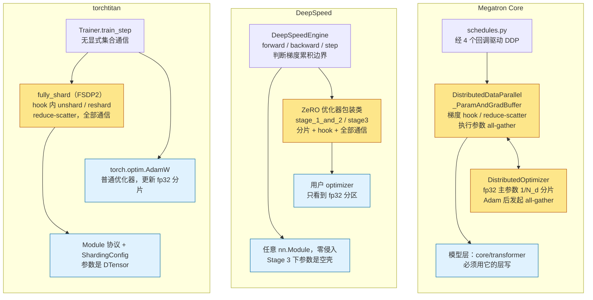
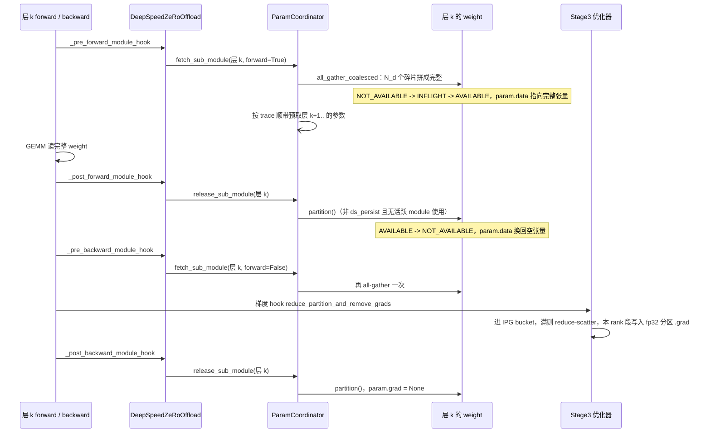

> [!NOTE]
> 本文源码引用以 DeepSpeed v0.19.2、PyTorch 2.13.0 为准。


上一篇（[02《并行策略全景》](/parallelism-strategies-which-state-to-shard.html)）给了 ZeRO-1/2/3 的字节账与通信账。本篇沿同一条 bf16 参数的生命线进 DeepSpeed 0.19.2 的源码：Stage 3 里 `param.data` 只是一个壳，完整的 bf16 参数在用到前由 hook all-gather 出来、用完立即打碎，常驻的是每参数 $$1/N_d$$ 的 `ds_tensor` 碎片和扁平 fp32 分区。三个框架并排的对照在 [06《三个框架对比》](/megatron-deepspeed-torchtitan-architecture-and-source-guide.html)，本篇只读 DeepSpeed。

> **一个 bf16 参数在 DeepSpeed Stage 3 里存在哪里、什么时候被 all-gather、什么时候被释放、它的 fp32 主副本在哪张卡上？[^q0]**

## 一、总览

DeepSpeed 是微软开源的训练框架，底座是 ZeRO：它沿着优化器这条轴切状态——优化器状态、梯度、参数分三级切到 $$N_d$$ 份。与 Megatron 不同，模型不需要用它的层写：任意一个 `nn.Module` 包进 `DeepSpeedEngine` 就能用 ZeRO-3。

先看 train-ledger 的 8 卡配置：ZeRO-3、DP=8，模型形状沿用 03 的 Llama 3.2 1B（$$L=16$$、$$h=2048$$、$$f=8192$$、$$v=128256$$，总计约 1,498,482,688 个参数）。F1 画的是每卡常驻什么，以及算到某一层 k 时完整参数从哪里来。


上排每个 rank 的色条是同一个权重 $$W_k$$ 的 1/8 切片；下面三行分别是 bf16 `ds_tensor`、bf16 梯度分区、fp32 主参数与 Adam 的 $$m,v$$，每份也各占 1/8。前向 pre-hook 把 8 片拼成完整 $$W_k$$，所以下排 8 张卡暂时都有一整份 bf16 权重；算完即 release，回到上排状态。

这 8 张卡上的一个 step 可以按六步读：

1. `zero.Init` 在构造时把每个参数切成 $$N_d$$ 段，本 rank 只留一段进 `ds_tensor`，`param.data` 换为空壳。
2. 前向到某一层时，pre-forward hook 把该层参数 all-gather 回完整 bf16 权重。
3. 该层算完，post-forward hook 立即 `partition()` 释放，`param.data` 又变空壳。
4. 反向到同一层时再 all-gather 一次；梯度就位后 reduce-scatter，本 rank 只留自己分区的梯度。
5. `step()` 时 Adam 更新 fp32 主参数分片，新值拷回 `ds_tensor`。
6. `step()` 不 all-gather 参数；下一个 step 的前向 hook 按需再取回。

第二步到第四步的「每卡只拿 1/8」折成字节，按 03 的参数总量 $$N\approx1.50\times10^9$$ 算（bf16 参数占 2 字节）：

- bf16 参数分片 $$2N/N_d$$。
- 梯度分区 $$2N/N_d$$：0.19.2 里 `data_types.grad_accum_dtype` 默认取模型 dtype（`runtime/engine.py` 的 `get_data_types()`），`bf16.enabled=true` 且不设 `data_types` 时梯度累积分区是 bf16，`grad_partitions_flat_buffer` 按 `gradient_accumulation_dtype` 分配（`stage3.py`）。
- fp32 主参数 + Adam 的 $$m,v$$ 共 $$12N/N_d$$。
- 常驻合计 $$16N/N_d$$，DP=8 时约 3.0 GB / 卡。
- 临时项：正在算的那一层完整的 bf16 参数，每层约 60.8M 参数 ≈ 121.6 MB；预取几层就乘几，深度由 `stage3_prefetch_bucket_size` 与 `stage3_max_live_parameters` 控制。

三框架的异同和取舍放在 [06《三个框架对比》](/megatron-deepspeed-torchtitan-architecture-and-source-guide.html)，本篇只读 DeepSpeed。

## 二、来龙去脉

下表按时间列出 DeepSpeed 的几次重要变化。年份和论文按原文、DeepSpeed 官方博客与 release 核过。

| 年 | 谁 | 当时的问题 | 怎么解决 | 效果 | 引入或遗留的问题 |
|---|---|---|---|---|---|
| 2019 | 微软 Samyam Rajbhandari 等 | 显存里最贵的优化器状态、梯度、参数都是整份常驻 | [ZeRO 论文](https://arxiv.org/abs/1910.02054)提出三级分片：Stage 1 切优化器状态、Stage 2 加切梯度、Stage 3 连参数也切 | 论文论证可训练超 100B 参数的模型 | 分片后参数要按层取回，通信模式变复杂 |
| 2020-02 | 微软 DeepSpeed 团队 | 大模型训练需要专门框架，ZeRO 只停在论文 | [DeepSpeed 开源](https://www.deepspeed.ai/2020/02/13/release.html)，自带 ZeRO-1（optimizer state partitioning） | Turing-NLG 17B 用它训练；宣称可到 100B 参数 | 只切了优化器状态 |
| 2020-05 | DeepSpeed 团队 | 梯度和激活的显存仍是整份 | [ZeRO-2 发布](https://www.deepspeed.ai/2020/05/18/zero-stage2.html)：梯度分区 + 激活分区 + 碎片整理 | 官方称可训 170B 参数，速度最高 10 倍 | Stage 1/2 里参数本身仍是整份 |
| 2020-09 | DeepSpeed 团队 | 参数本身还切不了，万亿参数要 3D 并行 | [v0.3.0](https://github.com/deepspeedai/DeepSpeed/releases/tag/v0.3.0) 一批发布：ZeRO-3、3D 并行、ZeRO-Offload 初版、1-bit Adam | 宣称可组合出万亿参数训练 | ZeRO-3 的参数取回时机要按层调度 |
| 2021 | Rajbhandari 等 | 单卡 GPU 装不下的模型只能靠多卡堆 | [ZeRO-Offload 论文](https://arxiv.org/abs/2101.06840)把 fp32 主参数与优化器计算挪到 CPU；3 月又发布 [ZeRO-3 Offload](https://www.deepspeed.ai/2021/03/07/zero3-offload.html) | 官方称单 GPU 可微调 40B 级模型 | CPU↔GPU 带宽成为新瓶颈 |
| 2021 | Rajbhandari 等 | 连 CPU 内存也不够装的状态 | [ZeRO-Infinity 论文](https://arxiv.org/abs/2104.07857)把 offload 扩到 NVMe，参数可放在磁盘上 | 论文称单节点可微调万亿级模型、512 卡 25 PFLOP/s | NVMe 带宽限制实用场景 |
| 2022 | Rajbhandari 等 | MoE 专家数多、单卡装不下，推理也慢 | [DeepSpeed-MoE 论文](https://arxiv.org/abs/2201.05596)：专家并行 + MoE 专用推理 | 论文报 MoE 推理最高快 7.3 倍 | 多了一套专家进程组要配置 |
| 2023 | 微软 | ZeRO-3 每层两次 all-gather 通信量大 | [ZeRO++ 论文](https://arxiv.org/abs/2306.10209)：量化通信 + hpZ 节点内二级参数分区 | 论文报 ZeRO-3 通信量明显下降 | 多一个二级分片副本和一组配置项 |
| 2023 | Jacobs、Tanaka 等 | 长序列下 TP 沿隐藏维切不再适用 | [DeepSpeed-Ulysses 论文](https://arxiv.org/abs/2309.14509)：序列并行，attention 时用 all-to-all 换回完整序列的头分片 | 论文报可训超长序列、通信随序列长近似不变 | 与 ZeRO、TP 的组合要另外配置 |
| 2023 | DeepSpeed 团队 | 推理侧每张卡还要手工配 TP | [AutoTP](https://github.com/deepspeedai/DeepSpeed/tree/v0.19.2/deepspeed/module_inject)（`module_inject/auto_tp.py`）：给定模型结构自动推 TP 切分 | 推理时免手写切分配置 | 只覆盖推理，训练仍要显式并行配置 |

这张表里能看到方向的变化：先沿优化器轴逐级切状态，再把状态搬出 GPU、搬到 NVMe；随后通信本身变成要省的对象，长序列和推理也各自有了专门的并行切法。

## 三、核心抽象

DeepSpeed 的对象按从下到上的依赖关系读。F2 把六层叠起来：最下面是进程组与通信，往上依次是构造时分片的参数、hook 与参数协调器、ZeRO 优化器包装类、`DeepSpeedEngine`；最上面是用户自己的训练循环。箭头一律指向上方，含义是「上层调用 / 依赖下层」。


- `groups.py` / `pipe/topology.py` / `comm` 提供进程组与通信原语，详见第五章。
- `zero.Init` / `ds_tensor` 让参数从构造起就是分片，详见第六章第 4 节。
- `DeepSpeedZeRoOffload` hooks + `PartitionedParameterCoordinator` 在 module 边界取回、释放、预取完整参数，详见第六章第 4 节。
- `DeepSpeedZeroOptimizer` / `_Stage3` 管梯度分区、fp32 主参数与 step，详见第六章第 3、4 节。
- `DeepSpeedEngine` 包装模型、接入 optimizer 与调度，详见第六章第 2、6 节。
- 用户训练循环只需要 `engine(batch)`、`engine.backward(loss)`、`engine.step()` 三个调用，详见第六章第 6 节。

## 四、最小任务：runs/deepspeed

train-ledger 里的练手配置是 ZeRO-3、DP 8，模型形状沿用 03 的 Llama 3.2 1B。三个框架并排的对账与预期数字在 06 的 [train-ledger 一节](/megatron-deepspeed-torchtitan-architecture-and-source-guide.html#五本文小结)，这里只留 DeepSpeed 这份配置（`runs/deepspeed/ds_config.json`，键名以 0.19.2 `runtime/constants.py` 与 `zero/config.py` 为准）：

```json title="runs/deepspeed/ds_config.json"
{
  "train_micro_batch_size_per_gpu": 1,
  "gradient_accumulation_steps": 2,
  "gradient_clipping": 1.0,
  "steps_per_print": 1,
  "bf16": { "enabled": true },
  "optimizer": {
    "type": "AdamW",
    "params": { "lr": 3e-4, "betas": [0.9, 0.95], "weight_decay": 0.1 }
  },
  "zero_optimization": {
    "stage": 3,
    "overlap_comm": true,
    "contiguous_gradients": true,
    "reduce_bucket_size": 5e7,
    "stage3_prefetch_bucket_size": 5e7,
    "stage3_param_persistence_threshold": 1e5,
    "stage3_max_live_parameters": 1e9,
    "stage3_max_reuse_distance": 1e9,
    "sub_group_size": 1e9
  },
  "wall_clock_breakdown": true,
  "memory_breakdown": false,
  "flops_profiler": { "enabled": true, "profile_step": 20, "module_depth": -1, "top_modules": 3, "detailed": false }
}
```

JSON 键分四组看：

- **批次**：`train_micro_batch_size_per_gpu` × `gradient_accumulation_steps` × DP 数推出 `train_batch_size`（这里 1 × 2 × 8 = 16），`train_batch_size` 本身省略不写。
- **精度与优化器**：`bf16.enabled` 决定模型 dtype，也连带决定默认的梯度累积 dtype（第一章的账）；`optimizer` 段建 AdamW，`gradient_clipping` 在 step 里做裁剪。
- **ZeRO 阈值**：`stage3_prefetch_bucket_size` 控制每次顺带预取的参数量，对应 F5 里「同时活着的完整参数」；`stage3_param_persistence_threshold` 决定多小的参数在 forward/backward 期间保持完整（`ds_persist`，见第六章第 4、5 节）；`stage3_max_live_parameters`、`stage3_max_reuse_distance` 分别封顶在途完整参数和「很快又用的参数不释放」的距离；`reduce_bucket_size` 是梯度 IPG bucket 的大小（第六章第 3 节）；`sub_group_size` 把参数切成 sub-group，每个 sub-group 一对 bf16 / fp32 扁平分区（第六章第 4 节）。
- **记录**：`wall_clock_breakdown` 与 `flops_profiler` 打印耗时与 FLOPs，对照第五章的通信账。

`train_ds.py` 的骨架：

```python title="runs/deepspeed/train_ds.py 的骨架"
"""train-ledger / runs/deepspeed/train_ds.py -- ZeRO-3 on any plain-PyTorch Llama implementation."""
import deepspeed, torch
from probe_memory import MemoryProbe

def main():
    deepspeed.init_distributed()
    cfg = "runs/deepspeed/ds_config.json"
    # zero.Init: parameters are partitioned (ds_tensor) as soon as each module's __init__ returns,
    # so the full 1B model is never materialised on one GPU.
    with deepspeed.zero.Init(config_dict_or_path=cfg, dtype=torch.bfloat16):
        model = build_llama_1b()            # any plain nn.Module Llama (16 layers, h=2048, 32/8 heads, ffn 8192)
    engine, _, _, _ = deepspeed.initialize(model=model, model_parameters=model.parameters(), config=cfg)
    probe = MemoryProbe("deepspeed", profile_steps=range(20, 22))
    for step, batch in enumerate(mock_batches(seq_len=8192, vocab=128256, device=engine.device)):
        with probe.step(step):
            for micro in range(engine.gradient_accumulation_steps()):
                loss = engine(**batch[micro])
                engine.backward(loss)
                engine.step()                # only the accumulation boundary takes a real optimizer step
        if step == 50:
            break
    probe.dump("runs/deepspeed/probe.json")
```

模型实现不限（任何一份纯 PyTorch 的 Llama 都可以），这正是 DeepSpeed 的卖点；`build_llama_1b()` 与 `mock_batches()` 不在本篇给出。

## 五、进程组：groups.py 的委托与自建

并行策略落到代码里的第一件事是进程组：每张卡属于哪一个 TP 组、哪一个 DP 组、哪一个 PP 组。DeepSpeed 的进程组有三个来源：

- **外部 `mpu`**：`deepspeed/utils/groups.py` 的模块级变量 `mpu` 若被设置（用户通过 `deepspeed.initialize(mpu=...)` 传入一个 Megatron 风格的对象，需提供 `get_data_parallel_group()`、`get_model_parallel_group()` 等方法），所有 `_get_data_parallel_group()`、`_get_model_parallel_world_size()` 都转发给它。没有 `mpu` 时，DP 组就是 `_clone_world_group()`——整个世界的一个克隆。这反映了 DeepSpeed 的定位：它自己只负责 DP 系（ZeRO）的那一维，模型并行的进程组由外部框架（历史上是 Megatron-DeepSpeed）提供。
- **`groups.py` 自建**：MoE、ZeRO++ hpZ、autoTP 各建各的组（见下面的展开）。
- **`pipe/topology.py`**：`ProcessTopology` 用一组 `axes` 与 `dims` 描述网格，`PipeModelDataParallelTopology(num_pp, num_mp, num_dp)` 是三维实例，`PipelineParallelGrid` 从中建出 PP、DP、MP 各组，`PipelineEngine` 用它而不是 `groups.py`。

`DeepSpeedEngine._configure_distributed_model()` 里 `self.data_parallel_group`、`self.seq_data_parallel_group`、`self.expert_data_parallel_group` 各自从不同来源取。

<details markdown="1"><summary>源码细节：MoE、hpZ、autoTP 各自建的组</summary>

`_create_expert_and_data_parallel()` / `_create_expert_data_and_model_parallel()` 为 MoE 建 `ep` 与 `expt-dp` 组，按 `ep_size` 命名存进字典（`_get_expert_parallel_group(group_name)`）；`_create_zero_param_parallel_group()` 为 ZeRO++ 的 hpZ（`zero_hpz_partition_size`）建节点内的「二级参数分区组」，Stage 3 反向时的参数 all-gather 走它（`ds_secondary_tensor`）；`_init_tp_mesh_device()` 为 autoTP（`tensor_parallel` 配置）调用 `dist.initialize_mesh_device()`（`deepspeed/comm/comm.py`）建一个 `(data_parallel, tensor_parallel)` 的二维 DeviceMesh——这是 DeepSpeed 里少数用到 DeviceMesh 的地方。

</details>

## 六、源码导读：按优化器状态切

### 1. 目录地图

```text title="DeepSpeed 目录地图"
deepspeed/
  __init__.py                          initialize(model, optimizer, config, mpu, ...) → (engine, optimizer, dataloader, lr_scheduler)
  runtime/
    engine.py                          DeepSpeedEngine(Module)：forward / backward / step；_configure_distributed_model / _configure_optimizer / _configure_zero_optimizer
    config.py                          DeepSpeedConfig：解析 JSON
    constants.py                       JSON 键名常量：train_batch_size、train_micro_batch_size_per_gpu、gradient_accumulation_steps、bf16 …
    zero/
      config.py                        DeepSpeedZeroConfig：stage、overlap_comm、contiguous_gradients、reduce_bucket_size、stage3_* …
      stage_1_and_2.py                 DeepSpeedZeroOptimizer（Stage 1 / 2）
      stage3.py                        DeepSpeedZeroOptimizer_Stage3
      partition_parameters.py          Init 上下文；_convert_to_deepspeed_param 给参数挂 ds_* 属性与 all_gather / partition 方法
      parameter_offload.py             DeepSpeedZeRoOffload：注册前向 / 反向 hook
      partitioned_param_coordinator.py PartitionedParameterCoordinator：fetch / release / prefetch
    pipe/
      module.py                        PipelineModule、LayerSpec、TiedLayerSpec
      engine.py                        PipelineEngine(DeepSpeedEngine)：train_batch、_exec_* 指令实现
      schedule.py                      TrainSchedule 等 PipeSchedule；PipeInstruction 子类
      topology.py                      ProcessTopology、PipelineParallelGrid
      p2p.py                           send / recv
  utils/groups.py                      进程组（第五章）
  comm/comm.py                         deepspeed.comm：对 torch.distributed 的封装，可换后端
```

### 2. DeepSpeedEngine：包裹用户模型

**问题**：用户的模型是普通的 `nn.Module`，ZeRO 要在不改模型代码的前提下接管 forward / backward / step。

**直觉**：包一层 engine。DeepSpeed 的入口是 `deepspeed.initialize(model=..., optimizer=..., config=...)`，返回一个 `DeepSpeedEngine`（`runtime/engine.py`）。它继承 `nn.Module`，持有用户的 `self.module`，用户之后调用的是 `engine(batch)`、`engine.backward(loss)`、`engine.step()` 三个方法，模型代码一行不改。构造函数的顺序：

```text title="DeepSpeedEngine.__init__ 的顺序"
DeepSpeedEngine.__init__
  _configure_distributed_model(model)        把 module 移到设备、转 dtype；确定 data_parallel_group / seq_data_parallel_group / expert_data_parallel_group
                                             非 ZeRO 时广播参数使各 DP rank 一致
  _configure_optimizer(client_optimizer, model_parameters)
    _configure_basic_optimizer()             按 JSON 的 optimizer 段建 Adam / AdamW / FusedAdam …
    → zero_optimization().stage > 0 ?        _configure_zero_optimizer(basic_optimizer)
        stage 1 / 2                          DeepSpeedZeroOptimizer(...)      （stage_1_and_2.py）
        stage 3                              DeepSpeedZeroOptimizer_Stage3(...)（stage3.py）
      : bf16 ?                               _configure_bf16_optimizer()
      : fp16 ?                               _configure_fp16_optimizer()
  _configure_lr_scheduler()
```

所以 DeepSpeed 的「ZeRO 优化器」是一个**优化器包装类**：它接管用户优化器的 `param_groups`，把里面的参数替换成分片；ZeRO 的一切——分片、hook、通信——都在这个包装类里，engine 只在 `backward()` 与 `step()` 里调用它。这与 Megatron（DDP 负责梯度通信、优化器负责参数分片与 all-gather，两个类）和 torchtitan（FSDP 负责一切通信、优化器是普通的）都不同。三种「谁持有分片、谁发起通信」的归属画在一起（黄色 = 分片与集合通信所在的类）：



### 3. Stage 1 / 2：扁平分区

**问题**：Stage 1/2 不切参数本身，参数在每张卡上仍是整份——怎么让「优化器状态切 1/N_d」又不破坏参数的完整地址？

**直觉**：把一个 param group 里所有参数先拍平成一段连续内存，每段切成 $$N_d$$ 份，每个 rank 拿自己那份的 fp32 拷贝去更新；参数的 `.data` 仍是扁平张量里的视图，更新后 all-gather 拼回整段。F3 用三个参数 A（5 个元素）、B（4 个）、C（2 个）走一遍：总数 11，pad 到 12，DP=4 时每段 3 个元素——分片边界落在参数内部，rank 1 那段一半在 A、一半跨到 B 的边。


`stage_1_and_2.py` 的 `DeepSpeedZeroOptimizer` 构造时，对每个 param group：

1. 把组内所有 bf16 参数**拍平拼接**成一个一维张量 `bit16_groups_flat[i]`（`flatten_dense_tensors_aligned()`，pad 到 `dp_size` 的倍数），然后把每个参数的 `.data` 重新指向这个扁平张量里的视图——与 Megatron 的 `param_data` buffer 同一个思路，只是以 param group 而不是 dtype 为单位。
2. `get_data_parallel_partitions()` 把扁平张量均分成 `dp_size` 段，得到 `parallel_partitioned_bit16_groups[i]`。
3. `single_partition_of_fp32_groups[i]` = 本 rank 那一段的 fp32 克隆（`.detach().clone().float()`）——**fp32 主参数**，$$1/N_d$$。用户优化器的 `param_groups[i]['params']` 被替换成这一个 fp32 张量。

梯度路径：`create_gradient_handling_hooks()` 给每个参数注册梯度 hook，`reduce_ready_partitions_and_remove_grads()` 把就位的梯度攒进 IPG（independent partition gradient）bucket（`IPGBucket`，大小 `reduce_bucket_size`，默认 5e8 元素），满了就 `reduce_ipg_grads()` → `average_tensor()`：Stage 2（`partition_grads=True`）时按分区归属把 bucket 里的梯度分别 reduce 到各自的 owner（`reduce_scatter=True` 时用 reduce-scatter），本 rank 只保留自己分区的梯度、其余立即释放；Stage 1 时 all-reduce、所有梯度保留。`overlap_comm=True` 时通信在单独的 stream 上与反向重叠；`contiguous_gradients=True` 时本 rank 分区的梯度拷进一段连续内存以减少碎片。

`step()`：检查溢出（fp16 时）→ 梯度裁剪 → 对每个 group `_optimizer_step(i)`：用户优化器在 fp32 分区上更新 → `bit16_partitions[partition_id].data.copy_(fp32_partition.data)`（fp32 → bf16，只写本 rank 那一段）→ `all_gather_dp_groups()` 把各 rank 的 bf16 段拼成完整的 `bit16_groups_flat`。因为参数的 `.data` 是扁平张量的视图，all-gather 完成的瞬间所有参数就是更新后的值。

与 Megatron 的 ZeRO-1 相比，机制几乎一样（扁平 buffer、按字节区间分片、fp32 分片拷贝、更新后 all-gather），差别在于粒度（DeepSpeed 以 param group 为 buffer、以 bucket 为 reduce 单位；Megatron 以 dtype 为 buffer、以 bucket group 为通信单位）和重叠方式（DeepSpeed 的 all-gather 在 `step()` 里同步完成，不与下一 step 前向重叠；Megatron 可以）。

### 4. Stage 3：ds_tensor 与 hook

**问题**：Stage 3 连参数本体也切成 $$1/N_d$$，可算到某一层时需要的是完整权重——谁来决定什么时候把参数拼回来、什么时候再扔掉？

**直觉**：靠 module 边界上的 hook。每个 module 前向前 all-gather 自己的参数、用完释放，反向对称；取回的时机按第一个 step 记录的执行顺序预取。整个机制分在四个文件里，按参数的生命周期读。

**分片（`partition_parameters.py`）**。`deepspeed.zero.Init` 是一个上下文管理器（类 `Init`，继承 `InsertPostInitMethodToModuleSubClasses`）：在它里面构造的每个 `nn.Module`，其 `__init__` 结束后会被 `_post_init_method()` 拦截，对每个参数调用 `_convert_to_deepspeed_param()`。这个函数给参数挂上一组 `ds_*` 属性——`ds_status`（`AVAILABLE` / `NOT_AVAILABLE` / `INFLIGHT`）、`ds_shape`、`ds_numel`、`ds_tensor`（**分片**，本 rank 持有的 $$1/N_d$$ 一维碎片）、`ds_process_group`、`ds_persist`（小于 `stage3_param_persistence_threshold` 的参数在前向、反向期间保持完整，只在 step 前后短暂分片）、`ds_secondary_tensor`（hpZ 的节点内二级副本）——以及一组方法：`all_gather()`、`all_gather_coalesced()`、`partition()`、`ds_summary()`。随后 `_partition()` 把参数的完整数据切成 `dp_size` 段、只留本 rank 的一段进 `ds_tensor`，然后 `free_param()` 把 `param.data` 换成一个空张量。**从这一刻起，模型里的 `nn.Parameter` 只是一个壳**，形状对但没有数据。若不用 `zero.Init`，`DeepSpeedZeRoOffload.__init__`（`parameter_offload.py`）里的 `_convert_to_zero_parameters()` 会对已构造好的模型做同样的转换，但那要求模型先能完整放进内存。

实验室的 toy（`04_deepspeed_toys.py shards`，4 个 gloo rank）把这一步按参数打印出来——每个参数独立分片，`param.data` 是空壳、`ds_tensor` 是本 rank 的那一段：

```text title="python 04_deepspeed_toys.py shards（节选）"
rank0: W1: param.data=(0,), ds_tensor=(3,)，参数原形状=(3, 4)，numel=12
rank0: W2: param.data=(0,), ds_tensor=(2,)，参数原形状=(4, 2)，numel=8
rank0: b:  param.data=(0,), ds_tensor=(1,)，参数原形状=(2,)，numel=2
```

**取回与释放（`parameter_offload.py` + `partitioned_param_coordinator.py`）**。`DeepSpeedZeRoOffload.setup_zero_stage3_hooks()` 遍历模型的每个子 module，`_register_deepspeed_module()` 给它注册四个 hook：`_pre_forward_module_hook`、`_post_forward_module_hook`、`_pre_backward_module_hook`、`_post_backward_module_hook`。它们分别调用 `pre_sub_module_forward_function()` → `PartitionedParameterCoordinator.fetch_sub_module(sub_module, forward=True)`（把该 module 直接持有的参数 all-gather 回来，`ds_status` 变 `AVAILABLE`，`param.data` 指向拼好的完整张量）、`post_sub_module_forward_function()` → `release_sub_module()`（对不再被任何活跃 module 使用、且非 `ds_persist` 的参数调用 `__release_param()` → `param.partition()`，完整张量释放）；反向对称。

`PartitionedParameterCoordinator` 里有两个提高效率的机制。**trace**：第一个 step 记录 module 的执行顺序（`record_module()`），之后按这个顺序**预取**——`fetch_sub_module()` 在取回当前 module 的参数时，顺带发起后面几个 module 的 all-gather（总量由 `stage3_prefetch_bucket_size` 控制），`stage3_max_live_parameters` 限制同时活着的完整参数总数、`stage3_max_reuse_distance` 决定「很快又要用」的参数不释放。**coalesced all-gather**：`all_gather_coalesced()`（`partition_parameters.py` 里的 `_all_gather_coalesced()`）把一个 module 的多个参数拼成一次 `all_gather_into_tensor` 调用，返回 `AllGatherCoalescedHandle`，`wait()` 时再拆回各参数。

预取换的是显存。toy 的 `memory` 子实验在每个 hook 事件后记录活着的完整参数字节数：不预取时峰值是一层的 48 B，预取一层时峰值是两层的 88 B。F5 用 toy 事件序列画出锯齿形状，再把每个 live layer 按真实 bf16 层大小 121.6 MB 缩放；图上是模型量级，不是 toy 的 48 / 88 B。原始 toy 数字仍列在下面。


```text title="python 04_deepspeed_toys.py memory（prefetch_depth=1 节选）"
forward gather layer0     live_full_parameter_bytes=48
forward prefetch layer1   live_full_parameter_bytes=88
forward compute layer0    live_full_parameter_bytes=88
forward release layer0    live_full_parameter_bytes=40
forward compute layer1    live_full_parameter_bytes=40
forward release layer1    live_full_parameter_bytes=0
```

四个文件在一层的前向、反向里各自出场的次序如下（`ds_status` 与 `param.data` 的身份随之变化四次）：

<details markdown="1"><summary>源码细节：一层的前向 / 反向里 hook、协调器与优化器的调用顺序</summary>



</details>

**梯度（`stage3.py`）**。`create_reduce_and_remove_grad_hooks()` 给每个参数注册 `reduce_partition_and_remove_grads` hook；梯度就位后进 IPG bucket（`IPGBucketZ3`），满了 `__reduce_and_partition_ipg_grads()` → `__avg_scatter_grads()`（reduce-scatter）→ `partition_grads()` 把本 rank 分区的梯度写进梯度分区或 `fp32_partitioned_groups_flat[sub_group].grad`（取决于 `gradient_accumulation_dtype`，默认 bf16 梯度分区），然后 `param.grad = None`。反向结束时该参数本身也已被 `_post_backward_module_hook` 释放。

**fp32 主参数与 step（`stage3.py`）**。参数按 `sub_group_size`（默认 1e9 元素）分成若干 sub-group，每个 sub-group 有一个扁平的 bf16 分区 `fp16_partitioned_groups_flat[i]`（各参数 `ds_tensor` 的拼接）和一个扁平的 fp32 分区 `fp32_partitioned_groups_flat[i]`（`_create_fp32_partitions()`，`offload_optimizer` 时放 CPU pinned memory）。`step()` 对每个 sub-group：`_prepare_fp32_grad_for_sub_group()` → `_optimizer_step(i)`（用户优化器只看到这个 fp32 分区）→ `_reassign_or_swap_out_partitioned_parameters()` 把 fp32 分区拷回 bf16 分区（`fp16_partitioned_groups_flat[i].data.copy_(fp32_partitioned_groups_flat[i].data)`）。`_post_step()` 只 all-gather `persistent_parameters`——其余参数**不在 step 里 all-gather**，等下一 step 前向的 hook 按需取回。这就是第二篇里「ZeRO-3 省掉优化器后那次 all-gather」的代码位置。

### 5. 一个 bf16 参数的一生：DeepSpeed Stage 3

**问题**：`param.data` 在一个 step 里变几次身份，每次都因为什么？

**直觉**：它只有「被用到的那一刻」是完整的。F4 把一个 `nn.Linear.weight` 的一个 step 画成三条泳道：上面是计算事件，中间是通信事件，下面是 `param.data` 的身份——空壳 → 完整 → 空 → 完整 → 空。


toy 的 `lifecycle` 子实验用 4 个 rank 真跑这一组事件，输出和 F4 逐格对应（每个参数两次 gather、两次 release）：

```text title="python 04_deepspeed_toys.py lifecycle（一个参数的轨迹，rank0）"
W1.data: 空壳 -> 完整 (3, 4)（all-gather）
W1.data: 完整 -> 空壳（前向后 release）
W1.data: 空壳 -> 完整 (3, 4)（all-gather）
W1.data: 完整 -> 空壳（反向 reduce-scatter 后 release）
step：Adam 更新各 rank 的 fp32 shard；新值仍留在 ds_tensor，不做全参数 all-gather
末态参数与单进程参考的 max|diff| = 0.00000000
```

逐时刻的版本（含源码位置）收在下面的折叠块里：

<details markdown="1"><summary>源码细节：一个 bf16 参数的一生（DeepSpeed Stage 3）逐时刻表</summary>

以一个 Transformer 层的 `nn.Linear.weight` 为例（`bf16.enabled=true`，`zero_optimization.stage=3`，不 offload）：

| 时刻 | 事件 | 在哪里 |
|---|---|---|
| zero.Init 内构造 | weight 完整构造 → _convert_to_deepspeed_param → _partition<br/>weight.ds_tensor ← 本 rank 的 1/N_d 一维碎片（bf16）；weight.data ← 空张量 | partition_parameters.py Init._post_init_method |
| 优化器构造 | fp16_partitioned_groups_flat[g] ← sub-group 内各 ds_tensor 拼接<br/>fp32_partitioned_groups_flat[g] ← 其 fp32 拷贝（1/N_d） | stage3.py _create_fp16_partitions_with_defragmentation<br/>_create_fp32_partitions |
| step i，该层前向前 | _pre_forward_module_hook → fetch_sub_module<br/>all_gather_coalesced：N_d 个碎片 → weight.data（bf16，完整）；同时预取后面几层 | parameter_offload.py / partitioned_param_coordinator.py |
| 该层前向 | GEMM 读 weight（完整） |  |
| 该层前向后 | _post_forward_module_hook → release_sub_module → weight.partition() | weight.data 又是空张量 |
| 该层反向前 | _pre_backward_module_hook → fetch_sub_module（再 all-gather 一次） |  |
| 该层反向 | dW 生成 → 梯度 hook → 进 IPG bucket → reduce-scatter<br/>本 rank 得到 dW[本 rank 段] → 写进梯度分区；weight.grad = None | stage3.py reduce_partition_and_remove_grads / __avg_scatter_grads |
| 该层反向后 | _post_backward_module_hook → release → weight.partition() |  |
| engine.step | 对每个 sub-group：Adam 更新 fp32 分区（1/N_d）<br/>fp32 分区 → fp16_partitioned_groups_flat（即各 ds_tensor，bf16）<br/>不 all-gather（除 ds_persist 的小参数） | stage3.py step → _optimizer_step<br/>_reassign_or_swap_out_partitioned_parameters<br/>_post_step |
| step i+1，该层前向前 | 再 fetch_sub_module → all-gather | 回到上面 |

</details>

**常驻**：bf16 碎片 $$2N/N_d$$、fp32 主参数 + m + v $$12N/N_d$$、梯度分区 $$2N/N_d$$（`grad_accum_dtype` 默认跟模型 dtype，即 bf16）——合计 $$16N/N_d$$；设 `data_types.grad_accum_dtype="fp32"` 则变 $$4N/N_d$$、合计 $$18N/N_d$$。**临时**：正在前向 / 反向的那几层的完整 bf16 参数（预取深度决定有几层）。**通信**：每层前向一次 all-gather、反向一次 all-gather、一次 reduce-scatter，合计 $$3N$$。

与 Megatron 的时序放在一起，最大的差别是 **`param.data` 的身份是流动的**：Megatron 的 `weight.data` 从头到尾是 buffer 里同一段视图；DeepSpeed Stage 3 的 `weight.data` 在一个 step 里被替换四次（空 → 完整 → 空 → 完整 → 空）。这带来 Stage 3 的两个著名代价：任何在 hook 之外访问参数的代码（自定义的权重初始化、`param.data` 的手工操作、把参数当普通张量传给别的函数）都会拿到空张量，需要用 `deepspeed.zero.GatheredParameters` 显式取回；以及调试困难——参数「不在」的时候栈里看不到原因。`stage3_module_granularity_threshold` 与 `leaf_module` 配置（`DeepSpeedZeroLeafModuleConfig`）让 hook 挂在更粗的 module 上，是对这个代价的折衷。

「前向前 all-gather」这个机制也就是本节说的 pre-forward hook 取回——它与 FSDP1、FSDP2 的逐项并排在 [06《三个框架对比》](/megatron-deepspeed-torchtitan-architecture-and-source-guide.html#三对照阅读)。

### 6. 训练循环：forward / backward / step

**问题**：ZeRO 要决定什么时候 reduce、什么时候更新，但循环还是用户写的——边界怎么判断？

**直觉**：engine 数 micro-step。DeepSpeed 没有训练循环——用户写循环，engine 提供三个方法：

```text title="DeepSpeed 的训练循环：forward / backward / step"
for step in ...:
  for micro in range(gradient_accumulation_steps):
    loss = engine(batch)                     DeepSpeedEngine.forward：计时、flops profiler、Stage 3 的 root hook 起点
    engine.backward(loss)                    loss / gradient_accumulation_steps；ZeRO 时 optimizer.scale_if_loss；loss.backward()
                                             _backward_epilogue：ZeRO 时 optimizer.backward_epilogue()（清 IPG bucket、结束 reduce）
                                                                非 ZeRO 时 allreduce_gradients()（在梯度累积边界）
    engine.step()                            is_gradient_accumulation_boundary() 才真正 _take_model_step：
                                               optimizer.step()（ZeRO 的 step，含裁剪、更新、all-gather）
                                               lr_scheduler.step(); zero_grad
                                             global_steps += 1；micro_steps += 1
```

`gradient_accumulation_steps` 由 JSON 的 `train_batch_size / (train_micro_batch_size_per_gpu × dp_size)` 推出，engine 用 `micro_steps` 计数判断边界——用户不需要自己写 `no_sync`。这个设计让「零侵入」成立：现有的单卡训练脚本只要把 `model` 换成 `engine`、`loss.backward()` 换成 `engine.backward(loss)`、`optimizer.step()` 换成 `engine.step()` 就能用 ZeRO-3。代价是控制权在 engine 手里：什么时候 all-gather、什么时候 reduce、什么时候释放，都由 JSON 里的阈值决定，用户能调的是数字而不是顺序。

### 7. pipe/ 引擎与 JSON 配置的代价

流水线在 DeepSpeed 里是另一个 engine：`runtime/pipe/module.py` 的 `PipelineModule` 要求用户把模型写成一个 `LayerSpec` 列表（每层的类与构造参数），`_partition_layers()` 按 `partition_method`（`"uniform"`、`"parameters"`、`"type:regex"`）把层分给各 stage；`runtime/pipe/engine.py` 的 `PipelineEngine` 继承 `DeepSpeedEngine`，`train_batch()` 取代 forward / backward / step 三步：它构造一个 `TrainSchedule`（`runtime/pipe/schedule.py`），`_exec_schedule()` 逐步执行调度产出的指令。

`TrainSchedule.steps()` 是一个生成器，共 `2 × (micro_batches + stages - 1)` 步，每步 yield 一组 `PipeInstruction`——`RecvActivation`、`ForwardPass`、`SendActivation`、`RecvGrad`、`BackwardPass`、`SendGrad`、`LoadMicroBatch`、最后一步加 `ReduceTiedGrads`、`ReduceGrads`、`OptimizerStep`；`_exec_schedule()` 用 `_INSTRUCTION_MAP` 把每种指令映射到 `_exec_forward_pass()`、`_exec_send_activations()` 等方法。这是介于 Megatron 的过程式与 PyTorch pipelining 的动作表之间的第三种写法：调度是声明的（指令序列），执行是解释的。`num_pipe_buffers()` 返回 `min(stages - stage_id, micro_batches)`——就是 1F1B 在途 micro-batch 数 $$p - i$$。PP 与 ZeRO 的组合有限制：`_configure_zero_optimizer()` 在 `PipelineModule` 下强制 `overlap_comm=False`，Stage 3 与 PP 不兼容。

JSON 配置是 DeepSpeed 易用性的来源，也是它的代价所在。`runtime/zero/config.py` 的 `DeepSpeedZeroConfig` 有四十多个字段，其中 Stage 3 的六个阈值（`stage3_prefetch_bucket_size`、`stage3_param_persistence_threshold`、`stage3_max_live_parameters`、`stage3_max_reuse_distance`、`sub_group_size`、`reduce_bucket_size`）共同决定显存峰值与通信重叠程度，但它们之间的关系不在任何一个地方被算出来——用户要靠经验或 `see_memory_usage` 的日志调。而且配置里有大量隐式耦合：`train_batch_size`、`train_micro_batch_size_per_gpu`、`gradient_accumulation_steps` 三者给两个推第三个；`bf16.enabled` 与 `fp16.enabled` 互斥；`zero_optimization.offload_optimizer` 只在 Stage 1–3 有效但 Stage 1/2 与 3 的行为不同。JSON 无法表达这些约束，只能在 `DeepSpeedConfig` 的校验里报错。

## 七、本文小结

一个 bf16 参数在 DeepSpeed Stage 3 里的一生：常驻 $$1/N_d$$ 碎片（`ds_tensor`），`param.data` 只是形状对的空壳；前向到某个 module 时 hook 触发参数协调器 all-gather 出完整参数、用完立即释放回碎片，反向再来一次；fp32 主参数是优化器里的扁平分区，只在 step 时被 Adam 看到——合计常驻约 $$16N/N_d$$、通信 $$3N$$。`param.data` 身份的流动（一个 step 内换四次）是 Stage 3 一切的来源，也是它一切代价的来源。

本篇涉及的源码位置（DeepSpeed 0.19.2，另见各节目录地图）：

| 路径 | 内容 |
|---|---|
| DeepSpeed 0.19.2 `deepspeed/__init__.py`、`runtime/engine.py` | `initialize()`；`DeepSpeedEngine`：`_configure_distributed_model()`、`_configure_optimizer()`、`_configure_zero_optimizer()`、`forward()`、`backward()`、`_backward_epilogue()`、`allreduce_gradients()`、`step()`、`_take_model_step()`、`is_gradient_accumulation_boundary()`、`get_data_types()` |
| DeepSpeed 0.19.2 `deepspeed/runtime/zero/stage_1_and_2.py` | `DeepSpeedZeroOptimizer`：`bit16_groups_flat`、`parallel_partitioned_bit16_groups`、`single_partition_of_fp32_groups`、`create_gradient_handling_hooks()`、`reduce_ready_partitions_and_remove_grads()`、`reduce_ipg_grads()`、`average_tensor()`、`step()`、`_optimizer_step()`、`update_lp_params()`；`IPGBucket` |
| DeepSpeed 0.19.2 `deepspeed/runtime/zero/stage3.py` | `DeepSpeedZeroOptimizer_Stage3`：`_create_fp16_partitions_with_defragmentation()`、`_create_fp32_partitions()`、`create_reduce_and_remove_grad_hooks()`、`reduce_independent_p_g_buckets_and_remove_grads()`、`partition_grads()`、`grad_partitions_flat_buffer`、`step()`、`_optimizer_step()`、`_reassign_or_swap_out_partitioned_parameters()`、`_post_step()`、`_partition_all_parameters()`；`sub_group_size` |
| DeepSpeed 0.19.2 `deepspeed/runtime/zero/partition_parameters.py`、`parameter_offload.py`、`partitioned_param_coordinator.py` | `Init`（`_post_init_method()`、`_convert_to_deepspeed_param()`、`_partition()`）、`ZeroParamStatus`、`free_param()`、`AllGatherCoalescedHandle`<br/>`DeepSpeedZeRoOffload`（`setup_zero_stage3_hooks()`、`_register_deepspeed_module()`、`pre_sub_module_forward_function()` 等四个）<br/>`PartitionedParameterCoordinator`（`fetch_sub_module()`、`release_sub_module()`、`record_module()`、`trace_prologue()`） |
| DeepSpeed 0.19.2 `deepspeed/runtime/zero/config.py`、`runtime/constants.py`、`profiling/constants.py` | `DeepSpeedZeroConfig`（`stage`、`overlap_comm`、`contiguous_gradients`、`reduce_bucket_size`、`allgather_bucket_size`、`prefetch_bucket_size` 等 `stage3_*` 别名、`sub_group_size`、`zero_hpz_partition_size`）；JSON 键常量（`data_types.grad_accum_dtype` 默认 `None` → 取模型 dtype） |
| DeepSpeed 0.19.2 `deepspeed/runtime/pipe/{module,engine,schedule,topology,p2p}.py` | `PipelineModule`、`LayerSpec`、`TiedLayerSpec`、`_partition_layers()`<br/>`PipelineEngine`（`train_batch()`、`_exec_schedule()`、`_exec_forward_pass()` 等）<br/>`TrainSchedule`（`steps()`、`num_pipe_buffers()`）、`PipeInstruction` 子类<br/>`ProcessTopology`、`PipeModelDataParallelTopology`、`PipelineParallelGrid` |
| DeepSpeed 0.19.2 `deepspeed/utils/groups.py`、`comm/comm.py` | `mpu` 委托、`_get_data_parallel_group()`、`_clone_world_group()`、`_create_expert_and_data_parallel()`、`_create_zero_param_parallel_group()`、`_init_tp_mesh_device()`；`initialize_mesh_device()`、`init_distributed()` |
| train-ledger `runs/deepspeed/`、`probe_memory.py` | 本篇练手配置与探针，见第四章 |
| labs `large-scale-training/04_deepspeed_toys.py`、`04_deepspeed_figures.py` | 本篇的 ZeRO-3 toy（shards / lifecycle / memory）与 F1–F5 生成脚本 |


Table: 本篇涉及的源码位置

## 八、自测

1. DeepSpeed ZeRO-3 的「参数协调器」做什么？trace 预取解决了什么问题？

   <details markdown="1"><summary>答案</summary>

   在 module 的 pre-forward / pre-backward hook 里 all-gather 即将用到的参数、post hook 里释放；第一步记录 module 的执行顺序（trace），之后按顺序提前 all-gather 下一个 module 的参数——把通信藏在当前 module 的计算后面，否则每层都要停下等参数。

   </details>

2. `deepspeed.zero.Init` 解决了什么问题？不用它会怎样？

   <details markdown="1"><summary>答案</summary>

   它在每个 `nn.Module.__init__` 结束时拦截并把参数切成 `ds_tensor`——模型从构造起就只有分片，完整参数从不占内存。不用它的话 `_convert_to_zero_parameters()` 也能转换已构造好的模型，但要求完整模型先能放进内存，大模型在这一步就 OOM。

   </details>

3. `engine.step()` 为什么不一定真的更新参数？Stage 3 的 step 里为什么不做参数 all-gather？

   <details markdown="1"><summary>答案</summary>

   `is_gradient_accumulation_boundary()` 为真才 `_take_model_step`，其余 step 只累积梯度——梯度累积边界由 JSON 推出，用户不用自己写 no_sync。Stage 3 的 step 只 all-gather `ds_persist` 的小参数；完整参数在下一 step 前向被 hook 按需取回，省掉一次全量 all-gather。

   </details>

4. F4 里 `param.data` 在一个 step 内变了几次身份？如果一段代码在 forward 之外直接读 `weight.data`，会拿到什么？

   <details markdown="1"><summary>答案</summary>

   四次：空壳 → 完整 → 空 → 完整 → 空。hook 之外读 `param.data` 拿到的是空张量——Stage 3 下要用 `deepspeed.zero.GatheredParameters` 显式取回完整参数。

   </details>

5. F5 里 prefetch=1 的峰值为什么几乎是 prefetch=0 的两倍？对应的 JSON 配置是什么？

   <details markdown="1"><summary>答案</summary>

   预取一层时当前层和下一层的完整参数同时活着，峰值从一层涨到两层。`stage3_prefetch_bucket_size` 控制一次预取多少，`stage3_max_live_parameters` 封顶同时活着的完整参数。

   </details>

[^q0]: bf16 参数常驻 $$1/N_d$$ 碎片（`ds_tensor`），前向到某个 module 时 hook 触发参数协调器 all-gather 完整参数（按 trace 预取）、用完立即释放回碎片，反向再来一次；fp32 主参数是优化器里的扁平 fp32 分区（[第六章](#六源码导读按优化器状态切)）。
