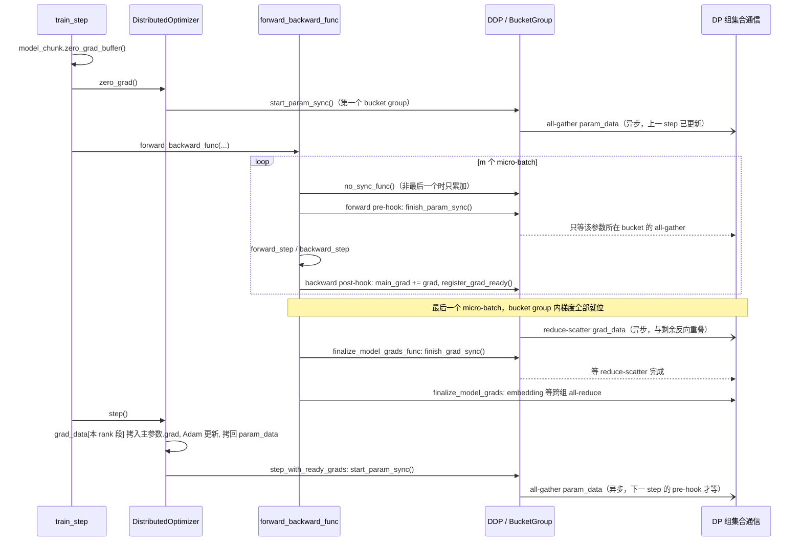

> [!NOTE]
> 本文源码引用以 Megatron Core core_v0.18.0、PyTorch 2.13.0 为准。


上一篇（[02《并行策略全景》](/parallelism-strategies-which-state-to-shard.html)）给的是公式：每参数 16 字节、ZeRO-1 的 2N 通信、TP/PP/DP 的组合代价。本篇沿同一条 bf16 参数的生命线往下走，进 Megatron Core 0.18.0 的源码：那段 bf16 参数在显存里是一段连续 buffer 的视图，fp32 主参数是优化器按字节区间切出的私有拷贝，梯度在另一段连续 buffer 里走 reduce-scatter。三个框架并排的对照在 [06《三个框架对比》](/megatron-deepspeed-torchtitan-architecture-and-source-guide.html)，本篇只读 Megatron。

> **一个 bf16 参数在 Megatron 里存在哪里、什么时候被 all-gather、什么时候被释放、它的 fp32 主副本在哪张卡上？[^q0]**

## 一、总览

Megatron-LM 是 NVIDIA 面向大规模 Transformer 训练的框架。它最显眼的做法是顺着模型结构切：层内用 TP，层间用 PP，副本之间用 DP。再加上 sequence parallel 和 distributed optimizer，单卡装不下的模型也能训练。

先看 8 张卡如何分工。每个 stage 有 8 层；TP 把每层的矩阵切成两半，DP 再复制一份。stage 0 带输入 embedding，stage 1 带输出层。F1 画的是每张卡负责的那一块，以及 TP、DP、PP 三种组分别连哪些卡。


这张图的 8 张卡按 `rank = tp + 2 × dp + 4 × pp` 排号。横向相邻的是 TP 组，两个 stage 里各有两份 DP 副本；上下两排通过 PP 传激活。02《并行策略全景》解释了这些维度为什么这样组合，本文第五章会把 rank 列表算出来。

这 8 张卡上的一个 step 可以按六步读：

1. 每个 DP 副本收到 8 个 micro-batch；每个 micro-batch 是 1 条样本。
2. PP=2 的 stage 0 计算前向，把激活发给 stage 1；1F1B 调度见第七章。
3. TP 组在层内做矩阵乘法与必要的集合通信；每卡只拿该层矩阵的一半。
4. 反向时，梯度写进 fp32 `main_grad`；DP 梯度在最后一个 micro-batch 的反向逐 bucket 做 reduce-scatter。
5. 每个 DP rank 用自己的一半梯度更新对应的 fp32 主参数与 Adam 状态。
6. 更新后的 bf16 参数分片 all-gather 回来，下一轮前向按 bucket 等待参数就绪。

第三步里「每卡只拿一半」具体是多少，按 Llama 3.2 1B 的形状算：train-ledger 的配置是层数 $$L=16$$、隐藏宽度 $$h=2048$$、FFN 宽度 $$f=8192$$、查询头数 $$n_q=32$$、K/V 头数 $$n_{kv}=8$$、每头宽度 $$d_h=64$$、词表大小 $$v=128256$$；其中 $$n_qd_h=h$$，embedding 和输出层不共享参数。这个练习配置的参数总量因此约 1.50B，不等于模型名里的 1B。

每层的 Q、K、V、O 权重数是 $$2h^2+2h(n_{kv}d_h)$$；SwiGLU 的 gate、up、down 三个矩阵是 $$3hf$$。加上两组 RMSNorm 权重，每层共 60,821,504 个参数。02 的 TP 切分图能把这些矩阵的切法画出来：列切 / 行切改变每卡持有的矩阵块，不改变全模型的参数总数。

- 16 层共 973,144,064 个参数；输入 embedding 和输出层各有 $$vh=262,668,288$$ 个参数，总计约 1,498,482,688。
- PP=2 后，每个 stage 约有 749.2M 个参数；TP=2 再把矩阵分成两份，每卡约 374.6M 个参数。
- bf16 参数占 2 字节、fp32 梯度占 4 字节。令 $$N_d=2$$ 表示 DP 副本数；每个 DP 副本只保存一半 fp32 主参数和 Adam 的 $$m,v$$，这三项共 $$12/N_d=6$$ 字节 / 参数。常驻量约为 $$2+4+12/N_d=12$$ 字节 / 每个 TP 本地参数，约 4.50 GB（4.19 GiB）/ 卡。字节口径与 01《大模型训练的显存账本》一致：bf16 参数 + fp32 梯度 + fp32 主参数和 Adam 的 m、v。

后面先讲 Megatron 是怎么一步步长成这样的，再讲这几个对象怎么连起来，最后读源码。03 只读 Megatron；三框架的异同和取舍放在 [06《三个框架对比》](/megatron-deepspeed-torchtitan-architecture-and-source-guide.html)。

## 二、来龙去脉

下表按时间列出 Megatron 的几次重要变化。年份和论文按原文、NVIDIA 的 release note / 技术博客核过。

| 年 | 谁 | 当时的问题 | 怎么解决 | 效果 | 引入或遗留的问题 |
|---|---|---|---|---|---|
| 2019 | NVIDIA 的 Mohammad Shoeybi 等 | Transformer 层太宽，单卡显存放不下 | [Megatron-LM 论文](https://arxiv.org/abs/1909.08053)把注意力和 MLP 的矩阵沿层内维度切开，通信仍用 PyTorch 原生操作 | 论文展示 8.3B 参数模型在 512 张 GPU 上训练 | 单层切开后要处理跨层流水和副本扩展 |
| 2021 | NVIDIA 的 Deepak Narayanan 等 | TP 还不足以把超大模型扩到更多 GPU，PP 有气泡 | [Efficient Large-Scale Language Model Training on GPU Clusters](https://arxiv.org/abs/2104.04473)组合 pipeline / tensor / data parallelism，并给出 interleaved 1F1B 与分布式优化器 | 1T 参数模型在 3072 张 GPU 上达到 502 PFLOP/s，约 52% 峰值 | 并行维度变多，组网和调度更难理解 |
| 2022 | NVIDIA 的 Korthikanti 等 | 长序列下激活内存高，直接重算代价大 | [Reducing Activation Recomputation in Large Transformer Models](https://arxiv.org/abs/2205.05198)提出 sequence parallel 与 selective recomputation | 激活内存降低约 5 倍；相对全量重算，额外计算开销减少约 90%；530B 模型 MFU 为 54.2% | 仍要为不同并行维度配置进程组 |
| 2023 | NVIDIA | 训练框架里的并行原语不易单独复用 | Megatron Core 从 Megatron-LM 中拆出为可组合的库；NVIDIA 仓库的 [Core 0.4.0 release](https://github.com/NVIDIA/Megatron-LM/releases/tag/core_v0.4.0)展示了独立的 Core 版本线 | TP、PP、通信、优化器等能力能以 Core API 组合 | 可选项增多，配置入口也更多 |
| 2024 | NVIDIA，Megatron Core v0.5 | MoE 专家参数和 token 路由需要额外并行维度 | [v0.5 release](https://github.com/NVIDIA/Megatron-LM/releases/tag/core_v0.5.0)记录 MoE 和 EP；NVIDIA [172B 模型说明](https://developer.nvidia.com/blog/developing-a-172b-llm-with-strong-japanese-capabilities-using-nvidia-megatron-lm/)也列出 context parallel | EP 能与 TP、DP、SP、PP 组合；CP 支持长上下文 | dense 和 expert 参数走不同进程组 |
| 2024 | NVIDIA，Megatron Core v0.6 | DP 梯度归约与每卡保留完整优化器状态的开销 | [NVIDIA 技术博客](https://developer.nvidia.com/blog/train-generative-ai-models-more-efficiently-with-new-nvidia-megatron-core-functionalities/)介绍 distributed optimizer：reduce-scatter 梯度、分片更新，再 all-gather 参数，并与反向 / 前向重叠 | 降低优化器状态占用；大 DP 下可用 bucket 重叠通信 | 参数与梯度 buffer 的切分边界不一定与参数边界对齐 |
| 2026 | NVIDIA，Megatron Core 0.18.0 | 仅切优化器状态不足以覆盖模型状态都要分片的用法 | [0.18.0 release](https://github.com/NVIDIA/Megatron-LM/releases/tag/core_v0.18.0)的源码包含 [`megatron/core/distributed/fsdp/`](https://github.com/NVIDIA/Megatron-LM/tree/core_v0.18.0/megatron/core/distributed/fsdp/) | Megatron-FSDP 与 DDP 并列，支持更完整的状态分片 | FSDP、TP、PP 各自的限制与组合仍需按配置核对 |

这张表里能看到方向的变化：最初 Megatron 解决的是一层怎么切；随后它把流水、数据副本、优化器状态和专家并行也纳入同一套工程。

## 三、核心抽象

Megatron Core 的对象可以按从下到上的依赖关系读。F2 把六个对象叠成一层一层：最下面是 `parallel_state`，所有对象都向它要进程组；往上是模型层的 TP 模块、DDP 和它的参数 / 梯度 buffer、`DistributedOptimizer`；最上面是驱动训练的 `schedules.py`。箭头一律指向下方，含义是「上层调用 / 依赖下层」。下面逐项说明每个对象管什么。


- `parallel_state` 提供各个 TP / DP / PP / EP / CP 组，详见第五章。
- `tensor_parallel` 把 Transformer 线性层切开，详见第六章第 2 节。
- `_ParamAndGradBuffer` / `_ParamAndGradBucketGroup` 管连续内存与通信 bucket，详见第六章第 3 节。
- `DistributedDataParallel` 建这些 buffer、注册 hooks 并驱动梯度归约，详见第六章第 3 节。
- `DistributedOptimizer` 按 buffer 区间分配 fp32 主参数与 Adam 状态，详见第六章第 4 节。
- `schedules.py` 按 micro-batch 调用前向、反向与 DDP 回调，详见第六章第 6 节和第七章。

## 四、最小任务怎么跑起来

训练账本里的入口在 `runs/megatron/run.sh`。8 张卡按 TP=2、PP=2、DP=2 排布，打开 sequence parallel 和 ZeRO-1 分布式优化器。模型形状用第一章算过的那组数字。

```bash title="runs/megatron/run.sh"
#!/bin/bash
# train-ledger / runs/megatron/run.sh -- Llama-3.2-1B shape, 8 GPUs: TP2 x PP2 x DP2, ZeRO-1 (distributed optimizer)
torchrun --nproc_per_node 8 pretrain_gpt.py \
  --use-mcore-models --transformer-impl transformer_engine \
  --num-layers 16 --hidden-size 2048 --ffn-hidden-size 8192 \
  --num-attention-heads 32 --group-query-attention --num-query-groups 8 \
  --seq-length 8192 --max-position-embeddings 8192 --position-embedding-type rope --rotary-base 500000 \
  --swiglu --normalization RMSNorm --disable-bias-linear --untie-embeddings-and-output-weights \
  --attention-dropout 0.0 --hidden-dropout 0.0 \
  --tensor-model-parallel-size 2 --pipeline-model-parallel-size 2 --sequence-parallel \
  --use-distributed-optimizer --overlap-grad-reduce --overlap-param-gather \
  --micro-batch-size 1 --global-batch-size 16 \
  --bf16 --lr 3e-4 --min-lr 3e-5 --lr-decay-style cosine --lr-warmup-iters 10 --train-iters 50 \
  --clip-grad 1.0 --weight-decay 0.1 --adam-beta1 0.9 --adam-beta2 0.95 \
  --mock-data --tokenizer-type NullTokenizer --vocab-size 128256 --split 99,1,0 \
  --log-interval 1 --log-memory-to-tensorboard --tensorboard-dir "$PWD/tb/megatron" \
  --use-pytorch-profiler --profile-step-start 20 --profile-step-end 22 --profile-ranks 0 1 2 3 4 5 6 7 \
  --eval-iters 0 --save-interval 1000000 \
  --distributed-timeout-minutes 30
```

脚本参数分三组看：

- **模型形状**：`--num-layers`、`--hidden-size`、`--ffn-hidden-size`、注意力头数与 K/V 头数，决定每层矩阵尺寸；`--swiglu`、RMSNorm、RoPE 和无 bias 指定模型结构。
- **并行与批次**：TP=2、PP=2、`--sequence-parallel`；`--use-distributed-optimizer` 打开 ZeRO-1，两个 `--overlap-*` 让梯度 reduce-scatter / 参数 all-gather 与计算重叠。`--global-batch-size 16`、micro-batch=1、DP=2 决定每个 DP 副本每 step 有 8 个 micro-batch。
- **精度、优化器和记录**：bf16、学习率、Adam beta、梯度裁剪和 weight decay 控制训练；mock data 和 NullTokenizer 让示例不依赖语料；profiler 与 TensorBoard 记录 step 和显存。

令 $$p$$ 表示 PP stage 数、$$m$$ 表示每个 DP 副本每 step 的 micro-batch 数。这里 PP=2、每 step 有 $$m=8$$ 个 micro-batch。气泡占比按 pipeline 的 $$ (p-1)/(m+p-1) $$ 计算；这里 $$p=2$$，所以是 $$1/(8+1)=11\%$$。这个近似式和气泡推导见 02《并行策略全景》的流水线并行一节。

`--log-memory-to-tensorboard` 让 `training_log()` 每步写 `mem-reserved-bytes`、`mem-allocated-bytes`、`mem-max-allocated-bytes`；`--use-pytorch-profiler` 让 `train()` 在第 20–22 步用 `torch.profiler.profile` 记录，trace 写到 tensorboard 目录。要用 `--use-megatron-fsdp --data-parallel-sharding-strategy optim_grads_params` 换成 ZeRO-3 对比，只需去掉 PP 并改 `--ckpt-format fsdp_dtensor`。


## 五、进程组

TP、DP、PP 是三种不同的组。同一张卡会同时属于三个组；真正的 rank 列表由并行度与 rank 顺序一起决定。先看玩具里的 8 卡例子：

```text title="groups toy：world=8, TP=2, DP=2, PP=2"
TP: [[0, 1], [2, 3], [4, 5], [6, 7]]
DP: [[0, 2], [1, 3], [4, 6], [5, 7]]
PP: [[0, 4], [1, 5], [2, 6], [3, 7]]
```

这正是第五章 F1 的三类连线。`groups` 子命令把 Megatron Core 0.18.0 的 `generate_masked_orthogonal_rank_groups()` 翻译成小段纯 Python；同一结果也可从本文已有的 rank-generator 图看出来：


源码入口是 `megatron/core/parallel_state.py` 的 `initialize_model_parallel()`、`RankGenerator` 和 `generate_masked_orthogonal_rank_groups()`。rank 次序、EP / CP 两套生成器、SHARP 的建组顺序，以及 `ProcessGroupCollection` 在下面展开。

<details markdown="1"><summary>源码细节：RankGenerator 怎样建组</summary>

`megatron/core/parallel_state.py` 是一个由模块级全局变量组成的注册表：`_TENSOR_MODEL_PARALLEL_GROUP`、`_DATA_PARALLEL_GROUP`、`_DATA_PARALLEL_GROUP_WITH_CP` 等几十个变量，各配一个 `get_*_group()` 读取函数。填这些变量的是 `initialize_model_parallel()`，它的签名里有 TP、PP、VP、CP、EP 各维度的大小，以及决定 rank 排布的 `order`，默认 `"tp-cp-ep-dp-pp"`。

排布由 `RankGenerator` 类完成。它接收各维度大小与 `order` 字符串，`get_ranks(token)` 对一个形如 `"tp"`、`"dp-cp"`、`"tp-ep-pp"` 的 token 调用 `generate_masked_orthogonal_rank_groups()`：把世界大小按 `order` 拆成一个多维网格，token 里出现的维度是"变化的"、其余维度是"固定的"，枚举固定维度的每一种取值，就得到一个进程组的 rank 列表。所以 `"tp-cp-ep-dp-pp"` 的含义是 TP 变化最快（相邻 rank、同节点）、PP 变化最慢——第二篇解释过这来自"TP 不可重叠必须 NVLink、PP 通信最少可放最远"。

同一张 8 卡网格，token 里出现的维度"变化"、其余"固定"，一次枚举就得到一组进程组；[05 的进程组](/torchtitan-architecture-and-source-guide.html#三进程组paralleldims-与-devicemesh)里的 `DeviceMesh` 视图 `("pp", "dp_shard", "tp")` 给出的正是同一张网格，只是"哪些卡在一组"改由 mesh 的索引语义回答。

这里 $$N_d$$、$$N_c$$、$$N_e$$ 分别表示 DP、CP、EP 的并行度。`initialize_model_parallel()` 里有两个 `RankGenerator`：`decoder_rank_generator`（tp/cp/dp/pp，ep 固定为 1）和 `expert_decoder_rank_generator`（tp/ep/dp/pp，cp 固定为 1）。这是因为 EP 与 CP 在 Megatron 里被视为互斥的维度（`RankGenerator.__init__` 有 `ep == 1 or cp == 1` 的断言）：专家层的 DP 组 `expt-dp` 大小是 $$N_d N_c / N_e$$，与非专家层的 `dp-cp` 组不同。两套生成器分别为 dense 部分和 MoE 部分建组，而 PP 组必须一致（函数里有对应断言）。

建组的顺序有讲究：`dp-cp` 组最先建，注释说明是为了 SHARP（`sharp_enabled_group="dp"` 时设置 `NCCL_COLLNET_ENABLE`，只有最先创建的通信器能用交换机内归约）。每个 NCCL 组还有一个 gloo 孪生（`create_gloo_process_groups=True` 时），供 CPU 侧的集合操作（如分布式优化器保存 checkpoint 时的 gather）使用。`num_distributed_optimizer_instances > 1` 时再切出 `intra_distributed_optimizer_instance` 与 `inter_distributed_optimizer_instance` 两层——这是 Megatron 版的 HSDP：优化器状态只在 intra 组内分片，inter 组之间做 all-reduce。

0.18.0 里还有一条新路径：`process_groups_config.py` 的 `ProcessGroupCollection` 把这些进程组打包成一个对象，`DistributedDataParallel`、`_ParamAndGradBuffer`、调度函数都接受可选的 `pg_collection` 参数，不传则退回 `parallel_state` 的全局变量；`hyper_comm_grid.py` 的 `HyperCommGrid` 则是一个不依赖全局状态的多维网格实现。这是在往"进程组是显式传递的对象而不是全局单例"的方向走——也就是 DeviceMesh 的方向。


</details>

## 六、源码导读

导读从模型层、buffer、优化器再走到训练循环。目录地图先给出每个对象所在的位置。

### 1. 目录地图

```text title="Megatron Core 目录地图"
megatron/core/
  parallel_state.py                    进程组（第五章）
  model_parallel_config.py             ModelParallelConfig：各并行度、sequence_parallel、overlap_p2p_comm、*_sync_func 回调
  tensor_parallel/
    layers.py                          ColumnParallelLinear、RowParallelLinear、VocabParallelEmbedding、LinearWithGradAccumulationAndAsyncCommunication
    mappings.py                        _CopyToModelParallelRegion 等 autograd.Function；all_to_all_sp2hp / hp2sp（Ulysses 式）
  pipeline_parallel/
    schedules.py                       get_forward_backward_func、forward_backward_no_pipelining / _without_interleaving / _with_interleaving
    p2p_communication.py               P2PCommunicator：recv_forward、send_forward_recv_backward …
  distributed/
    distributed_data_parallel.py       DistributedDataParallel：hook、start/finish_grad_sync、start_param_sync
    param_and_grad_buffer.py           _ParamAndGradBuffer、_ParamAndGradBucket、_ParamAndGradBucketGroup
    distributed_data_parallel_config.py  DistributedDataParallelConfig：overlap_grad_reduce、overlap_param_gather、bucket_size、grad_reduce_in_fp32 …
    finalize_model_grads.py            finalize_model_grads：embedding / 非 TP 参数的跨组归约
    fsdp/                              Megatron-FSDP（第 7 小节）
  optimizer/
    optimizer.py                       MixedPrecisionOptimizer、Float16OptimizerWithFloat16Params、ChainedOptimizer
    distrib_optimizer.py               DistributedOptimizer
  transformer/                         TransformerLayer、attention、mlp、moe/ —— 模型本身
megatron/training/
  training.py                          pretrain、setup_model_and_optimizer、train、train_step、training_log
  arguments.py                         parse_args、validate_args；大量参数由 training/config/ 下的 dataclass 生成
```


### 2. TP 层与 mappings：通信是手写的

**问题**：矩阵切成 TP 分片后，梯度如何还原为完整模型需要的形状？

**直觉**：Megatron 把列切、行切和它们的反向通信写成 `autograd.Function`。02《并行策略全景》的[列切 / 行切图](/parallelism-strategies-which-state-to-shard.html#三张量并行与序列并行)和 [f / g 共轭图](/parallelism-strategies-which-state-to-shard.html#三张量并行与序列并行)先把矩阵形状画出来。这里看参数如何带着切分信息进入优化器。


这里 $$N_t$$ 表示 TP 组的卡数；列切、行切和矩阵形状的推导见 02《并行策略全景》。`tensor_parallel/layers.py` 的 `ColumnParallelLinear`（权重按输出维切、`gather_output` 控制是否 all-gather 输出）与 `RowParallelLinear`（权重按输入维切、`input_is_parallel` 表示输入已分布、输出 all-reduce 或 reduce-scatter），以及 `mappings.py` 里每种通信作为一个 `autograd.Function` 出现、前向与反向互为共轭。这里补两点与"参数的一生"有关的细节。

第一，TP 分片的参数是**普通的 `nn.Parameter`**，形状就是切开后的形状（`ColumnParallelLinear.weight` 是 `[out/N_t, in]`），只是多了几个属性：`set_tensor_model_parallel_attributes()` 在参数上标 `tensor_model_parallel=True`、`partition_dim`、`partition_stride`。checkpoint、优化器、梯度裁剪靠这些属性知道哪些参数是切开的（裁剪时只算一次）、哪些是 TP 组内复制的（LayerNorm、bias 等，`param_is_not_tensor_parallel_duplicate()` 判断）。这和 DTensor 用 placement 携带同样信息形成对照。

第二，`LinearWithGradAccumulationAndAsyncCommunication` 这个 `autograd.Function` 的名字点出了 Megatron 的两个优化：**梯度累积融合**（`gradient_accumulation_fusion`，权重梯度直接累加进一个外部 fp32 buffer `weight.main_grad`，而不是先生成 `weight.grad` 再加）和**异步通信**（反向里对输入的梯度 all-reduce 与对权重的梯度 GEMM 重叠）。`main_grad` 这个属性是下一节 DDP 与 buffer 的接口：它是 `_ParamAndGradBuffer` 里一段 fp32 内存的视图。


### 3. DDP 与 ParamAndGradBuffer：两段连续内存

**问题**：一张卡的梯度算完后，什么时候通信？参数、梯度和 bucket 怎么对齐？

**直觉**：参数和梯度各自放在连续 buffer 里，每个模型参数只是对应 buffer 的一个 view。反向顺序排列让梯度先从 buffer 头部就位；bucket 满了再通信。

玩具 `buffer` 子命令用 2 个 CPU rank、gloo 和同一组小矩阵演示这个过程：

```text title="buffer toy：view、梯度累加与单进程对照"
numel=22 pad=0
WL: [0, 12), W2: [12, 16), W1: [16, 22)；视图共享 param_data
分片边界=11：WL 元素 0..10 归 rank0，元素 11 归 rank1
两个 micro-batch 的 dW 累加到 main_grad → reduce-scatter → Adam 分片更新 → all-gather
并行版与单进程 Adam 对照：WL / W2 / W1 最大差值都小于 0.01
```


Megatron 的 `distributed/distributed_data_parallel.py` 的 `DistributedDataParallel` 与 PyTorch 自带的 DDP 同名但不是同一个东西。它的构造函数做的事是：

1. 用 `group_params_for_buffers()` 把所有需要梯度的参数按 `(param_dtype, grad_dtype, is_expert_parallel)` 分组。`grad_dtype` 在 `grad_reduce_in_fp32=True` 时是 fp32——`--bf16` 下 `arguments.py` 默认把 `accumulate_allreduce_grads_in_fp32` 置为 True（除非 `--grad-reduce-in-bf16`），所以 bf16 训练的梯度默认是 fp32 累加、fp32 归约：这是第一篇"18 字节"那一档。
2. 每组建一个 `_ParamAndGradBuffer`（`param_and_grad_buffer.py`）：分配一段连续的 `param_data`（参数 dtype）和一段 `grad_data`（梯度 dtype），把组内每个参数的 `.data` 替换成 `param_data` 里对应位置的视图、给每个参数挂一个 `main_grad` 属性指向 `grad_data` 里对应位置的视图。参数在 buffer 里按**反向顺序**排列（后面的层在前面），这样反向传播时梯度从 buffer 头部开始依次就位。
3. 按 `bucket_size`（默认 `max(40000000, 1000000 × dp_size)` 个元素）把 buffer 切成若干 `_ParamAndGradBucket`，再把 bucket 组成 `_ParamAndGradBucketGroup`——通信以 bucket group 为单位发起。用分布式优化器时每个 bucket 会被 pad 到 `dp_size` 的整数倍，使 `shard_buffer()` 能把它均分给各 DP rank。
4. 给每个参数注册反向 hook（`_make_backward_post_hook()`）：hook 里 `param.main_grad.add_(param.grad)` 然后 `param.grad = None`（若梯度累积融合已经直接写进 `main_grad`，这一步跳过），再 `register_grad_ready()`——当一个 bucket group 里所有参数的梯度在本 step 的最后一个 micro-batch 都就位时，`start_grad_sync()` 发起通信：分布式优化器下是 reduce-scatter（`dist_reduce_scatter_func` 到 `shard_buffer(bucket.grad_data, dp_size)` 里本 rank 的那一段），否则是 all-reduce；`overlap_grad_reduce=True` 时异步发起、`finish_grad_sync()` 等待。

把这两段内存、bucket 与 DP 分片画在一起（下一节的分布式优化器就是在这张图上按字节区间切）：


图里三条内存条的关系：

- `param.data` = `param_data[a:b]` 的视图；`param.main_grad` = `grad_data[a:b]` 的视图（同一偏移，两段独立内存）。
- 分片边界 ≠ 参数边界：W_L 前 8 个元素归 rank0、后 4 个归 rank1，DistributedOptimizer 只为本 rank 段建 fp32 主参数与 m、v。
- 反向：bucket 内梯度全部就位 → reduce-scatter(`grad_data[bucket]`)，本 rank 段即归约结果。
- step：fp32 主参数分片 → `param_data[本 rank 段]`（转 bf16）→ all-gather 拼回完整。

前几个 micro-batch 的反向不触发通信：`no_sync()` 上下文（由调度函数通过 `config.no_sync_func` 调用）把 `is_last_microbatch` 置 False，hook 只累加不发送。这就是第二篇说的"梯度 bucket 与反向计算重叠"的实现。

`param_data` 与 `grad_data` 是两段独立的内存。`_ParamAndGradBuffer.__init__` 里有一个例外：参数是 MXFP8 张量且用分布式优化器时，二者共享同一段 `shared_buffer`（fp32 梯度时 `param_data` 是它前半段的 bf16 视图）——优化器步骤后 all-gather 更新的参数时复用已经归约完、不再需要的梯度 buffer。bf16 训练走的是两段独立内存的常规路径。


### 4. DistributedOptimizer：ZeRO-1 的 Megatron 写法

**问题**：每个 DP rank 都保存 fp32 主参数、m、v，会重复占用很多显存。

**直觉**：先对 bucket 梯度 reduce-scatter，每个 rank 只更新自己的连续区间；再把更新后的 bf16 参数 all-gather 回来。分片边界可能切过一个参数，所以不一定是“一个 rank 负责一个参数”。


`optimizer/distrib_optimizer.py` 的 `DistributedOptimizer` 继承 `MixedPrecisionOptimizer`，是 `--use-distributed-optimizer` 打开时的优化器。它的分片单位不是参数而是 **buffer 的字节区间**：

- `_build_gbuf_range_map()` 把每个 bucket 的 `[0, numel)` 均分成 `dp_size` 段，本 rank 负责第 `dp_rank` 段。这一段的边界不对齐参数边界——一个参数可能一半在本 rank、一半在邻居。`_build_model_gbuf_param_range_map()` 算出每个参数落在本 rank 段里的那一部分（`Range` 对象）。
- `_build_model_and_main_param_groups()` 据此建五组张量：`model_float16_groups`（原 bf16 参数）、`shard_float16_groups`（bf16 参数在本 rank 段内的视图 `model_param.detach().view(-1)[start:end]`）、`shard_fp32_from_float16_groups`（**fp32 主参数**：`model_param.float().view(-1)[start:end]` 得到的独立 fp32 拷贝，只有本 rank 负责的那一段）、以及 fp32 参数的对应两组。内部优化器（Adam）的 `param_groups` 被替换成 `shard_fp32_from_float16_groups`——它只看到 $$1/N_d$$ 的 fp32 分片，一阶矩、二阶矩自然也只有 $$1/N_d$$。

DistributedOptimizer 一个 step 的优化器部分，按先后是四步：

1. `_copy_model_grads_to_main_grads()`：grad_data 里本 rank 那一段（reduce-scatter 的结果，fp32）→ 主参数分片的 `.grad`。
2. inner `optimizer.step()`：Adam 更新 fp32 主参数分片与 m、v。
3. `_copy_main_params_to_model_params()`：fp32 主参数分片 → param_data 里本 rank 那一段（转 bf16）。
4. `step_with_ready_grads()` → `start_param_sync_for_bucket_group_subset()` → 每个 bucket group 的 `start_param_sync()`：all-gather bucket 的 param_data，各 rank 的 1/N_d 段拼成完整 bf16 参数。

`start_param_sync()`（`_ParamAndGradBucketGroup`）在 `overlap_param_gather=True` 时异步发起：第一个 bucket group 的 all-gather 在 `optimizer.zero_grad()` 里发出，之后每个 bucket group 的 all-gather 在前一个完成时接力发出，而**等待**发生在前向的 pre-hook 里——`DistributedDataParallel._make_forward_pre_hook()` 在一个 module 前向前对它的每个参数调用 `finish_param_sync()`，只等这个参数所在 bucket 的 all-gather。于是下一 step 的前向可以边算边收：算第一层时后面几层的参数还在路上。

这里 fp32 主参数与 bf16 参数是**两份内存**：主参数分片是优化器私有的 fp32 拷贝，占 $$4N_{\text{local}}/N_d$$；bf16 参数是模型的、完整的、每张 DP 卡一份，占 $$2N_{\text{local}}$$。


玩具运行给出每个分片的通信和参数对照；相同 toy 也比较完整的单进程 Adam 更新：

```text title="buffer toy 的验证结果"
rank0 拿到 grad_data[0:11]（reduce-scatter）
rank0 Adam 更新了 fp32 主参数分片（11 个元素）
rank0 all-gather 后 param_data sum=-4.6088
两步 Adam + reduce-scatter/all-gather 与单进程一致: True
```

### 5. 一个 bf16 参数的一生：Megatron

**问题**：一个模型参数从初始化到下一步前向，分别在哪些内存里？

**直觉**：F3 把计算、通信和常驻状态分开画。bf16 参数不释放；梯度写入 fp32 buffer；主参数和 Adam 状态只保存 DP 的一份分片。


这里 $$N_{local}$$ 表示单个 TP rank 在一个 PP stage 内持有的参数数。把上面三节串起来，以一个 `ColumnParallelLinear.weight` 为例（`--bf16 --use-distributed-optimizer --overlap-grad-reduce --overlap-param-gather`，TP 组内它是 $$1/N_t$$ 的分片，下面只看 DP 维）：

| 时刻 | 事件 | 在哪里 |
|---|---|---|
| 初始化 | weight.data ← param_data[a:b] 视图（bf16，完整）<br/>weight.main_grad ← grad_data[a:b] 视图（fp32，完整，置零）<br/>主参数分片 ← weight.float()[本 rank 段]（fp32，1/N_d） | _ParamAndGradBuffer.__init__<br/>DistributedOptimizer._build_model_and_main_param_groups |
| step i 前向 pre-hook | 等 weight 所在 bucket 的 all-gather 完成（step i-1 发出的） | DDP._make_forward_pre_hook → finish_param_sync |
| 前向 / 反向 × m 次 | GEMM 读 weight（bf16，完整，全程不释放）<br/>每次反向：dW 累加进 main_grad（fp32）；param.grad 立即丢弃 | LinearWithGradAccumulationAndAsyncCommunication / _make_backward_post_hook |
| 最后一个 micro-batch | bucket 内梯度全部就位 → reduce-scatter grad_data<br/>本 rank 得到 grad_data[本 rank 段] 的归约结果 | _ParamAndGradBucketGroup.start_grad_sync（异步） |
| finalize_model_grads | embedding 等跨 PP / 非 TP 参数的额外 all-reduce | distributed/finalize_model_grads.py |
| optimizer.step | grad_data[本 rank 段] → 主参数分片.grad<br/>Adam 更新主参数分片、m、v（全部 fp32，1/N_d）<br/>主参数分片 → param_data[本 rank 段]（转 bf16）<br/>发起 param_data 的 all-gather（异步，逐 bucket 接力） | _copy_model_grads_to_main_grads<br/>_copy_main_params_to_model_params<br/>step_with_ready_grads → start_param_sync |
| step i+1 前向 pre-hook | 等 all-gather 完成 → weight 又是完整、更新后的 bf16 |  |

Table: 一个 bf16 参数的一生：Megatron

**常驻**：bf16 参数 $$2N_{\text{local}}$$（完整）、fp32 梯度 $$4N_{\text{local}}$$（完整）、fp32 主参数 + m + v $$12N_{\text{local}}/N_d$$。**通信**：每 step 一次 reduce-scatter（fp32 梯度，与反向重叠）+ 一次 all-gather（bf16 参数，与下一 step 前向重叠）——正是第二篇 ZeRO-1 的 $$2N$$。**从不释放**：bf16 参数与 fp32 梯度 buffer 在整个训练期间常驻，这是 Megatron 显存最"稳"（碎片最少）但也最"贵"的地方。


### 6. 训练循环：pretrain → train → train_step

**问题**：训练脚本怎样把调度函数、DDP hooks 和 optimizer.step 接起来？

**直觉**：`pretrain()` 建模型与优化器；`train()` 设回调；每个 `train_step()` 先清梯度、执行调度、更新参数，再调度学习率。

训练循环里这三个阶段的职责可以这样记：

- `pretrain()`：初始化并行组、模型、优化器、数据迭代器。
- `train()`：把 DDP 的同步回调交给调度函数，循环调用 `train_step()`。
- `train_step()`：完成一个 global batch 的前后向、优化器更新和日志。


`megatron/training/training.py` 是 Megatron 的训练入口。骨架：

```text title="pretrain → train → train_step 的骨架"
pretrain()
  initialize_megatron()                       解析参数、init_process_group、parallel_state.initialize_model_parallel()
  setup_model_and_optimizer()
    get_model(model_provider_func)            每个 virtual stage 一个 model chunk；wrap_model_chunks_with_ddp() 套 DistributedDataParallel
    get_megatron_optimizer()                  → DistributedOptimizer / Float16OptimizerWithFloat16Params，多个则 ChainedOptimizer
    get_optimizer_param_scheduler()
  build_train_valid_test_data_iterators()
  train()
    config.no_sync_func / grad_sync_func / param_sync_func ← model_chunk.no_sync / start_grad_sync / start_param_sync
    config.finalize_model_grads_func ← finalize_model_grads
    forward_backward_func = get_forward_backward_func()      按 PP、VP 大小选三个调度函数之一
    while iteration < train_iters:
      train_step()
        model_chunk.zero_grad_buffer(); optimizer.zero_grad()        清 grad_data；overlap_param_gather 时在此发出第一个 all-gather
        forward_backward_func(forward_step_func, data_iterator, model, num_microbatches, seq_length, micro_batch_size, ...)
        optimizer.step()                                             → update_successful, grad_norm, num_zeros_in_grad
        opt_param_scheduler.step(increment=global_batch)
      training_log()                                                 loss、lr、grad_norm、timers、mem-*（log_memory_to_tensorboard）
      post_training_step_callbacks() / checkpoint_and_decide_exit()
```

三点值得注意。第一，`train_step()` 被 `rerun_state_machine.should_run_forward_backward()` 的 while 循环包着——这是第十二篇要讲的 SDC 检测机制的入口，正常情况下只跑一次。第二，调度函数不知道 DDP 的存在，它通过 `config` 上的四个回调（`no_sync_func`、`grad_sync_func`、`param_sync_func`、`finalize_model_grads_func`）与 DDP 交互，所以 `schedules.py` 能在没有 DDP 的场合（推理、测试）复用。第三，`training_log()` 在 `--log-memory-to-tensorboard` 时直接读 `torch.cuda.memory_stats()` 的 `reserved_bytes.all.current`、`allocated_bytes.all.current`、`allocated_bytes.all.peak` 写 TensorBoard——本篇练手项目的 `probe_memory.py` 读的是同一组键。

把第二点画成时序，重点看两处异步：reduce-scatter 在最后一个 micro-batch 的反向里发出、在 `finalize_model_grads` 里等；all-gather 在 `optimizer.step()` 里发出、在**下一个** step 的前向 pre-hook 里等。调度函数与 DDP 之间没有直接引用，只有四个回调和两个 hook：




### 7. Megatron-FSDP：趋势

**问题**：Megatron 的 ZeRO-1 路径会不会是唯一的数据并行选择？

**直觉**：0.18.0 里有 Megatron 自己的 FSDP 实现，也能接 PyTorch FSDP2。两条路径的并行限制不同，配置前要看清楚适用范围。


`megatron/core/distributed/fsdp/` 是 0.18.0 里 Megatron 自己的 FSDP 实现，`--use-megatron-fsdp` 打开。`fsdp/src/megatron_fsdp/fully_shard.py` 的 `ShardingStrategy` 枚举把四级写得很直白：`NO_SHARD`、`OPTIM`（ZeRO-1）、`OPTIM_GRADS`（ZeRO-2）、`OPTIM_GRADS_PARAMS`（ZeRO-3），由 `--data-parallel-sharding-strategy` 选；`megatron_fsdp.py` 的 `MegatronFSDP` 是模块包装类，`mcore_fsdp_adapter.py` 的 `FullyShardedDataParallel` 把它接进 Megatron 的 `_BaseDataParallel` 接口，与 `DistributedDataParallel` 平级。它保留了 Megatron 的 buffer 思路（`fsdp/src/megatron_fsdp/param_and_grad_buffer.py`）但把参数也切了，并且用 DTensor 表达分片（`uneven_dtensor.py`），checkpoint 格式 `--ckpt-format fsdp_dtensor`。`DistributedOptimizer.step_with_ready_grads()` 里有一个 `use_megatron_fsdp` 分支，调用 `model_chunk.start_param_sync()` 提前 all-gather 主参数。

另一条路径 `--use-torch-fsdp2`（`distributed/torch_fully_sharded_data_parallel.py`）直接用 PyTorch 的 `fully_shard`，但 `arguments.py` 里列了一串不兼容项：不支持 PP、EP、分布式优化器、梯度累积融合。两条路径合起来说明一件事：Megatron 长期"只做 ZeRO-1，其余靠 TP/PP"的立场在松动——当模型能用 FSDP 放下时，FSDP 比 PP 少一个气泡问题、比 TP 少一个 NVLink 约束，Megatron 也需要这个选项。这与 torchtitan 从 FSDP2 出发是同一个方向的两端。


## 七、1F1B：Megatron 的过程式写法

PP=2、8 个 micro-batch 时，stage 0 先 warmup 一个前向，再交替做前向 / 反向，最后 cooldown 一个反向。stage 1 没有 warmup。F4 按玩具 `schedule_1f1b()` 生成每个 stage 的事件顺序，再按前后向依赖排到全局时钟；灰色格子表示该拍这个 stage 等待。


**Megatron：过程式**。`megatron/core/pipeline_parallel/schedules.py` 的 `forward_backward_pipelining_without_interleaving()` 是一个几百行的函数，三段循环直接对应 1F1B 的三个阶段：

```text title="Megatron 过程式 1F1B：三段循环"
num_warmup_microbatches = min(total_stages - current_stage - 1, num_microbatches)     stage i 预热 p - i - 1 个
num_microbatches_remaining = num_microbatches - num_warmup_microbatches

warmup:   for i in range(num_warmup_microbatches):
            input  = p2p_communicator.recv_forward(shapes)
            output = forward_step(...)
            p2p_communicator.send_forward(output)
            input_tensors.append(input); output_tensors.append(output); deallocate_output_tensor(output)
steady:   input = recv_forward()                                            先收一个
          for i in range(num_microbatches_remaining):
            output = forward_step(input)
            output_grad = p2p_communicator.send_forward_recv_backward(output)     发前向、收反向合成一次通信
            input, output = input_tensors.pop(0), output_tensors.pop(0)
            input_grad = backward_step(input, output, output_grad)
            input = p2p_communicator.send_backward_recv_forward(input_grad)        发反向、收前向合成一次通信
cooldown: for i in range(num_warmup_microbatches):
            output_grad = recv_backward(); input_grad = backward_step(...); send_backward(input_grad)
```

点对点在 `p2p_communication.py` 的 `P2PCommunicator` 类：`_communicate()` 把"发给 next / 发给 prev / 从 next 收 / 从 prev 收"四种需求打包成一次 `batch_isend_irecv`（`_batched_p2p_ops()`，或 `_p2p_ops()` 逐个发），所以 `send_forward_recv_backward()` 是**一次**通信调用而不是两次——这是 1F1B 稳态里每步只有一次同步点的关键。两个辅助函数值得记住：`deallocate_output_tensor()` 在 output 发出后把它的 storage 释放（只留一个空壳给 autograd 图），因为下游 stage 已经拿到数据、本地只需要在反向时接收梯度；相应地 `custom_backward()` 绕过 `torch.autograd.backward` 对 output 形状的检查直接调 `Variable._execution_engine.run_backward`。梯度归约的时机由 `no_sync_func` 与 `enable_grad_sync()` 控制：非首 stage 在 cooldown 的最后一个反向才打开梯度同步，让 DP 的 reduce-scatter 落在气泡里。


## 八、本文小结

Megatron 把模型结构、进程组和训练时序连成一套实现：TP 切层内矩阵，PP 切层，DP 处理副本间的数据；`_ParamAndGradBuffer` 把参数和梯度放进连续内存，DistributedOptimizer 按 buffer 区间切主参数与 Adam 状态。本文的 8 卡 toy 验证了 rank 列表、梯度 reduce-scatter / 参数 all-gather 和 1F1B 顺序。

三框架的机制对照、取舍表和 train-ledger 对账在 [06《三个框架对比》](/megatron-deepspeed-torchtitan-architecture-and-source-guide.html)。

本篇涉及的源码位置（Megatron Core 0.18.0，另见各节目录地图）：


| 路径 | 内容 |
|---|---|
| Megatron Core 0.18.0 `megatron/core/parallel_state.py` | `initialize_model_parallel()`（`order="tp-cp-ep-dp-pp"`、`num_distributed_optimizer_instances`、`create_gloo_process_groups`）、`RankGenerator`、`generate_masked_orthogonal_rank_groups()`、`get_tensor_model_parallel_group()` / `get_data_parallel_group(with_context_parallel=)` / `get_expert_data_parallel_group()` / `get_intra_distributed_optimizer_instance_group()` 等 |
| Megatron Core 0.18.0 `megatron/core/process_groups_config.py`、`hyper_comm_grid.py` | `ProcessGroupCollection`、`HyperCommGrid`：显式传递的进程组 |
| Megatron Core 0.18.0 `megatron/core/tensor_parallel/layers.py`、`mappings.py` | `ColumnParallelLinear`、`RowParallelLinear`、`VocabParallelEmbedding`、`LinearWithGradAccumulationAndAsyncCommunication`、`set_tensor_model_parallel_attributes()`、`param_is_not_tensor_parallel_duplicate()`；`_CopyToModelParallelRegion` 等 |
| Megatron Core 0.18.0 `megatron/core/distributed/distributed_data_parallel.py`、`distributed_data_parallel_config.py` | `DistributedDataParallel`：`_make_forward_pre_hook()`、`_make_backward_post_hook()`、`no_sync()`、`start_grad_sync()` / `finish_grad_sync()`、`start_param_sync()`、`zero_grad_buffer()`；`DistributedDataParallelConfig`（`overlap_grad_reduce`、`overlap_param_gather`、`bucket_size`、`grad_reduce_in_fp32`、`use_megatron_fsdp`、`data_parallel_sharding_strategy`） |
| Megatron Core 0.18.0 `megatron/core/distributed/param_and_grad_buffer.py`、`finalize_model_grads.py` | `_ParamAndGradBuffer`、`_ParamAndGradBucket`、`_ParamAndGradBucketGroup`（`start_param_sync()`、`finish_param_sync()`、`start_grad_sync()`、`register_grad_ready()`）、`shard_buffer()`、`group_params_for_buffers()`；`finalize_model_grads()` |
| Megatron Core 0.18.0 `megatron/core/optimizer/distrib_optimizer.py`、`optimizer.py` | `DistributedOptimizer`：`_build_gbuf_range_map()`、`_build_model_gbuf_param_range_map()`、`_build_model_and_main_param_groups()`（`shard_fp32_from_float16_groups`）、`_copy_model_grads_to_main_grads()`、`_copy_main_params_to_model_params()`、`step_with_ready_grads()`；`MixedPrecisionOptimizer`、`Float16OptimizerWithFloat16Params`、`ChainedOptimizer` |
| Megatron Core 0.18.0 `megatron/core/pipeline_parallel/schedules.py`、`p2p_communication.py` | `get_forward_backward_func()`、`forward_backward_no_pipelining()`、`forward_backward_pipelining_without_interleaving()`、`forward_backward_pipelining_with_interleaving()`、`forward_step()`、`backward_step()`、`deallocate_output_tensor()`、`custom_backward()`、`get_tensor_shapes()`；`P2PCommunicator`（`recv_forward()`、`send_forward()`、`send_forward_recv_backward()`、`send_backward_recv_forward()`、`_communicate()`）、`_batched_p2p_ops()`、`_p2p_ops()` |
| Megatron Core 0.18.0 `megatron/core/distributed/fsdp/` | `mcore_fsdp_adapter.py` 的 `FullyShardedDataParallel`<br/>`src/megatron_fsdp/fully_shard.py` 的 `ShardingStrategy`（`NO_SHARD` / `OPTIM` / `OPTIM_GRADS` / `OPTIM_GRADS_PARAMS`）、`fully_shard_model()`、`fully_shard_optimizer()`<br/>`megatron_fsdp.py` 的 `MegatronFSDP` |
| Megatron Core 0.18.0 `megatron/training/training.py`、`arguments.py`、`config/common_config.py` | `pretrain()`、`setup_model_and_optimizer()`、`get_model()`、`wrap_model_chunks_with_ddp()`、`train()`、`train_step()`、`training_log()`<br/>`validate_args()`（`accumulate_allreduce_grads_in_fp32` 默认）<br/>`use_pytorch_profiler`、`profile_step_start` / `profile_step_end`、`profile_ranks`、`record_memory_history`、`memory_snapshot_path` |
| train-ledger `runs/megatron/`、`probe_memory.py` | 本篇练手配置与探针，见第二章 |


## 九、自测

1. Megatron 的分布式优化器每 step 做哪两次通信？哪一次能重叠、与什么重叠？

   <details markdown="1"><summary>答案</summary>

   反向时 bucket 满了 reduce-scatter 梯度（与后续层的反向重叠）；`step` 后 all-gather 更新过的 bf16 参数回 buffer（与下一步的前向重叠）。合计 $$2N$$。

   </details>

2. `_ParamAndGradBuffer` 里的 `param_data` 与 `grad_data` 是什么关系？为什么参数要按反向顺序排进 buffer？

   <details markdown="1"><summary>答案</summary>

   两段独立内存；每个参数的 `.data` 是 `param_data` 的视图、`main_grad` 是同偏移 `grad_data` 的视图。按反向顺序排（后面的层在前面），反向传播时梯度从 buffer 头部依次就位，bucket 能尽早凑满发起 reduce-scatter。

   </details>

3. `RankGenerator` 的 `order="tp-cp-ep-dp-pp"` 是什么意思？为什么 TP 要在最内层？

   <details markdown="1"><summary>答案</summary>

   它决定 rank 在多维网格里的变化次序：TP 变化最快（相邻 rank 同组、同节点）、PP 变化最慢。TP 通信不可重叠、必须走 NVLink，所以让 TP 组落在最近的卡上；PP 通信最少，可以放最远。

   </details>

4. `groups` toy 中，rank 3 属于哪个 TP、DP、PP 组？为什么这三个组不同？

   <details markdown="1"><summary>答案</summary>

   rank 3 属于 TP `[2, 3]`、DP `[1, 3]`、PP `[3, 7]`。它在三个并行维度的坐标分别是 TP=1、DP=1、PP=0；固定其他坐标、只改变目标维度，就得到对应 rank 组。

   </details>

5. buffer toy 的分片边界是元素 11。`WL` 有 12 个元素，rank0 与 rank1 各负责哪些？为什么它能说明分片单位不是参数？

   <details markdown="1"><summary>答案</summary>

   `WL` 的元素 0–10 在 rank0，元素 11 在 rank1。边界落在同一个参数内部，DistributedOptimizer 按 buffer 区间分片，不按参数对象分片。

   </details>

[^q0]: bf16 参数常驻完整，是 `_ParamAndGradBuffer` 连续内存里的一个视图，从不被释放；梯度经 DDP hook 累加进 `main_grad`（默认 fp32），bucket 满了就 reduce-scatter；`DistributedOptimizer` 按字节区间把优化器状态与 fp32 主参数切成 $$1/N_d$$——主副本在按字节区间分到的那张卡上，每卡只更新自己那段，然后 all-gather 更新后的 bf16 参数回 buffer（[第六章](#六源码导读)）。
