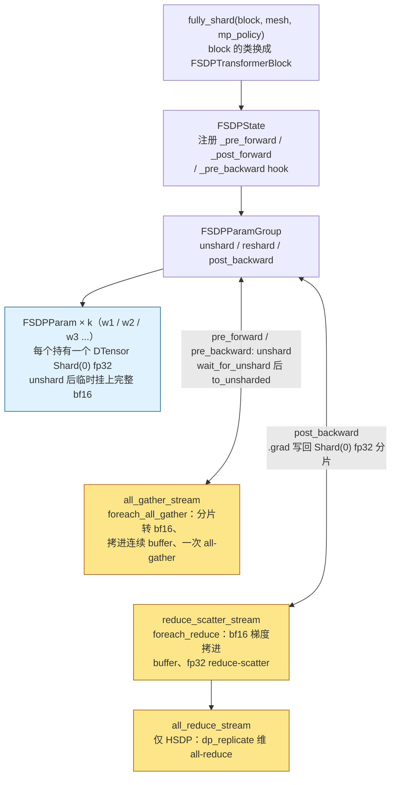

> **NOTE** 本文源码引用以 torchtitan v0.3.0、PyTorch 2.13.0 为准。


torchtitan 是 PyTorch 团队自己的参考实现（torchtitan: One-stop PyTorch native solution for production ready LLM pre-training，arXiv 2410.06511，2024）：它回答的不是"怎么切模型"，而是"用 PyTorch 原生原语——DeviceMesh、DTensor、fully_shard、pipelining——把并行组合起来，代码能短到什么程度"。它出现在 DeviceMesh 和 DTensor 之后，所以它的读法和前两个框架不同：它是这些原生 API 的参考用法，读它等于读 PyTorch 官方认为多维并行应该怎么组合。

上一篇（[02《并行策略全景》](/parallelism-strategies-which-state-to-shard.html)）给的是公式；本篇沿同一条 bf16 参数的生命线进 torchtitan v0.3.0 与 PyTorch 2.13.0 的源码：常驻的不是 bf16 参数而是 fp32 的 `Shard(0)` DTensor 分片，bf16 只在每层前向、反向的几十毫秒里存在，通信全部藏在 FSDP 的 hook 和 DTensor 的 `redistribute` 里。三个框架并排的对照在 [06《三个框架对比》](/megatron-deepspeed-torchtitan-architecture-and-source-guide.html)，本篇只读 torchtitan。

> **一个 bf16 参数在 torchtitan 里存在哪里、什么时候被 all-gather、什么时候被释放、它的 fp32 主副本在哪张卡上？[^q0]**

### 1. 核心抽象

|| 名字 | 是什么 | 管哪种状态 |
|---|---|---|
| `Trainer` / `Trainer.Config` | 训练器与配置树根：一次运行就是一个返回 Config 的 Python 函数 | 装配顺序、全部配置 |
| `ParallelDims` / `DeviceMesh` | 并行度 dataclass 与 n 维 rank 网格 | 全部进程组 |
| `ShardingConfig` | 声明式的 TP/SP 切分描述（placement 按 mesh 轴名给出） | 参数与输入输出的摆放 |
| `fully_shard`（FSDP2） | 每层一个 FSDP 单元，hook 内 unshard / reshard | 参数、梯度的分片与通信 |
| `DTensor` + placement | 张量 + mesh + 每维 Shard / Replicate / Partial | 一切"切分"的表示 |
| `PipelineStage` / `_PipelineScheduleRuntime` | PP 的 stage 与动作表解释器 | PP 的收发时序 |

Table: torchtitan 的核心抽象

## 二、最小任务：runs/titan

train-ledger 里的练手配置是 FSDP 4 × TP 2，模型取 Llama 3.2 1B 的形状（16 层、h = 2048、32 头 / 8 个 K/V 头、FFN 8192、词表 128256、s = 8192）。三个框架并排的对账与预期数字在 06 的 [train-ledger 一节](/megatron-deepspeed-torchtitan-architecture-and-source-guide.html#七本文小结)，这里只留 torchtitan 这份配置——v0.3.0 的一次运行就是一个返回 `Trainer.Config` 的 Python 函数（`runs/titan/ledger_llama3_1b.py`）：


```python title="runs/titan/ledger_llama3_1b.py"
"""train-ledger / runs/titan/ledger_llama3_1b.py -- Llama 3.2 1B shape, 8 GPUs: FSDP 4 x TP 2.

Run from the torchtitan repo root:
    NGPU=8 MODULE=runs.titan.ledger_llama3_1b CONFIG=llama3_1b_fsdp4_tp2 ./run_train.sh
"""
from torchtitan.components.loss import ChunkedLossWrapper, CrossEntropyLoss
from torchtitan.components.metrics import MetricsProcessor
from torchtitan.components.optimizer import default_adamw, LRSchedulersContainer
from torchtitan.config import ParallelismConfig, TrainingConfig
from torchtitan.distributed.activation_checkpoint import SelectiveAC
from torchtitan.hf_datasets.text_datasets import HuggingFaceTextDataLoader
from torchtitan.models.common.config_utils import decoder_vocab_size
from torchtitan.models.llama3 import model_registry
from torchtitan.tools.profiler import Profiler
from torchtitan.trainer import Trainer


def llama3_1b_fsdp4_tp2() -> Trainer.Config:
    model_spec = model_registry("1B")            # 16 layers, dim 2048, 32/8 heads, ffn 8192, vocab 128256
    return Trainer.Config(
        model_spec=model_spec,
        loss=ChunkedLossWrapper.Config(
            loss_fn=CrossEntropyLoss.Config(global_vocab_size=decoder_vocab_size(model_spec)),
        ),
        hf_assets_path="./tests/assets/tokenizer",
        optimizer=default_adamw(lr=3e-4, weight_decay=0.1),
        lr_scheduler=LRSchedulersContainer.Config(warmup_steps=10, decay_type="cosine", min_lr_factor=0.1),
        training=TrainingConfig(
            local_batch_size=2,                  # x FSDP 4 = global batch 8 sequences of 8192 tokens
            seq_len=8192,
            steps=50,
            dtype="float32",                     # sharded params stay fp32 = master copy
            mixed_precision_param="bfloat16",    # all-gather / compute in bf16
            mixed_precision_reduce="float32",    # reduce-scatter in fp32
        ),
        parallelism=ParallelismConfig(
            data_parallel_shard_degree=4,
            tensor_parallel_degree=2,
            enable_sequence_parallel=True,
            fsdp_reshard_after_forward="default",   # no PP -> reshard after forward -> 3N
        ),
        dataloader=HuggingFaceTextDataLoader.Config(dataset="c4_test"),
        activation_checkpoint=SelectiveAC.Config(),
        metrics=MetricsProcessor.Config(log_freq=1, enable_tensorboard=True, save_tb_folder="tb/titan"),
        profiler=Profiler.Config(enable_profiling=True, profile_freq=20, profiler_warmup=1, profiler_active=2),
    )
```

`MetricsProcessor` 每次 `log()` 都调用 `DeviceMemoryMonitor.get_peak_stats()` 输出 `max_active_gib`、`max_reserved_gib` 与 `num_alloc_retries`；`Profiler` 在第 20 步附近写 chrome trace。要对比 HSDP，加 `data_parallel_replicate_degree=2, data_parallel_shard_degree=2`。


## 三、进程组：ParallelDims 与 DeviceMesh

并行策略落到代码里的第一件事是进程组：每张卡属于哪一个 TP 组、哪一个 DP 组、哪一个 PP 组。torchtitan 没有任何全局变量——`ParallelDims` 持有的几张 DeviceMesh 视图回答一切。


`torchtitan/distributed/parallel_dims.py` 的 `ParallelDims` 是一个 dataclass：`dp_replicate`、`dp_shard`、`cp`、`tp`、`pp`、`ep`、`world_size`，由 `ParallelDims.from_config()` 从 `ParallelismConfig` 读出（`data_parallel_shard_degree` 为 -1 时自动补成 `world_size / (dp_replicate · cp · tp · pp)`）。`_validate()` 检查乘积等于 world size。

`build_mesh()` 只做一件事：先 `init_device_mesh(device_type, (world_size,), mesh_dim_names=("world",))` 建一个一维的世界 mesh，再用 `DeviceMesh._unflatten()` 把它按不同的维度组合"展开"成几张视图：

| mesh | 维度 | 用途 |
|---|---|---|
| dataloading_mesh | ("pp", "batch", "cp", "tp") | batch = dp_replicate × dp_shard，数据加载用它决定读哪一份 |
| loss_mesh | dataloading_mesh["batch", "cp"]._flatten() | loss 归约：所有切数据的维度 |
| dense_mesh | ("pp", "dp_replicate", "dp_shard", "cp", "tp") | 参数分片用；fully_shard 从中挑 dp_shard（与 cp）为 shard 维 |
| sparse_mesh | ("pp", "dp_replicate", "efsdp", "ep") | MoE 专家用；efsdp = dp_shard × cp × tp / ep |

Table: torchtitan 的几个 DeviceMesh 及其用途

大小为 1 的维度用 `backend_override[name] = "fake"`，不真正创建 NCCL 通信器（`_mesh_exist()` 决定哪些维即使为 1 也要保留，例如 `dp_shard`，因为 `fully_shard` 需要它来安装 `MixedPrecisionPolicy`）。之后 `get_mesh("tp")`、`get_optional_mesh("pp")`、`get_mesh(["dp_replicate", "dp_shard"])` 按名取子 mesh，各并行模块拿到 mesh 后自己 `mesh.get_group()`。

与 Megatron 对比，这里没有任何全局变量、没有手写的 rank 枚举：rank 排布由 `_unflatten` 的维度顺序决定（PP 最外、TP 最内，与 Megatron 的 `"tp-cp-ep-dp-pp"` 一致），"哪些卡在同一组"这个问题被 DeviceMesh 的索引语义回答。第二篇提到的 HSDP 在这里就是 `dp_replicate > 1`：`fully_shard` 收到的 `DataParallelMeshDims(shard="dp_shard", replicate="dp_replicate")`（`torch/distributed/fsdp/_fully_shard/_fsdp_api.py`）告诉它在哪一维分片、哪一维复制。

v0.3.0 多了一个 `spmd_backend` 字段（`"partial_dtensor" | "full_dtensor" | "spmd_types"`，默认 `"spmd_types"`），它决定 `build_mesh()` 额外建哪些视图、以及第五章要讲的 TP 走哪条路径。三条路径对进程组的组织没有影响，本篇按默认值读。


## 四、源码导读：用原生原语组合


```text title="torchtitan 目录地图"
torchtitan/
  train.py                             main()：ConfigManager 解析 --module / --config → Trainer(config).train()
  trainer.py                           Trainer：__init__ 装配、train_step、train
  config/
    configs.py                         TrainingConfig、ParallelismConfig、CompileConfig、CommConfig、DebugConfig
    configurable.py / manager.py       Configurable 基类（每个组件有内嵌 Config，Config.build() 构造组件）；ConfigManager
  distributed/
    parallel_dims.py                   ParallelDims、MeshAxisName、SpmdLayout
    fsdp.py                            apply_fsdp_to_decoder、get_fsdp_reshard_after_forward_policy
    tensor_parallel.py                 NoParallel（TP 的主体不在这里，见 protocols/ 与 models/common/）
    pipeline_parallel.py               pipeline_llm、_build_pipeline_schedule、_pipeline_module_split
    context_parallel/api.py            apply_cp_to_forward、prepare_context_parallel_input、cp_shard
    activation_checkpoint.py           FullAC、SelectiveAC
    compile.py / cudagraph.py          torch.compile 与 CUDA graph 包装
    full_dtensor.py                    resolve_fsdp_mesh、validate_config
    spmd_types.py                      spmd_types 后端的辅助函数
    utils.py                           init_distributed、set_determinism、clip_grad_norm_、dist_sum / dist_max、set_pg_timeouts
  protocols/
    module.py                          Module(nn.Module, Configurable)：parallelize()、_distribute_states()、_redistribute_inputs / outputs
    sharding.py                        ShardingConfig、LocalMapConfig、resolve_placements
    model.py / model_spec.py           BaseModel、ModelSpec（parallelize_fn、pipelining_fn、state_dict_adapter）
  models/
    common/                            attention、moe、embedding、linear、decoder_sharding（TP/SP 方案）、moe_sharding
    llama3/                            __init__（model_registry 与 debugmodel / 1B / 3B / 8B / 70B / 405B 规格）、model、parallelize、sharding、config_registry
  components/
    checkpoint.py + checkpointer/      CheckpointManager；DCP 与 torch.save 两种后端
    optimizer/                         OptimizersContainer、default_adamw、LRSchedulersContainer
    dataloader.py                      BaseDataLoader；hf_datasets/ 下的 HuggingFaceTextDataLoader
    metrics.py                         MetricsProcessor、DeviceMemoryMonitor、TensorBoard / W&B logger
    loss.py                            CrossEntropyLoss、ChunkedLossWrapper
    validate.py                        Validator
  tools/profiler.py                    Profiler（torch.profiler 包装）、MemoryProfiler
  experiments/                         torchft、autoparallel 等
```

与总纲和 brief 的对照：v0.3.0 没有 `components/data/`，数据在 `components/dataloader.py` 与 `hf_datasets/`；checkpoint 在 `components/checkpoint.py` + `components/checkpointer/`；metrics 在 `components/metrics.py`，另有 `observability/` 目录。

### 2. Trainer.__init__：装配的顺序就是架构

torchtitan 的架构最好的说明书是 `trainer.py` 里 `Trainer.__init__` 的执行顺序：

```text title="Trainer.__init__ 的执行顺序"
Trainer.__init__(config: Trainer.Config)
  init_distributed()                             dist_utils.init_distributed(config.comm) → ParallelDims.from_config(config.parallelism, world_size)
                                                 → parallel_dims.build_mesh()（第二章）
  set_determinism()
  model_config.build()  在 torch.device("meta") 下   模型只有形状，没有内存；dtype = training.dtype（默认 float32）
  metrics_processor = config.metrics.build()
  loss_fn = config.loss.build()
  gradient_accumulation_steps = global_batch_size / (local_batch_size × batch_degree)
  if pp_enabled:
    pp_schedule, model_parts, ... = model_spec.pipelining_fn(model, parallel_dims, ..., parallelize_fn=model_spec.parallelize_fn)
                                                 → pipeline_llm：切 module、每个 stage 建 PipelineStage、对每个 model part 调 parallelize_fn
  else:
    model = model_spec.parallelize_fn(model, parallel_dims, ...)      → parallelize_llama：TP/CP → AC → compile → FSDP
    model_parts = [model]
  for m in model_parts: m.to_empty(device); m.init_weights()          此时才分配显存、初始化——已经是分片后的形状
  optimizers = config.optimizer.build(model_parts)                    OptimizersContainer：每个 model part 一个 torch 优化器
  lr_schedulers = config.lr_scheduler.build(optimizers)
  tokenizer / dataloader = config.dataloader.build(dp_world_size=batch_degree, dp_rank=batch_rank, ...)
  checkpointer = config.checkpoint.build(dataloader, model_parts, optimizers, lr_schedulers, states={"train_state": self})
  train_context = dist_utils.get_spmd_context(parallel_dims)
```

两个顺序上的决定造就了 torchtitan 的两个特性。**meta 设备构造 → 并行化 → `to_empty` → `init_weights`**：模型在被切分之前不占任何显存，405B 也能在 8 卡上"构造"出来；切分后各卡只分配自己那份。这是 DeepSpeed 需要 `zero.Init` 上下文才能做到的事，torchtitan 用 PyTorch 的 meta 设备原生做到。**并行化在优化器之前**：优化器看到的参数已经是 DTensor 分片，所以 `OptimizersContainer` 只是普通的 `torch.optim.AdamW` 加上 `Stateful` 接口，不需要知道任何并行——分布式优化器"消失"了，因为分片参数上的逐元素更新本来就是局部的。

`Trainer.Config` 是整棵配置树的根：每个组件（metrics、loss、optimizer、dataloader、checkpoint、profiler、activation_checkpoint、validator）是一个 `Configurable`，有内嵌的 `Config` dataclass，`Config.build(...)` 构造实例。`torchtitan/config/configs.py` 只放没有归属组件的字段（`TrainingConfig`、`ParallelismConfig` 等）。一次运行就是一个返回 `Trainer.Config` 的函数，例如 `models/llama3/config_registry.py` 的 `llama3_debugmodel()`；`--module llama3 --config llama3_debugmodel` 选它。

### 3. TP：从 ParallelStyle 到 ShardingConfig

第二篇讲的 PyTorch 原生 TP 是 `torch/distributed/tensor/parallel/style.py` 的 `ColwiseParallel` / `RowwiseParallel` / `SequenceParallel` 加 `parallelize_module()`。torchtitan v0.3.0 在默认的 `spmd_types` 与 `full_dtensor` 后端下**不再直接调用它们**，而是走一条声明式的路：

- `torchtitan/protocols/sharding.py` 的 `ShardingConfig` 用四组字段描述一个 module 的切分：`state_shardings`（每个参数 / buffer 的 placement）、`in_src_shardings` / `in_dst_shardings`（输入进来时的 placement 与希望重分布到的 placement）、`out_src_shardings` / `out_dst_shardings`（输出同理）、`local_map`（可选，把 forward 包成 `local_map()` 在本地张量上算）。placement 用 `SpmdLayout`（`parallel_dims.py`）按 mesh 轴名给出，例如 `{DP: R, CP: R, TP: S(0)}`。
- `torchtitan/models/common/decoder_sharding.py` 用 `ShardingConfig` 写出一个 decoder 的完整 TP/SP 方案：`colwise_config()`（权重 `S(0)`、输出 `S(-1)`，docstring 直接写"ColwiseParallel"）、`rowwise_config(output_sp=...)`（权重 `S(1)`、输出从 `Partial` 重分布到 `Replicate`（all-reduce）或 `Shard(1)`（reduce-scatter，即 SP））、`norm_config(enable_sp=...)`、`set_gqa_attention_sharding()`、`set_dense_ffn_sharding()`、`set_decoder_sharding_config()`。`models/llama3/sharding.py` 的 `set_llama3_sharding_config()` 把它们挂到 Llama 3 的各个子 module 上。
- `torchtitan/protocols/module.py` 的 `Module.parallelize(parallel_dims)` 递归执行：对每个带 `_sharding_config` 的 module，`_distribute_states()` 用 `torch.distributed.tensor.distribute_tensor()` 按 placement 把参数变成 DTensor，然后把 `forward` 包成"重分布输入 → [local_map] forward → 重分布输出"——通信由 DTensor 的 `redistribute()` 从 src / dst placement 之差推导出来。

所以 TP 在 torchtitan 里的实现位置从 `distributed/tensor_parallel.py`（v0.3.0 里只剩一个 `NoParallel` 风格类）搬到了 `protocols/` 与 `models/common/`。语义没变：列切 + 行切配对、SP 把 all-reduce 拆成 all-gather + reduce-scatter，都在 `decoder_sharding.py` 的几个函数里能对上第二篇的图；变的是表达方式——切分方案与模型代码分离，同一份 `ShardingConfig` 在 `spmd_types` 后端下还可以做静态类型检查（`spmd_validate_redistributions()`，`debug.spmd_typechecking` 打开时生效）。`partial_dtensor` 后端保留了旧路径（`parallelize_llama()` 里的 else 分支）。

### 4. FSDP2：apply_fsdp_to_decoder

`parallelize_llama()`（`models/llama3/parallelize.py`）的最后一步总是 `apply_fsdp_to_decoder()`（`distributed/fsdp.py`），即使 `dp_shard = 1`——注释说明这是为了安装 `MixedPrecisionPolicy`。它做的事：

```text title="apply_fsdp_to_decoder 做的事"
mp_policy = MixedPrecisionPolicy(param_dtype=bf16, reduce_dtype=fp32, cast_forward_inputs=False)
                                                       training.mixed_precision_param / mixed_precision_reduce
reshard_after_forward = "default" → not pp_enabled     get_fsdp_reshard_after_forward_policy；PP 下默认不 reshard，避免每个 micro-batch 都 all-gather
fully_shard(tok_embeddings, mesh, mp_policy, reshard_after_forward)
for block in layers:  fully_shard(block, ...)          每个 Transformer 层一个 FSDP 单元
fully_shard([norm, lm_head], ..., reshard_after_forward=False)    最后几层前向后不释放：反向马上要用
```

`fully_shard()` 来自 `torch/distributed/fsdp/_fully_shard/_fully_shard.py`。对一个 module 调用它：把 module 的类动态换成 `FSDP<原类名>`（多继承 `FSDPModule`）、建一个 `FSDPState`（`_fsdp_state.py`）和一个 `FSDPParamGroup`（`_fsdp_param_group.py`），组内每个参数一个 `FSDPParam`（`_fsdp_param.py`）。`FSDPParam._init_sharded_param()` 把参数沿第 0 维切成 `mesh` 大小份，本 rank 的一份包成 `DTensor(placements=(Shard(0),))`（HSDP 时 `(Replicate(), Shard(0))`），**dtype 保持原样**——torchtitan 默认 `training.dtype = float32`，所以分片是 fp32。如果参数已经是 TP 的 DTensor（`Shard(0)` 或 `Shard(1)` 在 tp 维），FSDP 在它外面再加一维，得到一个二维 mesh 上的 DTensor。

前向与反向由 `FSDPState` 注册的 hook 驱动（`_register_group_forward_hooks()`）：`_pre_forward` → `FSDPParamGroup.pre_forward()` → `unshard()`（`_fsdp_collectives.py` 的 `foreach_all_gather()`：组内所有参数的分片拷进一个连续 buffer、一次 `all_gather_into_tensor`，输入在此处按 `mp_policy.param_dtype` 转 bf16）→ `wait_for_unshard()` → `foreach_all_gather_copy_out()` → `FSDPParam.to_unsharded()`（bf16 的完整参数注册到 module 上）；`_post_forward` → `post_forward()` → `reshard()` → `to_sharded()`（释放 bf16，module 上又是 fp32 分片）；反向 `pre_backward()` 再 unshard（`_backward_prefetch()` 按前向的逆序预取），`post_backward()` → `foreach_reduce()`（梯度拷进连续 buffer、`reduce_dtype` 为 fp32 的 reduce-scatter、结果写到分片参数的 `.grad`——也是 `Shard(0)` 的 fp32 DTensor）。三条 stream（`FSDPCommContext` 的 all-gather / reduce-scatter / all-reduce stream）让通信与计算重叠。一个 `fully_shard` 单元建出来的对象（上半）与它们在 `FSDPCommContext` 的两条通信 stream 上的分工（下半，黄色；所有单元共享同一个 context）：



### 5. PP 与 CP

**PP**（`distributed/pipeline_parallel.py`）。`pipeline_llm()` 是 `ModelSpec.pipelining_fn`：`_get_pipeline_metadata()` 算出每个 PP rank 负责哪些 stage（`_get_pp_rank_to_stage_indices_mapping()`，支持 looped / V 形分配）、`_generate_llm_fqn_per_model_part()` 算出每个 stage 包含哪些 module（按 `pipeline_parallel_layers_per_stage` 或 `module_fqns_per_model_part`，首末 stage 可少几层以平衡 embedding / lm_head），`_pipeline_module_split()` 对每个 stage `copy.deepcopy` 整个模型再 `_split_module()` 删掉不属于它的 module，包成 `torch.distributed.pipelining.PipelineStage`；然后对每个 model part 调 `parallelize_fn`（TP、FSDP 都在 stage 内部再做一次）；最后 `_build_pipeline_schedule()` 用 `get_schedule_class(parallelism.pipeline_parallel_schedule)` 取调度类（`"1F1B"`、`"Interleaved1F1B"`、`"ZBVZeroBubble"` 等），`n_microbatches = local_batch_size / pipeline_parallel_microbatch_size`，`scale_grads=False`（梯度缩放由 loss 里的 token 数处理）。`pipeline_parallel_schedule_csv` 非空时用 `_PipelineScheduleRuntime` 加载一张自定义动作表。训练时 `Trainer.pp_forward_backward_step()` 调 `pp_schedule.step(arg_mbs, kwarg_mbs, target_mbs, losses)`——第六章对照两种 1F1B 时展开。

**CP**（`distributed/context_parallel/api.py`）。`apply_cp_to_forward()` 在 `partial_dtensor` 后端下把每层的 `inner_attention` 替换成 PyTorch 实验 API `torch.distributed.tensor.experimental._context_parallel` 的 ring attention（第二篇讲过）；`prepare_context_parallel_input()` 在 `Trainer.post_dataloading_process()` 里按 `context_parallel_load_balancer`（默认 `"headtail"`）把输入序列切成本 rank 的份。默认后端下 CP 由 `decoder_sharding.py` 的 `set_gqa_inner_attention_local_map()` 用 `LocalMapConfig` 描述。CP 对参数没有影响——第二章说过 torchtitan 把 `cp` 并入 FSDP 的 shard 维，梯度归约自动覆盖。

### 6. 一个 bf16 参数的一生：torchtitan

以一个 Transformer 层里 `feed_forward.w1.weight` 为例（`dp_shard = 8`，`tp = 1`，`training.dtype = float32`，`mixed_precision_param = bfloat16`，`fsdp_reshard_after_forward = "default"`，无 PP）：

| 时刻 | 事件 | 在哪里 |
|---|---|---|
| meta 构造 | weight 是 meta 张量（fp32，完整形状，无内存） | Trainer.__init__ 的 torch.device("meta") |
| parallelize_llama | fully_shard(block) → FSDPParam._init_sharded_param<br/>weight ← DTensor(Shard(0))，本地 1/8 行，fp32，仍是 meta | torch/distributed/fsdp/_fully_shard/_fsdp_param.py |
| to_empty + init_weights | weight 的本地分片分配显存并初始化（fp32，1/8） | trainer.py |
| 优化器构造 | AdamW 的 param 就是这个 fp32 分片；m、v 按它的形状分配 | components/optimizer/optimizer.py OptimizersContainer |
| step i，该层前向前 | FSDPState._pre_forward → FSDPParamGroup.unshard<br/>foreach_all_gather：8 个 fp32 分片各自转 bf16 → 一次 all-gather<br/>wait_for_unshard → to_unsharded：block.feed_forward.w1.weight ← 完整 bf16 | _fsdp_state.py / _fsdp_param_group.py<br/>_fsdp_collectives.py |
| 该层前向 | GEMM 读 bf16 完整 weight |  |
| 该层前向后 | _post_forward → reshard → to_sharded：bf16 释放，weight 又是 fp32 分片 |  |
| 该层反向前 | pre_backward → unshard（同上，再一次 all-gather；由 _backward_prefetch 提前发出） |  |
| 该层反向 | dW（bf16 完整）→ post_backward → foreach_reduce：reduce-scatter，fp32 归约<br/>分片.grad ← DTensor(Shard(0))，fp32，1/8；完整 bf16 weight 与 dW 释放 |  |
| optimizers.step | AdamW 在 fp32 分片上更新（局部逐元素，不需要通信） | torch.optim.AdamW |
| step i+1，该层前向前 | 再 unshard：从更新后的 fp32 分片 all-gather 出新的 bf16 |  |

Table: 一个 bf16 参数的一生：torchtitan

**常驻**：fp32 分片 $$4N/N_d$$、fp32 梯度分片 $$4N/N_d$$、m + v $$8N/N_d$$——合计 $$16N/N_d$$，**没有独立的 bf16 参数和 fp32 主参数两份**。**临时**：正在算的层（及被预取的下一层）的完整 bf16 参数与 bf16 梯度。**通信**：与 DeepSpeed Stage 3 相同的 $$3N$$（前向 all-gather、反向 all-gather、reduce-scatter），PP 下 `reshard_after_forward=False` 时 $$2N$$。

对比三份时序，torchtitan 的独特之处是**fp32 分片既是模型参数也是主参数**。这不是 FSDP2 的发明——FSDP1 用 `MixedPrecisionPolicy` 时也是如此——但 torchtitan 把它作为默认（`training.dtype = float32`）。代价是模型在"未并行化"时是 fp32 的，单卡调试要 4 字节每参数；收益是少一次 fp32 → bf16 的拷贝、少一份内存、checkpoint 里只有一份权重（fp32 分片），恢复时不需要重建主参数。

### 7. 训练循环：train_step

`Trainer.train()` 的循环很短：加载 checkpoint → `while step < steps:` `train_step(data_iterator)` → `checkpointer.save()` → 可选 validate → `profiler.step()`。第一步之后 `set_pg_timeouts()` 把进程组超时从 `comm.init_timeout_seconds`（默认 300 s，容忍初始化与编译）降到 `comm.train_timeout_seconds`（默认 100 s）——hang 检测的第一道闸，第八篇回来看。

`train_step()`：

```text title="torchtitan train_step() 的骨架"
optimizers.zero_grad()
取 gradient_accumulation_steps × num_pipeline_parallel_microbatches 个 micro-batch，统计 local_valid_tokens
global_valid_tokens = dist_sum_tensor(local_valid_tokens, batch_mesh)          loss 按全局 token 数归一，梯度累积不再需要 /N
for 每个梯度累积步:
  forward_backward_step()
    非 PP：with train_context(): pred = model(inputs); loss = loss_fn(pred, labels, global_valid_tokens); loss.backward()
    PP：  pp_schedule.step(arg_mbs, kwarg_mbs, target_mbs, losses, loss_kwargs)
grad_norm = dist_utils.clip_grad_norm_(all params, max_norm, pp_mesh=..., ep_enabled=...)   DTensor 感知：分片范数 + 跨 PP 归约
checkpointer.maybe_wait_for_staging()                                                       异步 checkpoint 的 staging 完成后才能改参数
optimizers.step(); lr_schedulers.step()
metrics_processor.log(step, global_avg_loss, global_max_loss, grad_norm, ...)                loss 在 loss_mesh 上 dist_sum / dist_max
```

与 Megatron 的 `train_step()` 对照：没有 `zero_grad_buffer`（FSDP 自己管梯度 buffer）、没有 `no_sync`（FSDP2 用 `set_requires_gradient_sync()` 控制，torchtitan 默认每个梯度累积步都 reduce-scatter——因为 reduce-scatter 的结果就是分片梯度，累积直接在分片上做，不像 DDP 那样"最后一步才通信"能省什么）、没有单独的 `finalize_model_grads`（DTensor 的 `Partial` placement 让 TP 组内复制参数的梯度归约由 redistribute 自动完成）。整个循环里看不到任何一次显式的集合通信调用，除了 `dist_sum_tensor` 与 `clip_grad_norm_` 里的范数归约——所有参数相关的通信都藏在 FSDP 的 hook 和 DTensor 的 redistribute 里。这是"可读"的来源，也是"看不见"的来源：要知道通信发生在哪里，得读 `_fully_shard/`，而不是 torchtitan。


## 五、1F1B：PyTorch 的动作表写法

同一个 1F1B 调度（第二篇第五章），PyTorch 先写一遍过程式，再翻译成一张动作表。


**PyTorch：先是过程式，再是动作表**。`torch/distributed/pipelining/schedules.py` 的 `Schedule1F1B._step_microbatches()` 结构与 Megatron 几乎逐行对应：`warmup_chunks = min(n_microbatches, num_stages - stage_index)`，warmup 循环 `get_fwd_recv_ops()` → `forward_one_chunk()` → `get_fwd_send_ops()`，稳态循环把上一轮的 `fwd_sends` 与本轮的 `bwd_recvs` 合成一次 `_batch_p2p()`（注释写的是"1B1F"——先反向再前向，与 Megatron 的"1F1B"只是切入点不同）。差别在两处：通信操作是 `dist.P2POp` 列表由 `PipelineStage`（`stage.py`）生成、调度器只负责 batch 与 wait，接收 buffer 的形状由 `PipelineStage._prepare_forward_infra()` 在第一个 micro-batch 时推断（`_forward_metadata_inference()`，`_utils.py` 的 `InferenceMode` 决定静态还是动态推断）而不是像 Megatron 那样由 `get_tensor_shapes()` 从配置算出；`backward_one_chunk()` 走 `_backward.py` 的 `stage_backward()`，它还有 `stage_backward_input()` / `stage_backward_weight()` 两个拆开的版本——这是 zero-bubble 调度的前提。

`Schedule1F1B` 同时实现了 `_get_pipeline_order()`：把上面的过程翻译成一张按时间步排列的 `_Action` 表（`_ComputationType` 枚举：`FORWARD`、`FULL_BACKWARD`、`BACKWARD_INPUT`、`BACKWARD_WEIGHT`、`SEND_F` / `RECV_F` / `SEND_B` / `RECV_B`、`UNSHARD` / `RESHARD`、`REDUCE_GRAD`）。`_PipelineScheduleRuntime` 就是执行这种表的解释器：`_add_send_recv()` 给计算动作插入配对的通信动作、`_add_unshard_reshard()` 插入 FSDP 的 unshard / reshard（PP 与 FSDP 组合时让参数 all-gather 提前）、`_merge_bw()` 把相邻的 `BACKWARD_INPUT` 与 `BACKWARD_WEIGHT` 合并。`ScheduleInterleaved1F1B`、`ScheduleInterleavedZeroBubble`、`ScheduleZBVZeroBubble`、`ScheduleDualPipeV` 都是 `_PipelineScheduleRuntime` 的子类，只重写 `_calculate_single_rank_operations()` 生成各自的表；`_load_csv()` 甚至允许从 CSV 加载一张手写的表——torchtitan 的 `pipeline_parallel_schedule_csv` 就接在这里。


Megatron 的过程式写法在 [03《Megatron-LM》](/megatron-lm-architecture-and-source-guide.html#五1f1bmegatron-的过程式写法)，三种写法的并排在 06。

## 六、本文小结

一个 bf16 参数在 torchtitan 里的一生：`fully_shard` 让每层参数成为 `Shard(0)` 的 fp32 DTensor 分片——它就是主参数本身，没有独立的 fp32 主副本；前向前 unshard：all-gather 进连续 buffer 并按 `MixedPrecisionPolicy` 转成 bf16 临时参数，反向后 reduce-scatter 梯度、释放临时参数；AdamW 在 fp32 分片上局部更新，不需要任何通信。常驻 $$16N/N_d$$、通信 $$3N$$（不 reshard 则 $$2N$$）——与 Stage 3 同一笔账，差别全在分片的表示：DTensor 自描述，所以 DCP、TP、`clip_grad_norm_` 都能直接组合。

本篇涉及的源码位置（torchtitan v0.3.0 与 PyTorch 2.13.0，另见各节目录地图）：


| 路径 | 内容 |
|---|---|
| torchtitan v0.3.0 `torchtitan/train.py`、`trainer.py` | `main()`；`Trainer`（`Config`、`__init__`、`init_distributed()`、`forward_backward_step()`、`_forward_backward_body()`、`pp_forward_backward_step()`、`train_step()`、`train()`） |
| torchtitan v0.3.0 `torchtitan/config/configs.py`、`README.md` | `TrainingConfig`（`dtype`、`mixed_precision_param`、`mixed_precision_reduce`、`local_batch_size`、`global_batch_size`、`seq_len`）、`ParallelismConfig`（`data_parallel_replicate_degree`、`data_parallel_shard_degree`、`tensor_parallel_degree`、`enable_sequence_parallel`、`pipeline_parallel_degree`、`pipeline_parallel_schedule`、`pipeline_parallel_microbatch_size`、`context_parallel_degree`、`fsdp_reshard_after_forward`、`spmd_backend`）、`CommConfig`、`DebugConfig`；配置即 Python 函数 |
| torchtitan v0.3.0 `torchtitan/distributed/parallel_dims.py`、`full_dtensor.py` | `ParallelDims`（`from_config()`、`build_mesh()`、`get_mesh()`、`get_optional_mesh()`）、`MeshAxisName`、`SpmdLayout`；`resolve_fsdp_mesh()` |
| torchtitan v0.3.0 `torchtitan/distributed/fsdp.py`、`pipeline_parallel.py`、`context_parallel/api.py`、`utils.py` | `apply_fsdp_to_decoder()`、`get_fsdp_reshard_after_forward_policy()`<br/>`pipeline_llm()`、`_build_pipeline_schedule()`、`_pipeline_module_split()`<br/>`apply_cp_to_forward()`、`prepare_context_parallel_input()`<br/>`init_distributed()`、`clip_grad_norm_()`、`set_pg_timeouts()`、`dist_sum_tensor()` |
| torchtitan v0.3.0 `torchtitan/protocols/module.py`、`sharding.py`<br/>`models/common/decoder_sharding.py`<br/>`models/llama3/{__init__,parallelize,sharding,config_registry}.py` | `Module.parallelize()`、`_distribute_states()`<br/>`ShardingConfig`、`LocalMapConfig`、`resolve_placements()`<br/>`colwise_config()`、`rowwise_config()`、`norm_config()`、`set_decoder_sharding_config()`<br/>`model_registry()`、`parallelize_llama()`、`set_llama3_sharding_config()`、`llama3_debugmodel()` |
| torchtitan v0.3.0 `torchtitan/components/{metrics,checkpoint,dataloader,loss}.py`、`components/optimizer/`、`tools/profiler.py` | `MetricsProcessor`、`DeviceMemoryMonitor.get_peak_stats()`<br/>`CheckpointManager`<br/>`BaseDataLoader`<br/>`CrossEntropyLoss`、`ChunkedLossWrapper`<br/>`OptimizersContainer`、`default_adamw()`、`LRSchedulersContainer`<br/>`Profiler.Config`（`enable_profiling`、`profile_freq`、`profiler_active`、`profiler_warmup`） |
| PyTorch 2.13.0 `torch/distributed/fsdp/_fully_shard/` | `_fully_shard.py` 的 `fully_shard()`、`FSDPModule`（`unshard()`、`reshard()`、`set_reshard_after_forward()`、`set_modules_to_forward_prefetch()`、`set_requires_gradient_sync()`）<br/>`_fsdp_state.py` 的 `FSDPState`（`_pre_forward()`、`_post_forward()`、`_pre_backward()`）<br/>`_fsdp_param_group.py` 的 `FSDPParamGroup`（`unshard()`、`wait_for_unshard()`、`reshard()`、`pre_forward()`、`post_forward()`、`pre_backward()`、`post_backward()`、`_backward_prefetch()`）、`FSDPCommContext`<br/>`_fsdp_param.py` 的 `FSDPParam`（`_init_sharded_param()`、`to_unsharded()`、`to_sharded()`、`all_gather_inputs()`）、`ShardedState`<br/>`_fsdp_collectives.py` 的 `foreach_all_gather()`、`foreach_all_gather_copy_out()`、`foreach_reduce()`<br/>`_fsdp_api.py` 的 `MixedPrecisionPolicy`、`DataParallelMeshDims`、`CPUOffloadPolicy` |
| PyTorch 2.13.0 `torch/distributed/fsdp/_flat_param.py`、`_runtime_utils.py` | FSDP1：`FlatParameter`、`FlatParamHandle`（`shard()`、`unshard()`、`_all_gather_flat_param()`、`_use_unsharded_flat_param()`、`_use_unsharded_views()`、`reshard()`）；`_pre_forward()`、`_pre_forward_unshard()`、`_post_forward_reshard()`、`_prefetch_handle()` |
| PyTorch 2.13.0 `torch/distributed/pipelining/schedules.py`、`stage.py`、`_backward.py` | `Schedule1F1B`（`_step_microbatches()`、`_get_pipeline_order()`）、`_Action`、`_ComputationType`、`_PipelineScheduleRuntime`（`_load_csv()`）、`_add_send_recv()`、`_add_unshard_reshard()`、`_merge_bw()`、`_batch_p2p()`、`get_schedule_class()`<br/>`PipelineStage`（`forward_one_chunk()`、`backward_one_chunk()`、`backward_weight_one_chunk()`、`get_fwd_recv_ops()` 等）<br/>`stage_backward()`、`stage_backward_input()`、`stage_backward_weight()` |
| PyTorch 2.13.0 `torch/distributed/device_mesh.py`、`tensor/_api.py`、`tensor/parallel/style.py` | `DeviceMesh`（`__getitem__`、`get_group()`、`_flatten()`、`_unflatten()`）、`init_device_mesh()`<br/>`DTensor`（`redistribute()`、`to_local()`、`full_tensor()`）、`distribute_tensor()`<br/>`ColwiseParallel`、`RowwiseParallel`、`SequenceParallel` |
| train-ledger `runs/titan/`、`probe_memory.py` | 本篇练手配置与探针，见第二章 |


Table: 本篇涉及的源码位置

## 七、自测

1. FSDP1 的 `FlatParameter` 与 FSDP2 的每参数 DTensor 通信次数相同，差别在哪？

   <details markdown="1"><summary>答案</summary>

   表示：FSDP1 把一层拍平成一个大 Tensor，用户看不到原始参数（优化器、checkpoint、TP 组合都要特殊处理）；FSDP2 每个参数仍是独立的 DTensor（`Shard(0)`），能与 TP 的 DTensor、DCP、`torch.compile` 直接组合——通信量同，可组合性质变。

   </details>

2. torchtitan 里模型为什么先在 meta 设备上构造？`parallelize` 之后的 `to_empty` 做什么？

   <details markdown="1"><summary>答案</summary>

   meta 设备只有形状没有存储，405B 的模型也能瞬间"构造"出来而不占内存；`parallelize` 用 `distribute_tensor` / `fully_shard` 决定每个参数怎么切；`to_empty` 才在真实设备上按切好的分片形状分配内存，再 `init_weights`——避免先在单卡上物化完整模型。

   </details>

3. `ShardingConfig` 与 `parallelize_module()` + `ColwiseParallel` 的差别是什么？

   <details markdown="1"><summary>答案</summary>

   语义相同（列切 + 行切配对、SP 拆 all-reduce），表达方式不同：`ColwiseParallel` 逐个 module 指定切分方案；`ShardingConfig` 把每个参数 / 输入 / 输出的 placement 声明成一份配置，由 `Module.parallelize()` 统一执行，`redistribute` 从 placement 之差推出通信——切分方案与模型代码分离，还能做静态类型检查。

   </details>


[^q0]: bf16 参数不常驻——`fully_shard` 让每层参数成为 `Shard(0)` 的 fp32 DTensor 分片，前向前 unshard：all-gather 进连续 buffer 并按 `MixedPrecisionPolicy` 转成 bf16 临时参数，反向后 reduce-scatter 梯度、free 临时参数；fp32 主参数就是那个分片本身（[第四章](#四源码导读用原生原语组合)）。
