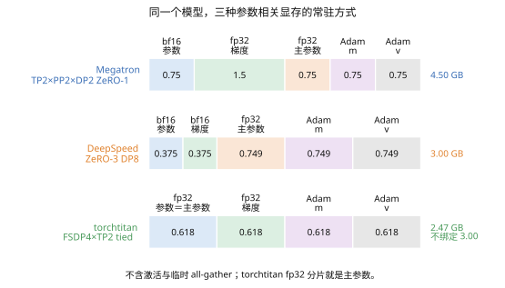
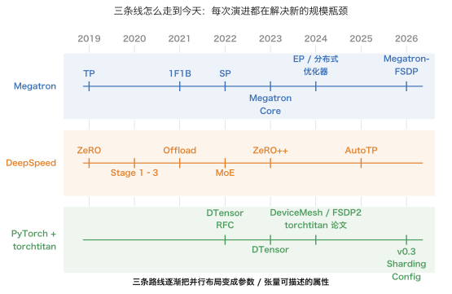
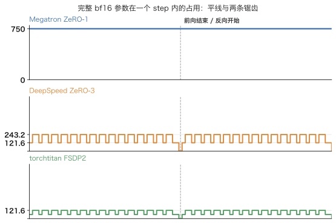
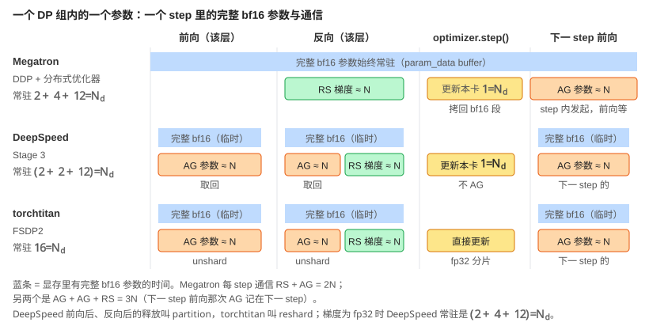
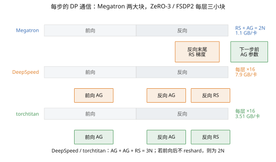
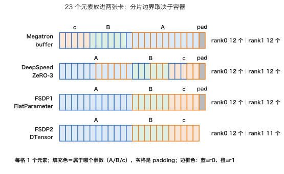
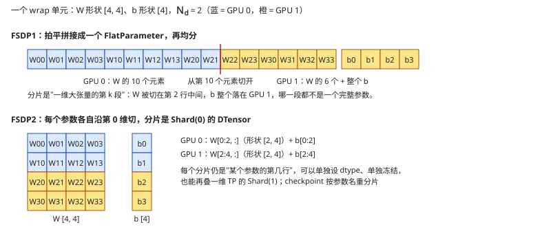
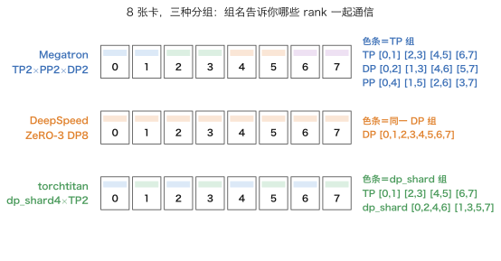
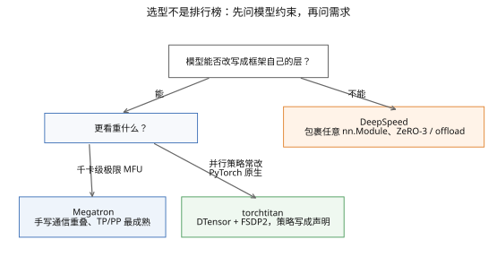

> **更新 @2026-10-27**：本篇拆成四篇。源码导读分别移到 [03《Megatron-LM》](/megatron-lm-architecture-and-source-guide.html)、[04《DeepSpeed》](/deepspeed-architecture-and-source-guide.html)、[05《torchtitan》](/torchtitan-architecture-and-source-guide.html)，本篇只留三者的对比。

前三篇各读了一个框架的源码。Megatron 把一个 DP 副本内的所有 bf16 参数拍进一段连续 buffer，梯度也拍进另一个 buffer，优化器只看自己那 $$1/N_d$$ 段（[03](/megatron-lm-architecture-and-source-guide.html)）；DeepSpeed 让每个参数在不用的时候只剩 $$1/N_d$$ 的碎片，用到时临时拼回来、用完立即打碎（[04](/deepspeed-architecture-and-source-guide.html)）；torchtitan 根本不保留常驻的 bf16 参数——常驻的是 fp32 分片，bf16 只在一层前向、反向的几十毫秒里存在（[05](/torchtitan-architecture-and-source-guide.html)）。

[02《并行策略全景》](/parallelism-strategies-which-state-to-shard.html)结尾用公式算出过一个数字：Llama 3 405B 用 TP 8 / PP 16 / DP 128 训练时，每张卡常驻的参数、梯度、优化器状态只有 13 GB。但公式不会告诉你：那份 bf16 参数在显存里是一个 `nn.Parameter` 还是一段大 buffer 的切片？fp32 主参数是谁在什么时候分配的？梯度算完之后经过几次拷贝才到达优化器？本篇把三份答案放在一起比：三种回答对应三种显存曲线、三种通信时间线、三种 checkpoint 格式，也对应三个框架各自最擅长的场景。

> **一个 bf16 参数在这三个框架里各自存在哪里、什么时候被 all-gather、什么时候被释放、它的 fp32 主副本在哪张卡上？[^q0] 把这条链追清楚，三个框架的架构差异就全部显现了。**

依照系列惯例，通信原语只用语义和通信量；版本基线是 Megatron Core 0.18.0、DeepSpeed 0.19.2、torchtitan v0.3.0、PyTorch 2.14.0。

## 一、总览：同一个 $$W_k$$，三种住法

同一个参数的同一个字，在三个框架里分别住在显存的什么地方？答案可以压成一句话：**三个框架各自从四种状态中的哪一种出发来组织代码**。Megatron 从模型结构出发（TP 切矩阵、PP 切层），bf16 参数是一等公民，全程常驻；DeepSpeed 从优化器状态出发（ZeRO 逐级切 O → G → P），bf16 参数是"临时物"，fp32 分区才是持久的；torchtitan 从参数的表示出发（DTensor 的 placement），fp32 分片既是模型参数也是主参数，bf16 只是通信和计算时的临时投影。后面每一章的显存表、通信时间线、checkpoint 差别，都能从这一句话推出来。

{: .clickable alt="三根横向堆叠条，每段上方标出该段的 dtype 与名称：Megatron TP2×PP2×DP2 ZeRO-1 分五段（bf16 参数 0.75、fp32 梯度 1.50、fp32 主参数 0.75、Adam m 0.75、Adam v 0.75）合计 4.50 GB；DeepSpeed ZeRO-3 DP8 五段（bf16 参数、bf16 梯度、fp32 主参数、Adam m、Adam v）合计 3.00 GB；torchtitan FSDP4×TP2 四段（fp32 参数＝主参数、fp32 梯度、Adam m、Adam v 各 0.618）合计 2.47 GB（括注不绑定为 3.00）。"}

按图读，三行各一句话：Megatron 多出来的常驻是完整的 bf16 参数和完整的 fp32 梯度；DeepSpeed 把五项全部除以 $$N_d = 8$$；torchtitan 没有单独的 bf16 参数，那个 fp32 分片同时就是主参数，所以只有四段。（这张图和下面全文都只算 train-ledger 8 卡配置下**常驻**的参数相关显存，激活和每层临时 all-gather 出来的完整参数不算，那是第三章的事。）

压缩成三行就是：

|  | Megatron-LM | DeepSpeed | torchtitan |
|---|---|---|---|
| 出发点 | 模型结构：TP 切矩阵、PP 切层 | 优化器状态：ZeRO 逐级切 O → G → P | 参数的表示：DTensor 的 placement |
| bf16 参数常驻？ | 是，每张 DP 卡一份完整 N_local | Stage 3 否，只剩 1/N_d 碎片 | 否，常驻的是 fp32 分片 |
| fp32 主参数 | 优化器内部的 1/N_d 切片拷贝 | 扁平 fp32 分区（可放 CPU） | 就是那个 fp32 分片本身，不另存 |

Table: 三种取向的三行浓缩版

<details markdown="1"><summary>完整对照表（对模型代码、状态容器、配置方式等七行）</summary>

|  | Megatron-LM | DeepSpeed | torchtitan |
|---|---|---|---|
| 出发点 | 模型结构：TP 切矩阵、PP 切层 | 优化器状态：ZeRO 逐级切 O → G → P | 参数的表示：DTensor 的 placement |
| 对模型代码 | 模型必须用它的层写 | 包裹任意 nn.Module，零侵入 | 模型用它的 Module 协议写，但层是普通 PyTorch |
| 状态容器 | 连续 buffer（参数一段、梯度一段） | 每参数一个 ds_tensor 碎片 + 扁平分区 | 每参数一个 Shard(0) 的 DTensor |
| 默认 DP 策略 | DDP + 分布式优化器（ZeRO-1） | ZeRO-1/2/3 由 JSON 选 | FSDP2 fully_shard（ZeRO-3） |
| bf16 参数常驻？ | 是，每张 DP 卡一份完整 N_local | Stage 3 否，只剩 1/N_d 碎片 | 否，常驻的是 fp32 分片 |
| fp32 主参数 | 优化器内部的 1/N_d 切片拷贝 | 扁平 fp32 分区（可放 CPU） | 就是那个 fp32 分片本身，不另存 |
| 配置方式 | argparse（几百个 --flag） | JSON | Python（Trainer.Config） |

Table: Megatron-LM、DeepSpeed、torchtitan 的架构差异（完整版）

</details>

几个符号在首次出现处说明：$$N$$ 是参数个数；$$N_d$$、$$N_t$$、$$N_p$$ 是数据 / 张量 / 流水并行度（本篇不涉及上下文与专家并行）；$$N_{\text{local}} = N / (N_t \cdot N_p)$$ 是一张卡在 TP×PP 切分后持有的份额；$$s$$、$$b$$、$$h$$、$$L$$、$$m$$ 是序列长、micro-batch、隐藏维、层数、每个 DP 副本每 step 的 micro-batch 数。

三个框架都建在 `torch.distributed` 上，但用到的层次不同。两个名字先说清楚：**DeviceMesh** 是一张给 rank 编号的 n 维网格，每一维有个名字，`mesh["tp"]` 就给出每张卡自己的 TP 组；**DTensor** 是一个张量加上它所在的 mesh、加上每一维的 placement（`Shard(d)` 沿该维切开 / `Replicate()` 各卡一份 / `Partial()` 各卡一个待归约的部分和），`redistribute` 换摆放方式时它自动发对应的集合通信。02 实际在用的就是这两个对象：[FSDP2 一节讲 per-parameter DTensor](/parallelism-strategies-which-state-to-shard.html#5-fsdp1-与-fsdp2flatparameter-与-per-parameter-dtensor)，[TP / SP 一节](/parallelism-strategies-which-state-to-shard.html#三张量并行与序列并行)的并行组在 torchtitan 里就是 mesh 的一维。

<details markdown="1"><summary>三框架用到的 torch.distributed 层次对照表</summary>

| torch.distributed 层次 | Megatron | DeepSpeed | torchtitan |
|---|---|---|---|
| ProcessGroup（new_group / all_reduce / all_gather_into_tensor …） | ✓ 直接用 | ✓ 经 deepspeed.comm 封装 | 经 DeviceMesh |
| DeviceMesh（torch/distributed/device_mesh.py） | FSDP 路径 | autoTP 路径 | ✓ 全部并行维度 |
| DTensor（torch/distributed/tensor/）与 placement | FSDP 路径 | — | ✓ 参数与激活 |
| fully_shard / FSDP2（torch/distributed/fsdp/_fully_shard/） | 可选后端 | — | ✓ 默认 DP |
| pipelining（torch/distributed/pipelining/{stage,schedules}.py） | —（自写） | —（自写） | ✓ |

Table: 三框架用到的 torch.distributed 层次

</details>

Megatron 与 DeepSpeed 诞生于 DeviceMesh 和 DTensor 之前，各自手写了进程组管理、集合通信调用和流水线调度；torchtitan 诞生于之后，是这些原生 API 的参考用法。[05](/torchtitan-architecture-and-source-guide.html) 讲过，这条路在 v0.3.0 又往前走了一步：参数的切分方式不再由 `ColwiseParallel` 这类 API 逐个 module 指定，而是由一份声明式的 `ShardingConfig` 描述。

源码引用版本：Megatron Core core_v0.18.0、DeepSpeed v0.19.2、torchtitan v0.3.0、PyTorch v2.14.0。各框架的目录地图与逐文件导读在 03/04/05 各自的源码导读章；torchtitan 一处与旧版用法不同要先说明：v0.2.x 用 TOML 文件配置一次运行，v0.3.0 已经不是——`torchtitan/config/README.md` 明确说一次运行由一个返回 `Trainer.Config` 的 Python 函数描述，本篇引用的配置写法都是 v0.3.0 的。

## 二、来龙去脉：三条线怎么走到今天

三个框架长成三种样子，是因为它们各自由一条独立的技术路线演进而来，每次演进都在解决当时新的规模瓶颈。三条线各自的完整年表在 [03 来龙去脉](/megatron-lm-architecture-and-source-guide.html#二来龙去脉)、[04 来龙去脉](/deepspeed-architecture-and-source-guide.html#二来龙去脉)、[05 来龙去脉](/torchtitan-architecture-and-source-guide.html#二来龙去脉)；这张泳道图只把每个节点压成一个短标签放在一起看。

{: .clickable alt="三条泳道 2019 到 2026：Megatron 线 2019 TP、2021 1F1B、2022 SP、2023 Core、2024 EP/分布式优化器、2026 Megatron-FSDP；DeepSpeed 线 2019 ZeRO、2020 Stage 1-3、2021 Offload、2022 MoE、2023 ZeRO++、2025 AutoTP；PyTorch+torchtitan 线 2022 DTensor RFC、2023 DTensor、2024 DeviceMesh 与 FSDP2、2024 TorchTitan 论文、2026 v0.3 ShardingConfig。"}

三条线最后都在往同一个方向靠，方向是**分片成为数据的属性**：Megatron Core 0.18.0 把 FSDP 引进来（`ShardingStrategy` 四级），DeepSpeed 用 DeviceMesh 表达 autoTP，torchtitan 用 `ShardingConfig` 把切分方式写成声明。各自从不同的起点出发，终点却越来越像。

## 三、显存：一条平线和两条锯齿

一个 step 里，"完整 bf16 参数"这个东西在每张卡上占多少显存、什么时候占？Megatron 全程持有，所以它是一条平线；DeepSpeed 和 torchtitan 只有一层正在计算时才需要那份完整参数，所以它们是两条随前向、反向起伏的锯齿。[04 的参数生命周期](/deepspeed-architecture-and-source-guide.html#5-一个-bf16-参数的一生deepspeed-stage-3)和 [05 的参数生命周期](/torchtitan-architecture-and-source-guide.html#6-一个-bf16-参数的一生torchtitan)各画过一条，这里把三条用同一口径排在一起。

{: .clickable alt="三个小面板共享时间轴与 0–800 MB 纵轴：Megatron 一条 750 MB 平线；DeepSpeed 锯齿每层临时完整 bf16 121.6 MB、预取 1 层时峰值两层 243.2 MB；torchtitan 锯齿每层 TP 半片 60.8 MB、峰值两层 121.6 MB。只画 16 个 Transformer 层。"}

锯齿的形状由 labs `06_compare_toys.py saw` 照 [04 toy](/deepspeed-architecture-and-source-guide.html#5-一个-bf16-参数的一生deepspeed-stage-3) 的 hook 事件语义生成（gather → compute → release，预取 1 层时下一层的 gather 与当前层 compute 重叠）。横轴是 toy 的 hook 事件顺序：16 层前向加 16 层反向，中间的虚线是前向与反向的分界；峰值正好两层同时在场。曲线只画 16 个 Transformer 层，不含 embedding 与输出层；单位 MB（十进制）。Megatron 那条平线是 16 层 bf16 参数之和（$$N_{\text{local}} = 750\text{M}$$ 元素 ×2 B ≈ 750 MB）；DeepSpeed 每个峰是一层完整 bf16（60,821,504 元素 ×2 B ≈ 121.6 MB）；torchtitan 每个峰是一层的 TP 半片 bf16（≈ 60.8 MB）。

叠在常驻上看：**常驻（F1 的数字）+ 临时（本图的峰值）≈ 每卡参数相关显存**。Megatron 是"常驻大、临时小"；另两家是"常驻小、每层一个峰"——锯齿越深，临时显存峰值越需要单独预算。

<details markdown="1"><summary>三条时序并排：一个 DP 组内的一个参数（10 行明细表）</summary>

|   | Megatron（DDP + 分布式优化器） | DeepSpeed Stage 3 | torchtitan（FSDP2） |
|---|---|---|---|
| bf16 参数常驻形态 | 完整；param_data buffer 的视图 | 1/N_d 碎片 ds_tensor；param.data 为空 | 无；常驻的是 fp32 Shard(0) DTensor |
| bf16 参数何时完整 | 始终 | 该层前向 / 反向期间（hook 取回） | 该层前向 / 反向期间（unshard） |
| 何时释放 | 从不 | 该层前向后 / 反向后（partition） | 该层前向后 / 反向后（reshard） |
| fp32 主参数在哪 | 优化器私有的 1/N_d 拷贝 | 扁平 fp32 分区（可 CPU） | 就是那个 fp32 分片 |
| 梯度形态 | fp32 完整 main_grad（buffer 视图） | bucket 后 reduce-scatter → 1/N_d 分区 | bf16 临时 → reduce-scatter → fp32 1/N_d 分片 |
| 优化器何时碰它 | step：拷 grad → 更新 → 拷回 bf16 段 | step：每个 sub-group 更新 → 拷回 ds_tensor | step：直接更新 fp32 分片 |
| 更新后 all-gather | step 内发起，下一 step 前向 pre-hook 等 | 不做（persist 参数除外）；下一 step 前向取回 | 不做；下一 step 前向 unshard |
| 每 step 通信 | RS(N) + AG(N) = 2N | AG + AG + RS = 3N | AG + AG + RS = 3N（不 reshard 则 2N） |
| 每参数常驻字节 | 2 + 4 + 12/N_d | (2 + 2 或 4 + 12)/N_d | 16/N_d |
| param.data 身份 | 固定 | 一个 step 内换四次 | 一个 step 内换四次（但 DTensor 自描述） |

Table: 三条时序并排：一个 DP 组内的一个参数

把表里"何时完整""何时释放""更新后 all-gather"三行画到同一条时间轴上：



代入一个具体的数：Llama 3 8B（$$N = 8 \times 10^9$$），8 卡纯 DP（$$N_d = 8$$），每卡常驻的训练状态是：

- **Megatron**：$$2 + 4 + 12/8 = 7.5$$ 字节/参数，约 60 GB。bf16 参数和 fp32 梯度都是完整的一份，只有优化器状态被切。
- **DeepSpeed Stage 3**：$$(2 + 2 + 12)/8 = 2$$ 字节/参数，约 16 GB；梯度用 fp32 时是 $$(2 + 4 + 12)/8 = 2.25$$，约 18 GB。另加当前层临时 all-gather 出的 bf16 参数。
- **torchtitan FSDP2**：$$16/8 = 2$$ 字节/参数，约 16 GB，同样另加当前层的临时 bf16 参数。

省下来的 40 多 GB 不是白给的：每 step 的通信从 $$2N$$ 涨到 $$3N$$，而且是每层三小块，要靠预取和计算重叠才藏得住。

</details>

最后两行解释了三个框架的"手感"。Megatron 的 `param.data` 可以随便读——checkpoint、日志、调试都直接看；DeepSpeed 的要用 `GatheredParameters`；torchtitan 的是 DTensor，`full_tensor()` 或 `to_local()` 二选一，但它知道自己是什么。

## 四、通信：两大块和每层三小块

显存曲线的形状，在通信时间线上有对应的形状。平线对应两大块：Megatron 在反向末尾一次 reduce-scatter 梯度、在下一步前向前一次 all-gather 参数，都与计算重叠；锯齿对应每层三小块：DeepSpeed 与 torchtitan 每层前向 all-gather、反向 all-gather、反向 reduce-scatter。[02 的通信账](/parallelism-strategies-which-state-to-shard.html#二数据并行与-zero切优化器状态梯度参数)给的公式是 ZeRO-1/2 与 DP 相同（$$2N$$：reduce-scatter + all-gather）、ZeRO-3 涨到 $$3N$$、前向后不释放参数则回到 $$2N$$。

{: .clickable alt="三条泳道各分前向、反向两半：Megatron 在反向末尾一次 RS 梯度、下一步前向前一次 AG 参数两大块（每卡约 1.1 GB，2N）；DeepSpeed 和 torchtitan 每层 前向 AG / 反向 AG / 反向 RS 三小块（每卡 7.9 GB / 3.51 GB，3N）。"}

图里的每卡字节数取 train-ledger 8 卡配置（[第九章](#九本文小结)有完整对账）：Megatron 每 step 发出 RS(fp32 梯度 1.5 GB) + AG(bf16 参数 0.75 GB)，$$N_d = 2$$ 各摊一半约 1.1 GB；DeepSpeed 三次通信各 3 GB、ring 系数 7/8 约 7.9 GB；torchtitan 3.51 GB 的算式在第九章逐项展开（其中 tied 的 embedding/norm/lm_head 单元不 reshard，反向不再取回，比纯 3N 少一点）。

混精度和 Adam 的字节账（每参数常驻 16 字节，fp32 梯度累加时 18 字节）在 [01《状态解剖》](/training-state-anatomy-memory-and-mfu.html#三混合精度的字节账16-与-18)推导过；通信量公式在 [02](/parallelism-strategies-which-state-to-shard.html#二数据并行与-zero切优化器状态梯度参数)。

## 五、分片在内存里长什么样

同一个模型、同一个 $$N_d = 2$$，"切成两半"在四个实现里各是什么形状？labs toy 拿同一个三个参数的小模型（`A[4,3]`、`B[2,3]`、`c[5]`，共 23 个元素）在 2 个 gloo rank 上各切一遍：

```text title="06_compare_toys.py shard 输出（节选）"
[rank0] -- a. Megatron 分布式优化器（一段连续 buffer + pad 到 N_d 倍数）
[rank0] buffer 布局（逆序拍平）：[('c', 0, 5), ('B', 5, 11), ('A', 11, 23)]，pad=1
[rank0] 本 rank 区间 [0,12)：['c[0:5]', 'B[0:6]', 'A[0:1]']
[rank0] -- b. DeepSpeed ZeRO-3（每参数各自 pad + 均分，ds_tensor）
[rank0] A: numel=12 pad=0 段长=6，本 rank 拿 A[0:6]
[rank0] B: numel=6 pad=0 段长=3，本 rank 拿 B[0:3]
[rank0] c: numel=5 pad=1 段长=3，本 rank 拿 c[0:3]
[rank0] -- c. FSDP1（整单元拍平成 FlatParameter + pad + 均分）
[rank0] FlatParameter numel=23 pad=1，本 rank [0,12)：['A[0:12]']
[rank0] -- d. FSDP2（真实 DTensor，distribute_tensor Shard(0)）
[rank0] A(4, 3): 全局形状 (4, 3)，本 rank to_local()=(2, 3)
[rank0] B(2, 3): 全局形状 (2, 3)，本 rank to_local()=(1, 3)
[rank0] c(5,): 全局形状 (5,)，本 rank to_local()=(3,)
```

toy 为了能在 23 个元素上画图，只保留了每家的基本规则，真实实现里还有两处 padding 没画：Megatron 的 buffer 布局由分布式优化器算好交给 DDP（`optimizer/param_layout.py`），其中每个参数的起始偏移对齐到 64 元素边界（`pad_param_start`），每个 bucket 的末尾补到 `lcm(dp_world_size, 128)` 的倍数、打开 `pad_for_high_nccl_busbw` 时是 `lcm(dp_world_size, 128, 2**16)`（`pad_bucket_end`）——所以真实 buffer 里参数之间还有空隙，不是上图这样首尾相接；DeepSpeed 那行展示的"每参数各自 pad 到 $$N_d$$ 的倍数"就是真实规则本身（`partition_parameters.py` 按 DP 组大小补齐），只是 23 个元素太小，体现不出它按参数独立补齐后段内 padding 位置的细节。

四种切法四种边界，画出来是：

{: .clickable alt="四行条带，每格一个元素：Megatron 把 c、B、A 逆序拍平进一段 buffer、pad 到 24、两半各 12 均分（rank1 拿到 A[1:12] 加 1 个 pad）；DeepSpeed 每个参数各自 pad 均分（c 切成 3 和 2 加一个 pad）；FSDP1 全部拍平成 FlatParameter 再均分（rank0 正好是完整的 A）；FSDP2 每个参数沿第 0 维 DTensor Shard(0)（A 切成 2 和 2 行、B 各 1 行、c 切成 3 和 2）。边框蓝=r0、橙=r1。"}

四行各对应一个取舍：

- **Megatron** 的一段连续 buffer 让 reduce-scatter 和参数 all-gather 都能整块发，但切分边界落在参数内部——`DistributedOptimizer` 只能按字节区间说话，checkpoint 也要靠 buffer 偏移重建参数（[03 的 buffer 一节](/megatron-lm-architecture-and-source-guide.html#六源码导读)）。
- **DeepSpeed** 每参数独立 pad 独立切，`ds_tensor` 是最灵活的表示（可 offload、可量化、可 hpZ 二级分片），但它是私有约定，PyTorch 的 DCP、TP、`torch.compile` 都不认识 `ds_*` 属性。
- **FSDP1** 的 `FlatParameter` 通信效率最高、实现最简单，但整个单元拍平后**抹掉了参数身份**——同一 dtype、同时冻结的前提下，checkpoint 只是一维段，是它被 FSDP2 取代的原因。
- **FSDP2** 的 `DTensor` 是四者中唯一"自描述"的：分片知道自己在哪个 mesh 的哪一维、全局形状多大，所以 DCP 能按参数名重分片、TP 能在另一维再切、`clip_grad_norm_` 能算对范数——[02](/parallelism-strategies-which-state-to-shard.html#5-fsdp1-与-fsdp2flatparameter-与-per-parameter-dtensor)说的"可组合性质变"就在这里。

<details markdown="1"><summary>前向前 all-gather 分片参数：Stage 3 vs FSDP1 vs FSDP2（12 行明细表）</summary>

|   | DeepSpeed Stage 3 | FSDP1（FlatParameter） | FSDP2（fully_shard） |
|---|---|---|---|
| 分片单位 | 每个参数各自切成 1/N_d（ds_tensor） | 一个 wrap 单元的所有参数拍平成一个 FlatParameter 再切 | 每个参数各自沿第 0 维切（FSDPParam），组成 FSDPParamGroup |
| 触发点 | 每个子 module 的 forward pre-hook<br/>parameter_offload.py _pre_forward_module_hook | wrap 单元的 forward pre-hook<br/>_runtime_utils.py _pre_forward → _pre_forward_unshard | fully_shard 单元的 forward pre-hook<br/>_fsdp_state.py _pre_forward → FSDPParamGroup.pre_forward |
| all-gather 调用 | fetch_sub_module → all_gather_coalesced<br/>一个 module 的多个参数拼成一次通信 | _unshard → FlatParamHandle.unshard → _all_gather_flat_param<br/>一次通信（本来就是一个张量） | unshard → foreach_all_gather（拷进连续 buffer、一次 all_gather_into_tensor）<br/>一次通信 |
| 完整参数如何出现 | param.data 指向拼好的张量 | _use_unsharded_flat_param → _use_unsharded_views：原参数变成 FlatParameter 的视图 | foreach_all_gather_copy_out → FSDPParam.to_unsharded：各参数恢复原形状 |
| dtype 转换 | all-gather 前 get_allgather_dtype | MixedPrecision：拷进低精度 FlatParameter 再 gather | all_gather_inputs 按 mp_policy.param_dtype 转 |
| 预取 | trace 驱动（stage3_prefetch_bucket_size） | forward_prefetch / backward_prefetch（_prefetch_handle） | set_modules_to_forward_prefetch / _backward_prefetch（默认按前向逆序） |
| 前向后释放 | release_sub_module → partition<br/>除 ds_persist | _post_forward_reshard → FlatParamHandle.reshard<br/>除 reshard_after_forward=False | post_forward → reshard → to_sharded<br/>除 reshard_after_forward=False；可重分片到更小组（SHARDED_POST_FORWARD） |
| 分片的类型 | 普通 Tensor + ds_* 属性 | FlatParameter（nn.Parameter 子类）+ 元数据 | DTensor(Shard(0)) |
| 参数身份 | 保留（每参数一个 ds_tensor） | 抹掉（同一 dtype、同时冻结、checkpoint 是一维段） | 保留（每参数一个 DTensor） |
| 与 TP 组合 | 要靠外部框架 | 需专门适配 | 天然（二维 DTensor） |

Table: 前向前 all-gather 分片参数：Stage 3 vs FSDP1 vs FSDP2

"分片单位"和"参数身份"两行用第二篇的例子最好理解：一个 wrap 单元里有 W [4, 4] 和 b [4]，切到 2 张卡上。FSDP1 把两者拍平成 20 个元素再对半切，W 被切在第 2 行中间；FSDP2 每个参数各自沿第 0 维切，每段都还是"某个参数的第几行"。DeepSpeed Stage 3 的 `ds_tensor` 也是按参数各自切，但切的是拍平后的一维碎片，不保留行的结构。



三者的通信量相同（都是每单元一次 all-gather），差别在**分片的表示**决定了什么能做、什么不能做。Stage 3 的 `ds_tensor` 是最灵活的（每参数独立，可以 offload、可以量化、可以 hpZ 二级分片），但它是 DeepSpeed 私有的约定，PyTorch 的其他组件（DCP、TP、`torch.compile`）都不认识 `ds_*` 属性。FSDP1 的 `FlatParameter` 通信效率最高、实现最简单，但抹掉了参数身份，是它被 FSDP2 取代的原因。FSDP2 的 `DTensor` 是三者中唯一"自描述"的：分片知道自己在哪个 mesh 的哪一维、全局形状多大，所以 DCP 能按参数名重分片（第八篇）、TP 能在另一维再切、`clip_grad_norm_` 能正确算范数——第二篇说的"可组合性质变"就在这里。

</details>

三者的通信量相同（都是每单元一次 all-gather），差别在**分片的表示**决定了什么能做、什么不能做。Stage 3 的 `ds_tensor` 最灵活但是私有约定；`FlatParameter` 最省但抹掉身份；`DTensor` 自描述所以最可组合。

## 六、进程组：同样 8 张卡，三种分组

并行策略落到代码里的第一件事是进程组：每张卡属于哪一个 TP 组、哪一个 DP 组、哪一个 PP 组。三个框架用三种方式回答这个问题。

Megatron 的 `parallel_state` 是一张由模块级全局变量组成的注册表，`RankGenerator` 按 `order="tp-cp-ep-dp-pp"` 枚举 rank 填进去；DeepSpeed 的 `groups.py` 是委托优先，`mpu` 在就转发给外部，不在就克隆整个世界；torchtitan 的 `ParallelDims` 持有几张 `DeviceMesh` 视图，`build_mesh()` 把一维 world mesh `_unflatten` 成按名索引的多维网格。三个实现分别在 [03 进程组](/megatron-lm-architecture-and-source-guide.html#五进程组)、[04 进程组](/deepspeed-architecture-and-source-guide.html#五进程组groupspy-的委托与自建)、[05 进程组](/torchtitan-architecture-and-source-guide.html#五进程组paralleldims-与-devicemesh)。

{: .clickable alt="三行各 8 个 rank 小卡片，卡内色条含义标在每行右侧：Megatron TP2×PP2×DP2 色条＝TP 组（TP [0,1][2,3][4,5][6,7]、DP [0,2][1,3][4,6][5,7]、PP [0,4][1,5][2,6][3,7]）；DeepSpeed ZeRO-3 色条＝同一 DP 组（DP [0..7]）；torchtitan dp_shard4×TP2 色条＝dp_shard 组（TP [0,1][2,3][4,5][6,7]、dp_shard [0,2,4,6][1,3,5,7]）。"}

第一行与第三行画的是 03、05 两个 toy 的真实输出：Megatron 的 rank 编码是 `rank = tp + 2·dp + 4·pp`（TP 最内），torchtitan 的 mesh 是 `rank = tp + 2·dp_shard`（TP 在最内维）；DeepSpeed ZeRO-3 只有一个 DP 组，所以八张卡一个颜色。

<details markdown="1"><summary>三框架进程组管理的完整对照表</summary>

|   | Megatron Core 0.18.0 | DeepSpeed 0.19.2 | torchtitan v0.3.0 |
|---|---|---|---|
| 数据结构 | 模块级全局变量 + get_*_group() | 模块级 mpu 委托 + 字典 | ParallelDims 持有的 DeviceMesh 视图 |
| rank 排布 | RankGenerator(order="tp-cp-ep-dp-pp") | 外部 mpu 决定；pipe 用 ProcessTopology | _unflatten 的维度顺序 (pp, dp_replicate, dp_shard, cp, tp) |
| DP 组 | dp / dp-cp / expt-dp / intra-inter 两层 | world 克隆 或 mpu.get_data_parallel_group() | dp_shard / dp_replicate / loss（batch×cp） |
| TP 组 | tp；expert-tp 可与 dense-tp 不同 | mpu 或 autoTP 的 mesh | tp |
| PP 组 | pp + embedding / position-embedding 组 | PipelineParallelGrid | pp（stage 之间由 PipelineStage 自己 send/recv） |
| CP 组 | cp；梯度在 dp-cp 上归约 | sequence-parallel 组（Ulysses） | cp；fully_shard 把 dp_shard×cp 合成 shard 维 |
| EP 组 | ep / tp-ep / tp-ep-pp / expt-dp | ep 与 expt-dp，按 ep_size 命名 | ep / efsdp |
| ZeRO/FSDP 分片组 | intra_distributed_optimizer_instance | dp（Stage 3 另有 hpZ 二级组） | dp_shard（+cp） |
| gloo 孪生 | 每组一个 | — | — |
| 显式传递 | pg_collection 可选 | mpu 参数 | parallel_dims 到处传 |

Table: 三框架进程组管理的对照表

</details>

三者都把 TP 放在最内、PP 放在最外，都把 CP 视为"切数据、复制参数"的维度并入梯度归约组。差别是历史层次：Megatron 是全局单例正在向对象化过渡，DeepSpeed 把模型并行的进程组交给外部，torchtitan 从一开始就是 mesh。

## 七、1F1B：调度写死在哪一层

同一个 1F1B 调度（[02 的第五章](/parallelism-strategies-which-state-to-shard.html#五流水线并行)），三个框架各写了一遍，"调度在哪一层被写死"分别是什么？labs toy 拿 PP=2、每 stage m=4 个 micro-batch，三种表示各打一遍：

```text title="06_compare_toys.py pp 输出"
-- Megatron：过程式三段循环产生的序列
  stage0: warmup ['F1'] | steady ['F2', 'B1', 'F3', 'B2', 'F4', 'B3'] | cooldown ['B4']
          序列: F1 F2 B1 F3 B2 F4 B3 B4
  stage1: warmup [] | steady ['F1', 'B1', 'F2', 'B2', 'F3', 'B3', 'F4', 'B4'] | cooldown []
          序列: F1 B1 F2 B2 F3 B3 F4 B4
-- DeepSpeed：TrainSchedule 的 stage0 指令流（按 v0.19.2 schedule.py 的 steps() 生成）
   LoadMicroBatch(0)       ForwardPass(0)          LoadMicroBatch(1)       ForwardPass(1)
   SendActivation(0)       RecvGrad(0)             BackwardPass(0)         SendGrad(0)
   SendActivation(1)       RecvGrad(1)             BackwardPass(1)         SendGrad(1)
   LoadMicroBatch(2)       ForwardPass(2)          SendActivation(1)       ...
   ...                                            ReduceTiedGrads()       ReduceGrads()
   OptimizerStep()
-- PyTorch：真实 Schedule1F1B._get_pipeline_order + _format_pipeline_order（CPU 可生成）
        Rank 0       Rank 1
Step 0: 0F0          1F1
Step 1: 0F1          1B0
Step 2: 0B0          1F2
Step 3: 0F2          1B1
Step 4: 0B1          1F3
Step 5: 0F3          1B2
Step 6: 0B2          1B3
Step 8: 0REDUCE_GRAD 1REDUCE_GRAD
```

三份输出是同一个调动的三种写法：Megatron 的 `forward_backward_pipelining_without_interleaving()` 是过程式三段循环，收发由 `P2PCommunicator` 合成一次 `batch_isend_irecv`；DeepSpeed 的 `TrainSchedule.steps()` 是生成器，每步 yield 一组 `PipeInstruction` 由 `PipelineEngine._exec_schedule` 查表执行；PyTorch 的 `Schedule1F1B` 过程结构几乎逐行对应，但调度可以翻译成一张 `_Action` 动作表、由 `_PipelineScheduleRuntime` 解释执行——上面那段就是 torch 2.14 在 CPU 上真实生成的表（两个 rank 各自的 F/B 步序，末行 `REDUCE_GRAD` 是 `_add_reduce_grad` 自动附加的梯度归约）。两处代码展开分别在 [03](/megatron-lm-architecture-and-source-guide.html#七1f1bmegatron-的过程式写法) 和 [05](/torchtitan-architecture-and-source-guide.html#七1f1bpytorch-的动作表写法)。

| | Megatron：过程式 | DeepSpeed：指令流 | PyTorch：动作表 |
|---|---|---|---|
| 调度长什么样 | `forward_backward_pipelining_without_interleaving()` 的 warmup / steady / cooldown 三段循环 | `TrainSchedule.steps()` 生成器，每步 yield 一组 `PipeInstruction` | `_Action` 表（或由 `_load_csv` 载入手写表） |
| 谁执行它 | 函数本身 | `PipelineEngine._exec_schedule` 按 `_INSTRUCTION_MAP` 查表调 `_exec_*` | `_PipelineScheduleRuntime` 逐 `_Action` 解释执行 |
| 通信在哪发出 | `P2PCommunicator._communicate()`，四类收发打包成一次 `batch_isend_irecv` | `_exec_send_activations` 等，走 `pipe/p2p.py` | `PipelineStage.get_fwd_recv_ops()` 等生成 `P2POp`，`_batch_p2p` 合并 |
| 改调度要动什么 | 改代码（interleaved 版本另写了一千行） | 改生成器；只有一种调度 | 换一张表；PP × FSDP、zero-bubble 都是表变换（`_add_send_recv` / `_add_unshard_reshard` / `_merge_bw`） |

Table: 1F1B 在三个框架里的写法

三种写法的取舍：Megatron 的过程式**快**——每一步做什么在代码里写死，没有解释开销，与自己的 DDP、分布式优化器、interleaved 调度的 `overlap_p2p_comm` 深度耦合（`forward_backward_pipelining_with_interleaving()` 有一千行）；PyTorch 的动作表**通用**——新调度只是一张新表，PP 与 FSDP、与 zero-bubble 的组合是表变换，代价是每步的解释与 `_batch_p2p` 的开销；DeepSpeed 的 `TrainSchedule` 在两者之间：指令序列是声明的，但只有一种调度。

## 八、怎么选

选型不是排行榜，先回答两个问题：模型能不能改写成框架自己的层？能改写的话，更看重极限 MFU 还是并行策略的可组合性？

{: .clickable alt="决策树：问题一「模型能否改写成框架自己的层？」——不能→DeepSpeed（包裹任意 nn.Module；ZeRO-3 / offload 省显存）；能→问题二「更看重什么？」——千卡级极限 MFU→Megatron（手写通信重叠、TP/PP 最成熟），并行策略常改、PyTorch 原生可组合→torchtitan（DTensor + FSDP2，策略写成声明）。"}

把"适合"一行展开成三句话，只从上面读过的机制推：

- **追求极限 MFU 的千卡级 dense / MoE 预训练 → Megatron**。它的 bf16 参数全程常驻、通信两大块与计算重叠，手写重叠和 TE / FP8、MoE 全套是三个框架里最深的；代价是模型必须用它的层写，外部模型要转换。
- **已有训练脚本要放大、显存不够、小集群 → DeepSpeed**。它包裹任意 `nn.Module`，零侵入就能把 ZeRO-3 + offload 打开，让几卡训动十几 B；代价是参数经常"不在"（`GatheredParameters`、六个 stage3_* 阈值靠经验调），与 PP 组合受限。
- **新项目、研究、需要改并行策略 → torchtitan**。代码量最小，并行方案是 placement 的声明，改一个 `ShardingConfig` 就换一种切法；DTensor 让它与 DCP、TP、`torch.compile` 天然组合。代价是依赖 PyTorch 侧的实现是否到位，ZeRO-1/2 这类"省事"档没有。

<details markdown="1"><summary>三框架取舍的完整对照表（10 行）</summary>

|   | Megatron Core 0.18.0 | DeepSpeed 0.19.2 | torchtitan v0.3.0 |
|---|---|---|---|
| 强项 | 极致性能：TE / FP8、手写重叠、MoE 全套 | 对模型零侵入；ZeRO-3 + offload 让小集群训大模型 | 可读、可组合；PyTorch 原生功能的参考实现 |
| 模型代码约束 | 必须用 megatron/core/transformer 的层写；<br/>外部模型需转换 | 任意 nn.Module；PP 要改写成 LayerSpec 列表 | 用它的 Module 协议 + ShardingConfig；层是普通 PyTorch |
| DP 系覆盖 | ZeRO-1（分布式优化器）+ Megatron-FSDP（ZeRO-1/2/3） | ZeRO-1/2/3、offload、hpZ、MiCS | FSDP2（ZeRO-3）、HSDP；无 ZeRO-1/2 |
| 模型并行覆盖 | TP+SP、PP（1F1B / interleaved）、CP、EP 全套 | 依赖外部 mpu 的 TP；自带 PP；Ulysses CP；EP | TP+SP、PP（pipelining 全部调度）、CP（实验 API）、EP |
| 配置 | 几百个 argparse flag，validate_args 做约束检查 | JSON，约束隐式 | Python 函数返回 Trainer.Config，类型检查 |
| 调试 | param.data 随时可读；buffer 布局要懂 | 参数常为空张量；GatheredParameters；日志靠 see_memory_usage | DTensor 自描述；但通信藏在 hook 里 |
| checkpoint | dist_checkpointing（ShardedTensor）+ torch_dist / fsdp_dtensor 格式 | ZeRO checkpoint 按 rank；universal checkpoint 转换 | DCP（DTensor 原生重分片） |
| 可观测 | timers、log_memory_to_tensorboard、straggler 检测 | wall_clock_breakdown、flops_profiler | MetricsProcessor、DeviceMemoryMonitor、Profiler、Flight Recorder 配置 |
| 代码量与耦合 | 大；DDP ↔ 优化器 ↔ 调度通过回调耦合 | 大；engine ↔ ZeRO 优化器强耦合 | 小；耦合在 PyTorch 侧 |
| 适合 | 千卡 dense / MoE 预训练，追求 MFU | 已有训练脚本要放大；显存不够；小集群 | 新项目、研究、需要改并行策略的场景 |

Table: 三框架取舍表

</details>

三者对同一格子的选择差异，多数可以从"从哪种状态出发"解释。Megatron 从模型结构出发，所以要求模型用它的层写、并行的每一步都手写、能做到最紧的重叠；DeepSpeed 从优化器状态出发，所以只需要接管优化器和 hook、对模型零侵入、但"参数不在"成为常态；torchtitan 从参数的表示出发，所以一切并行都是 placement 的变换、代码最少、但依赖 PyTorch 侧的实现是否到位。三者都在往同一个方向走：分片正在成为数据的属性，而不是框架的秘密。

## 九、本文小结

### 1. 要点回顾

- **主线**：一个 bf16 参数：Megatron 常驻完整（buffer 视图）、DeepSpeed Stage 3 常驻 1/N_d 碎片（hook 取回）、torchtitan 不常驻（fp32 分片 unshard 出 bf16）
- **fp32 主参数**：Megatron 优化器私有的 1/N_d 拷贝；DeepSpeed 扁平 fp32 分区；torchtitan 就是 fp32 分片本身
- **每参数字节**：Megatron 2 + 4 + 12/N_d（默认 fp32 梯度）；DeepSpeed (16 或 18)/N_d + 临时层；torchtitan 16/N_d + 临时层
- **通信**：Megatron RS + AG = 2N（AG 与下一步前向重叠）；DeepSpeed / torchtitan AG + AG + RS = 3N（不 reshard 则 2N）
- **进程组**：Megatron RankGenerator(order) 填全局变量；DeepSpeed 委托 mpu 或 world 克隆；torchtitan DeviceMesh _unflatten 成几张视图
- **Megatron**：_ParamAndGradBuffer 两段连续内存 + bucket group；DDP hook 累加 main_grad、bucket 满则 RS；DistributedOptimizer 按字节区间分片；调度经 config 回调与 DDP 交互
- **DeepSpeed**：engine 包裹 module；ZeRO 优化器包裹用户优化器；Stage 1/2 扁平分区 + IPG bucket；Stage 3 ds_tensor + 四个 module hook + 参数协调器（trace 预取）
- **torchtitan**：meta 构造 → parallelize → to_empty；ShardingConfig 声明 TP，distribute_tensor + redistribute 实现；fully_shard 每层一个单元，MixedPrecisionPolicy 决定 bf16
- **all-gather 三种**：Stage 3 每参数 ds_tensor + coalesced；FSDP1 FlatParameter 一次；FSDP2 每参数 DTensor 拷进连续 buffer 一次——通信量同，表示决定可组合性
- **1F1B 三种**：Megatron 过程式三段循环；DeepSpeed TrainSchedule 指令生成器；PyTorch _Action 表
- **趋势**：Megatron-FSDP（ShardingStrategy 四级）、DeepSpeed 的 DeviceMesh、torchtitan 的 ShardingConfig：分片正在成为数据的属性

### 2. 本篇涉及的源码位置

各框架的完整源码位置表在 [03](/megatron-lm-architecture-and-source-guide.html#八本文小结)、[04](/deepspeed-architecture-and-source-guide.html#七本文小结)、[05](/torchtitan-architecture-and-source-guide.html#八本文小结) 的小结尾，本篇不再重复。

### 3. train-ledger 三框架对账

**做什么**：在 8 张卡上用三个框架各跑一次同一个 Llama 风格的小模型（取 Llama 3.2 1B 的形状：16 层、$$h = 2048$$、32 头 / 8 个 K/V 头、FFN 8192、词表 128256、$$s = 8192$$），每个框架用它最自然的 8 卡配置，然后用 `probe_memory.py` 读每卡的 `torch.cuda.memory_stats()`、用 `torch.profiler` 数每 step 各类集合通信的次数与时间，和 [02《并行策略全景》](/parallelism-strategies-which-state-to-shard.html) 的 `ledger.parallel.place()` 的预测对账。一处口径要说明：Megatron、DeepSpeed 两份配置不绑定 embedding 与输出层（$$N = 1{,}498{,}482{,}688$$），torchtitan 沿用 v0.3.0 `_1b()` 的默认 `enable_weight_tying=True`（$$N = 1{,}235{,}814{,}400$$，见 [05](/torchtitan-architecture-and-source-guide.html#6-一个-bf16-参数的一生torchtitan)），对比时注明。目录：

```text title="train-ledger/runs/ 目录"
train-ledger/
  runs/
    megatron/run.sh              TP 2 × PP 2 × DP 2，分布式优化器（ZeRO-1），SP
    deepspeed/ds_config.json     ZeRO-3，DP 8
    deepspeed/train_ds.py        约 40 行的循环：zero.Init → deepspeed.initialize → engine(batch) / backward / step
    titan/ledger_llama3_1b.py    FSDP 4 × TP 2；一个返回 Trainer.Config 的函数
  probe_memory.py                读 memory_stats 与 profiler，写 JSON，与 ledger 对账
```

**预期（先算再跑）**。用 `ledger.parallel.report()` 对三个配置各算一遍，常驻状态（不含激活与临时 all-gather）大致是：

| 配置 | N_local | 参数（常驻） | 梯度（常驻） | 优化器状态 | 常驻合计 | 每 step DP 系通信（每卡发出） | 其余 |
|---|---|---|---|---|---|---|---|
| Megatron TP2 PP2 DP2 ZeRO-1 | 375M | bf16 0.75 GB | fp32 1.5 GB | 12 × 375M / 2 = 2.25 GB | ≈ 4.5 GB | RS(fp32 梯度 1.5 GB) + AG(bf16 参数 0.75 GB)，N_d = 2 各发一半 → ≈ 1.1 GB | TP ≈ 8.6 GB NVLink<br/>PP ≈ 0.27 GB |
| DeepSpeed ZeRO-3 DP8 | 1.5B | bf16 0.38 GB | bf16 0.38 GB | 12 × 1.5B / 8 = 2.25 GB | ≈ 3.0 GB | AG(3 GB) + AG(3 GB) + RS(3 GB)，7/8 → ≈ 7.9 GB | — |
| torchtitan FSDP4 TP2（tied） | 618M | fp32 0.618 GB | fp32 0.618 GB | 8 × 618M / 4 = 1.236 GB | ≈ 2.47 GB<br/>（不绑定 3.0 GB） | AG(bf16 TP 半参数) + AG + RS(fp32 梯度)，3/4 → ≈ 3.51 GB | TP ≈ 4.3 GB NVLink |

Table: 三个配置的常驻状态预期（torchtitan 行按 tied N = 1,235,814,400）

torchtitan 行的常驻拆开是：fp32 参数分片 4N/8 = 0.618 GB（它本身就是主参数）、fp32 梯度 4N/8 = 0.618 GB、Adam m+v 8N/8 = 1.236 GB，合计 16N/8 ≈ 2.47 GB；若关闭绑定取 N = 1,498,482,688 则是 3.0 GB。它的 DP 通信逐项是（每卡发出，ring ×3/4）：前向 all-gather 本 TP 半片的 bf16 参数 2N/2 = 1.236 GB；反向 all-gather 同样，但 tied 的 tok_embeddings+norm+lm_head 单元 `reshard_after_forward=False`（`torchtitan/distributed/fsdp.py` 的 `enable_weight_tying` 分支；policy 为 `"default"` 且无 PP 时 Transformer 层 reshard=True）不再取回，少 128256×2048×2/2 B = 0.263 GB → 0.973 GB；reduce-scatter fp32 梯度 4N/2 = 2.472 GB（`mixed_precision_reduce` 默认 float32，configs.py:93）。合计 4.681 GB × 3/4 ≈ 3.51 GB。

（Megatron 的 TP 通信按 $$m = 8$$、每 stage 8 层、SP 下每层 all-gather + reduce-scatter 各两次算；torchtitan 无 PP，一次前向就是 `local_batch_size = 2` 的整批，TP 通信按 16 层算。）跑出来的 `allocated_bytes.all.peak` 会比常驻合计大很多——差额是激活、临时 all-gather 的完整层、NCCL buffer 与 allocator 碎片，本篇只要求**常驻部分对得上**（用 step 之间的 `allocated_bytes.all.current` 读，此时激活已释放），激活与峰值的对账留给 [07《训练吞吐调参》](/thousand-gpu-configuration-and-mfu-tuning.html)。

<details markdown="1"><summary>三个 run 的配置与探针代码（run.sh / ds_config.json / train_ds.py / ledger_llama3_1b.py / probe_memory.py）</summary>

**Megatron 配置**（`runs/megatron/run.sh`，参数名以 0.18.0 `arguments.py` 与 `training/config/` 为准）：

```bash title="runs/megatron/run.sh"
#!/bin/bash
# train-ledger / runs/megatron/run.sh -- Llama-3.2-1B shape, 8 GPUs: TP2 x PP2 x DP2, ZeRO-1 (distributed optimizer)
torchrun --nproc_per_node 8 pretrain_gpt.py \
  --use-mcore-models --transformer-impl transformer_engine \
  --num-layers 16 --hidden-size 2048 --ffn-hidden-size 8192 \
  --num-attention-heads 32 --group-query-attention --num-query-groups 8 \
  --seq-length 8192 --max-position-embeddings 8192 --position-embedding-type rope --rotary-base 500000 \
  --swiglu --normalization RMSNorm --disable-bias-linear --untie-embeddings-and-output-weights \
  --attention-dropout 0.0 --hidden-dropout 0.0 \
  --tensor-model-parallel-size 2 --pipeline-model-parallel-size 2 --sequence-parallel \
  --use-distributed-optimizer --overlap-grad-reduce --overlap-param-gather \
  --micro-batch-size 1 --global-batch-size 16 \
  --bf16 --lr 3e-4 --min-lr 3e-5 --lr-decay-style cosine --lr-warmup-iters 10 --train-iters 50 \
  --clip-grad 1.0 --weight-decay 0.1 --adam-beta1 0.9 --adam-beta2 0.95 \
  --mock-data --tokenizer-type NullTokenizer --vocab-size 128256 --split 99,1,0 \
  --log-interval 1 --log-memory-to-tensorboard --tensorboard-dir "$PWD/tb/megatron" \
  --use-pytorch-profiler --profile-step-start 20 --profile-step-end 22 --profile-ranks 0 1 2 3 4 5 6 7 \
  --eval-iters 0 --save-interval 1000000 \
  --distributed-timeout-minutes 30
```

`--global-batch-size 16` 与 `--micro-batch-size 1`、DP 2 意味着每个 DP 副本每 step 8 个 micro-batch（$$m = 8$$，PP 2 的气泡 $$1/(8+1) = 11\%$$）。`--log-memory-to-tensorboard` 让 `training_log()` 每步写 `mem-reserved-bytes`、`mem-allocated-bytes`、`mem-max-allocated-bytes`；`--use-pytorch-profiler` 让 `train()` 在第 20–22 步用 `torch.profiler.profile` 记录，trace 写到 tensorboard 目录。要用 `--use-megatron-fsdp --data-parallel-sharding-strategy optim_grads_params` 换成 ZeRO-3 对比，只需去掉 PP 并改 `--ckpt-format fsdp_dtensor`。

**DeepSpeed 配置**（`runs/deepspeed/ds_config.json`，键名以 0.19.2 `runtime/constants.py` 与 `zero/config.py` 为准）：

```json title="runs/deepspeed/ds_config.json"
{
  "train_micro_batch_size_per_gpu": 1,
  "gradient_accumulation_steps": 2,
  "gradient_clipping": 1.0,
  "steps_per_print": 1,
  "bf16": { "enabled": true },
  "optimizer": {
    "type": "AdamW",
    "params": { "lr": 3e-4, "betas": [0.9, 0.95], "weight_decay": 0.1 }
  },
  "zero_optimization": {
    "stage": 3,
    "overlap_comm": true,
    "contiguous_gradients": true,
    "reduce_bucket_size": 5e7,
    "stage3_prefetch_bucket_size": 5e7,
    "stage3_param_persistence_threshold": 1e5,
    "stage3_max_live_parameters": 1e9,
    "stage3_max_reuse_distance": 1e9,
    "sub_group_size": 1e9
  },
  "wall_clock_breakdown": true,
  "memory_breakdown": false,
  "flops_profiler": { "enabled": true, "profile_step": 20, "module_depth": -1, "top_modules": 3, "detailed": false }
}
```

`train_batch_size` 省略，由 `1 × 2 × 8 = 16` 推出。`train_ds.py` 的骨架：

```python title="runs/deepspeed/train_ds.py 的骨架"
"""train-ledger / runs/deepspeed/train_ds.py -- ZeRO-3 on any plain-PyTorch Llama implementation."""
import deepspeed, torch
from probe_memory import MemoryProbe

def main():
    deepspeed.init_distributed()
    cfg = "runs/deepspeed/ds_config.json"
    # zero.Init: parameters are partitioned (ds_tensor) as soon as each module's __init__ returns,
    # so the full 1B model is never materialised on one GPU.
    with deepspeed.zero.Init(config_dict_or_path=cfg, dtype=torch.bfloat16):
        model = build_llama_1b()            # any plain nn.Module Llama (16 layers, h=2048, 32/8 heads, ffn 8192)
    engine, _, _, _ = deepspeed.initialize(model=model, model_parameters=model.parameters(), config=cfg)
    probe = MemoryProbe("deepspeed", profile_steps=range(20, 22))
    for step, batch in enumerate(mock_batches(seq_len=8192, vocab=128256, device=engine.device)):
        with probe.step(step):
            for micro in range(engine.gradient_accumulation_steps()):
                loss = engine(**batch[micro])
                engine.backward(loss)
                engine.step()                # only the accumulation boundary takes a real optimizer step
        if step == 50:
            break
    probe.dump("runs/deepspeed/probe.json")
```

模型实现不限（任何一份纯 PyTorch 的 Llama 都可以），这正是 DeepSpeed 的卖点；`build_llama_1b()` 与 `mock_batches()` 不在本篇给出。

**torchtitan 配置**（`runs/titan/ledger_llama3_1b.py`，v0.3.0 的配置是 Python 函数）：

```python title="runs/titan/ledger_llama3_1b.py"
"""train-ledger / runs/titan/ledger_llama3_1b.py -- Llama 3.2 1B shape, 8 GPUs: FSDP 4 x TP 2.

Run from the torchtitan repo root:
    NGPU=8 MODULE=runs.titan.ledger_llama3_1b CONFIG=llama3_1b_fsdp4_tp2 ./run_train.sh
"""
from torchtitan.components.loss import ChunkedLossWrapper, CrossEntropyLoss
from torchtitan.components.metrics import MetricsProcessor
from torchtitan.components.optimizer import default_adamw, LRSchedulersContainer
from torchtitan.config import ParallelismConfig, TrainingConfig
from torchtitan.distributed.activation_checkpoint import SelectiveAC
from torchtitan.hf_datasets.text_datasets import HuggingFaceTextDataLoader
from torchtitan.models.common.config_utils import decoder_vocab_size
from torchtitan.models.llama3 import model_registry
from torchtitan.tools.profiler import Profiler
from torchtitan.trainer import Trainer


def llama3_1b_fsdp4_tp2() -> Trainer.Config:
    model_spec = model_registry("1B")            # 16 layers, dim 2048, 32/8 heads, ffn 8192, vocab 128256
    return Trainer.Config(
        model_spec=model_spec,
        loss=ChunkedLossWrapper.Config(
            loss_fn=CrossEntropyLoss.Config(global_vocab_size=decoder_vocab_size(model_spec)),
        ),
        hf_assets_path="./tests/assets/tokenizer",
        optimizer=default_adamw(lr=3e-4, weight_decay=0.1),
        lr_scheduler=LRSchedulersContainer.Config(warmup_steps=10, decay_type="cosine", min_lr_factor=0.1),
        training=TrainingConfig(
            local_batch_size=2,                  # x FSDP 4 = global batch 8 sequences of 8192 tokens
            seq_len=8192,
            steps=50,
            dtype="float32",                     # sharded params stay fp32 = master copy
            mixed_precision_param="bfloat16",    # all-gather / compute in bf16
            mixed_precision_reduce="float32",    # reduce-scatter in fp32
        ),
        parallelism=ParallelismConfig(
            data_parallel_shard_degree=4,
            tensor_parallel_degree=2,
            enable_sequence_parallel=True,
            fsdp_reshard_after_forward="default",   # no PP -> reshard after forward -> 3N
        ),
        dataloader=HuggingFaceTextDataLoader.Config(dataset="c4_test"),
        activation_checkpoint=SelectiveAC.Config(),
        metrics=MetricsProcessor.Config(log_freq=1, enable_tensorboard=True, save_tb_folder="tb/titan"),
        profiler=Profiler.Config(enable_profiling=True, profile_freq=20, profiler_warmup=1, profiler_active=2),
    )
```

`MetricsProcessor` 每次 `log()` 都调用 `DeviceMemoryMonitor.get_peak_stats()` 输出 `max_active_gib`、`max_reserved_gib` 与 `num_alloc_retries`；`Profiler` 在第 20 步附近写 chrome trace。要对比 HSDP，加 `data_parallel_replicate_degree=2, data_parallel_shard_degree=2`。

**probe_memory.py**：三个框架都能挂的探针。Megatron 与 torchtitan 自带内存日志与 profiler，探针在那里只作为独立的对照；DeepSpeed 的脚本里它是主要的观测手段。

```python title="probe_memory.py：内存与集合通信探针"
"""train-ledger / probe_memory.py -- per-rank memory + collective-communication probe.

Reads torch.cuda.memory_stats() at step boundaries and, for a few steps, runs
torch.profiler to count NCCL kernels by collective type, so the numbers can be
compared with ledger.parallel.place() from article 2.
"""
from __future__ import annotations

import contextlib
import json
import os
import re
from collections import defaultdict

import torch
from torch.profiler import ProfilerActivity, profile

# NCCL device kernels are named like ncclDevKernel_AllGather_RING_LL, ncclDevKernel_ReduceScatter_...,
# ncclDevKernel_AllReduce_..., ncclDevKernel_SendRecv, ncclDevKernel_Broadcast_...
_COLL_RE = re.compile(r"nccl(?:Dev)?Kernel_(AllGather|ReduceScatter|AllReduce|SendRecv|Broadcast|AllToAll)", re.I)
_KEYS = ("allocated_bytes.all.current", "allocated_bytes.all.peak",
         "reserved_bytes.all.current", "reserved_bytes.all.peak",
         "active_bytes.all.peak", "num_alloc_retries", "num_ooms")


class MemoryProbe:
    def __init__(self, tag: str, profile_steps=range(0)):
        self.tag = tag
        self.rank = int(os.environ.get("RANK", "0"))
        self.profile_steps = set(profile_steps)
        self.records: list[dict] = []
        self.comm: dict[int, dict[str, dict]] = {}

    @contextlib.contextmanager
    def step(self, step: int):
        torch.cuda.synchronize()
        before = torch.cuda.memory_stats()
        torch.cuda.reset_peak_memory_stats()
        if step in self.profile_steps:
            with profile(activities=[ProfilerActivity.CPU, ProfilerActivity.CUDA]) as prof:
                yield
            torch.cuda.synchronize()
            self.comm[step] = self._summarise(prof)
        else:
            yield
            torch.cuda.synchronize()
        after = torch.cuda.memory_stats()
        rec = {"step": step, "rank": self.rank}
        for k in _KEYS:
            rec[k] = after.get(k, -1)
        # "resident" = allocated at the step boundary, when activations are gone but
        # params / grads / optimizer states are still there
        rec["resident_before"] = before.get("allocated_bytes.all.current", -1)
        self.records.append(rec)

    @staticmethod
    def _summarise(prof) -> dict[str, dict]:
        out: dict[str, dict] = defaultdict(lambda: {"count": 0, "cuda_us": 0.0})
        for evt in prof.key_averages():
            m = _COLL_RE.search(evt.key)
            if m and evt.device_time_total > 0:
                kind = m.group(1).lower()
                out[kind]["count"] += evt.count
                out[kind]["cuda_us"] += float(evt.device_time_total)
        return dict(out)

    def dump(self, path: str) -> None:
        os.makedirs(os.path.dirname(path) or ".", exist_ok=True)
        with open(path.replace(".json", f".rank{self.rank}.json"), "w") as f:
            json.dump({"tag": self.tag, "records": self.records, "comm": self.comm}, f, indent=1)


def compare_with_ledger(probe_json: str, model, cfg, precision="bf16", optimizer="adam") -> None:
    """Print ledger prediction next to measured resident bytes and collective counts."""
    from ledger.memory import state_bytes
    from ledger.parallel import fmt, place

    data = json.load(open(probe_json))
    st = state_bytes(model, precision, optimizer)
    pl = place(model, st, cfg)
    g = pl.per_gpu
    predicted = g.params_bytes + g.grads_bytes + g.optim_bytes
    steady = [r for r in data["records"] if r["step"] >= 5]
    measured = min(r["resident_before"] for r in steady) if steady else -1
    print(f"[{data['tag']}] resident: ledger {fmt(predicted)}   measured {fmt(measured)}   "
          f"peak allocated {fmt(max(r['allocated_bytes.all.peak'] for r in steady))}")
    for step, comm in data["comm"].items():
        print(f"  step {step} collectives:", {k: v["count"] for k, v in comm.items()})
    print("  ledger per-step comm by kind:", {k: fmt(v) for k, v in pl.by_kind().items()})
```

对账的读法。**常驻**：取稳态各步 `resident_before` 的最小值（step 边界、激活已释放）与 ledger 的 `per_gpu` 三项之和比较。Megatron 应当接近 4.5 GB 加上 fp32 梯度 buffer 未清零的部分（`zero_grad_buffer()` 只置零不释放，所以它一直在）；DeepSpeed 与 torchtitan 应当接近 3 GB，若 DeepSpeed 明显更高，看 `stage3_param_persistence_threshold` 下有多少参数被标成 `ds_persist`。**通信次数**：ledger 不给次数只给字节，但次数能验证结构——Megatron 一个 step 应看到 AllGather 与 ReduceScatter 各约等于 bucket group 数（$$N_{\text{local}}$$ 除以 bucket 大小）、加上 TP 的每层 4 次 AllGather / ReduceScatter（SP 下）乘以 $$L_s \cdot m$$、加上 PP 的 SendRecv；DeepSpeed Stage 3 应看到每层前向一次、反向一次 AllGather 与一次 ReduceScatter（合并后按 module 计）；torchtitan 应看到每个 `fully_shard` 单元（16 层 + embedding + norm/lm_head）前向、反向各一次 AllGather 与一次 ReduceScatter，加上 TP 的通信。**通信时间**：`cuda_us` 之和除以 step 时间给出通信占比的上界（未重叠部分要看时间线，[07](/thousand-gpu-configuration-and-mfu-tuning.html)），三个框架里 torchtitan 与 Megatron 的 AllGather 应大部分被计算掩盖，DeepSpeed 的取决于 `stage3_prefetch_bucket_size` 是否足够。

三份 probe 放在一起，[02](/parallelism-strategies-which-state-to-shard.html) 那张五元组表的每一行都有了一个可以指认的 kernel 名和一个可以对照的字节数。下一篇把这些数字变成时间：给定模型与集群，如何推出 TP / PP / DP / micro-batch 的取值，以及跑出来的 MFU 缺的那几个点去了哪里。

</details>

> **一个 70B dense 模型，1024 张 H100，序列长 8192，global batch 4M token。TP、PP、DP 各多少？micro-batch 多大？要不要重计算？预期 MFU 多少？跑出来只有 32%，缺的 10 个点去了哪里？**

## 十、自测

1. 三个框架里 fp32 主参数各在哪？每参数常驻字节各多少（$$N_d$$ 路数据并行）？

   <details markdown="1"><summary>答案</summary>

   Megatron：优化器私有的 $$1/N_d$$ 拷贝，$$2 + 4 + 12/N_d$$（默认 fp32 梯度）；DeepSpeed ZeRO-3：优化器的扁平 fp32 分区，$$(16 或 18)/N_d$$ 加临时层；torchtitan：fp32 分片本身就是主参数，$$16/N_d$$ 加临时的 bf16 unshard 参数。

   </details>

2. 同一个"前向前 all-gather 分片参数"，Stage 3、FSDP1、FSDP2 通信次数相同，真正差别在哪一层？

   <details markdown="1"><summary>答案</summary>

   分片的表示。`ds_tensor` 最灵活（可 offload、量化、二级分片）但是 DeepSpeed 私有约定；`FlatParameter` 通信效率最高但抹掉参数身份；`DTensor` 自描述——知道自己在哪个 mesh、全局多大，所以 DCP 能重分片、TP 能叠加、范数能算对。通信量相同，表示决定可组合性。

   </details>

3. 1F1B 的三种写法里，"调度在哪一层被写死"分别是什么？换一种调度各要动什么？

   <details markdown="1"><summary>答案</summary>

   Megatron 写在代码里（interleaved 是另写的一千行）；DeepSpeed 写在 `TrainSchedule` 指令生成器里，只有一种调度；PyTorch 写在 `_Action` 表里——新调度只是一张新表，PP×FSDP、zero-bubble 都是表变换。

   </details>

4. 已有 8 卡的小集群要把一个训不动的模型跑起来，选哪个框架？如果是新项目要试几种并行策略呢？

   <details markdown="1"><summary>答案</summary>

   前者 DeepSpeed：零侵入包上就能用 ZeRO-3 + offload。后者 torchtitan：并行是 placement 的声明，改配置就换策略，与 PyTorch 原生组件组合最好。

   </details>

5. train-ledger 里 torchtitan 的常驻合计为什么是 2.47 GB 而不是 3.0 GB？

   <details markdown="1"><summary>答案</summary>

   因为 v0.3.0 `_1b()` 默认 `enable_weight_tying=True`，tied 的 tok_embeddings/lm_head 只计一份，$$N = 1{,}235{,}814{,}400$$ 而非 1,498,482,688；常驻四项各 N/2（fp32 参数 0.618 + fp32 梯度 0.618 + m+v 1.236）合计 16N/8 ≈ 2.47 GB。同时 tied 单元 reshard_after_forward=False，反向 all-gather 也少 0.263 GB。

   </details>


[^q0]: **Megatron**：bf16 参数常驻完整，是 `_ParamAndGradBuffer` 连续内存里的一个视图，从不被释放；梯度经 DDP hook 累加进 `main_grad`（默认 fp32），bucket 满了就 reduce-scatter；`DistributedOptimizer` 按字节区间把优化器状态与 fp32 主参数切成 $$1/N_d$$（[03](/megatron-lm-architecture-and-source-guide.html)）。**DeepSpeed ZeRO-3**：bf16 参数常驻 $$1/N_d$$ 碎片（`ds_tensor`），前向到某个 module 时 hook 触发参数协调器 all-gather 完整参数、用完立即释放回碎片；fp32 主参数是优化器里的扁平 fp32 分区（[04](/deepspeed-architecture-and-source-guide.html)）。**torchtitan（FSDP2）**：bf16 参数不常驻——`fully_shard` 让每层参数成为 `Shard(0)` 的 fp32 DTensor 分片，前向前 unshard，fp32 主参数就是那个分片本身（[05](/torchtitan-architecture-and-source-guide.html)）。三者通信量相同（$$2N$$ 或 $$3N$$）、表示与可组合性不同；进程组一个用 `RankGenerator` 填全局变量、一个委托 mpu、一个用 `DeviceMesh` 切视图（[第六章](#六进程组同样-8-张卡三种分组)、[第七章](#七1f1b调度写死在哪一层)）。
