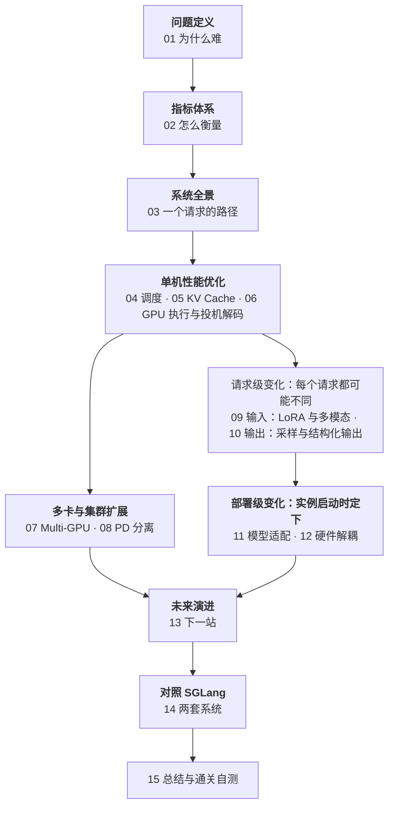

## 内容简介

《大模型推理系统揭秘：从 vLLM 看 LLM Serving Infra 核心技术》以 vLLM v0.27.1 为主要分析对象，从 LLM Serving 的问题本质出发，系统讲解请求生命周期、性能指标、调度、KV Cache、GPU 执行（含投机解码）、多卡并行、Prefill/Decode 分离，引擎如何承受输入（multi-LoRA 与多模态）、输出（采样参数与结构化输出）、模型与硬件四种变化，Serving Infra 的演进方向，以及对照 SGLang 的同题比较，共十四篇正文加一篇总结自测。源码不单列一篇，而是落在讲到它的那一篇里：第三篇是鸟瞰，把对象分到四个域、把一次请求的生命周期放大到组件和关键方法；函数级的调用栈放在各机制篇——第四篇讲 EngineCoreProc 的三个线程与 `step()`，第六篇讲调度结果怎样被翻译成 GPU 张量、Worker 的常驻循环和 Python 怎样调到 kernel，第十篇讲 API Server 进程里的协程。

本系列不局限于算子优化，也不止于源码解读，而是试图回答一个更完整的问题：

> **一个文本生成请求，为什么会逐渐演化成一个涉及计算、显存、调度、通信与状态管理的复杂系统？[^q0]**

在这个视角下，LLM Serving 不再只是“把模型跑起来”，而是一个持续协调**请求、Token、计算资源、中间状态和网络通信**的动态系统。

文章将按照以下主线展开：

> **问题定义 → 指标体系 → 系统全景 → 单机性能优化 → 多卡与集群扩展 → 输入、输出、模型与硬件适配 → 未来演进展望 → 对照 SGLang**

读者可以按顺序建立完整认知，也可以根据自身关注点选择调度、KV Cache、GPU 执行、多卡并行或集群 Serving 等主题阅读；每段主线包含哪几篇、带着具体问题该从哪篇进入，见下文「系列的整体主线」与「怎么读：按目标选篇」。

## 缩写



## 为什么写这个系列？

大模型能力快速演进，但真正决定其能否稳定、低成本、大规模服务用户的，往往不是模型本身，而是模型背后的 Serving Infra。

目前关于 LLM 推理的讨论，常常分散在几个局部方向：

- 有的关注 CUDA Kernel、量化和算子性能；
- 有的关注 Batch、调度和吞吐；
- 有的关注 KV Cache 或 PagedAttention；
- 有的直接进入源码，罗列类名和调用链。

这些内容各自重要，却容易让读者难以形成整体认识：不同技术究竟在解决什么问题？它们之间如何相互影响？为什么某项优化在一个场景有效，在另一个场景却可能带来新的瓶颈？

本系列文章希望提供一种系统化视角：

> **LLM Serving 的本质，是围绕生成过程，对请求、Token、计算资源和中间状态进行持续协调。**

从这个角度看：

- 调度解决“这一轮为哪些请求计算多少 Token”；
- KV Cache 解决“历史状态如何保存、复用和释放”；
- 执行优化解决“已经分配的计算如何高效完成”；
- 多卡并行解决“计算如何切分、状态如何组织”；
- 集群化部署解决“计算、状态和请求如何跨设备、跨实例流动”。

选择 vLLM，是因为它集中体现了现代 LLM Serving 的许多关键思想，也提供了观察推理系统演进的典型样本。本系列既关注 vLLM 的具体实现，也希望借此建立一套可以迁移到其他推理框架和 AI 基础设施的分析方法。

## 适合哪些读者？

本系列主要面向以下读者：

### AI Infra 与推理系统工程师

适合负责模型部署、推理服务、GPU 资源管理、性能优化和在线系统建设的工程师。

如果你已经能够部署模型，但希望进一步理解以下问题，本系列会比较适合：

- 吞吐和时延究竟由什么决定；
- Continuous Batching 与 Chunked Prefill 如何工作；
- KV Cache 为什么会成为核心瓶颈；
- 多卡并行和 Prefill/Decode 分离如何进行工程权衡；
- 如何从源码定位性能和稳定性问题。

### 大模型应用与平台工程师

适合负责 LLM API、RAG、Agent、模型网关和推理平台的开发者。

即使不直接编写 CUDA Kernel，也有必要理解：

- 请求为什么会排队；
- 长上下文为什么会显著增加成本；
- 不同模型和硬件为什么需要不同适配；
- 如何根据业务目标选择部署和扩展方案。

### 计算机系统与机器学习系统研究者

适合关注操作系统、分布式系统、编译器、计算机体系结构和机器学习系统的学生、研究人员与技术人员。

本系列将从一个真实的工程系统出发，讨论：

- 生成式工作负载如何改变传统推理范式；
- 动态调度与状态管理之间的关系；
- GPU、网络和分布式系统如何共同影响服务性能；
- AI Serving 为什么逐渐呈现出分布式系统甚至操作系统的特征。

### 希望系统学习 LLM Serving 的开发者

适合已经掌握 Python、深度学习和 Transformer 基础，希望从“会调用推理框架”进一步走向“理解推理框架如何工作”的读者。

不要求一开始就掌握 CUDA、分布式训练或 vLLM 的全部源码，但需要具备基本的模型推理和系统知识。

## 系列的整体主线

十四篇正文可以读成一个问题被不断放大的过程：先说清楚难在哪、怎么衡量；再在一台机器上解决调度、内存、执行三个战场；一张卡不够时扩到多卡、一个实例不够时拆成多实例；然后看引擎如何承受四种外部变化——先是请求级的输入与输出，再是部署级的模型与硬件；最后展望它会长成什么，再用同一套框架对照 SGLang 验收。

七段的分工：

| 主线段 | 篇 | 回答的问题 | 组织轴 |
|---|---|---|---|
| 问题定义 | 01 | LLM Serving 和传统 DL 推理有什么本质不同 | 工作负载 |
| 指标体系 | 02 | 用什么尺子判断系统好不好 | 工作负载 |
| 系统全景 | 03 | 一个请求在 vLLM 里经过哪些对象、哪些进程 | 请求生命周期 |
| 单机性能优化 | 04–06 | 这一轮给谁算、状态放哪、每步怎么算得更快（含投机解码：少跑几轮 forward） | 系统层次：调度 / 内存 / 执行 |
| 多卡与集群扩展 | 07–08 | 一张卡不够怎么切，一个实例不够怎么拆 | 规模：卡 → 实例 |
| 输入、输出、模型与硬件适配 | 09–12 | 输入、输出、模型、芯片变时，变化应该停在哪一层 | 变化的粒度：请求级（09 输入、10 输出，同一 batch 内逐请求不同）→ 部署级（11 模型、12 硬件，实例启动时定下） |
| 未来演进 | 13 | 执行器会长成什么样的分布式系统 | 演进 |
| 对照 SGLang | 14 | 同一个请求在另一套系统里走哪条路，差异来自出发点还是时间差 | 验收 |

Table: 系列主线的七段、所含篇目与各段回答的问题

单机段与变化段的分界按一条标准划：**改不改输出**。投机解码用拒绝采样保证输出分布与逐个采样完全相同，改变的只是一次 forward 产出几个 token，所以是性能问题，完整地放在第六篇；采样参数与结构化输出改变的是「输出什么」，属于变化段的第十篇。

编排上有一个约定：每一篇先把要解决的矛盾摆出来，再讲 vLLM 怎么做。跨篇反复出现的概念——KV Cache、token 级调度、Prefill / Decode 两种 workload、边界与契约——在第十五篇的「贯穿线」里有专门的整理。

## 章节结构与分章导读 

### 1. 先定义问题：Serving 到底难在哪里？

第一章从工作负载本质出发，解释 LLM 推理为什么不同于传统的静态 Batch 推理。

可以看到，Prefill 更像一次高并行度的批量计算，而 Decode 更像大量低计算量、强状态依赖的迭代计算。两者混合在同一个服务系统中，带来了批处理、调度、显存管理和时延控制上的连锁问题。

这一章的目标不是介绍某个具体实现，而是回答：

- LLM Serving 的基本计算单元是什么？
- 为什么请求之间很难保持同步？
- 为什么“模型能跑”并不等于“服务系统能高效运行”？
- 后续所有优化究竟是在解决哪一类瓶颈？

只有先把问题定义清楚，后面的技术才不会变成彼此孤立的名词。

### 2. 再建立指标：系统到底好不好？

当问题边界明确之后，第二章讨论如何衡量系统。

吞吐、TTFT、ITL、E2E Latency、并发数、显存占用等指标，分别描述了系统的不同侧面。它们并不是可以随意替换的“性能数字”，而是对应不同的用户体验、资源瓶颈和优化方向。

例如：

- TTFT 变差，可能意味着 Prefill 排队或调度受阻；
- ITL 变差，可能意味着 Decode 阶段受到带宽、通信或批次膨胀影响；
- 吞吐下降，可能意味着 GPU 利用率不足，也可能意味着 KV Cache 容量限制了并发；
- 显存占用升高，未必代表计算更充分，也可能意味着状态管理效率较差。

因此，本系列会把指标与系统动作连接起来：

> **先判断哪个指标出了问题，再判断问题发生在哪个阶段，最后决定应该优化调度、内存、执行还是通信。**

这条原则最后要落到一个跑着的 vLLM 实例上，所以这一章还回答：

> **指标异常时，vLLM 里该先动哪个参数？为什么 `max_num_batched_tokens`、`max_num_seqs` 调大总会让一个指标变好、另一个变坏？上线后靠 `/metrics` 的哪些指标盯住这些症状，服务端口径和 `vllm bench` 有什么不同？[^q1]**

第五章把 22 个参数（v0.27.1 默认值）、14 种症状和一张排查顺序图对到一起，并用贯穿全系列的例子把几组取舍算成数字；第六章把本章的指标对到 `/metrics` 里的名字，给出一块 8 面板看板和告警条件。

### 3. 接着画全景：一个请求如何穿过系统？

第三章不急于深入某个局部，而是先建立 vLLM 的全局地图。

从两个视角观察系统：

- **静态视角**：有哪些核心组件、对象和执行角色；
- **动态视角**：一个请求从进入、排队、Prefill、Decode，到完成和资源回收，经历了哪些状态变化。

这一章解决的是“对象在哪里、请求怎么流动、模块如何协作”的问题。后续章节中的 Scheduler、KV Cache Manager、Worker、Model Runner、Executor 等概念，都会回到这条请求链路中重新定位。

这样做的目的，是避免只记住局部类名和函数名，却无法理解它们在完整生命周期中的作用。

全景也要能落到源码上，所以这一章同时回答：

> **源码里的每个核心对象归哪个域管——请求、调度、显存还是模型？一次请求的生命周期落到哪些组件和关键方法、被哪几道边界切开？[^q2]**

逻辑视图按「两个面 → 四类核心组件 → 四个域」展开：控制面与数据面之间只过 `SchedulerOutput` 与 `ModelRunnerOutput`，四类组件从 API Server 一直排到 ModelRunner，四个域给对象定位，并用调度器一侧、Worker 一侧两张图说明它们靠 `request_id`、`block_id` 两个整数跨进程对上；场景视图把请求流放大一级，落到组件和关键方法上，标出两道进程边界与一道 Python → GPU 边界。这一章停在鸟瞰的高度：每个进程里常驻的循环和调用栈放在讲它的机制篇——EngineCoreProc 的三个线程与 `step()` 在第四篇，Worker 的常驻循环、四个阶段的源码位置和 Python 怎样调到 kernel 在第六篇，API Server 的协程在第十篇——第三篇文末只留一份折叠的源码导航。

### 4. 然后进入第一个核心战场：调度

当多个请求同时进入系统，最直接的问题就是：

> **GPU 下一轮计算，究竟应该服务哪些请求、多少 Token，以及以什么顺序服务？[^q3]**

第四章围绕这个问题展开，讨论 Continuous Batching、Chunked Prefill、Token Budget、Admission Control 和 Preemption。

这里的调度并不是简单的队列管理，而是在多个目标之间持续做权衡：

- 尽可能提高 GPU 利用率；
- 控制请求的首 Token 时延；
- 保证 Decode 的持续推进；
- 防止长 Prefill 阻塞短请求；
- 在显存不足时决定是否暂停、换出或拒绝请求。

调度因此成为连接“用户体验”和“硬件利用率”的第一层控制面。

### 5. 再进入第二个核心战场：内存与状态

调度决定“谁来计算”，但系统还必须回答另一个问题：

> **这些请求已经计算过的历史状态，应该放在哪里、如何复用、何时释放？[^q4]**

第五章以 KV Cache 为中心，解释 PagedAttention、Block 管理、分配与回收、Prefix Cache 以及相关的生命周期控制。在分页之上，它还回答三个具体问题：

> **Prefix Cache 怎样查命中、显存紧张时先驱逐谁、什么样的负载会让命中率塌下去？[^q5] 一个模型里既有全注意力又有滑窗、Mamba 层时，怎样用 KV cache group 共用一个块池、能省多少？[^q6] 把 KV 存成 FP8 时 scale 从哪来、哪些后端支持、并发能多多少？[^q7]**

KV Cache 并不是普通的临时张量。它是 Decode 阶段持续依赖的请求状态，也是限制并发规模、影响调度策略和决定扩展方式的关键资源。

因此，本系列会把 KV Cache 放在比“显存优化技巧”更高的位置来理解：

> **LLM Serving 的核心，不只是执行模型，更是持续管理模型生成过程中的状态。**

这一视角也会自然引出后面的 PD 分离、KV Transfer 和集群路由问题。

### 6. 再看第三个核心战场：执行效率

有了调度和内存管理之后，还需要回答：

> **在已经选定的请求和 Token 上，GPU 如何把每一步计算做得更快？[^q8]**

第六章进入执行层。在讲怎么算得更快之前，先补上调度与执行之间那层翻译：

> **调度器交出来的 `SchedulerOutput` 只说「哪个请求本轮推进多少 token」，它怎样变成 kernel 要的 `input_ids`、`slot_mapping`、`block_table`？一步之内 CPU 与 GPU 在哪里等谁？[^q9]**

然后讨论 Kernel Launch、CUDA Graph、FlashAttention 与算子融合、低精度，以及投机解码。

这一章重点区分两类常被混淆的问题：

- **系统没有把 GPU 喂饱**：通常与调度、Batch 组织或数据准备有关；
- **GPU 已经在工作，但每一步仍然很慢**：通常与 Kernel、访存、同步、通信或执行形态有关。

通过这种区分，可以更准确地理解为什么 GPU 算力很强，LLM Serving 仍然可能受限于带宽、Launch Overhead 或小规模 Decode。

前四种手段让每一轮 forward 更快，投机解码让 forward 的轮数更少：draft 一次提出 K 个候选，target 一次 forward 验证 K+1 个位置。它在本章而不单列，是因为它**无损**——拒绝采样保证接受的 token 与逐个采样同分布，输出没有变，变的只是速度。但它不只是一个 kernel 技巧：调度器要把 draft token 计入预算、KV Cache 要为 draft 预留 lookahead 槽位、model runner 一次算 K+1 个位置、RejectionSampler 做验证，被拒的位置靠回退 `num_computed_tokens` 回滚。第六章把这条链从 Proposer 家族到收益与代价完整走一遍，包括 batch 变大以后验证不再免费的拐点。

### 7. 从单卡走向多卡：扩展会引入什么新问题？

单卡上的调度、内存和执行问题，在多卡环境中会进一步叠加通信和拓扑约束。

第七章比较 DP、TP、PP、EP、CP 等并行方式，重点不在于罗列概念，而在于说明它们分别解决什么问题、引入什么代价，以及适合什么场景。

核心关注点包括：

- 计算如何切分；
- KV Cache 如何组织；
- 卡间通信发生在哪里；
- 通信能否与计算重叠；
- 并行策略如何受到模型结构和硬件拓扑影响。

这一章希望建立一个基本判断框架：

> **多卡扩展不是简单地“增加 GPU 数量”，而是重新设计计算、状态和通信之间的关系。**

### 8. 从资源混部走向计算解耦：为什么需要 PD 分离？

多卡解决的是一个模型装不下、一张卡算不动；但当模型规模、请求量和服务目标继续增长时，单个实例同时承担 Prefill 和 Decode 本身可能不再是最优选择——这是“一张卡不够”之后的第二级扩展：从多卡走向多实例。

第八章讨论 Prefill/Decode Disaggregation，以及由此带来的 KV Transfer、路由、网络、状态亲和性和故障恢复问题。

PD 分离并不是简单地把两个阶段部署到不同机器上。它重新定义了请求状态的流动方式：

- Prefill 产生的 KV Cache 如何传给 Decode；
- 请求应该路由到哪一个实例；
- 网络传输成本是否抵消了计算收益；
- 如何处理实例负载变化和状态迁移；
- 故障发生时，状态是否能够恢复或重建。

因此，是否采用 PD 分离，最终取决于工作负载、硬件资源、网络条件和服务目标，而不是某个单一的性能结论。

PD 分离紧跟多卡，是因为它和第七章同属“规模”这条线：切分计算（多卡）与拆开阶段（多实例）解决的都是扩展问题；输入、输出、模型与硬件的变化是另一条线，接下来四章集中讨论。

### 9. 一个请求还可以带什么进来：输入在变

前八章处理的是一个固定的服务如何被高效地调度、缓存、执行与扩展。从第九章起的四章换一个方向，看引擎如何承受四种外部变化，以及每种变化应该停在哪一层。四章按变化的粒度排：先是**请求级**的输入（第九章）与输出（第十章）——同一个 batch 里每个请求都可能不同，引擎必须逐请求处理；再是**部署级**的模型（第十一章）与硬件（第十二章）——一个实例启动时就定下，引擎要在接口层把它们隔离开。

第九章回答：**一个请求还可以带什么进来？**

> **当一个 batch 里的请求各带不同的 LoRA、各带几张图片时，"一个模型、一份权重、一串 token"的假设在哪里破了？vLLM 用什么把它重新缝起来，代价是多少？[^q10]**

在这之前还有一步前八章一笔带过的事：

> **一个 chat 请求带着的 messages、tools 和图片，怎样被 chat template 渲染成引擎看到的那串 token id？模板和模型不配时坏在哪里？[^q11]**

这一章讨论这一步和两种输入的扩展：

- 从 messages 到 token id：API Server 里的渲染流水线、模板从哪来与 content format、一个两轮对话加一个工具的渲染实例、模板不配时的五种故障与 `/tokenize` 排查；

- multi-LoRA：同一 batch 内不同 adapter 的 Triton kernel，LoRA 权重的槽位、LRU 与换入换出，`max_loras` / `max_lora_rank` 的显存账，对调度公平性与 CUDA Graph 的影响；
- 多模态：图像 / 音频 / 视频的 token 化与占位符，encoder 的独立预算与 encoder cache，多模态 prefix cache 的哈希，encoder 输出与 KV 之争。

两者都要求模型类声明对应的能力（`SupportsLoRA`、`SupportsMultiModal`），这一章就地说明它们的作用，能力声明与注册的完整机制留到第十一章。两者也给第十二章的硬件抽象提出了新约束（Triton kernel 与 ViT 注意力后端如何跨硬件），并把新问题放回第八章的 PD 分离（多模态 encoder 放哪一侧、LoRA 在 PD 两池怎么同步）。

### 10. 每个请求要什么样的输出：输出在变

第九章改的是请求带进来什么，第十章改的是请求要求输出什么。第六章结束于"一轮 batch 在 GPU 上跑完 forward 并采样出 token"，那里的采样是一次 `argmax` 或一次 `multinomial`；真实的服务里，同一个 batch 的每一行都有自己的规矩。

> **同一个 batch 里，有的请求要 `top_p=0.9` 加重复惩罚，有的要求输出必须是合法 JSON——这些按请求不同的输出约束在哪一层生效？为什么只动 logits 的功能也要牵动调度器与 model runner，到了多卡与 PD 部署下又落在哪一侧？[^q12]**

这一章讨论两种输出的扩展，以及它们在多卡与 PD 下的落点：

- 采样参数与 logits processors：温度、top-p、惩罚、thinking budget 等如何在同一个 batch 内按请求向量化地生效，penalties 为什么每一步都要把历史输出搬上 GPU；
- 结构化输出：grammar → bitmask → logits 掩码，调度器侧异步编译 grammar；与第六章的投机解码同时开启时，掩码要对每个 draft 位置逐个对账；
- 多卡与 PD 下的适配：TP 下每个 rank 都拿到完整 logits、各自采样为什么结果一致，`GrammarOutput` 如何广播给所有 worker，PP 只在最后一个 stage 采样，PD 分离后 grammar 在哪一侧编译、算在谁的时延上。

投机解码不在这一章：它不改变输出，已在第六章作为执行优化讲完；这里只在结构化输出与它同时开启时讨论二者如何对账。

采出 token 之后还有最后一步：

> **同一串 token 怎样在 API Server 里被切成 `content`、`reasoning` 与 `tool_calls`？`tool_choice` 怎样变成结构化输出的约束？[^q13]**

这一章的最后一部分讲输出解析：reasoning parser 与 tool parser 跑在哪个进程、由哪些参数打开，一个 delta 怎样流过它们，一个工具调用流式输出的逐步过程，以及「约束在前、解析在后」——`required`、点名函数和 `strict` 工具怎样经 structural tag 在采样时就保证格式。

### 11. 从固定模型走向模型生态：抽象如何承受变化？

输入与输出是请求级的变化；从第十一章起是部署级的变化——模型与芯片在一个实例启动时就定下，同一 batch 内不会各不相同，但它们一变，变化就可能捅穿好几层。

模型结构正在快速演进。不同模型可能在 Attention、MoE、位置编码、缓存布局、权重格式和执行路径上存在明显差异。

第十一章讨论 Serving 系统如何承接这些差异，并分析模型适配从临时 Patch 走向体系化抽象的过程；第九章用到的 `SupportsLoRA`、`SupportsMultiModal` 正是这里的能力声明机制的实例。

这里关注的并不只是“新模型能不能运行”，还包括：

- 模型差异应该被隔离在哪一层；
- 通用执行路径如何复用；
- 特殊结构如何获得专门优化；
- 新增适配是否会污染核心代码；
- 正确性、性能和可维护性如何同时保证。

最终需要区分两个层次：

> **能跑，是模型适配的起点；能够高效、稳定、可维护地运行，才是 Serving Infra 的真正目标。**

### 12. 从单一硬件走向多后端：如何保持核心稳定？

输入、输出和模型都是软件侧的变化；当 Serving 系统需要支持不同 GPU、不同加速器和不同软件栈时，硬件差异同样不能无限向上渗透。它排在四章最后，因为它离请求最远、改动面最靠底层。

第十二章围绕 Platform、Backend、Device、Kernel 和执行后端之间的边界展开，讨论硬件抽象的价值与局限。

真正的硬件解耦，并不是把所有差异都藏起来，而是明确：

- 哪些逻辑属于 Serving 核心；
- 哪些逻辑属于硬件平台；
- 哪些算子必须针对设备单独实现；
- 哪些性能特性无法通过统一抽象抹平；
- out-of-tree 适配在什么情况下合理、又会付出什么维护成本。

这一章会把“可移植性”从口号还原成具体的代码组织和职责边界问题。

### 13. 从执行器走向系统：Serving Infra 的下一站

前面的章节主要围绕“如何把请求执行得更好”，第十三章则进一步抽象：

> **未来的 Serving 系统，是否会从一个模型执行器，演化为管理计算、内存、通信和状态的分布式系统？[^q14]**

这一章讨论状态平面、自动并行、弹性伸缩、故障恢复、异构资源调度以及面向 Agent 的长生命周期任务等方向。

随着请求变长、交互变多、模型组合变复杂，Serving 系统管理的对象将不再只是一次推理，而可能是持续存在的上下文、工具调用、缓存状态和跨服务任务。

因此，所谓“AI Serving Operating System”，并不是一个简单的新名词，而是对这一演进方向的概括：

> **把模型推理从一次函数调用，提升为由系统统一管理的计算与状态过程。**

### 14. 对照 SGLang：同一个请求穿过另一套系统

最后用前十三篇建立的框架看第二个主流引擎。SGLang v0.5.18 与 vLLM 在同一个请求的路径上做了不同的选择：vLLM 一个调度器指挥 N 个被动 worker、调度结果跨进程传递，SGLang 每个 TP rank 各跑一份相同的调度器、与 ModelRunner 同进程；vLLM 一个 token 预算、无 prefill / decode 阶段、事后逐个抢占，SGLang 先 prefill 后 decode、用 `new_token_ratio` 预估准入、批量撤回带反馈；vLLM 的 KV 复用是块哈希表与引用计数，SGLang 是基数树（RadixAttention）与锁计数；PD 分离一边是 `KVConnector` 加外部 proxy，一边是内置的两级队列加 Rust 网关。本篇逐层并排这些差异，区分哪些来自两个项目的**出发点**（PagedAttention 的块 vs RadixAttention 的树）、哪些来自**定位**（执行层 vs 带编排）、哪些只是**时间差**，最后给出按工作负载而不是按 benchmark 的选择表，并解释一张吞吐图里藏着多少变量。

> **功能可以补，数据结构很难换：块与树各自决定了命中粒度、驱逐方式、锁定方式和调度器能看到什么。**

最终，这组文章希望形成的不是一份 API 说明，也不是若干优化技巧的集合，而是一套理解 LLM Serving 的方法：

1. 先从工作负载定义问题；
2. 再用指标定位矛盾；
3. 用请求生命周期建立全局视角；
4. 从调度、内存和执行三个核心战场深入，执行一章包括让 forward 轮数变少的投机解码；
5. 先沿规模扩展到多卡与多实例（PD 分离），再看输入（LoRA 与多模态）、输出（采样参数与结构化输出）、模型与硬件四种变化各应停在哪一层；
6. 每一篇都把抽象落到源码里的对象、状态变化与调用链上——一个概念若找不到这三样对应，就还没有真正落地；
7. 最后把同一套框架用到第二个引擎（SGLang）上，区分哪些差异来自出发点、哪些只是时间差。

沿着这条线阅读，vLLM 不再只是一个“推理框架”，而会呈现为一个持续协调**请求、Token、状态、计算、显存和通信**的动态系统。

### 15. 系列总结与通关自测

最后一篇不讲新内容：把十四篇正文压成一张「问题 → 结论 → 必记数字」的表并逐篇回顾，拎出贯穿全系列的几条线与常见误区，然后给一套三段式通关自测——十道判断与计算、五道跨篇综合、若干道面试题，答案各自折叠，附「读过 / 掌握 / 能教人」的判据。各篇末尾的自测检验的是一篇读懂了没有，这一篇检验的是十四篇能不能连起来用；读完正文再做。

## 怎么读：按目标选篇

按顺序读是建立完整认知最省力的路径。带着具体问题来的读者，可以从下表找入口，再按需要补前置：

| 你想弄清楚的问题 | 先读 | 再补 |
|---|---|---|
| GPU 利用率很高但吞吐上不去、TTFT 为什么抖 | 02、04 | 01、06 |
| 线上该盯 `/metrics` 的哪些指标、指标异常时先调哪个参数 | 02 | 04、05 |
| 并发上限由什么决定、长上下文为什么贵 | 05 | 01、04 |
| Prefix Cache 命中率为什么低，滑窗 / Mamba 混合模型、FP8 KV 能省多少 | 05 | 02、04 |
| 一步 decode 的时间花在哪，CUDA Graph / 量化 / 投机解码分别省什么 | 06 | 04、05 |
| 开了投机解码后，调度、KV、model runner 为什么都要改 | 06 | 04、05 |
| TP / PP / EP / DP 怎么选、通信发生在哪 | 07 | 01、05 |
| 要不要做 PD 分离、KV 怎么传、代价多大 | 08 | 05、07 |
| multi-LoRA 与多模态请求对调度、KV、CUDA Graph 的影响 | 09 | 04、05、06 |
| chat template 渲染不对：工具从不被调用、模型停不下来、思考开关不生效 | 09 | 10 |
| 每请求的采样参数、JSON / 语法约束输出由谁执行、代价多大 | 10 | 04、06 |
| 工具调用或推理内容解析出错：`tool_calls` 为空、JSON 落进 `content` | 10 | 09 |
| 新模型（MLA、MoE、MTP）接进 vLLM 要动哪几层 | 11 | 03、05、06 |
| 一块新芯片怎么接、哪些代码里不该出现设备判断 | 12 | 03、11 |
| vLLM 之上的集群层（llm-d、Dynamo）在做什么、边界在哪 | 13 | 08 |
| 想顺着源码把一次请求走一遍 | 03 的四个域与请求流放大图，再到 04 的 EngineCoreProc 循环、06 的翻译层与 Worker 循环、10 的 API Server 协程 | 05 |
| vLLM 与 SGLang 怎么选、差异在哪 | 14 | 03、05、08 |

Table: 按目标选篇：问题 → 入口篇 → 需要补的前置

三条常见路线：

- **只想建立判断**：01 → 02 → 03 → 05 → 15。读完能解释吞吐与时延由什么决定、KV Cache 为什么是第一号约束，用第十五篇的 A 组自测检验。
- **做部署与调优**：在上面基础上加 04 → 06 → 07 → 08 → 10。读完能把 `max_num_batched_tokens`、`max_num_seqs`、`block_size`、`kv_cache_dtype`、投机解码的 K、TP / PP、PD 分离与结构化输出后端这些旋钮对应到指标上；第二篇的第五、六章（症状 → 参数、`/metrics` 看板与告警）是这条路线的速查表。
- **做适配与贡献**：按顺序读完 01–14，重点是 09 → 10 → 11 → 12 的变化边界（请求级的输入、输出与部署级的模型、硬件）与 03 的四个域、06 的翻译层，再做第十五篇的 B、C 组自测。

## 前置要求与说明

### 前置要求

- 理解 Transformer 的结构与算量：参数量、Prefill / Decode 的 FLOPs 与访存量、KV Cache 的大小公式、GQA / MLA 对 KV 的影响。本系列直接使用这些结论而不再推导，缺少这部分基础的读者可先补 Transformer 算量与 KV Cache 的推导；
- 理解 PyTorch 运行时的基本结构：Tensor 与算子分发、CUDA stream 与同步、`torch.compile` 的大致工作方式；
- 能读 Python，能顺着 import 在一个几十万行的代码库里定位对象；
- 对 GPU 的 memory-bound / compute-bound 有基本判断。

不要求：

- 写过 CUDA kernel 或 Triton——FlashAttention、PagedAttention、量化 kernel 的内部实现属于 kernel 工程的范畴，本系列只讨论 vLLM 如何选择和调用它们；
- 了解 NCCL 内部或集合通信算法——多卡章节会用到 all-reduce / all-to-all 的代价结论，正文会给出理解所需的最小推导，NCCL 与互联硬件的原理不在本系列展开；
- 有分布式训练经验——TP / PP / EP 在训练侧的推导不在本系列展开，本系列关注它们在推理中的取舍与 vLLM 的实现。

### 版本与硬件基线

- 源码：**vLLM v0.27.1**（tag `6e448d0`，2026-08-11）。全系列的文件路径、类名和函数名以此为准；vLLM 目录结构变动很快，读旧版本或新版本时请以本地源码对照。文中不引用行号。
- 引擎：v0.27.1 只有 V1 引擎；`vllm/v1/worker/gpu_model_runner.py` 是默认的 Model Runner，`vllm/v1/worker/gpu/model_runner.py` 是可通过 `VLLM_USE_V2_MODEL_RUNNER` 启用的新实现，文中以前者为主线并在涉及处标注。
- 版本提示 @2026-11-12：截至 v0.32.0（2026-10-18），以下变化与本系列有关，全系列整体升级前先按此对照：
  - **Model Runner V2 成为默认**（v0.29.0）：V1 的 `GPUModelRunner` 被宣布弃用、只作回退。第三篇的 ModelRunner 一节与请求流放大图的执行侧、第六篇的翻译层、CUDA Graph 与投机解码、第十篇的采样器与 logits processor 讲的都是 V1 路径。
  - 调度（v0.31.0）：已经持有 KV 块的等待请求进入单独的 `kv_holding_waiting` 队列，优先于普通 `waiting` 调度（第四、八篇）。
  - prefix cache（v0.29.0）：sha256 类哈希下 `NONE_HASH` 默认就是确定值，不再需要设置 `PYTHONHASHSEED`（第五篇）。
  - 多卡（v0.29.0）：TP 的 all-reduce 默认改走 FlashInfer（第七篇）。
  - 默认值（v0.28.0）：大显存卡上 `max_num_batched_tokens` 默认从 8192 提到 16384，文中以 8192 计算的数字按旧默认值理解。
  - v0.33.0（预发布）删除了 Medusa 与旧的 Ray executor。
- 硬件：默认以 **H100 SXM（80 GB，约 3.35 TB/s，BF16 约 989 TFLOPS）** 为估算基准，A100 随文标注。文中所有毫秒级、GB/s 级数字除明确注明"实测"外均为**理论下界或量级估算**，用于建立判断，不是 benchmark 结果。
- 模型：示例以 Llama-3-8B / 70B 为主，MoE 与 MLA 以 DeepSeek-V3 为例。
- 对照引擎：第十四篇对照 **SGLang v0.5.18**（tag `71de97b`，2026-08-20），路径与默认值以该版本为准。

### 关于其他推理引擎

本系列以 vLLM 为分析对象。SGLang、TensorRT-LLM、LMDeploy 在同一位置的不同选择会在相关章节提及，但正文不展开；第十四篇专门用全系列的框架对照 SGLang，TensorRT-LLM 与 LMDeploy 读者可以用同一套方法（问题 → 指标 → 生命周期 → 调度 / 内存 / 执行三个战场 → 扩展）自行对照。

## 章节目录（建议按顺序阅读）

1. [为什么 LLM Serving 比传统 DL 推理难？](/why-llm-serving-is-hard.html)
2. [如何衡量一个 LLM Serving 系统？](/how-to-measure-llm-serving.html)
3. [鸟瞰 vLLM：一个请求如何穿过整个推理系统？](/vllm-request-lifecycle-overview.html)
4. [Scheduler：GPU 这一轮到底给谁用？](/scheduler-batch-and-fairness.html)
5. [KV Cache：LLM Serving 的第一号内存问题](/kv-cache-memory-core.html)
6. [GPU 执行：如何让每个 Token 算得更快？](/gpu-execution-kernels-and-graphs.html)（含投机解码）
7. [Multi-GPU：一张卡不够时如何扩展？](/multi-gpu-scaling-strategies.html)
8. [PD 分离：从资源混部走向计算解耦](/prefill-decode-disaggregation.html)
9. [请求形态的扩展：multi-LoRA 与多模态](/request-shapes-multi-lora-and-multimodal.html)
10. [输出在变：采样参数与结构化输出](/output-changes-sampling-and-structured-output.html)
11. [模型适配：如何跟上变化极快的模型世界？](/model-adaptation-architecture.html)
12. [硬件解耦：如何不让芯片差异污染 Serving 核心？](/hardware-abstraction-and-portability.html)
13. [Serving Infra 的下一站：从模型执行器到分布式智能操作系统](/future-of-serving-infra.html)
14. [vLLM 与 SGLang：同一个请求穿过两套 Serving 系统](/vllm-vs-sglang.html)
15. [系列总结与通关自测](/deep-dive-into-vllm-series-recap-and-self-test.html)

本系列讲的是 memory-bound 的 LLM serving；图像与视频生成模型的推理是另一半——单请求就 compute-bound、没有 KV cache、batch 几乎不提吞吐、请求时长可预测，几乎每一个系统答案都相反。那一半在 Infra 地图的 11[《扩散模型推理基础设施：从一次去噪到一个生成服务》](/diffusion-model-inference-infrastructure.html)。

> **版本说明：**本系列基于 vLLM v0.27.1（tag `6e448d0`，2026-08-11）源码分析。文中路径、类名和函数名均以该版本为准；由于 vLLM 迭代较快，阅读时请结合实际版本进行对照。

[^q0]: 因为生成是**逐 token、有状态、长度未知**的：每个 decode 步只算一个 token 却要读一遍全部权重（memory-bound，单请求 GPU 利用率个位数）→ 必须把很多请求批在一起（**计算**与**调度**：continuous batching、chunked prefill、token budget）；每个请求要保留全部历史的 KV cache、随生成增长且何时结束未知 → 必须管理一块动态的、不可预估的**显存**（PagedAttention、块分配、抢占、prefix cache）；模型放不进一张卡或吞吐不够 → **通信**（TP / PP / EP、PD 分离、KV 传输）；请求之间的公平、SLO、多轮会话的前缀复用 → **状态管理**。每一环都是上一环的后果，所以一个「跑模型」的程序长成了一个调度 + 内存 + 通信 + 状态的系统。
[^q1]: **先拆再动参数**：TTFT 先拆成 `request_queue_time_seconds` 与 `request_prefill_time_seconds`——排队长看 `num_requests_waiting_by_reason` 与 KV 用量：KV 用量 ≈ 1 是 KV 池不够（`kv_cache_dtype=fp8` 或扩副本），running 贴着 `max_num_seqs` 是并发上限，两者都有余量是长 prompt 吃光了预算（`long_prefill_token_threshold`）；prefill 长看前缀命中率。ITL / TPOT 先分均值与 P99：均值高是每步太重（`max_num_seqs` ↓、KV fp8、TP ↑），只有 P99 高看抢占速率，非零是重算式抢占（KV 容量 ↑、`watermark`），为零是大 prefill 块混进了 decode 步（`max_num_batched_tokens` ↓ 或 PD 分离）。**两个参数为什么总在两个指标之间换**：它们都是让一步多装东西，摊薄每步都要读一遍的 17.6 GB 权重（吞吐 ↑），代价是这一步本身更长（ITL / TPOT ↑）。Llama-3-70B / TP=8 的算例：预算 2048 → 8192，Total Tokens/s 20.3k → 21.4k（+5%），同一步里 64 个 decode 流的 ITL 99 → 376 ms；`max_num_seqs` 128 → 256，Output Tokens/s +54%，TPOT 11.8 → 15.4 ms，越过 15 ms 的 SLO 后 Goodput 断崖；H100 默认的 1024 在这里碰不到，真正限制 batch 的是约 540 条满长请求的 KV 池。V1 只有重算式抢占，旧资料里的 `--swap-space` 已不存在。**线上**：`/metrics` 里 TTFT、ITL、TPOT、排队、prefill、decode 各有直方图，`num_requests_waiting_by_reason`、`kv_cache_usage_perc`（旧名 `vllm:gpu_cache_usage_perc` 已没有）、`num_preemptions`、`prefix_cache_hits` / `prefix_cache_queries` 解释它们为什么变。与 `vllm bench` 的口径差四处：服务端 TTFT 不含回送首 token 的网络与 SSE、偏小；ITL 按引擎步记，投机解码一步出 3 个 token 也只记一个样本；Queueing Time 只算第一次排队；服务端没有 Goodput，只能逐指标估达标率。详见[第二篇第五章](/how-to-measure-llm-serving.html#五从症状到参数指标异常时在-vllm-里调什么)与[第六章](/how-to-measure-llm-serving.html#六线上监控metrics-里该看什么)。
[^q2]: **四个域**：请求域（`Request`：token ids、采样参数、状态机状态、块哈希）、调度域（每步一份 `SchedulerOutput` 与 `ModelRunnerOutput`）、显存域（`KVCacheBlock` 的 `block_id` / `ref_cnt` / 哈希，Worker 侧 `BlockTable` 做逻辑块 → 物理块映射）、模型域（常驻的权重与随前向生灭的激活）；只有显存域跨请求共享。对象之间靠两把钥匙对上：调度器一侧 `request_id` 经 `req_to_blocks` 找到它的 `KVCacheBlock` 列表，写进 `SchedulerOutput` 的只是整数 `block_id`；Worker 一侧用这些整数填 `InputBatch` 那一行对应的 `BlockTable`，再由 Triton kernel 派生出每个 token 的 `slot_mapping`——所以 Prefix Cache 命中与否 Worker 完全不知情。**生命周期放大一级**：API Server（`create_chat_completion()`、`AsyncLLM.add_request()`、`InputProcessor` tokenize）→ ③ ZMQ + msgspec 进 EngineCoreProc（第一道进程边界）→ `Scheduler.schedule()` 产出 `SchedulerOutput` → ⑤ `Executor.execute_model()` 经共享内存 `MessageQueue` 广播到 WorkerProc（第二道进程边界，也是控制面与数据面的边界）→ `GPUModelRunner` 准备张量 → ⑦ `model(input_ids, positions)` 进入 PyTorch dispatch（Python → GPU 边界）→ attention kernel 或一次 CUDA Graph 重放 → 采样结果 D2H → `Scheduler.update_from_output()`、detokenize、SSE 返回。三段各活在一个进程里，靠消息队列衔接；每个进程里常驻的循环与调用栈在[第四篇第五章第 5 节](/scheduler-batch-and-fairness.html#5-调度循环跑在哪里enginecoreproc-的三个线程与-step)（EngineCoreProc）、[第六篇第二章](/gpu-execution-kernels-and-graphs.html#二forward-之前scheduleroutput-如何变成-gpu-张量)（WorkerProc）与[第十篇第六章第 1 节](/output-changes-sampling-and-structured-output.html#1-解析在哪个进程里跑由哪些参数打开)（API Server）。详见[第三篇的「核心数据对象：四个域」](/vllm-request-lifecycle-overview.html#3-核心数据对象四个域)与[「放大：同一条生命周期，落到组件和关键方法上」](/vllm-request-lifecycle-overview.html#放大同一条生命周期落到组件和关键方法上)。
[^q3]: 由 Scheduler 每轮用一个 **token budget**（`max_num_scheduled_tokens`）决定：先推进正在 decode 的请求（每个 1 个 token，保证已接受的请求不饿死），剩余预算分给等待队列里的新请求做 prefill——chunked prefill 让长 prompt 只推进预算剩余的那部分、下轮继续；顺序按队列（FCFS）或优先级，admission control 在显存（KV 块）不够时不接新请求，preemption 在 decode 请求的 KV 块分配失败时把最晚到的请求换出 / 重算。所以答案是：服务**所有能分到 KV 块的 decode 请求 + 预算内尽量多的 prefill token**，顺序是「decode 优先、新请求按到达 / 优先级」——第四章在 GPU 利用率、TTFT 与 TPOT、公平性之间逐项权衡。
[^q4]: 放在 GPU 显存里的 **KV cache**，以固定大小的 block（如 16 个 token）为单位由 BlockManager 分配——PagedAttention 让逻辑上连续的序列映射到物理上不连续的块，碎片与预留浪费接近零；复用靠 **prefix caching**：按块内容哈希，相同前缀（system prompt、多轮历史、beam 的公共部分）的块引用计数 +1 直接命中、跳过这段 prefill；释放时机：请求结束或被抢占时归还块，prefix cache 的块引用归零后进入 LRU 空闲列表、被新分配弹出时才真正驱逐；显存不够时 V1 只有一条路——抢占请求、丢弃它的 KV、之后重算（没有 swap）。块池之上还有两件事：一个模型里有几种注意力时用 KV cache group 共用一个块池，KV 量化（FP8）把每个元素压到 1 字节。第五章把 KV cache 当作「请求状态」而不是临时张量来讲它的生命周期。
[^q5]: **查命中**：请求第一次被调度时，`get_computed_blocks()` → `find_longest_cache_hit()` 从链头逐块查链式哈希表，第一块未命中就停；上限是 `num_tokens − 1`（最后一个 token 必须重算出 logits，按块对齐后是最后一整块：2048 token 完全一致也只命中 127 块）；命中的块若还在空闲队列（`ref_cnt == 0`），也算进本次分配的容量，容量不够时一块都不 touch、请求继续等。**先驱逐谁**：空闲队列是 LRU，队首最久没用；同一请求归还的块按 `reversed()` 交回，链尾先走（链头一丢整条链作废）；没写满、没有哈希的块直接插到队首、最先被分走；驱逐是 `get_new_blocks()` 弹块时顺手做的。**命中率塌掉的五种负载**：前缀开头放了时间戳等会变的内容；工作集比块池大（Llama-3-70B / 8×H100 每卡约 131 万 token 的池，64 份 32K 文档轮转 = 210 万 token，LRU 下命中接近 0）；负载越高能当缓存的空闲块越少；抢占与前缀无感的多实例路由；命中粒度是整块。详见[第五篇第四章](/kv-cache-memory-core.html#四prefix-cache命中怎么找谁先被驱逐)。
[^q6]: `get_kv_cache_groups()` 按规格把层分桶，以最小桶的层数为每组层数切组；`unify_kv_cache_spec_page_size()` 先让各组的页大小相同，所有组就能共用一个 `BlockPool`、一套 `block_id`，`HybridKVCacheCoordinator` 给每组配一个管理器。滑窗组每步把窗口外的整块换成 `null_block` 归还（哈希保留，仍可被命中）。Gemma-3-27B：62 层 = 10 层全注意力 + 52 层窗口 1024 的滑窗 → 7 个 group（1 个全注意力 + 6 个滑窗，每组 9 或 8 层，最多 15.38% 填充）、10 个 `KVCacheTensor`；一个 32K 请求不区分窗口要 15.5 GiB，窗口感知约 2.98 GiB（5.2×），15 GiB 的池从一个都放不下变成放 5 个。代价是分组填充、cascade attention 用不上、KV connector 要支持 HMA。详见[第五篇第五章](/kv-cache-memory-core.html#五混合-kv一个模型里有几种注意力)。
[^q7]: **scale**：`fp8` / `fp8_e4m3` 是按张量量化，每层一对标量 `k_scale` / `v_scale` 从 checkpoint 读，没有就取 1.0 并告警，不占 KV 块；`*_per_token_head` 在写 cache 时由 kernel 对每个 (token, head) 动态算，scale 从 KV 池里划（Llama-3-70B TP8 多约 3%）。**后端**：FlashAttention 只支持 `fp8` / `fp8_e4m3`，且要 FA3 + Hopper 或 FA4 + Blackwell；FlashInfer 还支持 `fp8_e5m2`、`nvfp4`；per-token-head 只有 Triton 后端；MLA 后端支持 `fp8`。**并发**：Llama-3-70B / 8×H100 每卡约 50 GiB 的 KV 池从 81,920 块变成 163,840 块，8K 上下文的并发 160 → 320，2,350 token 的请求 557 → 1,114、被 `max_num_seqs` 默认的 1,024 截住；decode 每步读的 KV 也减半。代价在精度（scale 为 1.0 时风险最大），PD 两端的 `kv_cache_dtype` 必须一致。详见[第五篇第六章第 3 节](/kv-cache-memory-core.html#3-kv-量化每个元素占几个字节)。
[^q8]: 分两类问题：**没把 GPU 喂饱**——每步几十上百个小 kernel 的 launch 开销与 CPU 侧准备时间在 decode 里占大头，用 CUDA Graph 把一步的 kernel 序列录下来一次提交、把采样与输入准备向量化；**kernel 本身慢**——decode 是 memory-bound，所以用低精度权重（FP8 / INT4）与 KV cache 量化减少每步读的字节、算子融合减少中间张量往返、FlashAttention / PagedAttention kernel 做 attention 的 tiling。再往上是**投机解码**：不让每一轮更快，而让轮数更少——draft 提出 K 个候选、target 一次 forward 验证 $$K+1$$ 个位置，把 memory-bound 的步数折算成一次稍重的计算；它是无损的（拒绝采样保证输出分布不变），代价是调度器按 $$1+K$$ 计预算、KV 为 draft 预留 lookahead 槽位、model runner 的输入形状变成每请求 $$1+K$$ 个位置、被拒位置靠回退 `num_computed_tokens` 回滚，batch 大到算力不再闲置时验证不再免费、收益消失。第六章按「launch → 带宽 → 精度 → 投机」的顺序每项给出收益区间。
[^q9]: 在 `GPUModelRunner.execute_model()` 的前半段分四步：`_update_states()` 按 `SchedulerOutput` 增删跨步常驻的 `InputBatch` 的行、追加新块号；`_prepare_inputs()` 用 numpy 把各请求本轮的 token 拼成一条 `input_ids` / `positions`、经 pinned buffer 异步 H2D，再由 Triton kernel 从 block table 算出每个 token 的 `slot_mapping`；`_build_attention_metadata()` 把 `block_table`、`slot_mapping`、`query_start_loc`、`seq_lens` 交给 attention kernel；最后选 FULL / PIECEWISE CUDA Graph 还是 eager，并 pad 到捕获过的尺寸。Prefix Cache 命中的那段已计入 `num_computed_tokens`，根本不在本轮 token 里。时序上 `execute_model()` 全程异步入队、不同步，整步唯一的 CPU 等 GPU 点在 `sample_tokens()` 的 `_bookkeeping_sync()`（`transfer_event.synchronize()` 等采样结果 D2H）；开启 async scheduling 后，这次 D2H 改在独立的 copy stream 上做，连这个同步点也拿掉。详见[第六篇第二章](/gpu-execution-kernels-and-graphs.html#二forward-之前scheduleroutput-如何变成-gpu-张量)。
[^q10]: 三个假设破了：batch 内所有 token 乘同一份权重（multi-LoRA：每行还要乘自己 adapter 的 $$BA$$）、输入 embedding 是查表（多模态：图片位置的 embedding 由 encoder 算出）、相同 token 前缀有相同 KV（两者都破：同一串 token 在不同 adapter 或不同图片下 KV 不同）。缝回去的办法：multi-LoRA 用**一个 Triton kernel 处理全部 adapter**（按排序后的行号 gather，不物理重排）加**槽位静态预分配 + 两层 LRU**；多模态让 encoder **单独跑、单独算预算**、输出按图片哈希短期缓存，再用布尔掩码把 encoder 输出盖到占位 token 的 embedding 上；两者都往 KV 块哈希里加键（adapter 名、图片哈希 + 偏移）隔离 prefix cache。代价：multi-LoRA 花的是静态显存（8 个 rank-16 槽位约 1.44 GB / 卡）与每步上千次 kernel launch，不是 FLOPs；多模态花的主要是图片占位 token 的 KV（约 20 倍于 encoder 输出、伴随请求全程）。
[^q11]: 全在 API Server 进程里：`OnlineRenderer.render_chat()` 先校验 `tool_choice` 与启动参数；`parse_chat_messages()` 把图片收进 `mm_data`、原位置留占位，把历史 `tool_calls` 的 `arguments` 从字符串解析成 dict；`safe_apply_chat_template()` 按四级优先级选模板（`--chat-template` → 不带 `tools` 时的 processor 模板 → `tokenizer_config.json` 的模板 → vLLM 兜底文件），用 Jinja 渲染出 prompt 文本；分词时 `add_special_tokens` 默认关（模板已写了 BOS）；多模态处理器把一个图片占位换成 N 个；`InputProcessor` 把 `generation_config.json` 的 `eos_token_id` 并进停止集合，组成 `EngineCoreRequest`。引擎只看到 `prompt_token_ids`。Qwen2.5-7B-Instruct 两轮对话加一个工具渲染出 232 个 token，其中工具定义与格式说明占 132 个、放在最前面，是可被 prefix cache 共享的前缀。**模板不配时**多半不报错：模板不渲染工具 → 工具从不被调用、HTTP 200；轮次标记属于别的模型家族 → 被切成普通 token，答非所问或停不下来；`add_generation_prompt=false` → 模型替用户接着说；思考开关传给不认识它的模板 → 被静默丢掉；模板教的调用格式与 `--tool-call-parser` 不配 → 模型调了工具、客户端收不到。排查用 `POST /tokenize`。详见[第九篇第二章](/request-shapes-multi-lora-and-multimodal.html#二从-messages-到-token-idchat-template-与工具定义)。
[^q12]: 在采样这一步生效，但要前面几层配合。**采样参数**由 Sampler 按请求向量化处理：温度、top-p 等是 batch 维的张量而不是逐请求循环，penalties 要统计每个请求的历史输出 token，所以 model runner 每步要把这份历史搬到 GPU，调度器传下来的请求元数据也随之扩展。**结构化输出**把 grammar 编译成每步一张词表大小的 bitmask、在采样前屏蔽非法 token：grammar 由调度器侧异步编译，编译完之前请求不进入调度；每请求一份语法状态随接受的 token 推进；与第六章的投机解码同时开启时，掩码要对每个 draft 位置逐个计算，被拒的位置语法状态要回退。**多卡与 PD 下**：TP 下词表分片的 logits 经 all-gather 到每个 rank（CUDA 上 `Platform.use_all_gather()` 为 True），每个 rank 各自打掩码、各自采样，靠同一个随机种子得到同一个 token，只有 `output_rank` 回传结果；调度器产出的 `GrammarOutput` 经 executor 广播给所有 worker；PP 只在最后一个 stage 采样，结果再广播回其他 stage；PD 分离后 P 和 D 两侧各编译一次 grammar（proxy 发往 P 的请求保留了结构化输出参数），两段编译时间都落在 TTFT 上。投机解码不属于这里：它不改变输出分布，只改变一次 forward 产出几个 token，是第六章的执行优化。
[^q13]: **切分**在 API Server：`OutputProcessor` 增量 detokenize 出 `delta_text` 后交给 `DelegatingParser.parse_delta()`——推理没结束时由 reasoning parser 按 token id 找结束标记（`deepseek_r1` 找 `</think>`；prompt 末尾已有 `</think>` 就从第一个 token 起算推理已结束），之后交 tool parser 从模型的调用格式里抠出函数调用（`hermes` 认 `<tool_call>` 包的 JSON，名字等右引号出现才发，参数按文本差分发）。工具解析要 `--enable-auto-tool-choice` 与 `--tool-call-parser` 一起开；`hermes` 遇到写坏的 JSON 整段退回 `content`、HTTP 200；响应字段叫 `reasoning`（`reasoning_content` 是旧名）。**约束**：`Parser.adjust_request()` 在请求进引擎前把 `tool_choice` 写成 `SamplingParams.structured_outputs`——`required`、点名函数、带 `strict: true` 工具的 `auto` 走 xgrammar structural tag（约束的就是模板教的格式），不标 `strict` 的 `auto` 不加约束；之后走第三章的 grammar 编译与 bitmask。约束在前、解析在后，两者由同一个 `is_reasoning_end_streaming()` 定位推理边界。详见[第十篇第六章](/output-changes-sampling-and-structured-output.html#六输出解析同一串-token-拆成-contentreasoning-与-tool_calls)。
[^q14]: 会，而且已经在发生：请求变长、交互变多、模型组合变复杂之后，系统管理的对象不再是一次推理，而是**持续存在的状态**（多轮会话的 KV、agent 的工具调用上下文、跨请求的缓存）、**多种资源**（prefill 与 decode 的异构算力、KV 的多级存储、跨节点的传输）与**多个模型**（draft / target、路由、多 LoRA），这就需要独立的状态平面（KV 的全局寻址与迁移）、自动并行与弹性伸缩、故障恢复、异构调度与长生命周期任务——即「AI Serving Operating System」。vLLM 在其中的位置是**单节点 / 单实例的执行引擎**：它把一张或一组卡上的调度、KV 管理与 kernel 做到最好，而集群级的路由、PD 分离编排、KV 传输与状态平面由它之上的一层（llm-d、Dynamo、Mooncake 一类）承担，vLLM 通过 KV connector、disaggregated serving 接口与指标暴露接进去。
