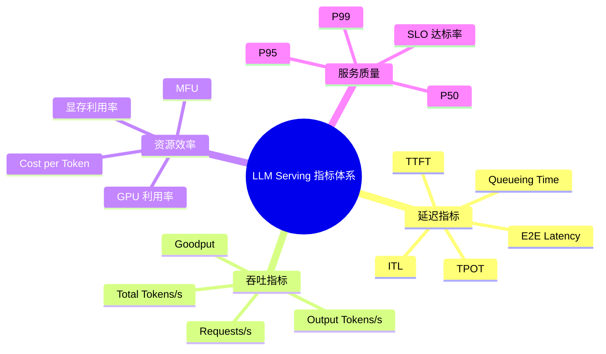
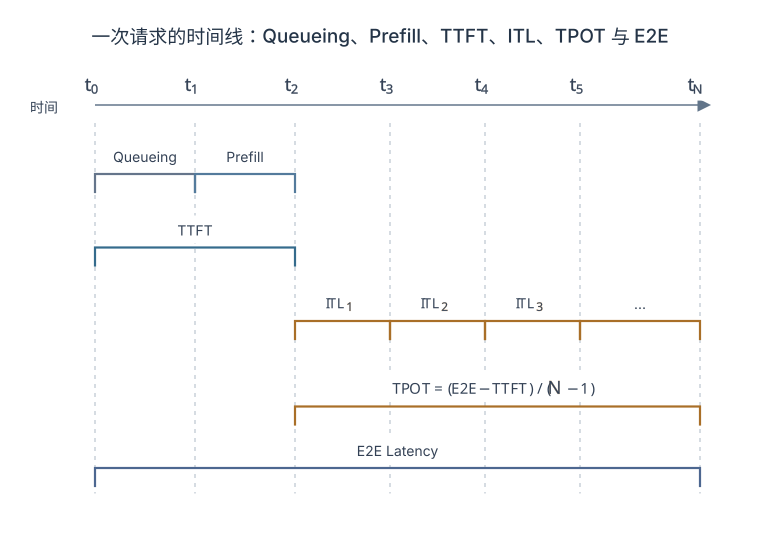
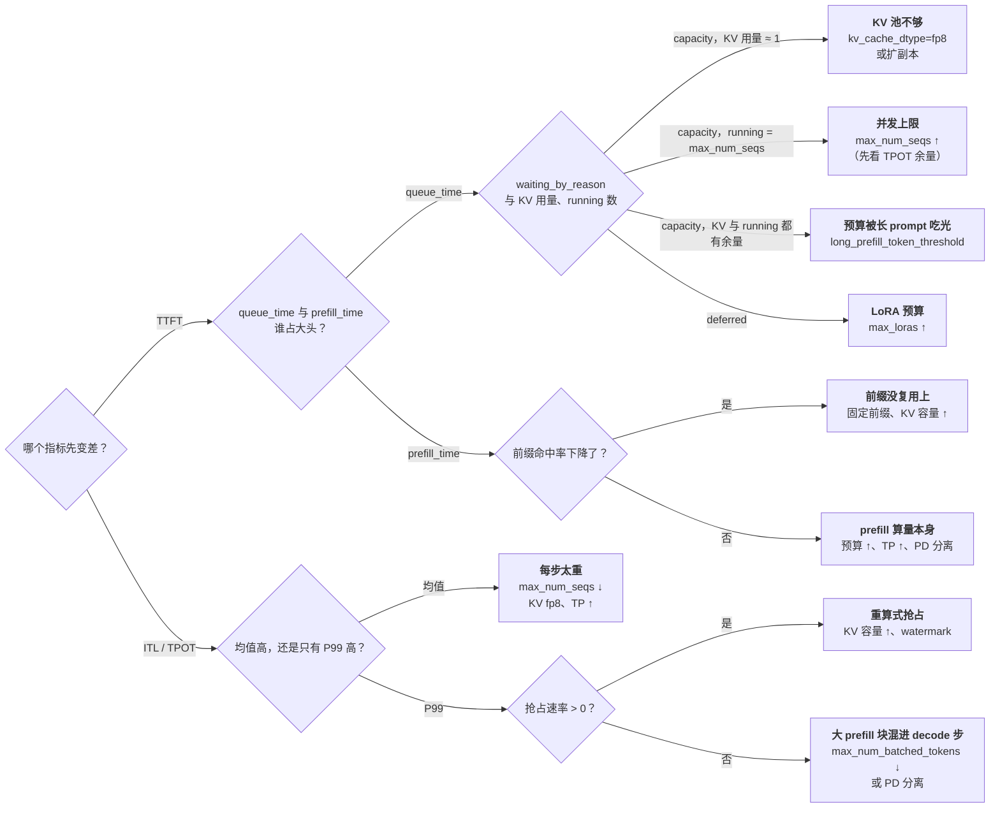

> **NOTE** 本文基于 vLLM v0.27.1（tag `6e448d0`, 2026-08-11）源码剖析。文中文件路径、类名和函数名均以该版本为准；vLLM 迭代很快，阅读时请以你手上的版本对照。


上一篇说明了 LLM Serving 为什么难：服务对象变成了持续生成过程，Prefill 与 Decode 是两种不同的 Workload，吞吐与时延无法同时最优。在动手优化之前，还需要先回答一个更基本的问题——系统到底好不好、问题出在哪一段。

LLM Serving 的性能不能只看单一指标：延迟、吞吐、效率与服务质量四个维度各自暴露不同阶段、不同资源的瓶颈。本篇的核心问题是：

> **应该用哪些指标衡量一个 LLM Serving 系统？[^q0] 指标异常时，如何判断问题出在排队、Prefill、Decode 还是资源，并选择对应的优化方向？[^q1] 落到 vLLM 上，每种症状该先动哪个参数、往哪个方向动、代价落在哪个指标上？[^q2] 上线之后，靠 `/metrics` 里的哪些指标及早发现这些症状？[^q3]**

## 一、总览：先定义指标，再对应瓶颈

### 1. 四个维度与一条使用原则

本篇先给出完整的指标体系——延迟（TTFT、TPOT、ITL、E2E、Queueing Time）、吞吐（Tokens/s、Requests/s、Goodput）、资源效率（MFU、GPU 利用率、显存利用率、Cost per Token）和服务质量（P50/P95/P99、SLO 达标率）——并逐一说明定义、反映的问题和使用注意；然后讨论常见的解读误区，把“指标异常”映射到“重点优化方向”；接着读一遍 vLLM 自带的 `vllm bench` 实现，用源码口径消除定义上的歧义。后两章把指标落到 vLLM 的配置上：先按“症状 → 指标 → 成因 → 参数”整理 v0.27.1 里真正存在的调优参数，用贯穿系列的 Llama-3-70B / 8×H100 算例说明一个参数为什么总是让一个指标变好、另一个变坏；最后列出线上 Prometheus `/metrics` 里与本文每个指标对应的名字，以及一块看板和几条告警该怎么配。

顺序是“定义 → 误读 → 压测 → 调参 → 监控”：前三章回答“系统好不好”，后两章回答“不好时动哪里、上线后怎么盯”。

贯穿全篇的原则是：不同指标对应不同瓶颈，不同瓶颈对应不同优化手段。

### 2. 本文的章节安排

| 章 | 主题 | 内容 |
|---|---|---|
| 二 | LLM Serving 指标总览 | 四个维度下各指标的定义、反映的问题与使用注意 |
| 三 | 指标常见误区与优化方向 | 六个常见误区、指标与优化方向的对应表、分析顺序 |
| 四 | 在 vLLM 里怎么测 | `vllm bench` 的四个子命令与五条口径细节 |
| 五 | 从症状到参数 | v0.27.1 的调优参数表、症状对照表、排查决策图、五组需要算账的取舍 |
| 六 | 线上监控 | `/metrics` 指标名与本文指标的对应、服务端与客户端口径差异、8 块看板与告警条件 |
| 七 | 本文小结 |  |
| 八 | 自测 | 7 道题 |

Table: 本文的章节安排

## 二、LLM Serving 指标总览

LLM Serving 的性能不能只看单一指标，而应同时关注四个维度：

- 延迟：用户需要等待多久？
- 吞吐：系统单位时间处理多少请求和 Token？
- 效率：GPU、显存和资金利用得好不好？
- 服务质量：有多少请求满足 SLO？



延迟维度的五个指标其实是同一条请求时间线上的不同区间，先把它们放到一张图里，后面的定义就不容易混（`t0` 客户端发出请求，`t1` 服务端开始执行，`t2` 首 token 到达客户端，`t3..tN` 后续每个输出 token 到达客户端，共 N 个输出 token）：



几个容易看错的地方：TTFT 从 `t0` 而不是 `t1` 起算，所以它包含排队、首 token 采样和网络传输，不等于 Prefill；ITL 是 `t2` 之后每一段间隔各自的值，有 N−1 个样本，所以能算分位数；TPOT 是这 N−1 段的平均值，一个请求只有一个数，它和 ITL 的均值相等，但抹掉了抖动；E2E 覆盖整条线。

**指标说明**

| 维度 | 指标 | 定义 | 主要反映 | 常见影响因素 | 使用注意 |
|---|---|---|---|---|---|
| **延迟** | **TTFT**（Time To First Token） | 请求到达至收到第一个输出 Token 的时间 | 首次响应速度 | 排队、Prompt 长度、Prefill、Prefix Cache、首 Token 生成 | 不等于 Prefill 时间，还包括排队和传输 |
| **延迟** | **TPOT**（Time Per Output Token） | Decode 阶段平均生成一个输出 Token 的时间：`(E2E − TTFT) / (输出 Token 数 − 1)` | 平均生成速度 | Decode Batch、KV Cache 长度、显存带宽、Attention Kernel、量化 | vLLM 的 `vllm bench serve` 明确**不含首 Token**（报告栏标注 `excl. 1st token`）；对比其他工具时需确认口径 |
| **延迟** | **ITL**（Inter-Token Latency） | 相邻两个输出 Token 到达客户端的时间间隔 | 流式输出的连续性和稳定性 | 调度抖动、Batch 变化、抢占、网络传输 | 应重点观察 P95/P99，而不只是平均值 |
| **延迟** | **E2E Latency** | 从请求发送至完整结果返回的总时间 | 完整请求体验 | 排队、Prefill、Decode、输出长度、网络 | 长输出场景下通常受 Decode 主导 |
| **延迟** | **Queueing Time** | 请求到达至开始执行前的等待时间 | 系统拥塞程度 | 并发量、Batch 容量、Admission Control、KV Cache 空间 | 高并发时可能成为 TTFT 的主要部分 |
| **吞吐** | **Output Tokens/s** | 单位时间生成的输出 Token 数 | Decode 吞吐 | Batch Size、显存带宽、Kernel、并行度 | 适合衡量在线生成能力 |
| **吞吐** | **Total Tokens/s** | 单位时间处理的输入与输出 Token 总数 | 端到端 Token 处理能力 | Prompt 长度、输出长度、Prefill 和 Decode 效率 | 必须说明是否包含输入 Token |
| **吞吐** | **Requests/s** | 单位时间完成的请求数 | 业务请求处理能力 | 请求长度、并发度、服务策略 | 不能脱离输入输出长度单独比较 |
| **吞吐** | **Goodput** | 单位时间内满足 SLO 的**请求数**（req/s） | 满足服务质量后的有效吞吐 | 吞吐、尾延迟、调度、Admission Control | vLLM 的实现是 `request_goodput = 达标请求数 / 时长`，SLO 只能对 `ttft`、`tpot`、`e2el` 三项设阈值（`--goodput ttft:200 tpot:50`）；有些论文按 Token 计 Goodput，注意区分 |
| **资源效率** | **MFU**（Model FLOPs Utilization） | 实际模型 FLOPs/s 与理论峰值 FLOPs/s 的比值 | 计算单元利用效率 | GEMM 规模、算子融合、Kernel 调度 | Decode 可能受显存带宽限制，MFU 低不一定代表低效 |
| **资源效率** | **GPU 利用率** | GPU 活跃时间占比 | GPU 是否持续工作 | 计算、访存、通信、调度和 Kernel Launch | 需要结合 HBM 带宽和 Tokens/s 判断 |
| **资源效率** | **显存利用率** | 已使用显存与可用显存的比例 | 并发和上下文容量 | 权重、KV Cache、激活、通信 Buffer、运行时开销 | 显存不仅决定模型能否加载，也决定并发度 |
| **资源效率** | **Cost per Token** | 处理一个 Token 的综合成本 | 经济效率 | GPU 成本、吞吐、利用率、量化、SLO | 应明确按输入、输出还是有效 Token 计算 |
| **服务质量** | **P50** | 50% 请求不超过该延迟 | 典型请求体验 | 常规负载 | 不能代表尾部请求 |
| **服务质量** | **P95** | 95% 请求不超过该延迟 | 大多数用户体验 | 负载波动、请求长度、调度 | 常用于在线服务 SLO |
| **服务质量** | **P99** | 99% 请求不超过该延迟 | 尾部请求体验 | 长请求、资源竞争、抢占、网络抖动 | 对多租户和交互式服务尤其重要 |
| **服务质量** | **SLO 达标率** | 满足预设延迟或吞吐目标的请求比例 | 服务稳定性 | TTFT、ITL、E2E、排队和错误率 | Goodput 的计算基础之一 |

Table: LLM Serving 指标总览

## 三、指标常见误区与优化方向

LLM Serving 的各项指标并非相互独立。不同指标暴露的是不同阶段或不同资源的瓶颈，因此应根据指标异常选择优化方向，而不是笼统地追求 GPU 利用率或总吞吐。

### 1. 常见误区

**误区一：只看平均延迟**

平均值可能掩盖严重的尾延迟问题。在线服务通常应同时报告**平均值、P50、P95、P99 和 SLO 达标率**。

尤其是在动态批处理和多租户环境中，少量长请求可能显著拖高 P99。

**误区二：将 TTFT 等同于 Prefill 时间**

TTFT 通常还包括排队时间、调度等待、Prefill、首 Token 生成和网络传输。

因此 TTFT 过高不一定意味着 Prefill Kernel 低效，也可能是请求在队列中等待过久。

**误区三：只用 TPOT 衡量流式体验**

TPOT 是平均值，而用户实际感受到的是每个 Token 的到达间隔。调度抖动、Batch 动态变化和通信阻塞可能导致平均 TPOT 正常，但 ITL 的 P95/P99 很差。

**误区四：用 GPU 利用率判断系统是否高效**

GPU 利用率较高，可能只是 GPU 在等待显存访问或通信；GPU 利用率较低，也可能是系统受限于显存带宽、请求不足或模型并行通信。因此需要结合以下指标共同判断：

- HBM 带宽利用率；
- Kernel 执行时间；
- MFU；
- Decode TPOT；
- GPU 间通信时间；
- 有效 Tokens/s。

**误区五：只比较 Requests/s**

不同测试的 Prompt 长度、Output 长度和请求分布不同，Requests/s 很难直接比较。更合理的报告方式是同时给出：

- 并发数、输入 Token 数、输出 Token 数、Output Tokens/s、
- Total Tokens/s、TTFT、TPOT/ITL 和 P99

**误区六：显存占用越高越好**

提高 KV Cache 使用率有助于增加并发，但过度填充显存可能造成：

- 新请求无法接入；
- 长请求触发抢占；
- KV Cache 频繁换入换出；
- P99 延迟显著升高；
- 系统出现 OOM 风险。

因此，显存利用率应与并发度、KV Cache 命中率、抢占率和尾延迟联合分析。

### 2. 指标与优化方向的对应关系


| 指标或现象 | 主要暴露的问题 | 重点优化方向 |
|---|---|---|
| **TTFT 过高** | 排队时间长、Prefill 计算量大或首 Token 调度不及时 | 减少排队、优化 Prefill Kernel、使用 Prefix Cache、采用 Chunked Prefill、改进请求优先级 |
| **ITL / TPOT 过高** | Decode 阶段访存效率低、KV Cache 访问开销大或 Batch 调度不合理 | 优化 Decode Kernel、改进 KV Cache 布局和访问、减少通信开销、优化 Continuous Batching |
| **吞吐不足** | 有效 Batch 太小、计算或显存带宽利用率低 | 增大有效 Batch、提高算力和带宽利用率、优化 Kernel、减少 CPU/GPU 调度开销 |
| **P99 过高** | 长请求竞争、动态 Batch 抖动、资源争用或排队失控 | 控制长 Prefill、限制最大上下文、隔离不同长度请求、改进调度、增加限流和 Admission Control |
| **KV Cache 不足** | 上下文过长、并发过高或 KV Cache 管理效率低 | 使用 PagedAttention、Prefix Cache、KV 量化、KV Cache 复用和抢占 |
| **GPU 利用率低但 TTFT 高** | 请求排队、调度间隙或并发不足 | 优化请求准入、动态批处理、调度粒度和 CPU/GPU 协同 |
| **GPU 利用率高但吞吐低** | 可能受显存带宽、Kernel 效率或通信瓶颈限制 | 优化内存访问、融合 Kernel、量化、减少同步和跨卡通信 |
| **Prefill 很快但 Decode 很慢** | Decode 的小矩阵计算和 KV Cache 访存成为瓶颈 | 优化 Decode 专用 Kernel、改进 KV Cache 布局、调整 Decode Batch 和并行策略 |
| **吞吐高但 Goodput 低** | 系统牺牲延迟换取吞吐，导致大量请求违反 SLO | 引入 SLO-aware 调度、限制 Batch 上限、控制长请求、优化资源隔离 |
| **P99 随并发快速恶化** | 系统接近饱和，排队和资源竞争出现非线性增长 | 设置并发上限、实施 Admission Control、区分请求优先级、扩展实例或进行负载分片 |

Table: 指标与优化方向的对应关系

### 3. 使用原则

指标分析应遵循以下顺序：

1. 先确认指标口径
2. 区分 Prefill、Decode、排队和网络因素
3. 观察平均值与 P95/P99 的差异
4. 结合 GPU、显存、带宽和通信指标定位瓶颈
5. 选择与指标对应的优化方向
6. 用 Goodput 和 SLO 达标率验证优化是否有效

核心原则是：

> 不同指标对应不同瓶颈，不同瓶颈对应不同优化手段。  
> 不能用提高吞吐的方法解决 TTFT，也不能用单纯增加 GPU 利用率的方法解决 P99 或 KV Cache 容量问题。

## 四、在 vLLM 里怎么测：`vllm bench`

上面的指标不是纸面定义，vLLM 自带的压测工具就是按这些口径实现的，读一遍源码可以消除大部分口径歧义。入口是 `vllm bench <子命令>`（`vllm/entrypoints/cli/benchmark/`），子命令分别对应 `vllm/benchmarks/` 下的同名模块：

| 子命令 | 用途 | 实现 |
|---|---|---|
| `vllm bench serve` | 对一个已启动的 OpenAI 兼容服务发起在线压测，报告 TTFT / TPOT / ITL / E2E 的均值与分位数、吞吐、Goodput | `vllm/benchmarks/serve.py` |
| `vllm bench throughput` | 离线吞吐：直接调用 `LLM.generate`，不经 HTTP | `vllm/benchmarks/throughput.py` |
| `vllm bench latency` | 单 batch 端到端延迟 | `vllm/benchmarks/latency.py` |
| `vllm bench sweep` | 对多组参数批量跑 `serve` | `vllm/benchmarks/sweep/` |

Table: vllm bench 的子命令

一次典型的在线压测：

```bash title='vllm bench serve 的一条典型命令'
vllm bench serve --model <MODEL> --dataset-name sharegpt --dataset-path ShareGPT.json \
  --request-rate 8 --num-prompts 500 \
  --percentile-metrics ttft,tpot,itl,e2el --metric-percentiles 50,95,99 \
  --goodput ttft:300 tpot:60
```

几个与口径直接相关的实现细节（`vllm/benchmarks/lib/endpoint_request_func.py` 与 `serve.py` 的 `calculate_metrics`）：

- **TTFT** 在客户端收到第一个 SSE chunk 时打点，所以包含了网络与 HTTP 解析开销，不是服务端的 Prefill 时间；
- **ITL** 是相邻 chunk 到达时刻的差，逐个记录后再算分位数；
- **TPOT** = `(latency − ttft) / (output_len − 1)`，不含首 Token；
- **Goodput** 按请求计数，一个请求只有 `ttft`、`tpot`、`e2el` 三项全部达标才算有效；
- **Total Token throughput** = `(总输入 Token + 总输出 Token) / 时长`，包含输入。

用上面命令里的 `--goodput ttft:300 tpot:60` 举一个 6 个请求、跑了 10 s 的例子，看 Goodput 是怎么从 Requests/s 里“扣”出来的（没有给 `e2el` 阈值，所以不检查）：

| 请求 | TTFT (ms) | TPOT (ms) | TTFT ≤ 300 | TPOT ≤ 60 | 计入 Goodput | 不达标的原因 |
|---|---|---|---|---|---|---|
| R1 | 120 | 35 | ✓ | ✓ | ✓ | — |
| R2 | 280 | 58 | ✓ | ✓ | ✓ | —（两项都贴着阈值，但仍达标） |
| R3 | 450 | 30 | ✗ | ✓ | ✗ | 排队久，首 token 慢 |
| R4 | 90 | 75 | ✓ | ✗ | ✗ | 首 token 快，但 Decode 每步太慢 |
| R5 | 150 | 40 | ✓ | ✓ | ✓ | — |
| R6 | 310 | 62 | ✗ | ✗ | ✗ | 两项都超 |
| **合计** | | | | | **3 / 6** | Requests/s = 6/10 = **0.6**；Goodput = 3/10 = **0.3 req/s** |

Table: Goodput 从 Requests/s 里扣除的例子

R3 和 R4 各只违反一项，但一样不计入——Goodput 是按请求做“与”判断，不是按指标各算达标率。这也解释了第三章“吞吐高但 Goodput 低”那一行：加大 Batch 让 6 个请求都完成了（Requests/s 不变甚至更高），却把一半请求推过了阈值。

对比不同引擎的 benchmark 数字时，先确认对方工具的这五条口径是否一致，否则数字没有可比性。

## 五、从症状到参数：指标异常时在 vLLM 里调什么

第三章的对应表停在“优化方向”这一层：“减少排队”“控制长 Prefill”“增大有效 Batch”。落到一个跑着的 vLLM 实例上，这些方向最终都变成启动参数。本章按“症状 → 看哪个指标 → vLLM 里的成因 → 先动哪个参数、往哪个方向 → 代价落在哪个指标上”整理一遍。参数名、默认值和语义都以 v0.27.1 的 `vllm/config/*.py` 与 `vllm/engine/arg_utils.py` 为准；机制本身留给后面各篇，这里只说它们对指标的影响。

### 1. 先认识参数：它们各管哪一层

| 参数（CLI） | v0.27.1 默认值 | 管什么 | 定义位置 |
|---|---|---|---|
| `--max-num-batched-tokens` | 显存 ≥ 70 GiB 且不是 A100（H100、H200、MI300X）：API Server 8192、离线 `LLM` 16384<br/>其他 GPU：2048 / 8192 | 每一步（一次 forward）最多处理多少 token：每个 decode 请求占 1 个，prefill 按块占；启动时激活显存也按它 profile | `SchedulerConfig.max_num_batched_tokens`；默认值在 `EngineArgs.get_batch_defaults` |
| `--max-num-seqs` | 同上条件：1024<br/>其他 GPU：256 | 同时处于 running 的请求数上限 | `SchedulerConfig.max_num_seqs` → `Scheduler.max_num_running_reqs` |
| `--long-prefill-token-threshold` | 0（不限） | 单个请求一步最多拿多少 prefill token | `SchedulerConfig.long_prefill_token_threshold` |
| `--enable-chunked-prefill` | 模型支持就开（生成模型都支持；手动关会告警） | 长 prompt 能否切块、和 decode 进同一步 | `EngineArgs._set_default_chunked_prefill_and_prefix_caching_args` |
| `--scheduling-policy` | `fcfs` | 设为 `priority` 后按请求的 `priority` 字段排队，也按它挑抢占对象 | `SchedulerConfig.policy` |
| `--gpu-memory-utilization` | 0.92 | 本实例可用显存比例；扣掉权重、激活峰值和 CUDA Graph 之后剩下的全部给 KV | `CacheConfig.gpu_memory_utilization` |
| `--kv-cache-memory-bytes` | 未设 | 直接指定每卡 KV 字节数，替代上面的推算 | `CacheConfig.kv_cache_memory_bytes` |
| `--max-model-len` | 模型配置里的上下文长度 | 单请求 prompt + 输出的上限；启动时 KV 池至少要放得下一条这么长的请求 | `ModelConfig.max_model_len` |
| `--kv-cache-dtype` | `auto`（跟模型 dtype） | `fp8` / `fp8_e4m3` / `fp8_e5m2` 让每 token 的 KV 减半 | `CacheConfig.cache_dtype` |
| `--block-size` | 16（不手动指定时，attention backend 可以换成它偏好的大小） | 一个 KV 块装几个 token | `CacheConfig.DEFAULT_BLOCK_SIZE`；`Platform.update_block_size_for_backend` |
| `--enable-prefix-caching` | 开（hybrid 模型除外） | 相同前缀复用已算好的 KV 块 | `EngineArgs._set_default_chunked_prefill_and_prefix_caching_args` |
| `--kv-offloading-size` | 未设 | 给 KV 加一块 CPU 内存（GiB），逐出 GPU 的前缀块还能找回 | `CacheConfig.kv_offloading_size` |
| `--watermark` | 0.0 | 接纳 waiting 或被抢占的请求时，留出这一比例的空闲块 | `SchedulerConfig.watermark` |
| `--scheduler-reserve-full-isl` | 开 | 接纳新请求前检查整条 prompt 的 KV 放得下，而不只是第一块 | `SchedulerConfig.scheduler_reserve_full_isl` |
| `--max-cudagraph-capture-size`<br/>`--cudagraph-capture-sizes` | 上限 = min(`max_num_seqs` × (1 + 投机 token 数) × 2, 512)，且不超过 `max_num_batched_tokens`<br/>尺寸：1、2、4，8–248 步长 8，256 起步长 16 | 哪些每步 token 数走 CUDA Graph（向上 padding 到最近的尺寸）；超过最大尺寸的步不用图 | `CompilationConfig`；`VllmConfig._set_cudagraph_sizes` |
| `--enforce-eager` | 关 | 完全不用 CUDA Graph | `ModelConfig.enforce_eager` |
| `--performance-mode` | `balanced` | `throughput`：没手动设的 batched tokens 与 seqs 默认值翻倍<br/>`interactivity`：1–32 每个尺寸都捕获图 | `VllmConfig.performance_mode` |
| `--async-scheduling` | 不设时自动开；pooling 模型、`ngram` / `draft_model` / `medusa` 这类非 EAGLE、MTP 系的投机方法、不支持的 executor 下自动关 | CPU 调度第 N+1 步与 GPU 执行第 N 步重叠 | `SchedulerConfig.async_scheduling`；`VllmConfig.__post_init__` |
| `--stream-interval` | 1 | 攒几个 token 再发一次流式输出 | `SchedulerConfig.stream_interval` |
| `--max-loras` | 1 | 同一步里最多几个不同的 LoRA adapter | `LoRAConfig.max_loras` |
| `-tp` / `--pipeline-parallel-size` | 1 / 1 | 张量并行 / 流水线并行的卡数 | `ParallelConfig` |
| `--speculative-config` | 未设 | 投机解码方法（`eagle3`、`mtp`、`ngram`…）与 `num_speculative_tokens` | `SpeculativeConfig` |

Table: 本章涉及的 vLLM 参数（v0.27.1）

### 2. 症状对照表

| 症状 | 先看哪个指标 | vLLM 里的常见成因 | 先动的参数（方向） | 代价落在 | 机制见 |
|---|---|---|---|---|---|
| TTFT 高，排队占大头 | `request_queue_time_seconds`<br/>`num_requests_waiting_by_reason{reason="capacity"}` | running 已到 `max_num_seqs`<br/>KV 池放不下新请求<br/>到达率超过服务能力 | KV 够时 `max_num_seqs` ↑<br/>KV 不够时 `kv_cache_dtype=fp8`、`gpu_memory_utilization` ↑<br/>都不行就扩副本、网关限流 | TPOT ↑（batch 变大）；限流 = 拒绝请求 | [《Scheduler》](/scheduler-batch-and-fairness.html)<br/>[《KV Cache》](/kv-cache-memory-core.html)<br/>[《Multi-GPU》](/multi-gpu-scaling-strategies.html) |
| TTFT 高，prefill 占大头 | `request_prefill_time_seconds`<br/>`prompt_tokens_by_source{source="local_compute"}` | prompt 长且没命中前缀<br/>token 预算小，一条 prompt 要切很多步 | 稳定前缀、确认 prefix caching 开着<br/>`max_num_batched_tokens` ↑<br/>`-tp` ↑ | 同一步 decode 的 ITL ↑；TP 通信 | [《Scheduler》](/scheduler-batch-and-fairness.html)<br/>[《KV Cache》](/kv-cache-memory-core.html)<br/>[《GPU 执行》](/gpu-execution-kernels-and-graphs.html)<br/>[《Multi-GPU》](/multi-gpu-scaling-strategies.html) |
| TTFT P99 ≫ P50，短请求被长 prompt 卡住 | TTFT P99 / P50<br/>`request_queue_time_seconds` P99<br/>`request_prompt_tokens` 分布 | 一条长 prompt 每步吃光剩余预算，排在后面的请求一个 token 也分不到 | `long_prefill_token_threshold` 设为预算的 1/4 左右<br/>`--scheduling-policy priority`<br/>长文请求分到单独实例 | 长 prompt 自己的 TTFT 略升 | [《Scheduler》](/scheduler-batch-and-fairness.html)<br/>[《PD 分离》](/prefill-decode-disaggregation.html) |
| TPOT 均值高 | `request_time_per_output_token_seconds`<br/>`num_requests_running` | batch 大、上下文长，每步读的 KV 多<br/>每卡权重读取的下界高 | `max_num_seqs` ↓<br/>`kv_cache_dtype=fp8`<br/>`-tp` ↑<br/>低并发时开投机解码 | 吞吐 ↓；fp8 有精度风险；TP 通信 | [《KV Cache》](/kv-cache-memory-core.html)<br/>[《GPU 执行》](/gpu-execution-kernels-and-graphs.html)<br/>[《Multi-GPU》](/multi-gpu-scaling-strategies.html) |
| ITL P99 尖刺，均值正常 | `inter_token_latency_seconds` P99 / P50<br/>`iteration_tokens_total` | 大 prefill 块和 decode 进同一步，这一步变长<br/>抢占后的重算<br/>每步 token 数超过最大 CUDA Graph 尺寸 | `max_num_batched_tokens` ↓<br/>`long_prefill_token_threshold`<br/>PD 分离 | prefill 积压排空变慢，TTFT ↑，总吞吐略降 | [《Scheduler》](/scheduler-batch-and-fairness.html)<br/>[《GPU 执行》](/gpu-execution-kernels-and-graphs.html)<br/>[《PD 分离》](/prefill-decode-disaggregation.html) |
| 吞吐上不去，GPU 利用率却很高 | Output Tokens/s 对 `num_requests_running`<br/>`estimated_read_bytes_per_gpu_total` | decode 是 memory-bound，“利用率高”只说明有 kernel 在跑<br/>batch 被 `max_num_seqs` 或 KV 容量卡住 | KV 容量 ↑ 之后 `max_num_seqs` ↑<br/>`kv_cache_dtype=fp8` | TPOT ↑ | [《KV Cache》](/kv-cache-memory-core.html)<br/>[《GPU 执行》](/gpu-execution-kernels-and-graphs.html) |
| 吞吐低，GPU 有空隙 | GPU 时间线（profiler）<br/>`generation_tokens` 速率 | CPU 侧调度、输入准备、detokenize、HTTP 没被 GPU 时间盖住<br/>没用上 CUDA Graph | 确认 async scheduling 开着（`ngram` 等方法会关掉它）<br/>去掉 `--enforce-eager`<br/>`--stream-interval` ↑、`--api-server-count` ↑ | 流式输出更“成块”；多进程的 CPU 与内存 | [《鸟瞰 vLLM》](/vllm-request-lifecycle-overview.html)<br/>[《GPU 执行》](/gpu-execution-kernels-and-graphs.html) |
| 抢占频繁 | `num_preemptions` 速率<br/>`kv_cache_usage_perc` 贴近 1 | decode 增长要新块时池满，只能抢占：被抢的请求清零已算 token、回到 waiting 队头 | KV 容量 ↑<br/>`max_num_seqs` ↓<br/>`--watermark` 0.01–0.05<br/>保持 `--scheduler-reserve-full-isl` 开 | 并发 ↓ → 吞吐 ↓ | [《Scheduler》](/scheduler-batch-and-fairness.html)<br/>[《KV Cache》](/kv-cache-memory-core.html) |
| 启动 OOM / 启动报 KV 不够 | 启动日志 | 权重 + 激活峰值 + CUDA Graph 超过 `gpu_memory_utilization` 的份额<br/>KV 池放不下一条 `max_model_len` 长的请求 | `max_model_len` ↓（报错里直接给估算值）<br/>`-tp` ↑、`kv_cache_dtype=fp8`<br/>`gpu_memory_utilization` ↑（同卡没别的进程时） | 上下文变短；TP 通信 | [《KV Cache》](/kv-cache-memory-core.html)<br/>[《Multi-GPU》](/multi-gpu-scaling-strategies.html) |
| Prefix cache 命中率下降 | `prefix_cache_hits` / `prefix_cache_queries`<br/>`kv_block_idle_before_evict_seconds` | 前缀变了（system prompt 插了时间戳、工具列表顺序变）<br/>KV 紧张，空闲的缓存块被逐出<br/>多副本没按前缀路由 | 固定前缀<br/>KV 容量 ↑、`--kv-offloading-size`<br/>按前缀亲和路由 | CPU 内存；路由复杂度 | [《KV Cache》](/kv-cache-memory-core.html)<br/>[《Multi-GPU》](/multi-gpu-scaling-strategies.html) |
| 突发流量下尾延迟恶化 | `num_requests_waiting` 陡升<br/>`request_queue_time_seconds` P99 | 到达率短时超过服务率，排队按非线性增长；单实例参数救不了 | 网关准入与限流<br/>`--scheduling-policy priority`<br/>扩副本（提前，而不是等告警） | 被拒绝或降级的请求 | [《Scheduler》](/scheduler-batch-and-fairness.html)<br/>[《Multi-GPU》](/multi-gpu-scaling-strategies.html) |
| 多 LoRA 时部分请求等很久 | `num_requests_waiting_by_reason{reason="deferred"}`<br/>`lora_requests_info` | 一步里不同 adapter 数到了 `max_loras`，其余 adapter 的请求被推迟 | `--max-loras` ↑ | adapter 权重槽占显存；每步 LoRA kernel 变慢 | [《请求形态的扩展》](/request-shapes-multi-lora-and-multimodal.html) |
| 结构化输出、`n` > 1 或大量 `logprobs` 后变慢 | TTFT、TPOT 按请求参数分组<br/>`request_params_n` | 语法约束每步要算 token 掩码，新 schema 首次要编译<br/>`n` 份并行采样各占一个序列 | 复用 schema<br/>按需开 `logprobs`、限制 `n` | 功能取舍 | [《输出在变》](/output-changes-sampling-and-structured-output.html) |
| 开投机解码后反而变慢 | `spec_decode_num_accepted_tokens` / `spec_decode_num_draft_tokens`<br/>TPOT 对并发 | 接受率低<br/>高并发时验证 K+1 个 token 不再免费<br/>`ngram` 关掉了 async scheduling | `num_speculative_tokens` ↓<br/>只在低并发实例上开 | 低并发时的 TPOT 收益 | [《GPU 执行》](/gpu-execution-kernels-and-graphs.html) |

Table: 症状、指标与参数的对照（指标名省略 `vllm:` 前缀）


### 3. 排查顺序：先拆 TTFT 和 ITL，再碰参数

表是按症状查的；实际排查时更常见的情况是“延迟变差了”，得先判断落在哪一段。vLLM 的服务端直方图已经把一个请求拆成排队、prefill、decode 三段（第六章），下图就是按这几个指标往下分的顺序，每片叶子是第一个值得试的参数：



两个分叉点是这张图比症状表多出来的东西：TTFT 先拆成排队和 prefill，因为两段的原因不重叠——排队长说明请求连第一次被调度的机会都没拿到，卡在容量（KV 池、并发上限）或者每步的预算被别人用光；prefill 长说明已经开始算了、但要算的 token 多或者算得慢；ITL 先分均值和 P99，因为均值高是每一步都重（batch 和上下文的问题），只有 P99 高是个别步突然变重（prefill 块或抢占的问题）。

### 4. 五组需要算账的取舍

表里每一行的“代价”一栏都是一句话，下面五组需要用数字才能说清楚。算例沿用[《为什么 LLM Serving 难》](/why-llm-serving-is-hard.html)的设定：Llama-3-70B、8×H100、TP=8，每 token 的 KV 320 KB（每卡 40 KB），每卡权重 17.6 GB。再加两个从[《GPU 执行》](/gpu-execution-kernels-and-graphs.html)取来的实测量级：64 个请求的纯 decode 步约 10 ms；2050 token 的 prefill 约 92 ms，折合每个 prefill token 约 45 µs。这里把一步的时间简化成：

$$t_\text{step} \approx t_\text{decode}(B) + 45\ \mu\text{s} \times (\text{这一步的 prefill token 数})$$

它忽略了长上下文下 attention 的平方项，也假设 prefill 每 token 的成本不随块大小变化——这两点在下面用到时会说明偏向哪边。

**1、token 预算：`max_num_batched_tokens` 让吞吐和 ITL 往相反方向走。**

场景：64 个请求正在 decode，这时同时到了 4 个 2050 token 的 prompt，一共 8200 个 prefill token。比较默认的 8192（H100 上 API Server 的默认值）和 2048：

| 预算 | 每步组成 | 步数与每步时间 | 4 个 prompt 的 TTFT | 64 个 decode 流的 ITL | 这段时间的 Total Tokens/s |
|---|---|---|---|---|---|
| 2048 | 64 decode + 1984 prefill | 4 步 × 99 ms + 1 步 22 ms，共 419 ms | 199 / 298 / 397 / 419 ms，均值 328 ms | 每步约 99 ms | (8200 + 5 × 64) / 0.419 s ≈ **20.3k** |
| 8192 | 64 decode + 8128 prefill | 1 步 376 ms + 1 步 13 ms，共 389 ms | 376 / 376 / 376 / 389 ms，均值 379 ms | 第一步 **376 ms** | (8200 + 2 × 64) / 0.389 s ≈ **21.4k** |

Table: 4 个 2050 token prompt 同时到达时，两种 token 预算的对比

预算从 2048 加到 8192：总吞吐涨了约 5%，积压排空快了 30 ms；代价是 64 个正在流式输出的用户在这一步里等了 376 ms 才看到下一个字（ITL P99 放大约 3.8 倍），最早到的那个 prompt 的 TTFT 也从 199 ms 变成 376 ms。吞吐只涨 5%，是因为在这个简化模型里 prefill 每 token 的成本是常数，大预算省下的只有“少跑 3 步”的每步固定开销（每步都要把 17.6 GB 权重读一遍）。真实的 GEMM 在块只有几百 token 时效率会下降，所以预算从 512 涨到 2048 的吞吐收益比这里大，从 2048 往上则越来越小——ITL 的代价却一直按块大小线性增长。

还有一个容易漏掉的细节：同一段时间里，64 个 decode 流在 2048 预算下各出了 5 个 token，在 8192 下只出了 2 个，Output Tokens/s 反而从 764 降到 329。“吞吐变高”到底是哪个吞吐，在这里结论完全相反——这就是第二章要求报告时注明是否含输入 token 的原因。

所以方向是：交互式服务（ITL SLO 在 50–100 ms）把预算压到 2048 左右，宁可让 prefill 积压慢一点排空；离线批处理没有 ITL 约束，用默认值甚至 `--performance-mode throughput` 翻倍。

**2、并发上限：`max_num_seqs` 让吞吐和 TPOT 一起涨，直到踩线。**

decode 每步要读一遍每卡 17.6 GB 的权重，再读 batch 里每个请求的全部 KV。按[《为什么 LLM Serving 难》](/why-llm-serving-is-hard.html)的 Roofline 下界（上下文取请求结束时的 2350 token），再加约 3 ms 的 all-reduce 与 kernel 开销：

| 并发 B | 每卡 KV 读取 | 每步时间 ≈ TPOT | Output Tokens/s |
|---:|---:|---:|---:|
| 64 | 6.0 GB | 7.0 + 3 ≈ 10.0 ms | 6.4k |
| 128 | 12.0 GB | 8.8 + 3 ≈ 11.8 ms | 10.8k |
| 256 | 24.1 GB | 12.4 + 3 ≈ 15.4 ms | 16.6k |

Table: decode 并发与 TPOT、吞吐的关系（Llama-3-70B、TP=8、上下文 2350）

从 128 到 256，吞吐涨 54%，TPOT 涨 30%。如果 SLO 是 TPOT ≤ 15 ms，256 刚好越线：Requests/s 还在涨，Goodput 却可能从几乎全部达标跌到几乎为零——第四章例子里“吞吐高但 Goodput 低”就是这么来的。

H100 上 `max_num_seqs` 的默认值是 1024，对 70B / TP=8 来说这个上限通常碰不到，真正限制 batch 的是 KV 池：每卡 80 GB × 0.92 ≈ 73.6 GB，减去 17.6 GB 权重，再假设激活峰值和 CUDA Graph 约 5 GB（实际值看启动日志的 `GPU KV cache size: N tokens`），剩约 51 GB，按每卡每 token 40 KB 约 127 万 token，折合约 540 个 2350 token 的满长请求。负载上来时 batch 会一路长到这里，那时 TPOT ≈ (17.6 + 51) GB / 3.35 TB/s + 3 ms ≈ 23.5 ms。也就是说，有 TPOT SLO 的服务应该显式把 `max_num_seqs` 设到 SLO 对应的并发（这里约 200–250），而不是相信默认值；多出来的请求在 waiting 里排队，表现为 TTFT 上升——这是有意把压力从 TPOT 挪到 TTFT，再用扩副本解决。

`kv_cache_dtype=fp8` 在这一组里是少有的“两个指标一起变好”：每卡每 token 的 KV 从 40 KB 变成 20 KB，B = 256 时 KV 读取从 24.1 GB 降到 12.0 GB，TPOT 从约 15.4 ms 降到约 11.8 ms，KV 池容量同时翻倍。代价不在延迟上，而在精度：checkpoint 里没有 KV scale 时 scale 默认取 1.0，上线前要用自己的评测集对一遍（机制见[《KV Cache：LLM Serving 的第一号内存问题》](/kv-cache-memory-core.html)）。

**3、显存怎么分：`gpu_memory_utilization`、`max_model_len` 和启动失败。**

vLLM 启动时先用一个 `max_num_batched_tokens` 大小的假 batch 跑一遍 forward（`GPUModelRunner.profile_run`），量出激活峰值，再捕获 CUDA Graph；`gpu_memory_utilization × 显存` 减去权重、激活峰值和图内存，剩下的全部切成 KV 块。启动阶段的两种失败都在 `vllm/v1/core/kv_cache_utils.py` 的 `_check_enough_kv_cache_memory`：

1. 剩余为零或负：报 “No available memory for the cache blocks”。权重本身放不下，只能加卡（`-tp` ↑）或量化权重；激活峰值太大时，`max_num_batched_tokens` ↓ 也有效。
2. 剩余不够放一条 `max_model_len` 长的请求：报 “To serve at least one request with the model's max seq len …”，并直接给出 “the estimated maximum model length is N”。把 `--max-model-len` 设到 N 以下就能启动。

启动成功后日志会打印 `GPU KV cache size: N tokens` 和 `Maximum concurrency for X tokens per request: Y x`，后者就是“放得下几条满长请求”。`max_model_len` 本身并不占 KV（块是按需分配的），它影响的是启动检查和单请求最多能占多大的池。换成结构相同、上下文 128K 的 Llama-3.1-70B 并把上下文开满，一条请求最多占 128K × 40 KB ≈ 5 GB 每卡，约为 51 GB 池子的十分之一——十个长文请求就能把池子占满、把其他请求挤进抢占。业务不需要 128K 时，`max_model_len` 设成实际需要的长度，是最便宜的保护。

`gpu_memory_utilization` 默认已经是 0.92，再往上调能多出的 KV 不多（每 1% 约 0.8 GB），还会压缩 NCCL、PyTorch 缓存分配器等不受 vLLM 统计的显存余量，在 TP 多卡上更容易在运行中 OOM。同一张卡上跑两个实例时则反过来要调低：这个比例是每个实例各自的上限。

**4、抢占：V1 只有重算，`watermark` 用容量换稳定。**

running 里的请求每多生成 16 个 token（一个块）就要一个新块。池满时调度器调用 `Scheduler._preempt_request`：FCFS 策略下抢 running 队尾最后加入的那个，`priority` 策略下抢优先级数值最大、到达最晚的那个；释放它的全部块，把 `num_computed_tokens` 清零，放回 waiting 队头。被抢的请求下次被调度时要把 prompt 加已生成的 token 重新 prefill 一遍：[《为什么 LLM Serving 难》](/why-llm-serving-is-hard.html)里那个请求在生成到第 250 个 token 时被抢，要重算约 2300 token，按 45 µs 计约 104 ms 的 GPU 时间，这个用户的 ITL 里会出现一个“排队等待 + 104 ms”的空洞，同一步里的其他请求也被这 2300 token 拖慢。开着 prefix caching 时，被释放的块进入空闲队列但保留哈希，如果在重新调度前没被别人拿走，重算会直接命中这些块——只是池满时它们往往第一批被逐出。

所以抢占速率 > 0 的稳态是坏信号：GPU 在重复做已经做过的工作，吞吐和 ITL 一起变差。`--watermark 0.02` 让调度器在接纳 waiting 或被抢占的请求时留出 2% 的空闲块（51 GB 池子里约 1 GB、约 2.5 万 token 的余量），给 running 里的请求增长用；代价是峰值并发少了约 2%。`--scheduler-reserve-full-isl`（默认开）解决的是另一半：接纳时就确认整条 prompt 放得下，避免“第一块进来了、后面的块抢别人”的抖动；它只管 prompt，不管之后的输出增长，所以输出长的业务还需要 watermark 或更小的 `max_num_seqs`。

**5、长 prompt 与短请求：`long_prefill_token_threshold` 用长请求的一点 TTFT 换短请求的大头。**

场景：预算 8192，64 个请求在 decode，先到一条 32K token 的长文档请求，紧接着到一条 200 token 的短问答。V1 调度器每一步先排 running 里的请求（包括已经开始 prefill 的长请求），剩下的预算才轮到 waiting。

1. 不设阈值：长请求每步拿走 8128 个 token，32768 token 要 4 个满步加 1 个小步，约 4 × 376 + 21 ≈ 1.52 s；这期间预算每步都被用光，短请求一个 token 也分不到，一直留在 waiting 里，TTFT 约 1.5 s——在监控里它记在 `request_queue_time_seconds` 上，而 KV 用量和 running 数都还有余量。64 个 decode 流在这 1.5 s 里每步等 376 ms。
2. `--long-prefill-token-threshold 2048`：长请求每步最多 2048 token，短请求在下一步就和它一起进 batch，这一步约 10 + 45 µs × 2248 ≈ 111 ms，短请求 TTFT 在 0.2 s 以内。长请求要 16 步、每步约 102 ms，共约 1.64 s，比不设阈值慢约 8%；decode 流的 ITL 也从 376 ms 降到约 100 ms。

这里简化模型低估了 32K prompt 后半段 attention 的平方项成本，两种设置下长请求都会更慢，但短请求 TTFT 的差别不受影响——它取决于预算有没有被让出来。阈值只在小于预算时才有作用：预算是 2048 时设 2048 等于没设。

**6、其余几个参数的方向。**

**CUDA Graph 尺寸。** 每步 token 数向上 padding 到最近的捕获尺寸（65 个 token 跑 72 的图），超过最大尺寸的步不用图，launch 开销回来，ITL 抬高。H100 默认 `max_num_seqs` = 1024 时最大尺寸是 512；开投机解码时每个请求一步占 1 + K 个 token，batch 一大就越过 512。`--enforce-eager` 只该在排查问题时用。

**Async scheduling。** 它把 CPU 侧的调度与输入准备藏到 GPU 执行后面；v0.27.1 默认就开，要确认的是它有没有被别的选项悄悄关掉——启动日志里 “Async scheduling … will be disabled” 的告警就是信号，`ngram` 投机是最常见的原因。

**张量并行。** TP 从 4 到 8，每卡权重从 35 GB 降到 17.6 GB，decode 的权重读取下界从约 10.5 ms 降到 5.3 ms，KV 池也变大；代价是每层两次 all-reduce（80 层一步约 2–3 ms）和翻倍的卡数，每卡吞吐通常下降。机制见[《Multi-GPU：一张卡不够时如何扩展？》](/multi-gpu-scaling-strategies.html)。

**投机解码。** 低并发时每步只读一遍权重却出 1 + 接受长度个 token，TPOT 明显下降；batch × (1 + K) 接近每卡约 295 token 的 Roofline 拐点后，验证不再免费，收益消失甚至变负。用 `spec_decode_num_accepted_tokens` 与 `spec_decode_num_draft_tokens` 的比值决定 K，机制见[《GPU 执行：如何让每个 Token 算得更快？》](/gpu-execution-kernels-and-graphs.html)。

**`--stream-interval`。** 设为 5 时每攒 5 个 token 发一次，API Server 的序列化与网络开销降到约五分之一；客户端看到的 ITL 变成“4 个约 0 ms + 1 个约 5 × TPOT”，P99 ITL 变差，TPOT 不变。CPU 成为瓶颈、`--api-server-count` 也已加够时才值得用。

## 六、线上监控：`/metrics` 里该看什么

压测给出的是一个固定负载下的数字；上线之后负载、请求长度分布、前缀命中率每天都在变，需要持续看的是同一组指标的服务端版本。vLLM 的 OpenAI 兼容服务在 `/metrics` 暴露 Prometheus 格式的指标（`vllm/entrypoints/serve/instrumentator/metrics.py` 挂载路由，指标定义在 `vllm/v1/metrics/loggers.py` 的 `PrometheusStatLogger`，投机解码部分在 `vllm/v1/spec_decode/metrics.py`）。每个指标都带 `model_name` 和 `engine`（数据并行时每个引擎一份）两个标签。

### 1. 指标名与本文指标的对应

| 本文指标 | `/metrics` 里的名字 | 类型 | 口径 |
|---|---|---|---|
| TTFT | `vllm:time_to_first_token_seconds` | histogram | 请求进入前端（`arrival_time`）到前端处理完首 token |
| ITL | `vllm:inter_token_latency_seconds` | histogram | 同一请求相邻两次引擎步输出的间隔，用引擎时间戳 |
| TPOT | `vllm:request_time_per_output_token_seconds` | histogram | 每请求一个样本：decode 时长 /（输出 token 数 − 1） |
| E2E Latency | `vllm:e2e_request_latency_seconds` | histogram | `arrival_time` 到请求结束 |
| Queueing Time | `vllm:request_queue_time_seconds` | histogram | 首次 QUEUED 到首次 SCHEDULED |
| Prefill / Decode 分段 | `vllm:request_prefill_time_seconds`<br/>`vllm:request_decode_time_seconds`<br/>`vllm:request_inference_time_seconds` | histogram | prefill = 首次调度到首 token；decode = 首 token 到末 token；中间的抢占都算在所在的段里 |
| Output / Total Tokens/s | `vllm:generation_tokens`<br/>`vllm:prompt_tokens`<br/>`vllm:prompt_tokens_by_source{source}` | counter | `source` 分 `local_compute`、`local_cache_hit`、`external_kv_transfer`，第一项才是真算了的 prefill |
| Requests/s | `vllm:request_success{finished_reason}` | counter | `finished_reason` 为 `stop`、`length`、`abort`、`error`、`repetition` |
| 并发与队列 | `vllm:num_requests_running`<br/>`vllm:num_requests_waiting`<br/>`vllm:num_requests_waiting_by_reason{reason}` | gauge | `reason` 分 `capacity`（等调度容量）和 `deferred`（LoRA 预算、KV 传输等临时约束），两者之和等于 waiting |
| 显存（KV）利用率 | `vllm:kv_cache_usage_perc` | gauge | 1 表示 100%；缓存着但没人引用的前缀块算空闲（`BlockPool.get_usage`） |
| 抢占 | `vllm:num_preemptions` | counter | 累计抢占次数 |
| Prefix Cache 命中率 | `vllm:prefix_cache_hits` / `vllm:prefix_cache_queries` | counter | 单位是 token，不是请求 |
| 每步 token 数 | `vllm:iteration_tokens_total` | histogram | 直接看 token 预算用了多少 |
| 请求形状 | `vllm:request_prompt_tokens`<br/>`vllm:request_generation_tokens`<br/>`vllm:request_params_n`、`vllm:request_params_max_tokens` | histogram | 负载分布变了，先从这里看出来 |
| MFU 与带宽 | `vllm:estimated_flops_per_gpu_total`<br/>`vllm:estimated_read_bytes_per_gpu_total`<br/>`vllm:estimated_write_bytes_per_gpu_total` | counter | 估算值，需 `--enable-mfu-metrics` |
| 投机解码接受率 | `vllm:spec_decode_num_accepted_tokens`<br/>`vllm:spec_decode_num_draft_tokens`<br/>`vllm:spec_decode_num_drafts`<br/>`vllm:spec_decode_num_accepted_tokens_per_pos{position}` | counter | 只在配置了 `--speculative-config` 时出现 |
| 缓存块寿命 | `vllm:kv_block_lifetime_seconds`<br/>`vllm:kv_block_idle_before_evict_seconds`<br/>`vllm:kv_block_reuse_gap_seconds` | histogram | 采样统计，需 `--kv-cache-metrics` |

Table: vLLM v0.27.1 的 Prometheus 指标与本文指标的对应

使用细节：counter 在 `/metrics` 里带 `_total` 后缀，查询时写 `vllm:num_preemptions_total`、`vllm:prefix_cache_hits_total`、`vllm:generation_tokens_total`；本身名字就以 `_total` 结尾的不再重复（`vllm:iteration_tokens_total` 是 histogram，查 `vllm:iteration_tokens_total_bucket`）。histogram 查分位数用 `_bucket`。

不开 Prometheus 时，同一组数也会周期性打在日志里（`LoggingStatLogger.log`）：`Avg prompt throughput`、`Avg generation throughput`、`Running`、`Waiting`、`Preemptions`、`GPU KV cache usage`、`Prefix cache hit rate`。

### 2. 服务端口径与 `vllm bench` 的差异

同一个请求，`/metrics` 里的数和第四章 `vllm bench serve` 报的数不会相等。差异有四处：

**1、TTFT 偏小。** 服务端从请求进入引擎前端（已经过了 HTTP 解析）算到前端处理完首 token，不含把这个 token 送回客户端的网络和 SSE 写出。两者的差值稳定在几毫秒以内是正常的；差值大说明 API Server 进程或网络是瓶颈。

**2、ITL 是“每步”而不是“每 token”。** 服务端在每个引擎步为每个请求记一个间隔。开投机解码时一步出 3 个 token 也只记一个样本，样本数比 bench 少；`--stream-interval` 的攒批发生在它之后，服务端 ITL 看不到这种成块。

**3、Queueing Time 只算第一次。** 被抢占后的再次等待计入 prefill 或 decode 时长，所以抢占多时 queue time 看起来正常、decode 时长却变长。

**4、没有 Goodput。** Goodput 要对每个请求的 TTFT、TPOT 做“与”判断，直方图已经把它们分开聚合了，回不到单个请求。线上能拿到的是每个指标各自的达标比例，而且 SLO 要落在桶边界上才精确：TTFT 的桶有 0.25、0.5、0.75、1.0 s，TPOT 和 ITL 的桶有 0.025、0.05、0.075、0.1 s。要真正的 Goodput，得在网关或请求日志里逐请求算。

### 3. 一块 8 面板的看板

| # | 面板 | 查询（PromQL，单实例；多实例在 `sum by` 里加 `model_name`） | 看什么 |
|---|---|---|---|
| 1 | 请求与 token 流量 | `sum by (finished_reason) (rate(vllm:request_success_total[1m]))`<br/>`rate(vllm:generation_tokens_total[1m])`、`rate(vllm:prompt_tokens_total[1m])` | 负载有没有变；`abort` 上升 = 客户端在超时取消 |
| 2 | TTFT 分位数与排队 | `histogram_quantile(0.99, sum by (le) (rate(vllm:time_to_first_token_seconds_bucket[5m])))`，同样画 P50；叠加 `request_queue_time_seconds` 的 P95 | TTFT 涨的时候是排队涨还是 prefill 涨 |
| 3 | ITL 与 TPOT | `inter_token_latency_seconds` 的 P50 / P99，`request_time_per_output_token_seconds` 的 P95 | P99 / P50 拉开 = 个别步变重 |
| 4 | 队列 | `vllm:num_requests_running`、`vllm:num_requests_waiting_by_reason` | running 贴着 `max_num_seqs`、waiting 持续非零 = 到容量了 |
| 5 | KV 与抢占 | `vllm:kv_cache_usage_perc`；`rate(vllm:num_preemptions_total[5m])` | 用量贴近 1 且抢占速率非零 = KV 池是瓶颈 |
| 6 | Prefix cache 命中率 | `rate(vllm:prefix_cache_hits_total[5m]) / rate(vllm:prefix_cache_queries_total[5m])`；`prompt_tokens_by_source` 的占比 | 命中率突然下降，TTFT 随之上升 |
| 7 | 每步 token 数与请求形状 | `vllm:iteration_tokens_total_bucket` 热力图；`request_prompt_tokens` 的 P50 / P99 | 预算是不是常年用满；有没有新出现的超长 prompt |
| 8 | 效率（可选） | `rate(vllm:estimated_flops_per_gpu_total[1m]) / 989e12`（H100 BF16 稠密峰值）；投机解码时画 `rate(vllm:spec_decode_num_accepted_tokens_total[5m]) / rate(vllm:spec_decode_num_draft_tokens_total[5m])` | MFU 估算值的趋势；接受率随流量的变化 |

Table: vLLM 线上看板的 8 个面板

面板 2、3、4、5 是排查顺序图的四个分叉点：TTFT 涨了先看面板 2 里排队和 prefill 谁在涨，再看面板 4 的 `reason` 和面板 5 的 KV 用量；ITL 涨了看面板 3 的 P99 / P50 和面板 5 的抢占速率。

### 4. 告警条件

告警要报“用户已经受影响”或“马上会受影响”，而不是“某个资源用得多”——KV 用量 95% 本身是健康的，说明池子被用起来了。阈值按自己的 SLO 定，下面以 TTFT ≤ 1 s、TPOT ≤ 50 ms 为例：

1. **SLO 告警**：TTFT P99 > 1 s 或 TPOT P95 > 50 ms，持续 5 分钟。这是唯一应该叫醒人的一组。
2. **容量告警**：`num_requests_waiting_by_reason{reason="capacity"}` 持续非零超过 10 分钟，且 `request_queue_time_seconds` 的 P95 在上升——已经到容量上限，应该扩副本，而不是等 SLO 告警。
3. **抢占告警**：`rate(vllm:num_preemptions_total[5m]) > 0` 持续 10 分钟，同时 `kv_cache_usage_perc` > 0.95——GPU 在做重复工作，按第五章第 4 节第 4 条处理。
4. **前缀缓存告警**：命中率低于前一天同一时段的 70%（`… < 0.7 * (… offset 1d)`）。命中率断崖通常是上游改了 prompt 模板，而不是 vLLM 的问题。
5. **错误与中断**：`rate(vllm:request_success_total{finished_reason="error"}[5m]) > 0`；`abort` 的比例明显高于基线时，说明客户端在超时放弃，往往比延迟告警更早出现。

## 七、本文小结

LLM Serving 的指标体系可以归纳为：

- 延迟：TTFT、TPOT、ITL、E2E
- 吞吐：Tokens/s、Requests/s、Goodput
- 效率：MFU、GPU 利用率、显存利用率、Cost per Token
- 质量：P50、P95、P99、SLO 达标率

其中最重要的区别是：

> 吞吐衡量系统处理了多少工作；  
> 延迟衡量用户等待了多久；  
> Goodput 衡量系统在满足 SLO 的前提下完成了多少有效工作。

落到 vLLM 上，几乎每个参数都是在两个指标之间换：

- `max_num_batched_tokens` ↑：总吞吐略升、prefill 积压排空更快，但同一步里 decode 的 ITL 按块大小放大（算例里 2048 → 8192，总吞吐 +5%，ITL 99 → 376 ms）。
- `max_num_seqs` ↑：Output Tokens/s 与 TPOT 一起涨（128 → 256，吞吐 +54%，TPOT 11.8 → 15.4 ms），越过 TPOT SLO 后 Goodput 断崖；H100 默认 1024 在 70B / TP=8 上通常碰不到，真正限制 batch 的是 KV 池。
- `long_prefill_token_threshold`：让长 prompt 慢约 8%，换短请求的 TTFT 从约 1.5 s 降到 0.2 s 以内。
- `kv_cache_dtype=fp8` 是少有的容量与 TPOT 同时变好的选项，代价在精度。
- V1 只有重算式抢占，抢占速率 > 0 的稳态意味着 GPU 在重复工作；`watermark` 用少量容量换稳定。

线上用 `/metrics` 盯同一组指标：TTFT / ITL / TPOT / 排队 / prefill / decode 各有直方图，`num_requests_waiting_by_reason`、`kv_cache_usage_perc`、`num_preemptions` 和前缀命中率负责解释它们为什么变；服务端没有 Goodput，只能逐指标估达标率。

## 八、自测

1. TTFT、TPOT、ITL、E2E 各量什么？一个 2000 token prompt、300 token 输出、TTFT 0.3 s、TPOT 30 ms 的请求 E2E 是多少？

   <details markdown="1"><summary>答案</summary>

   TTFT 首 token 延迟（含排队 + prefill）；TPOT 每输出 token 的平均间隔；ITL 逐 token 的间隔分布；E2E 端到端。E2E ≈ 0.3 + 299 × 0.03 ≈ 9.3 s——decode 占 97%。

   </details>

2. 吞吐 5000 tokens/s 但 P99 TTFT 8 s，这个系统好不好？该看什么指标？

   <details markdown="1"><summary>答案</summary>

   不一定好——吞吐高可能是因为 batch 很大、请求排队很久；看 Goodput：SLO（比如 TTFT < 1 s、TPOT < 50 ms）下完成的 tokens/s，超过 SLO 的部分不算。

   </details>

3. TTFT 突然升高、TPOT 不变，最可能在哪一段？先看什么？

   <details markdown="1"><summary>答案</summary>

   排队或 Prefill：看 waiting 队列长度、running 数是否达到上限（`max_num_seqs`）、KV 是否满（抢占次数）、有没有超长 prompt 占满 token budget。TPOT 不变说明 decode 本身没受影响。

   </details>

4. GPU 利用率 95% 但 MFU 只有 5%，矛盾吗？说明什么？

   <details markdown="1"><summary>答案</summary>

   不矛盾：利用率只说 SM 上有 kernel 在跑，不说算力用了多少；decode 是 memory-bound，SM 大部分时间在等 HBM，MFU 天然只有几个百分点。看 decode 该看带宽利用率与每步时间对下界的比值。

   </details>

5. 压测一个 serving 系统时为什么要固定输入输出长度分布、控制到达率、区分冷热 prefix cache？

   <details markdown="1"><summary>答案</summary>

   三者任一变化都会让结果不可比：长 prompt 抬 TTFT、长输出抬 KV 占用，到达率决定排队，prefix cache 命中让 prefill 几乎免费；报告要带上这三个条件，且报分位数不报均值。

   </details>

6. Llama-3-70B、8×H100、TP=8，64 个请求在 decode 时同时到了 4 个 2050 token 的 prompt。把 `max_num_batched_tokens` 从 2048 调到 8192，Total Tokens/s、64 个 decode 流的 ITL、Output Tokens/s 各往哪个方向变？（一步 ≈ 10 ms + 45 µs × prefill token 数）

   <details markdown="1"><summary>答案</summary>

   Total Tokens/s 略升（约 20.3k → 21.4k，+5%，少跑 3 步省下每步的固定开销）；ITL 变差（每步约 99 ms → 第一步 376 ms，约 3.8 倍）；Output Tokens/s 在这段时间反而下降（约 764 → 329，decode 流只出了 2 步而不是 5 步）。交互式服务应该把预算压低。

   </details>

7. 线上看板显示：TTFT P99 从 0.8 s 涨到 3 s，`request_queue_time_seconds` 的 P95 同步上涨，`num_requests_waiting_by_reason{reason="capacity"}` 持续在 50 以上，`kv_cache_usage_perc` 停在 0.97，`num_preemptions` 每分钟几十次，`num_requests_running` 是 380（`max_num_seqs` = 1024）。瓶颈在哪？把 `max_num_seqs` 调大有没有用？先动什么？

   <details markdown="1"><summary>答案</summary>

   瓶颈是 KV 池：running 远没到 1024，新请求进不来是因为块不够，运行中的请求还在互相抢占重算。调大 `max_num_seqs` 没用（上限不是约束），只会让更多请求挤进来、抢占更多。先加 KV 容量：`--kv-cache-dtype fp8`（容量翻倍、TPOT 也下降，代价是精度要验证）、业务不需要长上下文时调小 `--max-model-len`，不让少数超长请求独占池子；再用 `--watermark` 留一点余量减少反复抢占；仍不够就扩副本。

   </details>

[^q0]: 四组：**延迟**——TTFT（首 token）、TPOT / ITL（每 token 间隔）、E2E；**吞吐**——tokens/s、requests/s、以及在 SLO 下完成的有效吞吐 Goodput；**效率**——MFU、GPU 利用率、显存利用率、每 token 成本；**质量**——P50 / P95 / P99 与 SLO 达标率。吞吐衡量系统做了多少工作，延迟衡量用户等了多久，Goodput 衡量在满足 SLO 前提下做了多少有效工作——只报吞吐或只报平均延迟都会误导。详见[第二章](#二llm-serving-指标总览)。
[^q1]: TTFT 高而 TPOT 正常 → 排队或 Prefill（看队列长度与 waiting 数、prefill 的 token 预算、是否有长 prompt 独占）；TPOT 高 → Decode（batch 太大、KV 读取量大、被 chunked prefill 混批拖慢、通信）；两者都高且随负载恶化 → 资源饱和（KV 显存不足触发抢占与重算）；P99 远高于 P50 → 尾延迟来自长请求、抢占或 straggler。对应的方向：排队 → 扩容或准入控制；Prefill → chunked prefill、prefix cache、PD 分离；Decode → 调 token budget、KV 量化、投机解码、CUDA Graph；资源 → 更多 KV 显存（量化、GQA / MLA 模型）。测法：固定的请求分布与到达率压测、报分位数不报均值、区分冷热缓存。详见[第三章](#三指标常见误区与优化方向)、[第四章](#四在-vllm-里怎么测vllm-bench)。
[^q2]: 先按指标定位，再动对应的参数，每个参数都在两个指标之间换。TTFT 高且排队占大头：running 到了 `max_num_seqs` 就调大它（TPOT 会涨），KV 用量贴近 1 就加 KV 容量（`kv_cache_dtype=fp8`、扩副本）；排队长但 KV 与并发都有余量，是长 prompt 吃光了每步预算，设 `long_prefill_token_threshold`（长请求慢约 8%，短请求 TTFT 从约 1.5 s 降到 0.2 s 以内）。ITL 的 P99 尖刺：调小 `max_num_batched_tokens`（算例里 2048 → 8192 总吞吐只 +5%，ITL 却从 99 ms 变成 376 ms）或做 PD 分离。TPOT 均值高：调小 `max_num_seqs`、KV 用 fp8、加大 TP（并发 128 → 256 时吞吐 +54%、TPOT 11.8 → 15.4 ms）。抢占频繁：V1 只有重算式抢占，加 KV 容量、设 `watermark`、减并发。启动失败：按报错里的估算值调小 `max_model_len`，或加卡、KV 用 fp8。详见[第五章](#五从症状到参数指标异常时在-vllm-里调什么)。
[^q3]: 与本文指标一一对应的服务端直方图是 `vllm:time_to_first_token_seconds`、`vllm:inter_token_latency_seconds`、`vllm:request_time_per_output_token_seconds`、`vllm:e2e_request_latency_seconds`、`vllm:request_queue_time_seconds`、`vllm:request_prefill_time_seconds` / `vllm:request_decode_time_seconds`；解释它们为什么变的是 `vllm:num_requests_running`、`vllm:num_requests_waiting_by_reason`、`vllm:kv_cache_usage_perc`、`vllm:num_preemptions`、`vllm:prefix_cache_hits` / `vllm:prefix_cache_queries`、`vllm:iteration_tokens_total`，开投机解码时再加接受率。口径上，服务端 TTFT 不含回客户端的网络，ITL 按引擎步记，queue time 只算第一次排队，也没有 Goodput（只能按桶边界逐指标估达标率）。看板 8 块：流量、TTFT 与排队、ITL / TPOT、队列、KV 与抢占、前缀命中率、每步 token 与请求形状、效率；告警按 SLO 违约、容量（capacity 等待持续非零）、抢占（速率 > 0 且 KV 用量 > 0.95）、前缀命中率断崖、`error` / `abort` 比例来配。详见[第六章](#六线上监控metrics-里该看什么)。
