> **NOTE** 本文基于 vLLM v0.27.1（tag `6e448d0`，commit `6e448d0ea9bf3d88d898b65449ca6dc2aec170ac`，2026-08-11）源码剖析。文中文件路径、类名和函数名均以该版本为准；vLLM 迭代很快，阅读时请以你手上的版本对照。文中的 **V1** 指引擎架构及其源码包 `vllm/v1/`，不是一个可选的版本：旧的 V0 引擎在 v0.11.0（2025-10-02）中被整体移除，release notes 原话是 “V1 is the only engine in the codebase now”，所以 v0.27.1 里只有这一套引擎，没有 “V2 引擎”。名字里带 V2 的只是两个组件——模型执行层的新 ModelRunner 和 Ray 后端的 `RayExecutorV2`，见[第二章 2.4 节](#24-executorworker-与-modelrunner模型执行的设备抽象)。
>
> **版本提示 @2026-11-12**：v0.29.0（2026-09-09）起，Model Runner V2（`vllm/v1/worker/gpu/`）成为所有模型的默认实现，V1 的 `GPUModelRunner`（`vllm/v1/worker/gpu_model_runner.py`）被宣布弃用，只在 V2 尚不支持的配置下作为回退。本文第二章 2.4 节里 ModelRunner 的部分讲的是 V1 路径；API Server → AsyncLLM → EngineCore → Executor → Worker 的分层与进程间通信不变。截至 v0.32.0 的其他变化见[总纲的版本与硬件基线](/deep-dive-into-vllm.html#版本与硬件基线)。


前两篇分别定义了问题（LLM Serving 为什么难）和尺子（用什么指标衡量）。在深入调度、KV Cache、GPU 执行等单个战场之前，需要先有一张全景图：一个请求进入 vLLM 之后，会经过哪些模块，以什么形式被传递，最后如何变成 token 返回给用户。

本篇的核心问题是：

> **一个请求如何穿过 vLLM 的整个推理系统——哪个模块负责决策、哪个模块负责执行，它们之间传递的到底是什么？[^q0]**

## 一、总览：用 4+1 视图看同一个系统

### 1. Kruchten 4+1：五个视角看同一个系统

借用软件架构里的 Kruchten 4+1 视图模型来看 vLLM。**逻辑视图**说明模块分工（第二章的静态拓扑）；**进程视图**把同一批模块放进进程和线程，说明它们怎样交互（第三章）；**开发视图**把模块放回源码目录，说明去哪读代码、编译出哪些制品（第四章）；**部署/物理视图**说明进程和制品怎么落到 GPU 和节点上（第五章）。最后的 **+1 场景视图**沿时间轴追踪一次请求（第六章，含请求流与数据流两个子场景）——它把前四个视图串成一条线。

顺序按“同一批东西换个角度看”排：进程视图紧接逻辑视图，因为两张图里是同一批模块，只是多了进程边界；开发视图紧挨部署视图，因为源码编译出的 wheel 和扩展模块，正是部署时装到每台机器上的东西。

这样可以分清谁保存请求状态、谁决定这一步跑什么，以及 token 和调度结果怎样跨进程移动。

### 2. 本文的章节安排

| 章 | 视图 | 内容 |
|---|---|---|
| 二 | 逻辑视图 | 总图之后分三节：<br/>两个面：控制面与数据面的分离、越过边界的是什么、控制面为什么可以用 Python 写<br/>四类核心组件：API Server 与 AsyncLLM、EngineCore、Scheduler 与 KVCacheManager、Executor → Worker → ModelRunner<br/>核心数据对象的四个域：请求域、调度域、显存域、模型域，以及串起它们的 `request_id` 与 `block_id`（调度器一侧、Worker 一侧各一张图） |
| 三 | 进程视图 | API Server、EngineCoreProc、WorkerProc 的职责与 IPC |
| 四 | 开发视图 | 模块 ↔ 源码目录 ↔ 所在进程的对照表<br/>包依赖树<br/>源码到 wheel 制品的构建，以及哪些进程加载这些制品 |
| 五 | 部署/物理视图 | 五种典型部署各一张部署图：进程、GPU、节点怎样对应 |
| 六 | 场景视图（+1） | 1. 请求流：一次请求的完整生命周期，HTTP → SSE [DONE]；放大一级，落到组件和关键方法上的同一条链与它的三道边界<br/>2. 数据流：Token 如何穿过整个 Serving 栈 |
| 七 | 本文小结 | 模块分工，以及与第一篇“四问”的对应 |
| 八 | 自测 | 7 道题 |

Table: 本文的章节安排

## 二、逻辑视图：静态系统拓扑（自顶向下）

逻辑视图回答“系统由哪些模块组成、谁调用谁”。先看总图，再分三节：第 1 节看总图里最重要的一条分界——控制面与数据面；第 2 节自顶向下走一遍四类核心组件；第 3 节换成数据对象的角度，看这些组件持有和传递的东西落在哪四个域里。

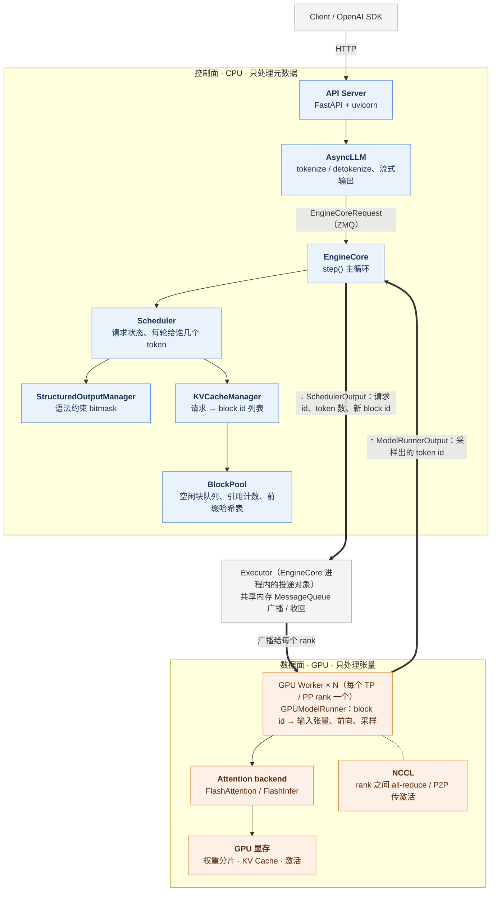

### 1. 两个面：控制面与数据面的分离

vLLM 把系统分成**控制面**和**数据面**两半：控制面在 CPU 上，只处理元数据——请求 id、token id、block id、每轮的调度决策；数据面在 GPU 上，只处理张量——模型权重、前向激活和 KV Cache。两半之间只有一个接口：EngineCore 把 `SchedulerOutput` 交给 Executor 下发，Worker 把 `ModelRunnerOutput` 交回来。

图中粗箭头就是这条边界。越过边界的东西如下：

**1、向下：`SchedulerOutput`，全是整数和列表。**

首次调度的请求下发 prompt token ids、采样参数和分到的 block ids；已在 Worker 上的请求只下发增量——新分到的 block ids、已经算到第几个 token。此外还有每个请求这一轮推进几个 token。

**2、向上：`ModelRunnerOutput`，只有一个 Worker 回传。**

主体是每个请求这一轮采样出的 token id，可选 logprobs。所有 rank 算的是同一个 batch，结果只需要其中一个 rank 交回。

**3、例外：少数请求会带一次张量或数组，都在 CPU 内存里，不涉及显存。**

- 直接传嵌入的请求和多模态请求，随首次调度带一次输入张量。
- 结构化输出的语法 bitmask 是一块 int32 数组，随采样那一步下发。
- pooling 模型交回的是张量。

从不越过边界的是**权重、激活和 KV Cache**。KVCacheManager 管的“块”只是一个带编号、引用计数和可选哈希的小对象；真正的 KV 张量由 Worker 在初始化时一次性分配在显存里，块编号就是它的下标。分配、释放、前缀复用、抢占在控制面都是整数运算，不发生任何显存拷贝。TP / PP 之间的激活由 Worker ranks 经 NCCL 直接交换，不经 EngineCore。

这样分开有三个直接收益：

1. **CPU 工作与 GPU 前向重叠。** EngineCore 发出这一轮的前向后不等结果，先去算结构化输出的语法 bitmask，再去取采样结果；开启 async scheduling（v0.27.1 在没有不兼容选项时默认开启）后，GPU 还在跑第 N 轮时调度器就开始排第 N+1 轮。
2. **边界消息的大小与模型大小无关。** 一轮的 `SchedulerOutput` 只和 batch 里的请求数、新分到的块数有关，7B 和 670B 的模型一样，所以同机多卡时一块共享内存环形缓冲就能广播给所有 rank。
3. **调度状态只有一份。** Scheduler 和 KVCacheManager 只在 EngineCore 里存在，所有 rank 拿到同一份决定；换单卡、同机多进程或 Ray 部署，改的只是中间那个 Executor 对象。

**控制面为什么可以用 Python 写，而不拖慢 GPU？[^q1]**

两半的语言分工是：控制面全部是 Python，数据面是 PyTorch 调起的 C++ / CUDA / Triton kernel 和 NCCL。控制面选 Python 有三个理由：

1. **语言特性匹配。** 调度逻辑条件判断多、数据结构动态（队列、字典、按请求增删的列表），适合 Python；数值计算追求极致性能，适合 C++ / CUDA。
2. **迭代速度。** 调度算法是 vLLM 改动最频繁的模块，Python 的开发效率远高于 C++。
3. **控制面开销可被摊薄。** 只要调度、序列化和输入准备的时间显著小于 GPU 执行时间，Python 控制面的影响就会被流水线化和批处理摊薄；具体是否成为瓶颈取决于 batch、模型和硬件。

第 3 条用数字看。下图以一个较大模型的 decode 步为例（forward 约 15 ms 量级，例如 70B 级别多卡部署；Llama-2-7B 在 A100 单卡上 batch=1 的一步约 8–12 ms，量级相同）：只要 GPU 侧是十毫秒量级，Python 侧的零点几毫秒就淹没在里面。下半部分是上面第 1 条收益说的流水线化：GPU 跑第 N 步的 forward 时，CPU 已经在准备第 N+1 步。

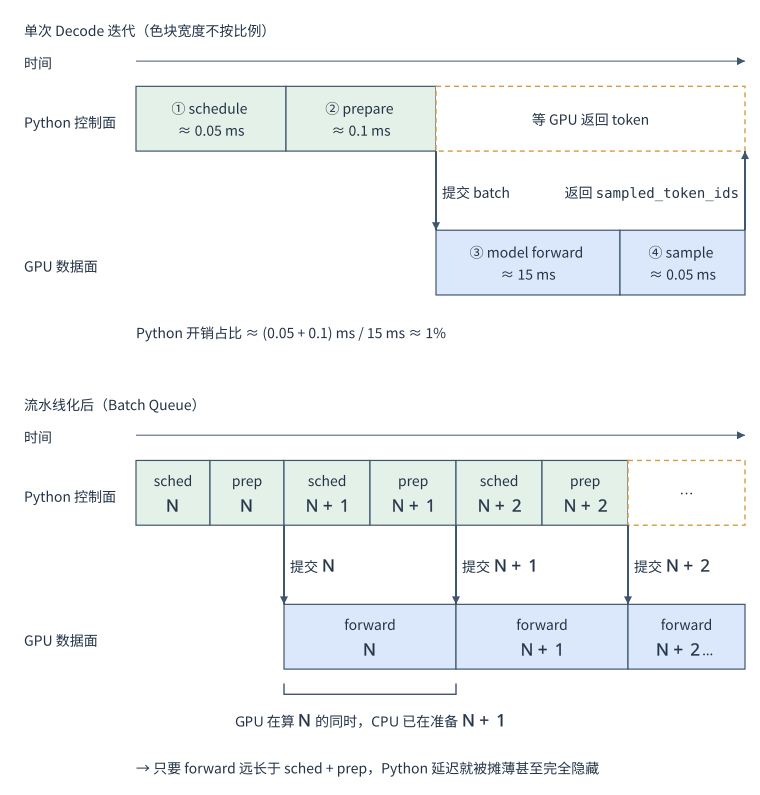

图里一步分四个阶段：

1. **schedule（CPU）**：调度器从 running / waiting 两个队列里按 token 预算分配本步额度，产出 `SchedulerOutput`。
2. **prepare（CPU）**：Worker 按 `SchedulerOutput` 的增量更新常驻的 batch，拼出这一轮的 input ids、positions 和每个 token 的 KV 写入位置，拷到 GPU。
3. **model forward（GPU）**：逐层 launch kernel；纯 decode 时整张 CUDA Graph 一次 replay。
4. **sample（GPU → CPU）**：采样出每个请求的下一个 token，拷回 CPU，打包成 `ModelRunnerOutput` 交回调度器。

图中 ~0.05 ms、~0.1 ms 这些数字是估算，不是源码里的常量。四个阶段各落在哪些函数、第 2、4 阶段在一步之内谁等谁、唯一的同步点在哪，见[《GPU 执行：如何让每个 Token 算得更快？》第二章第 3 节](/gpu-execution-kernels-and-graphs.html#3-一步之内的时序cpu-与-gpu-在哪里等谁)；EngineCore 一侧发出前向、取回结果的主循环见[《Scheduler》第五章第 5 节](/scheduler-batch-and-fairness.html#5-调度循环跑在哪里enginecoreproc-的三个线程与-step)。

### 2. 四类核心组件：从请求入口到 GPU

自顶向下，总图里的模块分成四类：API Server 与 AsyncLLM 接请求、出文本；EngineCore 驱动每一轮；Scheduler 与 KVCacheManager 决定每一轮给谁算、KV 放在哪；Executor、Worker 与 ModelRunner 把决定落到 GPU 上。前三类在控制面，最后一类跨过边界进入数据面。

#### 2.1 API Server 与 AsyncLLM：异步并发处理的桥头堡

入口是基于 FastAPI 的 HTTP 服务器，实现了 OpenAI 兼容的 `/v1/chat/completions`、`/v1/completions` 等 REST API。

`AsyncLLM` 是面向外部的异步引擎接口。它自己不做重活，而是把工作交给三个协作者：

- `InputProcessor`：把文本 / 多模态输入 tokenize、校验采样参数，产出 `EngineCoreRequest`；
- `EngineCoreClient`：与 `EngineCore` 通信的客户端。默认部署下 `EngineCore` 运行在**独立进程**中，两者通过 ZMQ + msgspec 收发 `EngineCoreRequest` / `EngineCoreOutputs`（`AsyncMPClient`）；单进程调试时用 `InprocClient`。这条进程边界是 vLLM 让 HTTP 处理、tokenize / detokenize 与 GPU 调度循环互不阻塞的关键；
- `OutputProcessor`：接收 `EngineCoreOutputs`，做 detokenize、stop 条件检查、logprobs 整理，产出 `RequestOutput` 交给 API 层流式返回。

因此 `AsyncLLM` 的职责是：管理请求的异步生命周期、串起上述三者、支持 SSE 流式响应，以及数据并行（DP）场景下的多引擎协调。

#### 2.2 EngineCore：推理系统的中央调度大脑

`EngineCore` 是引擎的核心。构造时它依次建好三样东西——模型执行器、KV Cache、调度器：

```python title='EngineCore 的构造：执行器、KV Cache、调度器'
# 简化
class EngineCore:
    """Inner loop of vLLM's Engine."""

    def __init__(self, vllm_config, executor_class, ...):
        # 1. 初始化模型执行器
        self.model_executor = executor_class(vllm_config)

        # 2. 初始化 KV Cache
        kv_cache_config = self._initialize_kv_caches(vllm_config)

        # 3. 初始化调度器
        Scheduler = vllm_config.scheduler_config.get_scheduler_cls()
        self.scheduler = Scheduler(
            vllm_config=vllm_config,
            kv_cache_config=kv_cache_config,
            ...
        )
```

之后它的 `step()` 每轮做三件事：让调度器排出这一轮、交给执行器去跑、拿结果更新请求状态。整个推理循环就是反复调用 `step()`。

#### 2.3 Scheduler 与 KVCacheManager：资源管理双核

`Scheduler` 持有每个请求的权威状态：running / waiting 两个队列，以及每个 `Request` 已算到第几个 token（`num_computed_tokens`）。`KVCacheManager` 记录每个请求占了哪些 KV block，底下的块池是 `BlockPool`。三者都在 EngineCore 进程里，处理的全是整数。

**每轮的两条上限。** `schedule()` 开头令 `token_budget = max_num_scheduled_tokens`（未单独设置时取 `max_num_batched_tokens`），同时在跑的请求数不超过 `max_num_running_reqs`（取自 `max_num_seqs`）。

**没有 prefill / decode 两个阶段。** `schedule()` 开头的注释说得很直接：每个请求只有 `num_computed_tokens` 和 `num_tokens_with_spec`（prompt + 已生成 + 投机 token）两个数，调度器每轮给请求分若干 token，让前者追上后者。新请求一次分到几千个 token，就是 prefill；running 请求分到 1 个，就是 decode；预算不够时只分一部分、下一轮接着算，就是 chunked prefill（`long_prefill_token_threshold` 可再给单个请求封顶）。

一轮 `schedule()` 的顺序：

1. **先排 running 队列。** 对每个请求算出 `num_new_tokens`，截到剩余预算，再调 `kv_cache_manager.allocate_slots(request, num_new_tokens, ...)` 给这些 token 要 block。
2. **块不够就抢占。** `allocate_slots` 返回 `None` 表示空闲块不够。默认 FCFS 策略弹出 running 队列尾部的请求（priority 策略选优先级最低的），`_preempt_request` 释放它的全部 block、把 `num_computed_tokens` 清零、放回 waiting 队首，然后重试分配。被抢占的请求下次调度时重新 prefill，前缀缓存里还没被驱逐的块可以直接复用。
3. **再排 waiting 队列。** 本轮只要发生过抢占，就不接纳新请求。否则逐个取 waiting 请求：running 数到上限就停；`num_computed_tokens == 0` 的请求先调 `kv_cache_manager.get_computed_blocks(request)` 查前缀缓存，命中的 token 不再计算；剩下的 token 走 `allocate_slots`，失败就停止接纳。
4. **打包 `SchedulerOutput`。** 首次调度的请求放进 `scheduled_new_reqs`（`NewRequestData`，带完整 prompt token ids、采样参数、block ids），已在 Worker 上的放进 `scheduled_cached_reqs`（`CachedRequestData`，只带新 block ids 等增量），再加上每个请求的 `num_scheduled_tokens`、总数 `total_num_scheduled_tokens`、`finished_req_ids` / `preempted_req_ids`，以及投机解码、多模态 encoder 输入等扩展字段。

模型跑完后，`update_from_output()` 把采样出的 token 追加到请求上、检查停止条件；结束的请求经 `_free_request` 调 `kv_cache_manager.free(request)` 归还 block。

`KVCacheManager` 自己不直接管块：它经 `KVCacheCoordinator` 为每个 KV cache group（例如全注意力层与滑动窗口层各一组）调对应的 `SingleTypeKVCacheManager`，这些 manager 共用一个 `BlockPool`。`BlockPool` 有三样东西：

1. **`blocks`**：全部 `KVCacheBlock`。每个块只有 `block_id`、`ref_cnt` 和一个可选的 block hash，是显存里 KV 张量的下标，不是显存本身。
2. **`free_block_queue`**（`FreeKVCacheBlockQueue`）：`ref_cnt` 为 0 的块，按驱逐顺序排列。`get_new_blocks` 从队头取；取出的块若还带哈希，先从哈希表删掉，这就是驱逐。`free_blocks` 让 `ref_cnt` 减 1，归零的块里没有哈希的放到队头（最先复用），有哈希的放到队尾（还留在前缀缓存里，最晚驱逐），整体是一个 LRU。
3. **`cached_block_hash_to_block`**：block hash → 块。`get_computed_blocks` 按请求 token 逐块算出的哈希在这里查最长命中；`allocate_slots` 落实命中时调 `touch`，`ref_cnt` 加 1，块若正躺在空闲队列里就先摘出来。多个请求共享同一段前缀，就是同一组块的 `ref_cnt` 大于 1。

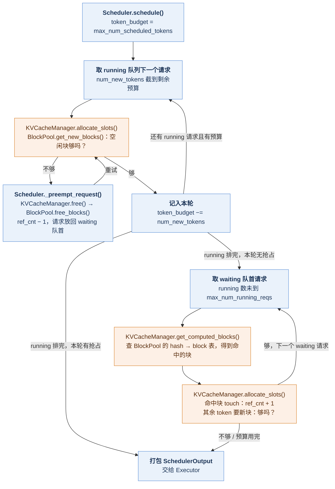

图里蓝色是 Scheduler 自己的步骤，橙色是对 KVCacheManager 的调用，节点里写出的 `BlockPool.*` 是这些调用最终落到的块池操作。调度策略（FCFS 与 priority、公平性、抢占代价）在[《Scheduler：GPU 这一轮到底给谁用？》](/scheduler-batch-and-fairness.html)里展开；块的布局、前缀缓存哈希和驱逐在[《KV Cache：LLM Serving 的第一号内存问题》](/kv-cache-memory-core.html)里展开。

#### 2.4 Executor、Worker 与 ModelRunner：模型执行的设备抽象

EngineCore 下面的执行层分三层，从外到内：**Executor** 决定一轮 batch 交给哪些 Worker、怎么交；**Worker** 管一个设备（一张 GPU、一个 TP / PP rank）；**ModelRunner** 在这个设备上真正把一轮 batch 跑完。

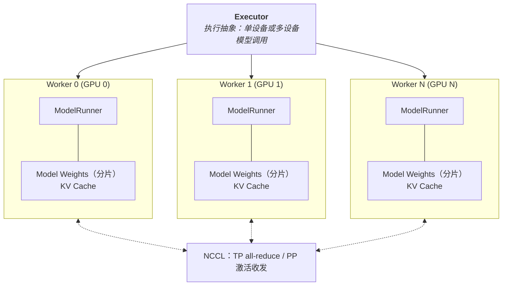

常见 GPU 部署中，Executor 会把一次 `execute_model()` 调用分发给一个或多个 Worker；Worker 再调用本地的 `ModelRunner` 执行模型前向、采样和 KV Cache 读写。单卡、同机多进程、Ray 分布式和 external launcher 的进程/设备映射并不完全相同，因此不应把“一个 GPU 固定绑定一个 Worker 进程”写成绝对规则。

**Executor。** `Executor` 是模型执行抽象层，负责在一个设备或多个设备上执行模型，而不是 Scheduler 本身。v0.27.1 中可见的主要实现包括：
- `UniProcExecutor`：单进程单卡
- `MultiprocExecutor`：多进程多卡（同机）
- `RayDistributedExecutor`：Ray 分布式（直接继承 `Executor`）
- `RayExecutorV2`：Ray 分布式的新实现（`distributed_executor_backend="ray"` 时默认用它，`VLLM_USE_RAY_V2_EXECUTOR_BACKEND=0` 才退回 `RayDistributedExecutor`），注意它继承的是 `MultiprocExecutor` 而非 `Executor`——即复用同一套 worker 进程管理逻辑，只把进程的**拉起方式**换成 Ray（`RayWorkerProc(WorkerProc)`）
- `ExecutorWithExternalLauncher`：外部 launcher 场景（继承 `UniProcExecutor`）

这条继承链本身就说明了一件事：**"用不用 Ray"是部署方式的差异，不是执行模型的差异。** Executor 这层抽象的价值就在于把"进程怎么起、卡怎么分"和"一轮 batch 怎么执行"彻底分开，所以 `RayExecutorV2` 才能靠换掉进程拉起方式来复用同机多进程的全部逻辑。

**Worker。** `Worker` 是一个设备的管家，通常负责：
- 初始化设备和本 rank 的分布式环境（TP / PP 通信组）；
- 加载模型权重的分片（Tensor Parallel 下每卡持有一部分）；
- 测显存余量、按 `kv_cache_config` 一次性分配 KV Cache 的物理显存；
- 持有一个 ModelRunner，把 Executor 发来的 `execute_model()` 转给它。

**ModelRunner。** `GPUModelRunner`（本系列图中简写为 ModelRunner）是 Worker 里真正“跑一步”的对象。它常驻一份持久的 `InputBatch`（每个在跑请求一行：token ids、block table、采样参数），每轮做三件事：
1. **准备输入**：按 `SchedulerOutput` 的增量更新 `InputBatch`，算出这一轮的 input ids、positions 和 slot mapping，组成 attention backend 要的元数据；
2. **前向**：调模型和 attention backend，读写 KV Cache，能用 CUDA Graph 时走捕获好的图；
3. **采样**：从 logits 采出每个请求的下一个 token，打包成 `ModelRunnerOutput` 交回。

`InputBatch` 的行、每行的 block table 和调度器一侧的 `Request`、`KVCacheBlock` 怎样靠两个整数对上，是下一节[“核心数据对象：四个域”](#3-核心数据对象四个域)的后半部分。

Worker 管“这张卡上有什么”，ModelRunner 管“这一轮怎么算”，所以[《GPU 执行：如何让每个 Token 算得更快？》](/gpu-execution-kernels-and-graphs.html)展开的主要是 ModelRunner。v0.27.1 另有一份新实现 Model Runner V2：`VLLM_USE_V2_MODEL_RUNNER=1` 强制启用，未设置时只对少数架构（如 `DeepseekV2ForCausalLM`、`Qwen2MoeForCausalLM`）和 PCP、diffusion 等少数特性默认启用。文中以默认的 `GPUModelRunner` 为主线。

### 3. 核心数据对象：四个域

上一节按模块讲；换一个角度，按“数据对象归谁管”来分，vLLM V1 的核心对象落在四个域里：

- **请求域**：`Request` 是调度器内部对请求的完整表示，包含 token ids、采样参数、状态机状态、块哈希等。
- **调度域**：`SchedulerOutput` 封装每一轮的调度决策，`ModelRunnerOutput` 封装 GPU 执行结果。
- **显存域**：`KVCacheBlock` 是物理块的元数据（含引用计数和哈希），Worker 侧的 `BlockTable` 维护请求的逻辑块 → 物理块映射。
- **模型域**：模型权重常驻 GPU，激活张量在前向计算中动态生成和销毁。

这四个域和[第一篇的四个核心问题](/why-llm-serving-is-hard.html#六阅读地图后续内容如何展开)是对应的：请求域是四问的输入，调度域是第一问（这一轮谁执行、执行多少）的产物，显存域是第二问（状态放哪、怎么复用）的产物，模型域是第三问（怎么算得更快）的战场。

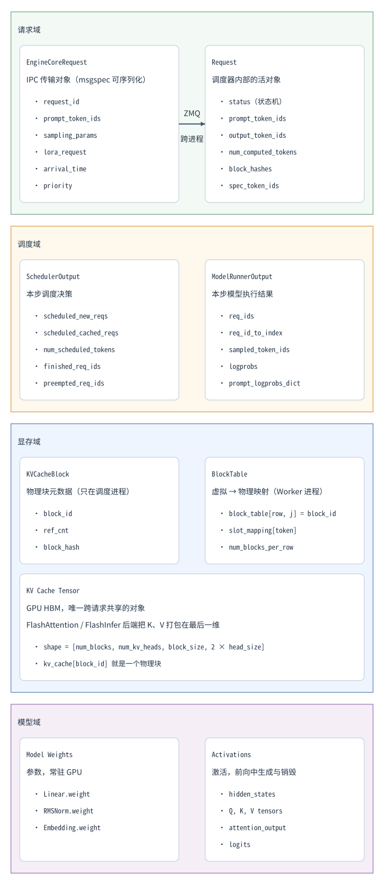

两条边界值得留意：

- **`EngineCoreRequest` → `Request` 是一次跨进程翻译。** 前者是能被 msgspec 序列化、走 ZMQ 的扁平数据；后者是带状态机、会被反复修改的活对象。这条边界就是第三章进程视图里 API Server 与 EngineCoreProc 之间的 API 边界。
- **显存域是唯一“跨请求共享”的域。** 请求域、调度域、模型域的对象都属于某一次请求或某一轮迭代，而 `KVCacheBlock` 会被多个请求通过 `ref_cnt` 共享——Prefix Cache 的全部魔法都发生在这一个字段上。

全景图按域列出了字段，但没有回答“这些对象之间靠什么串起来”。答案是两把钥匙——`request_id` 和 `block_id`——以及一次跨进程的复制。下面分两侧看：调度器一侧用 `request_id` 找到块对象，跨进程时只剩整数 `block_id`；Worker 一侧再用这些整数一路派生出 kernel 读写 KV 张量要的槽位。

**1、调度器一侧：`request_id` 找到块，块号是显存的下标。**

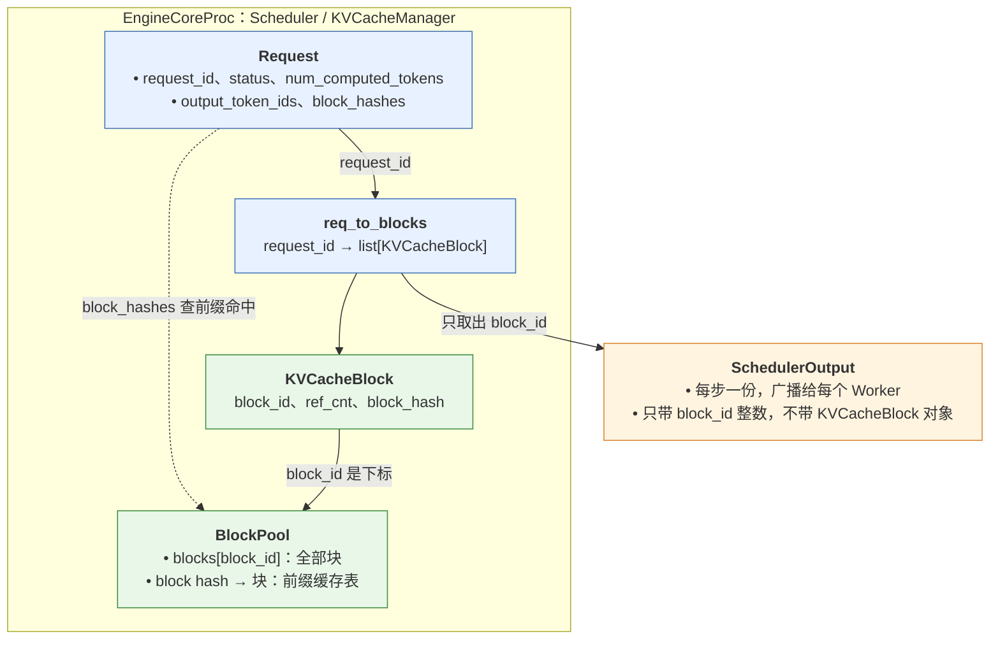

`ref_cnt` 和 `block_hash` 只在这一侧有意义：它们决定一个块能不能复用、什么时候释放。写进 `SchedulerOutput` 的只是新请求分到的块号和老请求新增的块号，所以这条边界就是“只传 `block_id` 整数”的那一刀。

**2、Worker 一侧：块号一路派生成每个 token 的 KV 槽位。**

Worker 里常驻一张 `InputBatch` 表，每个在跑的请求占一行；每个 KV cache group 还有一张 `BlockTable`，按同样的行号记着这个请求占了哪些块。每步收到 `SchedulerOutput` 的增量后，新块号追加到对应行，整张表拷到 GPU，再由一个 Triton kernel 在 GPU 上把块号换算成每个 token 在 KV Cache 里的槽位（`slot_mapping`）：

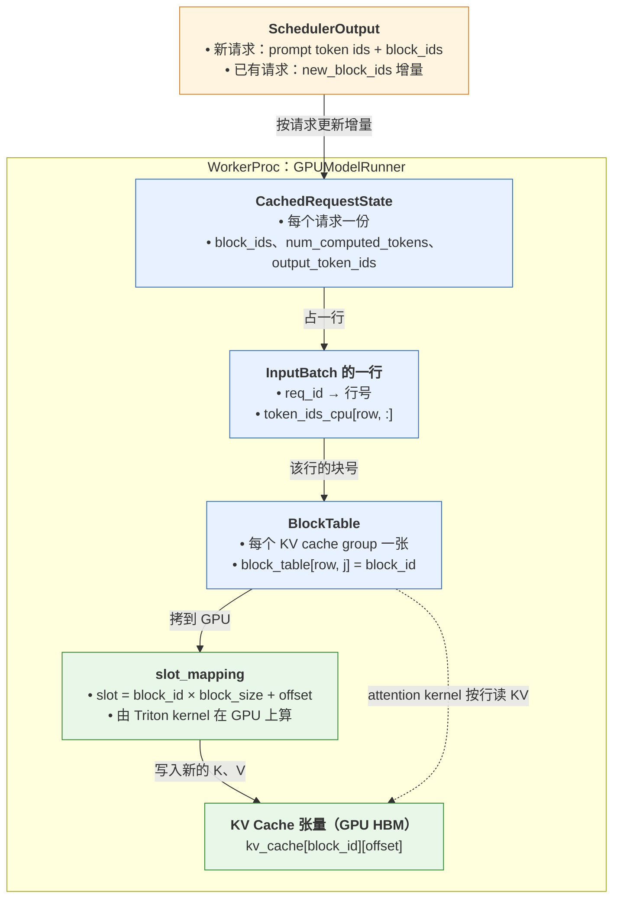

读这两张图要抓住三处“断开”：

1. **`KVCacheBlock` 对象不出进程。** `ref_cnt`、`block_hash` 只在 Scheduler 侧有意义（决定能否复用、何时释放），Worker 侧看到的只是一个整数 `block_id`。所以 Prefix Cache 命中与否，Worker 完全不知情——它只是少收到几个要写的 token。
2. **`CachedRequestState` 是 `Request` 的只读镜像。** 两者字段高度重合（`num_computed_tokens`、`output_token_ids`、`block_ids`），但前者靠每步 `CachedRequestData` 的增量维护，从不反向同步；`Request` 才是权威。
3. **`InputBatch` 的行号是临时的。** 请求结束后，`InputBatch` 会把尾行搬进空出来的行，行号随之变化；`BlockTable` 和 token ids 都按行号索引，所以必须和 `InputBatch` 同步搬行。`request_id` 是跨进程的稳定身份，行号只是 Worker 内一次 step 的临时坐标。

Worker 侧从 `SchedulerOutput` 到这些张量的每一步在[《GPU 执行》第二章](/gpu-execution-kernels-and-graphs.html#二forward-之前scheduleroutput-如何变成-gpu-张量)逐个函数展开；第六章第 2 节的对象表则按进程和寿命把同一批对象再排一遍。

## 三、进程视图：谁在什么进程里，如何交互

静态拓扑图画模块之间的调用；这张图把它们放回默认部署的进程和线程里。API Server 处理协议和文本，`EngineCoreProc` 管请求状态和调度，每个 `WorkerProc` rank 执行模型。

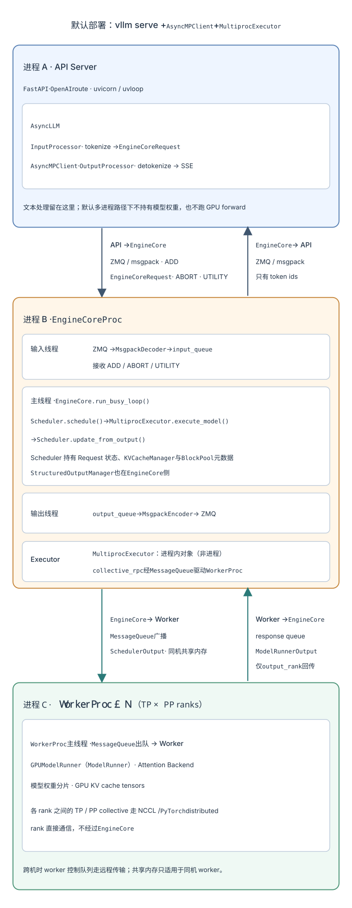

### 1. API Server：处理协议与文本

FastAPI 的 OpenAI route 调用同进程里的 `AsyncLLM`。`InputProcessor` 产出 `EngineCoreRequest`；`OutputProcessor` 把 `EngineCoreOutputs` 增量 detokenize 成 `RequestOutput`，输出循环由 asyncio task 驱动。

“处理文本”的两端各有一层容易出错的转换：进门时 chat template 把 messages 和工具定义渲染成 token id（[第九篇第二章](/request-shapes-multi-lora-and-multimodal.html#二从-messages-到-token-idchat-template-与工具定义)），出门时 reasoning parser 和 tool parser 把 token 切成 content、reasoning、tool_calls（[第十篇第六章](/output-changes-sampling-and-structured-output.html#六输出解析同一串-token-拆成-contentreasoning-与-tool_calls)）。两者都只在这个进程里运行，`--api-server-count` 扩的正是它们。

### 2. EngineCoreProc：持有调度状态

`EngineCoreProc` 运行 `EngineCore`：输入、输出 socket I/O 各有线程，主线程循环调度与更新。`Scheduler` 持有权威 `Request` 状态和 `KVCacheManager` 元数据；默认 `MultiprocExecutor` 下，GPU forward 留在 Worker 侧。三个线程各做什么、主循环一轮怎样走，见[第四篇第五章第 5 节](/scheduler-batch-and-fairness.html#5-调度循环跑在哪里enginecoreproc-的三个线程与-step)。

注意 **Executor 不是一个进程**：它是 `EngineCore` 构造时创建的一个进程内对象，活在 EngineCoreProc 的主线程里。所以逻辑视图里的 Executor 在这张进程图里落在 EngineCoreProc 内部——它不占进程，它的作用是封装“怎么把一轮调度交给 Worker”：`UniProc` 在本进程直接调，`Multiproc` 经共享内存 MessageQueue 广播给 `WorkerProc`，`Ray` 走 actor。换一个部署形态时 EngineCore 的代码一行不改，改的只是这个对象。

### 3. WorkerProc：一个模型并行 rank

`MultiprocExecutor` 为每个模型并行 rank 启动 `WorkerProc`。每个进程初始化 `Worker` 和 `GPUModelRunner`，加载本 rank 的权重分片，并在 GPU 上读写 KV cache；TP/PP 通信由 Worker ranks 直接完成，不经过 EngineCore。WorkerProc 里常驻的循环怎样把收到的消息变成一次 `execute_model()`，见[第六篇第二章第 4 节](/gpu-execution-kernels-and-graphs.html#4-worker-进程的常驻循环execute_model-只是一个方法名)。

### 4. 两道边界上传什么

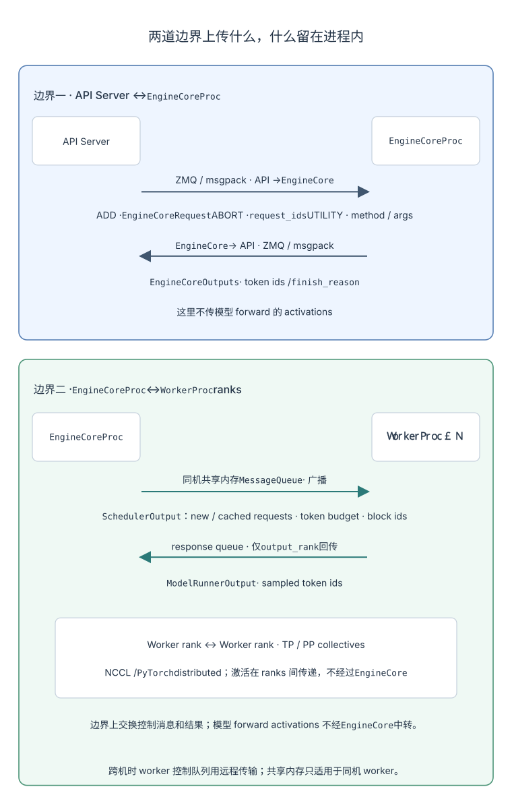

API 边界传 `EngineCoreRequest` 与 `EngineCoreOutputs`；执行边界传 `SchedulerOutput` 与 `ModelRunnerOutput`。模型 forward 的 activations 不经 EngineCore；TP/PP activations 在 Worker ranks 之间传递。

### 5. 启动顺序与就绪握手

单 API Server 时，`vllm serve` 在当前进程运行 API Server；`AsyncLLM` 创建 ZMQ 客户端，由它绑定 socket 并拉起 EngineCore 进程。`--api-server-count > 1` 时顺序反过来：先启动 EngineCore，再由一个进程管理器拉起各 API Server 子进程。每个 EngineCore 在自己进程内构造 Executor，`MultiprocExecutor` 再为每个 rank 拉起一个 `WorkerProc`。

就绪是逐级握手的：EngineCore 先向启动器注册（`HELLO`），拿回地址和配置，初始化完成后报告 `READY`；API 一侧还要等 EngineCore 在输入 socket 上发来就绪响应。Worker 初始化完成后经 ready pipe 报告 `READY`，并交回自己响应队列的句柄；Executor 等所有 rank 都就绪后才开始服务。

### 6. 一个 decode step 怎样穿过三个进程

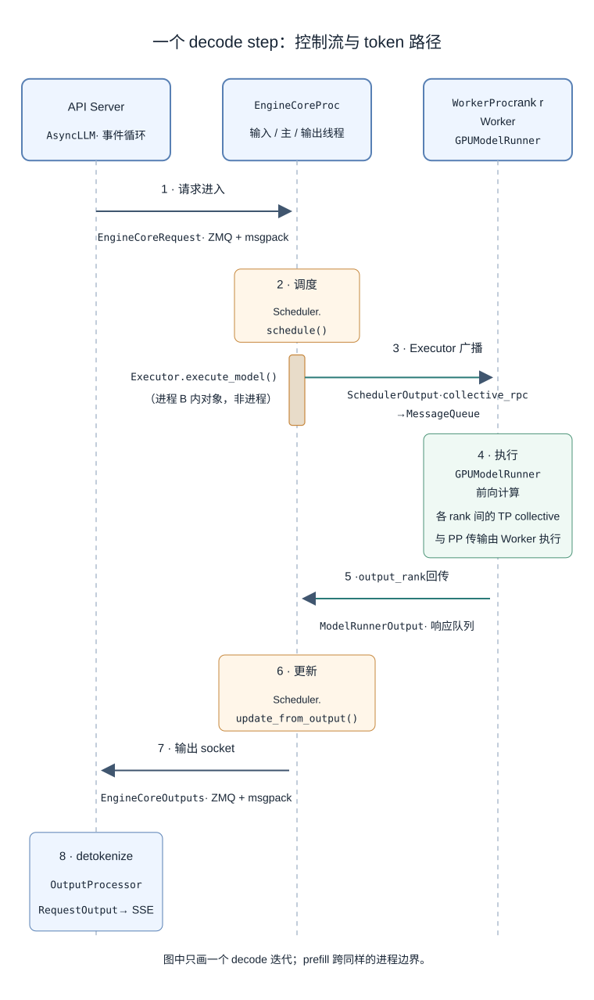

EngineCore 收到请求后，主线程调度出这一轮的 `SchedulerOutput`，交给进程内对象 `Executor`（默认 `MultiprocExecutor`）广播给所有 Worker——这条链路是 `EngineCore → Executor → WorkerProc`，本章开头的进程图里 Executor 画在 EngineCoreProc 内部，上面这张时序图里它是 EngineCoreProc 一侧的一小段激活。Worker 执行模型并由 `output_rank` 返回结果；EngineCore 更新请求，再把 `EngineCoreOutputs` 交给输出线程。API Server 收到 token ids 后做 detokenize，最后由 HTTP handler 写成 SSE。图里只展开一个 decode step；prefill 也走同一组进程边界。

这里的广播是一写多读：

- Executor 只写一次，写进 `rpc_broadcast_mq`（`MessageQueue`）。同机的 Worker 从共享内存环形缓冲里读，跨机的经 ZMQ 发布订阅收，每个 WorkerProc 读到的是同一份 `SchedulerOutput`。
- 要发给每个 Worker，是因为 TP / PP 下每个 Worker 只有一部分权重和自己那份 KV cache，大家要一起算同一个 batch：这一轮跑哪些请求、每个请求几个 token、KV 写进哪些 block，所有 rank 必须一致，前向里的 all-reduce 等 collective 才对得上。
- 调度器只在 EngineCore 里有一份，决定只做一次，所以是一发多收。
- 回程反过来，只收一份：只有 `output_rank`（最后一个 PP stage 的第一个 TP rank）回传 `ModelRunnerOutput`。最后一个 stage 的各 TP rank 采样结果相同，前面的 stage 没有 logits。

## 四、开发视图：模块在源码树的哪里

逻辑视图给了模块的名字，进程视图给了它们跑在哪个进程；开发视图回答读代码时最直接的问题：每个模块在源码树的哪个目录、编译成什么。下表按 v0.27.1（tag `6e448d0`）核实，「所在进程」一列用第三章的进程名。

| 源码位置 | 逻辑视图里的模块 | 所在进程 |
|---|---|---|
| `vllm/entrypoints/openai/` | API Server：FastAPI 路由、`ChatCompletionRequest` 等协议对象 | API Server |
| `vllm/v1/engine/async_llm.py` | `AsyncLLM`：异步请求管理、流式输出 | API Server |
| `vllm/v1/engine/input_processor.py` | `InputProcessor`：tokenize、构造 `EngineCoreRequest` | API Server |
| `vllm/v1/engine/output_processor.py` + `detokenizer.py` | `OutputProcessor` / `IncrementalDetokenizer`：增量 detokenize、`RequestOutput` | API Server |
| `vllm/v1/engine/core_client.py` | `AsyncMPClient` / `EngineCoreClient`：API 边界的 ZMQ 客户端 | API Server（client 侧） |
| `vllm/v1/engine/core.py` | `EngineCore` / `EngineCoreProc`：主循环、进程入口 | EngineCoreProc |
| `vllm/v1/core/sched/` | `Scheduler`、`SchedulerOutput` / `NewRequestData` / `CachedRequestData` | EngineCoreProc |
| `vllm/v1/core/kv_cache_manager.py` | `KVCacheManager`：块分配与复用 | EngineCoreProc |
| `vllm/v1/engine/coordinator.py` + `utils.py` | `DPCoordinator`、进程启动与握手 | EngineCoreProc 一侧（`DPCoordinator` 是单独的进程） |
| `vllm/v1/executor/` | `Executor` 抽象与 `Multiproc` / `UniProc` / `Ray` 实现：拉起并驱动 Worker | EngineCoreProc 内的对象，拉起 WorkerProc |
| `vllm/v1/worker/gpu_worker.py` | `Worker`：设备与 KV cache 显存 | WorkerProc |
| `vllm/v1/worker/gpu_model_runner.py` | `GPUModelRunner`：输入准备、前向、采样 | WorkerProc |
| `vllm/model_executor/models/` | 各模型定义；TP 下每卡加载自己的权重分片 | WorkerProc |
| `vllm/v1/attention/backends/` | FlashAttention、Triton 等 attention backend 实现 | WorkerProc |

Table: 模块、源码位置与进程的映射（vLLM v0.27.1）

一个值得记住的边界：`vllm/v1/engine/` 下的文件分属两个进程——`async_llm` / `input_processor` / `output_processor` 在 API Server 进程，`core` / `core_client` 的服务端在 EngineCoreProc，目录按功能分不按进程分。单卡时 Worker 在 EngineCoreProc 里，上表的 WorkerProc 一列都落在 EngineCoreProc（第五章）。

### 1. 子系统划分与包图

UML 的开发视图看的是子系统划分与包依赖。服务一条请求真正相关的源码目录有八个。它们之间的 import 并不分层：统计 v0.27.1 的源码，这些目录两两之间有 38 个方向存在 import，不少是反向的、互相引用的（见图后的表）。所以图里的实线画的是**运行时谁调用谁**——一条请求从入口一路驱动到 kernel 的方向；虚线补两条调用主干之外的直接依赖：

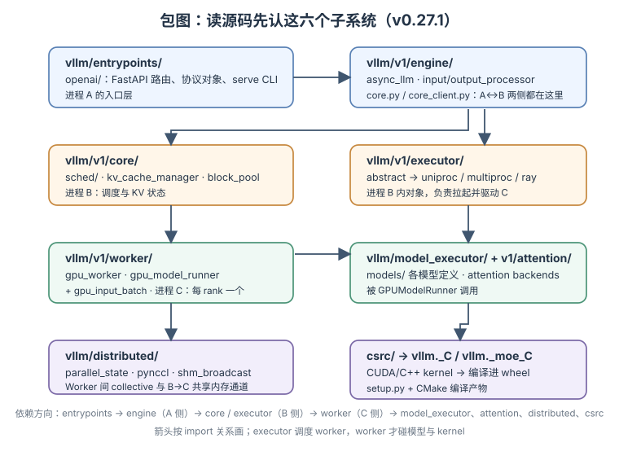

- **entrypoints**（`vllm/entrypoints/openai/`）：协议层。FastAPI 路由、`ChatCompletionRequest` 等 msgspec/pydantic 模型、`serve` CLI 都在这里，往下主要经 `v1.engine` 的客户端侧调用。
- **v1.engine**（`vllm/v1/engine/`）：引擎壳。`async_llm` / `input_processor` / `output_processor` / `detokenizer` 在 API Server 进程；`core.py`（`EngineCore` / `EngineCoreProc` / `DPEngineCoreProc`）与 `core_client.py` 的服务端在 EngineCoreProc；`coordinator.py`、`utils.py` 管 DP 协调与进程启动。
- **v1.core**（`vllm/v1/core/`）：调度域。`sched/`（Scheduler、`SchedulerOutput`）、`kv_cache_manager`、`block_pool`、`encoder_cache_manager`，全部活在 EngineCoreProc。
- **v1.executor**（`vllm/v1/executor/`）：执行抽象。`abstract.py` 的 `Executor` 基类派生 `UniProcExecutor` / `MultiprocExecutor` / `RayExecutorV2` / `RayDistributedExecutor`，是 EngineCoreProc 内拉起并驱动 WorkerProc 的唯一通道。
- **v1.worker**（`vllm/v1/worker/`）：设备域。`gpu_worker`、`gpu_model_runner`、`gpu_input_batch`，每个 WorkerProc 一份。
- **执行依赖**：`vllm/model_executor/models/`（各模型定义）、`vllm/v1/attention/backends/`（FA/Triton 等 backend）、`vllm/distributed/`（`parallel_state`、`pynccl`、`shm_broadcast`）、`csrc/`（CUDA/C++ kernel）。

调用方向之外，import 关系里量最大的几条如下，多数是引用另一个包里定义的数据结构或注册表，不是运行时的反向调用：

| 方向 | import 语句数 | 主要引用的是什么 |
|---|---:|---|
| `model_executor` → `distributed` | 270 | 模型层里 TP / PP 用的并行线性层与 collective（`vllm.distributed`、`parallel_state`） |
| `model_executor` → `v1/attention` | 126 | 模型调用 attention 层与 backend 注册表（`v1.attention.backend`、`backends.registry`） |
| `model_executor` → `v1/worker` | 83 | 多模态编码器的 CUDA Graph 定义（`worker.encoder_cudagraph_defs`）、micro-batch 工具 |
| `distributed` → `v1/core` | 61 | KV connector 读调度输出与块管理器（`core.sched.output`、`kv_cache_manager`） |
| `v1/attention` → `model_executor` | 55 | MLA 等 backend 引用模型层的实现与量化工具 |
| `distributed` → `v1/attention` | 25 | KV connector 读 attention backend 的元数据定义 |
| `v1/worker` → `v1/core` | 16 | Worker 读 `SchedulerOutput` 的类型定义 |

Table: v0.27.1 里调用主干之外 import 最多的方向（按 import 语句计）

### 2. 构建与打包：Python 包 + 编译扩展

发布物是一个 wheel：Python 源码原样打包，CUDA/C++ 源码由 `setup.py` 声明成 `CMakeExtension`，交给 CMake（`CMakeLists.txt` 的 `define_extension_target`）编译成 CPython 扩展模块，放进同一个 wheel。CUDA 平台上源码目录和制品的对应关系如下：

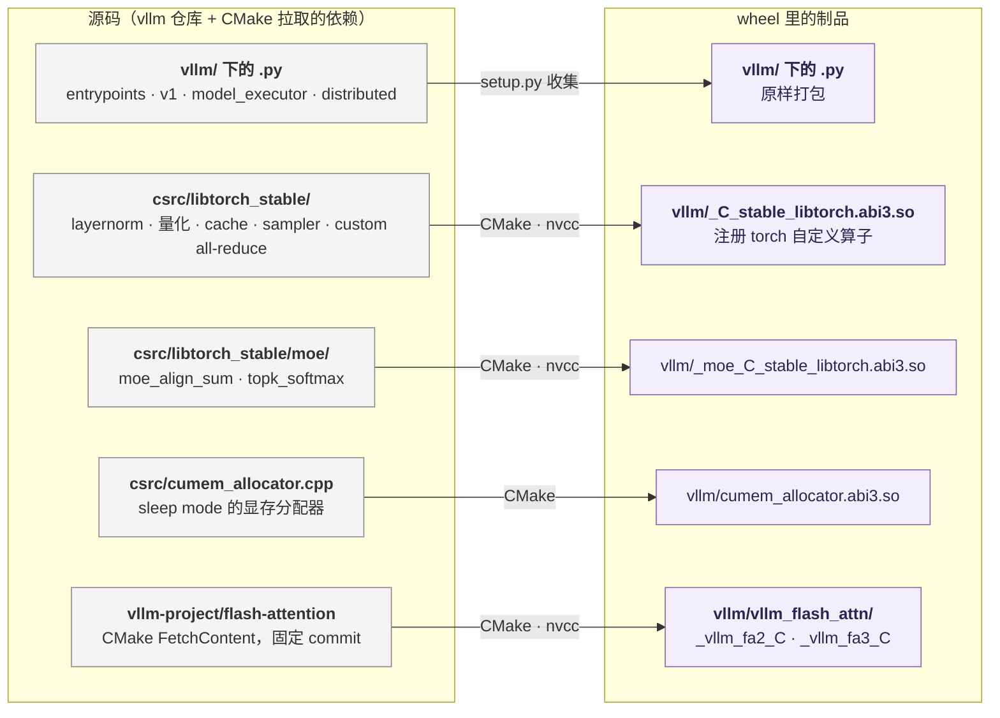

图里是 CUDA 平台的必选部分（`setup.py` 里 `ext_modules` 的 CUDA 分支）：

1. `_vllm_fa3_C` 要求 CUDA 12.3 以上。
2. FlashMLA（`_flashmla_C`）、DeepGEMM（`_deep_gemm_C`）、qutlass（`_qutlass_C`）等标成 `optional=True`，目标架构不支持时不产出。
3. 名字不带 `_stable_libtorch` 的 `vllm._C` 只在 ROCm 和 CPU 平台上构建。

制品在运行时由谁加载：`vllm/platforms/cuda.py` 在模块顶层 `import vllm._C_stable_libtorch`，把 kernel 注册成 torch 自定义算子；`vllm/_custom_ops.py` 再调 `current_platform.import_kernels()` 加载 `_moe_C_stable_libtorch`。所以只要一个进程解析了 `current_platform`——API Server 和 EngineCoreProc 构造配置时都会——这个 `.so` 就会被装进内存；真正在 GPU 上调用这些 kernel 的只有执行模型的进程：WorkerProc，单卡时是 EngineCoreProc 里的 Worker。FlashAttention 扩展由 `vllm/v1/attention/backends/fa_utils.py` 导入，在 Worker 的 attention 前向里用。

这些 `.so` 里的算子怎样注册给 PyTorch、Python 一侧又经什么名字调到它们，属于“forward 里那串 kernel 从哪来”的问题，在[第六篇第二章第 5 节](/gpu-execution-kernels-and-graphs.html#5-forward-里的-kernel-从哪来python-怎样调到-c--cuda--triton)展开。

按层看，语言分工如下：

| 层面 | 语言 | 职责 | 为什么选这个语言 |
|------|------|------|----------------|
| API + 调度 | Python | 请求管理、调度策略、KV 块分配 | 逻辑复杂多变，需要快速迭代 |
| 输入准备 | Python + PyTorch | 张量构建、block table 更新 | 利用 PyTorch 的张量接口 |
| 模型 Forward | C++ / CUDA（经 PyTorch） | GEMM、Attention、MLP | 极致性能 |
| 自定义算子 | CUDA / Triton | RMSNorm、RoPE、Fused Attention | 硬件特化 |
| 集合通信 | C++（NCCL） | All-Reduce、All-Gather | 零拷贝、内核级调度 |

Table: Python 与 C++ 的核心分工

## 五、部署/物理视图：进程怎样落到 GPU 和节点上

第三章说了有哪几类进程，第四章说了源码编译出哪些制品；部署视图把进程落到硬件上。先看决定进程图的规则，再看五种常见部署。

### 1. 部署的总体规则

API Server 和 EngineCoreProc 是纯 CPU 进程；执行侧每个模型并行 rank 是一个 WorkerProc，占一张（或一份）GPU。进程数由两类并行度分别决定，另有一类并行不新增进程：

**1、data parallel size 决定 EngineCoreProc 的个数。**

`launch_core_engines` 对每个 DP rank 起一个 EngineCore 进程（`vllm/v1/engine/utils.py`、`vllm/v1/engine/core.py`）。DP rank 之间互不共享 KV state，每个 rank 一套 Scheduler / Executor / Worker。

**2、world_size = TP × PP（× PCP，context parallel）决定每个 EngineCoreProc 拉起的 WorkerProc 数。**

`MultiprocExecutor` 按 world_size 拉起 WorkerProc，并断言 `world_size == tp_size * pp_size * pcp_size`（`vllm/v1/executor/multiproc_executor.py`）。

**3、expert parallel 不新增进程。**

EP 复用 DP × TP 的已有 rank，MoE 权重按 EP 组切分在已有的 Worker 上。

此外，几个开关会改变进程图的形状：

- `UniProcExecutor` 在 EngineCore 进程内直接初始化并调用 Worker，不创建 `WorkerProc` 子进程。`InprocClient` 是另一层选择：它把 EngineCore 本身也放在调用方进程里。二者改变的是不同的进程边界（`vllm/v1/executor/uniproc_executor.py`、`vllm/v1/engine/core_client.py`）。
- data parallel 会启动多个 EngineCore rank，各自有自己的 Scheduler 和 Executor。在线且配置需要协调时，rank 0 还会启动 `DPCoordinator`；它汇总队列统计、向 API frontends 发布负载信息，并在需要时协调 MoE request wave。它不是每个 token 的执行通道（`vllm/v1/engine/utils.py`、`vllm/v1/engine/coordinator.py`、`vllm/v1/engine/core.py`）。
- `--api-server-count > 1` 会启动多个 API Server 进程，并为它们分配各自的 ZMQ 地址；它增加的是前端进程数，不等于增加模型并行 rank。未显式指定时，参数默认值会根据 DP 配置决定（`vllm/entrypoints/cli/serve.py`、`vllm/entrypoints/openai/cli_args.py`）。
- Ray 改变 Worker 的启动和放置方式。`RayExecutorV2` 用 Ray actor 承载 `RayWorkerProc`，并复用 MessageQueue 控制面与 Worker 间的 collective；旧 `RayDistributedExecutor` 是另一套 Ray executor 实现（`vllm/v1/executor/ray_executor_v2.py`、`vllm/v1/executor/ray_executor.py`）。

> 单卡时没有 WorkerProc，Worker 直接跑在 EngineCoreProc 里，源码依据（v0.27.1）：`ParallelConfig.__post_init__` 里 `world_size == 1` 时把 `distributed_executor_backend` 置为 `"uni"`（`vllm/config/parallel.py`），`Executor.get_class` 再把 `"uni"` 映射到 `UniProcExecutor`（`vllm/v1/executor/abstract.py`）；它的 `_init_executor` 直接在 EngineCore 进程内 `WorkerWrapperBase.init_worker()`、`init_device()`、`load_model()`（`vllm/v1/executor/uniproc_executor.py`），全程没有 `make_worker_process`。单卡时连 API Server → EngineCoreProc 的进程边界都可能取消（`InprocClient`），但那是另一层选择。

### 2. 常见的部署方式

五种典型配置的进程与落位：

| 部署 | 进程 | 落位 |
|---|---|---|
| 单卡 | 1 × API Server、1 × EngineCoreProc（`UniProcExecutor`，Worker 在 EngineCore 进程内，没有 WorkerProc） | 1 台节点，EngineCoreProc 占 1 张 GPU |
| 单机 TP=4 | 1 × API Server、1 × EngineCoreProc、4 × WorkerProc | 1 台节点，4 个 WorkerProc 各占 1 张 GPU，组内集合通信 |
| 多机 TP×PP | 1 × API Server、1 × EngineCoreProc、world_size 个 WorkerProc；其余每台节点多一个 `--headless` 启动进程 | 默认 `MultiprocExecutor` 配合 `--nnodes` / `--node-rank`：节点 0 跑 API Server、EngineCoreProc 和本机的 WorkerProc，其余节点 `--headless` 只拉起本机的 WorkerProc；`--distributed-executor-backend ray` 时用 `RayExecutorV2` / `RayDistributedExecutor`（`RayWorkerProc`），rank 间 TP/PP collective 跨机 |
| DP=2 | 默认 2 × API Server（不指定 `--api-server-count` 时取 `data_parallel_size`）、1 × `DPCoordinator`、2 × EngineCoreProc、每 rank 各自一组 WorkerProc | 两个 EngineCore rank 各管自己的 Scheduler 与 Executor；每个 API Server 都能把请求发给任一 rank，按 `DPCoordinator` 发布的负载选 |
| 多 API Server | `--api-server-count > 1`，N × API Server 子进程 | 只增加前端进程，模型侧 rank 数不变；P/D 分离部署则把 prefill 与 decode 拆到不同 EngineCore 实例、连 KV 传输层 |

Table: 部署方式到进程、GPU、节点的映射

下面每种配置一张部署图。外框是一台节点，蓝色是只用 CPU 的进程，橙色是占 GPU 的进程。

**1、单卡：两个进程，没有 WorkerProc。**

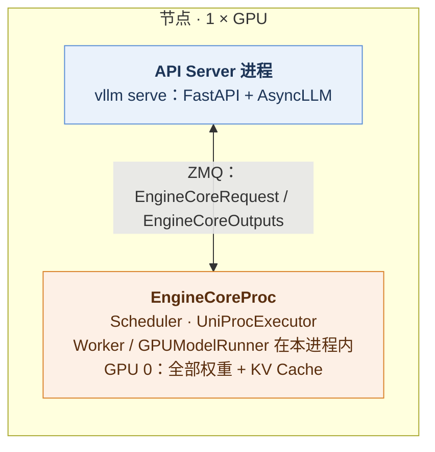

**2、单机 TP=4：一个 EngineCoreProc 广播给 4 个 WorkerProc。**

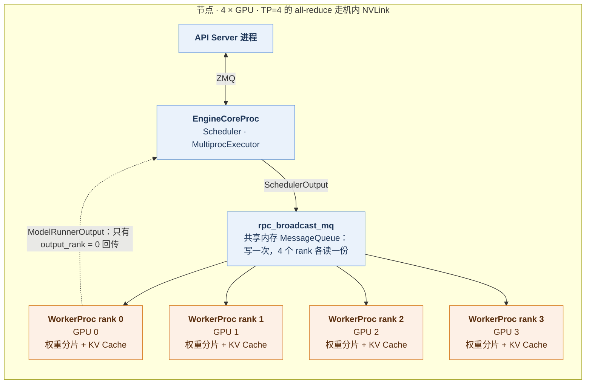

**3、两机 TP=8 × PP=2：节点 0 有完整的控制面，节点 1 只有 WorkerProc。**

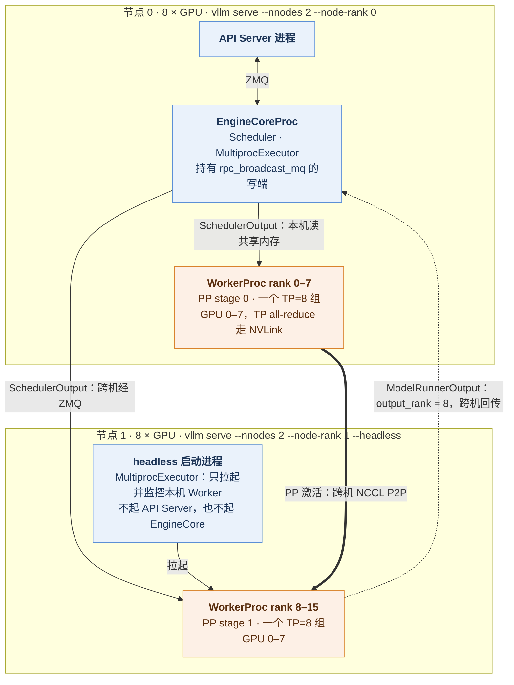

rank 按 TP 最内层编号（`vllm/distributed/parallel_state.py` 的 `initialize_model_parallel`），所以 rank 0–7 是 PP stage 0、正好占满节点 0，TP 的 all-reduce 都在机内；跨机的只有 PP 的激活和控制消息。`output_rank` 是最后一个 PP stage 的第一个 TP rank（`MultiprocExecutor._get_output_rank`：`world_size − tp_size` = 8），在节点 1 上，所以采样结果要跨机回到 EngineCoreProc。

**4、单机 DP=2 × TP=2：两套互不共享 KV 的引擎，前面多了负载均衡。**

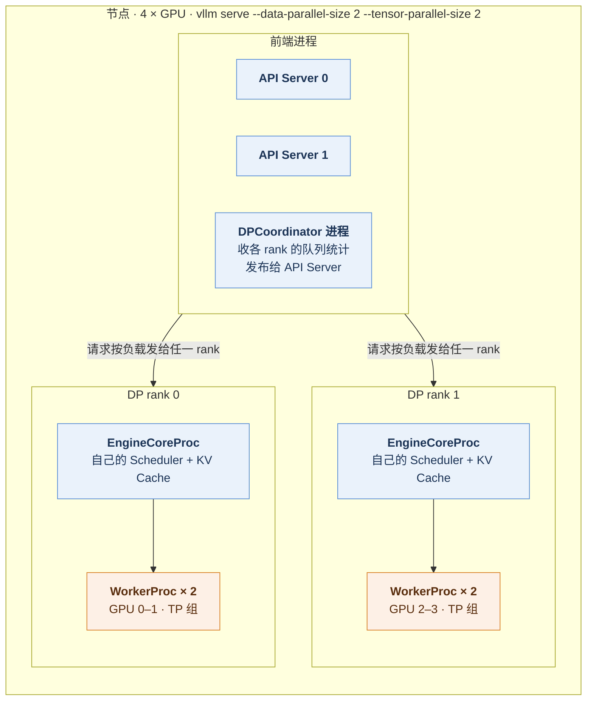

多 API Server 时，`vllm serve` 本身变成只负责启动和监控的父进程（`run_multi_api_server`），图里没有画它。`DPCoordinator` 只在在线服务、DP > 1 时由 rank 0 启动（`launch_core_engines`）。

**5、多 API Server：只加前端进程，模型侧不变。**

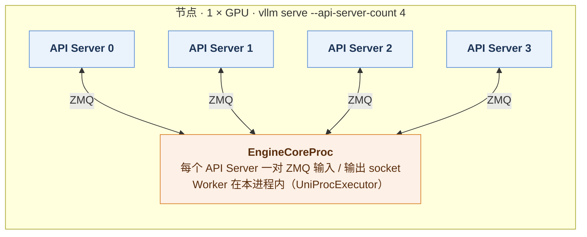

P/D 分离部署不在这五种里：它把 prefill 和 decode 拆到不同的 vLLM 实例（各自是上面某一种形态），中间接 KV 传输层，见[《PD 分离：从资源混部走向计算解耦》](/prefill-decode-disaggregation.html)。

## 六、场景视图（+1）

Kruchten 4+1 的“+1”就是场景视图：逻辑、进程、开发、物理四个视图各看一个切面，场景把四个切面串起来——沿时间轴走一遍真实发生的交互，验证前四张图能对上同一件事。这里放两个子场景：先看一条请求的完整生命周期（谁经手、什么顺序），并把同一条路径放大一级，看它被哪几道边界切开；再只看 token 这个对象在四个进程之间怎么变形（数据流）。

### 1. 请求流：一次请求的完整生命周期


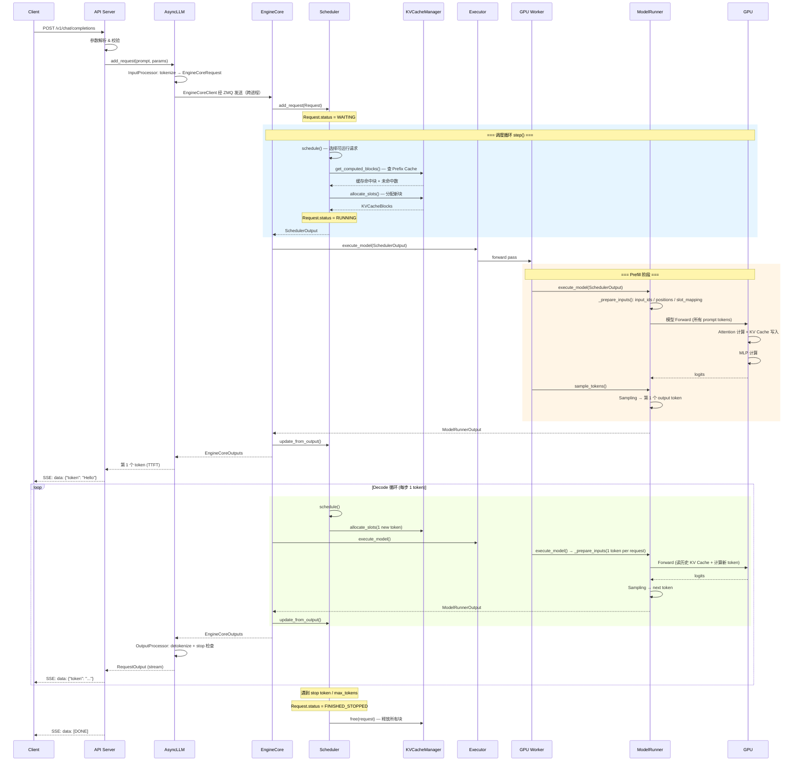

#### 放大：同一条生命周期，落到组件和关键方法上

上面的时序图停在组件一级，回答的是“谁经手、什么顺序”，并且为了好读，把跨进程的收发画成了同步的一来一回。把同一条生命周期放大一级，每个组件只写出它在这条路上的关键方法，就能看出这条路被哪几道边界切开、每一段是什么语言：

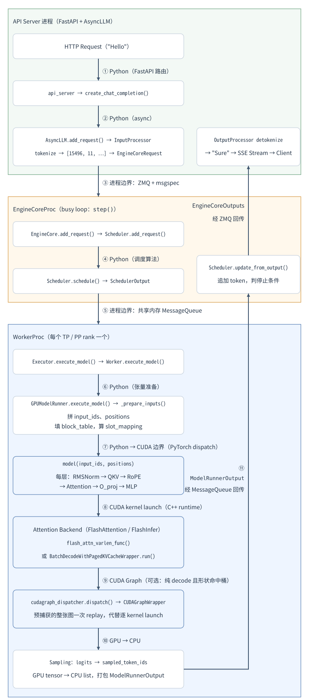

图里标出了三道边界，它们恰好把这条链切成四段，位置也不是随意的：

1. **③ 是进程边界。** API 层与引擎核心分离，为的是不让 HTTP 处理和 tokenize / detokenize 阻塞调度循环（第三章第 1、2 节）。
2. **⑤ 也是进程边界，同时是控制面与数据面的边界。** 上游全是决策，下游全是计算（第二章第 1 节）。EngineCore 只把 `SchedulerOutput` 经共享内存广播给 WorkerProc；单卡时 Executor 与 Worker 同进程，这道边界退化为普通函数调用。
3. **⑦ 是 Python 与 GPU 的边界。** 过了这里，一步的耗时就由 kernel 决定，Python 不再参与。

第二章那张单步时间线说的“Python 控制面只占约 1%”，指的就是 ⑦ 之前这一段相对 ⑦–⑩ 的耗时占比。

三段链各活在一个进程里，进程之间只靠消息队列衔接，没有哪一段调用同时横跨两道边界：每个进程里都常驻一个“循环 + 一次调用”形状的东西，请求本身只是在队列里流过的数据。各进程里常驻的循环和调用栈分别在机制篇里展开：API Server 进程的协程见[第十篇第六章第 1 节](/output-changes-sampling-and-structured-output.html#1-解析在哪个进程里跑由哪些参数打开)，EngineCoreProc 的三个线程和 `step()` 见[第四篇第五章第 5 节](/scheduler-batch-and-fairness.html#5-调度循环跑在哪里enginecoreproc-的三个线程与-step)，WorkerProc 的循环和 ⑥–⑩ 在 Worker 里的细节见[第六篇第二章](/gpu-execution-kernels-and-graphs.html#二forward-之前scheduleroutput-如何变成-gpu-张量)。

### 2. 数据流：Token 如何穿过整个 Serving 栈

#### 放大：一个 token 的回程（流式输出）

第 1 节的时序图把 EngineCore 和 AsyncLLM 之间画成了同步的请求-应答，实际上它们跨进程、各自有独立的循环。下面把 decode 循环中**一个 token 的回程**放大，重点看两件事：detokenize 发生在哪个进程，以及引擎循环为什么不需要等它。

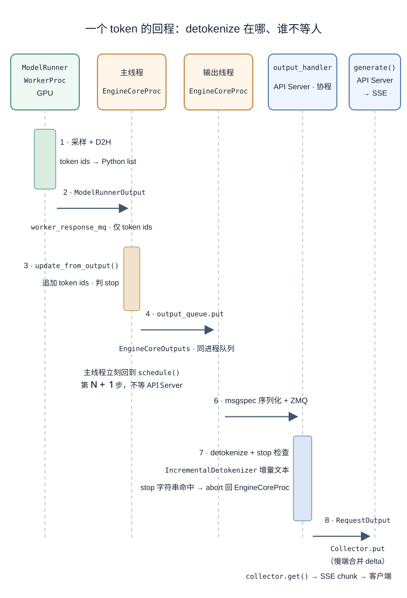

这张图解释了第三章的进程边界怎样影响流式输出：EngineCoreProc 的主线程把 `EngineCoreOutputs` 放进 `output_queue` 后立刻回到 `schedule()`，序列化由输出线程做，detokenize 和 stop 字符串检查由 API Server 进程的 `output_handler` 协程做，三者互不等待。代价是 stop **字符串**（而非 stop token id）的判定要晚一步——API Server 检测到后反向发 abort，GPU 可能已经为这个请求多算了一步。另外，`RequestOutputCollector` 在 `DELTA` 模式下会把积压的输出合并，因此客户端收到的一个 SSE chunk 不一定恰好对应一个 decode 步。

去程把文本变成 token ids 送到 GPU，回程只带 token ids，到 API Server 才变回文本。四条泳道对应四类实体：

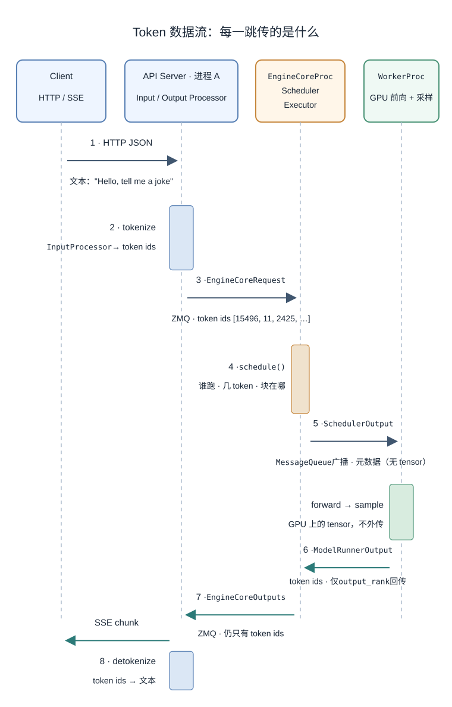

注意 Detokenizer 不在 GPU 那一侧，而是在 API Server 进程的 `OutputProcessor` 里：EngineCore 回传的只有 token ids，文本是到这里才拼出来的。上图沿着数据走了一遍，但同一个请求在每一层其实是**不同的对象**——它们活在不同进程、寿命也不同。把这些对象排成一张表，就能看出"谁持有请求的真状态、谁只是一次性的快照"：

| 对象 | 所在进程 | 生存期 | 它是什么 |
|---|---|---|---|
| HTTP JSON → `ChatCompletionRequest` | API Server | 一次 HTTP 连接 | 文本 prompt + 采样参数（用户视角） |
| `EngineCoreRequest` | API Server → EngineCoreProc（msgspec 序列化过 ZMQ） | 只传一次 | 扁平的 IPC 载荷：`prompt_token_ids`、`sampling_params`、`arrival_time`… 已 tokenize，无状态 |
| `Request` | EngineCoreProc（Scheduler 内部） | 从入队到 `free()` | **请求状态的唯一权威副本**：`status` 状态机、`num_computed_tokens`、`output_token_ids`、`block_hashes` |
| `NewRequestData` / `CachedRequestData` | EngineCoreProc → WorkerProc（共享内存广播） | 一个 step | `SchedulerOutput` 里的两种"订单"：首次调度的请求带全量 `prompt_token_ids` + `block_ids`；已在 batch 里的只带增量 `new_token_ids` + `new_block_ids` |
| `SchedulerOutput` | EngineCoreProc → WorkerProc | 一个 step | 上面两者 + `num_scheduled_tokens{req_id: n}` + `finished_req_ids` 等：这一轮"谁跑、跑多少、块在哪" |
| `CachedRequestState` + `InputBatch` 行 | WorkerProc（Worker 常驻） | 从首次调度到 `finished_req_ids` | Worker 侧对 `Request` 的**镜像**，靠增量订单保持同步；`InputBatch` 是按行排列的持久 batch（`token_ids_cpu`、`block_table`） |
| `ModelRunnerOutput` | WorkerProc → EngineCoreProc（`worker_response_mq`） | 一个 step | `req_ids` + `sampled_token_ids: list[list[int]]` + logprobs：只有采样结果，不含任何状态 |
| `EngineCoreOutput(s)` | EngineCoreProc → API Server（ZMQ） | 一个 step | 每个请求的 `new_token_ids` + `finish_reason`；仍然只有 token ids |
| `RequestOutput` | API Server（`OutputProcessor` 产出） | 一个 SSE chunk | 第一次出现**文本**：detokenize 后的增量 `text` + `token_ids` |

Table: 一个请求在各层的对象

表里有两条规律。第一，**状态只在 EngineCoreProc 和 WorkerProc 各有一份**：`Request` 是权威，`CachedRequestState` 是靠每步增量同步的镜像；所有跨进程的载荷（`EngineCoreRequest`、`SchedulerOutput`、`ModelRunnerOutput`、`EngineCoreOutputs`）都是无状态的一次性消息，读完即弃，也因此可以随意序列化、走任何 IPC 通道。第二，**文本只在 API Server 进程出现**：从 `EngineCoreRequest` 到 `EngineCoreOutputs` 全程都是 token ids，EngineCoreProc 和 WorkerProc 完全不需要 tokenizer。

## 七、本文小结

读 trace 时，先分清两种流量：请求、token ids 和 `SchedulerOutput` 属于控制流；TP/PP 的激活张量在 Worker 间走 collective，不经 EngineCore 转发。

把它和第一篇的四问对齐，就得到全系列的骨架：

| 四问 | 承担模块 |
|------|---------|
| 一、这一轮谁执行、执行多少 | `Scheduler`（+ `EngineCore` 驱动） |
| 二、状态放哪、怎么复用 | `KVCacheManager` / `BlockPool` |
| 三、怎么算得更快 | `ModelRunner` / Attention Backend / Kernel |
| 四、怎么扩出去 | `Executor` / `Worker` / 集合通信 |

Table: 四问与承担模块

按数据对象看是同一副骨架：请求域（`Request`）是四问的输入，调度域（`SchedulerOutput` / `ModelRunnerOutput`）和显存域（`KVCacheBlock` / `BlockTable`）是前两问的产物，模型域是第三问的战场；它们之间只靠 `request_id` 和 `block_id` 两个整数串起来（第二章第 3 节）。

本篇停在组件和关键方法一级。每个进程里常驻什么、一轮在函数里怎么走，在讲对应机制的几篇里：EngineCoreProc 的主循环在第四篇，WorkerProc 的循环和从 Python 到 kernel 的调用路径在第六篇，API Server 进门的渲染在第九篇、出门的解析在第十篇。


<details markdown="1">
<summary><b>📂 本章源码导航</b></summary>

正文只讲架构，下面是各节涉及的源码位置（v0.27.1）。各进程里常驻的循环和调用栈在机制篇里展开：API Server 的协程见[第十篇第六章第 1 节](/output-changes-sampling-and-structured-output.html#1-解析在哪个进程里跑由哪些参数打开)，EngineCoreProc 的三个线程与 `step()` 见[第四篇第五章第 5 节](/scheduler-batch-and-fairness.html#5-调度循环跑在哪里enginecoreproc-的三个线程与-step)，WorkerProc 的循环与 Python → kernel 的调用路径见[第六篇第二章](/gpu-execution-kernels-and-graphs.html#二forward-之前scheduleroutput-如何变成-gpu-张量)。

**入口与引擎循环**

| 想看什么 | 从哪开始 |
|---|---|
| HTTP 入口、OpenAI 兼容接口 | `vllm/entrypoints/openai/api_server.py`（路由、`run_server()`）、`vllm/entrypoints/openai/chat_completion/`（chat 接口实现、`ChatCompletionRequest`） |
| 异步请求生命周期、流式响应 | `vllm/v1/engine/async_llm.py` → `AsyncLLM` |
| tokenize 与请求构造 | `vllm/v1/engine/input_processor.py` → `InputProcessor` |
| 与 EngineCore 进程通信 | `vllm/v1/engine/core_client.py` → `EngineCoreClient` / `AsyncMPClient` / `InprocClient` |
| detokenize 与输出整理 | `vllm/v1/engine/output_processor.py` → `OutputProcessor`；`vllm/v1/engine/detokenizer.py` → `IncrementalDetokenizer` |
| **推理主循环（建议从这里入手）** | `vllm/v1/engine/core.py` → `EngineCore.__init__()` / `step()`、`EngineCoreProc` |
| 调度器与块管理 | `vllm/v1/core/sched/scheduler.py` → `Scheduler`；`vllm/v1/core/kv_cache_manager.py` → `KVCacheManager`；`vllm/v1/core/kv_cache_coordinator.py` → `KVCacheCoordinator`；`vllm/v1/core/block_pool.py` → `BlockPool` |
| 调度器给执行层的“订单” | `vllm/v1/core/sched/output.py` → `SchedulerOutput` / `NewRequestData` / `CachedRequestData` |
| 执行层的回执 | `vllm/v1/outputs.py` → `ModelRunnerOutput` |
| 执行抽象与各种部署形态 | `vllm/v1/executor/abstract.py` → `Executor`；`multiproc_executor.py`、`uniproc_executor.py`、`ray_executor_v2.py`、`ray_executor.py` |
| Worker 与一轮 batch 在 GPU 上怎么跑 | `vllm/v1/worker/gpu_worker.py` → `Worker`；`vllm/v1/worker/gpu_model_runner.py` → `GPUModelRunner.execute_model()` / `sample_tokens()` |
| Model Runner V2 及其开关 | `vllm/v1/worker/gpu/model_runner.py`；`vllm/config/vllm.py` → `VllmConfig.use_v2_model_runner` |

Table: 入口与引擎循环的源码导航

**数据对象与进程边界**

| 想看什么 | 从哪开始 |
|---|---|
| 四个域的核心对象 | `vllm/v1/request.py` → `Request`；`vllm/v1/core/kv_cache_utils.py` → `KVCacheBlock`；`vllm/v1/core/single_type_kv_cache_manager.py` → `req_to_blocks`；`vllm/v1/worker/block_table.py` → `BlockTable`；`vllm/v1/worker/gpu_input_batch.py` → `InputBatch` / `CachedRequestState` |
| 一个请求在各层的对象 | `vllm/entrypoints/openai/chat_completion/protocol.py` → `ChatCompletionRequest`；`vllm/v1/engine/__init__.py` → `EngineCoreRequest` / `EngineCoreOutputs`；`vllm/v1/request.py` → `Request.from_engine_core_request()`；`vllm/outputs.py` → `RequestOutput` |
| 执行边界的共享内存广播 | `vllm/distributed/device_communicators/shm_broadcast.py` → `MessageQueue` |
| Worker 之间的 TP / PP 通信 | `vllm/distributed/parallel_state.py`、`vllm/distributed/communication_op.py`、`vllm/distributed/device_communicators/pynccl.py` |
| 进程启动、ZMQ 握手与 DP 协调 | `vllm/entrypoints/cli/serve.py`（`run_multi_api_server()`）、`vllm/v1/engine/utils.py`（`launch_core_engines()`）、`vllm/v1/utils.py`（`APIServerProcessManager`）、`vllm/v1/engine/coordinator.py`（`DPCoordinator`）；Worker 拉起与就绪：`vllm/v1/executor/multiproc_executor.py` → `WorkerProc.make_worker_process()` |

Table: 数据对象与进程边界的源码导航

</details>

## 八、自测

1. vLLM 里 `AsyncLLM` 与 `EngineCore` 为什么分成两个进程？中间传什么？

   <details markdown="1"><summary>答案</summary>

   把 tokenize / detokenize、HTTP、流式响应这些 CPU 密集且抖动大的工作从引擎循环里摘出去，让 `EngineCore.step()` 稳定地驱动 GPU；中间经 ZMQ 传 `EngineCoreRequest`（token id + 采样参数）与 `EngineCoreOutputs`（新 token id），不传 tensor。

   </details>

2. `SchedulerOutput` 里有什么、没有什么？为什么 ModelRunner 能只凭它构造这一步的输入？

   <details markdown="1"><summary>答案</summary>

   有：每个被调度请求的 id、这一轮的新 token 数、已计算 token 数、block table、采样参数变化、被抢占 / 完成的请求；没有：任何 tensor。ModelRunner 维护持久的 `InputBatch`，凭这些元数据更新位置与 slot mapping、从 KV 块里读，不需要 Scheduler 传数据。

   </details>

3. 从 `Scheduler.schedule()` 给一个请求分到 KV 块，到 kernel 把它的新 K、V 写进显存，“块”经过哪几个对象？从哪一步起只剩一个整数？

   <details markdown="1"><summary>答案</summary>

   `Scheduler.schedule` → `KVCacheManager.get_computed_blocks`（查 prefix cache 命中的块）→ `KVCacheManager.allocate_slots`（算需要几个新块）→ `BlockPool.get_new_blocks`（从空闲队列取，可能先驱逐带哈希的旧块）→ 追加到 `SingleTypeKVCacheManager.req_to_blocks[request_id]`，这些都是 `KVCacheBlock` 对象；写进 `SchedulerOutput`（`NewRequestData.block_ids` / `CachedRequestData.new_block_ids`）时只剩整数 `block_id`，`ref_cnt` 和哈希留在 EngineCoreProc。Worker 用它填 `BlockTable` 的一行，`compute_slot_mapping()` 算出每个 token 的 slot，`reshape_and_cache` 按 slot 写 KV。

   </details>

4. TP=8 时 Executor 把一步分发给 8 个 Worker，谁做采样？logits 在哪？

   <details markdown="1"><summary>答案</summary>

   8 个 Worker 各算自己那 1/8 的权重，激活经 all-reduce 汇合；lm_head 的输出（logits）经 all-gather 后在每个 rank 都完整，每个 rank 都各自采样（同一个随机种子保证结果一致），只有 `output_rank`（rank 0）把结果回传给 EngineCore，其他 rank 的结果不回传。

   </details>

5. 前端 detokenize 为什么放在 `AsyncLLM` 而不是 EngineCore？流式输出时“一个 token 一次返回”有什么坑？

   <details markdown="1"><summary>答案</summary>

   detokenize 是纯 CPU 且要维护每请求的字符串状态，放引擎里会拖慢 step；坑：BPE（Byte Pair Encoding，字节对编码）的 token 边界与 UTF-8 字符边界不对齐，一个多字节字符可能跨两个 token，`IncrementalDetokenizer` 要缓存到能安全输出的完整字符再发。

   </details>

6. 默认多进程路径里，`EngineCoreProc` 与 `WorkerProc` 各自做什么？`SchedulerOutput` 和 `ModelRunnerOutput` 分别通过哪种通道传？

   <details markdown="1"><summary>答案</summary>

   `EngineCoreProc` 持有 Scheduler 和请求状态，驱动调度、执行、更新；`WorkerProc` 持有本 rank 的 Worker、GPUModelRunner、权重分片和 GPU KV cache。单机时 EngineCore 通过共享内存 `MessageQueue` 广播 `SchedulerOutput`，`output_rank` 通过 response queue 回传 `ModelRunnerOutput`。

   </details>

7. TP/PP、DP、`--api-server-count > 1` 分别改变哪一部分？RayExecutor 又改变什么？

   <details markdown="1"><summary>答案</summary>

   TP/PP 增加 Worker rank，并让 Worker 之间做 collective；DP 增加独立的 EngineCore rank，在线配置需要时由 DPCoordinator 汇总负载或协调 wave；`--api-server-count` 增加 API Server 进程。RayExecutor 改变 Worker 的启动和放置方式；`RayExecutorV2` 仍复用 MessageQueue 控制面与 Worker 间 collective。

   </details>

[^q0]: 链路是固定的：**入口**（`api_server` 的 OpenAI 兼容路由）→ `AsyncLLM` → `InputProcessor`（tokenize、构造 `EngineCoreRequest`）→ 经 `EngineCoreClient` 跨进程送进 **EngineCore**。EngineCore 的 `step()` 是驱动循环：**Scheduler 决策**——这一轮哪些请求跑、每个推进多少 token，产出 `SchedulerOutput`；**Executor 分发**到一个或多个 Worker；**ModelRunner 执行**——准备 `InputBatch`、调 attention backend 与模型前向、采样，产出 `ModelRunnerOutput`；EngineCore 把结果交回 Scheduler 更新请求状态，并把 `EngineCoreOutputs` 送回前端 detokenize、流式返回。**传递的是什么**：Scheduler 与 ModelRunner 之间传的不是 tensor 而是元数据——每个请求这一轮的 token 数、block table、slot mapping、采样参数；Worker 之间传的是激活（TP 的 all-reduce、PP 的 P2P）；前后端之间传的是 token id。详见[第二](#二逻辑视图静态系统拓扑自顶向下)至[第六章](#六场景视图1)（请求流及其放大图在 6.1，数据流在 6.2）。
[^q1]: 可以，因为控制面只处理整数元数据，而且它的时间被 GPU 时间盖住。三个理由：（1）**语言特性匹配**——调度逻辑条件多、数据结构动态，适合 Python；数值计算追求极致性能，适合 C++ / CUDA；（2）**迭代速度**——调度算法是 vLLM 改动最频繁的模块，Python 的开发效率远高于 C++；（3）**开销可被摊薄**——一步 decode 的 GPU 时间是十毫秒量级（70B 多卡约 15 ms、7B 单卡约 8–12 ms），schedule 与输入准备合计零点几毫秒，约占 1%；再加上 `execute_model(non_block=True)` 与 async scheduling 的 batch queue 让 GPU 跑第 N 步时 CPU 准备第 N+1 步，这部分时间被流水线化盖住。是否成为瓶颈仍取决于 batch、模型和硬件。详见[第二章](#二逻辑视图静态系统拓扑自顶向下)。
