> **NOTE** 本文基于 vLLM v0.27.1（tag `6e448d0`, 2026-08-11）源码剖析。文中文件路径、类名和函数名均以该版本为准；vLLM 迭代很快，阅读时请以你手上的版本对照。


设想一个场景：

你有一张 80 GB 的卡，同时来了 100 个请求。第一个请求最后只生成了 300 个 token，第二个生成了 3000 个，第三个一路写到 20K。**问题在于：这三个数字，你在请求到达的那一刻一个都不知道。**

如果按传统做法，给每个请求划一块连续显存来放它的 KV Cache，那你只能按"最坏情况"预留——按模型支持的最大长度划。于是那个只生成 300 token 的请求，占着一块够装 32K token 的地。100 个请求这么一摊，卡就满了，尽管真正装了有效数据的可能不到三成。

> **显存不是被模型吃掉的，是被"不确定性"浪费掉的。**

PagedAttention 的核心思想，用一句话就能说完：

> **别给请求整块连续空间。把 KV Cache 切成固定大小的小块，用多少申请多少，块与块之间不要求相邻。**

这样"预留"就消失了——因为不再需要预判总长度，只需要在写满当前块时再要一块。这个思路你大概率见过：**它就是操作系统的虚拟内存分页**。

本篇的核心问题是：

> **这些请求已经计算过的历史状态（KV Cache），应该放在哪里、如何复用、何时释放，才能不让"不确定性"吃掉显存？[^q0]**

## 一、总览：从分页管理到瘦身

### 1. 四个层面的问题

分页只是起点。块切好以后，还有三件事各自决定了一张卡最终能装下多少请求：

1. **块能不能被别的请求复用**：成百上千个请求共享同一段 system prompt 时，Prefix Cache 让它们共用同一份物理块；命中怎么查、显存紧张时先丢谁，决定了这份复用在高负载下还剩多少。
2. **一个模型里的 KV 不止一种**：Gemma-3、gpt-oss 这类模型一部分层是全注意力、一部分是滑窗注意力，Mamba 混合模型还有固定大小的递归状态。各层要存的 token 数和存活时间都不同，一张块表管不了，vLLM 用「KV cache group」把它们分开管理、共用一个块池。
3. **每个 token 本身要占多少字节**：GQA / MLA 从模型结构上减少要存的量，KV 量化（FP8 等）把每个元素压小。

本文按这个顺序展开：先讲分页本身和一个块的生命周期，再讲 Prefix Cache 的命中与驱逐，然后是多种注意力层共存的混合 KV，最后是结构和数值两层瘦身。对象之间的总体关系（请求域、调度域、显存域、模型域，以及串起它们的 `request_id` / `block_id`）在[《鸟瞰 vLLM》的「核心数据对象：四个域」](/vllm-request-lifecycle-overview.html#3-核心数据对象四个域)已经讲过，这里只下钻显存域。

### 2. 本文的章节安排

| 章 | 主题 | 内容 |
|---|---|---|
| 二 | PagedAttention 的数学本质与源码实现 | 碎片灾难<br/>页表思想的映射<br/>核心数据结构（对象关系、block_id 到显存） |
| 三 | 一个 KV 块的完整生命周期 | 分配（BlockPool、allocate_slots）<br/>写入、读取<br/>归还与复用（空闲队列、引用计数、驱逐） |
| 四 | Prefix Cache：命中怎么找、谁先被驱逐 | 块哈希与 extra_keys<br/>find_longest_cache_hit 与容量检查<br/>五个请求共享 system prompt 的逐步推演<br/>驱逐顺序、命中率为什么会塌 |
| 五 | 混合 KV：一个模型里有几种注意力 | 各类层的 KV 形状与寿命、KVCacheSpec 家族<br/>KV cache group 与页大小统一<br/>滑窗组的块表、混合模型的命中查找<br/>Gemma-3-27B 算账与代价 |
| 六 | KV Cache 还能更小吗：结构、数值与分层存储 | GQA / MQA、MLA<br/>KV 量化（dtype、scale、后端支持、容量算账）<br/>Offloading 与 Swapping |
| 七 | 本文小结 |  |
| 八 | 自测 | 6 道题 |

Table: 本文的章节安排

## 二、PagedAttention 的数学本质与源码实现

### 1. 痛点：传统显存分配的碎片灾难

在 PagedAttention 出现之前，每个请求的 KV Cache 必须在 GPU 显存中预分配一段**连续内存**，其长度等于模型支持的最大序列长度。这造成了两类碎片：

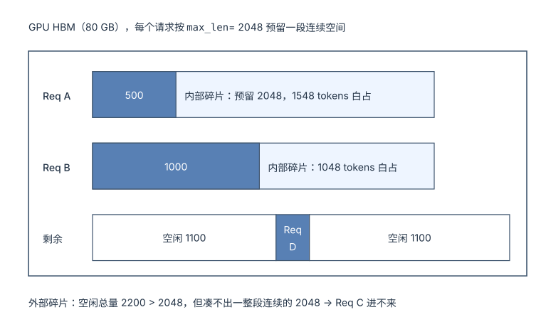

| 碎片类型 | 成因 | 后果 |
|---|---|---|
| **内部碎片** | 按最大长度预留，实际用不了那么多 | 主要浪费来源 |
| **外部碎片** | 已释放的空间不连续 | 总量够却无法分配给新请求 |

Table: 传统显存分配的两类碎片

总浪费率有多大？PagedAttention 论文（SOSP'23）测得当时的 SOTA 系统中，**真正存放有效 KV 的显存只占 20.4% ~ 38.2%**——也就是约 60% ~ 80% 被碎片和预留吃掉了。

### 2. 页表思想的映射：操作系统虚拟内存在推理系统中的重现

PagedAttention 的灵感直接来自操作系统的虚拟内存管理。核心思想是将连续的逻辑地址空间映射到不连续的物理页框：

| | 操作系统虚拟内存 | PagedAttention |
|---|---|---|
| 连续的逻辑视图 | 虚拟地址空间（Page 0,1,2,3…） | 逻辑 token 序列（Blk 0,1,2…，每块 16 个 token） |
| 映射表 | Page Table（VP → PF） | **Block Table**（虚拟块 → 物理块） |
| 不连续的物理载体 | 物理页框 Physical Frame | **物理 KV 块** Physical Block（GPU HBM 上） |
| 分配单位 | 一页（如 4 KB） | 一块（`block_size` 个 token 的 K/V） |
| 好处 | 进程看到连续内存，实际零散存放 | 请求看到连续序列，KV 实际零散存放 |

Table: 操作系统虚拟内存与 PagedAttention 的对应

映射关系是这样的——注意物理块号完全不需要连续：

```mermaid
%% 图：页表思想的映射：逻辑块连续，Block Table 把它们映到不连续的物理 KV 块
graph LR
    subgraph LOG["逻辑视图（连续）"]
        B0["<b>Blk 0</b><br/>$$t_1$$–$$t_{16}$$"] --- B1["<b>Blk 1</b><br/>$$t_{17}$$–$$t_{32}$$"] --- B2["<b>Blk 2</b><br/>$$t_{33}$$–$$t_{48}$$"]
    end
    subgraph BT["Block Table"]
        T["<b>VB0 → PB7</b><br/>VB1 → PB13<br/>VB2 → PB21"]
    end
    subgraph PHY["物理 KV 块（不连续）"]
        P7["PB 7"]
        P13["PB 13"]
        P21["PB 21"]
    end
    B0 --> T
    B1 --> T
    B2 --> T
    T --> P7 & P13 & P21
```

在 vLLM 中，每个物理块（Physical Block）存储固定数量 token 的 K 和 V 张量：

```python title="KV Cache 物理块的张量布局（单层，FlashAttention 后端）"
# vllm/v1/attention/backends/flash_attn.py → FlashAttentionBackend.get_kv_cache_shape
# 逻辑形状: (num_blocks, num_kv_heads, block_size, 2 * head_size)，K 和 V 拼在最后一维
# 例: Llama-3-70B TP8 每卡 1 个 KV 头: (81920, 1, 16, 256)，BF16
kv_cache = torch.empty(num_blocks, num_kv_heads, block_size, 2 * head_size,
                       dtype=torch.bfloat16, device="cuda")
key_cache, value_cache = kv_cache.split(head_size, dim=-1)
```

每一层各有一个这样的张量（第五章会看到，混合模型里几层共享一个）；块号是第一维的下标，同一个 block_id 在所有层的张量里指向同一个位置。

### 3. 源码解密：核心数据结构

先看对象之间的关系：谁持有谁、分配结果以什么形式交给 Scheduler。

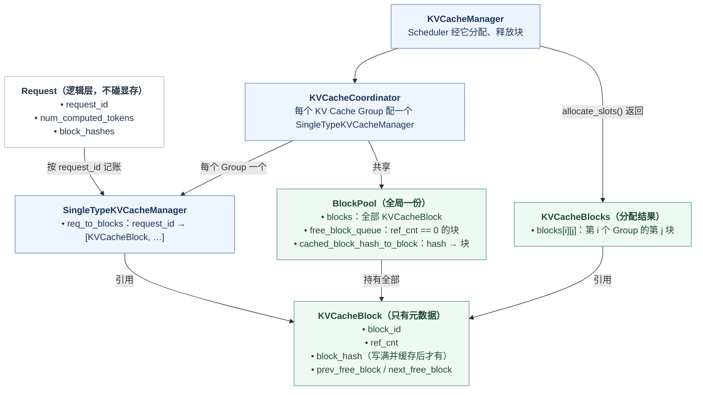

Request 是逻辑层，只记 token 和进度，不直接碰显存。Scheduler 通过 KVCacheManager 给它分配块：KVCacheManager 内部经 KVCacheCoordinator，为每个 KV Cache Group 维护一个 SingleTypeKVCacheManager，用 `req_to_blocks` 记下每个请求持有哪些块（Group 是 KV 形状相同的一组层；普通模型只有一个 Group，混合了滑窗注意力或 Mamba 层的模型才有多个）。分配结果以 KVCacheBlocks 交给 Scheduler，`blocks[i][j]` 是第 i 个 Group 的第 j 块。

所有 KVCacheBlock 对象由全局唯一的 BlockPool 持有，它们只是元数据：`block_id`、`ref_cnt`、写满并缓存之后才有的 `block_hash`，以及一对前后指针。块被持有时（`ref_cnt > 0`）只出现在请求的块序列里；`ref_cnt` 归零后靠这对指针串进 `free_block_queue`，等着被重新分配或被 Prefix Cache 命中（第三章第 4 节）。

再看块和显存的关系：

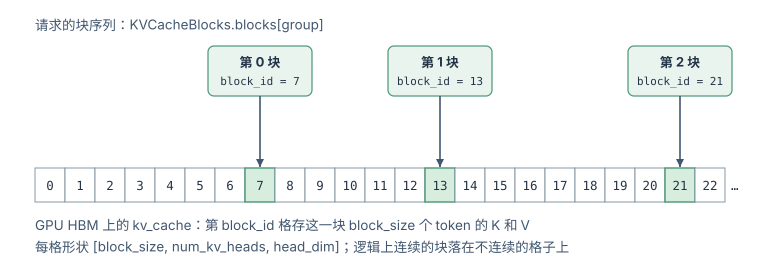

`block_id` 直接当下标，索引到 GPU HBM 上 `kv_cache` 的一格，每格放一整块 `block_size` 个 token 的 K 和 V。块 0 例外：`BlockPool` 初始化时把它从空闲队列里摘出来当 `null_block`，永远不分配，块表里需要占位而不需要真实数据的位置（第五章的滑窗层）都指向它，所以可分配的块是 1 到 `num_gpu_blocks − 1`，`get_usage()` 算占用率时也把它扣掉。逻辑上相邻的块，物理上可以相隔很远。请求 → 块序列、`block_id` → 显存，这两层映射是后面 Prefix Cache 复用和 Preemption 释放的基础。

> **回到前面的例子**：2050 个 prompt token，`block_size=16`，于是需要 `⌈2050/16⌉ = 129` 个块（前 128 块装满 2048 个 token，第 129 块只装 2 个）。生成完 300 个 token 后，序列长 2350，共占 **147 个块**。
>
> 注意一个巧合般的细节：**2000 个 token 的 system prompt 恰好是 125 个整块**。这不是偶然设计，但它揭示了 Prefix Cache 的一个硬约束——只有**装满**的块才会被缓存，所以可复用的边界永远对齐到 `block_size`。第四章就用这一点算账。

## 三、一个 KV 块的完整生命周期：分配、写入、读取、归还

这一章跟着一个块走完一生：从 BlockPool 里分配出来，被 Prefill 或 Decode 写入，被 attention kernel 读取，最后在请求完成或被抢占时归还，留在空闲队列里等待复用或被驱逐。写入、读取、归还三步的全景如下：

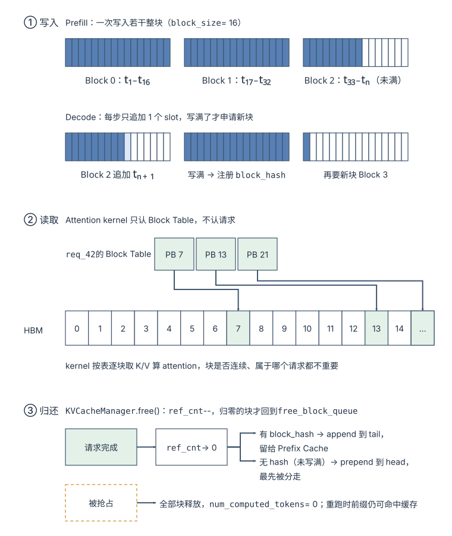

### 1. 分配：BlockPool 与 `allocate_slots()`

`BlockPool`（`vllm/v1/core/block_pool.py`）管理所有物理块的分配和回收。它的设计有一个容易看漏的关键点：**没有单独的"缓存块"集合**。所有 `ref_cnt == 0` 的块——无论是从未用过的空块，还是刚被请求释放、但仍带着 block hash 的"缓存块"——都挂在同一条 `free_block_queue` 双向链表上，按释放时间排序。带 hash 的块同时还被 `cached_block_hash_to_block` 索引着，供 Prefix Cache 查找。

```python title="block_pool.py：BlockPool 的数据结构"
# vllm/v1/core/block_pool.py (简化)
class BlockPool:
    def __init__(self, num_gpu_blocks: int, enable_caching: bool, ...):
        self.free_block_queue = FreeKVCacheBlockQueue(num_gpu_blocks)   # 所有 ref_cnt==0 的块，LRU 序
        self.cached_block_hash_to_block = BlockHashToBlockMap()         # hash → 块（Prefix Cache 索引）

    def get_new_blocks(self, num_blocks: int) -> list[KVCacheBlock]:
        # 不够就直接报错——调用方（KVCacheManager.allocate_slots）在调用前已确认数量足够
        if num_blocks > self.get_num_free_blocks():
            raise ValueError(...)
        ret = self.free_block_queue.popleft_n(num_blocks)   # 从链表头取：最久未用的先被拿走
        for block in ret:
            self._maybe_evict_cached_block(block)   # 若这块还挂着 hash，摘掉 → 这就是"驱逐"
            block.ref_cnt += 1
        return ret

    def free_blocks(self, ordered_blocks):
        # ref_cnt--，归零则放回链表：没 hash 的块插到头部（先被分走），
        # 有 hash 的块追加到尾部（尽量保留）；hash 不清除，块仍可被 Prefix Cache 命中
        ...

    def touch(self, blocks):
        # Prefix Cache 命中：把 ref_cnt==0 的块从空闲链表摘出来复用，ref_cnt++
        ...

    def cache_full_blocks(self, request, blocks, ...):
        # 将满块的 hash 注册到 cached_block_hash_to_block
        ...
```

块分配的布局（引自 `allocate_slots()` 注释）：

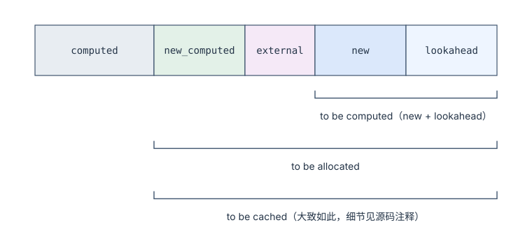

- `computed`：之前已缓存在 KV Cache 中的 tokens（Prefix Cache 命中）
- `new_computed`：本轮新计算但已完成的 tokens
- `external`：从远端传输的 KV 块（PD 分离场景）
- `new`：需要本轮计算的新 tokens
- `lookahead`：为 Speculative Decoding 预留的额外 tokens

这五段不会同时出现。还是用贯穿全文的例子（2000 token 的 system prompt + 50 token 用户输入，`block_size = 16`），看几种常见场景下各段分别是多少：

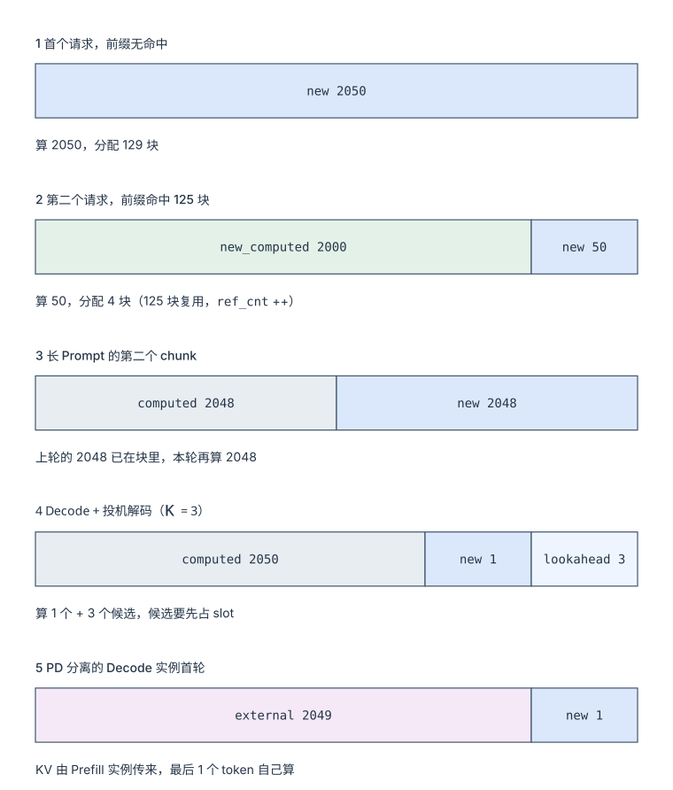

| 场景 | 非零的段 | 本轮要算 | 本轮要分配 | 说明 |
|---|---|---|---|---|
| 1 首个请求，前缀无命中 | `new` = 2050 | 2050 | 129 块 | 所有 token 都是新的，`computed` 为 0 |
| 2 第二个请求，前缀命中 125 块 | `new_computed` = 2000，`new` = 50 | 50 | 4 块 | 125 块复用，`ref_cnt++`；它们算 `new_computed` 而不是 `computed`，因为是本轮刚查出来的命中 |
| 3 长 Prompt 的第二个 chunk | `computed` = 2048，`new` = 2048 | 2048 | 128 块 | 上一轮算完的 2048 已经在请求自己的块里，这才是 `computed` |
| 4 Decode + 投机解码（K=3） | `computed` = 2050+t，`new` = 1，`lookahead` = 3 | 1 + 3 个候选 | 最多 1 块 | 候选 token 要先占 slot 才能验证，所以预留 `lookahead` |
| 5 PD 分离的 Decode 实例首轮 | `external` = 2049，`new` = 1 | 1 | 129 块 | KV 由 Prefill 实例传来，最后一个 token 由 Decode 端自己算以产生 logits |

Table: allocate_slots() 五种场景下各段的取值

这个布局也揭示了 Scheduler 为什么不能按请求类型硬分类。一轮迭代中一个请求可能同时覆盖 computed（prefix cache 命中）、new（需要新计算）和 lookahead（spec decode 预留），不同请求在这个轴上的位置各不相同。token 预算模型统一处理这些区间，而不是按"prefill 请求"和"decode 请求"分开。

### 2. 写入：Prefill 批量写、Decode 逐 slot 追加

两个阶段的写法完全不同：

| 阶段 | 写入方式 | 例子 |
|---|---|---|
| Prefill | 批量写入若干整块 | `Block 0: t₁~t₁₆`、`Block 1: t₁₇~t₃₂`、`Block 2: t₃₃~tₙ` |
| Decode | 每步增量追加 1 个 slot | `Block 2` 尾部追加 `tₙ₊₁`，写满了才要新块 |

Table: Prefill 与 Decode 阶段的 KV 写入方式

### 3. 读取：kernel 只认 Block Table

kernel 拿到的只有 Block Table 和 HBM 上的 `kv_cache`，没有"请求"这个概念。这带来两个直接后果：

- 读多少由上下文长度决定。一个 2050 token 的请求要遍历 129 个块，每块取出 16 个 token 的 K/V；Decode 每多一个 token，要读的块数最多加 1，所以 Decode 的显存读取量随上下文线性增长，这是 Decode 受带宽限制的直接来源。
- 写和读走两套索引。写入用 `slot_mapping`（token → 物理 slot，每轮由执行层算好），读取用 `block_table`（请求 → 物理块列表）。kernel 不要求块连续，也不关心相邻的块属于谁，所以不同请求的块可以在同一次 forward 里混着读——这是 Continuous Batching 能把 Prefill 和 Decode 塞进一个 batch 的前提。

读取的过程用伪代码写出来是：

``` title="Attention kernel 通过 Block Table 读 KV"
Block Table:  req_42 → [PB_7, PB_13, PB_21]

for each query position:
    for block_id in block_table[req]:
        K_block = key_cache[block_id]     # [num_kv_heads, block_size, head_size]
        V_block = value_cache[block_id]
        scores += Q @ K_blockᵀ
    attn_out = softmax(scores) @ V_blocks
```

### 4. 归还与复用

这一步决定了块能不能被别人复用：

| 触发 | 动作 | 关键后果 |
|---|---|---|
| 请求完成 | `KVCacheManager.free(request)`：所有块 `ref_cnt--` | `ref_cnt == 0` 才真正归还 `free_block_queue` |
| ↳ 块有 `block_hash` | 进入 LRU 缓存 | **留给 Prefix Cache 复用** |
| ↳ 块无 hash（未写满） | 插到 `free_block_queue` 头部 | 无法复用，最先被分走 |
| 被抢占 | 释放所有块 + `num_computed_tokens = 0` | 需重算，但 Prefix Cache 命中可跳过大部分 |

Table: KV 块归还的触发与后果

注意倒数第二行：**块只有"写满"才会被缓存**。这解释了为什么 Prefix Cache 的命中粒度是 `block_size`，而不是单个 token。

LRU 驱逐也不是一个显式步骤，而是分配的副作用：空闲链表头部的块就是最久没被访问的块，把它分出去时顺手摘掉它的 hash，这块缓存就"被驱逐"了。反过来，Prefix Cache 命中一个 `ref_cnt == 0` 的块时，`touch()` 把它从链表中摘出——命中即续命。这套设计让"空闲块"和"缓存块"共享同一份容量：缓存永远填满所有当前没在用的显存，且不需要任何后台淘汰线程。

用一个 6 块的小池子把这四个动作（`get_new_blocks` / `free_blocks` / 驱逐 / `touch`）在链表上走一遍，就能看清"空闲"和"缓存"是怎么共享同一条队列的：

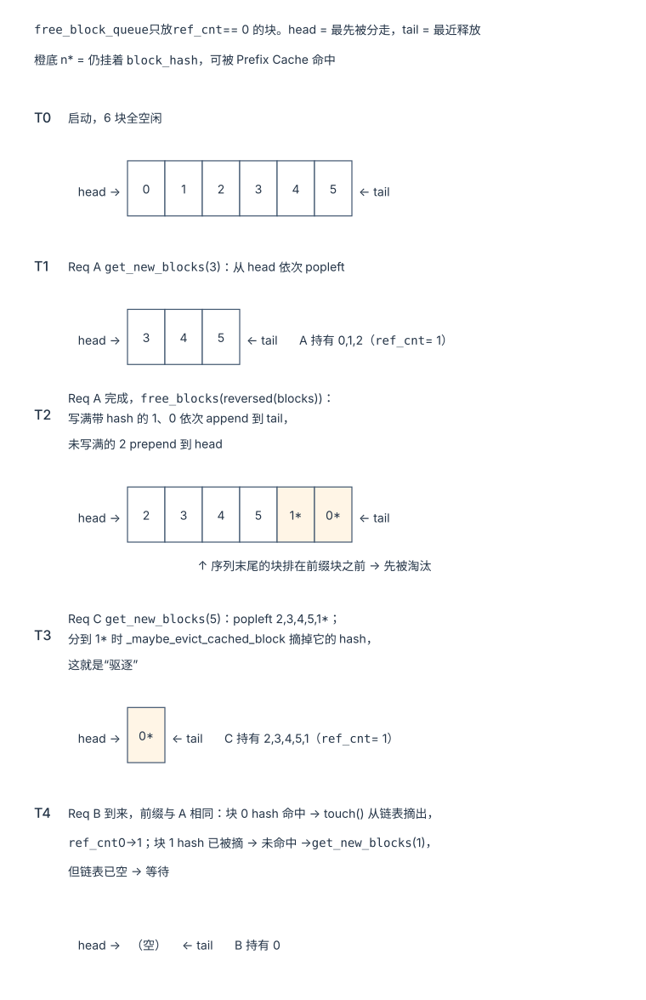

T2 里有个容易忽略的细节：`KVCacheManager.free()` 是把请求的块**反序**交给 `free_blocks()` 的，于是同一个请求里越靠后的块越靠近 head、越先被淘汰，而前缀块尽量留到最后——这和 Prefix Cache "命中总是从前缀开始"的访问模式是配套的。块 3 也排在 head，原因却不同：它没写满、没有 hash，`free_blocks()` 把这类块直接插到 head，让它们最先被分走。

T4 则说明「命中」不等于「能用」：命中的块 1 还躺在空闲队列里，把它摘走和分配一个新块一样要占用空闲容量，容量不够时整个请求等待，块 1 不会被 touch，下一轮可能已经被别人驱逐（第四章第 2 节）。

归还表里的 `ref_cnt--` 之所以要"归零才真正归还"，是因为一个物理块可能同时被多个请求持有。沿着贯穿全文的例子，跟踪那 125 个 system prompt 块的引用计数怎样随事件变化：

| 时刻 | 事件 | 125 个前缀块的 `ref_cnt` | 块此刻在哪 |
|---|---|---|---|
| ① | Req A 到达，`allocate_slots()` → `get_new_blocks()` | 0 → **1** | 从 `free_block_queue` 头部弹出，归 A |
| ② | A 的 Prefill 写满这些块 → `cache_full_blocks()` | 1 | hash 注册进 `cached_block_hash_to_block` |
| ③ | Req B 到达，`get_computed_blocks()` 命中 → `touch()` | 1 → **2** | 同一份物理块被 A、B 共享，不复制 |
| ④ | A 完成（或被抢占），`free()` | 2 → **1** | **不归还**——B 还在用 |
| ⑤ | B 完成，`free()` | 1 → **0** | 追加到 `free_block_queue` 尾部，hash 保留，仍可命中 |
| ⑥a | Req C 带同样 system prompt 到来 → `touch()` | 0 → **1** | 从链表中间摘出，缓存续命 |
| ⑥b | 或者 Req D 要新块，`get_new_blocks()` 弹到它 | 0 → **1** | `_maybe_evict_cached_block()` 摘掉 hash，缓存被驱逐 |

Table: 125 个前缀块引用计数的变化

也就是说 `ref_cnt` 只回答"有几个请求正在用"，块是否可复用由 hash 是否还在决定；两者独立，这是第四章的前提。

## 四、Prefix Cache：命中怎么找、谁先被驱逐

在生产环境中，大量请求共享相同的 System Prompt（几千 token 的系统指令、工具定义、few-shot 示例），多轮对话的每一轮又把前几轮原样带上。如果两个请求的前缀 token 完全相同，它们算出来的 K、V 也完全相同，可以共享同一份物理块。第三章已经看到，块写满后会挂上 `block_hash`、归还后留在空闲队列里等着被命中。这一章回答剩下的问题：

> **后来的请求怎样找到可以复用的块？显存紧张时先丢哪些块，什么样的负载会让命中率塌下去？[^q1]**

### 1. 块哈希：链式哈希与 `extra_keys`

```mermaid
%% 图：Prefix Cache 的复用：Request A prefill 后注册 125 个满块，Request B 经链式哈希全部命中，只需 prefill 最后一块
sequenceDiagram
    participant A as Request A<br/>[SysPrompt 2000] + "Hi"
    participant P as BlockPool<br/>(hash → block)
    participant B as Request B<br/>[SysPrompt 2000] + "Bye"

    Note over A,P: 链式哈希：每块的 hash 依赖前驱块
    A->>P: Prefill 2000 tokens<br/>Blk0=hash($$t_1 \dots t_{16}$$)=0xABC1<br/>Blk1=hash(0xABC1, $$t_{17} \dots t_{32}$$)=0xDEF2 …
    P-->>P: 125 个满块全部注册进缓存
    B->>P: get_computed_blocks()
    P-->>B: 0xABC1 命中 → 0xDEF2 命中 → … 125 块全中（ref_cnt++）
    Note over B: 只需 Prefill "Bye" 那 1 个块<br/>省下 2000 tokens 的计算 + 一整份 KV 显存
```

vLLM 使用链式哈希确保前缀匹配的正确性——每个块的哈希值依赖其前驱块的哈希，因此只有完全相同的前缀序列才会产生相同的哈希链。同样的 16 个 token 放在不同的前文之后，算出来的 K、V 不同（attention 依赖全部前文），所以键必须编码整个前缀，而不只是本块的 token。下图把三种情况摆在一起：B 与 A 共享前缀（命中 + 分叉），C 只在第一个 token 上与 A 不同（全部未命中）：

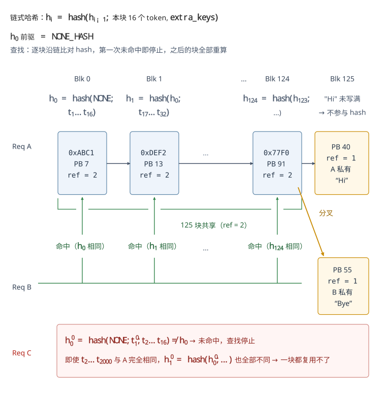

由此可见"命中"不是单块比对，而是从链头开始的一段连续匹配：分叉点之前的块共享同一份物理块（`ref_cnt` 累加），分叉点及之后各自申请新块；而链头一旦不同，后面再像也没用——这正是链式哈希保证正确性的方式，代价是命中的粒度只能是"前缀"。

```python title="kv_cache_utils.py：hash_block_tokens 签名"
# vllm/v1/core/kv_cache_utils.py (签名照抄, 函数体简化)
def hash_block_tokens(
    hash_function: Callable[[Any], bytes],
    parent_block_hash: BlockHash | None,
    curr_block_token_ids: Sequence[int],
    extra_keys: tuple[Any, ...] | None = None,
) -> BlockHash:
    """链式哈希：当前块哈希 = f(前驱块哈希, 本块 token ids, 额外键)"""
    if not parent_block_hash:
        parent_block_hash = NONE_HASH  # 首块的哈希起点
    return BlockHash(
        hash_function((parent_block_hash, tuple(curr_block_token_ids), extra_keys))
    )
```

这个签名里有三个细节值得留意，它们不是实现噪音：

- **哈希函数是注入进来的，不是 Python 内建的 `hash()`**，返回值也是 bytes 而非 int。`CacheConfig.prefix_caching_hash_algo` 默认 `sha256`（pickle 序列化后取 SHA-256），可选 `sha256_cbor`、`xxhash`、`xxhash_cbor`；CBOR 两种是可跨进程、跨语言复现的序列化，xxhash 更快但不是密码学哈希，在多租户场景下碰撞的风险要自己权衡。块哈希要在多个 worker、甚至跨节点（PD 分离、LMCache）之间对得上，必须可控且可复现。
- **链条起点 `NONE_HASH` 默认是随机的。** `init_none_hash()` 在未设置 `PYTHONHASHSEED` 时取 `os.urandom(32)`，即每个进程一个随机起点；只有显式设置 `PYTHONHASHSEED` 才会变成确定值。这是一个刻意的安全默认：随机起点让块哈希无法被外部预测，避免跨租户的缓存探测；而想让多进程/多节点共享同一份 prefix cache，就必须放弃这个默认。**可复现性和不可预测性在这里是一对取舍**，vLLM 默认选了后者。
- **`extra_keys` 是隔离用的。** 同一串 token 在不同 LoRA adapter、不同多模态输入、不同 `cache_salt`、不同 prompt embeds 下不能复用同一份 KV，这些维度都由 `generate_block_hash_extra_keys()` 收集进 `extra_keys`：LoRA 是 adapter 名，多模态是「图片等输入的哈希 + 它在本块里的起始偏移」，prompt embeds 是本块 embedding 的 SHA-256。`cache_salt` 只进**第一块**的 `extra_keys`——链式哈希会把它带到后面每一块，所以加一次就够把整条链和别的租户隔开。也就是说，"前缀相同"的判定比"token 序列相同"严格——这是 prefix cache 的正确性边界。

哈希在请求侧算好：`get_request_block_hasher()` 返回的函数在请求创建和每次追加 token 时被调用，只为**写满**的块追加哈希到 `request.block_hashes`。真正把块登记进哈希表的是 `allocate_slots()` 末尾的 `cache_blocks()`：它在**调度时**就把本轮算完后会写满的块登记进 `cached_block_hash_to_block`（数量截到 `request.num_tokens`，未验证的 draft token 不登记），所以后到的请求不必等 A 跑完就能命中。登记时不去重：同一个 hash 已经有块了，新写满的块照样登记，`BlockHashToBlockMap` 的一个键可以挂多个块——源码注释给的理由是要保证已分配的 block_id 不变、块表只追加。

### 2. 查找：`find_longest_cache_hit` 与两条容易忽略的规则

请求第一次被调度时，Scheduler 调 `KVCacheManager.get_computed_blocks()`，经 Coordinator 落到 `FullAttentionManager.find_longest_cache_hit()`（单一注意力类型的模型由 `UnitaryKVCacheCoordinator` 直接转发）：

```python title="single_type_kv_cache_manager.py：全注意力的命中查找（简化）"
# FullAttentionManager.find_longest_cache_hit（简化）
computed_blocks = []
# !ref scan
for block_hash in block_hashes[: max_length // block_size]:
    cached = block_pool.get_cached_block(block_hash, kv_cache_group_ids)
    if not cached:
        # !ref stop
        break
    computed_blocks.append(cached)
hit_length = len(computed_blocks) * block_size
```

从链头往后逐块查哈希表，[第一块未命中就停](#stop)——链式哈希保证后面的块不可能再命中，所以这是 O(命中块数) 的扫描。[扫描上限](#scan) `max_length` 来自调用方，这里藏着第一条规则：

**1、命中最多到 `num_tokens - 1`。** `get_computed_blocks()` 传入的上限是 `request.num_tokens - 1`：哪怕整个 prompt 都在缓存里，最后一个 token 也必须重新算一遍，因为采样下一个 token 要它的 logits。又因为命中长度必须对齐到块，实际要重算的是最后一整块。2048 token 的 prompt 和缓存完全一致时，上限是 2047，只能命中 `2047 // 16 = 127` 块，最后一块 16 个 token 重算。

**2、命中的块如果还在空闲队列里，也要算进本次分配的容量。** 命中只是查表，`touch()`（把块从空闲队列摘出、`ref_cnt += 1`）发生在 `allocate_slots()` 确认容量够之后。`SingleTypeKVCacheManager.get_num_blocks_to_allocate()` 返回的是「新块数 + 命中块里 `ref_cnt == 0` 的块数」：后者此刻还算空闲块，摘走它们和分配新块一样会让空闲数减少。容量不够时 `allocate_slots()` 返回 `None`，请求留在 waiting 队列，命中的块一个都不 touch，继续留在空闲队列里——下一轮可能已经被别人驱逐。

第三章那张 6 块小池子图里的 T4 就是这种情况；下面用一个稍大的例子把 Prefix Cache 的完整状态走一遍。

### 3. 一个走完的例子：五个请求与一段 system prompt

为了让表格放得下，取 `block_size = 4`，块池 9 块：块 0 是 null_block，可分配的是 1–8。system prompt `S` 正好 8 个 token、2 个整块，它的两个块哈希记作 `h1 = H(NONE_HASH, s1..s4)`、`h2 = H(h1, s5..s8)`。`3*` 表示块 3 还挂着 hash。

| 时刻 | 事件 | 各请求的块表 | 哈希表 | free_block_queue（head → tail） |
|---|---|---|---|---|
| t0 | 启动 | — | 空 | 1 2 3 4 5 6 7 8 |
| t1 | A 到达：S + a1 a2 a3，共 11 token<br/>查 h1 未命中<br/>分 3 块；`cache_blocks` 登记 2 个满块 | A：1 2 3 | h1→1<br/>h2→2 | 4 5 6 7 8 |
| t2 | A 继续 decode：第 12 个 token 写满块 3，登记 h3A<br/>第 13 个 token 新分块 4 | A：1 2 3 4 | + h3A→3 | 5 6 7 8 |
| t3 | B 到达：S + b1 b2，共 10 token<br/>上限 9 token → 最多查 2 块，h1、h2 都命中<br/>需 1 个新块 + 0 个空闲命中块，容量够<br/>touch 块 1、2（ref_cnt 2），新分块 5 | A：1 2 3 4<br/>B：1 2 5 | 不变 | 6 7 8 |
| t4 | A 完成，按 4 3 2 1 反序归还<br/>块 4 没有 hash → 插到 head<br/>块 3 有 hash → 追加到 tail<br/>块 1、2 还被 B 用（ref_cnt 1） | B：1 2 5 | 不变 | 4 6 7 8 3* |
| t5 | C 到达（A 那段对话的下一轮）：S + a1..a4 + c1，共 13 token<br/>h1 h2 h3A 全中，12 个 token 免算<br/>需 1 个新块 + 1 个空闲命中块（块 3）= 2 ≤ 5<br/>块 3 从链表中间摘出；新块取 head 的块 4，它没有 hash，无需驱逐 | B：1 2 5<br/>C：1 2 3 4 | 不变 | 6 7 8 |
| t6 | B 完成（13 token，KV 写到第 12 个，块 5 已写满并登记 h3B）<br/>按 5 2 1 反序归还：块 5 追加到 tail，块 1、2 还被 C 用 | C：1 2 3 4 | + h3B→5 | 6 7 8 5* |
| t7 | D 到达：前缀完全不同的 14 token，要 4 块<br/>popleft 6 7 8 5*；分到块 5 时摘掉 h3B | C：1 2 3 4<br/>D：6 7 8 5 | h1 h2 h3A<br/>（h3B 被驱逐） | 空 |
| t8 | E 到达（B 那段对话的下一轮）：S + b1..b4 + e1，共 13 token<br/>h1、h2 命中，h3B 未命中<br/>还要 2 个新块，空闲 0 → `allocate_slots` 返回 None，E 等待 | 不变 | 不变 | 空 |

Table: block_size 为 4 的块池上，五个请求的 Prefix Cache 状态

这张表把 Prefix Cache 的几个机制放到了一起：

1. **共享靠 `ref_cnt`，不复制**：t3 之后块 1、2 被 A、B 同时持有，t5 之后被 B、C 同时持有，物理上始终只有一份。
2. **多轮对话天然命中**：C 是 A 那段对话的下一轮，它的前缀就是 A 的 prompt 加 A 的输出，A 的输出块（块 3）在 A 完成后仍挂着 hash，于是 C 只算 1 个 token。
3. **没写满的块最先被重新分配**：A 的尾块 4 在 t4 被插到 head，t5 第一个被拿走，反正它不可能被命中，用掉它不损失任何缓存。
4. **驱逐不看「这块以后还有没有用」**：块 5 是 t6 才释放的，是整条链表里最新的，但 t7 的 D 要 4 块而空闲只有 4 块，它照样被拿走；t8 B 的下一轮 E 因此只能命中 2 块，而且连这 2 块的命中都兑现不了——池子空了，E 只能等。

### 4. 驱逐顺序：LRU，且同一请求里链尾先走

`FreeKVCacheBlockQueue` 的注释写明了驱逐顺序的两条规则：

1. **最久没用过的块在队首**（LRU）。块被 `free_blocks()` 归还时追加到队尾，被 `touch()` 命中时从队列中间摘出（双向链表，O(1)），所以队首永远是最久没被任何请求用过的块。
2. **同一时刻释放的块，链尾先走**。同一个请求归还的块「最后访问时间」相同，这时 hash 覆盖 token 越多的（链尾）越靠前。实现方式不在队列里，而在调用方：`SingleTypeKVCacheManager.free()` 用 `reversed()` 把块交给 `free_blocks()`。上表 t4 里 A 按 4 3 2 1 归还，就是这个顺序。

这和命中的访问模式是配套的：命中总是从链头开始的一段连续匹配，链尾块被驱逐只损失最后几块，链头块被驱逐则整条链作废（后面的块哪怕还在也查不到——`find_longest_cache_hit` 在第一个未命中处就停了）。另外，`free_blocks()` 把没有 hash 的块（没写满的尾块）直接插到队首，它们最先被分走。

驱逐本身没有单独的线程，是 `get_new_blocks()` 从队首弹块时顺手做的：`_maybe_evict_cached_block()` 把这块挂着的所有哈希键从 `cached_block_hash_to_block` 里删掉、`reset_hash()`。所以「缓存」永远填满所有当前没在用的显存，代价是每次分配都可能顺带驱逐。权重更新后（RLHF 训练里很常见）旧的 KV 全部作废，要调 `reset_prefix_cache()` 清空哈希表，它只在除 null_block 之外的块都已归还时才会成功。

### 5. 回到贯穿全文的例子：命中省下多少

> 那 2000 token 的 system prompt 是 **125 个整块**。第一个请求跑完后它们全部进入缓存；**第二个请求带着同样的 system prompt 到来时，这 125 块全部命中**，只需要 prefill 用户那 50 个 token。
>
> 省下多少？按[《为什么 LLM Serving 难》](/why-llm-serving-is-hard.html)「一个贯穿全文的例子」的量算：
>
> - **计算**：2000 token 的 prefill 不用做了，TTFT 从约 92 ms 掉到 5 ms 量级
> - **显存**：这 125 块（约 625 MB 的 KV）在两个请求间**共享同一份物理块**，靠 `ref_cnt` 计数，不是复制
>
> 在真实的多租户服务里，system prompt 往往被成百上千个请求共享——这就是为什么 Prefix Cache 是性价比最高的优化之一。

### 6. 命中率为什么会塌

Prefix Cache 的收益完全取决于负载。vLLM 用 `vllm:prefix_cache_queries` / `vllm:prefix_cache_hits` 两个计数器统计命中的 token 数（被抢占后重新调度的请求单独计），再配合 `vllm:kv_cache_usage_perc` 看块池的占用。命中率往下掉，常见的是下面五种原因。

**1、前缀本身不稳定。** 链式哈希只认从第一个 token 开始的完全一致。把当前时间、请求 ID、用户名放在 system prompt 的开头，第一块就各不相同，后面再长的公共部分也全部失效。把会变的内容挪到 prompt 末尾，命中长度就从 0 变成「变化点之前的整块数」。`cache_salt`、LoRA adapter 也会把同一段 token 分成互不命中的几份，这是有意的隔离，但会按租户数或 adapter 数摊薄命中率。

**2、工作集比块池大，LRU 退化成零命中。** [《为什么 LLM Serving 难》](/why-llm-serving-is-hard.html)的 Llama-3-70B / 8×H100 例子里，按每卡约 50 GiB 留给 KV 估算，每卡每 token 40 KiB，块池约 81,920 块、131 万 token。RAG 服务如果轮流引用 64 份各 32K token 的文档做前缀，工作集是 210 万 token。按顺序轮转访问时，LRU 正好在每份文档再次被用到之前把它驱逐——命中率接近 0，而不是「装得下的那 60% 命中」。

**3、负载越高，留给缓存的块越少。** 缓存只能占用 `ref_cnt == 0` 的块。正在跑的请求持有的块越多，空闲队列越短，缓存块被新分配挤掉得越快。`kv_cache_usage_perc` 在 90% 时，能当缓存的只剩 10% 的块——恰恰在最需要省 prefill 的高峰期，命中率最低。

**4、抢占和多实例。** 被抢占的请求 `num_computed_tokens` 归零、块全部归还，恢复时能省多少完全看那些块是否还没被驱逐。多实例部署时，路由层不感知前缀（轮询、随机），同一段前缀的请求被打散到 N 个实例上，每个实例都要各自 prefill 一遍；默认随机的 `NONE_HASH` 还让不同进程的块哈希对不上，需要跨进程对上块哈希的场景（外部 KV 缓存、KV 事件）要固定 `PYTHONHASHSEED`。

**5、命中粒度是整块。** 只有写满的块才进缓存，2005 token 的 system prompt 最后 5 个 token 落在未满的块里，每次都要重算；再加上前面的 `num_tokens - 1` 规则，prompt 完全相同时最后一整块也要重算。`block_size` 越大，这部分损失越大。

## 五、混合 KV：一个模型里有几种注意力

到这里为止，默认了模型的每一层都要为每个 token 存一份同样形状的 K、V，从第一个 token 存到请求结束——Llama 系列确实如此。但越来越多的模型不是这样：

> **一个模型里各层要存的 KV 形状不同、存活时间也不同时，怎样在同一个块池里管理它们，又能省下多少？[^q2]**

### 1. 各类层的 KV：形状与寿命

| 层的类型 | 例子 | 每个 token 存什么 | 一个请求要留多少 | v0.27.1 的规格类 |
|---|---|---|---|---|
| 全注意力 | Llama 全部层；Gemma-3 每 6 层中的 1 层 | K、V 各 `num_kv_heads × head_dim` | 全部 token，直到请求结束 | `FullAttentionSpec` |
| 滑窗注意力 | Gemma-3 其余 5/6 的层（窗口 1024）；gpt-oss 的偶数层（窗口 128） | 同上 | 只有最近 w 个 token | `SlidingWindowSpec` |
| 分块局部注意力 | Llama 4 的局部层 | 同上 | 当前 chunk 内的 token | `ChunkedLocalAttentionSpec` |
| MLA | DeepSeek-V2 / V3 | 一个 latent 向量（512 + 64 维） | 全部 token | `MLAAttentionSpec` |
| Mamba / 线性注意力 | Jamba、Nemotron-H、Qwen3-Next 等混合模型的递归层 | 不按 token 存，每个请求一份固定大小的状态 | 一份状态（开 prefix cache 时按块保存检查点） | `MambaSpec` |
| 跨层共享 | Gemma 3n 的后若干层复用前面某层的 KV | 不存 | — | 不建规格，挂到目标层所在的组 |

Table: 各类注意力层的 KV 形状、寿命与 v0.27.1 的规格类

这些类都在 `vllm/v1/kv_cache_interface.py`，基类 `KVCacheSpec` 只有一个字段 `block_size`，加上三个关键方法：`page_size_bytes`（一块占多少字节）、`max_memory_usage_bytes()`（一个请求最多占多少，启动时用来检查显存够不够、估算最大并发）、`merge()`（同组的多层合成一个规格）。`AttentionSpec` 加上 `num_kv_heads`、`head_size`、`dtype`、`kv_quant_mode`，页大小是 `2 × block_size × num_kv_heads × head_size × dtype 字节`（量化模式不同，公式略有变化，见第六章）。各子类的差别主要在 `max_memory_usage_bytes()`：

- `FullAttentionSpec`：`⌈max_model_len / block_size⌉` 块。
- `SlidingWindowSpec`：`⌈(w − 1 + 在途 token 数) / block_size⌉ + 1` 块，与 `max_model_len` 无关。「+1」是因为窗口不一定从块边界开始，源码注释的例子是 `block_size = 4` 时 6 个 token 的窗口 `[CDEF]` 要占两块 `[XXCD][EF]`。
- `MambaSpec`：页大小由状态张量的形状算出，与 `block_size` 无关；`mamba_cache_mode = "none"`（默认）时每个请求只要 1 块（外加投机解码的块），`"align"` 时要 2 块，`"all"` 时按 `max_model_len` 每块存一份状态检查点。

跨层共享的层在 `GPUModelRunner.get_kv_cache_spec()` 里直接跳过、不建规格，所以 KV cache 管理完全看不到它；之后 `add_kv_sharing_layers_to_kv_cache_groups()`（`vllm/v1/worker/utils.py`）把它挂进目标层所在组的 `layer_names`，attention 计算时读目标层的 KV。省下的就是这些层的全部 KV。

### 2. 分组：KV cache group 与页大小统一

`get_kv_cache_groups()`（`vllm/v1/core/kv_cache_utils.py`）把各层的规格整理成若干个 KV cache group，每组一张块表：

1. 所有层规格相同（Llama）：一个组。
2. 类型相同、只是 head 数不同（比如全是全注意力但各层 KV 头数不同）：仍是一个组，用 `UniformTypeKVCacheSpecs` 按层分别算大小。
3. 类型不同（Gemma-3 的全注意力 + 滑窗）：先把每层的页大小统一，再交给 `_get_kv_cache_groups_uniform_page_size()` 按「每组层数相同」切组。

第 3 种情况是混合 KV 的核心。先看分组函数的做法（它的注释里拿 Gemma-3 的 5:1 举例），再用 Gemma-3-27B 走一遍：

1. **按规格分桶**：62 层里，第 5、11、…、59 层是全注意力（10 层），其余 52 层是窗口 1024 的滑窗。两种规格合并不了，分成两个桶。
2. **定组大小**：取最小桶的层数 10 作为每组的层数（如果最大桶不到最小桶的 1.5 倍，就取最大桶的层数，以减少填充）。
3. **切组**：全注意力 10 层正好 1 组；滑窗 52 层切成 `⌈52 / 10⌉ = 6` 组，用 `layers[i::6]` 交错取层，每组 9、9、9、9、8、8 层，比 6 × 10 少 8 层，启动日志会警告 「Add 8 padding layers, may waste at most 15.38% KV cache memory」。

为什么非要每组层数相同？因为所有组共用一个 `BlockPool`、一套 block_id。`get_kv_cache_config_from_groups()` 按「组的最大层数」分配 10 个 `KVCacheTensor`，第 i 个张量由每组的第 i 层共享：

| 组 | 规格 | 层数 | 用到的 KVCacheTensor |
|---|---|---:|---|
| 全注意力组 | `FullAttentionSpec` | 10 | 0–9 |
| 滑窗组 1–4 | `SlidingWindowSpec`（w = 1024） | 各 9 | 0–8 |
| 滑窗组 5–6 | 同上 | 各 8 | 0–7 |

Table: Gemma-3-27B 的 7 个 KV cache group 与 10 个 KVCacheTensor

block_id j 在每个张量里都对应第 j 格。块 j 此刻归哪个组，这 10 个张量的第 j 格就给那个组的各层用：归全注意力组时 10 格全用上；归滑窗组 5 时只用 8 格，另外 2 格空着——这就是那 15% 填充的来源。这套布局要求所有组的**页大小相同**（同一个 block_id 在各组里占同样多的字节），所以分组之前要先过 `unify_kv_cache_spec_page_size()`：

- 页大小不同、但能整除最大页的层，把它的 `block_size` 放大到同样字节数（页小一半的层，每块装两倍的 token）。
- Mamba 层的页大小由状态形状决定，没法靠 `block_size` 调，就反过来：启动时 `Platform.update_block_size_for_backend()` 把注意力层的 `block_size` 调大到「注意力页 ≥ Mamba 页」，再把 Mamba 页填充（`page_size_padded`）到和注意力页一样大，日志里会打印 「Setting attention block size to N tokens」 和填充的百分比。所以 Mamba 混合模型的注意力 `block_size` 往往是几百甚至上千，而不是 16。

Gemma-3 的两种层 `num_kv_heads`、`head_dim` 相同，`block_size` 都是 16（滑窗层用后端支持的最小 kernel 块，FlashAttention 是 16），页大小天然相等，不需要统一。

### 3. 一个请求在各组里怎么分块

分好组之后，`HybridKVCacheCoordinator`（`vllm/v1/core/kv_cache_coordinator.py`）给每个组配一个 `SingleTypeKVCacheManager` 子类：全注意力和 MLA 用 `FullAttentionManager`，滑窗用 `SlidingWindowManager`，Mamba 用 `MambaManager`。`allocate_slots()` 的每一步对各组分别算要几块、分别分配，块都从同一个 `BlockPool` 取。

各组的差别在 `allocate_slots()` 一开头调用的 `remove_skipped_blocks()`：它问每个管理器「已算的 token 里，有多少以后不会再被 attention 读到」（`get_num_skipped_tokens()`），把这些 token 所在的整块从块表里换成 `null_block`、归还块池。全注意力返回 0，什么都不释放；滑窗返回 `num_computed_tokens − w + 1`。源码注释的例子：`w = 4`、已算 7 个 token 时，下一个 token 的窗口是第 4–7 个，第 0–3 个 token 被跳过。

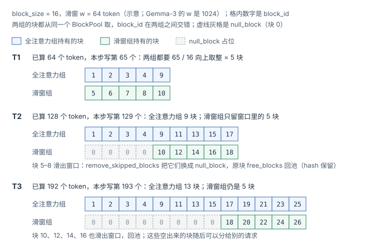

图里用 64 token 的窗口示意（Gemma-3 是 1024）。全注意力组的块表随序列一直变长；滑窗组前面的位置换成了 `null_block`（块 0），实际只持有窗口里的约 5 块。被换下来的块走 `free_blocks()`，**hash 保留**，进空闲队列尾部，可以被分给别的请求，也还能被 Prefix Cache 命中。块表本身的长度不变（第 i 项永远对应第 i 个 16 token），worker 端的 `BlockTable` 照常按位置索引，null 块不会被读到。

注意释放用的是 `total_computed_tokens − num_in_flight_tokens`，即只按**已经算完并确认**的 token 释放：异步调度时上一步还在 GPU 上跑，它的窗口还要读这些块；投机解码被拒的 token 也可能让位置回退。

### 4. 混合模型的 Prefix Cache 命中

滑窗组的命中规则和全注意力不同。要从位置 L 接着算，全注意力需要 `[0, L)` 每一块都在缓存里；滑窗只需要 L 之前一个窗口的块，即连续 `⌈(w − 1) / block_size⌉` 块（Gemma-3：`⌈1023 / 16⌉ = 64` 块），更早的块用 `null_block` 占位就行。所以 `SlidingWindowManager.find_longest_cache_hit()` **从右往左**扫，找到第一段连续 64 个命中块就停。Mamba 只需要 L 处的那一份状态，也是从右往左找最近的一个检查点。

`HybridKVCacheCoordinator.find_longest_cache_hit()` 把各组的结果对齐成一个共同的长度：全注意力组排在最前，从左往右扫得到一个上界；滑窗组在这个上界以内从右往左找；任何一组把长度缩短了，就用新长度重查其他组，直到长度不再变（一个全注意力加一种别的类型时，一轮就够）。最后全注意力组的块截到这个长度。

这带来一个只在混合模型上出现的问题：**滑窗组的块比全注意力组的块更早进入空闲队列。** 请求 A 还在运行时，滑出窗口的滑窗块就已经一块块归还了，在 LRU 队列里排在 A 结束时才归还的全注意力块前面，显存紧张时先被驱逐。只要 L 之前那 64 块里缺一块，滑窗组就找不到 L 处的命中，扫描一路退到序列开头那段连续命中的块——它们恰好是最早释放、最先被驱逐的，于是共同命中长度常常直接掉到 0，尽管全注意力组的 125 块一块都没丢。默认配置下滑窗组每个写满的块都会登记 hash，问题只出在驱逐顺序上。设置 `VLLM_PREFIX_CACHE_RETENTION_INTERVAL` 可以改成只在固定间隔保留滑窗检查点，用命中位置的密度换缓存占用；这时 `get_computed_blocks()` 记下的 `shared_prefix_boundary`（全注意力组命中了、滑窗组没跟上的公共前缀位置）会让 `cache_blocks()` 额外保留那个位置之前一个窗口的滑窗块（`SlidingWindowManager.reachable_block_mask()`），免得稀疏保留把多个请求共同的接合点丢掉。

### 5. 算账：Gemma-3-27B 的一个 32K 请求

Gemma-3-27B：62 层，16 个 KV 头，`head_dim = 128`，BF16。每 token 每层的 KV 是 `2 × 16 × 128 × 2 B = 8 KiB`，`block_size = 16` 时每层一页 128 KiB。一个 32K（32,768 token）上下文、正在 decode 的请求：

| 量 | 不区分窗口<br/>（`--disable-hybrid-kv-cache-manager`） | 窗口感知（默认） |
|---|---:|---:|
| 全注意力 10 层 | 32,768 × 10 × 8 KiB = 2.5 GiB | 2.5 GiB |
| 滑窗 52 层 | 32,768 × 52 × 8 KiB = 13 GiB | 52 层 × 65 块 × 128 KiB = 422.5 MiB |
| KV 数据合计 | 15.5 GiB | 2.91 GiB |
| 按块计（含分组填充） | 2,048 块 × 每块 62 页 = 15.5 GiB | (2,048 + 6 × 65) 块 × 每块 10 页 = 2.98 GiB |
| 每 token 平均 | 496 KiB | 95 KiB |
| 15 GiB 的 KV 池能放几个 | 0.97（一个都放不下） | 5.0 |

Table: Gemma-3-27B 一个 32K 请求的 KV 占用，不区分窗口与窗口感知两种管理方式

几个数怎么来的：

1. 滑窗组 65 块：decode 第 32,769 个 token 时，块表需要 `⌈32769 / 16⌉ = 2049` 项，跳过的 token 是 `32768 − 1024 + 1 = 31745`，即前 1984 块，剩 65 块。
2. 不区分窗口时（关掉混合管理器），`unify_hybrid_kv_cache_specs()` 把滑窗层的规格提升成全注意力规格，62 层合成一个组，每块 62 页 = 7.75 MiB。滑窗层的**计算**仍只看窗口，但**显存**按全长分配。
3. 15 GiB 是按单卡 H100 估的：80 GB × 0.92（默认 `gpu_memory_utilization`）≈ 73.6 GB，减去约 55 GB 的 BF16 权重和几 GB 的激活与 CUDA Graph，剩 15 GiB 左右。不区分窗口时一个 32K 请求都放不下，启动时 `get_kv_cache_configs()` 的显存检查会直接报错，要求调小 `max_model_len`。

窗口感知把这个请求的 KV 缩到 1/5.2。省下来的几乎全是滑窗层：52 层只为最近 1024 个 token 存 KV，上下文越长，省得越多（4K 上下文时只省 2.5 倍左右）。

还有一个峰值要注意。上面是 decode 的稳态；chunked prefill 一步要写 8192 个 token，这一步里滑窗组同时持有「上一个窗口 + 本步的 8192 个 token」：`⌈(1023 + 8192) / 16⌉ + 1 = 577` 块，6 个滑窗组共 3,462 块，是稳态的 9 倍。新请求准入时（`scheduler_reserve_full_isl` 默认开启）按这个上限检查空闲块，所以长 prompt 的准入门槛比它 decode 时的实际占用高得多。

gpt-oss-120b 是另一种比例：36 层里 18 层全注意力、18 层滑窗，窗口只有 128，每 token 每层 `2 × 8 × 64 × 2 B = 2 KiB`。长上下文下滑窗层几乎不占显存，每 token 的 KV 从 72 KiB 降到约 36 KiB，正好一半。

### 6. 代价与开关

混合管理器不是没有代价：

1. **分组填充**：Gemma-3-27B 的滑窗组每块浪费 1–2 页，滑窗部分最多 15% 的显存是空的。
2. **有的功能不支持混合组**：`SlidingWindowManager.get_num_common_prefix_blocks()` 和 `MambaManager` 的同名方法都直接返回 0，cascade attention（多个请求共享前缀时只读一遍前缀 KV）用不上；decode context parallel 不支持滑窗组；`find_longest_cache_hit` 要多组对齐，查找更慢。
3. **KV connector 要支持 HMA**：PD 分离、CPU offload 的 connector 如果没有实现 `SupportsHMA`，`VllmConfig` 会自动关掉混合管理器（HMA，hybrid KV cache manager）并打警告——滑窗模型照样能跑，只是退回上面左列的显存占用；Jamba、Bamba 这类 Mamba 混合模型则必须有 HMA，直接启动失败。
4. **Mamba 的块要清零**：`KVCacheConfig.needs_kv_cache_zeroing` 在有 Mamba 层或混合精度 KV 时为真，新分配的块要先清零（Mamba 状态在写满之前就会被读）。

开关是 `--disable-hybrid-kv-cache-manager`：默认 `None`，由 vLLM 按平台、KV connector 和模型自动决定；显式设成 `False` 而配置又不支持时会报错。

## 六、KV Cache 还能更小吗：结构、数值与分层存储

第四、五章都是在「已经要存这么多」的前提下管好显存。这一章换个方向：本来要存的量能不能更少，每个元素能不能更小。三个层面互不冲突，可以叠加：

| 层级 | 手段 | 解决的问题 |
|------|------|-----------|
| 系统管理层 | PagedAttention、Prefix Cache、混合 KV 管理 | 已经要存这么多，**显存怎么管才不浪费** |
| 模型架构层 | MQA / GQA / MLA、滑窗与跨层共享 | **本来到底需要存多少** |
| 数值层 | FP8 / INT8 / FP4 量化 | 每个 KV 元素**占几个字节** |

Table: KV Cache 瘦身的三个层级

### 1. GQA / MQA：模型结构级 KV Cache 瘦身

KV Cache 的大小与 KV head 数量成正比。Grouped-Query Attention (GQA) 和 Multi-Query Attention (MQA) 通过减少 KV head 数来缩减 KV Cache：

以 8 个 Query head 为例，三种变体的差别只在于**几个 Q head 共享一份 K/V**：

| 变体 | Q heads | K/V heads | 每 token 每层 KV 大小 | 相对 MHA |
|---|---|---|---|---|
| **MHA** | 8 | 8（一对一） | `2 × 8 × d` 个元素 | 100% |
| **GQA** | 8 | 2~4（分组共享） | `2 × G × d` 个元素 | 1/4 ~ 1/2 |
| **MQA** | 8 | 1（全部共享） | `2 × 1 × d` 个元素 | 1/8 |

Table: MHA、GQA 与 MQA 的 KV 大小

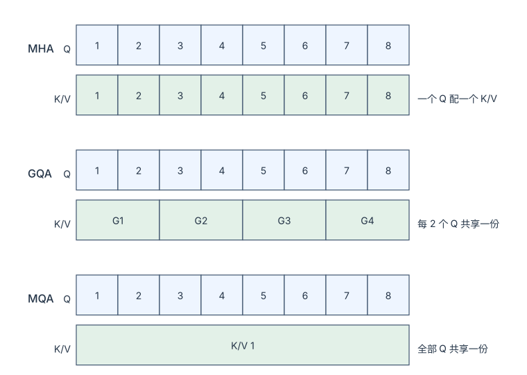

代价是表达能力：K/V head 越少，KV Cache 越小，但模型区分不同注意力模式的自由度也越低。GQA 是目前公认的甜点区——这也是为什么 Llama 3 全系都用 GQA。

| 模型 | 注意力类型 | num_heads | num_kv_heads | KV Cache 比例 |
|------|-----------|-----------|-------------|--------------|
| GPT-3 175B | MHA | 96 | 96 | 100% |
| Llama 3 70B | GQA | 64 | 8 | 12.5% |
| Llama 3 8B | GQA | 32 | 8 | 25% |
| Falcon 7B | MQA | 71 | 1 | 1.4% |
| DeepSeek V3 | MLA | 128 | - | ~2%（存 576 维 latent，相对 128 头 × 128 维的 MHA） |

Table: 主流模型的注意力类型与 KV Cache 比例

### 2. MLA：从 KV Cache 到 Latent Cache

DeepSeek V2/V3 提出的 Multi-head Latent Attention (MLA) 是一种更激进的 KV Cache 压缩方案。它不存储完整的 K、V 张量，而是存储一个低维的 latent 向量：

| | 传统 MHA / GQA | MLA（DeepSeek） |
|---|---|---|
| 存的是什么 | `K [Hkv, d]` + `V [Hkv, d]` | `c_kv [kv_lora_rank]` + `k_pe [qk_rope_head_dim]` |
| 每 token 每层 | `2 × Hkv × d` bytes | `(kv_lora_rank + qk_rope_head_dim) × sizeof(dtype)` |
| 实例 | Llama-70B（GQA-8）：`2×8×128×2B` = **4 KB** | DeepSeek V3：`(512+64)×2B` ≈ **1.1 KB** |

Table: MHA / GQA 与 MLA 的对比

MLA 的运作分两步——**存的时候压缩，用的时候还原**：

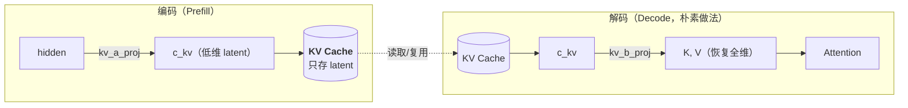

但朴素做法有个致命问题：**每一步 Decode 都要把全部历史 token 的 latent 解压回全维 K/V**，那省下的显存又变成了带宽开销。真正的关键优化叫 **"吸收"（Absorbing）**——把解压矩阵 `W_uk` 预先融合进 `W_q`，于是可以**直接在 latent 空间做 Attention，完全不解压**。原理是矩阵乘法的结合律：注意力分数 $$q^\top k = (W_q h_t)^\top (W_{uk} c_s) = h_t^\top (W_q^\top W_{uk})\, c_s$$，所以把 $$W_q^\top W_{uk}$$ 预先乘成一个矩阵，query 直接投影到 latent 维度，和缓存里的 $$c_s$$ 做点积；V 侧同理，把 $$W_{uv}$$ 并进输出投影 $$W_o$$。这样 Decode 时读的和算的都是 576 维的 latent，不再还原 K、V（见 [DeepSeek-V2 论文](https://arxiv.org/abs/2405.04434) 2.1.2 节）。

压缩效果：相比同规模 MHA 可缩减一个数量级以上；相比 Llama 式 GQA-8（4 KB/token/layer）约缩减 3~4x。

以[《为什么 LLM Serving 难》](/why-llm-serving-is-hard.html)的 Llama-3-70B 为参照，三层叠起来是：MHA 64 头 BF16 每 token `2 × 64 × 128 × 2 B × 80 层 = 2.56 MB`，GQA-8 是 320 KB，再存成 FP8 是 160 KB，一共缩小 16 倍。

vLLM 里 MLA 层是 `MLAAttention`（`vllm/model_executor/layers/attention/mla_attention.py`，模型侧经 `vllm/model_executor/layers/mla.py` 的 `MultiHeadLatentAttentionWrapper` 接入）。它的 `get_kv_cache_spec()` 返回 `MLAAttentionSpec(num_kv_heads=1, head_size=576)`：把 latent 当成「只有 1 个头、576 维、K 和 V 不分开」的 KV，页大小是 `block_size × 576 × dtype 字节`，没有全注意力公式里那个 2。`MLAAttentionSpec` 是 `FullAttentionSpec` 的子类，由 `FullAttentionManager` 管理，所以分页、Prefix Cache、驱逐都和普通模型完全一样——变的只是每页的字节数。

### 3. KV 量化：每个元素占几个字节

GQA 和 MLA 要改模型、要重新训练；量化 KV 不改模型，只改存法。问题是：

> **把 KV 存成 FP8 能多装多少请求，scale 从哪来、哪些后端支持，代价是什么？[^q3]**

#### 3.1 v0.27.1 能选的 `kv_cache_dtype`

`--kv-cache-dtype` 的取值定义在 `vllm/config/cache.py` 的 `CacheDType`，`vllm/v1/kv_cache_interface.py` 的 `get_kv_quant_mode()` 再把字符串映射成后端分派用的 `KVQuantMode`：

| `kv_cache_dtype` | `KVQuantMode` | 每元素 | scale 的粒度与来源 |
|---|---|---|---|
| `auto` / `bfloat16` / `float16` | `NONE` | 2 B | 无（`auto` 跟模型 dtype 走） |
| `fp8` / `fp8_e4m3` / `fp8_e5m2` | `FP8_PER_TENSOR` | 1 B | 每层一对标量 `k_scale` / `v_scale`，从 checkpoint 读，没有就是 1.0 |
| `fp8_per_token_head` / `int8_per_token_head` | `*_PER_TOKEN_HEAD` | 1 B | 每个 token 的每个 KV 头一个 scale，写 cache 时在 kernel 里动态算 |
| `int4_per_token_head` | `INT4_PER_TOKEN_HEAD` | 0.5 B | 同上，两个 int4 打包进一个字节 |
| `nvfp4` | `NVFP4` | 约 0.56 B | FP4 数据 + 每 16 个元素一个 FP8 块 scale |
| `turboquant_*` | `TURBOQUANT` | 3–4 bit 级 | Hadamard 旋转后量化，K、V 打包存放 |
| `fp8_ds_mla` | （MLA 专用布局） | 每 token 656 B | DeepSeek-V3.2 的稀疏 MLA 自定义格式 |

Table: v0.27.1 的 kv_cache_dtype 取值、每元素字节与 scale 来源

CUDA 上 `fp8` 就是 `fp8_e4m3`。E4M3 有 3 位尾数、最大值 448，E5M2 只有 2 位尾数但范围大得多；KV 的数值范围不大，精度更要紧，所以默认用 E4M3。所有 FP8 格式在张量层面都存成 `torch.uint8`（`STR_DTYPE_TO_TORCH_DTYPE`），kernel 读的时候再按 FP8 解释。

#### 3.2 scale 存在哪

**按张量（`fp8*`）**：`vllm/model_executor/layers/quantization/kv_cache.py` 的 `BaseKVCacheMethod` 给每个 attention 层建 `k_scale`、`v_scale`（还有 `q_scale`、`prob_scale`），初值 −1 表示「没加载到」。`process_weights_after_loading()` 的规则：

1. checkpoint 里有 `k_scale`、`v_scale`：直接用；只有一个合并的 `kv_scale` 时，K、V 用同一个值。
2. 都没有：用 1.0，并打警告 「Using KV cache scaling factor 1.0 for fp8_e4m3」。scale 为 1 意味着直接把 BF16 值截断成 E4M3，超过 448 的值会被截到最大值；KV 的值通常远小于这个范围，但精度全靠 3 位尾数。
3. scale 必须是标量，否则报错 「Only support per-tensor scaling factor for fp8 KV cache」。

写入时 `reshape_and_cache_flash()` 拿 `layer._k_scale` / `_v_scale` 把 K、V 除以 scale 再存；读取时 FlashAttention 把它们作为 `k_descale` / `v_descale` 传进 kernel，在 kernel 内反量化，显存里从头到尾都是 1 字节。scale 是每层一个标量，跟着模型权重走，**不占 KV 块的空间**。动态计算 scale 的 `--calculate-kv-scales` 在 v0.27.1 里已标为弃用。

**按 token × 头（`*_per_token_head`）**：scale 在写 cache 时由 kernel 对每个 (token, head) 动态计算，checkpoint 里的 scale 一律不用。这些 scale 存在 attention 后端单独管理的张量里，但显存是从 KV 池里划出来的，所以 `AttentionSpec.unpadded_page_size_bytes` 给每页加上 `2 × block_size × num_kv_heads × 4 B`（float32）。Llama-3-70B TP8 每卡 1 个 KV 头：每 token 每层数据 `2 × 128 × 1 B = 256 B`，scale `2 × 4 B = 8 B`，多 3%。

#### 3.3 哪些后端支持

| 后端 | 支持的量化 KV | 条件 |
|---|---|---|
| FlashAttention | `fp8`、`fp8_e4m3` | FA3 + Hopper（SM90），或 FA4 + Blackwell（SM100）；不支持 `fp8_e5m2`（`flash_attn_supports_kv_cache_dtype()`） |
| FlashInfer | `fp8`、`fp8_e4m3`、`fp8_e5m2`、`nvfp4` | — |
| Triton | `fp8`、`fp8_e4m3`、`fp8_e5m2`、三种 `*_per_token_head` | — |
| MLA 后端（FlashMLA、CUTLASS MLA、FlashInfer MLA、Triton MLA） | `fp8`、`fp8_e4m3` | — |

Table: v0.27.1 主要 attention 后端的 supported_kv_cache_dtypes

每个后端类的 `supported_kv_cache_dtypes` 列出它接受的取值，后端选择时不匹配的直接排除。所以 per-token-head 量化在 v0.27.1 只能走 Triton 后端；在 H100 上用默认的 FlashAttention 时，能选的只有 E4M3 按张量量化。FlashAttention 的 FP8 路径连 query 也一起量化（没有 `q_scale` 时用 `k_scale` 代替，会打警告），attention 的乘法在 FP8 上做。

#### 3.4 算账：Llama-3-70B / 8×H100 能多装多少

沿用[《为什么 LLM Serving 难》](/why-llm-serving-is-hard.html)的例子。每卡留给 KV 多少要看实际启动日志，这里按约 50 GiB 估：80 GB × 0.92 ≈ 73.6 GB，减去权重 17.6 GB 和几 GB 的激活、CUDA Graph、通信缓冲。TP8 下每卡只有 1 个 KV 头，每 token 每卡 40 KiB（BF16）或 20 KiB（FP8），每块 16 token 即 640 KiB 或 320 KiB：

| 场景 | BF16 | FP8（E4M3） |
|---|---:|---:|
| 每卡块池 | 81,920 块，131 万 token | 163,840 块，262 万 token |
| 2,350 token 的请求（147 块）能并发几个 | 557 | 1,114 → 被 `max_num_seqs` 的默认值 1,024 截住 |
| 8K 上下文（512 块） | 160 | 320 |
| 32K 上下文（2,048 块） | 40 | 80 |

Table: Llama-3-70B / 8×H100 每卡 50 GiB KV 池在 BF16 与 FP8 下的并发上限

（`max_num_seqs` 在 80 GB 级、非 A100 的卡上默认 1,024，见 `vllm/engine/arg_utils.py` 的 `get_batch_defaults()`。）

容量翻倍只是一半收益。Decode 受带宽限制，[《为什么 LLM Serving 难》](/why-llm-serving-is-hard.html)算过 Batch=256 时每步要读 24 GB 的 KV、已经超过权重本身；KV 减半，这部分读取也减半，长上下文、大 batch 的 decode 每步时间跟着下降。

#### 3.5 代价与相互影响

1. **精度**：K 的误差直接进入 $$q^\top k$$，softmax 的指数会放大 logit 之间的差，长上下文时被加权平均的 token 越多，误差越难预料；V 的误差只是线性地混进输出。按张量的 FP8 用一个标量覆盖整层所有 token 和头，某些头的离群值会挤占其他头的精度。scale 为 1.0 时（checkpoint 没给）风险最大，上线前要在自己的评测集上对比。`--kv-cache-dtype-skip-layers` 可以让指定层（按层号，或 `sliding_window` 这类注意力类型）保持原精度，代价是混合精度的块池：页大小要对齐、新块要清零（`KVCacheConfig.has_mixed_precision_kv_cache`）。
2. **Prefix Cache**：块哈希不包含 dtype，因为一个实例里所有块的 dtype 相同，命中的块直接可用；量化只是让同样的显存能多缓存一倍的前缀。但改了 `kv_cache_dtype` 的实例之间不能共享缓存的 KV。
3. **PD 分离**：NIXL connector 握手时比对的兼容性哈希（`compute_nixl_compatibility_hash()`）把 `cache_dtype` 算了进去，`enforce_handshake_compat` 默认开启，Prefill 和 Decode 两端的 `kv_cache_dtype` 必须一致；一致时每个请求要传的字节数减半。
4. **Offload**：存到 CPU 的是块的原始字节，FP8 的块在 CPU 上也只占一半，PCIe 搬运量同样减半。

### 4. KV Cache Offloading 与 Swapping

当 GPU 显存不足时，KV Cache 还可以放到更低层的存储：

| 层级 | 容量 | 带宽 | 延迟 | 存什么 |
|---|---|---|---|---|
| **GPU HBM**（热） | 10–80 GB | 3.35 TB/s (H100) | ~ns | 活跃请求的 KV + 当前的 Prefix Cache |
| **CPU DRAM**（温） | 256 GB–2 TB | ~200 GB/s（经 PCIe Gen5 约 64 GB/s 回到 GPU） | ~100 ns | 从 GPU 上驱逐的前缀块（Prefix Cache 的二级缓存） |
| **NVMe SSD**（冷） | 1–16 TB | ~7 GB/s | ~10 μs | 长期前缀缓存（较新的方向） |

Table: KV Cache 的分层存储

当 GPU 显存不够时，有三种应对策略，代价各不相同：

| 策略 | 做法 | 优点 | 缺点 |
|---|---|---|---|
| **Recomputation**（重算） | 直接释放 KV，恢复时从头算 | 无传输开销，不占 CPU 内存 | 浪费 GPU 算力 |
| **Swapping**（换出） | KV 块 GPU→CPU，恢复时回传 | 保留了已算结果 | 吃 PCIe 带宽 |
| **Quantization + Offload** | 量化后再换出 | 传输量减半 | 额外精度损失 |

Table: 显存不够时的三种应对策略

vLLM V1 抢占时用 **Recomputation**（`Scheduler._preempt_request()` 归还全部块、把 `num_computed_tokens` 置零），因为在 Prefix Cache 存在的情况下，重算的实际成本远低于理论最坏情况——大部分前缀块仍在缓存中可复用（前提是第四章那几种塌方没有发生）。CPU 这一层在 v0.27.1 里不是抢占时的换出目的地，而是通过 KV connector 接入的二级缓存：设置 `kv_offloading_size`（GiB）后，`kv_offloading_backend`（`native` 或 `lmcache`）把块存到 CPU，前缀在 GPU 上被驱逐之后还能读回来，而不必重算。这条路要求 connector 支持混合 KV（第五章第 6 节），否则滑窗模型会退回不区分窗口的显存占用。

<details markdown="1">
<summary><b>📂 本章源码导航</b></summary>

**KV Cache 与 PagedAttention**

| 想看什么 | 从哪开始 |
|---|---|
| **块的分配与释放（核心）** | `vllm/v1/core/kv_cache_manager.py` → `KVCacheManager.allocate_slots()`、`get_computed_blocks()`、`free()` |
| 物理块池、null_block、LRU 驱逐、Prefix Cache 注册 | `vllm/v1/core/block_pool.py` → `BlockPool.get_new_blocks()`、`free_blocks()`、`touch()`、`cache_full_blocks()`；`BlockHashToBlockMap` |
| 空闲队列、块元数据 | `vllm/v1/core/kv_cache_utils.py` → `FreeKVCacheBlockQueue`、`KVCacheBlock` |
| 块哈希、`extra_keys`、`NONE_HASH` | `vllm/v1/core/kv_cache_utils.py` → `hash_block_tokens()`、`generate_block_hash_extra_keys()`、`get_request_block_hasher()`、`init_none_hash()` |
| 命中查找、各类层的块管理 | `vllm/v1/core/single_type_kv_cache_manager.py` → `FullAttentionManager`、`SlidingWindowManager`、`MambaManager` 的 `find_longest_cache_hit()` / `remove_skipped_blocks()` |
| 多组协调 | `vllm/v1/core/kv_cache_coordinator.py` → `get_kv_cache_coordinator()`、`UnitaryKVCacheCoordinator`、`HybridKVCacheCoordinator.find_longest_cache_hit()` |
| 各类 KV 规格、量化模式 | `vllm/v1/kv_cache_interface.py` → `KVCacheSpec` 及其子类、`KVQuantMode`、`KVCacheConfig` |
| 分组与页大小统一 | `vllm/v1/core/kv_cache_utils.py` → `get_kv_cache_groups()`、`unify_kv_cache_spec_page_size()`、`_get_kv_cache_groups_uniform_page_size()`、`get_kv_cache_config_from_groups()` |
| Mamba 混合模型的块大小对齐 | `vllm/platforms/interface.py` → `Platform.update_block_size_for_backend()` |
| MLA 层 | `vllm/model_executor/layers/attention/mla_attention.py` → `MLAAttention.get_kv_cache_spec()` |
| KV 量化的 scale | `vllm/model_executor/layers/quantization/kv_cache.py` → `BaseKVCacheMethod` |
| 各后端支持的 KV dtype | `vllm/v1/attention/backends/*.py` → `supported_kv_cache_dtypes` |
| 相关配置 | `vllm/config/cache.py` → `CacheConfig`（`block_size`、`cache_dtype`、`enable_prefix_caching`、`prefix_caching_hash_algo`、`kv_offloading_size`） |

Table: KV Cache 与 PagedAttention 源码导航

</details>

## 七、本文小结

- 显存不是被模型吃掉的，是被"不确定性"浪费掉的：请求的最终长度在到达时未知，按最坏情况预留连续显存会造成大量内部碎片。
- PagedAttention 把 KV Cache 切成固定大小的块，用多少申请多少、块间不要求相邻——这就是操作系统虚拟内存分页在推理系统中的重现；vLLM 中对应 `KVCacheManager`、`BlockPool`、`KVCacheBlock` 与 Block Table 这组数据结构，块 0 是永不分配的 null_block。
- 一次请求的 KV 生命周期是：Prefill 批量写入 → Decode 逐 slot 追加 → 完成或被抢占时归还；块只有"写满"才会进入 Prefix Cache，所以复用粒度是 `block_size` 而不是单个 token。
- Prefix Cache 用链式哈希做键（`extra_keys` 隔离 LoRA、多模态、`cache_salt`），从链头逐块查到第一个未命中为止，命中上限是 `num_tokens - 1`；命中的块若还在空闲队列里，要算进本次分配的容量。空闲块按 LRU 排队、同一请求的链尾先走，驱逐是分配时顺手做的。前缀不稳定、工作集超过块池、高负载、抢占与多实例、整块粒度，都会让命中率塌下去。
- 混合模型里各层的 KV 寿命不同：vLLM 把层按规格分成层数相同、页大小相同的 KV cache group，共用一个块池；滑窗组每步把窗口外的块换成 null_block 归还。Gemma-3-27B 的 32K 请求因此从 15.5 GiB 降到约 3 GiB；代价是分组填充、部分功能不支持，以及 KV connector 必须支持 HMA。
- 让 KV Cache 更小有三个正交层面：系统管理层（分页、Prefix Cache、混合 KV 管理）、模型架构层（MQA / GQA / MLA）、数值层（KV 量化）。H100 默认的 FlashAttention 后端只支持 E4M3 按张量量化，scale 是每层一对标量；Llama-3-70B 换成 FP8 后每卡并发上限翻倍，PD 两端的 `kv_cache_dtype` 必须一致。
- 显存不够时 vLLM V1 抢占用重算，CPU 层是 Prefix Cache 的二级缓存而不是换出目的地。

## 八、自测

1. `block_size = 16`、Llama-3-70B TP8：一个块多大？一个 2050 token 的请求要几个块、最后一块浪费多少？

   <details markdown="1"><summary>答案</summary>

   每卡每 token 320 KB / 8 = 40 KB，一块 640 KB；$$\lceil 2050 / 16 \rceil = 129$$ 块，最后一块只用 2 个 slot、浪费 14 / 16——分页后碎片上限是一块，不是整个最大长度。

   </details>

2. Prefix Cache 的键为什么是“链式哈希”而不是本块 token 的哈希？`cache_salt` 为什么只加在第一块上？

   <details markdown="1"><summary>答案</summary>

   同样的 16 个 token 在不同前缀之后的 K、V 不同（attention 依赖全部前文），只有“前缀完全相同”的块才能复用；链式哈希 = hash(前一块哈希, 本块 token, extra_keys)，天然编码了整个前缀。`cache_salt` 进了第一块的哈希，就会沿链传到后面每一块，加一次就隔离了整条链。

   </details>

3. 2000 token 的 system prompt + 50 token 用户问题，第二个请求命中多少块、还要 prefill 多少 token？如果第二个请求和第一个的 2048 token prompt 一字不差呢？

   <details markdown="1"><summary>答案</summary>

   第一种：125 个整块全部命中，还要 prefill 50 个 token（如果 system prompt 是 2005 个 token，最后 5 个落在未满的块里，也要重算）。第二种：命中上限是 `num_tokens - 1 = 2047`，只能命中 127 块，最后一整块 16 个 token 重算——要算出最后一个 token 的 logits。

   </details>

4. 请求完成时它的块按什么顺序回到空闲队列？一个新请求命中了 3 块、其中 1 块已在空闲队列里，还需要 2 个新块，空闲队列只剩 2 块，能调度吗？

   <details markdown="1"><summary>答案</summary>

   反序归还：链尾块先进队列、先被驱逐；没写满、没 hash 的块直接插到队首。第二问不能：命中但 `ref_cnt == 0` 的块也要从空闲队列里摘走，所需容量是 2 + 1 = 3 > 2，`allocate_slots` 返回 None，请求留在 waiting，命中的块不被 touch。

   </details>

5. Gemma-3-27B（62 层、5 滑窗 : 1 全注意力、窗口 1024、每 token 每层 8 KiB）：vLLM 把它分成几个 KV cache group？一个 32K 请求在 decode 时，滑窗组和全注意力组各占多少块，总共多少显存？

   <details markdown="1"><summary>答案</summary>

   7 组：10 层全注意力 1 组，52 层滑窗按每组 10 层切成 6 组（9、9、9、9、8、8 层，填 8 层）。全注意力组约 2048 块，每个滑窗组 65 块；每块 10 页 × 128 KiB = 1.25 MiB，共 (2048 + 390) × 1.25 MiB ≈ 2.98 GiB，不区分窗口时是 15.5 GiB。

   </details>

6. Llama-3-70B / 8×H100，每卡约 50 GiB 留给 KV：8K 上下文的请求在 BF16 和 FP8 下各能并发几个？用默认的 FlashAttention 后端开 `--kv-cache-dtype fp8`、checkpoint 里没有 KV scale，会发生什么？

   <details markdown="1"><summary>答案</summary>

   每卡每 token 40 KiB → 20 KiB，块池 81,920 → 163,840 块；8K 请求 512 块，并发 160 → 320。FlashAttention 在 H100 上走 FA3，只支持 E4M3 按张量量化；没有 scale 时 `k_scale = v_scale = 1.0` 并打警告，精度全靠 E4M3 的 3 位尾数，上线前要在评测集上对比。

   </details>

[^q0]: **放在哪里**：按块放。请求到达时不知道它会生成 300 还是 20K 个 token，按最坏情况预留连续显存会让有效数据不到三成；PagedAttention 把每个请求的 KV 切成固定大小（`block_size`，默认 16 token）的块，用多少申请多少、块之间不要求相邻——`KVCacheManager` 管每个请求的块列表、`BlockPool` 管空闲块与引用计数、Block Table 是逻辑块到物理块的映射，attention kernel 经它查地址（[第二章](#二pagedattention-的数学本质与源码实现)）。**如何复用**：Prefix Cache——块写满才进缓存，用链式哈希（前一块的哈希 + 本块 token + extra_keys）做键、`ref_cnt` 让多个请求共享同一物理块；2000 token 的 system prompt 是 125 个整块，第二个请求全部命中（[第四章](#四prefix-cache命中怎么找谁先被驱逐)）。混合模型里各层寿命不同，滑窗层只留窗口里的块（[第五章](#五混合-kv一个模型里有几种注意力)）。**何时释放**：Prefill 批量写入 → Decode 每步追加一个 slot、块满了再申请 → 完成或被抢占时反序归还；`ref_cnt` 为零的块进空闲队列、仍可被后来者命中，直到被分配时顺手驱逐（[第三章](#三一个-kv-块的完整生命周期分配写入读取归还)）。让 KV 更小还有结构（GQA / MLA）和数值（FP8）两层，显存不够时 V1 用重算而不是换出（[第六章](#六kv-cache-还能更小吗结构数值与分层存储)）。
[^q1]: **怎么找**：请求侧在 token 追加时为每个写满的块算链式哈希，`find_longest_cache_hit` 从链头逐块查 `cached_block_hash_to_block`，第一块未命中就停；上限是 `num_tokens - 1`，所以 prompt 完全相同时最后一整块也要重算。命中的块若 `ref_cnt == 0`（还在空闲队列里），要和新块一起算进容量，容量不够就整个请求等待、不 touch。**先丢哪些**：空闲队列按 LRU 排序，同一请求归还的块链尾在前（`free()` 用 `reversed()`），没 hash 的块直接插到队首；驱逐发生在 `get_new_blocks()` 从队首取块时。**什么负载会塌**：前缀开头有变化的内容、工作集超过块池（轮转访问时 LRU 命中率接近 0）、高负载下空闲块少、抢占与不感知前缀的多实例路由、整块粒度。详见[第四章](#四prefix-cache命中怎么找谁先被驱逐)。
[^q2]: vLLM 按每层的 `KVCacheSpec` 分桶，再切成层数相同、页大小相同的 KV cache group，所有组共用一个 `BlockPool`；block_id j 在各个 `KVCacheTensor` 里的第 j 格归当前持有它的组。滑窗组每步把窗口外的块换成 null_block 归还，Mamba 组每个请求只留一份状态；命中查找由 `HybridKVCacheCoordinator` 对齐到各组共同的长度。Gemma-3-27B 一个 32K 请求从 15.5 GiB 降到约 2.98 GiB（5.2 倍）；代价是分组填充（滑窗部分最多 15%）、cascade attention 等功能不可用、KV connector 必须支持 HMA。详见[第五章](#五混合-kv一个模型里有几种注意力)。
[^q3]: FP8 每个元素从 2 字节降到 1 字节：Llama-3-70B / 8×H100 每卡 50 GiB 的块池从 81,920 块变成 163,840 块，8K 请求的并发上限从 160 到 320，decode 每步读的 KV 也减半。按张量的 FP8 用每层一对标量 `k_scale` / `v_scale`，从 checkpoint 读、没有就是 1.0；per-token-head 模式在写入时动态算 scale，多占约 3% 显存，只有 Triton 后端支持。H100 上默认的 FlashAttention（FA3）只支持 E4M3。代价是精度（K 的误差经 softmax 放大，scale 为 1.0 时风险最大），PD 分离两端的 `kv_cache_dtype` 必须一致。详见[第六章第 3 节](#3-kv-量化每个元素占几个字节)。
