> **NOTE** 本文基于 vLLM v0.27.1（tag `6e448d0`, 2026-08-11）源码剖析。文中文件路径、类名和函数名均以该版本为准；vLLM 迭代很快，阅读时请以你手上的版本对照。
>
> **版本提示 @2026-11-12**：v0.29.0（2026-09-09）起，Model Runner V2（`vllm/v1/worker/gpu/`）成为所有模型的默认实现，V1 的 `GPUModelRunner`（`vllm/v1/worker/gpu_model_runner.py`）被宣布弃用，只在 V2 尚不支持的配置下作为回退。本文第二章（`SchedulerOutput` 到 GPU 张量的翻译）、CUDA Graph 与投机解码三章的源码讲的是 V1 路径：V2 有自己的输入准备（`vllm/v1/worker/gpu/input_batch.py`、`block_table.py`、`attn_utils.py`）、CUDA Graph 管理（`cudagraph_utils.py`）、拒绝采样与整套 speculator（`vllm/v1/worker/gpu/spec_decode/`），机制与本文一致，类名和文件不同；在 v0.29 及以后的版本里调试输入准备，断点要打在 `vllm/v1/worker/gpu/model_runner.py`。Medusa 在 v0.33.0 的预发布版中已被删除。


前面几篇解决的是"这一轮算哪些 token"（Scheduler）和"它们的状态放在哪里"（KV Cache）。这一篇的问题是：

> **这些已经确定要算的 token，怎么算得更快？[^q0]**

## 一、总览：四种浪费与一笔账

### 1. GPU 上的四种浪费形态

Decode 偏 memory-bound、Prefill 偏 compute-bound，但落到 GPU 上，浪费其实只有四种形态：

| 浪费形态 | 症状 | 对策 | 
|---|---|---|
| GPU 在**等 CPU 发指令** | kernel 之间有气泡 | CUDA Graph | 
| GPU 在**等 HBM 送数据** | 算力闲置、访存打满 | FlashAttention、算子融合 | 
| 搬的**每个数太胖** | 带宽被低信息密度的数据占满 | FP8 / INT8 / INT4 量化 | 
| **轮次本身太多** | 每轮只产出 1 个 token | 投机解码（不改输出分布，只改一次 forward 产出几个 token） |

Table: GPU 上的四种浪费形态


### 2. 回到前面的例子：一笔账

**回到前面的例子**（Llama-3-70B、8×H100、TP=8）：每张卡持有 17.6 GB 权重，H100 HBM 带宽 3.35 TB/s，于是**一次 decode 的权重读取下界约 5.3 ms**；加上 KV 读取、80 层 × 2 次 All-Reduce 和 kernel 开销，实测一步大约在 10 ms 量级。

那么这个请求的账就清楚了：

| 环节 | 估算 | 占比 |
|---|---|---|
| Prefill 2050 token | ≈ 92 ms（8×H100 稠密算力 7.9 PFLOPS，按 40% MFU 估） | 3% |
| Decode 300 步 | 300 × 10 ms ≈ **3000 ms** | **97%** |
| E2E | ≈ 3.1 s | |

Table: 贯穿全文例子的一笔时间账

**看清楚这个 3% vs 97%**：TTFT 只有 92 ms，而 97% 的时间花在那 300 次逐 token 的 decode 上。这解释了为什么绝大多数优化都是针对 Decode 侧的优化——Prefill 再快一倍，端到端也只省 3%。

### 3. 本文的章节安排

四种浪费都发生在 forward 里，而 forward 的输入是 ModelRunner 每一步现做的：调度器交出来的只是“哪个请求本轮推进多少 token”，kernel 要的是扁平的 `input_ids`、每个 token 的 KV 写入位置和每个请求能读的块。所以第二章先讲这层翻译和一步之内 CPU 与 GPU 谁等谁——CUDA Graph 的分桶与 padding、attention metadata、投机解码一次算 K+1 个位置，都是在这层翻译里决定的。第三到第六章再按上表的顺序，每章对付一种浪费：

| 章 | 主题 | 内容 |
|---|---|---|
| 二 | forward 之前：SchedulerOutput 如何变成 GPU 张量 | `SchedulerOutput` 的字段<br/>`_update_states()`、`_prepare_inputs()`、attention metadata、执行模式选择四步翻译<br/>一步之内 CPU 与 GPU 在哪里等谁：`execute_model()` 与 `sample_tokens()`、唯一的同步点<br/>Worker 进程的常驻循环 `worker_busy_loop()`<br/>forward 里的 kernel 从哪来：`torch.ops._C.*` 与 `torch.ops.vllm.*` 两类注册 |
| 三 | GPU 为什么在空转？ | Kernel Launch Overhead 与 CUDA Graph 的捕获、重放 |
| 四 | 数据为什么搬不动？ | FlashAttention（Attention 后端路由、Tiling 与 Online Softmax）与 Kernel Fusion |
| 五 | 能不能少搬几个字节？ | 权重量化、FP8 推理与混合精度组合 |
| 六 | 能不能少跑几轮模型？ | 投机解码的原理与无损性<br/>Proposer 家族（Draft Model / n-gram / EAGLE / Medusa / MTP）<br/>调度器的预算、lookahead 槽位与回滚<br/>model runner 一次算 K+1 个位置与 CUDA Graph<br/>RejectionSampler<br/>收益的临界点<br/>多卡与 PD 下的约束 |
| 七 | 本文小结 |  |
| 八 | 自测 | 8 道题 |

Table: 本文的章节安排

## 二、forward 之前：SchedulerOutput 如何变成 GPU 张量

> **调度器交出来的是“哪个请求本轮推进多少 token”，kernel 要的是“这个 token 的 KV 写到哪个 slot、这个请求能读哪些块”——中间这层翻译在哪做、做了什么，又为什么不让 GPU 等？[^q1]**

[《Scheduler》](/scheduler-batch-and-fairness.html)的调度决策和本文后面四章的 GPU 执行之间，隔着这一层翻译。做翻译的是 `GPUModelRunner.execute_model()` 的前半段：`_update_states()`、`_prepare_inputs()`、`_build_attention_metadata()` 三个函数，再加一次执行模式选择。先看全貌，下面两张表再展开：

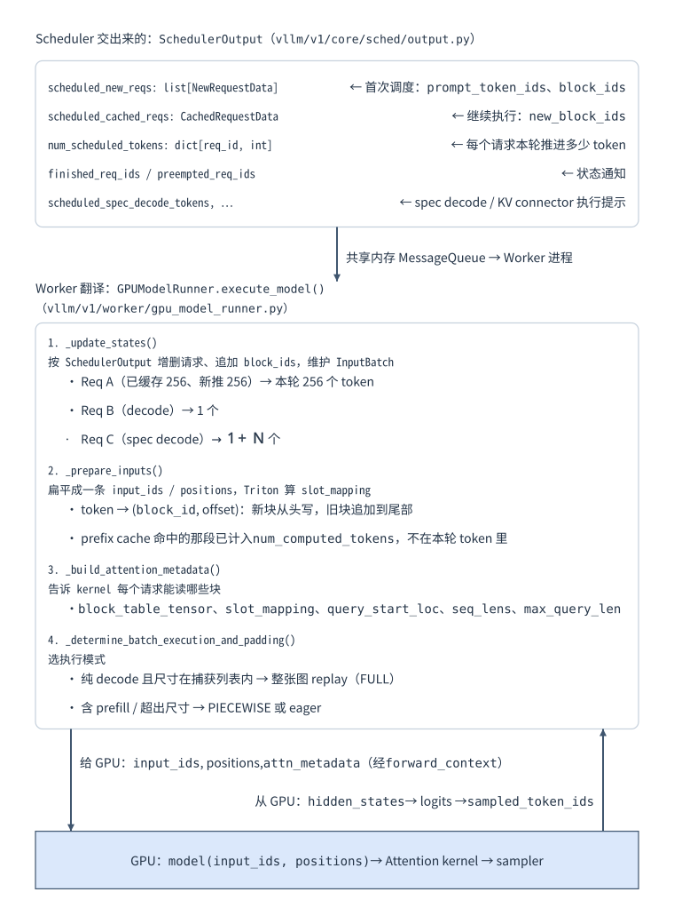

### 1. 输入：SchedulerOutput 交出来什么

`SchedulerOutput`（`vllm/v1/core/sched/output.py`）经共享内存 `MessageQueue` 广播到每个 Worker 进程，里面全是 Python 的 int 和 list：

| 字段 | 类型 | 含义 |
|---|---|---|
| `scheduled_new_reqs` | `list[NewRequestData]` | 首次调度的请求：带 `prompt_token_ids`、`sampling_params`、`block_ids`、`num_computed_tokens` |
| `scheduled_cached_reqs` | `CachedRequestData` | 继续执行（或从抢占恢复）的请求，按列存：`req_ids`、`new_block_ids`、`num_computed_tokens` |
| `num_scheduled_tokens` | `dict[str, int]` | 每个请求本轮推进多少 token；`total_num_scheduled_tokens` 是总和 |
| `scheduled_spec_decode_tokens` | `dict[str, list[int]]` | 本轮要验证的草稿 token |
| `finished_req_ids` / `preempted_req_ids` | `set[str]` | 状态通知，Worker 据此删 `InputBatch` 的行 |

Table: SchedulerOutput 的字段

### 2. 四步翻译：从调度决策到 kernel 参数

Worker 一侧常驻一份 `InputBatch`（`vllm/v1/worker/gpu_input_batch.py`，每个在跑的请求占一行）和每个 KV cache group 一张 `BlockTable`（`vllm/v1/worker/block_table.py`）。它们和调度器进程里的对象怎样靠 `request_id`、`block_id` 两个整数对上，见[《鸟瞰 vLLM》“核心数据对象：四个域”](/vllm-request-lifecycle-overview.html#3-核心数据对象四个域)那张图。每一步，Worker 把 `SchedulerOutput` 翻译成 GPU 数据结构，分四步：

| 步骤 | 函数 | 做什么 | 细节 |
|---|---|---|---|
| ① 同步 `InputBatch` | `_update_states()` | 按 `SchedulerOutput` 删掉完成 / 抢占的行、加新请求、追加新块号、更新 `num_computed_tokens`；`InputBatch` 跨步常驻，只做增量；删行留下的空洞由 `condense()` 把尾行搬进来，`BlockTable` 跟着 `move_row()` / `swap_row()` 同步搬行，所以行号每步都可能变 | Req A（已缓存 256、新推 256）→ 本轮 256 个 token<br/>Req B（decode）→ 1 个<br/>Req C（spec decode）→ 1+N 个 |
| ② 拼输入与 `slot_mapping` | `_prepare_inputs()` | numpy 把各请求本轮的 token 扁平成一条 `input_ids` / `positions`，经 pinned buffer 异步 H2D；`block_table.compute_slot_mapping()` 用 Triton kernel 由 block table 算出每个 token 的 slot | 新块从头写<br/>已有块追加到尾部<br/>**Prefix Cache 命中的那段已计入 `num_computed_tokens`，根本不在本轮 token 里** |
| ③ attention metadata | `_build_attention_metadata()` | 告诉 kernel 每个请求能读哪些块 | `block_table_tensor`、`slot_mapping`、`query_start_loc`、`seq_lens`、`max_query_len`；V1 没有 `is_prompt`，prefill 和 decode 只是 query 长度不同 |
| ④ 执行模式选择 | `_determine_batch_execution_and_padding()` → `cudagraph_dispatcher.dispatch()` | 决定 FULL / PIECEWISE CUDA Graph 还是 eager，并把 batch pad 到捕获过的尺寸 | 纯 decode 且尺寸在捕获列表内 → 整张图 replay<br/>含 prefill / 超出尺寸 → piecewise graph 或 eager |

Table: SchedulerOutput 到 GPU 输入的四步翻译

最终**给 GPU 的**是 `input_ids`、`positions`（直接传给 `model()`）和 attention metadata（经 `forward_context` 交给各层 Attention），**从 GPU 拿回的**是 `hidden_states → logits → sampled_token_ids`。

所以 `SchedulerOutput` 和 GPU 计算之间隔着的这一层不是调模型，而是把调度决策翻译成 GPU 数据结构：`slot_mapping` 告诉每个 token 的 KV 写去哪，`block_table` 告诉每个请求能读到哪些块，CUDA Graph / Eager 的选择也在这里决定。这层翻译是看懂后面 Prefill、Decode 和 Mixed Batch 执行差异的前提。

这一层为什么必须存在：`slot_mapping` 是[《KV Cache》](/kv-cache-memory-core.html)分块存储的直接产物（KV 不连续，所以必须逐 token 给出落点），`block_table` 是 Prefix Cache 共享的直接产物（多个请求可能指向同一个物理块，见《KV Cache》），而“走 Graph 还是 Eager”则是本文第三章 CUDA Graph 那个约束的落地位置（图里的形状必须固定）。**三个字段，三处设计约束。**

### 3. 一步之内的时序：CPU 与 GPU 在哪里等谁

上面讲的是“翻译什么”，还有一个问题是“翻译和计算在时间上怎么排”。[《鸟瞰 vLLM》的控制面与数据面](/vllm-request-lifecycle-overview.html#1-两个面控制面与数据面的分离)那张单步时间线把一步分成四段，落到源码是：

1. **schedule（CPU，EngineCore 进程）**：`Scheduler.schedule()` 从 running / waiting 里按 token 预算分配本步额度，产出 `SchedulerOutput`（主循环见[《Scheduler》](/scheduler-batch-and-fairness.html#5-调度循环跑在哪里enginecoreproc-的三个线程与-step)）。
2. **prepare（CPU，Worker 进程）**：`GPUModelRunner._update_states()` 按 `SchedulerOutput` 增删 `InputBatch` 的行，`_prepare_inputs()` 拼 `input_ids` / `positions`、H2D 拷贝、算 `slot_mapping`。
3. **model forward（GPU）**：`_model_forward()` 逐层 launch kernel，纯 decode 时整张 CUDA Graph 一次 replay。
4. **sample（GPU → CPU）**：`_sample()` 采出 `sampled_token_ids`，`_bookkeeping_sync()` 拷回 CPU，打包成 `ModelRunnerOutput` 交回 Scheduler。

那张图说 CPU 准备 N+1 步时 GPU 在算 N 步，它成立的前提是**一步之内 CPU 几乎不等 GPU**。v0.27.1 把一步拆成 `execute_model()` 和 `sample_tokens()` 两次调用，下面按时间顺序标出每个动作发生在 CPU 还是 GPU、哪里是异步入队、哪里是真正的同步点：

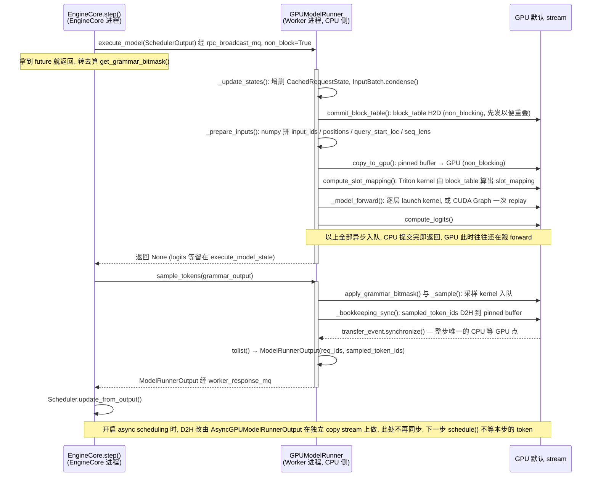

图里有四点要看：

1. **`execute_model()` 全程不同步。** 从 `_update_states()` 到 `compute_logits()`，CPU 做的只是填 pinned buffer、发 `non_blocking` 拷贝、launch kernel（或 replay 一张图）。`commit_block_table()` 被刻意放在 `_prepare_inputs()` 的第一行，让 block table 的 H2D 拷贝和后面的 numpy 计算重叠——源码注释明说这是一项优化（“Start copying the block table first”）。
2. **同步点只有一个，且被推到最后。** `_bookkeeping_sync()` 里的 `_to_list()` 用 `transfer_event.synchronize()` 等采样结果落到 CPU；它用 CUDA event 而不是 `tolist()` 直接触发的全 stream 同步，是为了不阻塞其他 stream 上的拷贝（比如 PD 分离时的 KV 传输）。在这个点之前，GPU 上排着的是 forward + 采样整条队列，CPU 等的时间就是 GPU 真正的计算时间。
3. **为什么拆成两次调用。** `execute_model()` 返回后、`sample_tokens()` 之前，EngineCore 有一个窗口可以做需要上一步结果的事（结构化输出的 grammar bitmask），而 GPU 此刻正在跑 forward——把 CPU 侧这段工作塞进 GPU 的空当。
4. **async scheduling 把最后那个同步点也拿掉了。** 采样结果留在 GPU，`AsyncGPUModelRunnerOutput` 在另一条 copy stream 上做 D2H，Scheduler 用占位 token 先调度下一步，等结果到达再修正。这就是[《鸟瞰 vLLM》](/vllm-request-lifecycle-overview.html)说的“流水线化”在源码里更激进的形态。

### 4. Worker 进程的常驻循环：execute_model 只是一个方法名

上面的时序图从 `GPUModelRunner` 画起。消息是怎么到它手里的，要看 WorkerProc（默认 `MultiprocExecutor` 下每个 TP / PP rank 一个进程）里常驻的那个循环——`WorkerProc.worker_busy_loop()`（`vllm/v1/executor/multiproc_executor.py`）：

1. 阻塞在 `rpc_broadcast_mq.dequeue()` 上，从共享内存环形缓冲里取出一条消息：方法名、参数和这次要谁回复（`output_rank`）。
2. 方法名是字符串时，`getattr(self.worker, method)` 反射拿到 `Worker` 上的同名方法；是字节串时，说明 EngineCore 发来的是 cloudpickle 过的函数，反序列化后绑到 `Worker` 上。
3. 调用它；本 rank 正是 `output_rank`（或者这次不指定回复者）时，`handle_output()` 把返回值放进自己的 `worker_response_mq`，其他 rank 算完就丢掉。出异常时同样只由该回复的 rank 把异常交回。

所以 `execute_model` 和 `sample_tokens` 对这个循环来说只是两个字符串；EngineCore 一侧 `collective_rpc()` 发什么名字，Worker 就调什么方法。Worker 进程里的调用栈因此很浅——循环、`Worker` 上的一个方法、再转给 `GPUModelRunner`：

```text title="WorkerProc 里的调用栈"
WorkerProc（每个 TP/PP rank 一个）           vllm/v1/worker/
└─ worker_busy_loop()                        executor/multiproc_executor.py
   └─ Worker.execute_model() / sample_tokens()   gpu_worker.py
      └─ GPUModelRunner                      gpu_model_runner.py
         ├─ _update_states()      CPU: 同步 CachedRequestState / InputBatch
         ├─ _prepare_inputs()     CPU → GPU: H2D 拷贝 + slot_mapping kernel
         ├─ _model_forward()   ┐  Python → CUDA 边界（PyTorch dispatch）
         ├─ compute_logits()   │  Attention → flash_attn / FlashInfer kernel
         ├─ _sample()          │  或整段 CUDA Graph replay
         └─ _bookkeeping_sync()┘  GPU → CPU: 整步唯一的 D2H 同步点
```

请求本身不在这个栈上：它只是 `SchedulerOutput` 里的一行，栈的形状是“死循环 + 一次方法调用”，每一步都一样。单卡时没有 WorkerProc，`UniProcExecutor` 在 EngineCore 进程里直接调 `Worker` 的方法，栈从 `Worker.execute_model()` 往下不变。

### 5. forward 里的 kernel 从哪来：Python 怎样调到 C++ / CUDA / Triton

`_model_forward()` 里那一串 kernel 是 Python 调起来的，中间隔着 PyTorch 的 dispatcher。vLLM 的 CUDA 扩展模块不是用 PyBind11 绑出一组 Python 函数：`csrc/libtorch_stable/torch_bindings.cpp` 用 `STABLE_TORCH_LIBRARY_FRAGMENT(_C, ops)` 向 dispatcher 声明算子 schema，用 `STABLE_TORCH_LIBRARY_IMPL(_C, CUDA, ops)` 挂上 CUDA 实现；文件末尾的 `REGISTER_EXTENSION(_C_stable_libtorch)`（`csrc/core/registration.h`）只生成一个空的 `PyInit_` 入口，好让 `import vllm._C_stable_libtorch` 能把 `.so` 装进进程、触发注册。之后 Python 一侧通过 `torch.ops._C.<算子名>` 调用，`vllm/_custom_ops.py` 再包一层同名函数（例如 `rms_norm()` 里就是 `torch.ops._C.rms_norm(...)`）。

另一类算子用 Python 写：attention 层的 `unified_attention_with_output` 由 `direct_register_custom_op`（`vllm/utils/torch_utils.py`）注册成 `torch.ops.vllm.*`，这样 `torch.compile` 把它当成一个不可拆的节点——第三章 PIECEWISE 模式下留在图外、把图切成几段的，就是这类节点（`CompilationConfig.splitting_ops` 默认包含 `vllm::unified_attention_with_output`）；它内部再调 FlashAttention 扩展或 Triton kernel。许多算子（尤其是 Attention 和 MoE 相关）用 Triton 写，`.py` 文件在运行时 JIT 编译，不进 wheel 的 `.so`。

| Python 一侧的调用 | 落到的实现 | GPU 硬件 |
|---|---|---|
| `vllm/_custom_ops.py` 的 `rms_norm()` → `torch.ops._C.rms_norm` | `csrc/libtorch_stable/layernorm_kernels.cu`，编进 `_C_stable_libtorch.abi3.so` | CUDA Cores |
| `torch.ops.vllm.unified_attention_with_output`（`vllm/model_executor/layers/attention/attention.py`） | Attention backend：FlashAttention（`vllm_flash_attn` 扩展）或 Triton kernel（`.py`） | Tensor Cores |
| `fused_moe()`（`vllm/model_executor/layers/fused_moe/`） | `csrc/libtorch_stable/moe/`（`_moe_C_stable_libtorch`）或 Triton experts（`.py`） | Tensor Cores |
| `torch.matmul()` / 线性层 | PyTorch 自带的 cuBLAS GEMM | Tensor Cores |

Table: 从 Python 调用到 GPU 硬件的对应

这些 `.so` 由哪些进程加载、wheel 里有哪几个，见[《鸟瞰 vLLM》的开发视图](/vllm-request-lifecycle-overview.html#2-构建与打包python-包--编译扩展)。

翻译层本身不会让 GPU 空等：它的 CPU 工作全部异步入队，被 GPU 上一段 forward 盖住。真正可能让 GPU 等 CPU 的，是 `_model_forward()` 里那串 kernel launch——一步几百到上千次，单个 kernel 又短。这就是下一章的第一种浪费。

## 三、GPU 为什么在空转？—— Kernel Launch 与 CUDA Graph

第一种浪费最反直觉：**GPU 并不慢，它只是在排队等 CPU 告诉它下一步做什么。** 这个问题在 Prefill 阶段几乎看不见（单个 kernel 算得久，提交开销被淹没），却会在 Decode 阶段被放大——因为 Decode 每步的计算量太小了。

### 1. 痛点：Kernel Launch Overhead

在 Decode 阶段，每步模型 Forward 要启动**数百到上千个** CUDA Kernel，而每个 Kernel 的实际 GPU 计算时间可能只有几十微秒。数量之所以这么多，是因为它是**逐层累乘**的：以 80 层的 Llama-3-70B 为例，单层就有 RMSNorm ×2、QKV Proj、RoPE、Attention、O Proj、MLP 的三个 GEMM 与激活，TP=8 下还要再加 2 次 All-Reduce——十几个 kernel × 80 层，一步下来轻松上千。32 层的 7B 也在数百这个量级。

这里要先破除一个常见的误解：**kernel launch 本身是异步的，CPU 提交完就返回，并不会傻等 GPU 算完。** 正常情况下 CPU 会一路往前提交，把 GPU 的任务队列填满，提交开销完全隐藏在 GPU 执行时间背后。所以真正的成立条件只有一个：

> **当单个 kernel 的 GPU 执行时间 < CPU 提交它所需的时间时，GPU 就会追上 CPU，队列被抽干，开始出现气泡。**

这就解释了为什么 CUDA Graph 基本只对 Decode 有意义：Prefill 的 kernel 动辄跑几百微秒，CPU 那点提交开销（现代 CUDA 通常 2–5 μs 量级）根本追不上；而 Decode 阶段充斥着大量只需要 1.5μs 的细碎 Kernel，几十个这样的小 Kernel 排下来，CPU 异步发射的速度就成了拖后腿的那一方。

下图画的正是这种队列被抽干、算力不饱和的最坏情形（Launch-Bound 状态）——注意它不是常态，而是 Decode 小 kernel 场景下才会退化成的样子：

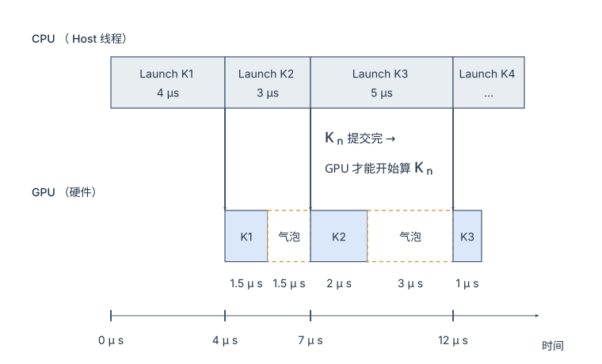

把时间线拆开看：

1. 时刻 0，CPU 开始提交 K1，花了 4μs。
2. 时刻 4，CPU 提交完 K1，立刻开始提交 K2；同一时间 GPU 拿到 K1 开始执行。
3. 时刻 5.5，GPU 只用 1.5μs 就把 K1 算完了，去队列里找 K2，发现 K2 要到时刻 7 才提交完，只能空转 1.5μs。
4. 时刻 7 到 9 GPU 算 K2；K3 的提交更慢，要到时刻 12 才完成，GPU 又空转 3μs。

每个 kernel 的提交时间和执行时间都不一样，但只要"提交比执行慢"，GPU 算完一个就得等下一个。按平均值算开销：一步如果有 400 个这样的小 kernel，提交平均 4μs、执行平均 1.5μs，CPU 提交总耗时 ≈ 400 × 4μs = 1600μs。GPU 比 CPU 快，整条流水线被 CPU 拉长，总时间就由 CPU 决定，约 1600μs；其中 GPU 真正干活约 600μs（37.5%），卡在气泡里约 1000μs（62.5%）。

### 2. CUDA Graph：静态执行图捕获与重放

为了消灭上述图中高达 62.5% 的恐怖气泡，CUDA Graph 改变了游戏规则。它在模型初始化或第一轮时将一系列 Kernel Launch 录制成一个"计算图"，之后用一次 Launch 重放整个图：

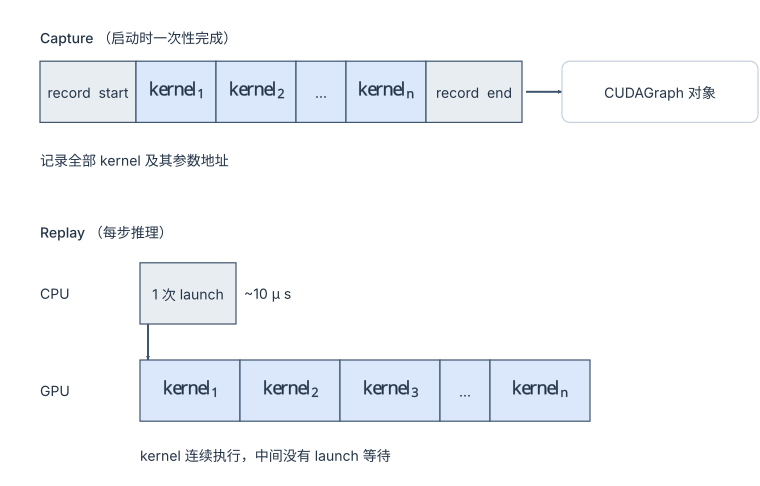

算一笔账：总执行 = 10μs（1 次 launch）+ 约 8000μs（compute）= 8010μs；对比提交开销完全暴露时的 10000μs，上界能省 20%。实测通常在 5%~15%，因为一部分提交开销本来就被隐藏了。

代价是三条约束：

- 图里 kernel 的形状必须固定，所以要对不同 Batch Size 分别预捕获；
- 内存地址必须固定，靠 placeholder tensor 复用；
- 不支持动态控制流，所以 Decode（固定模式）适用，Prefill（可变）不适用。

捕获与重放在默认的 `GPUModelRunner` 路径下由 `CUDAGraphWrapper`（`vllm/compilation/cuda_graph.py`）负责，"这一步用哪种模式、哪个 batch size 的图"由 `CudagraphDispatcher`（`vllm/v1/cudagraph_dispatcher.py`）在每次 forward 前决定；V2 Model Runner（`vllm/v1/worker/gpu/`）则用 `CudaGraphManager`（`cudagraph_utils.py`）承担同样职责。"用哪种模式"由配置枚举 `CUDAGraphMode`（`vllm/config/compilation.py`）描述：

```python title="compilation.py：CUDAGraphMode 枚举"
# vllm/config/compilation.py
class CUDAGraphMode(enum.Enum):
    NONE = 0                        # 不录图，全程 eager
    PIECEWISE = 1                   # 分段录制：attention 等不兼容算子留在图外
    FULL = 2                        # 整个 forward 录成一张图（所有 batch 都用）
    FULL_DECODE_ONLY = (FULL, NONE)       # 纯 decode batch 走 FULL，混合 batch 走 eager
    FULL_AND_PIECEWISE = (FULL, PIECEWISE)  # 纯 decode 走 FULL，混合 batch 走 PIECEWISE（默认）
```

后两个是"组合模式"：元组的第一个元素给纯 decode batch 用（`decode_mode()`），第二个给含 prefill 的混合 batch 用（`mixed_mode()`）。为什么要区分？因为 decode batch 的形状只由请求数决定、可以按 batch size 分桶提前录好；而混合 batch 里每个请求的 token 数各不相同，attention 的输入形状几乎不重复，只能把 attention 留在图外、其余层分段录图。

"按 batch size 分桶提前录好"具体是怎么做的？图里 kernel 的形状是固定的，所以不可能给每一个可能的 batch 大小都录一张图；vLLM 的做法是只在一组离散的 `cudagraph_capture_sizes` 上录图，运行时把实际 batch **向上 pad** 到最近的桶：

```python title="cudagraph_capture_sizes 的默认生成规则"
# vllm/config/compilation.py
cudagraph_capture_sizes = [1, 2, 4] + list(range(8, 256, 8)) + list(range(256, max_size + 1, 16))
# max_size = max_cudagraph_capture_size，默认 min(max_num_seqs * 2, 512)
```

本质上这是一张字典：启动时按 key 把图录好存进去，运行时拼出同样的 key 查表、replay。分两步看。

**启动时录图。** key 是 `BatchDescriptor(num_tokens, num_reqs, uniform, has_lora, num_active_loras)`。`CudagraphDispatcher.initialize_cudagraph_keys()` 对每个 capture size 生成 key：默认的 `FULL_AND_PIECEWISE` 下每个 size 两个——一个 FULL 给纯 decode batch（`uniform=True`，`num_reqs = size / (1 + 投机 token 数)`），一个 PIECEWISE 给混合 batch（`num_reqs=None`，任意请求数都能用）；开了 LoRA 再按 `num_active_loras` 的取值翻倍。然后对每个 key 跑一次捕获，`CUDAGraphWrapper` 把图存进 `concrete_cudagraph_entries: dict[BatchDescriptor, CUDAGraphEntry]`。PIECEWISE 的"一张"其实是一组：模型按 attention 切成若干段，每段一个 wrapper、各录一张，replay 时逐段重放。

**运行时查表。** 每一步 `CudagraphDispatcher.dispatch(num_tokens, uniform_decode, ...)`：

1. `num_tokens` 超过 `max_cudagraph_capture_size` 直接返回 NONE，走 eager；
2. 否则用 `_bs_to_padded_graph_size[num_tokens]` 把 batch 向上取到最近的桶，比如 5 → 8；
3. 用 pad 后的 size、这一步是否纯 decode、LoRA 情况拼出 `BatchDescriptor`；
4. 先在 FULL 的 key 里找，没有再把 `num_reqs` 抹掉到 PIECEWISE 里找，都没有就 NONE；
5. 命中就取出图 `replay()`，pad 多出来的行白算一遍。

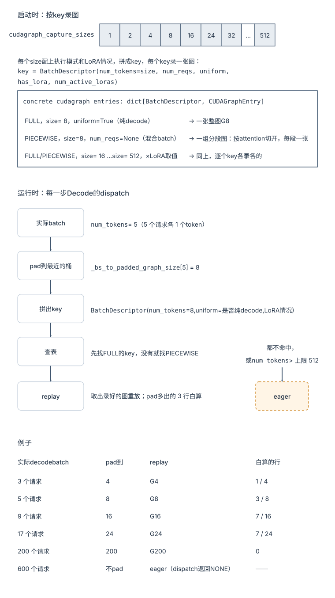

被 pad 出来的行喂的是占位 token，算完直接丢弃；换来的是任意 batch 大小都能命中一张已录好的图。桶在 8 以上按 8 步进、256 以上按 16 步进，正是因为 batch 越大，多算几行的相对开销越可以忽略；而 1、2、4 单独成桶，是因为小 batch 下 pad 一行就是 25%~100% 的浪费。`dispatch()` 最终返回的 `BatchDescriptor(num_tokens, num_reqs, uniform)` 就是查图用的 key——decode batch 带 `uniform=True` 去查 FULL 图，查不到就退化为去掉 `num_reqs` 和 `uniform` 的宽松 key 查 PIECEWISE 图，再查不到才走 eager。

| 模式 | 机制 | 适用场景（引自 `CompilationConfig.cudagraph_mode` 的 docstring） | 说明 |
|---|---|---|---|
| NONE | 不录图 | 调试；或 attention backend / 自定义算子完全不支持 CUDA Graph | 每一步都由 CPU 逐个发射 kernel，小 batch decode 下 launch 开销占比显著 |
| PIECEWISE | `torch.compile` 按 `splitting_ops`（默认是 attention 算子）把 forward 切成若干段，每段各录一张图，attention 在段间 eager 执行 | 通用；混合 batch 的默认策略 | 需要 `CompilationMode.VLLM_COMPILE` 且 `splitting_ops` 非空；一次 forward 要 replay N 段图 + N 次 eager attention |
| FULL | 整个 forward（含 attention）录成**一张图**，一次 replay | "小模型或短 prompt 负载可能有收益；很多 backend 不支持" | 要求 attention backend 支持 CUDA Graph 下的 prefill（形状必须能分桶）；对多数负载不如 FULL_AND_PIECEWISE |
| FULL_DECODE_ONLY | decode batch 走 FULL；混合 batch 不录图 | "适合 P/D 分离中的 decode 实例：prefill 不重要，可以省下 piecewise 图的显存" | 只录一套 decode 图，显存开销最小的"有图"方案 |
| FULL_AND_PIECEWISE | decode batch 走 FULL；prefill / 混合 batch 走 PIECEWISE | "对大多数模型最快，是默认值" | 常驻两套图（decode 各桶的 FULL 图 + piecewise 段图），显存开销最大 |

Table: cudagraph_mode 的几种模式

PIECEWISE 的"分段"落到一层 Transformer 上长什么样？`VllmBackend.split_graph()`（`vllm/compilation/backends.py`）拿到整个 forward 的 FX 图后，在每一个 `splitting_ops`（默认是 `_attention_ops`，即 `vllm::unified_attention_with_output` 等）处切一刀，切出来的每一段交给 Inductor 编译并由 `CUDAGraphWrapper` 各录一张图；attention 本身留在图外 eager 调用：

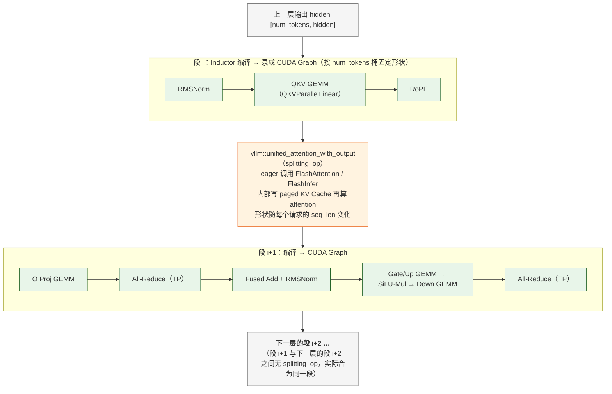

于是 80 层的模型一次 forward 要 replay 约 81 段图、eager 调用 80 次 attention（相邻两层之间没有 splitting_op，上一层的后半段与下一层的前半段是同一段）。绿色段内 kernel 之间没有 launch 气泡，橙色的 attention 因为形状不固定只能由 CPU 逐次发射——但它是一层里最"胖"的 kernel，launch 开销相对可以接受；这就是 PIECEWISE 在混合 batch 下的取舍。FULL 模式则是把上图从头到尾（包括橙色的 attention）录成一张图，因此要求 attention backend 也能在固定形状下工作，这只对"每请求 1 个 token"的纯 decode batch 才容易满足。

两个常见误解要澄清。第一，FULL 模式录的是**一张包含全部 kernel 的图**，replay 时 GPU 按图里记录的顺序执行这些 kernel——它减少的是 CPU 侧 launch 开销和 kernel 间的空隙，**不是**把 forward 融合成一个"超级 kernel"，每个 kernel 内部的执行时间一点没变。第二，CUDA Graph 与 `torch.compile` 是两个正交的轴：docstring 明说 "the cudagraph logic is generally orthogonal to the compilation logic"——PIECEWISE 依赖 piecewise 编译，但 FULL 图在不开编译时也能录。`CompilationConfig.mode`（`NONE / STOCK_TORCH_COMPILE / DYNAMO_TRACE_ONCE / VLLM_COMPILE`）管的是"要不要让 Inductor 生成融合 kernel"，`cudagraph_mode` 管的是"生成好的 kernel 序列要不要录成图"。

这组模式和[《PD 分离》](/prefill-decode-disaggregation.html)有一个自然的对应：Decode 实例里没有 prefill，全部 batch 都是"每请求一个 token"的规则形状，`FULL_DECODE_ONLY` 用最少的显存拿到全部收益（这正是 docstring 里点名的用法）；Prefill 实例里每个 batch 的形状都不一样，图的收益本来就小，`PIECEWISE` 甚至 `NONE` 都合理。

## 四、数据为什么搬不动？—— 压缩 HBM 流量

第二种浪费才是大头。GPU 的算力增长速度远快于显存带宽，于是绝大多数推理 kernel 的真实瓶颈都不是"算不完"，而是"数据喂不上"。

这一节的三种手段看起来毫不相干——换 Attention 实现、融合算子、挑后端——但它们优化的是**同一个量**：

> **HBM 流量 = 搬运次数 × 每次搬运的数据量。**

FlashAttention 和 Kernel Fusion 减少的是"搬运次数"（别让中间结果落地再读回来），下一章的量化减少的是"每次搬多少字节"。

### 1. FlashAttention

**1.1 vLLM的 Attention 后端与动态算子路由**

在进入到 FlashAttention 之前，还是要先介绍一下 vLLM 的 Attention Backend 和 Selector 机制。

Attention 算子的硬件执行效率高度依赖于工作负载（Workload）形态、硬件架构及数据类型（dtype）。vLLM 在 vllm/v1/attention/backends/ 下集成了数十种 Attention 后端，并在 registry.py 中通过 Selector 机制，根据 Head Size、dtype、硬件算力以及运行时特征（Prefill / Decode / Mixed / MLA）进行动态算子路由（Kernel Selection）。

其核心后端生态及工业界典型的推荐基准（Benchmark Prefs）划分如下：

* **FlashInfer (flashinfer.py)**：默认的通用全能型后端。得益于对 Ragged Batch、PagedAttention 以及 Prefill+Decode 混合批次的深度汇编级优化，在 Decode 及 Mixed 场景下吞吐领先。
* **FlashAttention (flash_attn.py)**：NVIDIA 生态的经典基准。在纯 Prefill 场景下对长 Query 具备极佳的矩阵乘法吞吐表现，并包含 flash_attn_diffkv 等衍生变体。
* **MLA 特化后端 (mla/)**：针对 DeepSeek 等模型的低秩 KV 压缩（MLA）进行算子融合与内存重排优化。包含 FlashInfer MLA、FlashMLA、CUTLASS MLA、Triton MLA 及 ROCm 架构下的 AITER Triton MLA。
* **Triton / FlexAttention (triton_attn.py, flex_attention.py)**：高可定制化后端。利用高级语言抽象，便于跨硬件平台快速移植、验证或进行非标的自定义 Mask/Attention 研发。
* **硬件特化与非标后端**：包含 AMD 生态的 ROCm 系列（rocm_attn.py 等）、CPU 降级后端，以及适配 Mamba、Linear Attention 等非 Transformer 架构的专用算子。

**TIPS：** 业界没有绝对通用的默认后端，算子路由强绑定于具体的 vLLM 版本与底层硬件。在生产环境上线或变更 workload 形态（如从单轮 QA 转向超长多轮对话）前，必须基于目标硬件进行针对性的端到端压力测试（Profile & Benchmark）。

**1.2 FlashAttention：Tiling 与 Online-Softmax**

FlashAttention 是现代 LLM 推理的基石算子。它的核心思想是通过**分块计算（Tiling）**和 **Online Softmax**，让 N×N 的中间矩阵**根本不必在 HBM 里出现**。注意它优化的是**访存**，计算量（FLOPs）一分没少。


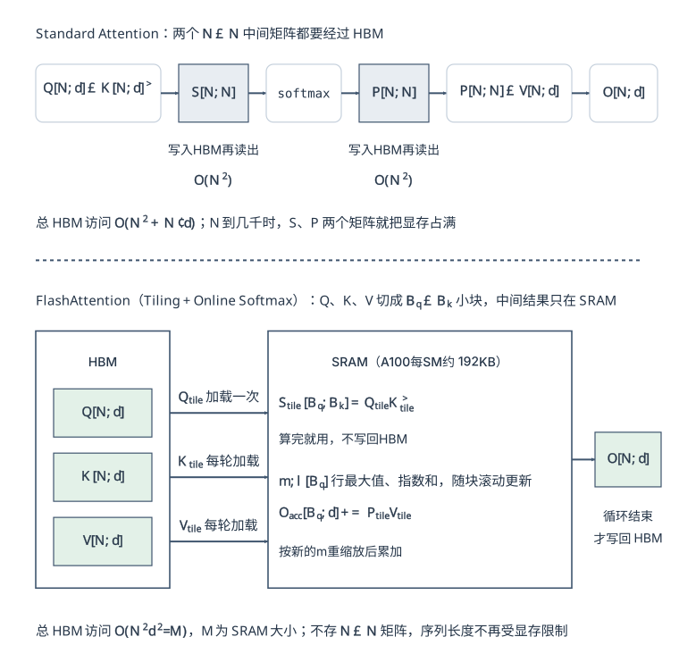

FlashAttention 内层循环做的事（完整推导见下面第 ③ 小节）：

```python title="FlashAttention 内层循环"
for each K_tile, V_tile:
    S_tile = Q_tile @ K_tileᵀ                 # SRAM 内计算
    m_new  = max(m_old, rowmax(S_tile))       # Online max
    P_tile = exp(S_tile - m_new)              # SRAM 内计算
    l_new  = exp(m_old - m_new) * l_old + rowsum(P_tile)
    O_acc  = rescale(O_acc) + P_tile @ V_tile # Online 累加
```

**说明：**

- 标准注意力会显式生成两个 N×N 大矩阵，显存和带宽压力都很大。
- FlashAttention 不保存完整中间矩阵，而是把计算拆成小块，在片上完成并立即复用。
- 它的目标不是减少 FLOPs，而是减少 HBM 读写。

**① 为什么 Standard Attention 会卡显存？**

Standard Attention的问题在于它把两个 N×N 的大矩阵实实在在地写进了 HBM：

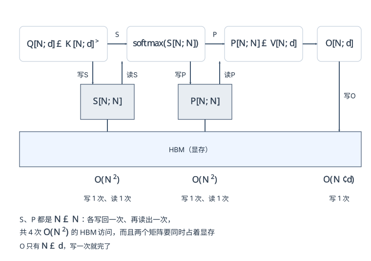

三步各自的代价：`Q·Kᵀ` 算出的 S 要写回 HBM 一次；softmax 要把 S 读回来，再把 P 写回去；`P·V` 又要把 P 读一次，最后把 O 写回去。O 只有 N×d，写一次就完了，真正要命的是 S、P 这两个 N×N。

总 HBM 访问 **O(N·d + N²)**，其中 N² 项的系数是 4（S 写、S 读、P 写、P 读）。更要命的是显存：N 到几千时，S、P 两个矩阵就能把显存占满。

**说明：**

- 问题不只是矩阵大，而是它们必须在 HBM 里“来回搬运”
- 当序列长度变大时，N² 级别的中间结果会迅速成为瓶颈
- 所以标准注意力的主要痛点是访存和显存，不是算力

**② FlashAttention 的 Tiling 思路**

FlashAttention 把 Q/K/V 切成 `Bq × Bk` 的小块，让中间结果**只在片上 SRAM 里出现，从不落回 HBM**（A100 每个 SM 的 L1/shared 合计 192 KB，可作 shared memory 的约 164 KB）：

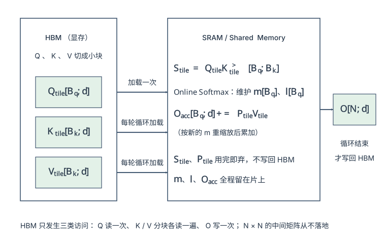

| 驻留在 SRAM 的东西 | 形状 | 说明 |
|---|---|---|
| `Q_tile` | `[Bq, d]` | 从 HBM 加载 |
| `K_tile` / `V_tile` | `[Bk, d]` | 分块循环加载 |
| `S_tile` | `[Bq, Bk]` | **在 SRAM 中算完就用掉，不写回** |
| `O_acc` | `[Bq, d]` | 在线累加的输出 |
| `m, l` | `[Bq]` | softmax 的运行时统计量（行最大值、指数和） |

Table: FlashAttention 驻留 SRAM 的张量

**③ Online Softmax 是怎么“边算边归一化”的**

FlashAttention能够运转的关键在于**Online Softmax**，它让 softmax 不需要先看到整行就能开始累加。

softmax 看起来需要先知道一整行的最大值和总和，才能归一化。这似乎意味着必须先把完整的 S[N,N] 算出来。但 FlashAttention 用了 Online Softmax，允许它在分块过程中动态维护：

- m：当前最大值
- l：指数和
- O_acc：输出累加结果

当新块到来时，如果发现最大值变了，就把历史结果按比例重新缩放，再把新块的贡献加进去。
这样就能保证：**分块计算的结果，和一次性算完整 softmax 的结果严格等价。**

```python title="Online Softmax 的循环"
m, l, O_acc = -inf, 0, 0
for each K_tile, V_tile:                               # 沿 KV 方向循环
    S_tile = Q_tile @ K_tileᵀ                          # SRAM 内，不写回
    m_new  = max(m, rowmax(S_tile))                    # 滚动更新行最大值
    P_tile = exp(S_tile - m_new)                       # SRAM 内
    l      = exp(m - m_new) * l + rowsum(P_tile)       # 修正旧的指数和
    O_acc  = exp(m - m_new) * O_acc + P_tile @ V_tile  # 同一个系数修正旧的累加结果
    m      = m_new
O = O_acc / l                                          # 整个循环结束才做这一次除法
```

每来一个新块，就用 `exp(m_old - m_new)` 把此前累加的结果**追溯性地缩放一次**，因此它与"先看完整行再 softmax"在数学上**严格等价**，不是近似。注意归一化的除法被推迟到了循环之外——这是它能一边扫一边累加的前提。

**④ FlashAttention 到底省了什么？**

FlashAttention 的收益主要体现在两方面：

**显存：O(N²) → O(N)**
标准 Attention 需要显式保存 S[N,N] 和 P[N,N]，所以额外显存是 O(N²)。
FlashAttention 只保存当前 tile 和少量统计量，因此额外显存降到 O(N) 级别。

**访存（带宽）：O(N²) → O(N²d²/M)**
标准 Attention 里，中间矩阵要在 HBM 里反复读写。
FlashAttention 把大部分中间计算压到片上内存完成，显著降低 HBM 访问压力。

但是需要注意的是，FlashAttention 并没有把 HBM 访问从 O(N²) 降到 O(N·d)。论文给出的 IO 复杂度是 **O(N²d²/M)**（`M` 为可用 SRAM 大小）——**N² 这一项消不掉**，因为循环要沿一个方向走 `N/B` 次，每一次都得把另一侧的 tile 重新从 HBM 过一遍。它真正做的是把 N² 项的**系数**从 4 压到 `d²/M` 量级。

**但要注意，计算复杂度并没有任何改变**
FlashAttention 并没有把注意力从 O(N²) 变成 O(N)。
它优化的是 IO 和显存占用，不是注意力本身的二次结构。

**对比 & 总结**

| 特性 | Standard Attention | FlashAttention |
|------|-------------------|----------------|
| HBM 访问 | O(N·d + N²) | **O(N²d²/M)** |
| 额外显存 | **O(N²)**（必须物化 S、P） | **O(N)**（只留 `m`、`l`） |
| 最大序列长度 | 受 N² 显存约束 | 不再受 N² 显存约束 |
| IO 效率 | 低（中间矩阵 HBM 往返） | 高（tile 在 SRAM 内复用） |
| 实现复杂度 | 简单 | 高（需要手写 CUDA kernel） |

Table: Standard Attention 与 FlashAttention 的对比

**FlashAttention 在显存上是渐进式的胜利（O(N²) → O(N)，这条无条件成立），在带宽上拿到的是一个常数倍的胜利**——倍数约为 `M/d²`，`d` 越小、SRAM 越大越划算。实测 2~4× 的加速也不只来自访存量本身，还来自少了一趟独立的 softmax kernel、以及不再被 N² 显存卡住 batch。

**⑤ 训练和推理中的差异**

FlashAttention 在训练和推理中的作用并不完全相同。

- **训练时**，反向传播需要依赖注意力计算中的一些中间信息。  
  但 FlashAttention 为了节省显存，不会把完整的 `S` 和 `P` 中间矩阵保存下来。  
  因此在反向阶段，通常需要通过**重算（recompute）**来恢复这些信息，再继续求梯度。  
  也就是说，训练阶段的核心特点是 **“用计算换显存”**。

- **推理时**，模型只需要做前向计算，不需要反向传播。  
  这意味着中间结果不必长期保留，也不会带来额外的重算代价。  
  所以 FlashAttention 在推理阶段通常表现为**纯收益**：既降低显存占用，又减少访存压力。

**⑥ Serving 场景下的 Decode 优化：从 FlashAttention 到 Flash-Decoding**

在 Serving 场景里，FlashAttention 的收益不只取决于计算复杂度，更取决于**GPU 是否能被有效填满**。它的核心优势来自 query 方向上有足够多的行可以切块复用；但在 **Decode** 阶段，`query_len = 1`，因此 `Bq` 只能取 1，query 方向根本切不动。此时 kernel 会退化成对一长串历史 KV 的单行扫描，SM 大量空转，原本依赖 tiling 的效率优势也会明显减弱。

Decode 侧的办法不是继续沿 query 切，而是**把切分方向换到 KV 维度**：通过 **split-K / Flash-Decoding**，让多个 SM 各自处理一段历史 KV，先得到局部的注意力结果，再使用和 FlashAttention 完全一致的 `m`、`l` 在线 rescale 规则把这些局部结果合并起来。vLLM 中的 FlashInfer / paged decode kernel 走的就是这条路线，这也是上一节的 selector 需要根据 workload 形态做分派的原因。

更进一步看，**“分块计算 + 在线累加”** 其实是同一个数学技巧在不同硬件层级上的重复出现，只是切分边界不同：

| 切分位置 | 沿什么方向切 | 方案 | 
|---|---|---|
| SRAM ↔ HBM | query | FlashAttention | 
| SM ↔ SM | KV | Flash-Decoding / split-KV |
| GPU ↔ GPU | 序列 | Ring Attention | 

Table: 分块计算 + 在线累加在不同层级的重现

因此，在 Serving 场景中，FlashAttention 的关键不再只是“能不能把 attention 算得更省”，而是“在当前 workload 形态下，应该沿哪一维切块、在哪一层级做合并”。这也是为什么 Prefill、Decode、跨 GPU 长序列分别对应 FlashAttention、Flash-Decoding 和 Ring Attention。

**⑦ 版本演进与优化方向**

FlashAttention 后续版本主要是在同一套数学核心上继续做工程优化，而不是改变算法本质。

- **FlashAttention-2**
重点提升了 GPU 并行效率，把并行维度进一步扩展到序列方向，同时减少了非矩阵乘法指令的开销。

- **FlashAttention-3**
针对 Hopper 架构做了更进一步的优化，引入了 warp specialization，并支持 FP8 等更高效的低精度计算。

不过，无论是最初版本还是后续版本，FlashAttention 的核心思想都没有变：
**通过分块计算（Tiling）和在线归一化（Online Softmax），在保持结果等价的前提下，大幅降低注意力计算的显存和访存开销。**

### 2. Kernel Fusion

Kernel Fusion 的核心目标，是**把原本多个相邻的算子合并到一个 kernel 里执行**，从而减少中间结果的读写开销，降低 kernel launch 次数，并提升整体吞吐效率。对于大模型推理而言，很多算子本身的计算量并不大，但它们之间频繁地在 HBM 中读写中间 tensor，会让性能很快受限于显存带宽而不是算力。因此，Kernel Fusion 本质上是在做一件和 FlashAttention 非常相似的事情：**尽量让中间结果不落到 HBM，而是在片上完成连续计算。**

**2.1 Kernel Fusion 的动机与收益**

在传统的未融合实现中，一个算子链通常会被拆成多个独立 kernel。例如以 `RMSNorm → RoPE → Residual` 为例：

| | 未融合（3 个独立 kernel） | 融合后（1 个 kernel） |
|---|---|---|
| 执行 | RMSNorm 读 x 写 temp₁ → RoPE 读 temp₁ 写 temp₂ → Residual 读 temp₂ 写 out | 读 x 一次 → norm → RoPE → 加 residual → 写 out 一次 |
| HBM 访问 | **6 次**（3 读 + 3 写） | **2 次**（1 读 + 1 写） |
| 中间 tensor | 2 个 | **0 个** |
| kernel launch | 3 次 | 1 次 |

Table: 未融合与融合后的 RMSNorm → RoPE → Residual

可以看到，未融合版本的问题并不只是“多了几个算子”，而是每个算子之间都要把中间结果写回 HBM，再从 HBM 读出来继续处理。这种反复搬运数据的方式，会显著放大显存带宽压力。相比之下，融合后的 kernel 直接在一次执行过程中完成多个连续操作，只在最开始读取输入、最后写出结果，中间过程尽量留在寄存器或共享内存中，从而大幅减少内存访问。

Kernel Fusion优化带来的收益主要有三类：

1. **减少 HBM 访问**
中间 tensor 不再频繁写回显存，显著降低带宽开销。
2. **减少 kernel launch 开销**
多个小 kernel 合并成一个后，可以减少 launch 次数和调度开销。
3. **提升整体吞吐效率**
对推理场景来说，尤其是 decode 阶段，很多算子都偏轻量，launch 和访存的开销占比很高，融合后的收益往往非常明显。

注意这个收益的来源和 FlashAttention 完全一致——**都是不让中间结果去 HBM 兜一圈**，只不过 FlashAttention 作用在一个算子内部，Kernel Fusion 作用在多个算子之间。

**2.2 vLLM 中的 Kernel Fusion 实践**

在 vLLM 中，Kernel Fusion 已经被广泛用于推理链路的多个环节，尤其集中在 `csrc/libtorch_stable/` 下的 CUDA 实现中，目标就是尽可能把高频、低算力密度但高访存代价的操作合并执行。下面这些算子就是比较典型的例子：

| 融合算子 | 涉及操作 | 实现位置 | 收益 |
|----------|---------|---------|------|
| Fused Add + RMSNorm | 残差加 + RMSNorm，一次读写 | `fused_add_rms_norm`（`csrc/libtorch_stable/layernorm_kernels.cu`） | 省掉残差和的一次落地与回读 |
| RMSNorm + 静态 FP8 量化 | 归一化后直接写出 FP8 | `rms_norm_static_fp8_quant` / `fused_add_rms_norm_static_fp8_quant`（`layernorm_quant_kernels.cu`，该文件只支持 static scale） | 归一化输出不以 BF16 落地 |
| RMSNorm + 动态 per-token 量化 | 归一化 + 求每行 scale + 量化 | `rms_norm_dynamic_per_token_quant`（`csrc/libtorch_stable/quantization/fused_kernels/`） | 同上，且省掉单独求 scale 的一遍读 |
| RoPE | 对 Q、K 就地旋转 | `rotary_embedding`（`pos_encoding_kernels.cu`） | 一个 kernel 同时处理 Q 和 K，不生成中间 tensor |
| 合并 QKV 投影 | Q/K/V 三个权重拼成一个矩阵 | `QKVParallelLinear`（`vllm/model_executor/layers/linear.py`），底层一次 GEMM | 1 次 GEMM 替代 3 次，输入只读一遍 |
| 合并 Gate/Up 投影 + 激活 | gate_proj 与 up_proj 拼成一个 GEMM，再用一个 kernel 完成 `SiLU(gate) * up` | `MergedColumnParallelLinear` + `SiluAndMul`（`activation.py`，kernel 在 `csrc/libtorch_stable/activation_kernels.cu`） | GEMM 减半次数；激活与逐元素乘不分两趟 |
| Attention | `softmax(QKᵀ/√d)·V` 全程留在 SRAM，直接从 paged KV Cache 读 | FlashAttention / FlashInfer / Triton 后端 | 本节主角：中间的 N×N 矩阵不落 HBM |
| KV Cache 写入（MLA） | RoPE + 拼接 + 写 cache + 可选 FP8 转换 | `concat_and_cache_mla_rope_fused`（`cache_kernels_fused.cu`） | MLA 专用；普通模型的写入是 `reshape_and_cache_flash`（`cache_kernels.cu`），只做写入 |
| 采样中的重算子 | repetition penalty；per-row top-k | `apply_repetition_penalties_`、`top_k_per_row_*`（`sampler.cu`） | 只是采样流水线中的两个 kernel；完整流程（temperature → top-k/top-p → 采样 → logprobs）在 `vllm/v1/sample/sampler.py` 里是多阶段 PyTorch 代码，**不是**一个融合 kernel |

Table: vLLM 里的融合算子

这些融合算子覆盖了推理过程中的几个关键环节：

* 归一化阶段：如 RMSNorm 与 Residual 的融合，减少前后张量搬运；
* 位置编码阶段：如 RoPE 与维度重排的融合，避免生成临时 tensor；
* 线性投影阶段：如 QKV 合并计算，减少重复访存和 launch；
* 注意力阶段：如 FlashAttention，将 softmax 和矩阵乘法尽量做成一个高效流程；
* 采样阶段：如 top-k/top-p/temperature 一体化，减少生成端的额外开销；
* 缓存阶段：如 KV Cache 写入与量化融合，降低显存占用并提高写入效率。

可以看到，vLLM 的融合并不局限于某一个单点优化，而是围绕整个推理链路进行系统性的改造。其思路是：凡是存在“中间结果写回 HBM 再继续处理”的地方，都尽量尝试融合。

### 3. 小结

Kernel Fusion 和 FlashAttention 的共同点在于，它们都在解决同一个根本问题：
**把本可以在片上连续完成的计算，尽量压缩成一次执行，避免中间结果落到 HBM。**

如果说 FlashAttention 是注意力内部的“算子内融合”，那么 Kernel Fusion 则更像是推理系统层面的“算子间融合”。二者结合起来，最终目标都是：

* 少读少写
* 少 launch
* 少中间 tensor
* 更高吞吐、更低延迟

## 五、能不能少搬几个字节？—— 低精度推理

上一章在减少搬运**次数**，这一章换个方向：让每次搬运的**数据本身变小**。两者正交，可以叠加。

### 1. 推理量化的对象、收益与代价

| | 权重 (W) | 激活 (A) | KV Cache |
|---|---|---|---|
| 生命周期 | 常驻 GPU，占比最大 | 动态生成，逐层计算 | 动态增长，随序列膨胀 |
| 量化收益 | 减少显存、加速推理 | 加速 GEMM、减少带宽 | 更多并发、更长上下文 |
| 典型方法 | GPTQ / AWQ / W4A16 | W8A8 / FP8、per-token | FP8 / INT8、per-head |

Table: 推理量化的三类对象

三种量化对象不是均匀受益的。权重量化同时降低显存和 Decode 带宽压力，因为 Decode 每步都要读权重；KV Cache 量化主要受益于 Decode 的历史 KV 读取和并发数；激活量化则更直接加速 Prefill 的 GEMM。选择方案前需要先判断瓶颈在 Prefill 还是 Decode。

### 2. 权重量化方法

| 方法 | 格式 | 原理 | 量化时机 | 精度 |
|------|------|------|---------|------|
| **GPTQ** | W4A16 | 基于 Hessian 的逐层最优量化 | 离线（需校准数据） | 好 |
| **AWQ** | W4A16 | 保护显著权重通道 | 离线（需校准数据） | 更好 |
| **SmoothQuant** | W8A8 | 将激活难度转移到权重 | 离线 | 好 |
| **FP8** | W8A8 | 硬件原生 FP8 格式 | 在线/离线 | 接近 FP16 |
| **Weight-only** | W4A16/W8A16 | 只量化权重，激活保持 FP16 | 离线 | 较好 |

Table: 权重量化方法对照

以 Llama-70B 为例：

| 格式 | 权重大小 | Decode 加速 | 精度损失 |
|---|---|---|---|
| FP16 | 140 GB | 1.0×（基准） | 基准 |
| FP8 (W8A8) | 70 GB | 1.5–2.0× | 极小 |
| INT8 (W8A8) | 70 GB | 1.5–2.0× | 小 |
| INT4 (W4A16) | 35 GB | 1.8–2.5× | 中等 |

Table: Llama-70B 各量化格式的权重大小与加速

Decode 之所以能加速，有三个叠加的原因：

1. **权重从 HBM 加载的带宽直接减半**——回到第一章那笔账，batch=1 时权重读取就是 decode 耗时的大头，砍掉一半立竿见影；
2. INT4 / FP8 GEMM 能用上 Tensor Core 的特殊指令，算力更高；
3. 模型变小后可能用更少的卡装下，**连通信开销一起省了**。

### 3. FP8 推理

FP8 是 H100/H200 引入的硬件原生低精度格式，vLLM 通过 `vllm/model_executor/layers/quantization/fp8.py` 支持：

FP8 有两种排布，推理基本只用前者：

| 格式 | 位分配 | 范围 | 精度 | 用途 |
|---|---|---|---|---|
| **E4M3** | 1 符号 + 4 指数 + 3 尾数 | [-448, 448] | ~3–4 位有效数字 | **权重与激活** |
| E5M2 | 1 符号 + 5 指数 + 2 尾数 | 更大 | ~2–3 位有效数字 | 梯度，推理少用 |

Table: FP8 的两种排布

这个取舍很直白：E4M3 拿指数位换尾数位，**牺牲动态范围来保精度**——推理时数值范围可以靠 scaling 控住，精度却不能省。

FP8 推理的优势：

- Tensor Core 原生支持 FP8 GEMM。H100 SXM 稠密算力 **FP8 1979 TFLOPS vs BF16 989 TFLOPS，理论 2×**（常见的 3958 TFLOPS 是"带稀疏"口径，不能拿来和稠密 BF16 比）
- 权重 + 激活 + KV Cache 全链路 FP8 → 显存减半
- Per-tensor / Per-token scaling 可按需选择精度档位

### 4. 混合精度组合与性能评测

| 组合 | 权重 | 激活 | KV Cache | 显存 | TTFT | TPOT | 质量 |
|---|---|---|---|---|---|---|---|
| FP16 全精度 | FP16 | FP16 | FP16 | 100% | 基准 | 基准 | 基准 |
| FP8 全链路 | FP8 | FP8 | FP8 | 50% | 0.7× | 0.6× | ≈ 基准 |
| W4A16 + FP16 KV | INT4 | FP16 | FP16 | 35% | 0.8× | 0.5× | 轻降 |
| W4A16 + FP8 KV | INT4 | FP16 | FP8 | 27% | 0.7× | 0.5× | 轻降 |
| FP8 W/A + FP8 KV | FP8 | FP8 | FP8 | 50% | 0.5× | 0.5× | ≈ 基准 |

Table: 混合精度组合的显存、延迟与质量

**表中数值是相对基准的比例，仅作量级示意，实际因模型和场景而异。** 读这张表时注意三条规律：

- **TTFT 主要受权重量化影响**（Prefill 是 compute-bound，吃的是算力）
- **TPOT 同时受权重量化和 KV 量化影响**（Decode 是 memory-bound，吃的是带宽）
- **显存降低还有二阶收益**：省下的显存能换更大 batch，实际吞吐提升往往超过表里的单请求数字

最后一句必须说在前面：**质量损失一定要用 eval benchmark 实测**（HumanEval、MMLU 等），不能靠"≈ 基准"这三个字就上生产。

## 六、能不能少跑几轮模型？—— 投机解码

前面三章都在优化"一轮怎么跑得更快"。这一章换个思路：**能不能让一轮多产出几个 token，从而少跑几轮？**

先把投机解码的定位说清楚：它**不改变输出分布**（拒绝采样保证与直接用 Target 采样一致，greedy 下逐 token 相同），只改变"一次 Target forward 产出几个 token"。所以它和 CUDA Graph、量化一样是性能手段，归在本篇；而采样参数、结构化输出改变的是"输出什么"，放在[《输出在变》](/output-changes-sampling-and-structured-output.html)。

本章先讲原理和候选从哪来（第 1–3 节），再按 vLLM 里一步的走向讲调度器与 KV（第 4 节）、model runner（第 5 节）、拒绝采样（第 6 节），最后算账（第 7 节）并列出多卡与 PD 下的约束（第 8 节）。

### 1. Decode 的根本瓶颈

Decode 阶段的核心瓶颈是**逐 Token 串行**：每一步只生成 1 个 token，但需要完整读取模型权重和 KV Cache。GPU 算力的绝大部分处于闲置状态（低 arithmetic intensity）。

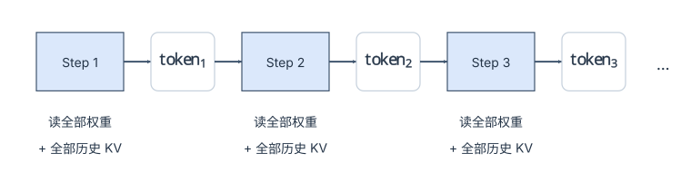

算力利用率在小 batch 下可以低到个位数百分比——绝大部分时间在等 HBM。（batch 增大后同一份权重被多个请求摊薄，利用率会显著回升，这正是 Continuous Batching 有效的根本原因；但**单个请求的延迟**并不会因此变好，这才是投机解码要解决的问题。）

### 2. 基本原理：Draft 猜、Target 验、拒绝采样保证无损

核心思想：用一个**小而快**的 Draft Model 一次性推测多个候选 token，然后用**大而准**的 Target Model 并行验证这些候选。

在看流程之前，必须先破除一个几乎人人都会产生的误解：

> **投机解码并没有消除自回归依赖。**

看到"一次 Forward 产出 5 个 token"，很容易以为 token 之间的依赖被打破、可以并行生成了。**不是的。** token 之间的因果依赖是语言模型的定义本身，谁也绕不过去。投机解码做的是另一件事：

- **依赖仍然存在**：`d₂` 的生成依然依赖 `d₁`，`d₃` 依赖 `d₂`……这个串行链条在 **Draft 模型内部**照样一步步走完，只不过 Draft 模型足够便宜，串行 5 步的代价也很小；
- **被并行化的是"验证"，不是"生成"**：Target 模型拿到 `[d₁...d₅]` 这个**已经确定的序列**之后，可以用一次 Forward 同时算出所有位置的真实概率分布——因为此时每个位置的输入前缀都已知了，不需要等上一步的输出。

所以它的本质是一次**赌注**：用便宜模型猜一条路径，再用贵模型一次性核对这条路径对不对。猜对了就白赚几个 token，猜错了就退回重来。**它省下的是 Target 模型的"轮次"，而不是语言模型的"依赖"。** 这也解释了为什么接受率一低，收益就迅速蒸发——赌输的次数太多了。

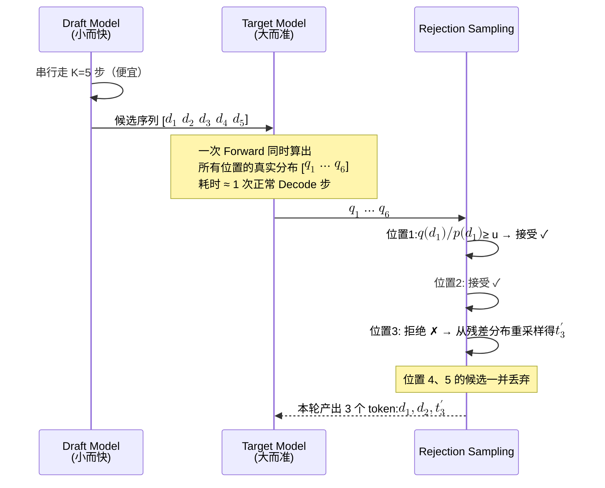

三个要点：

- **一次 Target Forward 产出了 3 个 token**，理想情况最多能到 K+1 个（K 个都接受时，最后一个位置的分布再采一个 bonus token）；
- **拒绝是"截断式"的**——位置 3 一旦被拒，后面的 4、5 全部作废，因为它们的前提已经不成立了。这也是接受率对收益影响巨大的原因；
- **输出分布严格无损**：下面的修正采样在数学上保证最终分布与直接用 Target Model 采样**完全一致**。投机解码不是近似加速，这一点和量化有本质区别。

**接受概率。** 设在某位置，Draft 与 Target 的分布分别为 $$p(x)$$ 和 $$q(x)$$。对 Draft 采出的候选 $$x^*$$，接受概率为：

$$P(\text{接受 } x^*) = \min\left(1, \frac{q(x^*)}{p(x^*)}\right)$$

- $$q(x^*) \ge p(x^*)$$：Target 比 Draft 更认可这个候选，100% 接受；
- $$q(x^*) < p(x^*)$$：Draft 高估了它，以 $$q(x^*)/p(x^*)$$ 的概率接受。

**拒绝后的残差分布。** 一旦第 $$M+1$$ 个位置被拒，链条在这里断开，Target 在这个位置从残差分布里重采一个 token：

$$q'(x) = \frac{\max\left(0, q(x) - p(x)\right)}{\sum_{z} \max\left(0, q(z) - p(z)\right)}$$

直观地说：Draft 在 $$x^*$$ 上多估的概率已经通过"拒绝"还回去了，重采时只从 Target 认为可能、而 Draft 低估了的那部分里挑。两步合起来，每个位置输出 token 的分布恰好是 $$q$$。

一次具体的对比（batch=1、K=5，数字是示意量级）：

| | 做法 | 耗时 | 产出 | 等效 TPOT |
|---|---|---|---|---|
| 普通 Decode | 5 次 Forward，每次 15 ms | 75 ms | 5 tokens | 15 ms |
| Speculative | Draft 5 步（5 ms）+ Verify 1 次（18 ms） | 23 ms | 3 tokens（接受 2 + 重采样 1） | **≈ 7.7 ms** |

Table: 普通 Decode 与投机解码的一次对比

约 **2× 加速**。注意 Verify 那 18 ms 比普通 Decode 的 15 ms 略高——因为要一次算 6 个位置而不是 1 个，计算量确实增加了，只是在 memory-bound 区间这点额外计算几乎免费。**这正是投机解码的本质：拿闲置算力去换延迟。**"几乎免费"到哪里为止，第 7 节会算出临界点。

### 3. 候选从哪来：Proposer 家族

不同方法的核心区别在于**"候选 token 如何生成"**，验证、接受 / 拒绝和 KV 更新是同一套流程：

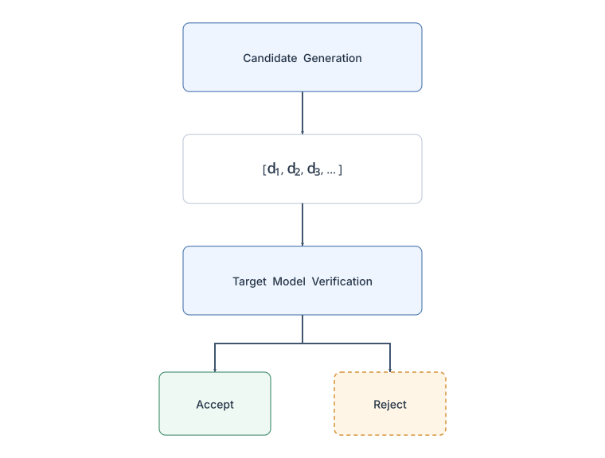

**先分类：它们并不都是"推理技巧"。**

| 类别 | 方法 | 怎么产生候选 |
|---|---|---|
| 纯推理侧，不碰模型 | 独立 Draft Model | 另找一个小模型 |
| ^^ | N-gram | 从 prompt 里抄 |
| ^^ | Suffix Decoding | 从后缀树里抄 |
| 需要额外训练一个"头" | EAGLE | 训一个特征级 draft 头 |
| ^^ | Medusa | 训若干并行 LM 头 |
| 模型自带（Model-native） | MTP | 预训练阶段就已经有了 |

Table: 六种 speculative decoding 方法的分类：推理侧还是模型侧

由此有三种部署形态：

1. Draft Model、N-gram、Suffix 是**部署时可以选择的推理策略**；
2. EAGLE、Medusa 也在部署时启用，但要提前针对特定 Target Model 训练额外组件；
3. MTP 要求模型 checkpoint 原生包含 MTP 结构和权重——vLLM 从模型配置里读 `num_nextn_predict_layers`，MTP 权重随 checkpoint 一起加载。**MTP 不是 vLLM 在部署时给普通模型外挂的能力，而是模型本身携带的能力。**

| 方法 | 候选生成机制 | 核心原理 | 优势 | 局限 |
|---|---|---|---|---|
| **Draft Model** | 独立小模型 | 用一个更小、更快的模型自回归生成候选 | 通用、与 Target 解耦 | 需要额外模型、显存和计算 |
| **N-gram** | 历史 token 匹配 | 从已有上下文中查找重复 n-gram 并预测后续 token | 几乎零模型开销 | 依赖文本中的重复模式 |
| **Suffix Decoding** | 后缀匹配 | 利用后缀结构 / 匹配结果生成候选 | 无需额外训练模型 | 对上下文中的可匹配模式依赖较强 |
| **EAGLE** | Target Feature | 利用 Target 的内部 feature，通过轻量 Draft Head 自回归生成候选 | 不需要完整 Draft Model，额外开销较低 | 需要针对 Target 训练 EAGLE 组件 |
| **Medusa** | 多预测 Head | 在 Target 上增加多个未来 token 预测 Head，并构造候选树 | 不需要独立 Draft Model，可并行产生多个候选 | 需要训练额外 Head，并涉及 Candidate Tree / Tree Attention |
| **MTP** | MTP Layers | 利用模型原生的 Multi-Token Prediction 层生成未来 token | 模型原生支持 | 需要 checkpoint 原生支持 MTP |

Table: 候选生成方法的对比

**EAGLE：不外挂完整 Draft Model，而是外挂轻量 Draft Head。** 它利用 Target 已经算出来的内部 feature，再通过一个专门训练的轻量网络生成候选：

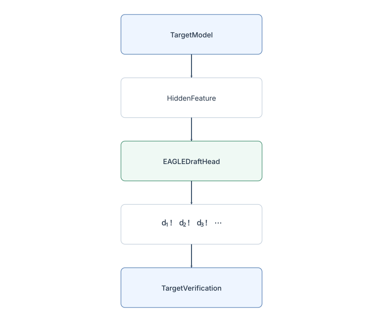

EAGLE Head 要针对特定 Target 训练，不能对任意模型直接通用；但相比维护一个完整的 Draft Model，它的额外参数量和计算开销小得多。

**Medusa：多个 Head 同时预测未来位置。**

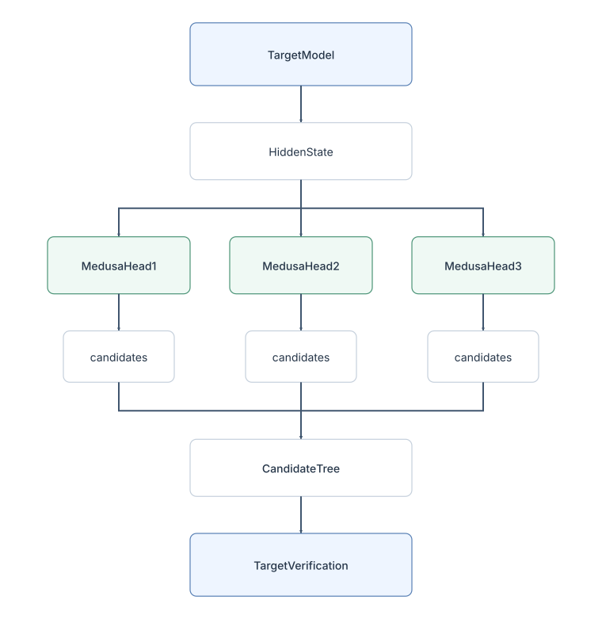

每个 Head 负责一个未来位置，多个 Head 的结果组织成 **Candidate Tree**，Target 用 Tree Attention 一次验证多条候选路径——关键不只是"多几个 LM Head"，而是候选树加一次验证多条路径。

**MTP：模型原生就有 Multi-Token Prediction 能力。**

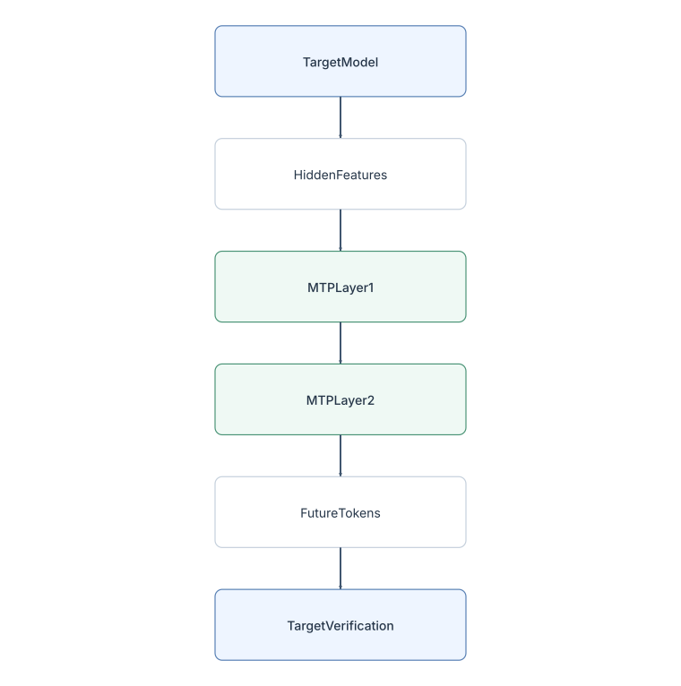

模型在训练阶段就学习预测多个未来位置，这些 MTP 层在推理时天然可以用来出候选。从部署形态看，四种方法是 Target 与 speculative 组件逐渐融合的过程（这只是工程上的理解框架，不是算法演进顺序）：

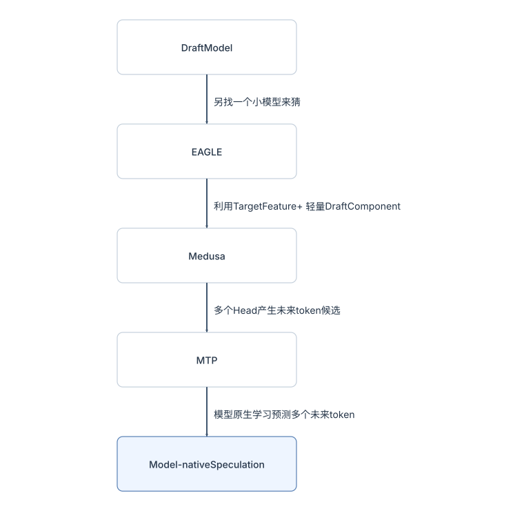

**落到 vLLM 里。** 候选生成器统一叫 **Proposer**，实现在 `vllm/v1/spec_decode/` 下，但没有统一的抽象基类——不同 proposer 的输入根本不同（n-gram 只要 token 历史，EAGLE 要 target 的 hidden state，Medusa 要最后一层 hidden state），所以 `GPUModelRunner.propose_draft_token_ids()` 里是一段按 `speculative_config.method` 分发的代码，每种 proposer 有自己的 `propose()` 签名。按"要不要跑模型、要不要自己的 KV"分三档：

| 档 | 方法（`SpeculativeConfig.method`） | 类 / 文件 | 跑模型？ | 自己的 KV？ | `draft_probs` |
|---|---|---|---|---|---|
| 抄历史 | `ngram` | `NgramProposer`（`ngram_proposer.py`，numba 实现 `batch_propose_numba()`，`prompt_lookup_min/max` 控制 n-gram 长度） | 否，CPU | 否 | `None` |
| ^^ | `ngram_gpu` | `NgramProposerGPU`（`ngram_proposer_gpu.py`） | 否，GPU kernel | 否 | `None` |
| ^^ | `suffix` | `SuffixDecodingProposer`（`suffix_decoding.py`，调用 Arctic Inference 的 `SuffixDecodingCache`） | 否 | 否 | `None` |
| 外挂头 | `medusa` | `MedusaProposer`（`medusa.py`）：对 target 的 hidden state 过若干 head，每个 head 取 argmax | 是，但一次 forward | 否 | 无（greedy） |
| ^^ | `eagle` / `eagle3` | `EagleProposer`（`eagle.py`，只有二十来行：`SpecDecodeBaseProposer` + `pass_hidden_states_to_model=True`） | 是，串行 K 步 | **是**（一个独立的 KV cache group） | 可选 |
| ^^ | `mtp`（含 `deepseek_mtp`、`qwen3_next_mtp` 等十几种 `*_mtp` 类型） | 同 `EagleProposer`，draft 结构是模型的一部分（`vllm/model_executor/models/*_mtp.py`） | 是 | 是 | 可选 |
| ^^ | `dflash` / `dspark` / `gemma4_mtp` / `step3p5_mtp` | `DFlashProposer`、`Gemma4Proposer`、`Step3p5MTPProposer` 等变体 | 是 | 是 | —— |
| 独立模型 | `draft_model` | `DraftModelProposer`（`draft_model.py`）：`SpecDecodeBaseProposer` + `pass_hidden_states_to_model=False`；支持异构词表（`VocabMapping`） | 是，一个完整小模型 | 是 | 可选 |
| 自定义 | `custom_class` | `create_custom_proposer()`（`custom_class_proposer.py`） | —— | —— | —— |

Table: vLLM 中投机解码 proposer 的家族

MTP 在 vLLM 里复用 `EagleProposer`，这是工程抽象上的复用（候选生成与执行流程相同），**不等于 MTP 在算法上是 EAGLE 的特例**。几个实现细节决定了后面几节的形状：

- **`SpecDecodeBaseProposer`**（`llm_base_proposer.py`，近 1900 行）是 EAGLE / MTP / draft model 的公共实现：`propose()` 里 `for token_index in range(self.num_speculative_tokens - 1)` 串行跑 draft 模型；`load_model()` 处理与 target 共享 embedding / lm_head（`_maybe_share_embeddings()`、`_maybe_share_lm_head()`，draft model 子类覆写为不共享）；它持有**自己的 `CudagraphDispatcher`**，`initialize_cudagraph_keys()` 只允许 PIECEWISE（draft 侧不录 FULL 图）。
- **draft 有自己的 KV cache group**：Draft 与 Target 的 KV 不共享——Target 在验证 forward 里用自己的层为候选 token 算出自己的 KV。`SpecDecodeBaseProposer.kv_cache_gid` 在 `initialize_attn_backend()` 时找到 `is_eagle_group` 为真的那个 group；调度器在 `KVCacheManager` 构造时传入 `use_eagle`，`KVCacheCoordinator` 用它标记 `eagle_group_ids`。对 70B 的 target 来说，EAGLE 头只有一层，每 token 的 draft KV 是 `4 KB`（与 target 的一层相同），2350 token 的请求约 9 MB——相对 734 MB 的 target KV 可以忽略；但一个 16 层、8 KV head、`head_dim=64` 的独立 1B draft 模型，每 token 是 `2 × 8 × 64 × 2 B × 16 = 32 KB`，即 target 的 10%，这就得算进显存预算了。
- **`draft_probs` 有没有**决定了拒绝采样用哪条规则（第 6 节）：`draft_sample_method="probabilistic"` 时 `take_last_draft_probs()` 会把 draft 的分布留给 `RejectionSampler`；n-gram 一族天然没有分布。

整套机制在 vLLM 里落在四个对象上，后面三节依次展开：

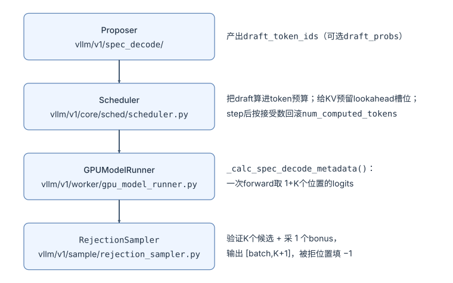

此外有两处约束贯穿始终：**KV**（draft 模型如果有自己的 KV，要独立的 cache group；target 侧要为尚未验证的 token 预留位置）和 **CUDA Graph**（"纯 decode batch"的形状从每请求 1 个 token 变成 `1+K` 个）。

### 4. 调度器与 KV：draft 进预算、预留 lookahead 槽位、按接受数回滚

[《Scheduler》](/scheduler-batch-and-fairness.html)讲 `schedule()` 时反复出现的 `num_tokens_with_spec`，在这里落地：

`num_tokens_with_spec = len(prompt_token_ids) + len(output_token_ids) + len(spec_token_ids)`

调度器对一个 running 请求做几件和普通 decode 不同的事（`Scheduler.schedule()`，`vllm/v1/core/sched/scheduler.py`）：

**① 把 draft 算进 token 预算。** `num_new_tokens = num_tokens_with_spec + num_output_placeholders - num_computed_tokens`，普通 decode 是 1，带 K 个 draft 就是 `1+K`。它和 prefill chunk 一样受 `token_budget` 约束，所以当预算紧张时 draft 会被**截断**：

```python title="Scheduler.schedule()：draft 进预算并可截断"
# Scheduler.schedule()（简化）
if request.spec_token_ids:
    num_scheduled_spec_tokens = (num_new_tokens + request.num_computed_tokens
                                 - request.num_tokens - request.num_output_placeholders)
    if num_scheduled_spec_tokens > 0:
        spec_token_ids = request.spec_token_ids[:num_scheduled_spec_tokens]   # 预算不够就只验证前几个
        scheduled_spec_decode_tokens[request.request_id] = spec_token_ids
    request.spec_token_ids = []     # 下一步的 draft 由 update_draft_token_ids() 重新填
```

注意 `num_scheduled_spec_tokens > 0` 这个条件：一个还在 chunked prefill 中的请求，`num_computed_tokens + num_new_tokens` 追不到 `num_tokens`，这个量 ≤ 0，**draft 在 prefill 阶段根本不会被调度**——`update_draft_token_ids()` 里对 `is_prefill_chunk` 的请求也直接丢弃 draft。投机解码只在请求进入纯 decode 后才生效。

另一条上界：`num_new_tokens ≤ max_model_len - num_computed_tokens - num_sampled_tokens_per_step`，源码注释写明 "This is necessary when using spec decoding"——验证 K 个 draft 后还要采一个 bonus，位置不能越界。

**② 给 KV 预留 lookahead 槽位。** `allocate_slots(request, num_new_tokens, num_lookahead_tokens=self.num_lookahead_tokens)`。[《KV Cache》](/kv-cache-memory-core.html)中 `allocate_slots()` 注释里那个布局图最右边的 `lookahead` 一段就是它。`num_lookahead_tokens` 在 `Scheduler.__init__` 里按方法设定：EAGLE / MTP / draft model 为 `num_spec_tokens`；DFlash 因为要多一个 query 位置是 `num_spec_tokens + 1`；n-gram 一族为 0——它们不跑模型，不需要为 draft 写 KV。为什么 draft 模型需要 lookahead？因为 draft 模型在**这一步的 forward 之后**才跑，它要为下一步的 K 个候选写自己那份 KV，位置必须现在就分好。

**回到前面的例子**：K=3，`num_lookahead_tokens=3`，每张卡每 token 40 KB，预留 120 KB；`block_size=16` 时绝大多数步骤这 3 个槽位落在当前块里，偶尔多占一块（每卡 640 KB）。对一个 734 MB 的请求来说是零头——**lookahead 的代价不在显存，而在它让 `allocate_slots()` 更早触碰 watermark**。

**③ step 之后按接受数回滚。** `update_from_output()` 里：

```python title="update_from_output()：按接受数回滚"
num_draft_tokens = len(scheduled_spec_token_ids)
num_accepted = max(len(generated_token_ids) - num_sampled, 0)   # 减掉 bonus
num_rejected = num_draft_tokens - num_accepted
request.num_computed_tokens -= num_rejected                    # 被拒的位置"当作没算过"
```

常说的"KV 回滚"，落到源码上**就是这一行减法**。vLLM 不调用任何"撤销"接口，也不释放被拒位置所在的物理块：被拒 token 占的槽位留在原地，下一步的 token 直接覆盖它们（`slot_mapping` 按 `num_computed_tokens` 算）。[《模型适配》](/model-adaptation-architecture.html)讲 DeepSeek MTP 时说的"暂存状态 vs 提交状态"，在 vLLM 里的实现就是 `num_computed_tokens` 与实际写入 KV 的位置之间的这个差。

用一个请求连续两步的 KV 槽位把这件事画出来（K=3，第一步接受 1 个、拒绝 2 个）：

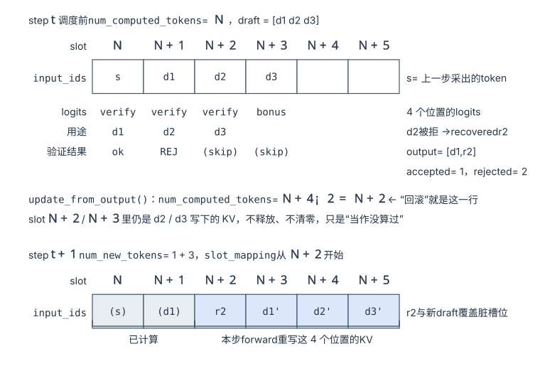

两点从图上一眼可见：`s` 这个"上一步采出的 token"在 step t 才写 KV，所以每步的输入总是 `1 + K` 个而不是 `K` 个；被拒位置的 KV 没有任何清理动作，正确性完全靠 `num_computed_tokens` 这个游标——prefix cache 的 `cache_blocks()` 也以它为界只缓存已计算的完整块，脏槽位因此不会被别的请求命中。

同一处还调用 `make_spec_decoding_stats()` 累积 `SpecDecodingStats`（`vllm/v1/spec_decode/metrics.py`）：`num_drafts`、`num_draft_tokens`、`num_accepted_tokens`，以及**按位置**的 `num_accepted_tokens_per_pos` / `num_draft_tokens_per_pos`。它随 `SchedulerStats` 回到前端，`SpecDecodingLogging.log()` 定期打印一行：

```text
SpecDecoding metrics: Mean acceptance length: 2.71, Accepted throughput: ... tokens/s,
Drafted throughput: ... tokens/s, Accepted: N tokens, Drafted: M tokens,
Per-position acceptance rate: 0.812, 0.605, 0.412, Avg Draft acceptance rate: 61.0%
```

"Mean acceptance length" 按惯例含 bonus token（`1 + accepted / drafts`）；Prometheus 侧是 `SpecDecodingProm`。**按位置的接受率是调 K 的依据**：第 3 个位置只有 41% 时，第 4 个位置大概率不值得。

**④ draft 从哪里来、何时回到调度器。** 同步调度下，`EngineCore.post_step()` 在一步结束后 `take_draft_token_ids()` → `Scheduler.update_draft_token_ids()` 写回 `request.spec_token_ids`；异步调度下调度器提前一步跑，拿不到 draft，于是 worker 侧在 `update_draft_token_ids_in_output()` 里把 `scheduled_spec_decode_tokens` 的占位换成真实 draft，**长度不够的位置补 `-1`**，并把每个请求补了几个记进 `num_invalid_spec_tokens`——`-1` 在 `RejectionSampler` 的 kernel 里被无条件拒绝。

**⑤ 一个 prefix cache 的特例。** `HybridKVCacheCoordinator.find_longest_cache_hit()` 与 `SingleTypeKVCacheManager.find_longest_cache_hit()` 都有一个 `drop_eagle_block` 参数：EAGLE / MTP 开启时，**prefix cache 命中的最后一个块会被主动丢掉**（`hit_length -= min(alignment_tokens, block_size)`）。原因是 EAGLE 的 draft 需要 target 对"最后一个已计算 token"的 hidden state，而 prefix cache 只保留 KV、不保留 hidden state——全部命中的话就没有任何位置会真正跑 forward，draft 无从下手。所以[《KV Cache》](/kv-cache-memory-core.html)算的"125 块全部命中"在开 EAGLE 时会变成 124 块命中、重算 16 个 token。相应地 `cache_blocks()` 会多缓存一块（`num_tokens_to_cache = aligned + block_size`），让下一个请求仍能用到。

### 5. Model runner：一次 forward 算 K+1 个位置

调度器交出的 `SchedulerOutput.scheduled_spec_decode_tokens` 在 model runner 里变成 `SpecDecodeMetadata`（`vllm/v1/spec_decode/metadata.py`）。`GPUModelRunner._calc_spec_decode_metadata()` 的注释自带一个例子，照抄：

```python title="_calc_spec_decode_metadata 注释里的例子"
# Inputs:
# cu_num_scheduled_tokens:  [  4, 104, 107, 207, 209]   ← 5 个请求，本步各调度 4/100/3/100/2 个 token
# num_draft_tokens:         [  3,   0,   2,   0,   1]   ← 请求 0 带 3 个 draft，请求 1 和 3 在 prefill
# Outputs:
# cu_num_draft_tokens:      [  3,   3,   5,   5,   6]
# logits_indices:           [  0,   1,   2,   3, 103, 104, 105, 106, 206, 207, 208]
# target_logits_indices:    [  0,   1,   2,   5,   6,   9]
# bonus_logits_indices:     [  3,   4,   7,   8,  10]
```

看请求 0：它本步的 4 个 token 是 `[上一步采样的 token, d₁, d₂, d₃]`，forward 后需要 4 个位置的 logits——前 3 个（`target_logits_indices`）用来验证 `d₁ d₂ d₃`，第 4 个（`bonus_logits_indices`）是全部接受时的 bonus。请求 1 在 prefill，只要最后一个位置（104 → 全是 bonus）。于是 `logits_indices` 总长 `num_tokens + batch_size`，**logits 张量不再是 `[num_reqs, V]` 而是 `[num_reqs + Σ drafts, V]`**——采样一侧的 logits processor 因此不知道每一行属于哪个请求，[《输出在变》](/output-changes-sampling-and-structured-output.html)会讲这带来的限制。`draft_token_ids` 直接从 `input_ids[logits_indices][target_logits_indices + 1]` 取出来：draft 已经作为输入 token 喂进了 forward。

**这一步和 CUDA Graph 的关系**是最容易被忽略的约束。[第三章](#2-cuda-graph静态执行图捕获与重放)讲 `FULL_AND_PIECEWISE` 时说"纯 decode batch 形状规则、可以按 batch size 分桶录图"——投机解码把"规则"的定义改了：

```python title="gpu_model_runner.py：uniform_decode_query_len"
# vllm/v1/worker/gpu_model_runner.py
self.uniform_decode_query_len = 1 + self.num_spec_tokens

@staticmethod
def _is_uniform_decode(max_num_scheduled_tokens, uniform_decode_query_len, num_tokens, num_reqs, ...):
    return (max_num_scheduled_tokens == uniform_decode_query_len
            and num_tokens == max_num_scheduled_tokens * num_reqs)
```

只有**每个请求恰好 `1+K` 个 token** 的 batch 才算 uniform decode、才走 FULL 图。`CudagraphDispatcher.initialize_cudagraph_keys()` 也据此只为 `≥ uniform_decode_query_len` 且能被它整除的 capture size 建 FULL 图的 key（第二章 key 里那个 `num_reqs = size / (1 + 投机 token 数)` 就是这么来的）。这带来两个后果：

- 上一节说的"预算不够就截断 draft"一旦发生，那个请求就只有 `1 + K'` 个 token，整个 batch 不再 uniform，退回 PIECEWISE——**投机解码对 token 预算的敏感度比普通 decode 高**；
- draft 模型自己那 K 步 forward 走 `SpecDecodeBaseProposer` 的独立 dispatcher，只有 PIECEWISE。

采样之后紧接着就是下一轮的 draft（`GPUModelRunner.sample_tokens()` 内部的 `propose_draft_token_ids()`）。默认的 "padded drafter batch" 模式下，EAGLE / draft model 直接消费 GPU 上的 `sampled_token_ids`，不等 D2H 拷贝和 CPU 侧 bookkeeping；`disable_padded_drafter_batch=True` 则退回先同步再 draft。这是投机解码在 V1 里能与异步调度共存的前提——`VllmConfig` 里限制了异步调度只支持 EAGLE / MTP 系、`ngram_gpu`、`draft_model` 和 `dspark`，且不能与 `disable_padded_drafter_batch=True` 同开。

### 6. RejectionSampler：验证的实现

`RejectionSampler`（`vllm/v1/sample/rejection_sampler.py`）的 docstring 先给了术语表：**accepted tokens**（按 draft/target 概率比接受的）、**recovered tokens**（拒绝后从残差分布采出的）、**bonus tokens**（全部接受后额外的一个，用普通 `Sampler` 采）、**output tokens = accepted + recovered + bonus**。`forward()` 分四步：

```python title="RejectionSampler.forward() 的四步"
# RejectionSampler.forward()（简化）
bonus_logits  = logits[metadata.bonus_logits_indices]            # [batch, V]
bonus_token_ids = self.sampler(bonus_logits, sampling_metadata, predict_bonus_token=True)
                                                                   # ① bonus 走完整的 Sampler：top-p、penalties 全都生效

target_logits = logits[metadata.target_logits_indices].float()   # [num_drafts, V]
target_logits = self.apply_logits_processors(target_logits, sampling_metadata, metadata)
                                                                   # ② 投机版的处理器：penalties / bad_words / min_tokens / thinking budget
target_logits = apply_sampling_constraints(target_logits, metadata.cu_num_draft_tokens, sampling_metadata)
                                                                   # ③ 温度 + top_k/top_p，参数按 draft 数 expand 到每一行

output_token_ids = rejection_sample(metadata.draft_token_ids, metadata.num_draft_tokens,
                                    metadata.max_spec_len, metadata.cu_num_draft_tokens,
                                    draft_probs, target_logits, bonus_token_ids, sampling_metadata, ...)
                                                                   # ④ 两个 Triton kernel
```

①–③ 保证 target 行用的是"和不开投机时同一个请求会看到的"那个分布——拒绝采样只有在 $$q$$ 就是该请求真正的采样分布时才无损。这几步怎么把每请求的参数展开到每个 draft 行、哪些处理器因此被禁用，属于采样参数的适配，放在[《输出在变》](/output-changes-sampling-and-structured-output.html)。

第 ④ 步 `rejection_sample()`：

- 输出缓冲 `output_token_ids = full((batch, max_spec_len + 1), PLACEHOLDER_TOKEN_ID=-1, int32)`，`MAX_SPEC_LEN = 128` 是编译期上限；
- 若 batch 里有 greedy 请求，先跑 `rejection_greedy_sample_kernel`：逐位置比较 `draft_token_id == target_argmax`，第一个不等就写 target 的 argmax 并停止，全等则补 bonus——**greedy 下投机解码严格等价于逐 token greedy**；
- 若有随机请求，`target_probs = softmax(target_logits)`，先用 `sample_recovered_tokens()` 为**每个位置**预采一个 recovered token（用第 2 节那个 `max(0, q - p)` 归一化的残差分布；用指数噪声技巧 `argmax(probs / q), q ~ Exp(1)` 代替 `torch.multinomial`，避免 CPU-GPU 同步），再跑 `rejection_random_sample_kernel`：位置 i 接受当且仅当 `draft_prob > 0 且 target_prob / draft_prob ≥ u_i`（`u_i` 由 `generate_uniform_probs()` 生成，尊重每请求的 seed）；第一个被拒的位置写入预采好的 recovered token 并停止；
- `NO_DRAFT_PROBS` 为真（n-gram 一族）时 `draft_prob = 1`，接受条件退化为 `target_prob ≥ u_i`——即按 target 自己的概率接受这个具体 token。这仍然是一个合法的采样过程（等价于把 draft 视为确定性提议），但**接受率会比有 draft 分布时低**：一个 target 概率 0.6 的 token 只有 60% 机会被接受，即使它就是 target 最想要的那个；
- 两个 kernel 都以 `batch_size` 为 grid，每个 program 顺序扫自己请求的 K 个位置——验证的并行度在请求间，不在位置间，因为位置间有"前一个被拒后面全作废"的依赖。

`SpeculativeConfig.rejection_sample_method` 默认是 `"standard"`，另有两个值：`"synthetic"` 按给定的每位置接受率随机接受（benchmark 时模拟固定接受率），`"block"` 是块验证（把 K 个 draft 作为一个整体联合验证，而不是逐个）。

`parse_output()` 把 `[batch, K+1]` 里 `-1` 之前的部分切成每请求的 token 列表，回到 `ModelRunnerOutput.sampled_token_ids`——这就是调度器 `update_from_output()` 里 `len(generated_token_ids)` 的来源。

### 7. 收益与代价的量化

第 2 节的例子是 batch=1、"验证 6 个位置比 1 个位置只多 3 ms"。这里推广到不同 batch，并给出临界点。

**"验证几乎免费"的边界在哪里？** 一步 decode 的时间约等于 `max(权重读取时间, 计算时间)`。每张卡 17.6 GB 权重、3.35 TB/s → 读取 5.3 ms；每 token 每卡的计算量约 `2 × 8.75 GFLOP`，H100 BF16 稠密 989 TFLOPS。两者相等时的 token 数：

$$T_\text{ridge} \approx \frac{989 \times 10^{12}\ \text{FLOP/s} \times 2\ \text{B/param}}{2 \times 3.35 \times 10^{12}\ \text{B/s}} \approx 295\ \text{token / 步 / 卡}$$

也就是说，**一步里 `batch × (1+K)` 超过大约 300 个 token，这一步就从 memory-bound 转入 compute-bound，多算的位置开始真金白银地花时间**（40% MFU 的话临界点还要再低一些）。

| batch | K | 每步 token 数 | 验证是否"免费" | 每步时间（估） |
|---:|---:|---:|---|---|
| 1 | 3 | 4 | 是 | ≈ 10 ms |
| 8 | 3 | 32 | 是 | ≈ 10 ms |
| 32 | 3 | 128 | 是 | ≈ 10–11 ms |
| 64 | 3 | 256 | 接近临界 | ≈ 12 ms |
| 128 | 3 | 512 | **否**，≈ 1.7× 临界 | ≈ 17 ms |
| 128 | 0（不开） | 128 | —— | ≈ 10 ms |

Table: 不同 batch 与 K 下验证是否免费

**每步的总时间**再加上 draft：EAGLE 头一层、TP=8 下每卡权重不到 0.3 GB，一次 forward 的权重读取不到 0.1 ms，但 K 步串行、每步几十个 kernel，launch 与同步开销主导，估 0.5–1 ms/步；独立 1B draft model 大约 1–2 ms/步。

**回到前面的例子**（batch=1，300 个输出 token）：

| 配置 | 步数 | 每步 | Decode 总时间 | 相对 |
|---|---:|---|---:|---|
| 不开投机 | 300 | 10 ms | 3000 ms | 1.0× |
| EAGLE，K=3，平均接受长度 2.5 | 120 | 10 + 3 × 0.7 ≈ 12 ms | ≈ 1450 ms | **≈ 2.1×** |
| EAGLE，K=3，平均接受长度 1.6（难预测的文本） | 188 | 12 ms | ≈ 2250 ms | 1.3× |
| n-gram，K=3，接受长度 1.2（几乎不重复的文本） | 250 | 10 ms（draft 在 CPU） | 2500 ms | 1.2× |
| n-gram，K=3，接受长度 3.5（RAG 抄原文） | 86 | 10 ms | 860 ms | **3.5×** |
| EAGLE，K=3，batch=128 | 每请求 120 步 | 17 + 2 ≈ 19 ms | ≈ 2280 ms | 1.3×（吞吐口径下还要再看：128 个请求同时慢了 1.9 倍） |

Table: 贯穿全文例子在不同投机配置下的 Decode 时间

最后一行是关键：**batch=128 时，投机解码把每一步拖慢 1.9 倍，只换来 2.5 倍的步数减少**——单请求延迟略好，系统吞吐反而下降（同样的 GPU 时间产出的 token 变少）。原因是额外的 draft 计算和多出来的验证位置，与其他请求竞争算力、显存带宽和执行资源；GPU 已经忙的时候，少跑几轮 Target 的收益抵不过这些开销。投机解码因此更适合 GPU 相对空闲、对 ITL 敏感的场景；吞吐优先的高并发服务要结合接受率、Draft 成本、batch size 实测。

**什么时候不该开**：

- 每步 token 数已接近或超过 $$T_\text{ridge}$$（高并发、吞吐优先）；
- 输出很短（prefill 主导，投机对 prefill 无效——第 4 节说过 draft 在 prefill 阶段根本不调度）；
- 请求普遍需要 `min_p`、`logit_bias` 或自定义 logits processor（开投机时它们被禁用，见[《输出在变》](/output-changes-sampling-and-structured-output.html)）；
- 采样温度高、文本高熵——接受率随之下降，而 draft 成本不变；
- 需要异步调度但 proposer 不在支持列表里。

`SpeculativeConfig.num_speculative_tokens_per_batch_size` 提供了一个折中：按 batch size 区间动态选 K（`build_dynamic_sd_schedule_lookup()`，`vllm/v1/spec_decode/dynamic/utils.py`），大 batch 时自动降到 0。

### 8. 多卡与 PD 下的约束

[《Multi-GPU》](/multi-gpu-scaling-strategies.html)和[《PD 分离》](/prefill-decode-disaggregation.html)没有专门讨论投机解码，这里把 v0.27.1 里与它们相关的几条约束列出来：

1. **draft 的 TP。** `SpeculativeConfig.draft_tensor_parallel_size` 只能是 1 或等于 target 的 TP（`SpeculativeConfig._verify_and_get_draft_tp()`；不设时取 target 的 TP，`mlp_speculator` 取 1）。`draft_model` 方法更严格，`DraftModelProposer._raise_if_draft_tp_mismatch()` 要求两者相等——注释给的原因是 target TP > 1、draft TP = 1 时各 rank 都在 rank 0 上编译 draft，torch.compile 缓存会互相覆盖。EAGLE 头随 target 的 TP 切开时，每卡的矩阵很小，draft 的每一步都要付 target 一层的 all-reduce，却只换来一层的计算。
2. **draft 在哪个 PP stage。** `GPUModelRunner.__init__` 只在最后一个 PP rank 上创建 `drafter`（注释："currently we put the entire draft model on the last PP rank"）——logits 只在末 stage 产生，draft 紧跟采样。
3. **动态 K 与 DP 互斥。** `VllmConfig._maybe_disable_dynamic_sd_for_data_parallel()` 在 DP > 1 时关掉 `num_speculative_tokens_per_batch_size`、退回固定 K：不同 DP rank 若选了不同 K，各 rank 的 forward 形状对不上，集合通信会死锁。
4. **PD 下的 lookahead 槽位。** D 侧异步拉取远端 KV 的那一步（`load_kv_async` 为真）不跑 forward，`Scheduler.schedule()` 里 `limit_lookahead_tokens` 把这一步的 `num_lookahead_tokens` 置 0，注释说是为了不让本地与远端的块数对不上；KV 到达、请求真正开始 decode 后再按正常规则预留。
5. **PD 下 EAGLE 的第一个 draft。** EAGLE 需要 target 对 prompt 最后一个 token 的 hidden state，而 KV Transfer 只传 KV。[《PD 分离》](/prefill-decode-disaggregation.html)走读的 NIXL toy proxy 下，D 本来就会[重算最后一个输入 token](/prefill-decode-disaggregation.html#1-一次请求的交接契约传什么何时可用何时释放)以得到采样所需的 logits，这一步的 hidden state 就在 D 上产生；和第 4 节的 `drop_eagle_block` 是同一件事——总要留一个位置真正跑 forward。

<details markdown="1">
<summary><b>📂 本章源码导航</b></summary>

**GPU 执行**

| 想看什么 | 从哪开始 |
|---|---|
| 输入翻译 | `vllm/v1/worker/gpu_model_runner.py` → `GPUModelRunner._update_states()`、`_prepare_inputs()`、`_build_attention_metadata()`、`_determine_batch_execution_and_padding()`、`_bookkeeping_sync()`；`vllm/v1/worker/block_table.py` → `BlockTable.commit_block_table()` / `compute_slot_mapping()` |
| **一轮 batch 在 GPU 上怎么跑** | `vllm/v1/worker/gpu_model_runner.py`（默认）、`vllm/v1/worker/gpu_input_batch.py`；V2 实现在 `vllm/v1/worker/gpu/`（输入翻译见本文第二章） |
| Worker 进程的常驻循环 | `vllm/v1/executor/multiproc_executor.py` → `WorkerProc.worker_busy_loop()`、`handle_output()`；EngineCore 一侧 `MultiprocExecutor.collective_rpc()`；`vllm/v1/worker/gpu_worker.py` → `Worker.execute_model()` / `sample_tokens()` |
| C++ / CUDA 算子怎样注册给 Python | `csrc/libtorch_stable/torch_bindings.cpp`（`STABLE_TORCH_LIBRARY_FRAGMENT` / `STABLE_TORCH_LIBRARY_IMPL`）、`csrc/core/registration.h`（`REGISTER_EXTENSION`）、`vllm/_custom_ops.py`（`torch.ops._C.*` 的包装） |
| Python 写的自定义算子 | `vllm/utils/torch_utils.py` → `direct_register_custom_op()`；`vllm/model_executor/layers/attention/attention.py` → `unified_attention_with_output`；图切分点 `vllm/config/compilation.py` → `CompilationConfig.splitting_ops` |
| CUDA Graph 捕获与重放 | `vllm/v1/worker/gpu/cudagraph_utils.py`；模式枚举在 `vllm/config/compilation.py` |
| Attention 后端选择 | `vllm/v1/attention/selector.py` → `get_attn_backend()` |
| 各 Attention 后端实现 | `vllm/v1/attention/backends/`（MLA 变体在 `mla/`） |
| 融合算子（CUDA） | `csrc/libtorch_stable/` |
| 量化 | `vllm/model_executor/layers/quantization/`（FP8 见 `fp8.py`） |

Table: GPU 执行源码导航

**投机解码**

| 想看什么 | 从哪开始 |
|---|---|
| 配置与方法枚举 | `vllm/config/speculative.py` → `SpeculativeConfig`、`SpeculativeMethod`、`use_eagle()`、`num_speculative_tokens_per_batch_size`、`draft_tensor_parallel_size`（`_verify_and_get_draft_tp()`） |
| Proposer 家族 | `vllm/v1/spec_decode/`：`llm_base_proposer.py`（`SpecDecodeBaseProposer`）、`eagle.py`（`EagleProposer`，MTP 复用）、`draft_model.py`、`medusa.py`、`ngram_proposer.py`、`ngram_proposer_gpu.py`、`suffix_decoding.py`、`custom_class_proposer.py`；MTP 的 draft 结构在 `vllm/model_executor/models/*_mtp.py`（如 `deepseek_mtp.py`） |
| **调度器侧** | `vllm/v1/core/sched/scheduler.py` → `Scheduler.__init__`（`num_lookahead_tokens`）、`schedule()`（`scheduled_spec_decode_tokens`、`limit_lookahead_tokens`）、`update_from_output()`（回滚与 stats）、`update_draft_token_ids()` / `update_draft_token_ids_in_output()` |
| KV 预留 | `vllm/v1/core/kv_cache_manager.py` → `KVCacheManager.allocate_slots(num_lookahead_tokens=...)` |
| EAGLE 与 prefix cache | `vllm/v1/core/kv_cache_coordinator.py`（`eagle_group_ids`）；`vllm/v1/core/single_type_kv_cache_manager.py` → `find_longest_cache_hit(drop_eagle_block=...)` |
| **model runner 侧** | `vllm/v1/worker/gpu_model_runner.py` → `_calc_spec_decode_metadata()`、`_sample()`、`sample_tokens()`、`propose_draft_token_ids()`、`_is_uniform_decode()`、`uniform_decode_query_len` |
| 元数据 | `vllm/v1/spec_decode/metadata.py` → `SpecDecodeMetadata` |
| 拒绝采样 | `vllm/v1/sample/rejection_sampler.py` → `RejectionSampler.forward()`、`rejection_sample()`、`apply_sampling_constraints()`、`rejection_greedy_sample_kernel` / `rejection_random_sample_kernel`、`sample_recovered_tokens()` |
| 指标 | `vllm/v1/spec_decode/metrics.py` → `SpecDecodingStats`、`SpecDecodingLogging`、`SpecDecodingProm` |
| CUDA Graph 的 key | `vllm/v1/cudagraph_dispatcher.py` → `CudagraphDispatcher.initialize_cudagraph_keys(uniform_decode_query_len=...)` |
| 与异步调度 / DP 的约束 | `vllm/config/vllm.py` → `VllmConfig` 中异步调度的方法白名单、`_maybe_disable_dynamic_sd_for_data_parallel()` |

Table: 投机解码源码导航

</details>

## 七、本文小结

- 落到 GPU 上，浪费只有四种形态：等 CPU 发指令、等 HBM 送数据、搬的每个数太胖、轮次本身太多；本篇的四类手段分别对应它们。
- 在例子里（Llama-3-70B、8×H100、TP=8），一次 decode 的权重读取下界约 5.3 ms，实测一步约 10 ms；Prefill 2050 token 约 92 ms 只占 3%，300 步 decode 约 3000 ms 占 97%——所以绝大多数优化针对 Decode 侧。
- forward 之前，`GPUModelRunner` 把 `SchedulerOutput` 翻译成 GPU 数据结构：`_update_states()` 增量更新常驻的 `InputBatch`，`_prepare_inputs()` 拼出扁平的 `input_ids` / `positions` 并用 Triton kernel 算 `slot_mapping`（每个 token 的 KV 写去哪），`_build_attention_metadata()` 交出 `block_table`（每个请求能读哪些块）、`query_start_loc`、`seq_lens`，再由 dispatcher 选 CUDA Graph 还是 eager。`execute_model()` 全程异步入队，`sample_tokens()` 里 `transfer_event.synchronize()` 是一步唯一的同步点，async scheduling 连它也拿掉。
- CUDA Graph 把一步 decode 的数百到上千次 kernel 提交合并为一次图重放，消除 Kernel Launch 气泡；代价是图内形状必须固定，因此要按 batch 形态捕获、按模式（如 `FULL_DECODE_ONLY`）取舍显存与收益。
- FlashAttention 与 Kernel Fusion 优化的是同一个量——HBM 流量 = 搬运次数 × 每次搬运的数据量——前者是注意力内部的"算子内融合"（Tiling + Online Softmax，N×N 矩阵不落 HBM），后者是推理链路上的"算子间融合"；vLLM 通过 Attention Backend Selector 按硬件与 workload 路由到不同实现。
- 低精度推理让每次搬运的数据本身变小，与减少搬运次数正交、可叠加；权重量化直接减半 decode 的权重读取带宽，FP8 / INT4 还能用上 Tensor Core 的特殊指令。
- 投机解码用闲置算力换延迟，且不改变输出分布：Draft 猜 K 个、Target 一次 forward 验证，拒绝采样（接受概率 $$\min(1, q/p)$$，被拒后从 $$\max(0, q-p)$$ 的残差分布重采）保证与直接用 Target 采样一致，greedy 下逐 token 相同。候选可以抄历史（n-gram、suffix）、外挂头（EAGLE、Medusa）、模型自带（MTP）或用独立小模型；vLLM 里统称 Proposer，EAGLE / MTP / draft model 共用 `SpecDecodeBaseProposer`，有自己的 KV cache group。
- 在 vLLM 里，调度器把 `1+K` 算进 token 预算（预算紧时截断 draft，prefill 阶段不调度 draft），用 `num_lookahead_tokens` 为 draft 模型预留槽位，步后 `num_computed_tokens -= num_rejected` 就是全部的"KV 回滚"——物理槽位不清理、不释放；model runner 的 logits 变成 `[num_reqs + Σdrafts, V]`，"纯 decode batch"变成每请求 `1+K` 个 token，截断 draft 会让 batch 掉出 FULL 图；EAGLE 命中 prefix cache 时主动少算一块。
- 收益有临界点：H100 上一步约 300 个 token 是 memory-bound 与 compute-bound 的分界，`batch × (1+K)` 超过它验证就不再免费。例子里 batch=1、接受长度 2.5 时约 2.1×；batch=128 时每步慢 1.9 倍、吞吐反降。按位置的接受率（`SpecDecodingStats`）是调 K 的依据；动态 K 在 DP > 1 时被关掉，PD 下异步拉 KV 的那一步不预留 lookahead。

## 八、自测

1. Llama-3-70B TP8、BF16：一步 decode 每卡读多少权重？H100 上时间下界多少？实测约 10 ms 的另一半去哪了？

   <details markdown="1"><summary>答案</summary>

   70B × 2 B / 8 ≈ 17.5 GB，/ 3.35 TB/s ≈ 5.3 ms；另一半是 KV 读取（随 batch × 上下文增长）、每层两次 all-reduce 的 $$\alpha$$（80 层 × 2 × 十几 µs ≈ 2–3 ms）、kernel launch 气泡与小算子。

   </details>

2. CUDA Graph 为什么要“按 batch 形态捕获”？一步里哪部分不能进图、vLLM 怎么处理？

   <details markdown="1"><summary>答案</summary>

   图里的 kernel 参数（包括 tensor 形状与地址）固定，batch 大小变了就要另一张图，所以按 1、2、4、8…分桶捕获、运行时 padding 到最近的桶；attention 的序列长度每步变，用固定形状的元数据 buffer（block table、seq_lens 填满 padding）或 piecewise 编译把 attention 留在图外。

   </details>

3. residual add + RMSNorm 融合、RoPE + reshape_and_cache 融合各省了什么？为什么对 prefill 收益小？

   <details markdown="1"><summary>答案</summary>

   省中间结果在 HBM 的一写一读（每元素几个字节）与几次 launch；prefill 是 compute-bound、逐元素算子占比小，融合省的字节在总时间里不显；decode 里逐元素算子与 launch 占比大，收益明显。

   </details>

4. 投机解码 K = 4、方法是 EAGLE 时，调度器对一个 decode 请求要改哪三处？为什么要预留 lookahead 槽位，n-gram 为什么不用？

   <details markdown="1"><summary>答案</summary>

   token 预算按每请求 $$1 + K = 5$$ 计（预算紧时截断 draft）；`allocate_slots()` 额外预留 `num_lookahead_tokens = 4` 个槽位；步后 `num_computed_tokens -= num_rejected` 回滚。lookahead 是给 draft 模型用的：它在本步 forward 之后为下一步的 K 个候选写自己那份 KV，位置要提前分好；n-gram 不跑模型、不写 KV，所以是 0。

   </details>

5. H100 上一步约 300 个 token 是 memory-bound 与 compute-bound 的分界：batch 64、K = 4 时投机解码还划算吗？batch 1 呢？

   <details markdown="1"><summary>答案</summary>

   64 × 5 = 320 > 300，验证步已进入 compute-bound，每步时间随 token 数增长，步数减少的收益被抵消甚至为负（文中 batch 128、K = 3 时每步慢 1.9 倍、吞吐下降）；batch 1 时每步 5 个 token，远在 memory-bound 区，验证几乎免费，接受长度 2.5 时约 2.1×。

   </details>

6. `GPUModelRunner._update_states()` 做什么？为什么它是 `InputBatch` 持久化的关键？

   <details markdown="1"><summary>答案</summary>

   按 `SchedulerOutput` 把完成 / 抢占的请求从 `InputBatch` 移除（`condense()` 用尾部行填补空位）、新请求加入、更新每个请求的 `num_computed_tokens` 与 block table；`InputBatch` 跨步保留，所以每步只做增量更新而不是重建，LogitsProcessor 的状态也随之同步。

   </details>

7. block table 是怎么进到 attention kernel 的？decode 时 kernel 用它做什么？

   <details markdown="1"><summary>答案</summary>

   `_update_states()` 把新块号写进 `BlockTable` 的行，`_prepare_inputs()` 第一行 `commit_block_table()` 把它异步拷到 GPU，再由 `compute_slot_mapping()` 算出 `slot_mapping`（新 token 写到哪个 slot），连同 `seq_lens`、`query_start_loc` 由 `_build_attention_metadata()` 打包成 attention metadata；decode kernel 对每个请求按 block table 查 KV 块地址，逐块读 K、V 做 attention，新 K、V 按 `slot_mapping` 写入。

   </details>

8. `torch.ops._C.rms_norm` 和 `torch.ops.vllm.unified_attention_with_output` 分别是怎么注册进 PyTorch 的？attention 为什么要注册成一个自定义算子？

   <details markdown="1"><summary>答案</summary>

   前者在 C++ 里注册：`torch_bindings.cpp` 用 `STABLE_TORCH_LIBRARY_FRAGMENT` 声明 schema、`STABLE_TORCH_LIBRARY_IMPL` 挂 CUDA 实现，`import vllm._C_stable_libtorch` 装入 `.so` 时触发，Python 侧经 `_custom_ops.py` 的包装调用。后者在 Python 里用 `direct_register_custom_op` 注册成 `torch.ops.vllm.*`。注册成一个不可拆的算子，`torch.compile` 就不会把 attention 拆开追踪，PIECEWISE CUDA Graph 正好在它处切段，它内部再按 backend 调 FlashAttention 扩展或 Triton kernel。

   </details>

[^q0]: 浪费只有四种形态，对应四类手段。**等 CPU 发指令**（launch-bound）：一步 decode 有几百到上千次 kernel 提交，单个 kernel 的 GPU 时间短于 CPU 提交它的时间时 GPU 出现气泡；CUDA Graph 把整步捕获成一张图一次重放，代价是图内形状必须固定——按 batch 大小分桶捕获、padding 到桶（[第三章](#三gpu-为什么在空转-kernel-launch-与-cuda-graph)）。**等 HBM 送数据**（memory-bound）：decode 每步读全部权重与 KV，Llama-3-70B TP8 一步权重读取下界约 5.3 ms、实测约 10 ms；手段是算子融合（残差 + RMSNorm、SiLU-mul、RoPE + cache 写入合成一个 kernel）与 attention backend 的选择（[第四章](#四数据为什么搬不动-压缩-hbm-流量)）。**搬的每个数太胖**：量化——权重 INT4 / FP8 让读取字节减 2–4 倍，KV FP8 减半，对 memory-bound 的 decode 直接换成时间（[第五章](#五能不能少搬几个字节-低精度推理)）。**轮次本身太多**：投机解码让 Draft 一次猜 K 个、Target 一次 forward 验证，拒绝采样保证输出分布不变；vLLM 里 draft 进 token 预算、为 draft 模型预留 lookahead 槽位、步后回滚 `num_computed_tokens`，一步里 `batch × (1+K)` 超过约 300 个 token 后验证不再免费（[第六章](#六能不能少跑几轮模型-投机解码)）。账本：Prefill 2050 token 约 92 ms 只占 3%，300 步 decode 约 3000 ms 占 97%——所以绝大多数优化针对 Decode。
[^q1]: 在 Worker 里的 `GPUModelRunner.execute_model()` 前半段，分四步：`_update_states()` 按 `SchedulerOutput` 增删、更新常驻 `InputBatch` 的行与 block table；`_prepare_inputs()` 把各请求本轮的 token 扁平成 `input_ids` / `positions` 经 pinned buffer 异步 H2D，并用 Triton kernel 由 block table 算出每个 token 的 `slot_mapping`（Prefix Cache 命中的 token 已计入 `num_computed_tokens`，不在本轮里）；`_build_attention_metadata()` 交出 `block_table_tensor`、`slot_mapping`、`query_start_loc`、`seq_lens`；`_determine_batch_execution_and_padding()` 经 `cudagraph_dispatcher.dispatch()` 决定 FULL / PIECEWISE / eager 并 pad 到桶。GPU 不等它，是因为 `execute_model()` 里的拷贝和 kernel 全部 `non_blocking` 入队（`commit_block_table()` 还被提到最前与 numpy 计算重叠），整步唯一的 CPU 等 GPU 点是 `sample_tokens()` 里 `_bookkeeping_sync()` 的 `transfer_event.synchronize()`；开 async scheduling 后连这一点也移到独立 copy stream 上。详见[第二章](#二forward-之前scheduleroutput-如何变成-gpu-张量)。
