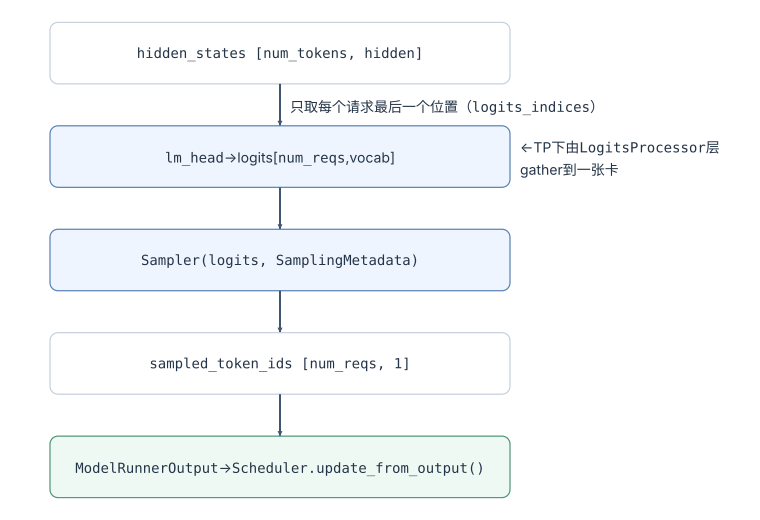
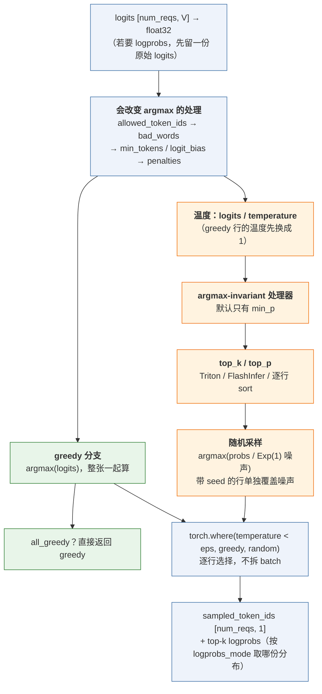
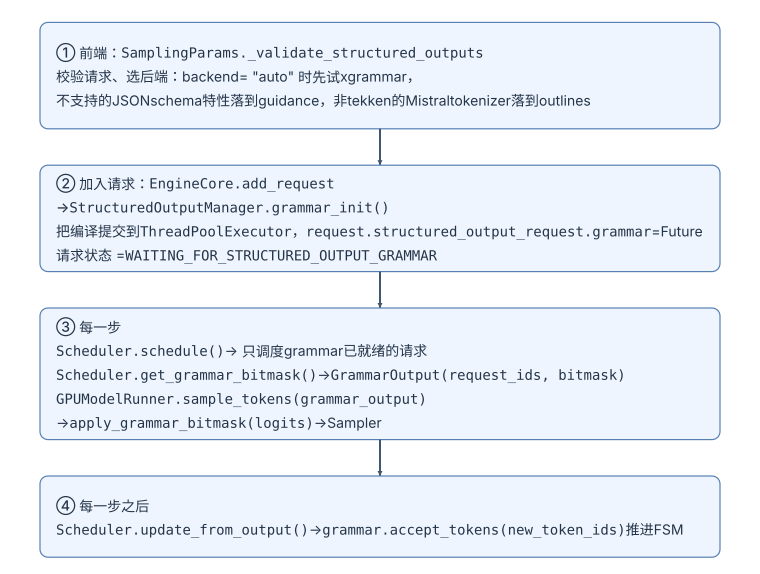
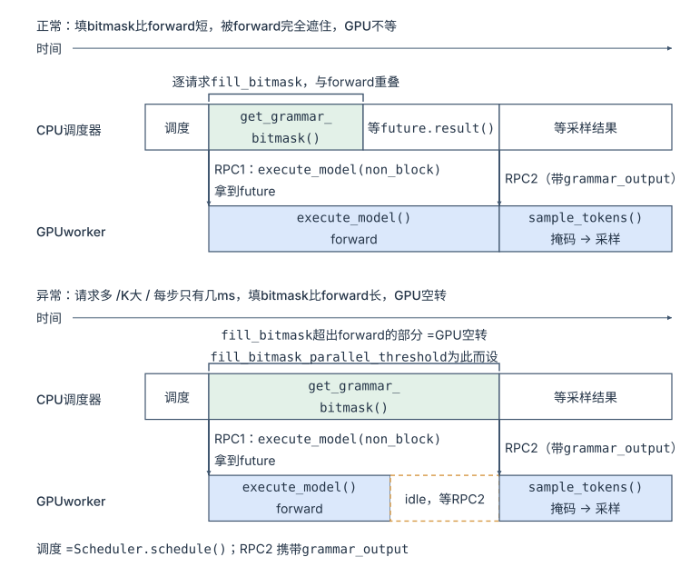
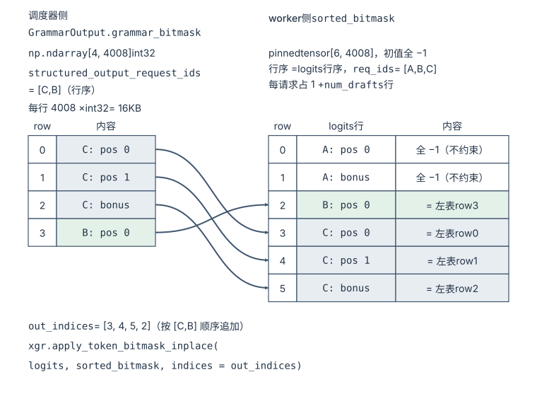
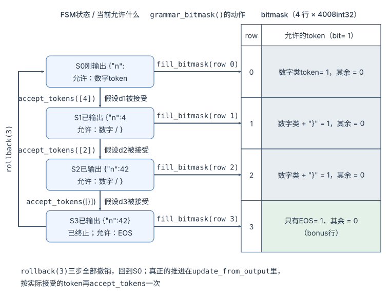
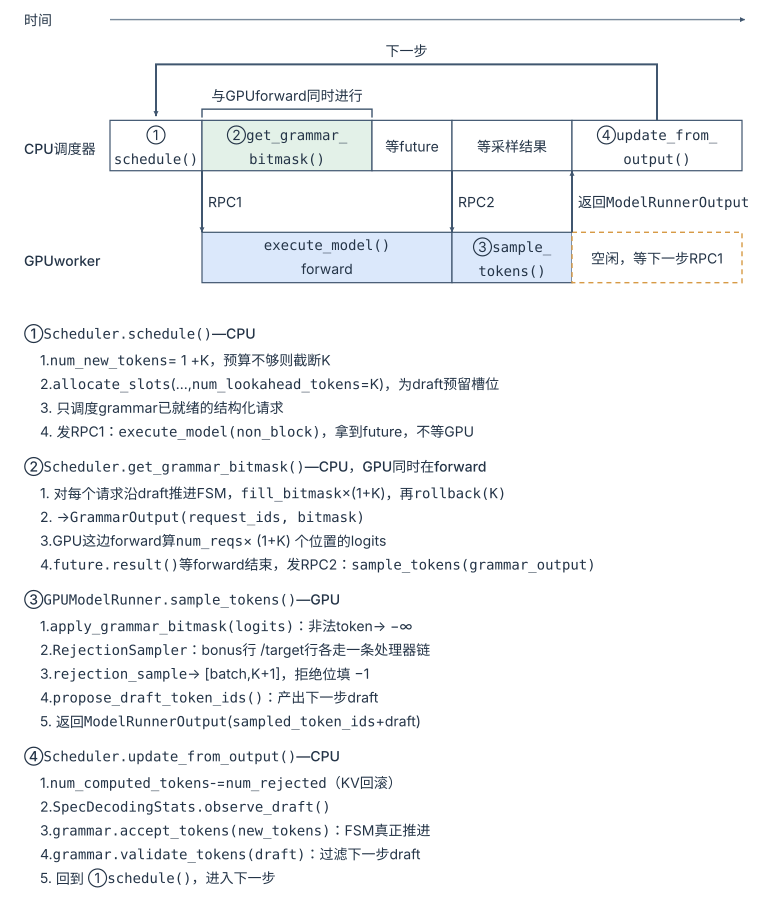
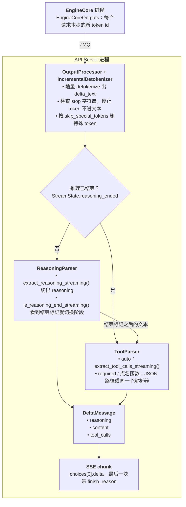

> **NOTE** 本文基于 vLLM v0.27.1（tag `6e448d0`, 2026-08-11）源码剖析。文中文件路径、类名和函数名均以该版本为准；vLLM 迭代很快，阅读时请以你手上的版本对照。
>
> **版本提示 @2026-11-12**：v0.29.0（2026-09-09）起，Model Runner V2（`vllm/v1/worker/gpu/`）成为所有模型的默认实现，V1 的 `GPUModelRunner`（`vllm/v1/worker/gpu_model_runner.py`）被宣布弃用，只在 V2 尚不支持的配置下作为回退。本文第二章的 `Sampler`、`LogitsProcessor` / `BatchUpdate` 接口与 `InputBatch` 讲的是 V1 路径：V2 有独立的采样器（`vllm/v1/worker/gpu/sample/`，Gumbel 采样、按槽位存请求状态）和新的 logits processor 接口；结构化输出的调度器侧（grammar 编译、bitmask）不变。


[《请求形态的扩展》](/request-shapes-multi-lora-and-multimodal.html)讲的是输入在变：同一个 batch 里的请求各带不同的 LoRA、各带几张图。这一篇看另一端——**输出在变**。

引擎对输出的默认约定很简单：每一步，每个请求在 logits 里占一行，从这一行采出一个 token。真实服务里这一行几乎从来不是"直接 argmax"：一个请求要 `temperature=0.7, top_p=0.9` 加 `repetition_penalty=1.1`，另一个要固定 `seed` 可复现，第三个要求输出必须是符合某个 JSON schema 的对象，第四个是推理模型，要先自由地"思考"、再输出 JSON。这些要求都是**请求带进来的输出语义**，每个请求不同，而且会随生成过程变化。

它们看起来都只是"采样时改一下 logits"，可在 vLLM 里，一个 JSON schema 会让请求在调度器里多出一个等待状态、让调度器进程每一步多做一份 CPU 工作；一个 `repetition_penalty` 会让 model runner 每一步把每个请求的全部历史输出搬上 GPU。本篇的核心问题是：

> **当每个请求都对"输出"提出自己的要求——自己的温度和惩罚、必须是合法的 JSON——vLLM 在哪几层吸收这些变化？[^q0] 代价分别落在谁身上？[^q1]**

投机解码不在本篇：它不改变输出分布，只改变一次 forward 产出几个 token，是性能手段，已经在[《GPU 执行》第六章](/gpu-execution-kernels-and-graphs.html#六能不能少跑几轮模型-投机解码)讲完。但它会改变 logits 的行数，和本篇的两类变化都有交叉，交叉点在各章里单独说明。

两类变化决定的是采出哪些 token。token 采出来之后还有一步：API Server 要把同一串 token 切成 `content`、`reasoning`、`tool_calls` 交给客户端——这一步不改变任何 token，第六章单独讲它，以及它和结构化输出、推理模式怎么配合。

## 一、总览：输出契约与两类变化

### 1. 输出契约：从 hidden_states 到 token

先把"最后一步"画清楚。[《GPU 执行》](/gpu-execution-kernels-and-graphs.html)的 forward 结束在 `hidden_states`；接下来是：



这条链对上游有三个隐含约定：

1. **每个请求一行 logits**：`logits` 的形状是 `[num_reqs, V]`，第 i 行属于 batch 里第 i 个请求；
2. **每个 token 都可能被选中**：词表里任何 token 都在候选集合里，Sampler 只决定概率；
3. **采样是无状态的**：这一步怎么采，只看这一步的 logits，不看请求过去输出过什么。

输出语义的变化，就是对这三条约定的改写。

### 2. 两类输出变化

| 变化 | 改的是什么 | 打破的约定 | 例子 |
|---|---|---|---|
| **采样语义**（每请求的采样参数与 logits processors） | 分布本身：每个请求按自己的参数改写自己那一行 | 第 1 条要被"每一行有自己的规矩"细化；penalties、`min_tokens` 打破第 3 条（要看历史输出） | `temperature`、`top_p` / `top_k` / `min_p`、三种 penalty、`logit_bias`、`bad_words`、`allowed_token_ids`、`min_tokens`、`seed`、`logprobs`、thinking budget、自定义 logits processor |
| **输出约束**（结构化输出） | 分布的支撑集：把 grammar 当前状态下不合法的 token 置 `-inf` | 打破第 2 条；grammar 是一台随输出推进的状态机，也打破第 3 条 | `json`、`json_object`、`regex`、`choice`、`grammar`、`structural_tag` |

Table: 两类输出变化与它们打破的约定

### 3. 变化落在哪几层

如果这两类变化只改 Sampler，本篇一章就够了。问题在于它们各自向上游捅了多深：

| 层 | 采样语义 | 输出约束（结构化输出） |
|---|---|---|
| API / `InputProcessor` | `SamplingParams.verify()` 校验参数（logprobs 上限、`logit_bias` 的 token id 是否在词表内、开投机时拒绝 `min_p` / `logit_bias`） | `_validate_structured_outputs()` 校验 schema、为请求选后端（`auto` 时 xgrammar → guidance → outlines） |
| EngineCore / Scheduler | —— | `grammar_init()` 异步编译，请求进 `WAITING_FOR_STRUCTURED_OUTPUT_GRAMMAR`<br/>每步 CPU 填 bitmask，与 forward 重叠<br/>步后 `accept_tokens()` 推进 FSM<br/>开投机时用 `validate_tokens()` 过滤 draft |
| KV Cache | —— | —— |
| ModelRunner / `InputBatch` | 持久 batch 里按下标存每请求参数，增删移动时生成 `BatchUpdate` 同步处理器状态<br/>开 penalties 时每步上传历史输出 | 采样前在 GPU 上按行打掩码（`apply_grammar_bitmask()`），行序要从调度器的顺序重排成 batch 的顺序 |
| Sampler | 主战场：以"是否改变 argmax"组织的流水线 | 不变：掩码在 Sampler 之前 |
| 多卡 | 每个 TP rank 都拿到完整 logits、各自采样；PP 下只有末 stage 采样 | `GrammarOutput` 随 RPC 广播给所有 worker；`external_launcher` 下改同步编译 |
| PD 分离 | 采样参数随请求一起交接 | P、D 各编译一次 grammar，两次编译都落在 TTFT 上 |
| **代价** | 几乎为零；值得算的是 penalties（每步两张 `[B, V+1]` int64 直方图 + 历史输出上传）和 `seed` | 几乎全在 CPU 与 TTFT：编译、每步填 bitmask、FSM 推进；GPU 只有一个掩码 kernel |

Table: 两类输出变化在各层的适配与代价

表里没有列出的第三件事是输出解析：采出的 token 在 API Server 进程里被 detokenize，再由 reasoning parser 和 tool parser 切成响应字段（第六章）；它不进 EngineCore，但 `tool_choice` 会经它反过来变成一条结构化输出约束。

KV Cache 一行是空的，这本身就是一个结论：**输出语义的变化不影响状态怎么存**——不同的采样参数、不同的 grammar 产生的都是普通 token，KV 与 prefix cache 不需要多一个键（对比《请求形态的扩展》，LoRA 和多模态都要往块哈希里加 `extra_keys`）。

### 4. 回到前面的例子：这一步有多贵？

**回到前面的例子**（Llama-3-70B、8×H100、TP=8、2050 token prompt、生成 300 token）。Llama-3 的词表是 128256，一行 fp32 logits 是 `128256 × 4 B ≈ 513 KB`；batch=64 时整个 logits 张量约 33 MB，按 3.35 TB/s 算读一遍只要 0.01 ms。和[《GPU 执行》](/gpu-execution-kernels-and-graphs.html)里"一步 decode 约 10 ms"相比，**Sampler 本身的成本是可以忽略的**——这正是能在这里塞进那么多花样的原因。

但有三个东西不便宜，本篇会逐个点名：

1. **排序**：top-p 的朴素实现要对每行 128256 个数排序；
2. **计数**：penalties 要为每个请求在 GPU 上建一张 `[vocab+1]` 的 int64 直方图，batch=64 就是 66 MB，而且每步重建；
3. **CPU 上的状态机**：结构化输出每步要在调度器进程里为每个请求填一行 bitmask、推进一次 FSM，请求进来时还要编译 grammar——几十到几百毫秒，直接加在这个请求的 TTFT 上。

### 5. 本文的章节安排

| 章 | 主题 | 内容 |
|---|---|---|
| 二 | 采样语义 | 参数从请求到张量<br/>Sampler 的流水线<br/>每请求参数的向量化<br/>LogitsProcessor 接口与持久 batch<br/>penalties 的真实代价<br/>开投机解码时的采样参数 |
| 三 | 输出约束：结构化输出 | 约束生效的四个位置<br/>后端抽象<br/>bitmask 的生成与应用<br/>与投机解码同时开启<br/>reasoning 模式下的跳过<br/>代价 |
| 四 | 多卡与 PD 分离下的适配 | TP：每个 rank 都采样<br/>PP：只有末 stage 采样<br/>`external_launcher` 与 DP<br/>PD：grammar 在两侧各编译一次 |
| 五 | 一步之内的顺序 | 结构化输出、投机解码与 penalties 同时开启时一步的时间轴 |
| 六 | 输出解析 | 在哪个进程跑、由哪些参数打开（API Server 的两类常驻协程）<br/>一个 delta 怎么流过解析器<br/>reasoning parser 与 prompt 里的推理边界<br/>tool parser 与调用格式<br/>实例：流式输出一个工具调用<br/>与结构化输出的关系：`tool_choice` 怎样变成约束 |
| 七 | 本文小结 |  |
| 八 | 自测 | 6 道题 |

Table: 本文的章节安排

## 二、采样语义：让同一个 batch 里的每一行按自己的规矩走

### 1. 从请求到张量：参数在哪几层被接住

一个 `temperature=0.7, top_p=0.9, frequency_penalty=0.5` 的请求，参数要经过三层才变成 GPU 上的一个数：

1. **API 进程**：`InputProcessor._validate_params()` 调 `SamplingParams.verify()`——校验 logprobs 个数不超过 `max_logprobs`、`logit_bias` 的 token id 在词表内、`allowed_token_ids` 非空，并按引擎配置检查组合是否合法：开了投机解码时，`_validate_spec_decode()` 对带 `min_p` 或 `logit_bias` 的请求直接报 `VLLMValidationError`（原因见本章第 6 节）；要 `thinking_token_budget` 却没配 reasoning parser 的请求也在这里被拒。不合法的组合在进入引擎之前就变成一个 400，而不是在 GPU 上出错。
2. **持久 batch**：请求进入 model runner 时，`InputBatch.add_request()`（`vllm/v1/worker/gpu_input_batch.py`）把参数写进按下标索引的 CPU 数组——`temperature_cpu[req_index]`、`top_p_cpu[req_index]`、`frequency_penalties_cpu[req_index]`……（greedy 请求的温度记成 0），带 `seed` 的请求在 `generators[req_index]` 里放一个自己的 `torch.Generator`；同时记下集合（`frequency_penalties_reqs` 等），用来判断整个 batch 是否 `no_penalties`、`all_greedy`。
3. **每步的 `SamplingMetadata`**：`InputBatch.refresh_metadata()` 只在 batch 有增删移动时重建 `SamplingMetadata`——`_make_sampling_metadata()` 用 `copy_slice()` 把前 `num_reqs` 个 CPU 值拷到 GPU 镜像；`all_greedy` 时连温度都不拷，`no_penalties` 时三种 penalty 和 prompt token 都不拷（注释："syncing these tensors is expensive"）。

所以"每个请求有自己的参数"在 vLLM 里的落点是**持久 batch 的一个下标**：请求在 batch 里占一行，参数跟着这一行走。后面几节都从这里展开。

### 2. Sampler 的流水线

`Sampler`（`vllm/v1/sample/sampler.py`）的 docstring 把顺序写得很清楚，这里按它的编号照抄骨架：

```python title="sampler.py：Sampler 的流水线顺序"
# vllm/v1/sample/sampler.py（docstring 顺序，代码略去分支）
class Sampler(nn.Module):
    """
    1. 若要 logprobs：按 logprobs_mode 先保存一份"原始" logprobs / logits
    2. logits 转 float32
    3. allowed_token_ids 白名单（不在名单里的置 -inf）
    4. bad_words 排除
    5. 非 argmax-invariant 的 logits processors（会影响 greedy 结果的）
         a) min_tokens   b) logit_bias
    6. penalties：repetition / frequency / presence
    7. sample()：
         a) 若不是 all_random，先算 greedy（argmax）；若 all_greedy 直接返回
         b) 温度
         c) argmax-invariant 的 logits processors（默认只有 min_p）
         d) top_k / top_p
         e) 按分布采样
         f) 逐行 torch.where(temperature < eps, greedy, random)
    8. 取 top-k logprobs 与被采样 token 的 logprob
    """
```

这个顺序不是随意的。**第 5 步与第 7c 步的区分——"会不会改变 argmax"——是整个流水线的组织原则**：`min_tokens` 把 EOS 置 `-inf`、`logit_bias` 直接加偏置，这两个会改变最大值在哪里，所以必须在 greedy 分支之前做；而 `min_p` 只是把低于阈值的 token 砍掉，最大值永远留着，greedy 请求做不做都一样，所以放到温度之后、只对随机采样的行做。这样一个 batch 里 greedy 与 random 的请求可以走同一条流水线，最后一行 `torch.where` 分流，不需要拆 batch。

把这个"先共用、再分叉、最后按行合流"的结构画出来（整张 `[num_reqs, V]` 的 logits 从头到尾没有被拆成两个 batch）：



蓝色是全 batch 共用的段，绿色只对 greedy 有意义、橙色只对随机采样有意义，但两条支路都在整张张量上跑——greedy 请求也会被除以 1、被 top-k 过一遍，只是结果最后被 `torch.where` 丢掉。这是"向量化优先于省算"的取舍：多算几行远比拆 batch、多发 kernel 便宜。

还有一个容易漏看的点：**logprobs 默认取的是"原始" logits 的 log-softmax**（`logprobs_mode="raw_logprobs"`），也就是第 1 步那份、还没经过 penalties 和温度的。源码注释明说这与 V0 不同——V0 返回的是采样用的 processed 分布。如果你的评测依赖 logprobs，这个差别要知道。

### 3. 每请求不同参数：向量化，而不是循环

第 1 节建好的 `SamplingMetadata`（`vllm/v1/sample/metadata.py`）里，`temperature`、`top_p`、`top_k`、三种 penalty 都是形状 `[num_reqs]` 的张量，`all_greedy` / `all_random` / `no_penalties` 是三个用来短路的标量。整条流水线没有"for req in batch"：

- **温度**：`apply_temperature()` 先把 greedy 请求的温度（`< 1e-5`）用 `torch.where` 换成 1，再对整张 logits 做一次 `div_`；
- **随机采样**：`random_sample()`（`vllm/v1/sample/ops/topk_topp_sampler.py`）不用 `torch.multinomial`——它会触发 CPU-GPU 同步——而是用指数噪声技巧：`q ~ Exp(1)`，`argmax(probs / q)`，等价于按 `probs` 采样。带 `seed` 的请求单独用自己的 `torch.Generator` 覆盖它那一行的噪声（源码注释承认这个逐请求循环"can be slow"）；
- **top-k / top-p**：`apply_top_k_top_p()` 有三条路：CPU 走 Triton 或纯 PyTorch；GPU 上 batch ≥ 8 走 Triton kernel（`topk_topp_triton.py`），小 batch 走 `apply_top_k_top_p_pytorch()`——后者对每行做一次全词表 `sort`，这就是第一章点名的"排序"成本。CUDA 上如果 FlashInfer 可用（`flashinfer_sampler_supported()`，由 `VLLM_USE_FLASHINFER_SAMPLER` 控制），`TopKTopPSampler.forward_cuda()` 会把 top-k/top-p/采样交给 FlashInfer 的融合 kernel；但只要 batch 里有带 seed 的请求，或 `logprobs_mode` 要求 processed 分布，就退回 native 路径。

"每请求不同参数"这件事在 GPU 上是免费的——一个 `[num_reqs]` 的向量广播到 `[num_reqs, V]` 上而已。**真正的成本在于每一步都要把这些参数张量维护好**，这是下一节 `LogitsProcessor` 接口存在的原因。

### 4. LogitsProcessor 接口：为什么它长成"跟着 batch 变化"的样子

`LogitsProcessor`（`vllm/v1/sample/logits_processor/interface.py`）只有四个方法：

```python title="interface.py：LogitsProcessor 的四个方法"
# vllm/v1/sample/logits_processor/interface.py
class LogitsProcessor(ABC):
    def __init__(self, vllm_config, device, is_pin_memory): ...
    def apply(self, logits: torch.Tensor) -> torch.Tensor: ...      # 对整张 [num_reqs, V] 就地改
    def is_argmax_invariant(self) -> bool: ...                        # 决定进第 5 步还是第 7c 步
    def update_state(self, batch_update: BatchUpdate | None): ...    # 每次 forward 前调用
```

关键在 `update_state()` 的参数 `BatchUpdate`：

```python title="BatchUpdate dataclass"
@dataclass(frozen=True)
class BatchUpdate:
    batch_size: int
    removed: Sequence[int]                                  # 被移出 batch 的下标
    added: Sequence[tuple[int, SamplingParams, list[int] | None, list[int]]]
                                                            # (下标, 参数, prompt_ids, output_ids 的引用)
    moved: Sequence[tuple[int, int, MoveDirectionality]]    # 请求在 batch 内的位置变动（单向 / 交换）
```

为什么接口是这个形状？因为 vLLM V1 的 `InputBatch`（`vllm/v1/worker/gpu_input_batch.py`）是一个**持久 batch**：请求不是每步重新排列，而是占着一个下标，完成的请求腾出的坑由后来者填上、或者把队尾的请求挪过来补洞。一个 logits processor 如果维护了任何"按下标索引的状态"（比如 `min_p` 的 `[max_num_reqs]` 张量），就必须跟着这些增删移动同步。`InputBatch` 里的 `BatchUpdateBuilder` 在一步之内收集所有 `removed / added / moved`，`refresh_metadata()` 时打包成一个 `BatchUpdate` 喂给每个处理器——`removed` 按降序排好，处理顺序固定为 removed → added → moved。

`added` 元组里的 `output_tok_ids` 是**对请求输出列表的引用**，不是拷贝（接口注释里特意写了 "Key assumption"）。这样 `MinTokensLogitsProcessor` 在 `update_state()` 时只要看 `len(out_tok_ids) >= min_toks` 就知道哪些请求已经过了最小长度，可以从自己的稀疏字典里删掉——不需要任何人通知它"又生成了一个 token"。

内置的三个处理器（`vllm/v1/sample/logits_processor/builtin.py`）刻意示范了两种状态组织方式：

| 处理器 | 状态形态 | `apply()` 做什么 | argmax-invariant |
|---|---|---|---|
| `MinPLogitsProcessor` | 稠密：`[max_num_reqs]` 的 CPU pinned 张量 + GPU 镜像，`min_p_count` 计数为 0 时整个跳过 | `softmax` → 每行最大概率 × min_p → 低于阈值置 `-inf` | 是 |
| `LogitBiasLogitsProcessor` | 稀疏：`dict[req_idx → dict[token → bias]]`，变化时重建一组 `(req_idx, tok_id, bias)` 的索引张量 | `logits[(reqs, toks)] += biases` 一次 index_put | 否 |
| `MinTokensLogitsProcessor` | 稀疏：`dict[req_idx → (min_toks, output_ids 引用, stop_token_ids)]` | `index_put_(-inf)` 到所有未达最小长度请求的 stop token 上 | 否 |

Table: 内置三个 LogitsProcessor 的状态组织

稀疏路线的通用逻辑抽成了 `process_dict_updates()`，`AdapterLogitsProcessor` 也复用它。

**thinking budget** 走的是同一套协议，但不是 `LogitsProcessor` 子类：`ThinkingBudgetStateHolder`（`vllm/v1/sample/thinking_budget_state.py`）用同样的 `BatchUpdate` 做 `sync_batch()`，但它需要看到本步"已经提交的输出 + 投机 draft"来判断思考段是否超预算，所以 `Sampler.apply_logits_processors()` 把它放在 penalties 之后单独调用（`holder.update_state()` → `holder.apply_to_logits()`），并明确区分 `output_token_ids`（已提交）与 `spec_token_ids`（草稿）。

**自定义处理器**有两条注册路径（`vllm/v1/sample/logits_processor/__init__.py`）：

- 引擎参数 `--logits-processors x.y.z:MyProc`（`ModelConfig.logits_processors`），`_load_logitsprocs_by_fqcns()` 按 `module:Class` 导入；
- Python entry point 组 `vllm.logits_processors`（`LOGITSPROCS_GROUP`），`_load_logitsprocs_plugins()` 自动发现。

两者都要求是 `LogitsProcessor` 子类，并在引擎启动时实例化一次——**V1 不再支持请求级传入 callable**。如果你有一个老式的 `def f(output_ids, logits)`，用 `AdapterLogitsProcessor` 包一层：实现 `new_req_logits_processor(params)` 按请求参数决定要不要给这个请求装一个，`apply()` 会逐行调用。逐行调用意味着一个 Python 循环，这是兼容的代价。

两条硬限制值得记住：pooling 模型拒绝任何自定义处理器；**开启投机解码时拒绝自定义处理器，`min_p` 和 `logit_bias` 也不可用**——前端拒绝带这两个参数的请求，引擎侧 `build_logitsprocs()` 只保留 `MinTokensLogitsProcessor` 并打一条 warning。原因在本章第 6 节。

### 5. penalties 的真实代价

penalties 不是 `LogitsProcessor`，而是流水线里一段硬编码的步骤（`Sampler.apply_penalties()` → `apply_all_penalties()`，`vllm/v1/sample/ops/penalties.py` → `apply_penalties()`，`vllm/model_executor/layers/utils.py`）。它做的事很直白：

```python title="utils.py：apply_penalties 的实现"
# vllm/model_executor/layers/utils.py（简化）
def apply_penalties(logits, prompt_tokens_tensor, output_tokens_tensor,
                    presence_penalties, frequency_penalties, repetition_penalties):
    num_seqs, vocab_size = logits.shape
    _, prompt_mask = get_token_bin_counts_and_mask(prompt_tokens_tensor, vocab_size, num_seqs)
    output_bin_counts, output_mask = get_token_bin_counts_and_mask(output_tokens_tensor, vocab_size, num_seqs)
    apply_repetition_penalties(logits, prompt_mask, output_mask, repetition_penalties)   # 自定义 CUDA op
    logits -= frequency_penalties.unsqueeze(1) * output_bin_counts
    logits -= presence_penalties.unsqueeze(1) * output_mask
```

`get_token_bin_counts_and_mask()` 用 `scatter_add_` 建一张 `[num_seqs, vocab_size + 1]` 的 **int64** 直方图（多出的一列给 padding 用）。代价算一下：

| 项 | 量 | 说明 |
|---|---|---|
| 直方图 | `64 × 128257 × 8 B ≈ 66 MB`，prompt 和 output 各一张 | 每步重新 `zeros` + `scatter_add_` |
| `output_token_ids` 上传 | `_convert_to_tensors()` 把 Python 的 `list[list[int]]` pad 成张量再 H2D | 长度随已生成 token 数增长；300 步时是 `64 × 300` 个 int64 |
| repetition penalty | `apply_repetition_penalties` 自定义 op（`csrc/libtorch_stable/sampler.cu`） | 读两张 mask + 整张 logits |

Table: penalties 每步的直方图开销

几十 MB、几百微秒的量级，和 10 ms 的 decode 比仍然是小数——但它是**每一步、只要 batch 里有任何一个请求开了 penalty 就要全 batch 付**的固定成本，而且随 batch 和词表线性增长。源码里 `NOTE(nick)` 直言 "The penalties implementation is currently quite inefficient and will be reworked anyhow"。更隐蔽的成本在 CPU 侧：`no_penalties` 为 False 时 model runner 必须每步维护并上传 `output_token_ids`，异步调度下这个列表甚至可能含有 `-1` 占位（`apply_all_penalties()` 里专门有一行把 `-1` 换成 `vocab_size`）。

**对比一下不同采样参数的成本形态**：

| 参数 | 每步额外工作 | 成本形态 |
|---|---|---|
| `temperature` / `top_k`（Triton 或 FlashInfer） | 一次逐元素 / 一个 kernel | 忽略 |
| `top_p`（小 batch 纯 PyTorch 路径） | 每行全词表 sort | 与 `V log V` 成正比，batch < 8 才会走到 |
| `min_p` | 一次 softmax + amax + mask | 忽略 |
| `logit_bias` / `min_tokens` / `allowed_token_ids` / `bad_words` | 稀疏 index_put | 忽略 |
| 任一 penalty | 两张 `[B, V+1]` int64 直方图 + 历史输出上传 | **O(B·V) 显存流量 + CPU 侧列表维护** |
| 带 `seed` | 逐请求 Python 循环覆盖噪声；FlashInfer 路径失效 | 与带 seed 的请求数线性 |

Table: 不同采样参数的成本形态

结论：采样参数里真正值得在容量规划时考虑的只有 penalties 和 seed，其余都淹没在 forward 里。

### 6. 开投机解码时的采样参数

投机解码（[《GPU 执行》第六章](/gpu-execution-kernels-and-graphs.html#六能不能少跑几轮模型-投机解码)）不改变输出分布，但它要求 target 在每个 draft 位置上的分布 $$q$$ 正是这个请求真正的采样分布——否则拒绝采样就不再无损。麻烦在于第一章第 1 节的第 1 条约定被打破了：logits 不再是每请求一行，而是 `[num_reqs + Σ drafts, V]`，一个带 3 个 draft 的请求就占 4 行（3 行 target + 1 行 bonus）。`RejectionSampler.forward()` 因此把采样语义拆成两份：

1. **bonus 行**（每请求一行）走完整的 `Sampler`，本章前几节的一切照常生效；
2. **target 行**（每个 draft 一行）走一条投机版的处理链：
   - `RejectionSampler.apply_logits_processors()` 用 `repeat_indices`（`arange(num_reqs).repeat_interleave(num_draft_tokens)`）把 `[num_reqs]` 的 penalty 参数展开到 `[num_drafts]` 行；
   - penalties 要的历史输出也不同：第 i 个 draft 位置的"历史"是"已输出 + 前 i-1 个 draft"，由 `_combine_outputs_with_spec_tokens()` 拼出来；
   - `MinTokensLogitsProcessor` 有专门的 `apply_with_spec_decode()`；thinking budget 的 `ThinkingBudgetStateHolder` 分开看 `output_token_ids`（已提交）与 `spec_token_ids`（草稿）；
   - `apply_sampling_constraints()` 用 `expand_batch_to_tokens()`（一个 Triton `expand_kernel`）把温度、top-k、top-p 从每请求展开到每个 draft 行，再调第 3 节那个 `apply_top_k_top_p()`——源码注释 `NOTE(woosuk)` 提醒它用排序、大词表下慢。

只有这几个内置步骤做了"行 → 请求"的映射，通用的 `LogitsProcessor.apply(logits)` 接口拿不到 `SpecDecodeMetadata`，不知道每一行属于谁。于是 `min_p`、`logit_bias` 和自定义处理器只能对 bonus 行生效、对 target 行不生效——那样输出分布就不再是请求要的分布，vLLM 干脆在开投机时禁用它们（第 4 节末尾那两条限制）。这是采样语义与投机解码之间的一处硬冲突：**开投机解码的服务，等于对请求声明不支持 `min_p` / `logit_bias` / 自定义 logits processor。**

## 三、输出约束：把 grammar 变成每步一张掩码

### 1. 约束在哪里生效：四个位置

结构化输出（`SamplingParams.structured_outputs`，支持 `json` / `json_object` / `regex` / `choice` / `grammar` / `structural_tag`，对应 `StructuredOutputOptions` 枚举）看起来只是"采样时把不合法 token 屏蔽掉"，但它在请求生命周期上分布在四个位置：



第 ② 步的**异步**是关键设计：JSON schema 编译成 grammar 可能要几十到几百毫秒，甚至更久，如果在调度循环里同步做，整个引擎会为一个请求停摆。所以编译进线程池，请求进一个专门的等待状态（[《Scheduler》第六章第 2 节](/scheduler-batch-and-fairness.html#2-kv-cache-不够preemption)状态机里的 `WAITING_FOR_STRUCTURED_OUTPUT_GRAMMAR` 就是它）。调度器每步在 `_try_promote_blocked_waiting_request()` 里看一眼 `structured_output_req.grammar`——这个 property（`StructuredOutputRequest.grammar`，`vllm/v1/structured_output/request.py`）会以 **100 微秒**的超时去 poll Future，好了就把请求放回 `WAITING`，编译抛异常的请求记入 `grammar_compile_error_reqs` 单独失败。代价是这个请求的 TTFT 多了一段编译时间；收益是其他请求完全不受影响。`external_launcher` 模式是例外——各 TP rank 各有调度器，异步编译会让状态转换在不同 rank 上时序不一致，于是退回同步（见第四章第 3 节）。

第 ③ 步里有一个时序细节值得看 `EngineCore.step()`（`vllm/v1/engine/core.py`）：

```python title="EngineCore.step()：forward 与 bitmask 重叠"
scheduler_output = self.scheduler.schedule(...)
future = self.model_executor.execute_model(scheduler_output, non_block=True)   # 先把 forward 发出去
grammar_output = self.scheduler.get_grammar_bitmask(scheduler_output)          # GPU 在算 forward 时，CPU 填 bitmask
model_output = future.result()
if model_output is None:
    model_output = self.model_executor.sample_tokens(grammar_output)            # 掩码在采样前才送到 worker
```

**bitmask 的生成与 forward 是重叠的**。这是 V1 把 `execute_model` 和 `sample_tokens` 拆成两个 RPC 的原因之一——掩码不需要在 forward 之前就绪，只需要在采样之前就绪。两条时间线并排看：



- 正常情况：填 bitmask 比 forward 短，被完全遮住，GPU 不多等。
- 异常情况：请求多、K 大、或每步只有几 ms 时，填 bitmask 比 forward 长，GPU 在 idle 段空转等 RPC 2。`fill_bitmask_parallel_threshold` 就是为此而设。

### 2. 后端抽象

`vllm/v1/structured_output/backend_types.py` 定义了两层：

```python title="backend_types.py：后端抽象的两层"
@dataclass
class StructuredOutputBackend(ABC):                 # 引擎级，一个引擎只有一个
    def compile_grammar(self, request_type: StructuredOutputOptions, grammar_spec: str) -> StructuredOutputGrammar
    def allocate_token_bitmask(self, max_num_seqs: int) -> torch.Tensor
    def destroy(self)

class StructuredOutputGrammar(ABC):                 # 请求级，一个请求一个
    def accept_tokens(self, request_id, tokens: list[int]) -> bool   # 推进 FSM
    def validate_tokens(self, tokens: list[int]) -> list[int]        # 只校验不推进，返回合法前缀
    def rollback(self, num_tokens: int)                              # 回退 FSM
    def fill_bitmask(self, bitmask: torch.Tensor, batch_index: int)  # 填当前状态的掩码
    def is_terminated(self) -> bool
    def reset(self)
```

四个后端：`XgrammarBackend`（`backend_xgrammar.py`，`xgr.GrammarCompiler` 编译、`xgr.GrammarMatcher` 做 FSM）、`GuidanceBackend`（`backend_guidance.py`）、`OutlinesBackend`（`backend_outlines.py`）、`LMFormatEnforcerBackend`（`backend_lm_format_enforcer.py`）。`StructuredOutputManager.grammar_init()` 在第一个请求到来时按 `sampling_params.structured_outputs._backend` 实例化后端，注释明说 "We only support a single backend. We do NOT support different backends on a per-request basis"。`StructuredOutputsConfig.backend` 默认 `"auto"`，前端的选择逻辑（第 1 节 ①）会为每个请求写入 `_backend`，但引擎只认第一个请求的那个：之后即使某个请求在 `auto` 下被判成了另一个后端，也仍交给已实例化的后端编译，编译失败就记入 `grammar_compile_error_reqs`。

`validate_tokens()` / `rollback()` 两个方法不是 grammar 库的常规接口，它们是为投机解码加的（第 4 节）。

### 3. bitmask 的生成与应用

**形状**：xgrammar 的 bitmask 是 int32，每 32 个 token 一个 word，`128256 / 32 = 4008` 个 int32，**每行 16 KB**。`StructuredOutputManager.grammar_bitmask()` 第一次调用时一次性分配 `max_num_seqs × (1 + num_spec_tokens)` 行——每个请求 1 行给普通 token 或 bonus，K 行给 K 个 draft 位置。

**生成**（CPU，调度器进程）：对本步每个使用结构化输出、且**不在 prefill chunk 中**的请求（`get_grammar_bitmask()` 过滤 `is_prefill_chunk`——prefill 阶段不采样，不需要掩码），调用 `grammar.fill_bitmask(bitmask, index)`；不需要约束的行（reasoning 中、grammar 已终止）填全 `-1`（`_full_mask`，即全部允许）。请求数超过 128 且没开投机时，按 16 个一组投进 `executor_for_fillmask` 线程池并行填。返回值转成 `np.ndarray`——注释说明是为了跨进程序列化效率。

**应用**（GPU，worker 进程）：`apply_grammar_bitmask()`（`vllm/v1/structured_output/utils.py`）做两件事：

1. **重排**。调度器给的 bitmask 行序是 `structured_output_request_ids` 的顺序，worker 的 logits 行序是 `input_batch.req_ids` 的顺序，而且投机解码下每个请求占 `1 + num_drafts` 行。函数先按 `input_batch.req_ids` 算出每个结构化请求的 logits 起始行（累加前面请求的 draft 数），再把 bitmask 搬到一张 `[logits.shape[0], 4008]` 的 pinned 张量里对应的行上，其余行全 `-1`；
2. **打掩码**。`xgr.apply_token_bitmask_inplace(logits, bitmask, indices)`——一个 kernel，对 `indices` 指定的行把 bit 为 0 的 token 置 `-inf`。所有行都要打时 `indices=None`。

重排这一步用一个三请求的 batch 画出来。A 不用结构化输出但带 1 个 draft，B 用 JSON 约束、没有 draft，C 用 JSON 约束、带 2 个 draft；调度器按 `structured_output_request_ids = [C, B]` 的顺序填，worker 的 logits 却按 `req_ids = [A, B, C]` 排：



右表的行号就是 `logits_indices` 的行号：C 的起始行 3 = A 的 2 行 + B 的 1 行，所以一个请求 draft 数的变化会挪动它后面所有结构化请求的掩码位置——这张 `[logits.shape[0], 4008]` 的 pinned 张量每步都要重新填。

注意它作用在**进 Sampler 之前的原始 logits** 上。掩码是硬 `-inf`，放在温度、penalties 之前或之后对"哪些 token 可能被选中"没有影响，但会影响 logprobs：`raw_logprobs` 模式下返回的 logprobs 是打掩码之后、其他处理之前的分布。

**回到前面的例子**：batch=64 全部开 JSON 约束、不开投机：每步 CPU 填 64 行、H2D 传 `64 × 16 KB = 1 MB`、GPU 一个掩码 kernel 扫 33 MB logits。三项都在百微秒量级。

### 4. 与投机解码同时开启

投机解码本身（proposer、调度器的预算与回滚、`RejectionSampler`）见[《GPU 执行》第六章](/gpu-execution-kernels-and-graphs.html#六能不能少跑几轮模型-投机解码)。这里只看它和 grammar 的交叉：投机解码让一步要决定 `1+K` 个位置，而每个位置的合法 token 集合取决于前面的位置，叠加时需要两层配合：

**① draft 先过一遍 grammar。** `Scheduler.update_draft_token_ids()` 拿到 proposer 的 draft 后，对结构化请求调 `grammar.validate_tokens(spec_token_ids)`——**不推进 FSM**，只返回合法的最长前缀。不合法的尾部直接扔掉（同步路径）或补 `-1`（异步路径 `update_draft_token_ids_in_output()`，因为 `scheduled_spec_decode_tokens` 的长度已经定了）。这是为什么 `StructuredOutputGrammar` 需要 `validate_tokens()` 这个"只看不动"的方法。

**② bitmask 每个位置一行。** 第 i 个 draft 位置的合法 token 集合取决于前 i-1 个 draft 都被接受时 FSM 的状态。`grammar_bitmask()` 的循环因此对每个请求：填第 0 行（当前状态）→ `accept_tokens([d₁])` 推进 → 填第 1 行 → `accept_tokens([d₂])` → … → 填 bonus 行 → **`rollback(state_advancements)` 全部回退**。遇到 `-1`（无效 draft）就停止推进、后续行不再约束。于是 FSM 每步被推进 K 次再回退 K 次——结构化输出的 CPU 成本随 K 线性增长，这也是并行填充路径要求 `max_num_spec_tokens == 0` 的原因（推进/回退是有状态的，不好切成独立任务）。

用一个最小的例子把"FSM 状态 ↔ 掩码行"的对应画出来。grammar 是 `{"n": <整数>}`，请求已经输出了 `{"n":`，draft 是 `[4, 2, }]`（K=3）：



若 d2 = -1（无效 draft），FSM 走到 S1 就停，row 2 / row 3 填全 -1，不约束。

四行掩码分别对应四个不同的 FSM 状态，这就是"每个位置一行"的含义；而这一路推进全是**假设** draft 会被接受得出的，所以最后必须 `rollback` 回 S0，等 `RejectionSampler` 给出真正接受了几个，再由调度器推进一次。

真正采样时，bonus 行走普通 `Sampler`、target 行走 `RejectionSampler`，两者的输入 logits 都已被各自的行掩码挖过，所以**被接受的 draft 与 recovered token 都一定合法**——`update_from_output()` 里的 `accept_tokens()` 若返回 False，源码直接记 error 并把请求置为 `FINISHED_ERROR`，因为这在设计上不应发生。

### 5. reasoning 模式下的跳过

推理模型（DeepSeek-R1 一类）的输出前半段是 `<think>…</think>`，用户要的 JSON 在后面。如果从第一个 token 就打掩码，模型连"思考"都得用 JSON 写。`StructuredOutputsConfig.reasoning_parser` 指定一个 `ReasoningParser`，`StructuredOutputManager` 用它做三件事：

- `should_fill_bitmask(request)`：`reasoning_ended` 为 False 时返回 False，该请求这一步填全 `-1`（不约束）；`enable_in_reasoning=True` 则始终约束；
- `should_advance(request, new_token_ids)`：用 `reasoner.is_reasoning_end_streaming()` 检测本步的新 token 里是否出现了思考结束标记，出现则置 `reasoning_ended=True` 并记下边界 `reasoning_end_token_index`；
- `trim_reasoning_for_advance()`：思考结束的那一步，新 token 可能是"思考尾巴 + 结束标记 + JSON 开头"混在一起，只把结束标记之后的部分喂给 `accept_tokens()`。

这里的 `ReasoningParser` 和 API Server 用来把思考内容切进 `reasoning` 字段的是同一个类、同一个 `--reasoning-parser` 参数，但在两个进程里各有一个实例；"推理是否已结束"的初值由 API Server 从 prompt 算出、随请求带进来，见第六章第 3 节。

和投机解码叠加时更绕：一个 draft 窗口内可能刚好跨过结束标记。`grammar_bitmask()` 的循环里 `detect_reasoning_end` 分支会对每个 draft 位置模拟"到这里为止的序列"判断是否结束，结束后把该窗口剩余位置改为约束、但**容忍**这些 draft 被 grammar 拒绝（它们是在没有掩码时产生的，不保证合法）。

### 6. 代价

| 项 | 量级 | 谁付 | 何时付 |
|---|---|---|---|
| grammar 编译 | 简单 regex / choice：毫秒级；复杂 JSON schema：几十到几百毫秒，极端情况秒级 | 该请求的 TTFT | 请求进入时，异步 |
| bitmask 分配 | `max_num_seqs × (1+K) × 16 KB`，256 × 4 × 16 KB = 16 MB | 引擎进程内存 | 一次 |
| 每步填充 | 每请求每位置一次 `fill_bitmask`（数十微秒量级）+ 投机下 K 次 `accept_tokens` / 1 次 `rollback` | 调度器进程 CPU，与 forward 重叠 | 每步 |
| 每步传输 | `请求数 × (1+K) × 16 KB` 序列化 + H2D | IPC 与 PCIe | 每步 |
| 每步掩码 | 一个 GPU kernel，读写整张 logits | GPU，百微秒以下 | 每步 |
| FSM 推进 | `accept_tokens()`，微秒级 | 调度器进程 | 每步之后 |

Table: 结构化输出的代价

结构化输出的"贵"几乎全在 CPU 和延迟上，GPU 侧近乎免费。当调度器进程是瓶颈（大 batch、小模型、每步只有几毫秒）时，每步几毫秒的 CPU 填充就不再能被 forward 遮住，这是 `fill_bitmask_parallel_threshold` 存在的场景。

## 四、多卡与 PD 分离下的适配

[《Multi-GPU》](/multi-gpu-scaling-strategies.html)和[《PD 分离》](/prefill-decode-disaggregation.html)讲的都是"一个模型、一串 token"怎么拆到多张卡、两个实例上，没有讨论采样语义和 grammar。把本篇的两类变化放回去，要回答的是：logits 在哪张卡上、谁来采样、掩码怎么送到、grammar 在哪里编译。

### 1. TP：每个 rank 都拿到完整 logits、各自采样

TP 下 `lm_head` 是按词表切的 `VocabParallelEmbedding`，每张卡只算出 `[num_tokens, V / tp]` 的一片 logits。`LogitsProcessor._get_logits()`（`vllm/model_executor/layers/logits_processor.py`）在 `lm_head.tp_size > 1` 时调 `_gather_logits()`：

- `current_platform.use_all_gather()` 为真时用 `tensor_model_parallel_all_gather`，**每个 rank 都得到完整的 `[num_tokens, V]`**。`Platform.use_all_gather()` 的默认实现返回 `True`，CUDA 平台没有覆盖它，所以 8×H100 上走的是这条；
- 返回 `False` 的平台走 `tensor_model_parallel_gather`，只有 rank 0 拿到 logits，其他 rank 得到 `None`。

拿到完整 logits 之后，**TP 组里每个 rank 都打同一张掩码、跑同一个 Sampler**。`GrammarOutput` 跟 `SchedulerOutput` 走同一条路：`MultiprocExecutor.sample_tokens()` 是一次 `collective_rpc("sample_tokens", args=(grammar_output,))`，消息写进共享内存的 `rpc_broadcast_mq` 一次、所有 worker 读到同一份，只有 `output_rank` 回复（`unique_reply_rank=self.output_rank`）——就是[《Multi-GPU》第八章那张时序图](/multi-gpu-scaling-strategies.html#2-nccl多-gpu-通信的默认底座)里 `execute_model` 的路径，`sample_tokens` 是它的第二个 RPC。

为什么不让一个 rank 采样、再广播结果？因为下一步的输入 token 要进每个 rank 自己的 `InputBatch`，异步调度下上一步采出的 `sampled_token_ids` 直接留在 GPU 上作为下一步的输入，各 rank 自己采就省掉了一次广播。前提是 8 个 rank 采出同一个 token：logits 相同、操作序列相同，随机状态由 `GPUWorker` 初始化时的 `set_random_seed(model_config.seed)` 对齐，带 `seed` 的请求各 rank 用同一个种子建自己的 `torch.Generator`。

**回到前面的例子**：batch=64、TP=8，bf16 的完整 logits 是 `64 × 128256 × 2 B ≈ 16 MB`，每卡贡献 2 MB，一次 all-gather 在 NVLink 上是几十微秒量级；bitmask 随 RPC 每步序列化一份，64 行 × 16 KB ≈ 1 MB。两者都远小于 10 ms 的一步。

### 2. PP：只有末 stage 采样

PP 下 logits 只在最后一个 stage 产生。[《Multi-GPU》讲 PP 里请求怎么流动](/multi-gpu-scaling-strategies.html#4-推理请求在-pp-中如何流动)时说过，非末 stage 算完把激活发给下游就返回；落到 `GPUModelRunner` 上，这些 rank 的 `execute_model()` 返回 `IntermediateTensors`，不保存采样所需的状态，于是随后的 `sample_tokens(grammar_output)` 在它们那里直接返回——`GrammarOutput` 照样广播给所有 worker，但只有末 stage 用得上。

下一步的输入要回到第一个 stage。同步调度下，采出的 token 经 `ModelRunnerOutput` 回到调度器，再随下一步的 `SchedulerOutput` 发出去。异步调度下调度器已经提前一步把下一步发出去了，等不及这条路，于是：

1. 末 stage 在 `sample_tokens()` 里调 `_pp_broadcast_prev_sampled_token_ids()`，在 PP 组上 `torch.distributed.broadcast` 本步的 `sampled_token_ids`；
2. 其他 stage 在 `sample_tokens()` 开头调 `_pp_receive_prev_sampled_token_ids_to_input_batch()` 收下，放进 `input_batch.prev_sampled_token_ids`，下一步拼输入时直接用；
3. 整个 batch 都在 chunked prefill 中时，采出的是会被丢弃的占位 token，两边都跳过广播。

这条路径断言 `sampled_token_ids` 的形状是 `[num_reqs, 1]`（"PP+async expects …"），即每请求一个 token。`external_launcher`（torchrun）下另有一套：`broadcast_pp_output` 为真时，PP 输出在计算 logits 时就已经同步到所有 rank，采样后不再单独广播。

### 3. `external_launcher` 与 DP：谁有自己的调度器

结构化输出的状态在调度器进程里（`StructuredOutputManager`），所以关键是"有几个调度器"：

1. **`external_launcher`：每个 TP rank 一个调度器。** 各 rank 必须在同一步做出同样的调度决定。异步编译让 `WAITING_FOR_STRUCTURED_OUTPUT_GRAMMAR → WAITING` 的转换在不同 rank 上发生在不同时刻，打破这个前提并导致死锁（`StructuredOutputManager.__init__` 的注释原话），所以 `_use_async_grammar_compilation` 在这种模式下为假：`grammar_init()` 就地调用 `_create_grammar()` 同步编译，编译时间不再藏在后台线程里。
2. **DP：每个 DP rank 一个 EngineCore、一个调度器。** 请求被路由到哪个 rank，grammar 就在哪个 rank 编译、FSM 就在哪个 rank 推进。xgrammar 的 `GrammarCompiler` 开了缓存（`cache_enabled=True`，上限 `VLLM_XGRAMMAR_CACHE_MB`），同一个 schema 第二次编译几乎免费，但缓存是每个后端实例自己的：同一个 schema 打到 4 个 DP rank 上，会各编译一次。

### 4. PD 分离：grammar 在两侧各编译一次

[《PD 分离》的交接契约](/prefill-decode-disaggregation.html#1-一次请求的交接契约传什么何时可用何时释放)里有一行"请求执行可接续：采样和停止参数、输出预算"。采样参数是请求字段，随请求本身到达 D，不需要额外交接；grammar 不一样，它是**每个实例自己编译、自己推进的状态**。

按[《PD 分离》](/prefill-decode-disaggregation.html)走读的 NIXL toy proxy（`tests/v1/kv_connector/nixl_integration/toy_proxy_server.py`）：`send_request_to_service()` 把原请求改成 `max_tokens=1`、`stream=False` 发给 P，P 返回后再把原请求加上 P 给的 `kv_transfer_params` 发给 D。proxy 已经为采样参数做了一处适配：发往 P 之前去掉 `min_tokens` / `min_completion_tokens`（注释 "These args are not supported for P"——`max_tokens=1` 与 `min_tokens > 1` 自相矛盾）。结构化输出参数则没有去掉，两边都带着，于是：

1. **P 侧也编译 grammar。** 请求在 P 上同样先进 `WAITING_FOR_STRUCTURED_OUTPUT_GRAMMAR`，grammar 就绪之前不会被调度，prefill 被推迟；最后一个 prompt chunk 那一步 `is_prefill_chunk` 已为假，`get_grammar_bitmask()` 会为它填掩码——P 用掩码采出那 1 个 token，而这个 token 不会返回给客户端。
2. **D 侧再编译一次，并且排在 KV 拉取之前。** D 的 `EngineCore` 收到请求时 `grammar_init()` 提交编译；D 发起 KV 拉取是在 `Scheduler.schedule()` 把请求从 waiting 队列取出、调 `connector.get_num_new_matched_tokens()` 的时候，而 grammar 未就绪的请求走不到这一步。所以 D 上的编译和 KV 传输是串行的，不是并行的。
3. **TTFT 多两段编译时间。** 对照[《PD 分离》](/prefill-decode-disaggregation.html)的 TTFT 分解 $$T_{\text{front}}+Q_P+T_P+T_{\text{handoff}}+Q_{D,\text{ready}}+T_{D,\text{first}}+T_{\text{return}}$$：P 上的编译落在 $$Q_P$$ 里（请求在 P 上等着被调度），D 上的编译串在 $$T_{\text{handoff}}$$ 前面。首 token 由 D 产生、受 D 的掩码约束，P 上那次编译只是为了让 P 能调度这个请求。

两点缓解：重复的 schema 在各实例的 xgrammar 缓存里命中，第二次之后编译几乎免费；P 那次编译可以由 proxy 省掉：像处理 `min_tokens` 一样，在发往 P 的请求里去掉结构化输出参数，P 采出的那个 token 反正会被丢弃。

PD 下 penalties 的历史也值得看一眼：toy proxy 丢弃 P 的输出 token，D 从空的输出历史开始生成，`output_token_ids` 与不分离时一致。若改成 P 流式返回首 token，D 的历史就要从 1 开始，`min_tokens`、penalties、grammar 的 FSM 都要把这个 token 计入。故障恢复时同理：[《PD 分离》说的流式续接](/prefill-decode-disaggregation.html#5-失败与状态恢复交接失败节点故障与流式续接)要遵守约束解码，换一个实例意味着用已提交的输出把 grammar 重新推进一遍。

## 五、一步之内的顺序

把前几章的内容按一步（`EngineCore.step()`）的时间轴排开。结构化输出与投机解码同时开启时交叉最多，所以下图画的是**结构化输出 + 投机解码 + penalties 同时开启**的一步；不开投机时，去掉其中的 draft 预留、`RejectionSampler` 和 `propose_draft_token_ids()`，剩下的就是结构化输出 + 普通 Sampler 的顺序。



图里 `RejectionSampler.forward()` 的两条处理器链展开是：

- bonus 行走完整的 Sampler 链：`allowed_token_ids → bad_words → min_tokens / logit_bias → penalties → thinking budget → 温度 → min_p → top_k/top_p → 采样`；
- target 行只走投机版处理器（penalties / bad_words / min_tokens / thinking budget），再由 `apply_sampling_constraints` 把温度 / top_k / top_p 按 draft 展开；
- 最后 `rejection_sample` 按 greedy / random 两种 kernel 得到 `[batch, K+1]`，被拒的位置填 `-1`；
- 采样一结束就 `propose_draft_token_ids()`：EAGLE 跑 K 步 draft forward（走 PIECEWISE 图），产出下一步的 draft。

（开投机时 `min_p` / `logit_bias` 在前端就被拒，所以 bonus 链里的 `logit_bias` 与 `min_p` 实际上是空的。）

三点值得再说一次：

1. 掩码在最前（③ 的第一步），所以后面所有处理器和拒绝采样看到的都是已经挖过的分布；
2. draft 在采样之后立刻产生（③ 的最后一步），但要等调度器在 ④ 里用 `validate_tokens` 过滤后才成为下一步的输入；
3. FSM 的真正推进只发生在 ④ 的 `accept_tokens()`；② 里为填掩码做的推进全部 `rollback`。

<details markdown="1">
<summary><b>📂 本章源码导航</b></summary>

**采样与 logits processors**

| 想看什么 | 从哪开始 |
|---|---|
| **采样流水线** | `vllm/v1/sample/sampler.py` → `Sampler.forward()` / `sample()` / `apply_logits_processors()` |
| 前端校验 | `vllm/v1/engine/input_processor.py` → `InputProcessor._validate_params()`；`vllm/sampling_params.py` → `SamplingParams.verify()`、`_validate_spec_decode()` |
| 每请求参数的容器 | `vllm/v1/sample/metadata.py` → `SamplingMetadata`；`vllm/v1/worker/gpu_input_batch.py` → `InputBatch.add_request()`、`_make_sampling_metadata()` |
| 投机解码下的采样 | `vllm/v1/sample/rejection_sampler.py` → `RejectionSampler.apply_logits_processors()`、`apply_sampling_constraints()`（投机解码本身见[《GPU 执行》](/gpu-execution-kernels-and-graphs.html)的源码导航） |
| top-k / top-p / 随机采样 | `vllm/v1/sample/ops/topk_topp_sampler.py` → `TopKTopPSampler`、`apply_top_k_top_p()`、`random_sample()`；Triton 版 `topk_topp_triton.py` |
| penalties | `vllm/v1/sample/ops/penalties.py` → `apply_all_penalties()`；`vllm/model_executor/layers/utils.py` → `apply_penalties()`、`get_token_bin_counts_and_mask()` |
| LogitsProcessor 接口与 BatchUpdate | `vllm/v1/sample/logits_processor/interface.py` |
| 内置处理器 | `vllm/v1/sample/logits_processor/builtin.py` → `MinPLogitsProcessor`、`LogitBiasLogitsProcessor`、`MinTokensLogitsProcessor`、`process_dict_updates()` |
| 加载、注册与 Adapter | `vllm/v1/sample/logits_processor/__init__.py` → `build_logitsprocs()`、`AdapterLogitsProcessor`、`LOGITSPROCS_GROUP` |
| 持久 batch 的增删移动 | `vllm/v1/sample/logits_processor/state.py` → `BatchUpdateBuilder`；`vllm/v1/worker/gpu_input_batch.py` → `InputBatch.refresh_metadata()` |
| thinking budget | `vllm/v1/sample/thinking_budget_state.py` → `ThinkingBudgetStateHolder` |

Table: 采样与 logits processors 源码导航

**结构化输出**

| 想看什么 | 从哪开始 |
|---|---|
| 前端校验与后端选择 | `vllm/sampling_params.py` → `SamplingParams._validate_structured_outputs()`；`vllm/config/structured_outputs.py` → `StructuredOutputsConfig` |
| **管理器** | `vllm/v1/structured_output/__init__.py` → `StructuredOutputManager.grammar_init()` / `grammar_bitmask()` / `should_fill_bitmask()` / `should_advance()` |
| 后端抽象 | `vllm/v1/structured_output/backend_types.py` → `StructuredOutputBackend`、`StructuredOutputGrammar`、`StructuredOutputOptions` |
| 各后端 | `backend_xgrammar.py`（`XgrammarBackend`、`XgrammarGrammar`）、`backend_guidance.py`、`backend_outlines.py`、`backend_lm_format_enforcer.py` |
| 请求级状态与 Future | `vllm/v1/structured_output/request.py` → `StructuredOutputRequest.grammar` |
| 调度器侧 | `vllm/v1/core/sched/scheduler.py` → `get_grammar_bitmask()`、`_try_promote_blocked_waiting_request()`、`update_from_output()` 中的 `accept_tokens` |
| 引擎循环的时序 | `vllm/v1/engine/core.py` → `EngineCore.step()` / `step_with_batch_queue()` |
| GPU 上打掩码 | `vllm/v1/structured_output/utils.py` → `apply_grammar_bitmask()`；调用处 `GPUModelRunner.sample_tokens()` |
| GrammarOutput | `vllm/v1/core/sched/output.py` → `GrammarOutput`、`SchedulerOutput.scheduled_spec_decode_tokens` / `num_invalid_spec_tokens` |

Table: 结构化输出源码导航

**多卡与 PD 分离**

| 想看什么 | 从哪开始 |
|---|---|
| TP 下 logits 的收集 | `vllm/model_executor/layers/logits_processor.py` → `LogitsProcessor._get_logits()` / `_gather_logits()`；`vllm/platforms/interface.py` → `Platform.use_all_gather()` |
| `GrammarOutput` 的广播 | `vllm/v1/executor/multiproc_executor.py` → `MultiprocExecutor.sample_tokens()`、`collective_rpc(unique_reply_rank=...)` |
| PP 下采样结果回传 | `vllm/v1/worker/gpu_model_runner.py` → `sample_tokens()`、`_pp_broadcast_prev_sampled_token_ids()`、`_pp_receive_prev_sampled_token_ids_to_input_batch()`、`broadcast_pp_output` |
| 同步 / 异步编译 | `vllm/v1/structured_output/__init__.py` → `StructuredOutputManager.__init__`（`_use_async_grammar_compilation`）；xgrammar 编译缓存 `backend_xgrammar.py` → `XgrammarBackend`（`VLLM_XGRAMMAR_CACHE_MB`） |
| PD 下的请求改写 | `tests/v1/kv_connector/nixl_integration/toy_proxy_server.py` → `send_request_to_service()` |

Table: 多卡与 PD 分离下的适配源码导航

</details>

## 六、输出解析：同一串 token 拆成 content、reasoning 与 tool_calls

前五章讲的都是"采出哪个 token"。客户端拿到的却不是 token：OpenAI 协议里一条 assistant 消息有 `content` 和 `tool_calls` 两个字段，vLLM 再加一个 `reasoning`（推理模型的思考过程；旧名 `reasoning_content`，v0.27.1 的响应里叫 `reasoning`）。同一串采出来的 token 要被切成这几段，才能变成客户端认识的响应——这一步不改变任何 token，却是线上"工具调用失败"最常出事的地方。

> **采出来的 token 是怎么变成 `content`、`reasoning` 和 `tool_calls` 的？[^q2] 这和第三章的结构化输出是什么关系？[^q3]**

### 1. 解析在哪个进程里跑，由哪些参数打开

解析发生在 **API Server 进程**，不在 EngineCore 里（进程划分见[《鸟瞰 vLLM》的进程视图](/vllm-request-lifecycle-overview.html#三进程视图谁在什么进程里如何交互)）。EngineCore 每步把各请求的新 token id 经 `EngineCoreOutputs` 发回；API Server 的 `OutputProcessor`（`vllm/v1/engine/output_processor.py`）为每个请求维护一个 `IncrementalDetokenizer`（`vllm/v1/engine/detokenizer.py`），增量地把 token id 还原成文本、检查 `stop` 字符串，因停止 token 结束时把这个 token 留在 `token_ids` 里、但不写进文本；`skip_special_tokens`（默认 `true`）决定特殊 token 的文本删不删。`OpenAIServingChat` 拿到这一步的 `delta_text` 和 `delta_token_ids` 后交给解析器：流式请求每个 delta 调一次 `Parser.parse_delta()`（在 `chat_completion_stream_generator()` 里），非流式请求在生成结束后对全文调一次 `Parser.parse()`（在 `chat_completion_full_generator()` 里）。

这几样东西挂在 API Server 进程里两类常驻的 asyncio 协程上：

1. **每个请求一个 `AsyncLLM.generate()`。** 它先 `add_request()`：`InputProcessor.process_inputs()` 构造 `EngineCoreRequest`（《请求形态的扩展》第二章的渲染流水线），`AsyncMPClient.add_request_async()` 经 ZMQ 发给 EngineCore；然后在这个请求自己的 `RequestOutputCollector` 上 `await`，取到一个 `RequestOutput` 就交给上层 `OpenAIServingChat` 的生成器解析、写成 SSE。客户端断开时这个协程被取消，`generate()` 随即 `abort` 掉请求。
2. **全局一个 `output_handler()`**（`AsyncLLM._run_output_handler()` 创建）。它循环 `await engine_core.get_output_async()` 取每一步的 `EngineCoreOutputs`，按 `VLLM_V1_OUTPUT_PROC_CHUNK_SIZE` 分块交给 `OutputProcessor.process_outputs()`，块与块之间 `await asyncio.sleep(0)` 让出事件循环；`process_outputs()` 增量 detokenize 后把各请求的 `RequestOutput` 推进它们各自的 collector。因 stop 字符串结束的请求，由这里反向发 abort 给 EngineCore——GPU 那边可能已经为它多算了一步。

```text title="API Server 进程里的调用栈"
API Server 进程                              vllm/entrypoints/, vllm/v1/engine/
└─ create_chat_completion()                  chat_completion/serving.py
   └─ AsyncLLM.generate()                    async_llm.py（每个请求一个协程）
      ├─ add_request()
      │  ├─ InputProcessor.process_inputs()  input_processor.py   tokenize
      │  └─ AsyncMPClient.add_request_async() core_client.py      ZMQ 发送 ↓
      └─ await RequestOutputCollector.get()  ◀─ output_handler() 协程 ↑（全局一个）
         └─ OutputProcessor.process_outputs() output_processor.py detokenize
```

所以 detokenize 和 stop 字符串检查跑在全局那一个 `output_handler()` 里，解析器跑在每个请求自己的消费链上；两者共用一个事件循环。

这里的 `Parser`（`vllm/parser/abstract_parser.py`）是一个组合：`ParserManager.get_parser()`（`vllm/parser/parser_manager.py`）按启动参数从两个注册表各取一个类——`ReasoningParserManager`（`vllm/reasoning/`）里的推理解析器、`ToolParserManager`（`vllm/tool_parsers/`）里的工具解析器——拼成一个 `DelegatingParser` 子类（gpt-oss 走 `HarmonyParser`，Kimi K3 走 `KimiK3Parser`）。服务端只持有类；每个请求（流式下 `n > 1` 时每个 choice）构造自己的实例，流式状态 `StreamState` 跟着实例走。

| 参数 | 作用 | 默认（v0.27.1） |
|---|---|---|
| `--reasoning-parser <名字>` | 选推理解析器；`EngineArgs` 把同一个值写进 `StructuredOutputsConfig.reasoning_parser`，EngineCore 也用它（第 3 节） | 空：不切分推理 |
| `--enable-auto-tool-choice` | 打开工具解析；不开时 `ParserManager.get_tool_parser()` 直接返回 `None`，只配 `--tool-call-parser` 不起作用 | 关 |
| `--tool-call-parser <名字>` | 选工具解析器；开了上一项却没配它，启动时报错 | 无 |
| `--tool-parser-plugin` / `--reasoning-parser-plugin` | 从一个 Python 文件注册自定义解析器 | 空 |
| 请求字段 `include_reasoning` | `false` 时丢弃 `reasoning`，流式下连 logprobs、token id 也不发（防止从里面还原出推理内容） | `true` |
| 请求字段 `skip_special_tokens` | detokenize 时是否删掉特殊 token；`hermes` 解析器在请求带工具时把它改成 `false` | `true` |

Table: 打开输出解析的参数

解析器名字写错，启动时就报 `TypeError`（"has not been registered"）；名字对、却和模型的 tokenizer 不配，要到请求来时才暴露：`BaseThinkingReasoningParser` 在构造时到词表里找 `<think>` / `</think>`，找不到抛 `RuntimeError`（Qwen2.5-7B-Instruct 的词表里没有 `<think>`，它会被切成 `[13708, 766, 29]` 三个普通 token）；`llama3_json` 的工具解析器同样在构造时找 `<|python_tag|>`。实例是每个请求构造的，所以这类错误表现为每个 chat 请求都失败。

成本上，解析是 API Server 进程里的纯 Python：每个请求每个 delta 跑一遍。它和第二章的采样、第三章的 bitmask 都不在一个进程，不占 EngineCore 的调度循环，但会占 API Server 的 CPU——大量流式请求同时调工具时，加 `--api-server-count` 摊开的正是这一段。

### 2. 一个 delta 怎么流过解析器



`DelegatingParser.parse_delta()` 把一个流分成两个阶段：

1. **推理阶段。** 配了推理解析器、且推理还没结束时，delta 交给 `ReasoningParser.extract_reasoning_streaming()`，切出 `reasoning` 和（如果结束标记就在这个 delta 里）标记之后的 `content`。`is_reasoning_end_streaming()` 一旦在本步新 token 里看到结束标记，`StreamState.reasoning_ended` 置真。
2. **工具阶段。** 推理结束后（没配推理解析器时从第一个 token 起），文本交给工具解析器。切换的那一步，工具解析器看到的累计文本**从结束标记之后重新开始**（`tool_call_text_started` 把 `previous_text` 清空）——所以模型在思考里写的 `<tool_call>` 不会被当成调用。两种解析器都没配时，delta 原样作为 `content`。

开投机解码时一步可能接受好几个 token，`delta_text` 就是这几个 token 拼起来的文本；解析器的分支都按"本步新增了哪些 token / 文本"写，不假设每步一个。流结束（`finished=True`）时 `finalize_generation()` 收尾：推理没结束就被截断的，某些推理解析器把已有文本补发为 `content`；工具参数里已解析、还没发出去的部分在最后一块补齐。

### 3. reasoning parser：按 token id 找结束标记

`ReasoningParser`（`vllm/reasoning/abs_reasoning_parsers.py`）的接口分两组：`extract_reasoning()` / `extract_reasoning_streaming()` 切文本，给 API Server 用；`is_reasoning_end()` / `is_reasoning_end_streaming()` / `extract_content_ids()` 判断边界，API Server 和 EngineCore 都用。大多数"思考包在一对标记里"的模型继承 `BaseThinkingReasoningParser`（`vllm/reasoning/basic_parsers.py`），子类只给出 `start_token` / `end_token`。以 `deepseek_r1`（`DeepSeekR1ReasoningParser`，标记是 `<think>` / `</think>`；vLLM 文档也把它列给 QwQ-32B）为例，流式切分看的是 token id 而不是字符串匹配：

| 之前的 token 里 | 本步新 token 里 | 本步发出 |
|---|---|---|
| 有 `<think>`，也有 `</think>` | —— | 全部是 `content` |
| 有 `<think>`，没有 `</think>` | 有 `</think>` | 标记前是 `reasoning`，标记后是 `content` |
| 有 `<think>`，没有 `</think>` | 没有 `</think>` | 全部是 `reasoning` |
| 没有 `<think>` | 有 `<think>` | 标记之间是 `reasoning`，`</think>` 之后是 `content` |
| 没有 `<think>` | 没有 `<think>` | 基类：`content`；`deepseek_r1` 覆盖为：`</think>` 出现前都是 `reasoning` |

Table: `deepseek_r1` 推理解析器的流式切分

（本步只来了一个 `<think>` 或 `</think>` token 时什么都不发——标记本身不进任何字段。）

最后一行的覆盖有来历：DeepSeek-R1-Distill 系列的模板在助手轮开头就写了 `<｜Assistant｜><think>\n`，`<think>` 在 **prompt** 里，输出里只会出现 `</think>`。这就引出推理解析的另一半——**看 prompt**。`is_reasoning_end(prompt_token_ids)` 从 prompt 末尾往前扫，先遇到 `<think>` 返回假、先遇到 `</think>` 返回真。`parse_delta()` 第一次调用时用它初始化 `reasoning_ended`；`_create_chat_completion()` 在提交请求前也算一次，经 `engine_client.generate(..., reasoning_ended=...)` → `AsyncLLM.add_request()` 写到 `EngineCoreRequest` 上，EngineCore 拿到的初值和 API Server 一致。两个例子：

1. **DeepSeek-R1-Distill**：prompt 以 `<think>\n` 结尾 → 推理未结束。API Server 把输出前段放进 `reasoning`；EngineCore 里第三章第 5 节的 `should_fill_bitmask()` 返回假，结构化输出等 `</think>` 出现才开始约束。
2. **Qwen3 关思考**：`chat_template_kwargs={"enable_thinking": false}` 时模板在助手轮开头写上 `<think>\n\n</think>\n\n`（[《请求形态的扩展》第二章第 5 节](/request-shapes-multi-lora-and-multimodal.html#5-模板与模型不配时会怎样)讲过这个开关怎么进模板）→ 往前扫先遇到 `</think>` → 推理已结束。输出全部进 `content`，结构化输出从第一个 token 起生效。另外，请求设了 `include_reasoning=false` 时，API Server 直接传 `reasoning_ended=True`：既然不要推理内容，约束也就从第一个 token 开始。

**同一个参数，两个进程各一个实例。** `--reasoning-parser` 的值经 `EngineArgs` 写进 `StructuredOutputsConfig.reasoning_parser`，API Server 的 `OnlineRenderer` / `OpenAIServingChat` 和 EngineCore 的 `StructuredOutputManager` 读的是同一个字段。EngineCore 只存类（`reasoner_cls`），按请求懒构造实例，构造参数是 API Server 随请求带过来的 `reasoning_parser_kwargs`（里面是这个请求的 `chat_template_kwargs`），所以两边对"思考开没开"的理解一致。两份实例各自看同一串 token：EngineCore 那份决定这一步**加不加掩码**，API Server 这份决定这段文本**进哪个字段**。第三章第 5 节讲的是前者，这里是后者；它们用同一个 `is_reasoning_end_streaming()` 判断边界，所以掩码生效的位置和 `content` 开始的位置是同一个 token。

### 4. tool parser：从模型的调用格式里抠出函数调用

`ToolParser`（`vllm/tool_parsers/abstract_tool_parser.py`）有三个方法：`adjust_request()` 在请求进引擎前改写它（第 6 节），`extract_tool_calls()` 解析完整输出（非流式），`extract_tool_calls_streaming()` 解析增量（流式，靠实例上的 `prev_tool_call_arr`、`streamed_args_for_tool` 记住已经发了什么）。v0.27.1 在 `vllm/tool_parsers/__init__.py` 里懒注册了 45 个名字，每个名字对应一种模型的调用格式，例如：

| `--tool-call-parser` | 它认的格式 | 适用（举例） |
|---|---|---|
| `hermes` | `<tool_call>` 包一个 `{"name": …, "arguments": …}` JSON，可多个 | Hermes 2 Pro；Qwen2.5、Qwen3 的官方模板教的就是这种格式 |
| `llama3_json` / `llama4_json` | 可选的 <code>&lt;&#124;python_tag&#124;&gt;</code> 后接一个或多个 `{"name": …, "parameters"/"arguments": …}` JSON | Llama 3.1 / 3.2 / 4，配 `examples/` 里对应的模板 |
| `pythonic` / `llama4_pythonic` | 一个 Python 风格的调用列表 `[f(a=1), g(b=2)]` | Llama 3.2 / 4 的 pythonic 模板 |
| `mistral`、`deepseek_v3`、`deepseek_v31`、`qwen3_coder`、`qwen3_xml`、`kimi_k2`、`glm45`、`openai` …… | 各自模型的专有标记或 XML 格式 | 对应的模型家族 |

Table: 几个常用工具解析器与它们认的格式

**解析器必须和模板配对**：它认的是模板在 prompt 里教给模型的那种格式（[《请求形态的扩展》第二章第 4 节](/request-shapes-multi-lora-and-multimodal.html#4-实例两轮对话加一个工具渲染出来是什么)的例子里，Qwen2.5 的模板写明了用 `<tool_call>` 包 JSON）。

`hermes`（`Hermes2ProToolParser`）的非流式解析很直接：用正则 `<tool_call>(.*?)</tool_call>|<tool_call>(.*)` 找出每段，`json.loads`，把 `arguments` 再 `json.dumps(ensure_ascii=False)` 成字符串（OpenAI 协议里它是字符串），第一个 `<tool_call>` 之前的文本作为 `content`。值得记住的是它的失败方式：**任何一段 JSON 解析失败，整段输出原样作为 `content` 返回，`tool_calls` 为空**——不报错、HTTP 200。模型少写一个引号、或者干脆没包 `<tool_call>`，客户端看到的就是"模型回了一段 JSON 文本"。这是 `tool_choice="auto"` 不加约束时的常态风险，第 6 节说怎么用约束解码堵上。

### 5. 实例：流式输出一个工具调用

接[《请求形态的扩展》第二章第 4 节](/request-shapes-multi-lora-and-multimodal.html#4-实例两轮对话加一个工具渲染出来是什么)的请求：Qwen2.5-7B-Instruct，服务端开了 `--enable-auto-tool-choice --tool-call-parser hermes`，请求加 `"stream": true`，`tool_choice` 缺省为 `auto`，没有推理解析器。假设模型对"那广州呢？"按模板教的格式回答：

```text title="模型这一轮的输出（共 20 个 token）"
<tool_call>
{"name": "get_weather", "arguments": {"city": "广州"}}
</tool_call><|im_end|>
```

不开投机解码，每步一个 token。`Hermes2ProToolParser.extract_tool_calls_streaming()` 每次都**重新扫描累计文本**：找出 `<tool_call>` 之后的 JSON 片段，名字完整了就发名字，参数文本比上次发的长就发多出来的那截。逐步看（第 3 列是 `<tool_call>` 之后、去掉首尾空白的部分）：

| 步 | 新 token（id） | 解析器看到的 JSON 片段 | 本步发出的 delta |
|---:|---|---|---|
| 1 | `<tool_call>`（151657） | 空 | 无 |
| 2–8 | `\n` `{"` `name` `":` ` "` `get` `_weather` | `{"name": "get_weather` | 无：名字的右引号还没到 |
| 9 | `",`（497） | `{"name": "get_weather",` | `tool_calls[0]`：`id`、`type: "function"`、`function.name: "get_weather"` |
| 10–12 | ` "` `arguments` `":` | `…, "arguments":` | 无：`arguments` 后面还没有值 |
| 13 | ` {"`（5212） | `…, "arguments": {"` | `function.arguments: "{\""` |
| 14 | `city`（8926） | `… {"city` | `function.arguments: "city"` |
| 15 | `":`（788） | `… {"city":` | `function.arguments: "\":"` |
| 16 | ` "`（330） | `… {"city": "` | `function.arguments: " \""` |
| 17 | `广州`（101980） | `… {"city": "广州` | `function.arguments: "广州"` |
| 18 | `"}}\n`（95642） | `{"name": "get_weather", "arguments": {"city": "广州"}}`，已是完整 JSON | `function.arguments: "\"}"` |
| 19 | `</tool_call>`（151658） | 同上 | 无 |
| 20 | <code>&lt;&#124;im_end&#124;&gt;</code>（151645） | 同上；停止 token 不进文本 | 空 delta，`finish_reason: "tool_calls"` |

Table: 一个 hermes 工具调用的流式解析过程

客户端收到的 SSE 依次是：一块 `{"role": "assistant", "content": ""}`（每个流的第一块），第 9 步一块带函数名和调用 id（`chatcmpl-tool-` 加随机串，`make_tool_call_id()`），第 13–18 步六块参数片段，第 20 步一块结束。把六段 `arguments` 拼起来是 `{"city": "广州"}`。几处细节：

1. **名字整块发，参数按文本差分发。** 名字要等右引号出现（正则 `"name"\s*:\s*"([^"]+)"` 匹配上）才发，保证客户端拿到的名字完整；参数则不等 JSON 完整，`_compute_args_diff()` 把这次的参数文本减去上次已发的部分直接发出——客户端必须自己拼接，拼完才是合法 JSON。
2. **第 18 步的 token 跨了三层。** `"}}\n` 一个 token 同时收尾了参数对象、外层对象和换行。在 JSON 完整之前，解析器分不清最后一个 `}` 属于谁；这一步累计片段能被 `json.loads` 解析了，`_extract_tool_args()` 才剥掉外层的 `}`，只发出 `"}`。
3. **停止 token 不出现在任何字段里。** `<|im_end|>` 是停止集合里的 token，detokenizer 不把它写进文本，第 20 步的 `delta_text` 为空；`parse_delta(finished=True)` 收尾后没有新内容，服务端仍发一块空 delta 带上 `finish_reason`。流里出现过工具调用、且不是点名函数，`finish_reason` 就从 `stop` 改写成 `tool_calls`（点名函数时按 OpenAI 的约定保持 `stop`）。
4. **`<tool_call>` 是普通 token，所以 `skip_special_tokens` 无所谓。** 在把这两个标记设成特殊 token 的模型上，默认的 `skip_special_tokens=true` 会在 detokenize 时把它们删掉，解析器就永远看不到调用的开头——这是 `Hermes2ProToolParser.adjust_request()` 在请求带工具时把它改成 `false` 的原因。
5. **每个 delta 都重扫全文。** 第 3 列每一步都是从头切出来的，一个调用的解析成本随输出长度平方增长；参数里是一大段代码时，这部分 CPU 花在 API Server 上。

如果模型先说一句话再调工具（"我查一下。<tool_call>…"），`_extract_content()` 把 `<tool_call>` 之前的文本作为 `content` 先发出去，同时扣住累计文本末尾可能是 `<tool_call>` 开头的那一截（`partial_tag_overlap()`），避免把半个标记当成正文发给客户端。非流式请求没有这些中间状态：生成结束后 `Parser.parse()` 对全文先 `extract_reasoning()`、再走第 4 节的 `extract_tool_calls()`，一次得到三个字段。

### 6. 和结构化输出的关系：约束在前，解析在后

第 4 节的失败方式（JSON 写坏了就退回 `content`）说明：`tool_choice="auto"` 下模型用不用工具、格式对不对，全靠模型自己；解析器只是事后去抠。要让格式有保证，就得在**采样时**约束它——这正是第三章的结构化输出。二者的分工是：约束由 API Server 在请求**进引擎前**写进 `SamplingParams.structured_outputs`，之后走第三章那条编译 grammar、每步填 bitmask 的路；解析仍在输出侧照常进行，只是这时输入的文本已经保证合法。

写约束的是 `Parser.adjust_request()`，它在[《请求形态的扩展》第二章第 2 节](/request-shapes-multi-lora-and-multimodal.html#2-渲染流水线从-http-请求到-enginecorerequest)的第 6 步、`to_sampling_params()` 之前运行。v0.27.1 有两种写法：

1. **structural tag（模型原生格式）。** 工具解析器声明了 `structural_tag_model`（`hermes`、`llama3_json` 等都有），并且环境变量 `VLLM_ENFORCE_STRICT_TOOL_CALLING` 为真（默认）时，`DelegatingParser._apply_structural_tag()` 调 `ToolParser.get_structural_tag()`（`vllm/tool_parsers/structural_tag_registry.py`）生成一个 xgrammar structural tag，写成 `StructuredOutputsParams(structural_tag=…)`。对 `hermes`，每个工具一条规则：以 `<tool_call>\n{"name": "<函数名>", "arguments": ` 开头，中间按这个函数的参数 schema 约束，以 `}\n</tool_call>` 结尾。约束的就是模板教的格式。
2. **JSON schema（通用格式）。** 解析器没有 `structural_tag_model`，或者把那个环境变量设成 0 时，`ToolParser.adjust_request()` 用 `get_json_schema_from_tools()` 生成 schema：`required` 是"至少一个元素的数组，每个元素是某个工具的 `{name, parameters}`"，点名函数直接是那个函数的参数 schema。模型被逼着输出一个 JSON 数组，而不是模板教的 `<tool_call>` 格式；`ToolParser.supports_required_and_named` 为真的解析器才走这条，解析时用 `TypeAdapter(list[FunctionDefinition])` 直接读这个数组。

以 `hermes` 和默认环境变量为例，四种 `tool_choice` 落到两层上是：

| `tool_choice` | 采样时（EngineCore） | 解析时（API Server） | `finish_reason` |
|---|---|---|---|
| `none` | 不约束；开了 `--exclude-tools-when-tool-choice-none` 时 prompt 里连工具定义都没有 | 不解析工具，全部是 `content` | `stop` |
| `auto`，没有工具标 `strict: true` | 不约束，模型自由生成 | `extract_tool_calls(_streaming)()` 事后抠；格式坏了退回 `content` | 有调用时 `tool_calls` |
| `auto`，有工具标 `strict: true` | structural tag，`<tool_call>` 触发：之前自由写文字，一旦写出 `<tool_call>`，后面必须是合法的调用 | 同上，但调用部分已保证合法 | 有调用时 `tool_calls` |
| `required` | structural tag，至少一个调用 | 同一个 `hermes` 解析器（它的 `supports_required_and_named` 为假，按 `auto` 的路径解析） | `tool_calls` |
| 点名函数 | structural tag，恰好一个调用（`stop_after_first`） | 同上 | `stop` |

Table: `hermes` 下 `tool_choice` 在采样与解析两层的行为

几点联系：

1. **约束有代价，解析没有。** 一旦写成 structural tag，这个请求就付第三章第 6 节那张表里的全部成本：进引擎先编译 grammar（TTFT 上多一段）、每步在调度器进程填 bitmask。`auto` 不标 `strict` 时不付这笔钱，代价是第 4 节的格式风险。
2. **约束和推理同用一个边界。** 推理模型配了 `--reasoning-parser` 时，第三章第 5 节的规则同样作用在工具约束上：`</think>` 之前不加掩码，之后才按 structural tag 约束；而本章第 2 节的阶段切换让工具解析也从 `</think>` 之后开始。两边都由第 3 节那个 `is_reasoning_end_streaming()` 定位，所以约束开始的位置和解析开始的位置是同一个 token。
3. **请求里已有 structural tag 时不覆盖。** `ToolParser.adjust_request()` 发现 `structured_outputs.structural_tag` 已经设置，就原样返回请求；`response_format` 则会在写入工具约束时被清掉——同一个请求不能既要工具调用、又要另一份 JSON schema（`check_structured_outputs_count()` 在请求校验时就拒绝这种组合）。

<details markdown="1">
<summary><b>📂 本章源码导航</b></summary>

| 想看什么 | 从哪开始 |
|---|---|
| 解析器的组装 | `vllm/parser/parser_manager.py` → `ParserManager.get_parser()` / `get_tool_parser()` / `get_reasoning_parser()` |
| **统一解析入口** | `vllm/parser/abstract_parser.py` → `Parser`、`DelegatingParser.parse()` / `parse_delta()` / `adjust_request()` / `_apply_structural_tag()` / `_extract_tool_calls()` / `finalize_generation()`、`StreamState` |
| 调用处 | `vllm/entrypoints/openai/chat_completion/serving.py` → `OpenAIServingChat._create_chat_completion()`（`reasoning_ended` 的计算）、`chat_completion_stream_generator()`、`chat_completion_full_generator()` |
| API Server 进程里的协程 | `vllm/v1/engine/async_llm.py` → `AsyncLLM.generate()`、`add_request()`、`_run_output_handler()`（`output_handler()`）；`vllm/v1/engine/output_processor.py` → `RequestOutputCollector`；`vllm/v1/engine/core_client.py` → `AsyncMPClient.add_request_async()` / `get_output_async()`；分块大小 `vllm/envs.py` → `VLLM_V1_OUTPUT_PROC_CHUNK_SIZE` |
| detokenize 与停止 | `vllm/v1/engine/output_processor.py` → `OutputProcessor.process_outputs()`；`vllm/v1/engine/detokenizer.py` → `IncrementalDetokenizer`、`BaseIncrementalDetokenizer.update()` |
| **推理解析器** | `vllm/reasoning/abs_reasoning_parsers.py` → `ReasoningParser`、`ReasoningParserManager`；`vllm/reasoning/basic_parsers.py` → `BaseThinkingReasoningParser`；`vllm/reasoning/deepseek_r1_reasoning_parser.py`；注册表 `vllm/reasoning/__init__.py` |
| EngineCore 侧的推理边界 | `vllm/v1/structured_output/__init__.py` → `StructuredOutputManager._get_reasoner()` / `should_fill_bitmask()`；`vllm/v1/engine/async_llm.py` → `AsyncLLM.add_request()`（`reasoning_ended`、`reasoning_parser_kwargs`）；`vllm/engine/arg_utils.py`（`reasoning_parser` 写进 `StructuredOutputsConfig`） |
| **工具解析器** | `vllm/tool_parsers/abstract_tool_parser.py` → `ToolParser`、`ToolParserManager`；`vllm/tool_parsers/hermes_tool_parser.py` → `Hermes2ProToolParser`；`vllm/tool_parsers/llama_tool_parser.py`；注册表 `vllm/tool_parsers/__init__.py` |
| 工具约束 | `vllm/tool_parsers/structural_tag_registry.py` → `get_model_structural_tag()`、`get_hermes_structural_tag()`；`vllm/tool_parsers/utils.py` → `get_json_schema_from_tools()`、`partial_tag_overlap()`；`vllm/envs.py` → `VLLM_ENFORCE_STRICT_TOOL_CALLING` |
| 响应字段 | `vllm/entrypoints/openai/engine/protocol.py` → `DeltaMessage`；`vllm/entrypoints/openai/chat_completion/protocol.py` → `ChatMessage`（`reasoning`） |

Table: 输出解析源码导航

</details>

## 七、本文小结

- 引擎对输出的默认约定是"每请求一行 logits、每个 token 都可能被选中、采样无状态"。输出语义的变化有两类：**采样语义**改分布本身（每请求的温度、top-p、penalties、`logit_bias`、`seed`、自定义 logits processor……），**输出约束**改分布的支撑集（结构化输出把不合法 token 置 `-inf`）。两者都不影响 KV 怎么存——这是它们和《请求形态的扩展》的输入变化最大的不同。
- 采样参数在三层被接住：前端 `SamplingParams.verify()` 校验并拒绝不兼容的组合；持久 `InputBatch` 按下标保存每请求参数；`refresh_metadata()` 只在 batch 变化时重建 `SamplingMetadata`。`Sampler` 的流水线以"是否改变 argmax"为组织原则，让 greedy 与随机请求走同一条向量化路径；`LogitsProcessor` 接口长成 `update_state(BatchUpdate)` 的样子，是因为处理器状态必须跟着持久 batch 的增删移动同步。V1 只接受引擎级注册的处理器类。
- 采样参数里真正有成本的是 penalties（每步两张 `[B, V+1]` int64 直方图 + 历史输出上传）和 `seed`（逐请求循环、FlashInfer 路径失效），其余淹没在 forward 里。开投机解码时 logits 变成每个 draft 一行，只有内置的几步做了"行 → 请求"的展开，所以 `min_p`、`logit_bias` 和自定义处理器被禁用。
- 结构化输出分布在四个位置：前端选后端；`grammar_init()` 异步编译，请求进 `WAITING_FOR_STRUCTURED_OUTPUT_GRAMMAR`；每步调度器进程填 bitmask、与 forward 重叠，worker 按 batch 行序重排后一个 kernel 打 `-inf`；步后 `accept_tokens()` 推进 FSM。与投机解码叠加时 draft 先经 `validate_tokens()` 过滤，bitmask 每个位置一行，FSM 每步推进 K 次再 `rollback()`。成本几乎全在 CPU 与 TTFT 上。
- 多卡下：CUDA 上 logits 被 all-gather 到每个 TP rank，每个 rank 用同一张掩码、同一个随机种子各自采样，`GrammarOutput` 随 `sample_tokens` RPC 广播、只有 `output_rank` 回复；PP 下只有末 stage 采样，异步调度时用 `_pp_broadcast_prev_sampled_token_ids()` 把 token 广播回其他 stage；`external_launcher` 下 grammar 改为同步编译，DP 下每个 rank 各编译各的。
- PD 分离下采样参数随请求到达 D，grammar 却在 P、D 各编译一次：P 的编译推迟 prefill，D 的编译排在 KV 拉取之前，两段都加在 TTFT 上；toy proxy 已经在发往 P 的请求里去掉了 `min_tokens`，同样的办法可以省掉 P 上的编译。
- 采出的 token 在 API Server 进程里被切成响应字段：`IncrementalDetokenizer` 增量还原文本（停止 token 不进文本），`ParserManager` 把 `--reasoning-parser` 与 `--tool-call-parser`（须同时开 `--enable-auto-tool-choice`）选出的两个类拼成一个 `DelegatingParser`，流式下先推理阶段、`</think>` 之后再工具阶段。推理边界按 token id 判断，初值由 API Server 从 prompt 末尾算出、随请求带给 EngineCore，所以掩码开始的位置和 `content` 开始的位置是同一个 token。`hermes` 流式解析每步重扫全文：函数名整块发、参数按文本差分发；JSON 写坏时整段退回 `content`。`tool_choice` 为 `required`、点名函数或工具标了 `strict` 时，`adjust_request()` 在进引擎前把它写成 structural tag，于是格式由第三章的约束解码保证，解析照常进行。

## 八、自测

1. `LogitsProcessor` 的接口为什么是 `update_state(BatchUpdate)` 而不是简单的 `__call__(logits)`？

   <details markdown="1"><summary>答案</summary>

   vLLM V1 的 `InputBatch` 是持久的——请求在 batch 里占一个下标，完成的请求腾出的坑由后来者填上或由队尾请求挪过来补；处理器维护的每请求状态（如 `min_p` 的 `[max_num_reqs]` 张量、`logit_bias` 的稀疏字典）必须同步这些增删移动，否则状态与行对不上。所以每步先用 `BatchUpdate`（removed → added → moved）更新状态，再对整批向量化处理。

   </details>

2. penalties（repetition / presence / frequency）为什么是"真正有成本的"采样参数？batch 64 时一步多出多少显存流量？

   <details markdown="1"><summary>答案</summary>

   它要看请求的全部历史：每步用 `scatter_add_` 为 prompt 和 output 各建一张 `[B, V+1]` 的 int64 直方图（batch 64、V = 128256 时每张约 66 MB），并且 model runner 每步要把 `output_token_ids` 从 Python 列表 pad 成张量上传。而且只要 batch 里有一个请求开了 penalty，整个 batch 都付。temperature、top-p 只是对 logits 做一次向量运算。

   </details>

3. 开投机解码的服务里，一个带 `min_p=0.05` 的请求会怎样？为什么？

   <details markdown="1"><summary>答案</summary>

   在前端就被拒：`SamplingParams._validate_spec_decode()` 报 `VLLMValidationError`。开投机时 logits 是每个 draft 一行，通用的 `LogitsProcessor.apply(logits)` 不知道每行属于哪个请求，`min_p` 只能作用在 bonus 行、作用不到 target 行，拒绝采样用的分布就不再是请求要的分布；所以 `build_logitsprocs()` 也只保留 `MinTokensLogitsProcessor`。

   </details>

4. 结构化输出的成本落在哪一侧？在 TP = 8 的部署里，掩码在几张卡上打？

   <details markdown="1"><summary>答案</summary>

   几乎全在 CPU 和 TTFT：grammar 编译（异步，请求在专门状态里等待，时间加在该请求的 TTFT 上）、每步调度器进程填 bitmask（与 forward 重叠）、步后推进 FSM；GPU 只有一个打 `-inf` 的 kernel。TP = 8 时 8 张卡都打：CUDA 上 logits 被 all-gather 到每个 rank，`GrammarOutput` 随 `sample_tokens` RPC 广播给所有 worker，每个 rank 各自打掩码、各自采样。

   </details>

5. 按 toy proxy 部署 PD 分离时，一个带 JSON schema 的请求的 grammar 编译几次、分别在哪里拖慢了 TTFT？

   <details markdown="1"><summary>答案</summary>

   两次。P 上请求要等 grammar 就绪才会被调度，编译时间落在 P 的排队里，推迟 prefill；D 上请求同样先等 grammar，KV 拉取要等请求被 `schedule()` 取出时才发起，所以编译串在 KV 交接之前。P 采出的那个受约束的 token 会被丢弃，P 的编译可以由 proxy 去掉结构化输出参数省掉。

   </details>

6. 一个 Qwen2.5-7B-Instruct 服务开了 `--enable-auto-tool-choice --tool-call-parser hermes`。客户端偶尔收到 `tool_calls` 为空、`content` 却是一段像调用的 JSON 文本，为什么？怎么让格式有保证，代价落在哪里？

   <details markdown="1"><summary>答案</summary>

   `tool_choice="auto"` 且没有工具标 `strict: true` 时采样不受约束，`hermes` 只是事后用正则和 `json.loads` 去抠；模型没包 `<tool_call>` 或 JSON 写坏，整段就原样退回 `content`。给工具标 `strict: true`（或用 `required` / 点名函数），`adjust_request()` 会写入 structural tag，`<tool_call>` 之后的内容按参数 schema 约束解码；代价是第三章那套：进引擎先编译 grammar（加在 TTFT 上），每步在调度器进程填 bitmask。

   </details>

[^q0]: 两类变化，各落在不同的层。**采样语义**（温度、top-p、penalties、`logit_bias`、`seed`、自定义 logits processor）：前端 `SamplingParams.verify()` 校验，持久 `InputBatch` 按下标存参数并用 `BatchUpdate` 同步处理器状态，`Sampler` 以"是否改变 argmax"组织流水线；开投机解码时 logits 变成每个 draft 一行，`min_p` / `logit_bias` / 自定义处理器被禁用（[第二章](#二采样语义让同一个-batch-里的每一行按自己的规矩走)）。**输出约束**（结构化输出）：前端选后端，`grammar_init()` 异步编译，调度器每步在 CPU 上填 bitmask、步后推进 FSM，worker 在采样前打掩码，与投机解码叠加时还要逐位置填掩码并回退（[第三章](#三输出约束把-grammar-变成每步一张掩码)）。多卡下每个 TP rank 各自采样、PP 只有末 stage 采样；PD 下 grammar 在 P、D 各编译一次（[第四章](#四多卡与-pd-分离下的适配)）。KV Cache 一层不需要改。
[^q1]: **采样语义**几乎免费：参数是 `[num_reqs]` 的向量，广播到整张 logits 上；值得算的是 penalties（每步两张 $$[B, V+1]$$ int64 直方图，batch 64 时每张约 66 MB，外加历史输出上传）和带 `seed` 的请求（逐请求循环、FlashInfer 路径失效），付钱的是整个 batch（[第二章第 5 节](#5-penalties-的真实代价)）。**结构化输出**的钱几乎全花在 CPU 和 TTFT 上：编译几十到几百毫秒加在该请求的 TTFT 上，每步填 bitmask 由调度器进程付、与 forward 重叠，投机下 FSM 每步推进 K 次再回退；GPU 只有一个掩码 kernel（[第三章第 6 节](#6-代价)）。PD 分离下编译付两次（[第四章第 4 节](#4-pd-分离grammar-在两侧各编译一次)）。
[^q2]: 在 API Server 进程里，分两段：`OutputProcessor` 里的 `IncrementalDetokenizer` 把新 token id 增量还原成文本（停止 token 不进文本，`skip_special_tokens` 决定特殊 token 删不删）；`ParserManager` 按 `--reasoning-parser`、`--tool-call-parser`（须同时开 `--enable-auto-tool-choice`）组装的 `DelegatingParser` 再把文本切开——推理阶段由 `ReasoningParser` 按 token id 找 `</think>`，把之前的放进 `reasoning`；之后的文本交给 `ToolParser`，如 `hermes` 从 `<tool_call>` 里抠出函数名和参数，其余作为 `content`。流式下每个 delta 调一次 `parse_delta()`，函数名整块发、参数按文本差分发；非流式结束后调一次 `parse()`。详见[第六章第 2 节](#2-一个-delta-怎么流过解析器)、[第 5 节](#5-实例流式输出一个工具调用)。
[^q3]: 约束在前、解析在后。`tool_choice` 为 `required`、点名函数，或 `auto` 下有工具标 `strict: true` 时，`Parser.adjust_request()` 在请求进引擎前把它写成 `structured_outputs`（`hermes` 等解析器用模型原生格式的 structural tag，其余用工具参数的 JSON schema），之后走第三章的 grammar 编译与 bitmask，付同样的 TTFT 和 CPU 成本；不加约束的 `auto` 全靠模型自觉，格式坏了解析器退回 `content`。推理模式下两边共用一个边界：同一个 `--reasoning-parser` 在 API Server 和 EngineCore 各有一个实例，`</think>` 之前既不加掩码也不解析工具。详见[第六章第 3 节](#3-reasoning-parser按-token-id-找结束标记)、[第 6 节](#6-和结构化输出的关系约束在前解析在后)。
