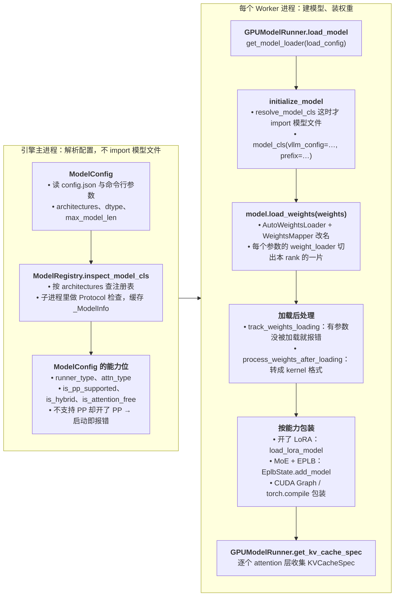
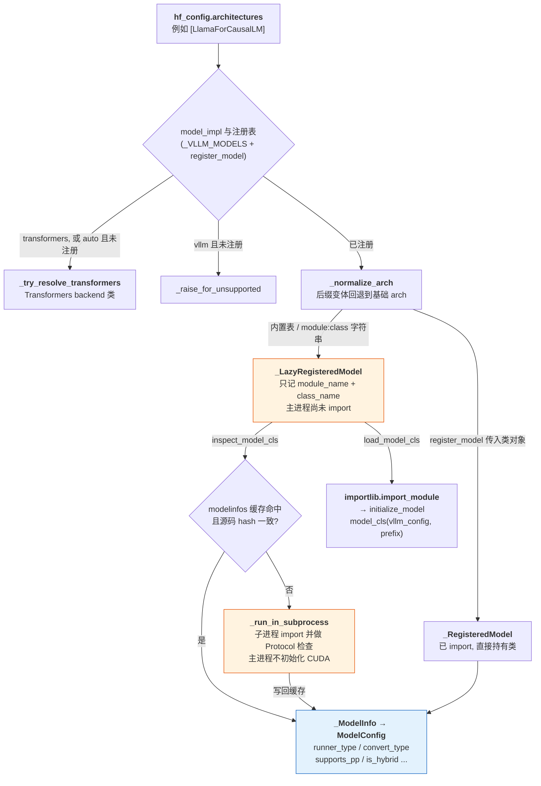
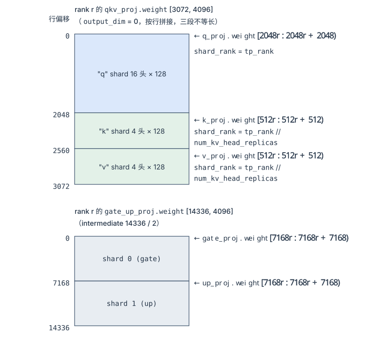
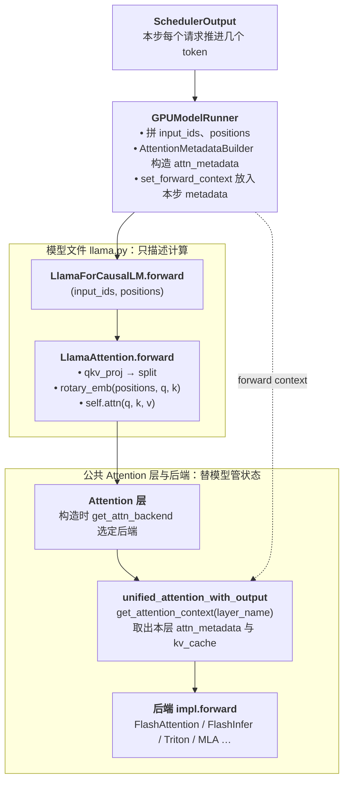
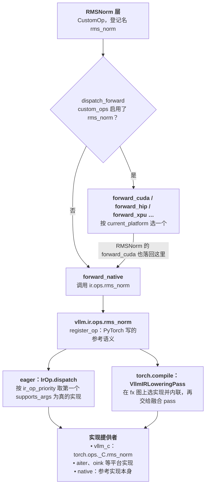
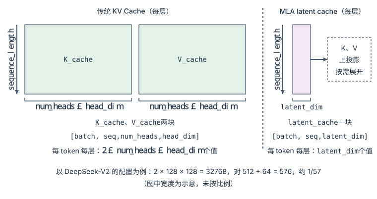
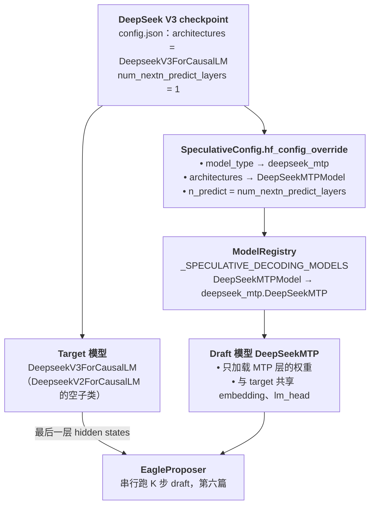

> **NOTE** 本文基于 vLLM v0.27.1（tag `6e448d0`, 2026-08-11）源码剖析。文中文件路径、类名和函数名均以该版本为准；vLLM 迭代很快，阅读时请以你手上的版本对照。


前面几篇先解决一个固定模型如何被高效地调度、缓存、执行和扩展，再看请求可见的契约怎样变——输入（第九篇：一个请求带自己的 LoRA、带几张图片）与输出（第十篇：采样参数与结构化输出）。这一篇换到模型本身。模型世界变化极快：MLA、MoE、MTP、Mamba、各种量化格式和权重布局层出不穷，而每一种差异都会往下捅穿好几层——Attention Kernel、KV Cache 布局、调度预算、并行与通信都可能被牵动。它是四种外部变化——输入在变（第九篇）、输出在变（第十篇）、模型在变（本篇）、硬件在变（第十二篇）——里的第三种：同样要问这种变化应该停在哪一层。

本篇的核心问题是：

> **面对结构、状态表示和执行方式都在快速变化的模型，推理引擎应该在哪一层吸收变化，才能既跟得上模型世界，又不牺牲性能与可维护性？[^q0]**

## 一、总览：抽象吸收变化，特化守住性能

### 1. 本文的思路

本文跟着一个模型走：从 Hugging Face 的 checkpoint 和 `config.json` 出发，经过配置解释、注册表找类、能力声明、权重装配，一直到它第一次 forward 时 attention 落到哪个 kernel。每经过一个抽象，就问一句：哪一类模型变化停在这里，哪一类会穿过去。

先在第二章把"差异怎样往下捅穿"画成一张矩阵；第三章沿接入链路逐个看 vLLM 的抽象，第九篇用到的 `SupportsLoRA`、`SupportsMultiModal` 在第三章第 3 节讲完整；第四、五章看这些抽象怎样演进、在哪里失效；第六章把前面的东西排成接入一个新模型的施工顺序和验收阶梯；第七章用 DeepSeek 的 MLA、MoE、MTP 三个特性逐一对照，看它们分别落在哪一层、对应哪段源码。

### 2. 本文的章节安排

| 章 | 主题 | 内容 |
|---|---|---|
| 二 | 痛点 | 算法同质、工程异构<br/>每种模型变化穿过哪几层（变化 × 层次矩阵）<br/>适配的四个目标 |
| 三 | vLLM 的核心抽象 | 接入链路全景<br/>`ModelConfig`、`ModelRegistry`<br/>能力声明（`Supports*` 协议与引擎据此启用的路径）<br/>权重装配（`WeightsMapper`、`weight_loader`）<br/>模型类与运行时的接缝（forward context、Attention 层）<br/>KV 规格、Tokenizer / 多模态注册表、插件<br/>动态运行时与 `torch.compile` 的边界<br/>出错时先查哪一层 |
| 四 | 适配机制的演进 | 专用实现 → Monkey Patch → `CustomOp` → vLLM IR → 组合计算原语 |
| 五 | 适配的边界 | 抽象解决了什么、解决不了什么<br/>通用实现与特化实现的取舍 |
| 六 | 新模型接入的完整路径 | 差异分析与复用决策<br/>写模型文件<br/>验收阶梯：从注册测试到分布式与性能 |
| 七 | DeepSeek 架构的工程适配 | MLA、MoE、MTP 各自落在哪一层、对应哪段源码<br/>决策矩阵<br/>通用层、特化层与验证层 |
| 八 | 本文小结 | 三层适配模型与推理引擎的核心竞争力 |

Table: 本文的章节安排

## 二、痛点：为什么推理引擎必须持续适配新模型？

### 1. 模型算法同质化与工程实现异构化

LLM 在算法上高度同质，都是 Transformer，围绕这几个组件构建：

- Embedding
- Transformer Block
- Attention
- Feed-Forward Network
- Normalization
- LM Head

工程实现上却高度异构：

| 维度 | 差异示例 |
|---|---|
| Attention | MHA / GQA / MQA / MLA / Sliding Window |
| 位置编码 | RoPE / ALiBi / Learned / NTK-RoPE |
| 归一化 | LayerNorm / RMSNorm、Pre-Norm / Post-Norm，位置与数量都可能不同 |
| MLP | Dense / MoE / Switch / Top-K routing |
| 激活函数 | GELU / SiLU / SwiGLU / GeGLU |
| KV Cache 格式 | Full KV / Latent（MLA）/ State（Mamba） |
| 特殊头 | MTP Head / EAGLE Head / Medusa Head |

Table: 模型工程实现的异构维度

新架构的发布频率是**周级**的。v0.27.1 的 `vllm/model_executor/models/` 下有 280 多个模型文件，注册表 `_VLLM_MODELS` 里有三百多个架构名。所以真正的问题是：**如何在不动 Continuous Batching + PagedAttention 这套通用框架的前提下，容纳每个模型的特殊计算路径。**

### 2. 新模型差异如何向下游扩散？

一个新模型接入推理引擎时，影响分三个层次：

| 层次 | 主要内容 | 典型问题 |
|---|---|---|
| 模型层 | 网络结构、权重、配置 | 如何加载权重？如何表示模型结构？ |
| 运行时层 | 调度、KV Cache、并行 | 如何执行动态 Batch？如何管理显存？ |
| 算子层 | Attention、MoE、量化 Kernel | 如何获得足够的吞吐和延迟？ |

Table: 新模型差异扩散的三个层次

理想情况下，模型层只调用运行时提供的通用能力，运行时层通过标准算子完成执行。难点在于**每一种差异都会往下捅穿好几层**。把常见的模型变化和三层对一下，每个格子写出 vLLM v0.27.1 里实际要动的对象：

| 模型变化 | 模型层 | 运行时层 | 算子层 |
|---|---|---|---|
| 换激活函数、归一化位置，增加普通层 | 模型文件组合公共层（`SiluAndMul`、`RMSNorm`、`*ParallelLinear`） | 不动 | 没有现成算子时新增 `CustomOp` |
| 换 Attention 变体（GQA、滑窗、attention sink） | `Attention(num_kv_heads=…, per_layer_sliding_window=…)` | 滑窗层得到 `SlidingWindowSpec`，KV 按规格分组管理 | `get_attn_backend` 按 head_size、滑窗、sink 选后端 |
| MLA | `DeepseekV2MLAAttention` + `MultiHeadLatentAttentionWrapper` | `MLAAttentionSpec`：每 token 1 个"头" × 576 维<br/>`get_num_kv_heads()` 返回 1 | MLA 专用后端<br/>prefill、decode 两条计算路径 |
| Mamba / 混合模型 | `IsHybrid` / `IsAttentionFree` 声明 + `get_mamba_state_shape_from_config` | `MambaSpec`：每请求定长的状态，不随 token 数增长，不是块状的 | mamba 算子成为 `torch.compile` 的切图点 |
| MoE | `FusedMoE` + 路由 `GateLinear` + `expert_params_mapping` | EP 组划分<br/>EPLB（`MixtureOfExperts` 协议） | fused MoE kernel<br/>Token Dispatch / Combine 的 All-to-All |
| MTP 等特殊预测头 | 独立的 draft 模型类（`DeepSeekMTP`） | 调度预算与 lookahead 槽位<br/>按接受数回退 `num_computed_tokens` | `RejectionSampler` |
| 新量化格式 | 不改（层名 `prefix` 让量化配置找到每一层） | 只有 KV 量化要改 cache dtype | `QuantizationConfig` + `LinearMethodBase` 子类 + kernel |
| 权重布局（改名、融合、打包） | `hf_to_vllm_mapper`、`packed_modules_mapping` | 不动 | 打包权重在 `process_weights_after_loading` 里转成 kernel 格式 |
| 新的并行方式 | `SupportsPP` 等声明 | TP / PP / EP 的切分与段间传递 | 通信算子 |

Table: 模型变化 × 三层：每种变化在 vLLM 里要动的对象

这张表从上往下越来越贵：前两行停在模型层或只多一个后端选项；MLA、Mamba 改了"状态长什么样"，调度器算显存的方式跟着变；MoE、MTP 改了"一步怎么执行"，牵动并行和调度。MTP 这一行的通用链路——proposer、lookahead 槽位、拒绝采样、按接受数回退——在[第六篇](/gpu-execution-kernels-and-graphs.html#六能不能少跑几轮模型-投机解码)，本文第七章第 3 节只讲 DeepSeek 的 MTP 头本身怎样接进来。

以标准 Attention 为例，论文里的计算是：

1. 计算 Q、K、V
2. $$QK^\top$$
3. Scale 与 Mask
4. Softmax
5. 与 V 相乘
6. 输出

实际推理系统里，同一个 attention 还要同时面对：

- 当前请求处于 Prefill 还是 Decode
- Batch 中每条序列的长度是否相同
- KV Cache 是否分页存储
- 是否启用张量并行或流水线并行
- 是否使用量化
- 是否存在特殊的位置编码
- 当前硬件适合哪一种 Kernel

因此适配的难点不是"把论文公式翻译成代码"，而是**把模型的计算语义准确映射到一个动态、异步、分布式且高度优化的执行系统中**。

### 3. 推理引擎适配的核心目标

一个成熟的模型适配方案要同时满足四个目标：

1. **正确性**：模型输出与参考实现一致
2. **性能**：不因为复用抽象而损失关键路径性能
3. **可维护性**：模型特化逻辑不污染整个运行时
4. **可扩展性**：新模型能够复用已有的执行原语

这四个目标并不总是一致：

| 方案 | 灵活性 | 性能 | 可维护性 | 适用场景 |
|---|---:|---:|---:|---|
| 完全复用通用实现 | 高 | 中 | 高 | 结构接近已有模型 |
| 模型专用 Python 逻辑 | 高 | 中低 | 中低 | 快速验证和早期接入 |
| Custom Op | 中 | 高 | 中高 | 性能关键算子 |
| 专用 Kernel 与运行时改造 | 低 | 很高 | 中 | 范式级模型创新 |

Table: 适配方案的灵活性、性能与可维护性

## 三、vLLM 的核心抽象：从模型接入到运行时执行

vLLM 没有一个包含所有模型逻辑的超大基类，而是按变化边界建了一组相互衔接、职责独立的抽象：配置语义、模型发现、能力声明、实例化与权重装配、运行时调度、执行编排、Attention / Kernel 执行。

### 1. 接入链路全景

这组抽象分在两个时间点、两类进程里。启动时，引擎主进程只解析配置、查注册表，不 import 任何模型文件；每个 Worker 进程才真正 import 模型类、在 GPU 上建结构、装权重。下图是一个模型从 checkpoint 到第一次 forward 之前走过的路：



第一次 forward 之后的每一步属于运行时：Scheduler 产出 `SchedulerOutput`，Worker 上的 ModelRunner 把它翻成张量和 attention metadata，模型 forward 时 attention 层再把 metadata 交给后端（本章第 5 节）。模型代码描述"模型如何计算"，运行时组件负责"在动态请求环境中如何组织这次计算"，两者靠加载好的模型实例、能力声明和 forward context 连起来。

### 2. 配置语义：`ModelConfig` 将外部参数收敛为执行意图

新模型接入的第一步不是写模型代码，而是回答：

> **这个模型是什么，系统准备以什么方式运行它？[^q1]**

`ModelConfig`（`vllm/config/model.py`）统一解释命令行参数和 Hugging Face 配置，产出：

- 模型架构信息：`architectures`、`model_type`
- runner 类型：generate、pooling、draft
- 输出转换类型（`convert_type`）：embed、classify、none
- dtype、量化和并行相关配置
- 最大上下文长度（`max_model_len`）
- tokenizer 和多模态相关配置
- 模型具备哪些运行能力、有哪些限制

它做的是一次**语义收敛**：外部配置、命令行参数、模型元数据 → 统一的执行意图。后续模块拿到的是已经有统一含义的对象，registry、loader、runner 不必各自重新解释同一组参数。

能力那一项来自注册表：`ModelConfig.__post_init__` 调 `registry.inspect_model_cls(architectures, self)`，拿到一份 `_ModelInfo`，之后的 `is_pp_supported`、`is_hybrid`、`is_attention_free`、`has_inner_state` 等属性都只是读它。另一类判断直接看 HF 配置，例如 `use_mla` = `is_deepseek_mla and not VLLM_MLA_DISABLE`；它为真时 `get_num_kv_heads()` 直接返回 1。

`ModelConfig` 描述"应该以什么方式运行这个模型"，下面这些都不归它管：

- 选择并实例化具体模型对象
- 读取和装配 checkpoint
- 组织某一轮请求执行
- 选择具体 attention kernel

### 3. 模型发现：`ModelRegistry` 负责定位实现

系统知道了架构名和运行方式，下一步是：

> **应该使用哪个模型实现类？[^q2]**

这是 `ModelRegistry`（`vllm/model_executor/models/registry.py`）的职责。它把架构名映射到实现类，支持五种来源：

- 内置模型表 `_VLLM_MODELS`（由 `_TEXT_GENERATION_MODELS`、`_MULTIMODAL_MODELS`、`_SPECULATIVE_DECODING_MODELS` 等合并而成）
- 运行时 `ModelRegistry.register_model`
- 插件：`vllm.general_plugins` 入口点里的函数在启动时调用 `register_model`
- `"module:class"` 字符串形式的懒加载
- `model_impl` 为 auto 且没有 vLLM 实现时，回退到 Transformers backend

内置表里每一项只记 `(模块名, 类名)`。同一个实现可以挂多个架构名——v0.27.1 里有 8 个架构名指向 `llama.py` 的 `LlamaForCausalLM`：

```python
# vllm/model_executor/models/registry.py
_TEXT_GENERATION_MODELS = {
    # ……（省略）
    "DeepseekV3ForCausalLM": ("deepseek_v2", "DeepseekV3ForCausalLM"),
    "InternLM3ForCausalLM": ("llama", "LlamaForCausalLM"),
    "LlamaForCausalLM": ("llama", "LlamaForCausalLM"),
    "MistralModel": ("llama", "LlamaForCausalLM"),
    # ……（省略）
}

# 树外模型：不改 vLLM 源码，在插件或启动脚本里注册
ModelRegistry.register_model("XxxForCausalLM", "my_pkg.xxx:XxxForCausalLM")
```

注册表把"检查能力"和"拿到类"拆成两个阶段：

- `inspect_model_cls`：在模型实例化之前检查能力和元信息，产出 `_ModelInfo`
- `resolve_model_cls`：真正 import 并返回用于实例化的模型类

拆开的原因是主进程在解析配置时只需要能力位，不该为此 import 模型文件。表里的每一项启动时被包成 `_LazyRegisteredModel`，主进程不 import 任何模型文件；`inspect_model_cls` 先查 `VLLM_CACHE_ROOT/modelinfos` 下按源码 hash 缓存的 `_ModelInfo`，未命中才用 `_run_in_subprocess` 在子进程里 import 模型类并跑一遍 Protocol 检查（`is_text_generation_model`、`supports_pp`、`is_hybrid` 等），这样主进程不会因为 import 模型文件而提前初始化 CUDA；只有 `resolve_model_cls → load_model_cls` 才真正 `importlib.import_module`。架构名本身先经过两层解析：`model_impl` 决定是否走 Transformers backend，`_normalize_arch` 把 `XxxForSequenceClassification` 这类后缀变体回退到基础架构名。整个解析路径如下：



图中两条出口对应两个阶段：`inspect_model_cls` 一路只产出 `_ModelInfo`（供 `ModelConfig` 判定 runner / convert type 和能力位），`load_model_cls` 一路才产出可实例化的模型类。能力信息来自一次隔离的子进程检查并被缓存，所以注册表可以容纳几百个架构而不让每次启动都 import 全部模型文件。拿到类之后，`_get_model_architecture`（`vllm/model_executor/model_loader/utils.py`）再按 `convert_type` 套一层适配器：embed 用 `as_embedding_model`、classify 用 `as_seq_cls_model`，一个生成模型因此不用另写文件就能当 embedding 或分类模型用。

`ModelRegistry` 负责"找到谁"，不负责"怎么跑"。下面这些都不是它的事：

- 创建完整模型对象
- 读取 checkpoint
- 将权重写入参数
- 管理设备侧模型生命周期
- 处理请求级 batch 和 KV cache

这些分别属于 `ModelLoader`、`Worker` 和 `ModelRunner`。Registry 是一个**模型实现路由层**，不是模型生命周期管理器。

### 4. 能力声明：`nn.Module` 加 Protocol，而不是统一继承树

模型类找到之后，还要回答：

> **不同模型如何接入统一运行时，同时避免被一棵庞大的继承树束缚？[^q3]**

vLLM 的模型类是两样东西的叠加：一个普通的 PyTorch `nn.Module`（参数注册、`state_dict`、device 迁移、与 PyTorch 工具链兼容），加上若干**能力协议**——定义在 `vllm/model_executor/models/interfaces_base.py` 和 `interfaces.py` 里的 `Protocol` 类。模型类继承哪个协议，就是向引擎声明"我支持这个能力"；引擎在固定的时间点检查这些声明，据此启用或拒绝对应的路径。

看 `LlamaForCausalLM` 的类头就知道它声明了什么：

```python
# vllm/model_executor/models/llama.py
class LlamaForCausalLM(
    LocalArgmaxMixin,
    nn.Module,
    SupportsLoRA,
    SupportsPP,
    SupportsEagle,
    SupportsEagle3,
    SupportsQuant,
):
    hf_to_vllm_mapper = LlamaModel.hf_to_vllm_mapper
    # LoRA specific attributes
    # !ref packed-mapping +3
    packed_modules_mapping = {
        "qkv_proj": ["q_proj", "k_proj", "v_proj"],
        "gate_up_proj": ["gate_proj", "up_proj"],
    }
    # !ref embedding-modules +3
    embedding_modules = {
        "embed_tokens": "input_embeddings",
        "lm_head": "output_embeddings",
    }
```

它没有继承任何 vLLM 基类：`SupportsLoRA` 要求的就是[这两个类属性](#packed-mapping)（[第二个](#embedding-modules)），`SupportsPP` 要求 `make_empty_intermediate_tensors` 和能接收 `intermediate_tensors` 的 `forward`。这样带来两个好处：

1. **兼容已有实现**：模型不必为了接入 vLLM 重构成某个继承体系，只实现运行时真正需要的能力。
2. **能力可以组合**：一个模型可以同时支持生成、多模态和 EAGLE，也可以只做 pooling，不必继承一条带着无关方法的基类链。

下表列出 v0.27.1 里主要的能力协议：模型要提供什么、谁在什么时候检查、声明之后引擎做什么。

| 协议 | 模型要提供 | 谁检查、何时检查 | 声明后引擎做什么 |
|---|---|---|---|
| `VllmModel` | `__init__(*, vllm_config, prefix)`<br/>`embed_input_ids(input_ids)`<br/>`forward(input_ids, positions, …)`，关键字名不能改 | `is_vllm_model` 检查签名；`initialize_model` 只按 `vllm_config` / `prefix` 两个关键字实例化 | 把它当作 vLLM 模型构造、调用 |
| `VllmModelForTextGeneration` | `compute_logits(hidden_states)` | 注册表检查，写进 `_ModelInfo.is_text_generation_model` | 可以作为 generate runner |
| `VllmModelForPooling` | `pooler` | 同上，`is_pooling_model` | 可以作为 pooling runner（embed / classify / score） |
| `SupportsLoRA` | `packed_modules_mapping`、`embedding_modules`（可选 `lora_skip_prefixes`） | Worker 加载完模型后 `load_lora_model` 调 `supports_lora(model)`，不满足就抛 `ValueError("… does not support LoRA yet.")` | `LoRAModelManager._create_lora_modules` 用 `from_layer` 把线性层换成 `*WithLoRA` 包装层；融合层按 `packed_modules_mapping` 拆回原子层名去匹配 adapter 权重（第九篇第二章） |
| `SupportsMultiModal` | `embed_multimodal(**kwargs)`、`get_placeholder_str(modality, i)`，并在 `MULTIMODAL_REGISTRY.register_processor` 登记处理器 | 注册表检查，`_ModelInfo.supports_multimodal` | `ModelConfig` 建多模态配置；ModelRunner 为它跑 encoder、把 encoder 输出按占位符合并进 embedding（第九篇第三章） |
| `SupportsPP` | `make_empty_intermediate_tensors`<br/>`forward` 接收并在非末段返回 `IntermediateTensors` | 注册表检查；`ModelConfig.verify_with_parallel_config` 在 PP > 1 而模型不支持时抛 `NotImplementedError("Pipeline parallelism is not supported for this model …")` | 允许按层切到多个 PP stage |
| `SupportsQuant` | `hf_to_vllm_mapper`、`packed_modules_mapping` | 模型构造时 `SupportsQuant.__new__` 自动执行 | 把 `quant_config` 挂到模型上，并把映射规则交给量化配置，让 checkpoint 里按原始层名写的量化信息对得上 vLLM 的融合层 |
| `HasInnerState` / `IsAttentionFree` / `IsHybrid` | 混合模型实现 `get_mamba_state_shape_from_config`、`get_mamba_state_copy_func` | 注册表检查 | `ModelConfig.attn_type` 变成 hybrid / attention_free；按层类型数 attention 层；KV 管理为 mamba 层分配定长状态 |
| `MixtureOfExperts` | `num_moe_layers`、专家数量字段、`set_eplb_state` | Worker 加载后 `is_mixture_of_experts(model)` | 开了 EPLB 时 `EplbState.add_model` 接管专家负载统计与重排；draft 模型是 MoE 时同样处理 |
| `SupportsEagle` / `SupportsEagle3` | 通过 `EagleModelMixin` 在指定层输出辅助 hidden states | `_setup_eagle3_aux_hidden_state_outputs` 调 `supports_eagle3`，不满足就抛 `RuntimeError` | 可以作为 EAGLE 系 draft 的 target，把中间层 hidden states 交给 draft |
| `SupportsMRoPE` | M-RoPE 位置计算 | ModelRunner 用到 M-RoPE 时 `assert supports_mrope(model)` | 多模态模型按 3D 位置编码准备 positions |
| `SupportsTranscription` | 转写相关的提示构造方法 | 注册表检查 | 开放语音转写接口 |

Table: vLLM v0.27.1 的主要能力协议：模型提供什么、谁检查、引擎启用什么

检查发生在两个时间点。一类在**启动解析配置时**，由注册表在子进程里对类做检查、写进 `_ModelInfo`，主进程据此决定 runner 类型、能不能开 PP、是不是混合模型——这类错误在模型加载之前就暴露。另一类在 **Worker 建好模型实例之后**，对实例做 `isinstance` 检查（`supports_lora`、`is_mixture_of_experts`、`supports_eagle3`），决定要不要包 LoRA 层、要不要挂 EPLB。

第九篇里 multi-LoRA 与多模态用到的 `SupportsLoRA`、`SupportsMultiModal` 就是这张表里的两行：声明了 `SupportsLoRA`，线性层才会被换成 `*WithLoRA` 包装层；声明了 `SupportsMultiModal` 并登记了处理器，引擎才会为它跑 encoder、合并 embedding。一个模型想支持 LoRA 却只写了一半，`supports_lora` 会打出警告：设了 `supports_lora=True` 但缺 `packed_modules_mapping` / `embedding_modules`，或者属性都有却没设标志。

所以 vLLM 统一的不是 `forward` 的完整签名，而是三样东西：

- 输入和输出的语义
- 运行时依赖的能力（上表）
- 模型与执行器之间的契约（`input_ids`、`positions` 两个关键字，非末段 PP 返回 `IntermediateTensors`）

### 5. 模型落地：`ModelLoader` 与 `WeightsMapper`

找到类不等于模型可以运行。接入中最容易出错的地方之一，是 checkpoint 权重怎样正确装配进模型参数。Worker 上的 `GPUModelRunner.load_model` 调 `get_model_loader(load_config)` 按 `load_format` 取一个加载器（默认 `DefaultModelLoader`，另有 dummy、bitsandbytes、sharded_state、tensorizer、runai_streamer 等），再调它的 `load_model`。这个方法在基类里，整个加载就是五步：

```python
# vllm/model_executor/model_loader/base_loader.py — BaseModelLoader.load_model（节选）
with set_default_torch_dtype(model_config.dtype):
    with target_device:
        # !ref load-init +4
        model = initialize_model(
            vllm_config=vllm_config,
            model_config=model_config,
            prefix=prefix,
        )
    # !ref load-inspect
    log_model_inspection(model)
    # !ref load-weights
    self.load_weights(model, model_config)
    if _has_online_quant(model):
        finalize_layerwise_processing(model, model_config)
    # !ref load-post
    process_weights_after_loading(model, model_config, target_device)
return model.eval()
```

1. [`initialize_model`](#load-init) 经 `get_model_architecture` 解析出类，以 `model_cls(vllm_config=vllm_config, prefix=prefix)` 实例化——结构直接建在目标设备上，dtype 是模型 dtype。构造函数不接受这两个关键字的老式模型类会触发 `DeprecationWarning`，再按参数名猜着传 `config`、`cache_config`、`quant_config`。
2. [`log_model_inspection`](#load-inspect) 在 `VLLM_LOG_MODEL_INSPECTION=1` 时打印建好的模型结构，排查"层没建对"时先开它。
3. [`load_weights`](#load-weights)：`DefaultModelLoader` 把 checkpoint 迭代器交给 `model.load_weights(...)`，拿回已加载参数名的集合；非量化模型默认开严格检查 `track_weights_loading`，模型里有参数没被 checkpoint 覆盖就抛 `ValueError("Following weights were not initialized from checkpoint: …")`。量化模型的 scale 可以缺省，所以默认不开这项检查。
4. [`process_weights_after_loading`](#load-post) 逐模块调用量化方法的同名钩子，把权重转成 kernel 需要的格式（重排、打包、预计算 scale）。

`WeightsMapper` 及模型的 `load_weights` 负责把外部 checkpoint 表示转换为运行时参数表示，这里同时有四类转换：

1. **参数命名差异**：checkpoint 的 key 与模型参数名不同，需要重命名或前缀转换。
2. **参数结构差异**：一个 checkpoint tensor 可能要拆成多个参数，或与其他 tensor 合并（QKV、gate/up projection），或按模型实现调整排列。
3. **并行切分差异**：TP / PP 下，完整权重要按运行时并行策略切到不同 rank。
4. **量化和设备布局差异**：packed weight、量化权重格式、特殊 dtype、延迟初始化、设备侧布局转换、加载后量化处理。

前两类在 vLLM 里由同一条规则完成，以 Llama 的 attention 和 MLP 为例。`LlamaModel` 的映射规则只有五行：

```python
# vllm/model_executor/models/llama.py
class LlamaModel(nn.Module, EagleModelMixin):
    hf_to_vllm_mapper = WeightsMapper(
        orig_to_new_stacked={
            # weight_name: (param_name, shard_id)
            ".q_proj": (".qkv_proj", "q"),
            ".k_proj": (".qkv_proj", "k"),
            ".v_proj": (".qkv_proj", "v"),
            ".gate_proj": (".gate_up_proj", 0),
            ".up_proj": (".gate_up_proj", 1),
        }
    )
```

`orig_to_new_stacked` 把 HF 的三个独立投影映射到一个融合层 `QKVParallelLinear`，并给每个来源打上 `shard_id`；`gate_proj` / `up_proj` 同理映射到 `MergedColumnParallelLinear`，`shard_id` 是整数下标。`shard_id` 再由融合层的 `weight_loader` 翻译成融合参数里的行偏移和本 rank 应取的 HF 行区间。

以 Llama-3-8B、TP=2 为例：hidden=4096，32 个 Q 头 / 8 个 KV 头，head_dim=128；每个 rank 拿到 num_heads=16、num_kv_heads=4、num_kv_head_replicas=1。mapper 把五个 HF 权重改名并挂上 shard_id：

| HF key | HF shape | → vLLM 参数 | shard_id |
|---|---|---|---|
| `self_attn.q_proj.weight` | [4096, 4096] | `self_attn.qkv_proj.weight` | `"q"` |
| `self_attn.k_proj.weight` | [1024, 4096] | `self_attn.qkv_proj.weight` | `"k"` |
| `self_attn.v_proj.weight` | [1024, 4096] | `self_attn.qkv_proj.weight` | `"v"` |
| `mlp.gate_proj.weight` | [14336, 4096] | `mlp.gate_up_proj.weight` | `0` |
| `mlp.up_proj.weight` | [14336, 4096] | `mlp.gate_up_proj.weight` | `1` |

Table: Llama-3-8B：HF 权重到 vLLM 融合层的映射（HF key 省去 `model.layers.N.` 前缀）

每个 rank 上，融合参数沿 output_dim=0 按行拼接，每段从对应 HF 权重里切自己那一片：



偏移由 `QKVParallelLinear.weight_loader` 按 `q → 0`、`k → num_heads*head_size`、`v → (num_heads+num_kv_heads)*head_size` 计算；`MergedColumnParallelLinear.weight_loader` 则用 `sum(output_sizes[:shard_id])`。k/v 的行区间用 `shard_rank = tp_rank // num_kv_head_replicas` 而不是 `tp_rank`：当 `tp_size > num_kv_heads` 时（例如 8 个 KV 头跑 TP=16），多个 rank 会复制同一个 KV 头，这就是 GQA 在 TP 下的权重复制发生的位置。

这条规则怎样被触发，取决于 `AutoWeightsLoader`（`vllm/model_executor/models/utils.py`）的分派：`load_weights` 先用 mapper 改名并把 `shard_id` 挂在张量对象上（`WeightsMapper.apply`），再按名字前缀逐级下钻子模块：

- `PPMissingLayer`（不在本 PP stage 的层）直接跳过
- 子模块自带 `load_weights` 的（如 `QKVParallelLinear.load_weights`）委托给它，由它调用 `param.weight_loader(param, w, shard_id)` 完成上图的偏移与切片
- 普通参数调用 `param.weight_loader`，没有的用 `default_weight_loader` 整块拷贝
- 对不上任何模块 / 参数的名字，要么命中 `skip_prefixes` / `ignore_unexpected_*` 规则被忽略（`rotary_emb.inv_freq` 一类默认忽略），要么直接抛 `ValueError` 并列出可用参数名

并不是所有模型都用 `AutoWeightsLoader` 这一套。`deepseek_v2.py` 的 `load_weights` 是手写循环：一张 `stacked_params_mapping` 列表（`(参数名, checkpoint 名, shard_id)`），MLA 时加上 `("fused_qkv_a_proj", "q_a_proj", 0)`、`("fused_qkv_a_proj", "kv_a_proj_with_mqa", 1)`，再用 `fused_moe_make_expert_params_mapping` 生成 `(参数名, checkpoint 名, expert_id, shard_id)` 四元组，把每个专家的 gate / up / down 权重写进融合的专家参数。两种写法殊途同归：都是"checkpoint 名 → 融合参数 + 分片编号 → 参数自己的 `weight_loader` 切本 rank 的片"。

许多表面上像"推理错误"的问题其实是权重装配错误。把加载隔离出来，排障时就能把问题分成四类：

- 模型结构问题
- 权重映射问题
- 运行时执行问题
- kernel 或硬件问题

### 6. 模型类与运行时的接缝：forward context 与 Attention 层

从这里开始看模型怎样在动态请求环境中运行。模型类本身不感知下面这些：

- 请求何时进入或退出
- 当前 batch 如何变化
- 每个请求本轮推进多少 token
- KV cache 如何分配和释放
- prefill、decode 和投机解码如何协同
- 当前设备采用哪种执行策略

这些由一条逐级细化的数据流承接，它们在第三、四、六篇里已经逐个展开过，这里只列各自对模型适配的意义：

| 对象 | 决定什么 | 包含 | 不包含 |
|---|---|---|---|
| `SchedulerOutput` | 这一轮处理谁、每个请求推进多少 token（step 级执行计划，"运行时结构化协议"意义上的 IR，不是编译器 IR） | 本轮请求<br/>每个请求的 token 数与执行阶段<br/>投机解码的 draft token<br/>encoder / 多模态输入<br/>已完成的请求<br/>要创建、更新、释放的 KV 与 encoder 状态 | kernel 调用方式<br/>硬件线程布局<br/>attention 后端内部结构<br/>模型 forward 细节 |
| `Worker` | 设备侧执行上下文与生命周期 | 接收调度结果<br/>初始化并持有 ModelRunner<br/>管理设备环境<br/>协调 KV cache 等运行时状态<br/>发起执行并返回结果 | 单步输入怎样组织 |
| `GPUModelRunner` | 怎样把计划组织成设备侧计算 | 组织 input_ids、positions、token layout<br/>准备 KV cache 引用<br/>用各层后端的 `AttentionMetadataBuilder` 构造 attention metadata<br/>调用模型 forward、`compute_logits`<br/>采样或 pooling<br/>封装 `ModelRunnerOutput` | 模型怎样计算 |
| Attention metadata | attention 应该看见什么 | query 起点与每条序列长度（`seq_lens`）<br/>`block_table`、`slot_mapping`<br/>prefill / decode 边界<br/>滑窗、局部 attention 等模式的参数<br/>后端特有的布局与执行参数 | 调度策略本身 |
| Attention 后端 | 用什么 kernel 执行 | paged KV 的读写<br/>prefill 与 decode<br/>不同 batch / sequence layout<br/>MLA 与混合 attention<br/>不同硬件、dtype、head dimension | 请求与调度 |

Table: 运行时数据流上的对象：各自决定什么、包含什么、不包含什么

对模型适配来说，关键是这条数据流**不经过模型代码的参数列表**。看 `LlamaAttention.forward` 的全部内容：

```python
# vllm/model_executor/models/llama.py — LlamaAttention
def forward(
    self,
    positions: torch.Tensor,
    hidden_states: torch.Tensor,
) -> torch.Tensor:
    # !ref attn-qkv +1
    qkv, _ = self.qkv_proj(hidden_states)
    q, k, v = qkv.split([self.q_size, self.kv_size, self.kv_size], dim=-1)
    # !ref attn-rope
    q, k = self.rotary_emb(positions, q, k)
    # !ref attn-call
    attn_output = self.attn(q, k, v)
    output, _ = self.o_proj(attn_output)
    return output
```

[融合投影后切开](#attn-qkv)、[对 q、k 做 RoPE](#attn-rope)，然后[把 q、k、v 交给 `self.attn`](#attn-call)——没有 `block_table`、没有 KV cache、没有 batch 里各序列的长度。这些由运行时放在一边：ModelRunner 在每步执行前用 `set_forward_context(attn_metadata, …)` 把本步的 metadata 放进一个全局上下文；`Attention` 层在 forward 里调用自定义算子 `unified_attention_with_output(…, layer_name)`，算子内部用 `get_attention_context(layer_name)` 取出本层的 `attn_metadata` 和 `kv_cache`，再调后端 `impl.forward`。后端也不是每步现选的：`Attention.__init__` 里按 head_size、dtype、kv_cache_dtype、是否 MLA、是否有 sink、是否滑窗调用 `get_attn_backend` 选定，之后固定。



这条接缝决定了适配的分工：模型文件描述"attention 的语义"（几个头、head_size 多大、是否滑窗），公共 `Attention` 层和后端负责"如何高效执行这个语义"。模型代码因此不绑定任何硬件平台或具体 kernel；调度策略演进时，只要 `SchedulerOutput` 仍是稳定的协议，执行侧把新策略翻成新的 metadata 即可，模型文件不用改。

模型和系统逻辑的边界不是文件边界。RoPE 在模型里算，mask 由后端按 metadata 隐式处理，positions 由 ModelRunner 准备——划分依据的是数据语义和稳定契约，而不是某段代码位于哪个文件。

### 7. 横切抽象：KV 规格、Tokenizer、多模态与插件

**1、KV 规格：模型只声明需要什么状态。**

KV cache 不绑定某个模型实现，而是由每个 attention 类的层自己声明。Worker 建好模型后，`GPUModelRunner.get_kv_cache_spec` 遍历所有 `AttentionLayerBase` 层，逐个调用它们的 `get_kv_cache_spec(vllm_config)`，得到"层名 → `KVCacheSpec`"的字典；KV 管理器按规格分组、按页大小分配和回收（第五篇）。和别的层共享 KV 的层（`kv_sharing_target_layer_name`）不产生规格，encoder-only 的层返回 `None`。`vllm/v1/kv_cache_interface.py` 里的规格家族就是 vLLM 能表示的"推理状态"种类：

| 规格 | 谁产生 | 每块页大小 | 典型模型 |
|---|---|---|---|
| `FullAttentionSpec` | 普通 `Attention` 层 | $$2 \times \text{block\_size} \times \text{num\_kv\_heads} \times \text{head\_size} \times \text{dtype 字节}$$ | Llama、Qwen |
| `SlidingWindowSpec` | 有 `per_layer_sliding_window` 的层 | 同上；窗口外的块可以提前释放 | Gemma 2/3、Mistral 的滑窗层 |
| `MLAAttentionSpec` | `MLAAttention` 层 | $$\text{block\_size} \times 1 \times 576 \times \text{dtype 字节}$$，没有 K、V 两份 | DeepSeek V2/V3 |
| `MambaSpec` | Mamba 类层 | 每请求定长的 conv state + ssm state，与 token 数无关 | Mamba、Jamba 等混合模型 |
| `CrossAttentionSpec`、`EncoderOnlyAttentionSpec` 等 | 对应的 attention 变体 | 按各自语义 | encoder-decoder、embedding 模型 |

Table: KVCacheSpec 家族：vLLM 能表示的几类推理状态

所以 KV 抽象统一的是缓存的分配与访问语义，不是"所有状态都是 K/V 张量"。Mamba 类模型的状态是循环状态，混合模型同时有两种；更准确的说法是**推理状态管理协议**：模型只声明需要什么状态，KV 系统负责怎样分配、保存和访问。

**2、Tokenizer Registry：tokenizer 的特殊处理不进模型文件。**

`vllm/tokenizers/registry.py` 的 `_VLLM_TOKENIZERS` 按 `tokenizer_mode` 映射到 `(模块, 类名)`，和模型注册表一样懒加载（`hf` → `CachedHfTokenizer`、`mistral` → `MistralTokenizer`、`deepseek_v32` → `DeepseekV32Tokenizer` 等）。它承接 tokenizer mode、专有 tokenizer 实现、truncation 方向、chat template、特殊 token、tokenizer 与模型配置之间的差异。新增一种 tokenizer 模式，不必在每个模型实现里复制条件分支。

**3、MultiModal Registry：模型结构与输入预处理链各自演进。**

多模态模型的复杂性不只来自结构，还来自输入预处理链。`MULTIMODAL_REGISTRY.register_processor` 把模型类与它的处理器工厂登记在一起（`SupportsMultiModal._processor_factory` 就是在这里设置的），第九篇的多模态输入流水线正是从这里按模型类找到 processor。它承接：

- 图片、视频、音频等输入处理
- 多模态特征提取
- 模态特征与文本 token 的对齐
- encoder 输入组织
- 不同模型所需的 processor 工厂

**4、插件：在注册点上扩展，而不是改核心路径。**

模型、硬件和采样策略不断增加，全靠核心代码内置会让系统越来越大。vLLM 的扩展点都是显式的注册点：

- 模型实现：`ModelRegistry.register_model`
- 整层替换：`PluggableLayer.register_oot`（`MultiHeadLatentAttentionWrapper` 就是以 `multi_head_latent_attention` 为名注册的可插拔层）
- 单个算子：`CustomOp.register_oot`
- tokenizer：`TokenizerRegistry.register`
- 多模态处理器：`MULTIMODAL_REGISTRY.register_processor`
- 量化方法：`register_quantization_config`
- 模型加载器：`register_model_loader`
- 硬件平台：`vllm.platform_plugins` 入口点（第十二篇）

这些注册函数通常写在一个 `vllm.general_plugins` 入口点里，vLLM 启动时 `load_general_plugins` 逐个调用。插件不是对所有内部对象开放任意修改：没有注册点的地方，插件只能 monkey patch，等于把核心里的隐式耦合搬到了外部。

### 8. 动态运行时与静态执行图：抽象边界的性能代价

运行时抽象提高了灵活性，也增加了编译优化和图捕获的难度。推理环境是动态的：

- batch size 持续变化
- sequence length 持续变化
- 请求不断加入和退出
- KV cache 地址不固定
- prefill、decode 和投机解码路径不同
- 不同请求可能处于不同执行阶段、有不同输入布局

编译器和图捕获擅长的却是：

- 相对稳定的计算图
- 稳定或可预测的 tensor shape
- 明确的控制流
- 固定的内存布局
- 可重复执行的 kernel 序列

vLLM 的做法是**不消除动态性，而是把动态性集中在运行时边界内，再把稳定部分下沉给编译器和硬件后端**：

| | 放在哪里 | 内容 |
|---|---|---|
| 动态部分 | Scheduler、Worker、ModelRunner、KV 状态、attention metadata、输入 buffer | 请求调度<br/>batch 组织<br/>每步 token 数<br/>KV block 地址<br/>执行路径选择 |
| 静态部分 | `torch.compile`、CUDA Graph、shape bucketing、kernel fusion、后端自己的图捕获 | 稳定的模型子图<br/>固定范围的 shape bucket<br/>可复用的 kernel 序列<br/>硬件相关的融合算子 |

Table: 动态性留在运行时，稳定部分下沉给编译与图捕获

这条边界在模型文件里看得见。`LlamaModel` 类上有一个装饰器：

```python
# vllm/model_executor/models/llama.py
@support_torch_compile(
    dynamic_arg_dims={
        "input_ids": {0: "b"},
        "positions": {0: "b"},
        "intermediate_tensors": {0: "b"},
        "inputs_embeds": {0: "b"},
    },
)
class LlamaModel(nn.Module, EagleModelMixin):
    ...
```

它告诉编译器：forward 的这几个输入只有第 0 维（本步 token 数）会变，其余都是静态的。动态的 token 数由 CUDA Graph 按若干档 batch size 分别捕获（第六篇）。attention 这类依赖 metadata 的算子被列为切图点：`CompilationConfig._attention_ops` 里有 `vllm::unified_attention_with_output`、`vllm::unified_mla_attention_with_output`、`vllm::mamba_mixer2` 等，`torch.compile` 在这些算子处把图切开，两段之间的 dense 计算整段编译、融合，attention 本身留给后端。一个新模型想享受编译和图捕获，forward 就得能被 Dynamo 追踪：不在 forward 里按张量的值走 Python 分支，新的 attention 类算子要注册成自定义算子并加进切图点。

`SchedulerOutput` 和 attention metadata 把动态状态显式化之后，编译器和 kernel 不必理解请求调度，只消费结构化的运行时输入——前面这些抽象服务于可维护性，也服务于性能。

### 9. 新模型接入出错时先查哪一层？

这套抽象的工程价值最终落到一个具体问题上：

> **当新模型接入失败时，应该首先修改哪一层？[^q4]**

按变化来源对层：

| 现象 | 优先检查的层 | 典型的报错或线索 |
|---|---|---|
| 架构无法识别 | `ModelConfig`、`ModelRegistry` | `_raise_for_unsupported`；`model_impl=auto` 时日志提示回退到 Transformers 实现 |
| runner 或输出类型判断错误 | `ModelConfig`、能力协议 | `_ModelInfo.is_text_generation_model` / `is_pooling_model` 与预期不符 |
| forward 或模型结构不兼容 | 模型类、Protocol、Attention 层 | `VLLM_LOG_MODEL_INSPECTION=1` 打印结构对照 |
| checkpoint 参数找不到 | `ModelLoader`、`WeightsMapper` | `AutoWeightsLoader` 抛 `ValueError` 并列出可用参数名 |
| 有参数没被加载 | 模型的 `load_weights`、映射规则 | `Following weights were not initialized from checkpoint` |
| QKV 或特殊权重加载错误 | 模型的加载逻辑、并行切分 | 不报错但 logits 偏；TP=1 正确、TP>1 错 |
| 开 PP / LoRA / EAGLE3 被拒 | 能力声明 | `Pipeline parallelism is not supported for this model`、`does not support LoRA yet` |
| batch 或 token 数量异常 | Scheduler、`SchedulerOutput`、ModelRunner | |
| KV cache 行为异常 | 层的 `get_kv_cache_spec`、KV 管理、metadata builder | |
| attention 结果异常 | attention metadata、Attention 层、后端 | |
| tokenizer 输入异常 | Tokenizer Registry | |
| 图片、视频等输入异常 | MultiModal Registry、处理器 | |
| 性能不稳定 | ModelRunner、后端、CUDA Graph、编译配置 | |

Table: 新模型接入时按现象优先检查的层

判断顺序是：

1. 确认模型被正确识别
2. 确认模型类和能力声明匹配
3. 确认 checkpoint 正确装配
4. 确认运行时输入和 KV 状态正确
5. 最后检查 attention 后端、编译和硬件性能

这样可以避免模型还没正确加载，就从 kernel 或调度器开始排查。

### 10. 小结：动态性上浮，静态性下沉

把本章的抽象和"什么变化落在这里"放在一张表里：

| 抽象 | 回答的问题 | 什么变化落在这里 |
|---|---|---|
| `ModelConfig` | 准备如何运行 | 配置变化 |
| `ModelRegistry` | 使用哪一个实现 | 识别变化（新架构名、别名、树外模型） |
| 能力协议 + 模型类 | 支持什么、怎样计算 | 能力变化、结构变化 |
| `ModelLoader` / `WeightsMapper` | 怎样把模型落地 | 权重命名、布局、切分、量化格式 |
| `SchedulerOutput` | 这一轮执行什么 | 调度策略变化 |
| `Worker` / `ModelRunner` | 怎样组织这次执行 | 执行方式变化 |
| `KVCacheSpec` / KV 管理 | 状态长什么样、怎样分配 | 缓存表示变化 |
| attention metadata | attention 应该看见什么 | attention 模式变化 |
| Attention 后端 | 用什么 kernel 执行 | kernel 与硬件变化 |
| Tokenizer / MultiModal Registry | 输入怎样变成 token 与 embedding | 输入变化 |
| 编译与图捕获 | 稳定部分怎样提速 | 性能变化 |

Table: vLLM 的抽象、它回答的问题与它吸收的变化

`SchedulerOutput`、ModelRunner、attention metadata 不是三个平行组件，而是一条逐级细化的数据流：调度计划 → 执行编排 → attention 输入描述 → kernel 执行。背后的设计原则有三条：

1. **动态性上浮**：请求队列、调度策略、batch 变化和执行路径选择集中在 Scheduler、Worker、ModelRunner 及其运行时协议中。
2. **静态性下沉**：稳定的模型计算、attention 子图和硬件相关 kernel 交给编译器、CUDA Graph 和 Attention 后端。
3. **以契约连接两者**：Registry、Protocol、WeightsMapper、SchedulerOutput 和 attention metadata，在动态系统与静态算子之间建立稳定的数据和能力契约。

支持一个新模型因此不再意味着全栈修改，而是先判断变化落在上表的哪一行。vLLM 没有试图消除模型差异，而是把不同类型的差异放进合适的抽象边界，让模型逻辑、运行时调度、状态管理和硬件执行相对独立地演进。

## 四、适配机制的演进：从临时补丁到编译化扩展

### 1. 早期方式：硬编码与模型专用实现

最直接的方式是为新模型写一份专用实现。开发路径短、便于快速验证、可以直接表达模型特有逻辑；代价是模型代码与运行时耦合、重复实现大量已有逻辑、难以复用现有 Kernel、后续维护成本高、不同模型之间容易分叉。适合早期接入，不适合作为长期架构。

vLLM 里还有一条更省事的复用路：Transformers backend。`model_impl=transformers`（或 auto 且 vLLM 没有原生实现）时，注册表经 `_try_resolve_transformers` 直接包装 Hugging Face 的模型类，用 vLLM 的 attention 替换其中的 attention 调用，其余计算照搬——新模型发布当天就能跑，代价是日志里那句"Some features may not be supported and performance may not be optimal"。

### 2. 热插拔适配：Monkey Patch

当模型已有实现、某些模块暂时无法复用时，可以在运行时替换局部逻辑：保留原始模型实现，替换其中的 Attention 模块、RoPE 或 MLP，复用其余结构。这能减少重复代码，但问题也明显：

- 调用关系不显式
- 依赖模块内部实现细节
- 不同版本之间容易失效
- 调试和性能分析困难
- 不利于长期维护

Monkey Patch 适合过渡阶段，不适合作为稳定扩展接口。vLLM 的 `PluggableLayer.register_oot` / `CustomOp.register_oot` 就是把"替换一层"变成显式注册点的做法：树外实现按名字登记，实例化时整类替换，不需要去改别人的模块属性。

### 3. Custom Op：将性能关键路径下沉为标准算子

模型结构已经能用通用模块表达、但性能关键路径不够快时，Custom Op 是更合理的方案。它承担三类职责：

1. 为 Python 层提供稳定接口
2. 把计算转发给 CUDA、Triton 或其他后端
3. 隐藏不同硬件后端之间的实现差异

在 vLLM 里，这是 `vllm/model_executor/custom_op.py` 的 `CustomOp` 基类。一个算子用 `@CustomOp.register("rms_norm")` 登记名字，实现 `forward_native`（纯 PyTorch 参考实现）和按平台的 `forward_cuda` / `forward_hip` / `forward_xpu` / `forward_cpu` / `forward_tpu` / `forward_oot`；`dispatch_forward` 在构造时按 `current_platform` 选定其中一个。是否启用由 `CompilationConfig.custom_ops` 控制：`"all"` 或 `"none"` 定基调，`"+rms_norm"` / `"-rms_norm"` 单独开关；用 Inductor 编译时默认 `"none"`，即走 `forward_native` 让编译器自己融合。

适合下沉为 Custom Op 的部分包括 Attention、RMSNorm、RoPE、Fused MLP、MoE Routing、Quantization、Sampling。Custom Op 解决的是"算子如何高效执行"，下面这些它不解决：

- 调度器如何组织请求
- KV Cache 如何分配
- 多卡之间如何通信
- MTP 被拒的 token 怎样回退
- 不同执行阶段如何切换

模型创新一旦涉及这些运行时语义，只加 Custom Op 不够。

### 4. IR：从算子注册走向计算图与后端解耦

IR 位于模型表达和硬件执行之间。它不描述某块 GPU 上的线程布局，而是描述：

- 计算操作
- 张量依赖与数据流
- Shape 与布局约束
- 可融合或可重排的计算
- 后端执行需求

模型代码 → IR → 图变换与优化 → 后端 Kernel → 硬件执行。相比单纯的算子注册，IR 能进一步支持算子融合、内存访问重排、自动选择后端、统一表达静态与动态 shape、为不同硬件生成代码、让模型结构与 kernel 实现解耦。

vLLM v0.27.1 里有两层"IR"。第一层是 `torch.compile` 捕获的 fx 图：`@support_torch_compile` 把模型 forward 追踪成图，在切图点之间跑 `vllm/compilation/passes/` 下的融合 pass（`add_rms_fusion`、`rms_quant_fusion`、`act_quant_fusion`、`allreduce_rms_fusion`、`rope_kvcache_fusion`、`mla_rope_kvcache_cat_fusion` 等），把相邻算子合成一个 kernel。第二层是刚起步的 **vLLM IR**（`vllm/ir/`）：用 `@register_op` 以纯 PyTorch 写出一个算子的参考语义，再由各个提供者用 `register_impl` 登记实现。这个版本里只有 `rms_norm` 和 `fused_add_rms_norm` 两个 IR op：

```python title="vllm/ir/ops/layernorm.py：算子的语义，用 PyTorch 写成参考实现"
@register_op
def rms_norm(
    x: Tensor, weight: Tensor | None, epsilon: float, variance_size: int | None = None
) -> Tensor:
    """Weighted root-mean-square layer normalization"""
    orig_dtype = x.dtype
    x = x.to(torch.float32)
    x_var = x if variance_size is None else x[..., :variance_size]
    variance = x_var.pow(2).mean(dim=-1, keepdim=True)
    x = x * torch.rsqrt(variance + epsilon)
    if weight is not None:
        x = x.to(weight.dtype) * weight
    return x.to(orig_dtype)
```

```python title="vllm/kernels/vllm_c.py：一个提供者，声明自己支持哪些参数、哪些平台"
# !ref ir-impl +2
@ir.ops.rms_norm.register_impl(
    "vllm_c", supports_args=rms_no_var_size, supported=GPGPU_DEVICE
)
def rms_norm(
    x: Tensor, weight: Tensor | None, epsilon: float, variance_size: int | None = None
) -> Tensor:
    # ……（ROCm 的形状处理省略）
    output = torch.empty(x.shape, device=x.device, dtype=x.dtype)
    torch.ops._C.rms_norm(output, x, weight, epsilon)
    return output
```

[`register_impl`](#ir-impl) 的两个参数把"能不能用"拆成两问：`supported` 问平台（这里是 CUDA 类或 XPU），`supports_args` 问这一次调用的参数（这里要求没有 `variance_size` 覆盖、权重与输入同 dtype）。同一个 op 还有 `aiter`、`oink` 等提供者。选择顺序来自 `KernelConfig.ir_op_priority`，用户不指定时取 `current_platform.get_default_ir_op_priority`。三层分派连起来是这样：



模型文件只写 `RMSNorm(hidden_size, eps)`；在哪个平台、用哪个 kernel、要不要和前后的加法或量化融合，全都在模型文件之外决定。这正是 IR 的价值：模型只表达语义，后端可以换、可以融合，而且有一份可执行的参考语义（native 实现）可以对数。

推理系统里的 IR 不能脱离动态运行时单独存在，它仍要和动态 batch、KV cache metadata、prefill / decode 阶段、并行拓扑、显存约束、请求优先级协同。所以现实的方向不是用静态编译完全替代动态调度，而是**由运行时决定执行计划，由 IR 和编译器优化计划中的计算部分**——上面的切图点就是这句话的实现：attention 留给运行时和后端，切出来的 dense 段交给编译器。

### 5. 从"支持模型"到"组合计算原语"

当 Attention、MoE、MTP 等能力被抽象为可组合的计算原语后，接入新模型就不再是从头实现整个网络，而是用标准 Attention + 标准 MoE + 标准 RoPE + 标准 KV Cache 原语组合出新的结构。适配的基本单位从"一个完整模型"变成了"一组标准计算原语"——第二章矩阵前两行的变化，在 vLLM 里大多就是这样接进来的。

前提是模型创新仍能被现有原语表达。如果模型改变了原语本身的语义，或者改变了多个原语之间的协作方式（MLA 改了 KV 的含义，MTP 改了一步生成几个 token），就要扩大抽象边界。

## 五、适配的边界：为什么仍然需要特化 Kernel？

### 1. 抽象机制解决了什么问题？

通用抽象主要解决：

- 统一模型加载流程
- 隔离模型结构与调度器
- 复用 KV Cache 管理
- 复用并行和通信机制
- 减少重复实现
- 提高新模型接入速度

对结构接近已有模型的架构，抽象能显著降低适配成本——8 个架构名共用一个 `llama.py` 就是例子。

### 2. 抽象机制解决不了什么问题？

当模型改变下面这些东西时，通用抽象可能失效：

- 数据表示方式
- 内存访问模式
- 算子融合边界
- 通信与计算的重叠方式
- Decode 阶段的执行粒度
- 调度器与模型计算之间的关系

例如某个模型使用低秩的 KV 表示。强行把它还原成标准 K/V，虽然能复用已有 Attention 接口，代价是：

- 额外的显存读写
- 额外的矩阵变换
- 更高的带宽压力
- 模型设计本身的优势发挥不出来

这时特化 Kernel 不是"为了极限性能过度优化"，而是模型语义变化后的必然结果。第七章的 MLA 就是这种情况：vLLM 为它单独写了 `MLAAttention` 层、`MLAAttentionSpec` 和一族 MLA 后端。

### 3. 通用算子与特化算子的永恒博弈

| 维度 | 通用实现 | 特化实现 |
|---|---|---|
| 接入速度 | 快 | 慢 |
| 模型复用 | 强 | 弱 |
| 峰值性能 | 中等 | 高 |
| 维护成本 | 低 | 高 |
| 适配范围 | 广 | 窄 |
| 对模型创新的支持 | 有限 | 强 |

Table: 通用实现与特化实现的对比

边界可以概括为：**模型只改变"计算结构"时，通用抽象通常足够；模型改变"数据流、内存流或执行流"时，就需要特化实现。**

## 六、一个新模型接入 vLLM 的完整路径

前文讲了 vLLM 的抽象和边界，这一章把它们排成施工顺序：

> **一个新模型接入 vLLM，应该按什么顺序分析、实现、验证和优化？[^q5]**

一个完整的接入要回答九个问题：能不能复用现有实现、结构对不对、权重装配对不对、单卡最小路径能不能跑、KV 和 Attention 对不对、调度与执行链路是否贯通、并行 / 量化 / 高级能力是否可用、性能是否达标、正确性和分布式测试是否通过。原则只有一条：**先建立正确、可观察、可复现的最小实现，再逐步引入并行、量化、图捕获和特化算子。** 一开始就同时改结构、权重加载、KV、并行和 kernel，任何错误都会被多个变量掩盖。

### 1. 模型差异分析与复用决策

第一步不是写代码，而是确定新模型与现有实现的差异，以及差异影响哪些层。先确认模型的基本形态：

- decoder-only、encoder-only 还是 encoder-decoder
- 做文本生成、pooling、embedding 还是分类
- 是否有 encoder 输出缓存
- 是否使用标准 Transformer block
- Attention 是 MHA、MQA、GQA、MLA 还是其他形式
- MLP 是标准 FFN、SwiGLU、MoE 还是其他结构
- 是否有特殊的位置编码、attention mask 或 position 计算
- 是否带 MTP 或其他多预测路径
- 是否支持多模态输入
- 是否有 KV Cache 之外的循环状态或其他持久化状态
- checkpoint 的参数命名、布局和格式是否与现有实现兼容

然后列一张差异表：

| 检查项 | 现有实现 | 新模型 | 影响层级 | 是否需要改造 |
|---|---|---|---|---|
| 模型架构 | decoder-only | decoder-only | Config / Model | 是/否 |
| Attention | 标准 MHA/GQA | 特殊 Attention | Model / Backend | 是/否 |
| 状态管理 | 标准 K/V Cache | 压缩 KV 或循环状态 | `KVCacheSpec` / Metadata | 是/否 |
| MLP | Dense FFN | MoE | Model / Parallel | 是/否 |
| 位置编码 | RoPE | 特殊 RoPE | Model / Runner | 是/否 |
| 输入形式 | 纯文本 | 文本加图像 | Tokenizer / Multimodal | 是/否 |
| 输出结构 | 单一 LM Head | 多预测头 | Runner / Sampling | 是/否 |
| 权重命名 | 与实现一致 | 命名不同 | Loader / Mapper | 是/否 |
| 权重布局 | 标准布局 | 融合或打包布局 | Loader / Quantization | 是/否 |
| 并行方式 | Tensor Parallel | 需要 Expert Parallel | Distributed | 是/否 |

Table: 模型差异表

差异分析的目标是做出接入决策，结果通常是三选一，每一种在 vLLM 里都有对应的动作：

| 决策 | 适用情况 | 在 vLLM 里做什么 |
|---|---|---|
| A. 直接复用 | 计算图与现有模型一致，差异只在配置字段、模型名称或参数命名 | 在注册表里加一行别名（`"InternLM3ForCausalLM": ("llama", "LlamaForCausalLM")`），必要时补映射规则；或先用 `model_impl=transformers` 跑起来 |
| B. 复用公共模块，局部改造 | 差异能由已有的 attention、MLP、MoE、position 模块表达，checkpoint 只需加映射规则 | 新建模型文件，组合公共层；或继承相近的模型类只覆写不同的部分（`DeepseekV3ForCausalLM` 就是 `DeepseekV2ForCausalLM` 的空子类） |
| C. 新增实现并扩展运行时 | 现有 ModelRunner 给不了模型要的输入、现有 KV 规格表示不了它的状态、现有后端执行不了它的 attention，或要新的并行 / 输出协议 | 新模型文件 + 新的层 / `KVCacheSpec` / 后端 / 能力协议 |

Table: 三种接入决策与 vLLM 里的对应动作

判断时按这个顺序问：

1. 新模型的计算图是否与现有模型基本一致
2. 差异是否只在配置字段、模型名称或参数命名
3. 差异能否由已有的 attention、MLP、MoE 或 position 模块表达
4. checkpoint 是否只需增加映射规则
5. 现有 `ModelRunner` 能否提供模型所需的输入
6. 现有 KV 规格能否表示模型的推理状态
7. 现有 Attention 后端能否执行模型的 attention 语义
8. 是否需要新的并行、通信或输出协议

越早回答"是"，越停在左边。**优先复用公共组件，局部适配模型差异；只有当现有抽象无法表达新模型语义时，才扩展运行时协议或底层后端。**

这一阶段的产物是一份接入设计，而不是一组未经验证的代码改动。它至少要写清：

- 复用哪些已有模块
- 新增哪些模型组件
- 是否需要新的权重映射
- 是否需要扩展能力协议
- 是否需要新的 cache / state 表示
- 是否需要新的 attention 后端
- 首次接入只支持哪些能力
- 哪些能力留待后续扩展

### 2. 写模型文件：结构与权重装配分开验证

模型实现要解决两个相关但应当分开验证的问题：forward 计算是否正确（结构），checkpoint 参数是否正确加载进结构（权重装配）。

**1、结构：组合公共层，用能力协议声明能力。**

模型类描述模型本身的计算语义：embedding、position 或 RoPE、attention、MLP 或 MoE、残差、normalization、logits、pooling 或其他输出头。实现时尽量复用 vLLM 已有的公共组件：并行线性层（`QKVParallelLinear`、`MergedColumnParallelLinear`、`RowParallelLinear`）、`Attention` 层、`RMSNorm`、`get_rope`、`FusedMoE`、量化线性层、`ParallelLMHead` 与 `LogitsProcessor`。如果新模型只是层配置、激活函数或参数组织不同，不应复制一整套实现，而应组合已有模块。

模型支持什么——文本生成、pooling、多模态、EAGLE、PP、特殊的 cache / state、特殊的 attention metadata——通过第三章第 4 节的能力协议表达，不让运行时对具体模型类做类型判断。

一个 decoder-only 生成模型的顶层类（以 `LlamaForCausalLM` 为参照）要提供的成员不多，但每一项都有明确的调用方和校验方，缺一项通常在启动的某个固定阶段报错：

| 成员 | 谁调用 / 谁校验 | 作用 | 何时必需 |
|---|---|---|---|
| `__init__(self, *, vllm_config, prefix="")` | `initialize_model` 以 `model_cls(vllm_config=..., prefix=...)` 实例化；`VllmModel` Protocol 检查 `vllm_config` 关键字 | 从 `vllm_config.model_config.hf_config` 读结构超参，组合公共层；`prefix` 用于量化/LoRA 按名字定位层 | 总是 |
| `embed_input_ids(input_ids)` | ModelRunner；`is_vllm_model` 检查 | 把 token id 变成 embedding，与 `forward` 分离以便多模态/EAGLE 直接注入 `inputs_embeds` | 总是 |
| `forward(input_ids, positions, intermediate_tensors=None, inputs_embeds=None)` | ModelRunner 每 step 调用；Protocol 检查关键字名 `input_ids`、`positions` | 表达一次模型计算，返回最后一层 hidden states（PP 非末段返回 `IntermediateTensors`） | 总是，关键字名不能改 |
| `compute_logits(hidden_states)` | ModelRunner；`VllmModelForTextGeneration` Protocol | `LogitsProcessor(lm_head, hidden)`，TP rank>0 返回 `None` | 生成模型；pooling 模型改为 `pooler` |
| `load_weights(weights) -> set[str]` | `DefaultModelLoader.load_weights`，返回值用于检查是否有参数未加载 | 通常仅委托 `AutoWeightsLoader`，加上 `skip_prefixes`（如 tie_word_embeddings 时跳过 `lm_head.`） | 总是 |
| `hf_to_vllm_mapper: WeightsMapper` | `load_weights` 传给 `AutoWeightsLoader`；LoRA/量化用 `get_unstacked_mapper` 解析原始名 | checkpoint 名 → vLLM 参数名 + `shard_id`（见第三章第 5 节） | checkpoint 命名与实现不一致时 |
| `packed_modules_mapping` | `SupportsLoRA` / `SupportsQuant` | 融合层 ↔ 原子层（`qkv_proj: [q_proj, k_proj, v_proj]`），LoRA 与量化配置按原子层名匹配 | 用了融合线性层且要支持 LoRA 或量化 |
| `embedding_modules` | `SupportsLoRA` | 标出 embedding / lm_head 的 LoRA 目标 | 支持 LoRA 时 |
| `make_empty_intermediate_tensors` | `SupportsPP`；ModelRunner 在 PP 非首段构造输入 | 声明 PP 段间传递的 tensor 名与形状 | 支持 Pipeline Parallel 时 |
| `@support_torch_compile(dynamic_arg_dims=…)` | 编译配置 | 声明 forward 的哪些输入维度是动态的（第三章第 8 节） | 要用 `torch.compile` / 分段 CUDA Graph 时 |
| 注册项 | `ModelRegistry` | 内置：在 `registry.py` 的 `_TEXT_GENERATION_MODELS` 加一行 `"XxxForCausalLM": ("xxx", "XxxForCausalLM")`；树外：`ModelRegistry.register_model("XxxForCausalLM", "pkg.mod:XxxForCausalLM")` | 总是 |

Table: decoder-only 顶层模型类需提供的成员

表里没有 attention kernel、KV Cache、调度这些词：它们都被 `Attention` 层、`*ParallelLinear` 等公共组件封装了（第三章第 6 节），模型类只需要把它们按正确的形状拼起来。

**2、权重装配：不能只看"模型成功加载"。**

权重加载要处理的转换比第三章第 5 节的 Llama 例子多：参数名与模块路径转换、QKV 和 gate/up 的合并或拆分、MoE 专家权重组织、TP 切分、PP 的层分配（`PPMissingLayer` 跳过）、转置和重排、packed weight 与量化格式、scale / zero-point 等量化参数、加载后的设备布局转换。

加载阶段的检查至少覆盖：

- checkpoint 中的参数是否全部被消费，有没有未匹配的名字
- 是否有参数被重复加载
- 参数 shape、dtype 是否一致
- QKV、gate/up、MoE 专家等融合参数是否按预期处理
- 不同并行 rank 加载的参数是否互补
- 量化权重与对应 scale 是否成对加载

vLLM 自带的检查只覆盖前两项的一部分：`AutoWeightsLoader` 对不上名字时报错，`track_weights_loading` 在非量化模型上查漏加载。其余要靠数值对比。权重加载错误不一定让程序崩溃——参数名碰巧匹配、shape 恰好兼容时，表现只是：

- logits 偏差
- 生成结果异常
- 某些输入长度下结果错误
- 多卡结果与单卡不一致
- 模型质量明显下降但程序运行正常

所以验证要由内向外：参数匹配 → 关键参数 shape → 参数统计量 → 单层输出 → hidden states → logits → 端到端生成结果。直接比较最终文本只能作为最后一层，因为采样和离散 token 会掩盖中间层的数值误差。

### 3. 验收阶梯：从注册测试到分布式与性能

> **新模型的正确性和性能要按什么顺序验证？[^q6]**

vLLM 仓库本身给每个新架构准备了一套由浅入深的测试，前四级不需要真实权重或只需要一张卡。每一级只加一个变量，失败时就知道该查哪一层：

| 级 | 打开什么 | vLLM 里的现成手段 | 对照基线 | 失败时先查 |
|---:|---|---|---|---|
| 1 | 注册与能力位 | `tests/models/registry.py` 为架构加一条 `_HfExamplesInfo`（`test_hf_registry_coverage` 强制每个注册的架构都有）<br/>`test_registry.py` 检查能 import、`_ModelInfo` 的能力位符合预期、主进程没有初始化 CUDA | 预期的能力表 | 注册项、能力协议 |
| 2 | 能建结构、能跑一步 | `test_initialization.py::can_initialize`：`load_format="dummy"` 随机权重，`dummy_hf_overrides` 把层数压到最少，走完 KV 初始化和一次 forward | 不崩溃 | 模型类、`get_kv_cache_spec`、Attention 层 |
| 3 | 真实权重、单卡、单请求 | 加载真实 checkpoint；严格的漏加载检查 | 参数统计量、单层输出与 HF 对比 | `load_weights`、映射规则 |
| 4 | 与参考实现对数 | `tests/models/language/generation/test_common.py`：HF 与 vLLM 各 greedy 生成 32 个 token、取 top-5 logprobs，`check_logprobs_close` 要求在第一个分叉位置，双方采到的 token 都在对方的 top-5 里 | HF Transformers | 位置编码、mask、KV 写入 / 读取、RoPE 参数 |
| 5 | Prefill 与 Decode 衔接、多轮、动态 batch | 同一序列：一次性 prefill 的 logits 与分段 prefill + decode 的对应 logits 对比；混入长短不同的请求 | 单请求结果 | position、KV 写入与读取、sequence length、token → block 映射、prefill / decode 路径切换 |
| 6 | 服务生命周期 | 流式输出、EOS 与 stop、请求在 prefill / decode 阶段取消、多个请求同时完成、长请求被插入、OOM 报错、异常请求不残留 block、反复加载卸载不泄漏显存 | 无泄漏、无残留 | KV 管理、请求状态 |
| 7 | 并行：TP → PP → EP → 多节点 | 每加一种都与单卡对比 | 单卡结果 | 权重切分、段间 hidden state 传递、token dispatch / combine 顺序、通信对齐 |
| 8 | 量化 | 先有高精度基线，再比数值误差、端到端质量、性能与显存收益 | 高精度模型 | checkpoint 格式、packed weight、scale / zero-point、kernel 支持、切分顺序 |
| 9 | Prefix Cache、投机解码、MTP | 接受 0 个、1 个、全部候选；prefix 命中与未命中 | 不开时的结果 | 状态语义、draft 的 hidden state、回退后的位置 |
| 10 | 图捕获、编译与特化 kernel | 开 CUDA Graph、`torch.compile`，替换 kernel 后重跑第 4–9 级 | 未优化实现 | 动态 shape 导致的图捕获失败、融合 pass |

Table: 新模型的验收阶梯：每级只加一个变量

第 5 级最容易被跳过，也最常出问题：一次性 prefill 与分段 prefill + decode 的 logits 有非预期差异，几乎都是 position、mask 或 KV 读写的错。第 9 级的能力不是模型开关，它们改变运行时状态和执行路径；首次接入时，如果它们不是上线的必要条件，就明确标为暂不支持，而不是在基础实现里加未经验证的分支。

正确性测试的内容按类别列全如下，每一类都对应阶梯上的某几级：

- **数值**：与参考框架比较 hidden states 和 logits；不同输入长度、batch size、dtype 下的结果；prefill 与 decode 的一致性；量化模型的误差范围；单卡与多卡的一致性
- **生成行为**：greedy；temperature、top-k、top-p 等采样参数；EOS、stop token、stop string；最大输出长度；空输入、短输入和超长输入；多轮对话和 chat template；流式输出；请求中途取消
- **运行时状态**：KV 分配与复用；prefix cache 命中与未命中；请求完成后的回收；长时间运行后的显存稳定性；动态 batch 中请求加入和退出；OOM 或异常后的恢复
- **多模态**（如果支持）：图片、视频、音频预处理；多模态 token 与文本 token 的对齐；不同输入尺寸；输入缺失或格式错误；encoder 状态的缓存和释放
- **分布式与故障**：不同 TP size、PP stage 数、EP；多节点通信；各 rank 参数和输出的一致性；通信与计算重叠；通信超时；部分 rank 异常；服务重启；模型重复加载和卸载

三组对比贯穿始终：单卡 vs 多卡、参考框架 vs vLLM、未优化 vs 优化后。每增加一种并行方式、量化方式或特化 kernel，都要重跑对应的正确性测试和性能回归。

### 4. 性能分析与选择性特化

正确性和稳定性通过后才进入性能优化。先固定测试条件：模型权重与版本、GPU 型号、dtype 与量化配置、输入长度、输出长度、batch size、并行规模、采样参数、cache 配置、软件和驱动版本。然后用端到端 profiling 定位瓶颈，而不是一开始就重写某个算子。指标按场景区分：

| 场景 | 主要指标 |
|---|---|
| 单请求 Prefill | TTFT、Prefill 延迟、Prefill 吞吐 |
| 单请求 Decode | ITL、每秒生成 token 数 |
| 动态 Batch | 总吞吐、P95/P99 延迟、batch 利用率 |
| 长上下文 | KV Cache 占用、显存带宽、OOM 情况 |
| Prefix Cache | 命中率、命中后的 TTFT、cache 管理开销 |
| 多卡推理 | 通信占比、扩展效率、计算通信重叠 |
| MoE 模型 | 路由开销、dispatch/combine 开销、expert 利用率 |
| 量化模型 | 显存占用、量化误差、反量化开销 |

Table: 不同场景的性能主要指标

性能测试的场景至少覆盖：单请求短 / 长上下文；短 prefill 长 decode 与长 prefill 短 decode；多请求动态 batch 与高并发 decode；prefix cache；不同 batch size、输入输出长度、dtype 与量化配置、并行规模。只看平均值不够，还要看首 token 延迟、token 间隔、总吞吐、P50 / P95 / P99、GPU 利用率、显存占用与带宽利用率、kernel launch 数量、通信占比、cache 分配和回收开销。

优化流程是：建立端到端基线 → 采集算子、访存、通信和调度指标 → 定位关键瓶颈 → 判断它属于计算、访存、通信、调度还是采样 → 选择性引入优化 → 重新验证正确性和收益。常见瓶颈有：

- Attention 计算
- KV Cache 访存
- MoE 路由、dispatch 和 combine
- TP 或 EP 通信
- 量化和反量化
- kernel launch
- 动态 shape 导致的图捕获失败
- Python 或 CPU 侧调度
- 采样
- 内存分配和 cache 管理

Attention 并不总是第一瓶颈。小 batch decode 时，系统常常受限于 kernel launch、访存、采样或通信，而不是矩阵计算。只有 profiling 证明现有实现确实在关键路径上，才考虑新增特化 kernel、扩展 Attention 后端、增加 shape bucket、引入 CUDA Graph、使用 `torch.compile`、融合量化和计算、优化通信与计算重叠、修改 ModelRunner 的输入布局——每次优化后回到验收阶梯第 4 级重新对数。

### 5. 发布门槛

一个新模型"接入完成"，不能只看类已经注册，也不能只看单次请求能生成文本。发布前要同时满足：

1. 配置可识别，实现可复用或可维护
2. 权重完整装配
3. 单卡 Prefill / Decode 数值正确
4. KV Cache 和请求生命周期稳定
5. 目标并行配置下输出正确
6. 性能达到预期，瓶颈可解释
7. 故障和资源回收行为可控

这七条正好对应第三章的抽象链路：配置语义、模型发现、能力声明、权重装配、调度计划、执行编排、attention metadata、KV / 后端、硬件执行。接入的核心不是把所有差异塞进模型类，而是识别差异落在第三章第 10 节那张表的哪一行，把它放进对应的抽象边界。

## 七、实际案例分析：DeepSeek 架构的工程适配

DeepSeek V2 / V3 的接入不是增加一个模型类、补几条权重映射、给某个算子写特化 kernel 那么简单。它在注意力、专家路由和多 token 预测三处同时引入了新的状态组织方式，是对推理引擎既有协议的一次压力测试：

> **DeepSeek 的 MLA、MoE、MTP 分别落在哪一层，vLLM 用哪些抽象接住了它们？[^q7]**

从工程角度看，它提出三类问题：

1. **如何表示新的计算状态**（MLA 的 latent cache）
2. **如何调度动态变化的计算路径**（MoE 的逐 token 路由）
3. **如何保证动态状态在增量执行、并行执行和部分接受时的一致性**（MTP）

它的适配因此跨越六个层次：模型配置与注册、权重加载与结构映射、注意力与 KV Cache 表达、MoE 路由与分布式执行、MTP 状态管理、调度 / 验证 / 回退与性能优化。下面三节各讲一个特性，每节先说变了什么，再说落在 vLLM 的哪段代码；机制本身在前面的篇目里已经讲过的，只给指针。

### 1. MLA：从注意力优化到 KV Cache 协议扩展

Multi-head Latent Attention（MLA）最直接的目标是降低 KV Cache 的存储与访存开销。传统多头注意力为每个 token 保存展开后的 K 和 V；MLA 用低秩表示压缩历史上下文，cache 里存的是一个潜变量：



在 DeepSeek V3 上，每 token 每层存 `kv_lora_rank` = 512 维 latent 加 `qk_rope_head_dim` = 64 维带位置编码的 key，共 576 维。bf16 下是 576 × 2 = 1,152 字节；如果 128 个头都按 head_dim 128 存完整的 K 和 V，是 2 × 128 × 128 × 2 = 65,536 字节，MLA 只有它的 1.8%（这笔账和"存的时候压缩、用的时候还原"两步，见[第五篇的 MLA 一节](/kv-cache-memory-core.html#2-mla从-kv-cache-到-latent-cache)）。

MLA 的关键变化不只是"缓存张量变小"，而是缓存的**语义**变了：KV Cache 不再必然表示已经展开的 Key / Value，而可以表示生成 Key / Value 所需的压缩状态。这一变化在 vLLM 里落到四处。

**1、模型层：一个可插拔的 MLA 层。**

`DeepseekV2MLAAttention`（`deepseek_v2.py`）把 `q_a_proj`、`kv_a_proj_with_mqa`、`kv_b_proj`、`kv_a_layernorm`、RoPE、`o_proj` 等子模块装进 `MLAModules`，交给 `MultiHeadLatentAttentionWrapper`（`vllm/model_executor/layers/mla.py`）。这个 wrapper 是以 `multi_head_latent_attention` 为名注册的 `PluggableLayer`，树外后端可以整层替换。按它的文档，它对 prefill token 做多头注意力、对 decode token 做多查询注意力，两类 token 分开算——这就是"非吸收 / 吸收"两条路径：decode 时把 `kv_b_proj` 吸收进 query 和输出投影，直接在 576 维 latent 上做 MQA。

**2、运行时层：一种新的 KV 规格。**

wrapper 里的 `MLAAttention` 层（`vllm/model_executor/layers/attention/mla_attention.py`）自己声明 cache 形态：

```python
# vllm/model_executor/layers/attention/mla_attention.py — MLAAttention
def get_kv_cache_spec(self, vllm_config: VllmConfig) -> KVCacheSpec:
    kv_cache_dtype = kv_cache_dtype_str_to_dtype(
        self.kv_cache_dtype, vllm_config.model_config
    )
    return MLAAttentionSpec(
        block_size=vllm_config.cache_config.block_size,
        # !ref mla-heads
        num_kv_heads=1,
        # !ref mla-head-size
        head_size=self.head_size,
        dtype=kv_cache_dtype,
        cache_dtype_str=self.kv_cache_dtype,
        kv_quant_mode=get_kv_quant_mode(self.kv_cache_dtype),
        non_causal_multi_token_decode=self.non_causal_multi_token_decode,
    )
```

[只有一个"头"](#mla-heads)，[`head_size`](#mla-head-size) = `kv_lora_rank + qk_rope_head_dim` = 576；`MLAAttentionSpec.real_page_size_bytes` 去掉了普通规格里的系数 2（没有 K、V 两份）。block_size 为 16、bf16 时，一层一块是 16 × 576 × 2 = 18,432 字节。运行时其余部分只看规格不看模型：KV 管理器按页大小分配；`MLAAttentionSpec.merge` 断言同一个 KV 组里全是 MLA 规格；`ModelConfig.use_mla` 为真时 `get_num_kv_heads()` 返回 1，显存账照此计算。

**3、复用与搬运：块共享不需要转换。**

普通注意力的写入是"新生成的 K、V 写进对应的块"；MLA 写进去的是压缩后的 latent 和带 RoPE 的 key。直觉上，前缀复用、块的复制与迁移都得知道"复制的到底是什么"。V1 的 KV 管理没有块复制和换出：前缀缓存是按块哈希共享同一个物理块（第五篇），块里存什么格式与它无关，所以 MLA 的前缀复用不需要任何转换。真正要对齐格式的地方在跨实例：PD 分离时，`compute_tp_mapping()` 对 MLA 的处理是 latent cache 在 TP rank 间复制、选一个源，与 GQA 按头切分拼接不同（第八篇）。

**4、算子层：一族 MLA 后端。**

`MLACommonBackend` 一族（`vllm/v1/attention/backends/mla/` 下的 FlashMLA、FlashAttention MLA、FlashInfer MLA、CUTLASS MLA、Triton MLA 等）的 KV 形状是 `(num_blocks, block_size, head_size)`，没有头维；它们的 metadata（`MLACommonMetadata`）分成 prefill 和 decode 两部分，对应上面两条计算路径。在 `torch.compile` 里，`vllm::unified_mla_attention_with_output` 是切图点之一。

所以 MLA 并不要求整个 vLLM 理解它的数学细节：

- 调度器只表达调度结果和每块的字节数
- 模型层组织 MLA 需要的输入
- 后端负责压缩状态的恢复与高效计算
- KV 管理器提供与该规格兼容的存储

MLA 的特殊性被限制在模型、规格和后端三个明确的边界内，没有扩散到通用调度代码里。

### 2. MoE：从静态执行图到动态专家路由

Mixture-of-Experts（MoE）把单一的前馈网络换成多个专家，由路由器为每个 token 选少数几个专家执行：在保持较大参数规模的同时，每个 token 只激活部分参数。对推理引擎而言，MoE 带来的不是多几个 `Linear` 层，而是一套动态的 token → 专家执行机制。Dense 模型的路径是 token → Attention → MLP → 下一层；MoE 层里变成 Router → Top-k 选专家 → 按专家重排（跨卡时 All-to-All dispatch）→ 专家计算 → 还原顺序（跨卡时 All-to-All combine）。矩阵乘法的输入排列不再固定，各专家的负载也不再均匀，而且每一批 token 都不同。Token-to-Expert 映射、dispatch / combine 的通信和重叠，[第七篇的 EP 一章](/multi-gpu-scaling-strategies.html#五ep-expert-parallelism)已经逐步展开；这里看它在 vLLM 里的落点。

**1、模型层：路由器 + 融合专家层。**

`DeepseekV2MoE`（`deepseek_v2.py`）由三部分组成：

- 路由器 `GateLinear`：输出 `n_routed_experts` 个分数；配置里 `topk_method == "noaux_tc"` 时多一个 `e_score_correction_bias` 参数
- 共享专家 `DeepseekV2MLP`：中间维度是 `moe_intermediate_size × n_shared_experts`
- 路由专家 `FusedMoEFactory(num_experts=n_routed_experts, top_k=num_experts_per_tok, use_grouped_topk=True, num_redundant_experts=…)`：所有专家的权重放在一个融合层里，由 fused MoE kernel 一次算完

DeepSeek V3 的配置是 256 个路由专家、1 个共享专家、每个 token 选 8 个。权重加载用前面提到的 `fused_moe_make_expert_params_mapping`，把 checkpoint 里每个专家各自的 gate / up / down 写进融合参数的对应位置。

**2、运行时层：调度器不知道路由结果。**

调度器管的是请求、序列和 token 级的批处理；路由器按当前 token 的 hidden state 选专家。所以调度器在路由器真正算出来之前，不可能知道每个 token 的专家归属。准确的说法是：**MoE 要求执行编排层容纳动态的路由结果，而不是要求调度器预测专家负载。** 在 vLLM 里，`SchedulerOutput` 没有任何 MoE 字段；专家并行由 `ParallelConfig` 的 `enable_expert_parallel` 打开，专家怎样分布到卡上在 MoE 层构造时就定了（`n_physical_experts = n_logical_experts + n_redundant_experts`，每卡 `n_physical_experts // ep_size` 个），dispatch buffer、通信与计算的重叠都在 fused MoE 层内部。

根据历史统计、容量限制或拓扑预估专家负载是另一回事，属于优化而不是路由语义。vLLM 里做这件事的是 EPLB（Expert Parallel Load Balancer）：模型声明 `MixtureOfExperts` 协议（`DeepseekV2MixtureOfExperts` 实现了它），Worker 加载后 `EplbState.add_model` 接管，按统计到的负载在冗余的物理专家槽位之间重新分配逻辑专家。

**3、算子与通信层：瓶颈换了地方。**

专家分布在不同 GPU 上时，token 要经 All-to-All 发到专家所在的卡，再收回来。瓶颈可能不再是单个 GEMM，而是：

- token dispatch 的重排
- All-to-All 通信
- 专家负载不均衡
- 小批量专家矩阵乘法
- 通信与计算之间的同步

所以 MoE 的验证不能只看输出数值，还要检查：

- 专家负载是否严重倾斜
- 通信量是否符合预期
- 极端输入下是否出现专家容量溢出
- 多卡和单卡路径的语义是否一致
- token 重排和还原的顺序是否正确

### 3. MTP：从单步生成到可验证的多步执行

Multi-Token Prediction（MTP）改变了"一次只生成一个 token、确认后再继续"的执行方式：模型带着额外的预测层，一次前向之后能提出多个候选 token，再由验证决定哪些被接受。过程是：已确认上下文 → 生成多个候选 → 验证 → 接受一部分 → 其余丢弃 → 提交新的推理状态。和普通 decode 最大的区别是，一次计算会产生多个"暂时状态"，它们不一定都成为最终状态。

**1、模型层：同一个 checkpoint，两个模型类。**

DeepSeek V3 的 checkpoint 里本来就带 MTP 层（`num_nextn_predict_layers` = 1）。开启 `--speculative-config '{"method": "mtp", …}'` 时，vLLM 从同一个 checkpoint 构造两个模型：



每个 MTP 层（`DeepSeekMultiTokenPredictorLayer`）的计算很短：

```python title="vllm/model_executor/models/deepseek_mtp.py：DeepSeekMultiTokenPredictorLayer.forward（节选）"
# !ref mtp-mask
inputs_embeds = torch.where(positions.unsqueeze(-1) == 0, 0, inputs_embeds)
inputs_embeds = self.enorm(inputs_embeds)
previous_hidden_states = self.hnorm(previous_hidden_states)
# !ref mtp-concat +2
hidden_states = self.eh_proj(
    torch.cat([inputs_embeds, previous_hidden_states], dim=-1)
)
# !ref mtp-block +4
hidden_states, residual = self.mtp_block(
    positions=positions,
    hidden_states=hidden_states,
    residual=None,
)
hidden_states = residual + hidden_states
return hidden_states, self.shared_head(hidden_states)
```

它把下一个 token 的 embedding 和 target（或上一步 draft）的 hidden state 各自归一化后[拼起来投影回 hidden 维](#mtp-concat)，过[一个完整的 `DeepseekV2DecoderLayer`](#mtp-block)（含 MLA 和 MoE），再经 `shared_head` 出 logits；[位置 0 的 embedding 被置零](#mtp-mask)，MTP 用不到它。要猜的 token 数 K 超过 MTP 层数时，`spec_step_idx % num_mtp_layers` 让同一层循环使用——DeepSeek V3 只有 1 层 MTP，K = 3 时这一层连跑 3 次。

能力协议在 draft 上同样生效：`DeepSeekMTP` 实现了 `DeepseekV2MixtureOfExperts`，所以开 EPLB 时 `load_model` 会把 draft 也交给 `EplbState`；`SupportsLoRA` 的 `lora_skip_prefixes` 可以写 `["mtp."]`，让 LoRA 加载跳过 MTP 层。

**2、运行时层：暂存状态与提交状态。**

传统增量推理假设"执行一步 → 写 KV → 更新序列长度 → 进入下一步"。MTP 引入了两种状态：

- **暂存状态**：候选 token 对应的临时计算结果
- **提交状态**：经过验证后正式纳入序列的结果

KV Cache、序列长度、位置以及相关元数据都必须能区分这两者。直觉上，回退似乎要做很多事：回退序列长度、释放或重新标记缓存块、恢复 block table、清理临时 metadata、撤销候选 token 的 logits、恢复位置和采样状态、修正请求的生成进度，像一个"记录旧状态 → 写入暂存结果 → 验证 → 提交或恢复"的事务。

vLLM 的做法要简单得多（[第六篇的调度器与 KV 一节](/gpu-execution-kernels-and-graphs.html#4-调度器与-kvdraft-进预算预留-lookahead-槽位按接受数回滚)）：调度时 draft token 进 token 预算，KV 按 `num_lookahead_tokens` 预留槽位；验证后只把请求的 `num_computed_tokens` 减去被拒的个数。被拒 token 写下的 KV 留在原地，下一步的 token 按 `num_computed_tokens` 算出 `slot_mapping`，直接覆盖它们；不调用任何撤销接口，也不释放物理块。"暂存 vs 提交"在 vLLM 里就是 `num_computed_tokens` 与实际写入 KV 的位置之间的差。所以 MTP 带进运行时的不是事务式回滚，而是**显式的候选状态和部分接受**：推理状态除了前进，还要能"只前进一部分"。

三者的分工是：

- **Scheduler**：决定 draft token 占多少预算、预留多少 lookahead 槽位，按接受数回退进度
- **ModelRunner**：一次 forward 算 K+1 个位置，采样后接着跑下一轮 draft
- **Attention / KV 后端**：按当前有效的 `slot_mapping` 读写，自然覆盖被拒的位置

**3、验证点。**

MTP 的验证不是"最终文本是否合理"，而是：

- 部分接受后位置是否连续
- 回退后 KV 的有效部分是否与基线一致
- 多轮候选执行后是否发生状态污染
- 接受 0 个、1 个或全部候选时是否都正确
- prefill、decode 与 MTP 混合的批次是否正确
- 失败路径是否造成缓存泄漏或块错配
- greedy 下开与不开 MTP 的输出是否逐 token 相同（拒绝采样保证无损）

### 4. DeepSeek 架构接入的边界拆解

把 DeepSeek 的特性逐项拆开，没有一项能简单归入"模型层"：

| 特性 | 主要变化 | vLLM 里的落点 | 对应抽象边界 | 关键验证点 |
|---|---|---|---|---|
| MLA | KV 从完整 K/V 变成 576 维 latent | `DeepseekV2MLAAttention`<br/>`MultiHeadLatentAttentionWrapper`<br/>`MLAAttention`、`MLAAttentionSpec`<br/>MLA 后端一族 | 模型层、KV 规格、Attention 后端 | 与标准注意力的数值误差<br/>latent 的写入与读取<br/>前缀复用 |
| MoE | 每个 token 动态选专家 | `DeepseekV2MoE`：`GateLinear` + `FusedMoEFactory`<br/>`fused_moe_make_expert_params_mapping` | 模型层、并行配置、fused MoE kernel | 专家负载均衡<br/>通信吞吐<br/>token 顺序还原<br/>容量溢出 |
| MTP | 一次执行产生多个候选并验证 | `DeepSeekMTP`（经 `hf_config_override` 解析）<br/>`EagleProposer`<br/>`RejectionSampler` | 注册表、调度预算、KV 槽位、采样 | 接受、拒绝和部分接受路径的一致性 |
| 低秩投影 | 权重和激活的形状、计算路径变化 | `fused_qkv_a_proj` 等融合层<br/>`stacked_params_mapping` | 模型层、权重加载 | 权重切分、合并<br/>量化格式与精度 |
| 分布式专家 | 专家跨设备分布 | EP 组<br/>冗余专家与 EPLB（`MixtureOfExperts`） | 并行状态、分布式后端 | 单卡 / 多卡一致性<br/>通信死锁<br/>负载倾斜 |
| 动态缓存 | 缓存不再是简单线性追加 | 按规格分组的块分配与前缀复用 | KV 管理器 | 缓存生命周期<br/>碎片率<br/>回退后的状态 |
| 推测式执行 | 结果有暂存与提交两个阶段 | `num_computed_tokens` 回退 + 槽位覆盖 | 调度器、ModelRunner、KV | 长序列、多请求并发和异常路径 |
| 特化 Kernel | 通用算子覆盖不了性能需求 | FlashMLA 等后端、fused MoE、融合 pass | Attention 后端、Custom Op | 数值稳定性<br/>边界尺寸<br/>不同硬件兼容性 |

Table: DeepSeek 架构接入的决策矩阵

### 5. 三层架构：通用层、特化层与验证层

为了控制复杂度，DeepSeek 的接入可以按三层组织。

**1、通用层：提供稳定的运行时骨架。**

复用 vLLM 已有的请求管理、tokenizer、基础调度、分块 KV Cache、权重加载框架、张量并行和流水线并行、采样接口、ModelRunner 生命周期。通用层不理解模型细节。

**2、特化层：承载 DeepSeek 的模型特性。**

MLA 的注意力与缓存布局、MoE 路由和专家执行、专家并行与 token dispatch、MTP 的候选生成与验证、特殊的位置编码与投影逻辑、面向特定硬件的 kernel。特化层通过清晰的接口（层、规格、后端、能力协议）接入通用层，不直接修改无关的调度和缓存代码。

**3、验证层：确保特化逻辑不破坏通用运行时。**

验证层覆盖四个维度：

| 维度 | 检查内容 |
|---|---|
| 数值正确性 | MLA 与参考实现的输出误差<br/>MoE 路由结果与专家计算结果<br/>MTP 接受路径与完整自回归路径<br/>不同精度下的误差边界<br/>量化与非量化模型的一致性 |
| 状态一致性 | KV 写入和读取<br/>前缀缓存命中<br/>MTP 部分接受与回退<br/>多轮 decode 后的序列状态 |
| 并发与分布式正确性 | 多请求连续批处理<br/>不同长度请求混合<br/>专家跨设备通信<br/>通信与计算重叠<br/>高并发下的块回收 |
| 性能正确性 | 首 token 延迟、单 token 延迟<br/>KV 占用<br/>专家负载均衡<br/>通信比例<br/>被拒候选浪费的算力<br/>长上下文下的显存增长<br/>不同 batch size 下的退化 |

Table: DeepSeek 接入验证层的四个维度

对 DeepSeek 这类模型，验证层的重要性不低于特化层，因为 MLA、MoE 和 MTP 的问题往往不在正常路径上暴露，而在边界条件里出现：

- 候选全部被拒
- 候选只接受一部分
- 专家负载极度倾斜
- 前缀缓存命中后再 decode
- 长序列和短序列混合
- 多卡通信延迟抖动
- 特定输入触发数值不稳定

### 6. 小结：DeepSeek 接入的本质

DeepSeek 对 vLLM 的影响可以概括为三次协议扩展：

1. **MLA 扩展了缓存协议**：KV Cache 不再只是完整 Key / Value 的存储区，也可以是压缩潜变量；在 vLLM 里，这是一种新的 `KVCacheSpec` 和一族新后端。
2. **MoE 扩展了执行协议**：模型执行不再是固定的数据流，而包含动态路由、token 重排、专家分发和跨设备通信；在 vLLM 里，这些都封装在 fused MoE 层和 EP / EPLB 里，调度器看不到。
3. **MTP 扩展了状态协议**：推理状态不再只有"向前追加"，还要支持候选、验证和部分接受；在 vLLM 里，这是同一个 checkpoint 解析出的第二个模型类，加上调度器对 `num_computed_tokens` 的回退。

三者对应的是现代推理引擎共同面对的趋势：模型结构越来越动态，缓存状态越来越复杂，执行路径越来越依赖运行时决策；推理引擎要做的，是通过稳定的抽象边界把这些变化限制在可控的协议之内——上层能表达复杂模型，中层能编排动态执行，底层仍保持高效、确定、可验证的算子执行。

## 八、本文小结：推理引擎适配能力的本质

### 1. 模型层、运行时层与算子层的三层适配模型

模型适配可以归纳为三层：

| 层 | 关注点 | 吸收的变化 | vLLM 里的扩展点 |
|---|---|---|---|
| 模型层 | 结构、权重、配置 | "算什么"变了 | 模型文件 + 注册表、能力协议、`WeightsMapper` |
| 运行时层 | 调度、Cache、并行 | "状态长什么样"变了 | `KVCacheSpec`、调度预算、并行配置 |
| 算子层 | Kernel、量化、通信 | "怎么算"变了 | Attention 后端、`CustomOp`、vLLM IR、`QuantizationConfig` |

Table: 模型层、运行时层与算子层

每种模型变化触及哪几层，见第二章的矩阵表。规律是：只改"计算结构"的变化停在模型层，靠组合公共层吸收；改了状态表示的（MLA、滑窗、Mamba）要动运行时层，这是最贵的一层，因为调度和显存账都跟着变；改了执行方式的（新量化格式、新 kernel、新硬件）落在算子层。成熟的推理引擎不是让所有模型共用一个实现，而是建立清晰的适配边界，让每类变化停在尽可能高、尽可能窄的层。

### 2. 推理引擎的核心竞争力

推理引擎的核心竞争力可以概括为四点：

1. **抽象能力**：能否识别不同模型之间可复用的共同结构
2. **运行时能力**：能否高效处理动态 Batch、KV Cache 和请求调度
3. **特化能力**：能否针对关键模型和硬件提供高性能实现
4. **演进能力**：能否在新模型出现时快速扩大抽象边界

只有抽象没有特化，系统易于扩展但性能不足；只有特化没有抽象，系统性能很高但难以维护。

### 3. 从模型适配到模型与引擎共演进

过去通常是模型先设计、推理引擎被动适配；现在越来越多是模型结构、推理引擎能力和硬件执行特性相互影响。模型设计开始考虑：

- KV Cache 成本
- 通信开销
- Kernel 可实现性
- 量化友好性
- 推理阶段的吞吐和延迟

推理引擎也通过运行时反馈影响模型设计：

- 哪些结构更适合动态 Batch
- 哪些 MoE 路由方式更适合多卡
- 哪些 Attention 形式更节省 Cache
- 哪些预测机制更适合投机解码

DeepSeek 的 MLA 和 MTP 就是这样的例子：前者为了推理时的 KV 显存而设计，后者在训练时就为推理准备了 draft。模型适配的目标因此不是让推理引擎无限承受模型复杂度，而是让模型、引擎和硬件协同演进：**通用抽象负责扩大适配范围，特化 Kernel 负责突破性能边界，运行时与 IR 则负责在动态执行和编译优化之间建立连接。**


<details markdown="1">
<summary><b>📂 本章源码导航</b></summary>

**模型适配**

| 想看什么 | 从哪开始 |
|---|---|
| **新模型如何被识别** | `vllm/model_executor/models/registry.py`：`_VLLM_MODELS`、`_ModelInfo`、`inspect_model_cls`、`resolve_model_cls` |
| 能力协议 | `vllm/model_executor/models/interfaces_base.py`（`VllmModel`、`VllmModelForTextGeneration`）、`interfaces.py`（`SupportsLoRA`、`SupportsMultiModal`、`SupportsPP`、`SupportsQuant`、`IsHybrid`、`MixtureOfExperts`、`SupportsEagle3` 等） |
| 能力位怎样进入配置 | `vllm/config/model.py`：`ModelConfig.__post_init__`、`verify_with_parallel_config`、`attn_type`、`use_mla` |
| 模型如何被加载 | `vllm/model_executor/model_loader/__init__.py`（`get_model_loader`）、`base_loader.py`（`BaseModelLoader.load_model`）、`default_loader.py`（`track_weights_loading`）、`utils.py`（`initialize_model`、`process_weights_after_loading`） |
| 权重映射 | `vllm/model_executor/models/utils.py`（`WeightsMapper`、`AutoWeightsLoader`）、`vllm/model_executor/layers/linear.py`（`QKVParallelLinear.weight_loader`） |
| Worker 上的加载与包装 | `vllm/v1/worker/gpu_model_runner.py`：`load_model`、`get_kv_cache_spec`；`vllm/v1/worker/lora_model_runner_mixin.py`：`load_lora_model` |
| 模型与 attention 的接缝 | `vllm/model_executor/layers/attention/attention.py`：`Attention.forward`、`unified_attention_with_output`、`get_attention_context`；`vllm/forward_context.py` |
| KV 规格家族 | `vllm/v1/kv_cache_interface.py` |
| Custom Op 与 vLLM IR | `vllm/model_executor/custom_op.py`、`vllm/ir/`、`vllm/kernels/vllm_c.py`、`vllm/compilation/passes/ir/lowering_pass.py` |
| 编译边界 | `vllm/compilation/decorators.py`（`support_torch_compile`）、`vllm/config/compilation.py`（`_attention_ops`） |
| 模型实现范例 | `vllm/model_executor/models/llama.py`、`deepseek_v2.py` |
| MLA | `vllm/model_executor/layers/mla.py`、`vllm/model_executor/layers/attention/mla_attention.py`、`vllm/v1/attention/backends/mla/` |
| MTP 头 | `vllm/model_executor/models/deepseek_mtp.py` |
| MTP 方法与配置改写 | `vllm/config/speculative.py`：`MTPModelTypes`、`hf_config_override` |
| 新架构的测试 | `tests/models/registry.py`、`tests/models/test_registry.py`、`tests/models/test_initialization.py`、`tests/models/utils.py`（`check_logprobs_close`） |

Table: 模型适配源码导航

</details>

## 九、自测

1. vLLM 接入一个结构与 Llama 相同、只是权重命名不同的新模型，要改哪一层？大致做什么？

   <details markdown="1"><summary>答案</summary>

   只改模型层。结构完全相同时直接在注册表里加一行别名指向 `llama.py` 的 `LlamaForCausalLM`，命名差异用 `hf_to_vllm_mapper`（或在子类里覆写 `load_weights`）把 HF checkpoint 的参数名映射到 vLLM 的融合线性层（`qkv_proj` 由 q / k / v 拼接、`gate_up_proj` 由 gate / up 拼接）；调度、KV、kernel 全部复用。再给 `tests/models/registry.py` 加一条测试样例。

   </details>

2. DeepSeek-V3 的 MLA 为什么不能只在模型层适配？触及了运行时层的什么？

   <details markdown="1"><summary>答案</summary>

   MLA 的 KV 不是 K、V 两个张量而是一个 512 维 latent + 64 维 RoPE key，每 token 每层的 cache 形状、字节数、attention kernel 读取方式都变了——`MLAAttentionSpec`（1 个"头" × 576 维、页大小没有系数 2）、块大小换算、`get_num_kv_heads()` 返回 1、专用的 MLA attention backend、prefill 与 decode 走不同路径（非吸收 / 吸收）都要改。

   </details>

3. `KVCacheSpec` 解决什么问题？滑窗 attention 与 full attention 混合的模型（如 Gemma 2）怎么管 KV？

   <details markdown="1"><summary>答案</summary>

   让每层声明自己需要的 cache 形态（类型、块大小、每 token 字节）：`GPUModelRunner.get_kv_cache_spec` 逐层调用 `get_kv_cache_spec`，`KVCacheManager` 按 spec 分组、各组独立分配；滑窗层只保留最近 $$W$$ 个 token 的块（超出的可释放），full 层保留全部——两组块池、两套引用计数，请求的 block table 按组各一份。

   </details>

4. 新量化格式（比如一种新的 W4A8）接入 vLLM 要碰哪一层？为什么不用改调度器？

   <details markdown="1"><summary>答案</summary>

   算子层：实现一个 `QuantizationConfig` 子类与对应的 `LinearMethodBase` 子类（`create_weights` 建权重、加载、`apply` 调 kernel、`process_weights_after_loading` 转格式），用 `register_quantization_config` 注册；线性层的前向被替换，输入输出形状不变，调度器与 KV 管理看不到差别（KV 量化除外，那要动 cache dtype）。

   </details>

5. 一个模型类没有继承 `SupportsPP`，用户却开了 `--pipeline-parallel-size 2`，会在什么时候、以什么方式失败？为什么不等到加载权重时才发现？

   <details markdown="1"><summary>答案</summary>

   在引擎启动解析配置时失败：注册表在子进程里检查类、把 `supports_pp=False` 写进 `_ModelInfo`，`ModelConfig.verify_with_parallel_config` 看到 PP > 1 就抛 `NotImplementedError("Pipeline parallelism is not supported for this model. Supported models implement the SupportsPP interface.")`。能力位在 import 模型、分配显存之前就已知，所以不必等到 Worker 加载。

   </details>

6. "让所有模型使用同一个实现"与"建立清晰的适配边界"差在哪？为什么后者才是成熟引擎的标志？

   <details markdown="1"><summary>答案</summary>

   前者把每个模型的特例塞进通用代码，条件分支越来越多、性能路径被拖累、改一处影响所有模型；后者按变化类型分层，每类变化有固定的扩展点（模型文件、能力协议、`KVCacheSpec`、`LinearMethodBase`、attention backend、`CustomOp` / IR、Platform），新模型的接入成本可预期、热路径保持专用。

   </details>

[^q0]: 在**三层**里按变化的性质吸收，让变化停在尽可能高、尽可能窄的层。**结构层面的变化**（新的 attention 变体、激活函数、MoE 路由）用模型层的组合式实现吸收——每个模型文件用共享的 `LinearBase` 子类、`Attention` 层、`FusedMoE` 拼装，权重加载经 `WeightsMapper` / `AutoWeightsLoader` 映射 HF 的 checkpoint 命名，能力用 `Supports*` 协议声明；新模型 = 一个新文件 + 注册到 `ModelRegistry`，运行时与算子层不动。**状态表示的变化**（MLA 的压缩 KV、滑窗、SSM 状态、混合模型）触及运行时层——每个 attention 类的层用 `get_kv_cache_spec` 声明自己的 `KVCacheSpec`，`KVCacheManager` 按 spec 分组管理；这是最贵的适配，因为调度与显存账都受影响。**执行方式的变化**（新量化格式、新 attention kernel、新硬件）落在算子层——`QuantizationConfig` + `LinearMethodBase` 替换线性层前向；attention 经 backend 抽象选 kernel；通用算子经 `CustomOp` / vLLM IR 按平台和优先级选实现；硬件经 Platform。判断方法：问它改了「算什么」（模型层）、「状态长什么样」（运行时层）还是「怎么算」（算子层）。详见[第二章](#二痛点为什么推理引擎必须持续适配新模型)的矩阵和[第三](#三vllm-的核心抽象从模型接入到运行时执行)至[六章](#六一个新模型接入-vllm-的完整路径)，DeepSeek 的案例在[第七章](#七实际案例分析deepseek-架构的工程适配)。
[^q1]: 由 **`ModelConfig`** 回答：它读取 Hugging Face 的 `config.json` 与命令行 / 引擎参数，统一解释出架构名（`architectures` / `model_type`）、runner 类型（generate / pooling / draft）、输出转换类型（embed / classify / none）、dtype 与量化方式、最大上下文、是否多模态、并行相关的派生量（每卡的 head 数、KV head 数、层数）等；能力位（`is_pp_supported`、`is_hybrid`、`attn_type` 等）来自注册表返回的 `_ModelInfo`，`use_mla` 来自 HF 配置。之后所有层——注册表选类、Loader 加载权重、Attention 后端选择、KV 块大小计算——都只看这份统一的解释，而不再各自读原始配置。详见[第三章第 2 节](#2-配置语义modelconfig-将外部参数收敛为执行意图)。
[^q2]: 由 **`ModelRegistry`** 决定：它维护「架构名 → 实现类」的映射——内置表 `_VLLM_MODELS`（如 `LlamaForCausalLM` → `llama.py`，8 个架构名共用这一个实现）、运行时 `register_model` 注册、通过 `vllm.general_plugins` 入口点加载的外部模块、`module:class` 字符串，以及 `model_impl` 为 auto 时回退到 Transformers backend；解析时按 `ModelConfig` 识别出的架构名查表（找不到就报不支持），能力检查在**子进程**里惰性导入模块完成、结果按源码 hash 缓存，以避免在主进程提前初始化 CUDA，只有 `resolve_model_cls` 才在 Worker 里真正 import 模型类。详见[第三章第 3 节](#3-模型发现modelregistry-负责定位实现)。
[^q3]: 用 **`nn.Module` + 能力协议（Protocol）** 而不是继承树：每个模型就是一个普通的 PyTorch 模块，通过继承 `interfaces_base.py` / `interfaces.py` 里的协议声明能力——`VllmModel`（`__init__(vllm_config, prefix)`、`forward(input_ids, positions, …)`）、`VllmModelForTextGeneration`（`compute_logits`）、`VllmModelForPooling`、`SupportsLoRA`（`packed_modules_mapping`、`embedding_modules`）、`SupportsPP`、`SupportsMultiModal`、`SupportsQuant`、`IsHybrid`、`MixtureOfExperts` 等。检查发生在两个时间点：注册表在启动时对类做检查、写进 `_ModelInfo`（决定 runner 类型、能否开 PP、是否混合模型）；Worker 建好实例后再做 `isinstance` 检查（是否包 LoRA 层、是否挂 EPLB）。模型内部复用的是一组**可组合的层**（`VocabParallelEmbedding`、`QKVParallelLinear`、`RowParallelLinear`、`Attention`、`RMSNorm`、量化后的 Linear），并行与量化通过这些层注入而不是通过基类。第九篇的 `SupportsLoRA`、`SupportsMultiModal` 就是其中两项。详见[第三章第 4 节](#4-能力声明nnmodule-加-protocol而不是统一继承树)。
[^q4]: 按变化的来源对层：**架构无法识别 / 找不到实现类** → `ModelConfig`（配置解释）与 `ModelRegistry`（映射表、插件注册）；**开 PP / LoRA / EAGLE3 被拒** → 能力协议；**权重名字对不上、有参数没加载、形状不匹配、量化 checkpoint 加载失败** → Loader 与模型类的 `load_weights`（`hf_to_vllm_mapper`、`stacked_params_mapping`、量化 Linear 的权重布局）；**前向报错或输出不对** → 模型实现类本身与它复用的并行 / 量化层（`QKVParallelLinear` 的切分、RoPE 参数）及 attention metadata；**特定后端 / 并行度才出错** → Attention 后端选择与并行层；**多模态输入处理失败** → 处理器与 `SupportsMultiModal` 相关接口。顺序是先识别、再能力、再权重、再运行时状态、最后后端与性能，让修改停在尽可能高、尽可能窄的层，不要为一个模型去改运行时。详见[第三章第 9 节](#9-新模型接入出错时先查哪一层)。
[^q5]: 按"先正确、后完整、再快"的顺序：先做差异分析并在三种决策里选一种（加注册别名直接复用、组合公共模块局部改造、新增实现并扩展运行时）；再写模型文件，结构和权重装配分开验证；然后沿验收阶梯一级级打开变量——注册与能力位、dummy 权重能建能跑、真实权重单卡、与 HF 对 logprobs、prefill / decode 衔接与动态 batch、服务生命周期、TP → PP → EP、量化、prefix cache 与投机解码、图捕获与特化 kernel；性能优化只在正确性基线稳定后、由 profiling 指向时才做，每次优化后回到对数那一级。详见[第六章](#六一个新模型接入-vllm-的完整路径)。
[^q6]: 每级只加一个变量：(1) `tests/models/registry.py` 的 `_HfExamplesInfo` 与 `test_registry.py` 查注册和能力位；(2) `test_initialization.py` 用 dummy 权重、压缩层数，确认能建结构、初始化 KV、跑一步；(3) 真实权重单卡，靠严格的漏加载检查和逐层对比；(4) 与 HF 各 greedy 生成 32 个 token，`check_logprobs_close` 要求第一个分叉处双方的 token 都在对方 top-5 logprobs 里；(5) prefill 与 decode 衔接、多轮、动态 batch；(6) 服务生命周期；(7) 并行；(8) 量化；(9) prefix cache 与投机解码；(10) 图捕获、编译与特化 kernel。失败时就查这一级新加的那个变量对应的层。详见[第六章第 3 节](#3-验收阶梯从注册测试到分布式与性能)。
[^q7]: **MLA** 落在三层：模型层的 `DeepseekV2MLAAttention` + `MultiHeadLatentAttentionWrapper`（可插拔层，prefill 走多头、decode 走吸收后的多查询），运行时层的 `MLAAttentionSpec`（1 个"头" × 576 维，页大小没有系数 2，`get_num_kv_heads()` 返回 1），算子层的一族 MLA 后端；前缀复用是按块共享，不需要格式转换。**MoE** 落在模型层的 `DeepseekV2MoE`（`GateLinear` 路由 + 共享专家 + `FusedMoEFactory`）和并行配置 / fused MoE kernel，`SchedulerOutput` 里没有任何 MoE 字段，负载均衡靠声明 `MixtureOfExperts` 后由 EPLB 接管。**MTP** 落在注册表（`hf_config_override` 把同一个 checkpoint 改写成 `DeepSeekMTPModel`，解析出 `DeepSeekMTP`）、调度器（draft 进预算、预留 lookahead 槽位、按接受数回退 `num_computed_tokens`）和采样（`RejectionSampler`）；回退不调用撤销接口，被拒位置下一步直接覆盖。详见[第七章](#七实际案例分析deepseek-架构的工程适配)。
