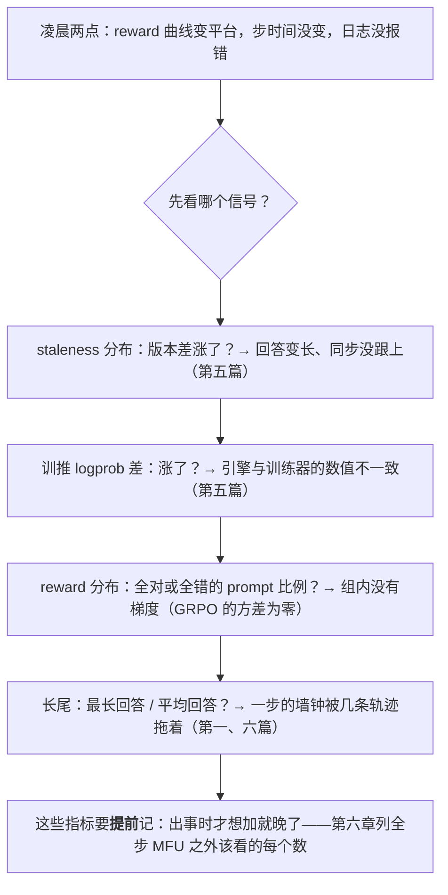
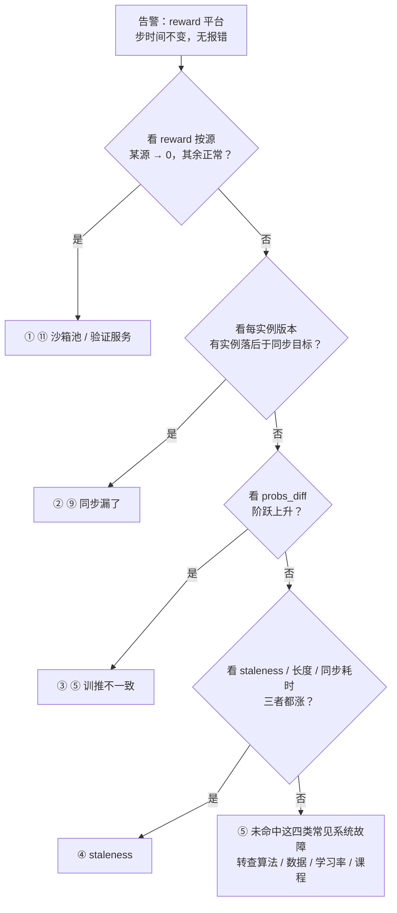

凌晨两点，告警：reward 曲线从上升变成平台，步时间没变，日志里没有报错。这一步是训到第 400 步的 32B 推理模型 GRPO，128 张卡，`separate_async`。可能的原因至少四个：staleness 涨了（回答变长、同步没跟上）；训推不一致变大了（某个实例的 vLLM 在上一次弹性扩容后版本不同）；某个沙箱池挂了、它上面的任务 reward 全是零；上一次权重同步漏了一部分参数（一个实例的 `update_weights` 超时，版本号却推进了）。它们在 reward 曲线上长得一样。十分钟内区分它们，靠的不是这十分钟里的机智，是开训前采集了哪些信号——这是本系列最后一篇的主题。

前七篇建立了账（第一篇）、形态（第二篇）、四个机制（第三到六篇）、代码（第七篇）。这一篇把它们变成两件可以照着做的事：**开训前**——给定模型、GPU 数、任务形态，按固定顺序推出系统形态、配比、两套并行配置、同步方式与异步参数，算出全步 MFU 的预期值并逐项拆解损失，为 RL 特有的状态设计 checkpoint，决定要不要为确定性付吞吐的代价，列出必须采集的指标；**开训后**——一张故障表，每一类只有 RL 系统才有的故障（跨引擎的 NCCL hang、同步中途的 OOM、sleep 之后的静默错误、训推差异导致的 reward 崩塌、沙箱泄漏、Ray 对象存储溢出）的信号与排查路径，以及回到开头那十分钟的决策树。末尾是引擎对平台的要求，和全系列的总结。

本篇的核心问题：

> **凌晨两点告警：reward 曲线从上升变成平台，步时间没变，没有报错。十分钟内你要判断是 staleness 涨了、是训推不一致、是某个沙箱池挂了导致 reward 全为零、还是权重同步漏了一部分参数。你需要的每一个信号，在开训前有没有采集？[^q0]**

版本：verl v0.9.0（`docs/advance/determinism.md`、`rl_insight.md`、`grafana_prometheus.md`、`checkpoint.rst`；`trainer/ppo/metric_utils.py`）、vLLM v0.27.1。数字沿用前七篇的场景。

## 一、总览




### 1. reward 变成平台：十分钟内怎么排查

四个原因、四个信号、四个动作，按"最便宜的先看"排序：

| 看什么 | 两分钟内能确认的 | 若是，做什么 |
|---|---|---|
| ① reward 按数据源 / 任务池分组的曲线 | 某一个池整体掉到 0，其余正常 → 沙箱池 / 验证服务故障的嫌疑最大 | 隔离该池（数据过滤），补沙箱；必要时把已训的几步回滚到 checkpoint |
| ② 每个推理实例的 `global_steps`（版本号） | 有实例落后于应到达的同步版本 → 同步漏了 | 对该实例强制全量同步；查 `update_weights` 超时日志 |
| ③ `rollout_probs_diff_mean` / `rollout_probs_diff_max` | 阶跃上升，且与 ② 同时 → 先查版本<br/>与 ② 无关 → 查引擎 / 精度变化，也查参数是否漏传 | 前者同 ②；后者查最近的镜像 / 配置变更与同步校验，开 TIS / MIS |
| ④ staleness 分布（自加）<br/>过期淘汰样本的 staleness 均值<br/>回答长度 p50 / p99<br/>`update_weights` 耗时 | 长度涨、同步耗时涨、整体 staleness 均值 > 阈值一半 → 样本变旧<br/>淘汰样本均值只统计 `drop` 策略下因过期而淘汰的样本，不能当整体均值 | 调 `parameter_sync_step`、换 `wait`、加 rollout 卡 |

Table: 那十分钟：四个原因、四个信号、四个动作

③ 的完整指标名是 `training/rollout_probs_diff_mean` / `training/rollout_probs_diff_max`；④ 的过期淘汰样本均值是 `training/off_policy/evicted_samples_staleness/mean`。

② 要和该实例应到达的同步版本比，不是直接和仍在更新的训练器比。版本号正常也不能证明参数完整：第七章④的静默错误还要靠同步校验或固定 prompt 对比排除。④ 的整体分布与淘汰样本指标也要分开看，`wait` 不会产生过期淘汰指标；口径见 verl v0.9.0 的 [`ReplayBuffer._evict_terminal_groups` 与 `ReplayBufferAsync._stale_terminal_keys`](https://github.com/volcengine/verl/blob/v0.9.0/verl/trainer/ppo/v1/replay_buffer.py)。

四条都要在**开训前**接进面板：① 需要 reward 带数据源标签、按源聚合；② 需要每个实例暴露版本号；③ 需要同步形态下就开着 `rollout_probs_diff`（第五篇）；④ 需要 staleness 与长度分布逐步记录。缺任何一条，那十分钟就变成一个小时。

### 2. 配置与运维的分工

| 开训前（本篇二–五章） | 开训后（六–八章） |
|---|---|
| 按账推形态与配比 → 两套并行配置 → 同步方式 → 异步参数 | 指标面板：三段时间、rollout 分布、同步、off-policy、MoE、环境 |
| 全步 MFU 的预期值与损失拆解 | 故障表：信号 → 原因 → 排查 |
| RL 状态的 checkpoint 方案 | 恢复语义：重发在飞、staleness 断点 |
| 确定性：要不要、代价多少 | 复现：两次运行对齐 |
| 必采指标清单 → 面板 → 告警阈值 | 十分钟决策树 |

Table: 配置（开训前）与运维（开训后）的分工

### 3. 本文的章节安排

| 章 | 内容 |
|---|---|
| 二 | 配置的推导顺序：一个 32B / 128 卡与一个 671B / 512 卡的算例 |
| 三 | 全步 MFU：定义、预期值、损失瀑布 |
| 四 | RL 状态的 checkpoint：训练状态之外还有什么 |
| 五 | 确定性：来源、verl 的 `full_determinism`、代价 |
| 六 | 可观测：必采指标与告警 |
| 七 | 常见故障：信号、原因、排查 |
| 八 | 那十分钟：决策树 |
| 九 | 引擎对平台的要求 |
| 十 | 自测：5 道题 |

Table: 本文的章节安排

## 二、配置的推导顺序

### 1. 六步

| 步 | 输入 | 输出 | 依据 |
|---|---|---|---|
| 1 | 模型规格 · B / G / P / L̄ / L_max · 卡数 · 任务形态 | 三段时间 T_thr / T_tail / T_fwd / T_train · KV 与并发 · 长尾占比 f | 第一篇的账 |
| 2 | f · 卡数 · 模型大小 · 是否 Agent | 形态（sync / colocate_async / separate_async）· 配比 n_r : n_t · 沙箱数 | 第二、六篇 |
| 3 | 模型大小 · n_t · 序列长度 | 训练侧：FSDP 或 Megatron<br/>TP / PP / EP / CP<br/>offload<br/>动态 token batch | 大规模训练系列 + 第三篇 |
| 4 | 模型大小 · n_r · L_max · 并发目标 | 推理侧：TP / EP / DP 实例数<br/>gpu_memory_utilization<br/>max_num_seqs<br/>CUDA graph 尺寸<br/>dtype | 推理系列 + 第三篇 |
| 5 | 形态 · 模型大小 · 训练后端 | 同步后端：naive / nccl / nixl / delta_sharded<br/>bucket<br/>量化传输<br/>LoRA 只传 adapter | 第四篇 |
| 6 | 形态 · T_sync · T_mb | 异步参数：parameter_sync_step · max_off_policy_threshold · drop / wait · warmup · gen_batch_size · rollout_correction | 第五篇 |

Table: 从账推配置的六步：输入、输出与依据

每一步的输出是下一步的输入，且都能在开训前算出来；第七章的故障有一半是某一步的输出与实际不符。

### 2. 算例一：32B 推理模型，128 × H100

任务：Qwen3-32B 规格，GRPO，$$B = 512$$、$$G = 16$$、$$P = 1\text{K}$$、$$\bar L = 8\text{K}$$、$$L_{max} = 32\text{K}$$，规则奖励。

```text title="算例一：32B 推理模型，128 × H100"
1  账（128 卡全部做每段）
   T_all = 8192 × 9 K = 74 M token；FLOP = 12 × 32.8e9 × 74 M = 29 EFLOP
   KV：k_kv = 256 KiB → 每条在飞 (1 K + 4 K) × 256 KiB = 1.3 GB；TP = 2 一实例 2 × 80 × 0.9 − 66 GB 权重 = 78 GB KV 池 → c ≈ 58；64 实例 × 58 = 3700 并发，2.2 波
   decode 步 ≈ 读 (66 + 78) GB / (2 × 3.35 TB/s × 0.6) ≈ 36 ms（填满 HBM 的老规律）→ 每卡 58 / 2 / 0.036 ≈ 800 token/s
   T_thr = 67 M / (128 × 800) ≈ 650 s；T_tail = 24.6 K 步 × 66 GB / 4 TB/s ≈ 400 s；T_fwd = 2 × 2 × 32.8e9 × 74 M / (128 × 989e12 × 0.5) ≈ 150 s；T_train = 6 × … / (… × 0.4) ≈ 290 s
   共置同步一步 ≈ 650 + 400 + 150 + 290 + 切换 ~5 ≈ 1500 s；f = 400 / 1050 = 38%
2  形态
   f 38% + 128 卡 + 回答会变长（f 会涨）→ separate_async；配比按 T_thr : (T_fwd + T_train) = 650 : 440 ≈ 3 : 2 → 76 : 52
   预期一步 ≈ 650 × 3/5 ≈ 390 s？—— 不对：配比只是分卡，每侧要用自己的卡数重算：T_gen(76) = 650 × 128/76 ≈ 1095 s，T_train(52) = 440 × 128/52 ≈ 1085 s，重叠后一步 ≈ 1090 s；比共置 1500 s 快 1.38×
   若 L̄ 涨到 12 K（f → 45%）：共置 ~2100 s，异步 ~1500 s（吞吐部分涨、长尾仍被吞）→ 1.4×，配比往 rollout 侧再挪
3  训练侧（52 卡按节点凑整取 48 = 6 节点；于是 80 : 48，T_gen(80) ≈ 1040 s、T_train(48) ≈ 1170 s，一步 ≈ 1170 s——凑整让训练侧成了瓶颈，这是可以接受的取舍）
   16N = 525 GB → 每卡 11 GB，不需要 offload；FSDP2 即可（32B dense 不需要 TP / PP）；激活：8 K 序列 + 重计算，每卡放得下
   use_dynamic_bsz=True，ppo_max_token_len_per_gpu = 16 K–24 K（按显存试）；ppo_mini_batch_size = 128 → 4 个 mini-batch / 步
   ref：param_offload=True（只前向用，11 GB 往返 0.4 s）
4  推理侧（80 卡 = 10 节点）
   TP = 2（33 GB 权重每卡，KV 池 78 GB）→ 40 实例；gpu_memory_utilization = 0.9（独占）；max_num_seqs = 128；bf16（FP8 可把 KV 池提到 110 GB、c 到 85，值得试）
   cudagraph_capture_sizes 默认（独占不用省）；enable_chunked_prefill 开
5  同步
   nccl 后端（固定集群），bucket 512 MB–2 GB；66 GB 全量跨机 ~15 s（实测量级）；若 T_sync / (k T_mb) 太大再上 delta_sharded（需换 SGLang）
6  异步
   T_mb ≈ 1170 / 4 ≈ 290 s；parameter_sync_step = 2 → 同步间隔 580 s，rollout 空转 15 / 595 ≈ 2.5%
   max_off_policy_threshold = 4，策略 wait（保长回答）；num_warmup_batches = 1；gen_batch_size = 32
   rollout_correction：bypass_mode = false（decoupled，3 份 logprob）；rollout_is = token，threshold 2.0；开 rollout_probs_diff 监控
预期全步 MFU：29 EFLOP / (128 × 989e12 × 1170) ≈ 20%
```

（第 2 步里那句"不对"是刻意留下的：配比算出来之后要**用每侧自己的卡数重算两侧的时间**，一步的墙钟是两侧的最大值，不是按比例缩短的总时间。这是最常见的算错。）

### 3. 算例二：671B MoE，512 × H100

DeepSeek-V3 规格，$$B = 512$$、$$G = 16$$、$$P = 1\text{K}$$、$$\bar L = 8\text{K}$$，代码任务（沙箱奖励）。

**这是容量估算，不是跑过 512 张 H100 的配置。** 我用它演示配比怎样撞上显存约束。源码能确定分组规则和 KV 的存储口径，不能替这组硬件给出吞吐、KV 池或同步耗时。先把假设写清楚：

- 本例的 K 按 1000、GB 按 $$10^9$$ B 算。推理 PP = 1，prefill / decode context parallel 都取 1；FP8 指权重量化，MLA KV 仍按 BF16 算，不启用 MTP。模型尺寸取 [DeepSeek-V3 的固定配置](https://huggingface.co/deepseek-ai/DeepSeek-V3/blob/e815299b0bcbac849fa540c768ef21845365c9eb/config.json)。
- **32 卡是一个引擎组，不是 TP 再乘一个独立的 EP 维度**：TP = 8、组内 DP = 4，开启 EP 后专家跨这 32 卡分片，EP = 32；组内有 4 个处理不同请求的 DP 副本。verl v0.9.0 的 [`RolloutConfig.__post_init__`](https://github.com/volcengine/verl/blob/v0.9.0/verl/workers/config/rollout.py) 会校验 `expert_parallel_size = tensor_model_parallel_size × data_parallel_size`，[`RolloutReplica`](https://github.com/volcengine/verl/blob/v0.9.0/verl/workers/rollout/replica.py) 的组规模是 TP × DP × PP。vLLM v0.27.1 的 [`FusedMoEParallelConfig`](https://github.com/vllm-project/vllm/blob/v0.27.1/vllm/model_executor/layers/fused_moe/config.py) 也按 TP / DP 形成专家组，不支持把这里写成 TP = 8、EP = 4。
- **45 GB KV 池是我给每个 rank 留的预算，不是实测值**：先按 `gpu_memory_utilization = 0.9`，名义 80 GB 卡留 72 GB；再用 `671 / 32 ≈ 21 GB` 的理想权重均摊和约 6 GB 其余开销，暂记 `72 − 21 − 6 ≈ 45 GB`。这忽略了非专家权重在 DP 间的复制、未量化参数、scale 和运行时峰值，21 GB 也不等于真实的每卡权重占用。最终必须用 vLLM [`GPUWorker.determine_available_memory`](https://github.com/vllm-project/vllm/blob/v0.27.1/vllm/v1/worker/gpu_worker.py) 的 profiling 结果重算。
- **这里的 c 按组内的一个 DP 请求副本计，不是整个 32 卡组的并发**。61 层 MLA 的 BF16 KV 原始载荷为 `61 × (512 + 64) × 2 = 70,272 B/token/rank`；平均在飞上下文假设为 `P + L̄/2 = 5 K`，每条约 `0.351 GB/rank`。所以 `c = floor(45 / 0.35136) = 128`，粗略记作 130。vLLM 的 [`ModelConfig.get_num_kv_heads`](https://github.com/vllm-project/vllm/blob/v0.27.1/vllm/config/model.py) 在 MLA 下每 rank 返回 1，[`MLAAttentionSpec.real_page_size_bytes`](https://github.com/vllm-project/vllm/blob/v0.27.1/vllm/v1/kv_cache_interface.py) 按压缩 latent 和 RoPE 部分计字节；这里不能再把 KV 除以 TP 或 EP。该平均上下文假设没有计入 block 取整、长尾和调度限制，也不是承诺能一直维持 128 条在飞序列。
- `16N` 是训练状态的粗算口径：BF16 参数与梯度、FP32 主权重及两份 Adam 状态各占 2、2、4、8 B/参数，暂按理想分片均摊。实际还有复制、激活、通信缓冲和量化副本；**FP8 计算不等于 FP8 优化器状态**。以下卡数只是待 profiling 的候选，不能据此保证放得下。

```text title="算例二：671B MoE，512 × H100（估算 / 示例口径）"
1  账（先假设 512 卡全部做每段）
   FLOP 按 37B 激活参数的简化模型算：12 × 37e9 × (8192 × 9 K) ≈ 33 EFLOP，不含 MoE 路由等额外开销
   推理：TP = 8、DP = 4、EP = 32 → 32 卡 / 组；c ≈ 128 / DP 副本（粗略记 130），不是 130 / 32 卡组
   512 卡 = 16 组 × 4 DP 副本；容量账为 16 × 4 × 128 = 8192 并发，约 1 波，不能漏掉组内 DP 这一层
   时延另作输入假设：有效输出吞吐 100 token/s/GPU → T_thr = 8192 × 8 K / (512 × 100) ≈ 1300 s；T_tail 暂取 300 s
   这两个时间都不是上面的并发数推出来的，也不是实测；沙箱暴露在关键路径上的等待另计，f 不能直接写成 > 60%
   训练状态：16N ≈ 10.7 TB → 理想均摊约 21 GB / 卡（512 卡），再加激活等开销
2  形态与资源（候选，不是 MoE 唯一能用的形态）
   暂试 separate_async；若另假设 T_thr : (T_fwd + T_train) ≈ 3 : 1，初分 384 推理 : 128 训练
   128 张训练卡仅状态均摊就约 84 GB / 卡，已超名义 80 GB → 候选改为 256 : 256，约 42 GB 状态 / 训练卡，仍需实测峰值
   若吞吐随推理卡数线性变化，T_thr 暂估翻倍到 2600 s；不是已经验证的缩放规律，也不能由此宣布 256 张训练卡足够
   沙箱另作稳态估算：假设每 1300 s 完成 8192 条轨迹，每条 20 次调用、每次占一个沙箱 30 s
   并发 ≈ (8192 / 1300) × 20 × 30 ≈ 3800（粗略 4000）；若周期变 2600 s 则约 1900，启动与长尾余量另留
3  训练侧（256 卡的分组候选，静态 CP = 1）
   Megatron：TP = 4、PP = 2、DP = 32 → 4 × 2 × 32 = 256 卡；ETP = 4、EP = 8 时，专家数据并行 EDP = 4
   按专家分组也可写成：ETP 4 × EP 8 × PP 2 = 64 卡 / 专家组，再乘 EDP 4；EDP 不是普通 DP
   主训练状态按 BF16 / FP32 口径保留；FP8 计算另核 kernel 和 bridge 支持。L_max 未定，CP 也待重算；不同时开启 dynamic CP 与 FP8
4  推理侧（256 卡的分组候选）
   rollout.tensor_model_parallel_size = 8；rollout.data_parallel_size = 4；rollout.expert_parallel_size = 32
   256 卡 = 8 个 32 卡引擎组 = 32 个 DP 请求副本；同一 KV 预算下约 32 × 128 = 4096 并发、约 2 波，仅是容量账
   FP8 权重、BF16 MLA KV；检查 EP 负载均衡与调度上限，再用实测 KV 池和上下文分布回填 c
5  同步（未实测的带宽模型）
   Megatron → vLLM FP8：先核量化 scheme、scale 和布局映射；delta_sharded 在该组合不适用，nccl / nixl 路径也需端到端验证
   假设只传一份 671 GB 权重、聚合有效带宽 8.4–11.2 GB/s → 纯传输约 60–80 s；不含量化、重排、扇出与装载
   用实测 T_sync / (k × T_mb) 决定是否需要重叠与增大 k，不能把 60–80 s 当成这组配置的同步保证
6  异步（只列待试起点，不宣称已验证）
   先测 T_mb；parameter_sync_step = 1–2、max_off_policy_threshold = 8 + wait 可作试验起点，按 staleness / reward 回调
   decoupled 路径；router replay 或 MIS 按路由翻转与后端支持另选
```

训练分组口径见 Megatron-Core [core_v0.18.0 的 `initialize_model_parallel`](https://github.com/NVIDIA/Megatron-LM/blob/core_v0.18.0/megatron/core/parallel_state.py)：普通 DP 和专家 EDP 是两套计数，EP 不能在普通 DP 之外再乘一次。verl v0.9.0 的 [`_check_dcp_unsupported_features`](https://github.com/volcengine/verl/blob/v0.9.0/verl/workers/engine/megatron/transformer_impl.py) 明确拒绝 dynamic CP 与 FP8 训练同时启用；[delta sync 的当前支持范围](https://github.com/volcengine/verl/blob/v0.9.0/docs/advance/delta_weight_sync.md) 也不包含 Megatron → vLLM FP8。

这个算例保留那个“放不下”：**按时间分卡之后，还得用每卡实际显存校验**。但 256 : 256 只是下一个候选，不是从 `16N / 256` 就能证明可运行的答案。

### 4. 两套并行配置的原则

训练侧与推理侧各有一套并行配置，同一模型两边选法不同：

|  | 训练侧 | 推理侧 |
|---|---|---|
| 目标 | 放下 16N + 激活；通信 / 计算比最低 | 每卡 token/s 最高 = 并发 c 最大 → 权重副本占得越少越好 |
| TP | 尽量小（NVLink 内），dense 32B 以下不用 | dense：让 (M − 权重/tp) 最大化 KV，同时 TP 通信不进 decode 关键路径 → 8B tp=1、32B tp=2、70B tp=4 |
| PP | 大模型放不下时用；RL 的 batch 变长让 PP 气泡更大 | 不用（延迟） |
| EP | MoE 的一种分片方式，是否开启及分组规则取决于后端；不要和普通 DP 重复乘卡数 | 本文 vLLM 启用 EP 的口径：context parallel = 1 时，EP = TP × DP；不是额外一维 |
| DP | 静态 CP 下，普通 DP = 总卡数 / (TP × PP × CP)；专家 EDP 另算 | PP = 1 时，组数 = n_r / (TP × DP)，每组有 DP 个请求副本；不是 n_r / (TP × EP) |
| CP | L_max ≥ 32 K 时训练侧要；RL 的变长序列让 dynamic CP 有价值 | 不用（KV 按序列分配即可） |
| dtype | bf16 或 FP8（MoE） | FP8 优先（权重副本减半 → KV 池变大 → c 变大） |
| batch | 按 token 打包（dynamic bsz）；mini-batch 数 = B / mini_bs | max_num_seqs 按 c 设；chunked prefill 开 |

Table: 训练侧与推理侧并行配置的选法

两边的 TP / EP 不同是权重同步布局映射的来源（第四篇）；两边都要 EP 的 MoE 是最复杂的组合。

## 三、全步 MFU

### 1. 定义

$$U = \frac{\sum_{\text{三段}} \text{FLOP}}{n_{\text{全部 GPU}} \cdot F_{peak} \cdot T_{step}}$$

分子是一步的全部有用 FLOP（生成 + 前向 + 训练，第一篇的 12N × token 数），分母是**全部** GPU（rollout 池 + 训练池 + RM 池）× 峰值 × 墙钟。它是整个 RL 步的利用率，与训练侧的 MFU（40% 上下）、decode 的 MFU（个位数）都不是一回事——**它才是要优化的数字**，而且它的理论上限本来就低（第一篇：13% 上限的配置很常见），所以看它的绝对值意义不大，看**它与预期值的差**、以及**差拆到哪几项**才有意义。

verl 的 `perf/throughput`（token / 秒 / GPU）与 `perf/time_per_step` 是它的原料；`separate_async` 的 `_get_n_gpus_for_throughput` 把 standalone rollout 卡数也算进分母（否则会高估）。

### 2. 损失瀑布

从 100% 到实际值，8B 推理场景（64 卡、共置同步、810 秒）：

这里扣的是**全步 MFU 的百分点**，每项都除以同一个 810 s。生成 602 s = 吞吐部分 406 s + 长尾 196 s；4% 是吞吐部分的 MFU，不是整个生成段的 MFU（第一篇第五章、第二篇第三章）。长尾按近似空转计，避免把它的损失又算进 decode 一次。

| 项 | 全步 MFU 的变化 | 计算口径 | 能动什么 |
|---|---|---|---|
| 峰值起点 | 100% | 全部卡全程按峰值算 | — |
| decode 是 memory-bound | −48.1 个百分点 | `406 × (1 − 0.04) / 810` | 结构性，只能靠更大的 c / 更好的 kernel / MLA / FP8 缩短这段 |
| 长尾 | −24.2 个百分点 | `196 / 810`：几条序列占着 64 张卡，近似空转 | 第二、五篇：`colocate_async` / `separate_async` / 部分 rollout |
| 前向与训练未达峰值 | −14.5 个百分点 | `[72 × (1 − 0.5) + 136 × (1 − 0.4)] / 810` | 大规模训练系列的调优 |
| 切换 + 同步 | 约 −0.1 个百分点 | 第三、四篇的亚秒级开销；810 s 已取整，这里只记量级 | 几乎不值得优化 |
| 模型估算的上限 | ≈ 13% | `100 − 48.1 − 24.2 − 14.5 − 0.1 ≈ 13.1` | 再减实际运行的开销 |

Table: 8B 推理场景的 MFU 损失分解

再减：Python / 调度开销、TransferQueue 读写、reward 计算等待、验证（`test_freq`）、checkpoint 保存……实测常在 8–10%。

同一配置换 `separate_async`（42 : 22）：长尾等待项归零，用第二篇的 619 s 墙钟重算，`6.80e18 / (64 × 989e12 × 619) ≈ 17%`。训练池还包含 MFU 50% 的前向，不能只拿训练段的 40% 当整池 MFU 来加权。**先砍长尾（一档形态），再看 decode 的 c（gpu_memory_utilization、FP8、TP），最后才是训练 MFU**——与预训练的优化顺序相反。

### 3. 三个容易高估的地方

- **只算训练池**：`separate_async` 下如果分母漏了 rollout 卡，MFU 会翻倍地好看。
- **只算有梯度的 token**：Agent RL 里八成 token 是环境的，它们的前向 + 反向 FLOP 是真实消耗（分子里要算），但"有效训练 token"只有两成——两个数字都要报。
- **忽略验证与保存**：`test_freq` 每 5 步一次的验证是一次完整的 rollout（在 rollout 池上，异步下会挤占生成）；`save_freq` 每 20 步一次的 checkpoint 32B 是 525 GB 的写入、几十秒到几分钟——它们进墙钟，不进分子。

## 四、RL 状态的 checkpoint

### 1. 训练状态之外

预训练的 checkpoint 是模型 + 优化器 + dataloader 位置 + RNG。RL 系统多出的状态：

| 状态 | 在哪 | 存不存 | 不存的后果 |
|---|---|---|---|
| 训练状态（16N） | 训练器 | 存（引擎的 save_checkpoint） | — |
| dataloader 位置 | driver | 存 | 重复 / 跳过 prompt |
| RNG（采样种子、DP 的 shuffle） | driver / worker | 存 | 不可复现（第五章） |
| 样本缓冲里已完成未训练的样本 | TransferQueue | verl 不存 | 丢弃：那些 rollout 白算（异步下可能是几千条） |
| 在飞的 prompt（pending / running） | TransferQueue 标签 + 推理引擎 | verl 存标签、恢复时重发 | 重发 = 用新权重重生成 → 这些样本 staleness 归零，reward 曲线出现断点 |
| 推理引擎里正在生成的请求 | vLLM 调度器 | 不存 | 同上 |
| 各实例的权重版本 | server | 随重启重同步 | — |
| 策略版本表（部分 rollout 每段的版本） | 样本元数据 | 随样本 | — |
| 沙箱状态（容器里的文件系统） | 沙箱集群 | 不存 | 在飞轨迹全部作废，重发从第一轮开始 |

Table: 训练状态之外

verl 的做法（`_save_checkpoint` / `_load_checkpoint` / `_reissue_inflight_prompts`）是**存训练状态与元数据、丢缓冲内容、重发在飞**——简单、正确、代价是重启后几步的样本分布与重启前不连续（全部 fresh、staleness 为 0、且是新权重的样本）。看 reward 曲线时要知道断点在哪。存缓冲内容（已完成的样本几 GB）是可以做的优化，但要连样本的版本标签一起存，恢复后它们的 staleness 按新的 `global_steps` 算——会比阈值大、被 drop——所以"存了也用不上"，除非策略是 wait。

### 2. 频率与代价

| 模型 | 训练状态 | 写入（并行文件系统 10 GB/s） | 每 20 步一次的占比（步 900 s） |
|---|---|---|---|
| 8B | 128 GB | 13 s | 0.07% |
| 32B | 525 GB | 53 s | 0.3% |
| 671B | 10.7 TB | 18 min（!） | 6% —— 必须异步保存或降频 |

Table: 频率与代价

大模型的 checkpoint 要**异步**（先拷到 CPU pinned 内存、后台写盘，训练继续）——verl 的 checkpoint 管理器（0.9 重写，YAML 配置）支持；`save_lora_only` 让 LoRA 训练只存 adapter。异步保存与第三篇的 offload、第五篇的 decoupled 快照三者都要 pinned 内存，要一起算。

### 3. 恢复语义

| 模式 | 恢复语义 |
|---|---|
| sync 模式 | 恢复 = 训练状态 + dataloader 位置 → 下一步重新 rollout 整批；无遗留 |
| colocate_async | 恢复 → _reissue_inflight_prompts 重发 pending / running；缓冲里 finished 的保留（若 TransferQueue 存活） |
| separate_async | 同上 + standalone 实例重新拉起、首次全量同步（on_init_end 的两个 update_weights） |
| Agent | 同上 + 沙箱：在飞轨迹的容器已回收，重发从头开始；tool.release 要在 abort 路径上也被调（否则泄漏，第七章） |

Table: 四种模式的恢复语义

## 五、确定性

### 1. 为什么 RL 对随机性敏感

预训练两次运行 loss 曲线的差是噪声级；RL 的 reward 曲线两次运行可以差出一个"结论"——因为样本是模型自己采的，一步的差异被下一步放大（采到不同的回答 → 不同的梯度 → 不同的下一批回答）。排障的前提是能复现：改一个配置，reward 变了，是配置的作用还是运气？没有确定性，这个问题要靠跑三五次取平均回答，每次几天。

### 2. 随机性的来源

| 来源 | 在哪 | 消除办法 | 代价 |
|---|---|---|---|
| 采样 | 推理引擎 | 固定 seed（每实例 replica_rank + seed） | 无 |
| batch 组成 / 完成顺序 | TransferQueue 按完成顺序收 | 按提交顺序收（v0 的 asyncio.gather）；v1 目前做不到 | verl 的 full_determinism 要求 use_v1=false |
| kernel 非确定性（atomics、split-K、reduce 顺序） | 训练器 + 推理引擎 | torch.use_deterministic_algorithms；确定性的 attention / GEMM 选择 | 训练慢 10–30% |
| batch 不变性（同一序列在不同 batch 里算出不同 logits） | 推理引擎 | vLLM 的 batch-invariant kernel（0.27 覆盖主流模型）；不覆盖的模型 max_num_seqs=1 | 后者吞吐掉一个量级 |
| MoE 路由的并列翻转 | 两侧 | 确定性 top-k + 上面两项 | — |
| 沙箱 / 环境 | 环境 | 固定测试顺序、禁网络、固定时钟 | 取决于环境 |
| Python 的 dict / set 顺序、多协程调度 | agent loop | 固定种子、有序数据结构 | — |

Table: 随机性的来源

### 3. verl 的 `full_determinism`

`docs/advance/determinism.md`：

```yaml title="verl 的 full_determinism 配置"
actor_rollout_ref.rollout.full_determinism: true    # 推理侧：确定性采样 + batch-invariant；seed 每实例 replica_rank + 42
actor_rollout_ref.rollout.seed: 42
actor_rollout_ref.actor.fsdp_config.full_determinism: true    # 训练侧：确定性算法（Megatron 用 megatron_config.full_determinism）
actor_rollout_ref.ref.fsdp_config.full_determinism: true
reward.reward_model.rollout.full_determinism: true   # 生成式 RM 同理
trainer.use_v1: false     # 必须：v1 按完成顺序收样本，跨运行不一致
# 模型不在 vLLM batch-invariance 覆盖内时：actor_rollout_ref.rollout.max_num_seqs: 1
```

结果是**两次运行 reward 曲线 bitwise 对齐**（0.9 release note："Full determinism for vLLM rollout and reward-model inference"）。代价：v0 trainer（没有 v1 的异步与 TransferQueue）、确定性 kernel 的吞吐损失、不被覆盖的模型要串行推理。所以它是**调试与回归测试的模式**，不是生产模式：改了代码后用小配置对比两条曲线是否 bitwise 相同——相同则改动无副作用，这比任何 review 都可靠。

### 4. 部分确定性

生产上退一步也有价值：固定采样种子 + 确定性训练算法（不管完成顺序）不能 bitwise 对齐，但能让两次运行的差异缩到"只来自 batch 组成"——足以区分"配置的作用"与"运气"的大部分情形。`rollout_probs_diff` 在确定性开启时应接近纯精度差（$$10^{-3}$$），它同时是训推不一致的基线（第五篇）。

## 六、可观测

### 1. 必采指标

按前七篇的顺序，每篇一组；括号里是 verl 现成的名字，没有的要自己加：

- **第一篇 · 三段时间与吞吐**
  - timing_s/{gen, reward, old_log_prob, ref, adv, update_actor, update_weights, save_checkpoint, testing}
  - perf/total_num_tokens · perf/time_per_step · perf/throughput（含全部 GPU 的分母）· 全步 MFU（自算）
  - response_length/{mean, max, min, clip_ratio}（打满 L_max 的比例）· prompt_length/*
  - → 告警：response_length/mean 单步涨 > 20%；clip_ratio > 0.2（大量打满：L_max 设小了或模型在刷长度）
- **第二篇 · 形态与配比**
  - trainer/idle_ratio · rollouter/idle_ratio（fully_async 的名字；v1 里用 gen 段等待时间 / 步时间近似）
  - 每个 rollout 实例的在飞请求数 · 每实例 token/s
  - → 告警：一侧 idle > 30% 持续 10 步 → 配比漂了
- **第三篇 · 显存**
  - 每卡 memory_allocated / reserved 在 "Before resume weights / After update_weights / After resume kv_cache" 三点
  - vLLM 的 gpu_cache_usage_perc · num_preempted（KV 池不够时的抢占）
  - → 告警：reserved − allocated 持续增长（碎片）；preemption > 0
- **第四篇 · 同步**
  - timing_s/update_weights · 传输字节 · 每实例 global_steps（版本）· delta 的 changed_ratio 与校验失败数
  - → 告警：任一实例版本落后 ≥ 1；同步耗时 > 步时间 10%
- **第五篇 · off-policy**
  - training/off_policy/evicted_samples · evicted_samples_staleness/{mean, max} · staleness 直方图（自加）
  - training/rollout_probs_diff_{mean, max, std}
  - actor/pg_clipfrac · actor/ppo_kl · rollout_correction 的 IS 权重统计与 mask 比例
  - 被训练样本长度 vs 生成样本长度（自加）· DAPO filtered 计数 · failure 组计数
  - → 告警：probs_diff_max 出现 > 1 的尖峰；staleness mean 超阈值一半；clipfrac 比基线翻倍
- **第六篇 · 环境**
  - 每轮环境耗时分布（p50 / p99）· 轨迹轮数分布 · 沙箱队列深度 · 容器启动时间 · 执行超时率 · 失败率 · 活跃容器数 vs 上限
  - 按数据源分组的 reward（自加，最重要的一个）· reward 为 0 的比例按源
  - 前缀缓存命中率（vllm:prefix_cache_hits / queries）
  - → 告警：某源 reward 全零；活跃容器接近上限；超时率 > 5%
- **MoE（第一、五篇）**
  - rollout/moe/{max_vio, avg_vio}/{max, avg} 与逐层（专家负载不均：max_vio = 最忙专家的负载 / 均值 − 1）· routed_expert_assignments
  - → 告警：max_vio/max > 2（一个专家的负载是均值三倍）

### 2. 面板

verl 0.9 的两条现成路径：`trainer.logger` 加 `rl_insight` 并设 `RL_INSIGHT_SERVER_URL`，得到统一的 Grafana 面板（训练指标、RL 状态轨迹、rollout / TransferQueue 子系统指标）；或者按 `docs/advance/grafana_prometheus.md` 自己接 Prometheus——vLLM 与 SGLang 本来就暴露 Prometheus 指标（`/metrics`），加上 verl 的训练指标与沙箱平台的指标，三个来源进一个面板。**面板的组织按本篇第一章的四个问题**：一屏能同时看到 reward 按源、每实例版本、probs_diff、staleness + 长度 + 同步耗时——那十分钟就是看这一屏。

### 3. 日志与 trace

指标之外，三样东西在排障时不可替代：

- **rollout trace**（`docs/advance/rollout_trace.rst`）：每条轨迹的每一轮——请求、响应、工具调用、耗时——落成可检索的记录（verl 支持 wandb weave / mlflow 一类的 trace 后端）。reward 异常时抽几条看轨迹，比任何聚合指标都快。
- **`log_gpu_memory_usage`** 打开（`VERL_LOGGING_LEVEL=DEBUG`）：切换路径上每个点的显存。
- **Ray timeline**（`ray_kwargs.timeline_json_file`）与 torch profiler（`global_profiler.steps`）：一步的时间线对到函数——第七篇的实践建议。

## 七、常见故障

### 1. 故障表

只列 RL 系统特有的；预训练与推理服务各自的故障在各自的系列。

| 故障 | 信号 | 原因 | 排查 / 处理 |
|---|---|---|---|
| ① 跨引擎 NCCL hang | 一步卡在 update_weights 或 update_actor<br/>GPU 利用率 100% 但无进展<br/>nccl_timeout（默认 600 s）后报错 | 训练器的进程组、推理引擎的 TP 组、同步用的临时组在同一批卡上<br/>某个 rank 没进入 collective（异常退出、abort 时机不对）<br/>异步下推理引擎正在 decode 时收到广播 | py-spy dump 每个 worker 看卡在哪个 collective<br/>NCCL_DEBUG=INFO<br/>确认 abort_replicas 在 build_process_group 之前<br/>分离形态用 nixl 避免建组 |
| ② 同步中途 OOM | update_weights 期间 OOM，训练与生成单独都不 OOM | 峰值 = 训练器 bf16 分片 + 推理权重区域 + 2 bucket + 一个完整参数（MoE 专家堆叠几 GB）+ caching allocator 保留段；expandable_segments 没关 | 缩 bucket<br/>确认 aggressive_empty_cache 与 set_expandable_segments(False) 在 resume 之前<br/>layered_summon=True（逐层 gather）<br/>MoE 大张量走 split_weight_chunks |
| ③ 第 N 步才 OOM | 前几十步正常，回答变长后 OOM | dynamic bsz 的 token 上限没随长度调<br/>KV 池碎片<br/>激活峰值随最长序列涨 | ppo_max_token_len_per_gpu 留余量<br/>L_max 设硬上限<br/>response_length/max 告警 |
| ④ sleep / wake 后静默错误 | reward 骤降到随机水平但无报错；greedy 输出乱码 | fp8 KV 的 scale 没重置、named_buffers 没恢复、MTP 草稿权重 level 2 后丢失、量化 scale 漏传、tied embedding 只更新一处 | 同步后用固定 prompt greedy 生成与训练器前向 argmax 对比（开训前就做一次）；slime 的 check_weight_update_equal 思路 |
| ⑤ 训推差异 → NaN / reward 崩塌 | rollout_probs_diff_max 尖峰 → 几步后 pg_loss NaN 或 reward 掉到 0 | FP8 推理 + bf16 训练<br/>MoE 路由翻转<br/>采样 logprob 取错（温度前 / 后）<br/>chat template 不一致（Agent） | 开 TIS / MIS<br/>MoE 开 router replay<br/>核对 logprob 定义<br/>token 连续性检查（第六篇） |
| ⑥ 沙箱泄漏 | 活跃容器数单调上升<br/>CPU 集群逐渐耗尽<br/>新轨迹排队 | abort / 超时 / 异常路径没调 tool.release<br/>容器的子进程未回收<br/>镜像层堆积 | release 放 finally<br/>沙箱服务侧按轨迹 id 做租约（TTL）<br/>定期 GC 孤儿容器 |
| ⑦ Ray 对象存储溢出 / spill | driver 内存涨<br/>日志 "object store is full"<br/>步时间逐渐变长 | v0 路径 DataProto 经 driver<br/>validation 的大 batch<br/>日志里存了整批 generations | 用 v1（TransferQueue）<br/>rollout_data_dir 分步落盘<br/>val batch 分块 |
| ⑧ 缓冲永远填不满 | gen 段一直等<br/>缓冲深度不涨<br/>无报错 | 某些 prompt 卡在 running（一条 session 死在环境里）→ 组不终态<br/>DAPO 过滤淘汰过多、补发跟不上<br/>agent loop worker 协程数不够 | 轨迹级超时<br/>看 TransferQueue 里 running 状态的年龄<br/>filtered 计数<br/>加 agent.num_workers |
| ⑨ 实例版本漂移 | 某实例 global_steps 落后；该实例的样本 probs_diff 偏大 | 同步对该实例超时 / 失败但版本号推进了；弹性扩容的新实例没走首次全量同步 | 每实例版本告警；同步失败必须回滚版本号或强制重同步 |
| ⑩ 重启后 reward 断点 | 恢复后几步 reward 跳变、staleness 归零 | _reissue_inflight_prompts 重发 → 全 fresh 样本；缓冲丢弃 | 预期行为，标注即可；要连续就存缓冲 + 用 wait |
| ⑪ reward 全零（某源） | 按源分组的 reward 某一源掉到 0，其他正常 | 该源的沙箱池 / 验证服务挂了<br/>镜像拉取失败<br/>某工具的 API 配额用尽 | 源级告警；reward 服务返回错误码而不是 0（0 是合法 reward，不能当错误用） |
| ⑫ DAPO 过滤饥饿 | filtered 计数 / 步单调上升<br/>有效 batch 变小<br/>生成负担涨 | 模型变强、全对率升 | 调过滤阈值<br/>课程（换更难的数据）<br/>把过滤比例做成指标 |
| ⑬ 长尾突增 | timing_s/gen 单步翻倍；response_length/max 打满 | 模型学到"越长越好"<br/>某实例慢（网卡 / 降频）<br/>L_max 太大 | clip_ratio 告警<br/>每实例 token/s<br/>部分 rollout |
| ⑭ 显存碎片累积 | reserved 涨、allocated 不涨；几十步后 OOM | 两个 allocator 交替；expandable_segments 开关时机错 | 步末 empty_cache；核对开关顺序（第三篇） |

Table: RL 系统特有的故障：信号、原因与排查

### 2. 排查的一般顺序

- **1**：先看是不是"数据的问题"：reward 按源 · 长度分布 · filtered / failure 计数 —— 它们不需要读代码
- **2**：再看是不是"版本的问题"：每实例 global_steps · 同步耗时 / 失败 · probs_diff 的阶跃
- **3**：再看是不是"异步的问题"：staleness 分布 · clipfrac · 被 drop 的长度
- **4**：最后才是"实现的问题"：py-spy · NCCL 日志 · 显存日志 · rollout trace 抽样

前三步都是看面板，各两分钟；第四步才要登机器。这个顺序反过来（先 py-spy）是最常见的浪费时间的方式。

## 八、那十分钟



每个分支的动作（⑪、⑨、⑤ 对应第七章故障表）：

1. **沙箱池 / 验证服务**：查该源的环境错误率与容器数。隔离该源、补池，必要时回滚到平台前的 checkpoint。
2. **同步漏了**：查该实例 `update_weights` 日志——超时？校验失败？强制全量重同步，该实例的样本按 staleness 处理。
3. **训推不一致**：最近改了引擎版本 / 精度 / 模型（MoE？）？也查权重同步是否漏参数，不只看版本号。开 TIS / MIS；若同时是 Agent，检查 template / token 连续性。
4. **staleness**：长度涨、同步耗时涨、staleness 均值升时，`parameter_sync_step` 减半或换 `wait`；配比往 rollout 侧挪。看被 `drop` 的长度分布，确认偏置。
5. **都不是**：交给算法同事继续查算法 / 数据 / 学习率 / 课程，附上以上四项都正常的截图。它们只说明没命中这四类故障，不能排除第七章④那种版本号正常、参数却不完整的静默错误；怀疑同步时，补做参数校验或固定 prompt 对比。

"都不是"这一枝很重要：**十分钟先把排查范围缩小**。四项信号正常的截图比猜测有用，但不是"系统没有问题"的证明。

## 九、引擎对平台的要求

RL 任务向调度器申请的不是"N 张卡"，是一组异质资源加几个服务。本篇只列引擎侧的要求，平台怎么满足在[《AI 平台工程》](/ai-platform-engineering.html)系列：

| 资源 | 要求 | 与预训练任务的差别 |
|---|---|---|
| GPU 池 × 2 | 训练池 + rollout 池（+ 可选 RM 池），可以不同卡型；rollout 池要能弹性增减 | 预训练一个池、固定 |
| CPU 池 | 沙箱：每 GPU 几十到上百个容器的并发<br/>按排队深度弹性<br/>隔离级别（gVisor / microVM） | 预训练几乎不要 CPU |
| 主机内存 | 训练池：pinned 内存 = offload 字节 + 快照 + 异步 checkpoint 缓冲（32B/8 卡 > 500 GB / 机） | 预训练 pinned 需求小 |
| 网络 | 训练池内 IB（集合通信）· rollout 池内 NVLink / IB（TP）· 两池之间 IB / RDMA（权重同步，几十 GB 到 TB 每步）· rollout ↔ 沙箱 HTTP（高并发小请求） | 预训练只有池内 |
| gang scheduling | 训练池 + rollout 池 + TransferQueue + agent loop worker 要同时起（否则首次同步 / 预热卡住）；沙箱池可以晚到 | 预训练只有一个 gang |
| 弹性 | rollout 实例可加可减（nixl 一类同步后端）<br/>训练池不能变卡数<br/>沙箱按需 | 预训练弹性 = 重启 |
| 抢占 | rollout 实例被抢占 → 在飞轨迹重发（成本 = 已生成部分）；训练池被抢占 = 重启 | 预训练被抢占 = 重启 |
| 故障域 | 一个 rollout 实例挂 → 只丢它的在飞<br/>一个训练 rank 挂 → 整步重来<br/>沙箱挂 → 该轨迹 failure | 预训练任一 rank 挂 = 重启 |
| 端口 / 服务发现 | 每实例一个 HTTP 端口 + ZMQ IPC 套接字<br/>agent loop 要能找到实例<br/>网关要能被 harness 访问 | 预训练只有 MASTER_ADDR |
| 镜像 | 训练镜像 + 推理镜像（可不同）+ 沙箱镜像（按任务，几千个） | 预训练一个镜像 |
| 存储 | checkpoint（大模型分钟级写入要异步）· rollout trace · 沙箱镜像仓库带宽 | 预训练只有 checkpoint |

Table: 引擎对平台的要求

一句话：**RL 任务是平台上第一种"训练 + 服务 + 批处理"三合一的工作负载**，调度器要么把它当三个任务加一层编排（Ray 在做的事），要么把"异质 gang"做成一等公民。

## 十、自测

1. reward 全零、loss 正常、步时间不变——最可能是什么？哪个指标一眼确认？

   <details markdown="1"><summary>答案</summary>

   reward 服务或沙箱池故障（超时全部返回 0）——GPU 照常生成与训练，只是奖励没有信号；看按来源拆分的 reward 分布与沙箱执行的成功 / 超时 / 错误计数，某个池的超时率 100% 即确认。

   </details>

2. `rollout_probs_diff` 为什么要在同步形态下就开着？它跳升的三种可能原因？

   <details markdown="1"><summary>答案</summary>

   它量的是训推不一致，同步形态下也存在（bf16 约 $$10^{-3}$$），有了基线才知道异步后的增量是 staleness 还是不一致；跳升：推理引擎升级 / 换 kernel、开了 FP8 或量化、MoE 路由翻转增多——或者权重同步漏了部分参数（持续偏大而非跳变）。

   </details>

3. RL 任务的 checkpoint 要比预训练多存什么？漏了会怎样？

   <details markdown="1"><summary>答案</summary>

   replay buffer 里的在飞样本与它们的生成版本、每个 rollout 实例的权重版本号、参考模型（若与初始不同）、沙箱 / 环境的任务进度与 seed、reward 服务的状态；漏了 buffer 与版本恢复后 staleness 语义错乱，漏了环境进度会重复或跳过任务。

   </details>

4. 全步 MFU 瀑布怎么做？上限 13% 到实测 8% 之间的差通常拆成哪几项？

   <details markdown="1"><summary>答案</summary>

   从理论上限出发逐项减：长尾（超出 $$T_{thr}$$ 的生成时间）、显存切换与权重同步、KV 池不足导致的波数增加、prefill 重算（KV 逐出）、训练侧的通信与气泡、等环境（Agent）、故障重试；每项用 `marked_timer` 的九个阶段时间与推理引擎指标算出来。

   </details>

5. 验证权重同步没漏参数，最便宜的做法是什么？为什么不能只看“同步成功”的日志？

   <details markdown="1"><summary>答案</summary>

   同步后对推理侧与训练侧按层或按桶算校验和（或抽几个 tensor `allclose`），对比桶数、字节数与预期；日志的“成功”只说传输完成，不说映射表是否覆盖了全部参数——新加的层（LoRA、MTP 头、embedding tied 与否）常被映射漏掉而没有任何报错。

   </details>

[^q0]: 靠开训前就采集好的信号，每个嫌疑一个决定性指标。**staleness 涨了**：每个 mini-batch 的 staleness 分布与 `drop` / `wait` 比例——分布右移、被丢样本偏长 → 是它，检查 rollout 池是否变慢。**训推不一致**：`rollout_probs_diff` 的均值与 P99——在同步形态下就开着作基线，跳升说明推理引擎版本、量化、MoE 路由出了变化。**沙箱池挂了**：按 reward 来源（规则 / 沙箱 / 生成式 RM）分开的 reward 分布与失败率、沙箱执行的成功 / 超时 / 错误计数——reward 全零而 loss 正常、`response_length` 正常，是环境侧；步时间没变是因为 GPU 照常跑。**权重同步漏了**：同步后推理侧与训练侧的参数校验和（按 bucket 或按层的哈希）、同步的桶数与字节数是否与预期一致，`rollout_probs_diff` 会持续偏大。**十分钟决策树**：先看 reward 按来源拆分 → 全零走环境路径；再看 `rollout_probs_diff` → 跳升走不一致 / 同步校验；再看 staleness 分布与淘汰比例 → 走异步配置；都正常才是算法问题。详见[第六章](#六可观测)、[第七章](#七常见故障)、[第八章](#八那十分钟)。
