## 深度学习基础

### 从公式到数字，再到模型结构

**十篇正文 · 一条连乘链 · 每个结论都能回到原文核对**

<aside class="notes" markdown="1">
系列总纲：[/deep-learning-foundations.html](/deep-learning-foundations.html)。先用一张训练步骤图把整个系列串起来，再逐篇看关键图与数字。
</aside>

---

## 这个系列回答一个问题

> 深网络训练中的现象，能否推到公式、代入数字，再用小实验复现？

- 前向方差逐层相乘，反向梯度是 Jacobian 的连乘；因子偏离 1，就会随深度放大或消失。
- 01–10：模型演进 → 损失与梯度 → 稳定训练 → 泛化 → CNN、Embedding 与 RNN。
- 正文 10 篇；第 11 篇是总结与自测。

<aside class="notes" markdown="1">
系列总纲：[/deep-learning-foundations.html](/deep-learning-foundations.html)。关键联系：ResNet 的退化与 RNN 的 BPTT 衰减都是连乘问题；残差连接与 LSTM 遗忘门都提供直通路径。
</aside>

---

## 全景：一条连乘链，十篇正文

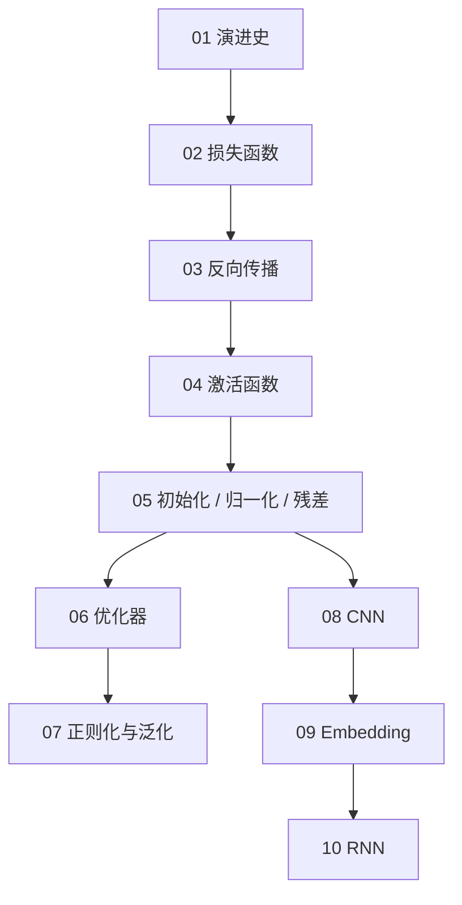

<aside class="notes" markdown="1">
每篇正文链接：01 [/evolution-of-deep-models-from-perceptron-to-transformer.html](/evolution-of-deep-models-from-perceptron-to-transformer.html)；02 [/loss-functions-from-mse-to-dpo.html](/loss-functions-from-mse-to-dpo.html)；03 [/backpropagation-by-hand.html](/backpropagation-by-hand.html)；04 [/activation-functions-from-sigmoid-to-swiglu.html](/activation-functions-from-sigmoid-to-swiglu.html)；05 [/initialization-normalization-and-residual.html](/initialization-normalization-and-residual.html)；06 [/optimizers-from-sgd-to-adamw.html](/optimizers-from-sgd-to-adamw.html)；07 [/regularization-and-generalization.html](/regularization-and-generalization.html)；08 [/cnn-from-lenet-to-resnet-and-vit.html](/cnn-from-lenet-to-resnet-and-vit.html)；09 [/embedding-and-representation-learning.html](/embedding-and-representation-learning.html)；10 [/rnn-lstm-and-the-birth-of-attention.html](/rnn-lstm-and-the-birth-of-attention.html)。
各篇一句话：01 能表示 ≠ 能学会；02 把任务写成可求导标量；03 逐算子计算 VJP；04 非线性与梯度通路；05 稳定深层连乘；06 步长与更新；07 优化器怎样挑解；08 局部性与共享；09 离散 ID 到向量；10 BPTT 衰减与 attention。
</aside>

---

## 01 · 深度模型演进史：能表示，不等于能学会

**H=4 的 MLP 在 20 个种子上全部解出 XOR；H=2 只有 13/20。**

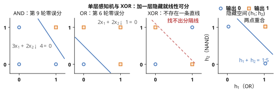{: style="max-height: 400px"}

<aside class="notes" markdown="1">
原文：[/evolution-of-deep-models-from-perceptron-to-transformer.html](/evolution-of-deep-models-from-perceptron-to-transformer.html)。XOR 暴露单一线性边界的限制；隐藏层解决表达能力，初始化与优化决定能否找到解。
</aside>

<!-- v -->

### 从阈值单元到 Transformer

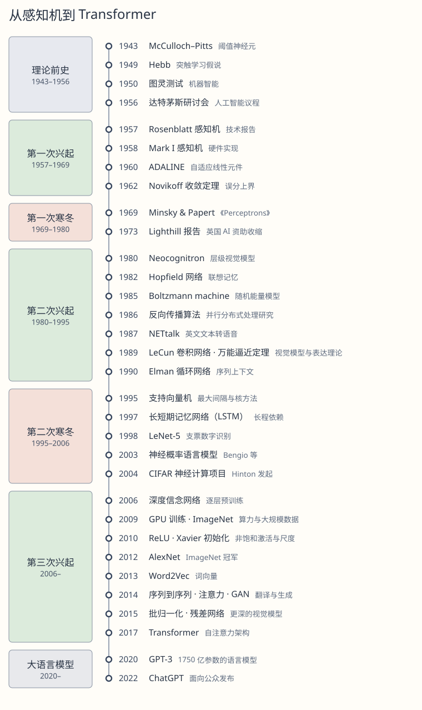{: style="max-height: 430px"}

**结构分支并行演进，不是所有深度学习都通向同一终点。**

<aside class="notes" markdown="1">
原文：[/evolution-of-deep-models-from-perceptron-to-transformer.html](/evolution-of-deep-models-from-perceptron-to-transformer.html)。
</aside>

---

## 02 · 损失函数：把任务写成可求导的数

**五种任务同一条推导：假设分布→最大似然→负对数（DPO 例：-log 0.532=0.630）**

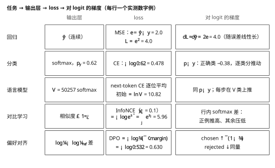{: style="max-height: 410px"}

<aside class="notes" markdown="1">
原文：[/loss-functions-from-mse-to-dpo.html](/loss-functions-from-mse-to-dpo.html)。选择损失时先确定任务对应的概率假设，再检查对 logits 的梯度；均匀输出时初始 next-token CE 为 ln V。
</aside>

<!-- v -->

### 语言模型：下一个 token 的交叉熵

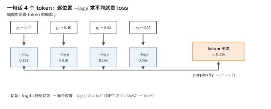{: style="max-height: 420px"}

**V=50,257 的均匀 logits 实测 CE=10.826，恰好等于 ln V=10.825**

<aside class="notes" markdown="1">
原文：[/loss-functions-from-mse-to-dpo.html](/loss-functions-from-mse-to-dpo.html)。GPT-2 的 V=50,257，实测均匀 logits CE=10.826，ln V=10.825。
</aside>

---

## 03 · 反向传播：逐算子计算 VJP

**参数量为 N、训练 D 个 token，前向约 2ND、反向约 4ND，总计约 6ND FLOPs。**

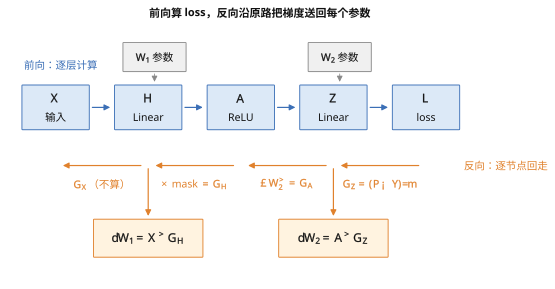{: style="max-height: 400px"}

<aside class="notes" markdown="1">
原文：[/backpropagation-by-hand.html](/backpropagation-by-hand.html)。线性层的反向使用本层输入计算 dW，并计算输入梯度；实现只需 VJP，不构造完整 Jacobian。
</aside>

<!-- v -->

### 迷你网络：逐层手算每个梯度

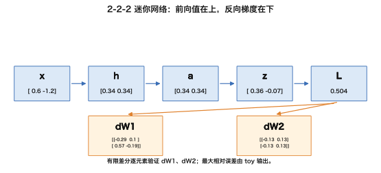{: style="max-height: 390px"}

**手算的 dW、dX、db 与中心差分核对，最大相对误差 4.157e-10**

<aside class="notes" markdown="1">
原文：[/backpropagation-by-hand.html](/backpropagation-by-hand.html)。第一层 batch 128 的完整 Jacobian 约 3.3×10⁹ 个 fp32 元素、13 GB；输入梯度为 392 KiB，W1 为 784 KiB。
</aside>

<!-- v -->

### 13 GB 的 Jacobian：只算 VJP

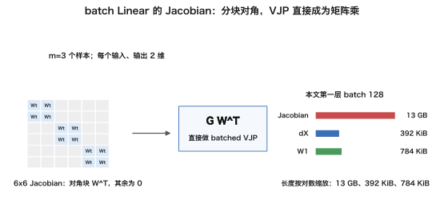{: style="max-height: 390px"}

**完整 Jacobian 13 GB（3.3×10⁹ 个 fp32），VJP 只需 392 KiB**

<!-- v -->

### 激活保存与 checkpointing

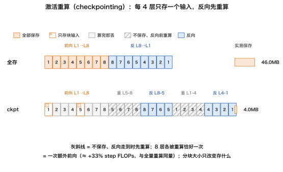{: style="max-height: 390px"}

**checkpointing 用额外前向计算换更少的保存激活。**

<aside class="notes" markdown="1">
原文：[/backpropagation-by-hand.html](/backpropagation-by-hand.html)。训练约 6ND FLOPs，重算约 8ND；激活占用随 batch、序列、层数和宽度增长。
</aside>

---

## 04 · 激活函数：非线性也决定梯度能否通过

**20 层 MLP 上，sigmoid 测试准确率 10.64%，tanh 为 90.48%。**

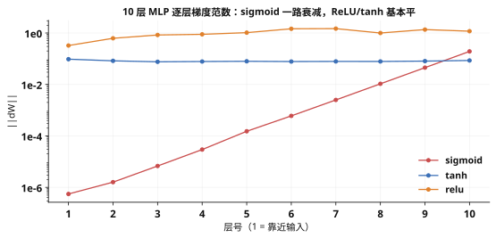{: style="max-height: 400px"}

<aside class="notes" markdown="1">
原文：[/activation-functions-from-sigmoid-to-swiglu.html](/activation-functions-from-sigmoid-to-swiglu.html)。相同 20 层、宽度 256、250 更新步；sigmoid 梯度消失并停在随机水平。激活的选择也影响 FFN 的门控结构。
</aside>

<!-- v -->

### ReLU 的局部导数

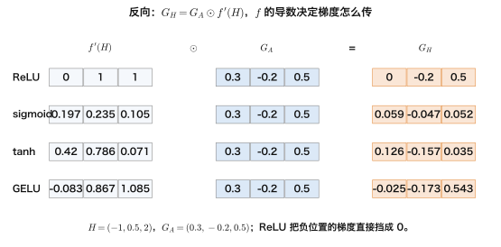{: style="max-height: 420px"}

**反向传播把上游梯度乘以局部导数；ReLU 正半轴导数为 1。**

<aside class="notes" markdown="1">
原文：[/activation-functions-from-sigmoid-to-swiglu.html](/activation-functions-from-sigmoid-to-swiglu.html)。
</aside>

---

## 05 · 初始化、归一化与残差：稳定深层连乘

**残差流标准差：无归一化第 64 块 6e9、Pre-Norm 8.1、GPT-2 缩放 1.46**

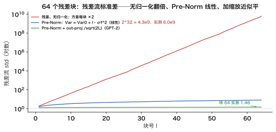{: style="max-height: 400px"}

<aside class="notes" markdown="1">
原文：[/initialization-normalization-and-residual.html](/initialization-normalization-and-residual.html)。64 层网络的失败形态来自因子连乘：每层 0.5 时方差为 0.5^64；每层 Jacobian 谱范数 0.9，128 层后梯度至多 1.4×10⁻⁶。Pre-Norm、RMSNorm、残差与初始化标准差 0.02 各有作用。
</aside>

<!-- v -->

### 残差给梯度一条恒等通路

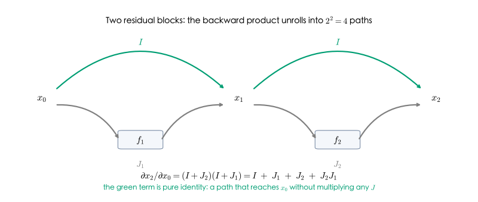{: style="max-height: 400px"}

**残差把 Jacobian 从 J 改为 I+J；归一化单独不能修复反向连乘。**

<aside class="notes" markdown="1">
原文：[/initialization-normalization-and-residual.html](/initialization-normalization-and-residual.html)。无归一化时残差流每层方差翻倍；Pre-Norm 下线性增长。
</aside>

---

## 06 · 优化器：第一步为什么需要 warmup

**同一个 g=0.5 的第一步：SGD -0.05、Adam -0.10、AdamW -0.11**

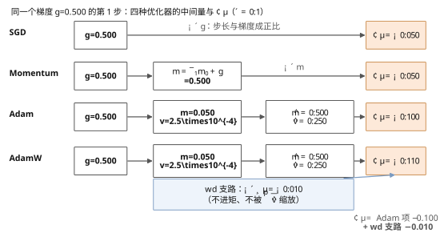{: style="max-height: 390px"}

<aside class="notes" markdown="1">
原文：[/optimizers-from-sgd-to-adamw.html](/optimizers-from-sgd-to-adamw.html)。偏差修正后 Adam 第一步近似 η·sign(g)，每个参数接近满步长；warmup 给二阶矩 v 时间学习梯度尺度。
</aside>

<!-- v -->

### warmup 改变最初的 loss 轨迹

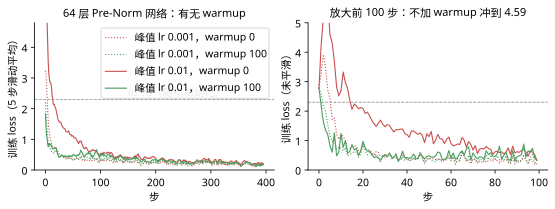{: style="max-height: 410px"}

**warmup 将第一次更新的风险从 loss 4.59 降到 1.26。**

<aside class="notes" markdown="1">
原文：[/optimizers-from-sgd-to-adamw.html](/optimizers-from-sgd-to-adamw.html)。Adam 状态为 8 字节/参数；Llama-3-8B 对应 64 GB。
</aside>

---

## 07 · 正则化与泛化：过参数化不等于必然过拟合

**weight decay 将测试 loss 的上升从 0.55 压到 0.42；测试 loss 上升而准确率不变，是过度自信。**

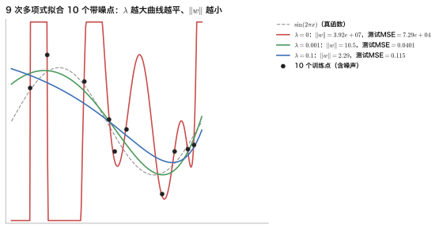{: style="max-height: 400px"}

<aside class="notes" markdown="1">
原文：[/regularization-and-generalization.html](/regularization-and-generalization.html)。正则化提供显式先验；过参数化区间还存在优化器选择的隐式正则化。
</aside>

<!-- v -->

### Double descent：插值阈值处的测试峰值

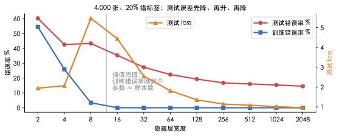{: style="max-height: 400px"}

**宽度 8–16 处测试 loss 从 2.07 冲到 5.48；参数是样本 407 倍时泛化最好。**

<aside class="notes" markdown="1">
原文：[/regularization-and-generalization.html](/regularization-and-generalization.html)。不要只看参数量；同时看训练/验证 gap、held-out 拐点与记忆探针。
</aside>

---

## 08 · CNN：局部连接与参数共享

**6×6 输入上的 3×3 卷积，对应 16×36 矩阵：144 个非零元素、只有 9 个自由参数。**

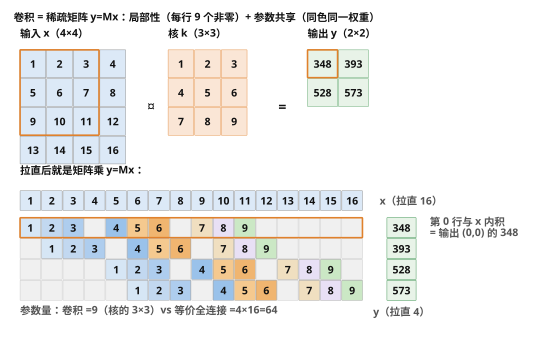{: style="max-height: 400px"}

<aside class="notes" markdown="1">
原文：[/cnn-from-lenet-to-resnet-and-vit.html](/cnn-from-lenet-to-resnet-and-vit.html)。卷积是带局部性和参数共享约束的线性层；深度扩大感受野，残差与归一化让深层网络可训练。
</aside>

<!-- v -->

### 深度扩大感受野

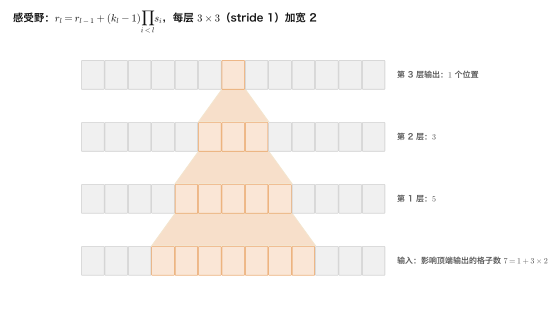{: style="max-height: 400px"}

**3×3 卷积每增加一层，stride=1 时感受野边长增加 2。**

<aside class="notes" markdown="1">
原文：[/cnn-from-lenet-to-resnet-and-vit.html](/cnn-from-lenet-to-resnet-and-vit.html)。ViT 将图像切成 patch，再投影为 token。
</aside>

---

## 09 · Embedding：one-hot 乘法等价于查表

**GPT-2 small 的输入 embedding 为 50,257×768，共 38,597,376 个参数，约占模型 31.0%。**

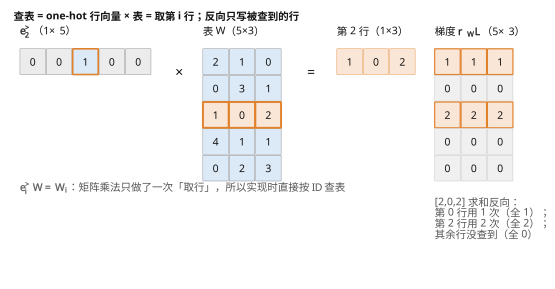{: style="max-height: 390px"}

<aside class="notes" markdown="1">
原文：[/embedding-and-representation-learning.html](/embedding-and-representation-learning.html)。查表实现不必构造 one-hot；反向只更新被访问的行。Word2Vec 以上下文预测学习静态词向量，Transformer 表示则随上下文变化。
</aside>

<!-- v -->

### 表示由什么信号学到

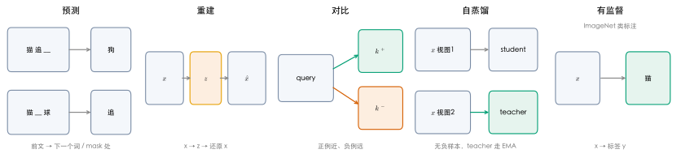{: style="max-height: 400px"}

**Embedding 同时回答嵌入什么、用什么训练信号，以及是否依赖上下文。**

<aside class="notes" markdown="1">
原文：[/embedding-and-representation-learning.html](/embedding-and-representation-learning.html)。
</aside>

---

## 10 · RNN：BPTT 衰减催生 attention

**谱半径 0.9 的 16 维矩阵：20 步剩 4.56e-3；谱半径 1.5 时 30 步涨到 17.4**

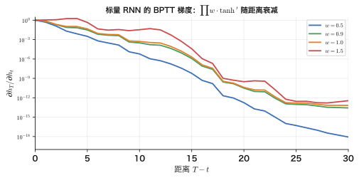{: style="max-height: 400px"}

<aside class="notes" markdown="1">
原文：[/rnn-lstm-and-the-birth-of-attention.html](/rnn-lstm-and-the-birth-of-attention.html)。LSTM 的细胞状态提供时间上的残差通路；Bahdanau attention 让每个解码步直接访问编码器全部状态。
</aside>

<!-- v -->

### LSTM：沿细胞状态保留梯度

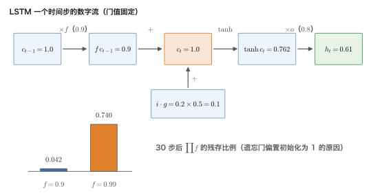{: style="max-height: 400px"}

**遗忘门偏置初始化为 1 后，20 步和 40 步任务从学不会变为 500 步内学会。**

<aside class="notes" markdown="1">
原文：[/rnn-lstm-and-the-birth-of-attention.html](/rnn-lstm-and-the-birth-of-attention.html)。attention 绕过固定向量瓶颈；Transformer 再去掉循环，换取并行。
</aside>

---

## 贯穿十篇的线索

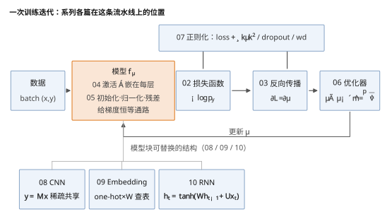{: style="max-height: 420px"}

**每个模块都要同时检查公式、形状、数值与训练信号。**

<aside class="notes" markdown="1">
系列总结：[/deep-learning-foundations-series-recap-and-self-test.html](/deep-learning-foundations-series-recap-and-self-test.html)。梯度连乘贯穿激活、初始化、归一化、残差与 RNN；损失定义训练目标，优化器控制更新，正则化影响泛化。
</aside>

---

## 常见误区

- 反向传播要显式构造 Jacobian——只算 VJP。
- 初始化正确就能保证深网络稳定——它只管训练起点。
- Adam + L₂ 等于 AdamW——前者的衰减会被自适应尺度改变。
- 参数比样本多就一定过拟合——过参数化区间还要看优化器挑出的解。
- Embedding 是 one-hot 的另一个名字——它是按 ID 查得的可学习向量。
- RNN 记不住远处是因为状态太小——关键瓶颈是训练信号传不到。
{: .fragments}

<aside class="notes" markdown="1">
细节与自测答案见系列总结：[/deep-learning-foundations-series-recap-and-self-test.html](/deep-learning-foundations-series-recap-and-self-test.html)。
</aside>

---

## 下一步

- **原文**：总纲 [/deep-learning-foundations.html](/deep-learning-foundations.html) · 总结与通关自测 [/deep-learning-foundations-series-recap-and-self-test.html](/deep-learning-foundations-series-recap-and-self-test.html)
- **配套代码**：[ai-learning-labs/deep-learning-foundations](https://github.com/arganzheng/ai-learning-labs/tree/main/deep-learning-foundations)
- **往后读**：[Transformer 原理与实现](/transformer-and-llm-structure-implementation-and-evolution.html) · [现代 LLM 结构](/llm-architecture-evolution-roadmap-from-gpt2.html)

<aside class="notes" markdown="1">
十篇正文按 01–10 排序；第 11 篇系列总结与通关自测：[/deep-learning-foundations-series-recap-and-self-test.html](/deep-learning-foundations-series-recap-and-self-test.html)。
</aside>
