## 这个系列回答一个问题

> 工具箱《Hugging Face 生态》那六行 LoRA SFT 代码——`from_pretrained`、`generate`、`apply_chat_template`、`load_dataset(...).map`、`get_peft_model`、`SFTTrainer`——执行时各经过了**哪些文件的哪些函数**？

**骨架是「注册表 + 字符串键」：找到表、找到 `compute_loss`、找到 `forward` 里那一行调用，往下追**

<aside class="notes" markdown="1">
总纲：/reading-hugging-face-source-code.html。版本基线 transformers 5.17.0、tokenizers 0.23.2、datasets 5.0.1、peft 0.21.0、trl 1.13.0，模型 Qwen2.5-0.5B，数据 HuggingFaceH4/no_robots。引用只给路径与函数名，不给行号。
</aside>

---

## 四篇沿一次 LoRA SFT 的数据流

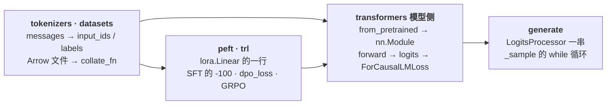

模型两端都是整数 `input_ids`：进的一端是 tokenizer 与 datasets，出的一端是 `generate`

<aside class="notes" markdown="1">
四篇：模型侧 /transformers-from-pretrained-to-forward-and-loss.html，generate /transformers-generate-call-chain.html，数据 /tokenizers-and-datasets-from-messages-to-input-ids.html，peft 与 trl /peft-and-trl-lora-sft-dpo-grpo-in-source.html。
</aside>

<!-- v -->

### 五个库的依赖分层

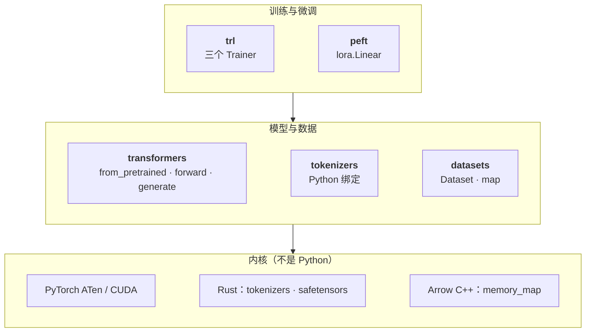

上层只 import 下层；读 Python 源码追到最底下一层就停

---

## 01 · 模型侧：先搭骨架，再按名字填

**加载峰值约等于权重本身：meta 骨架 0 字节，mmap 按名字填**

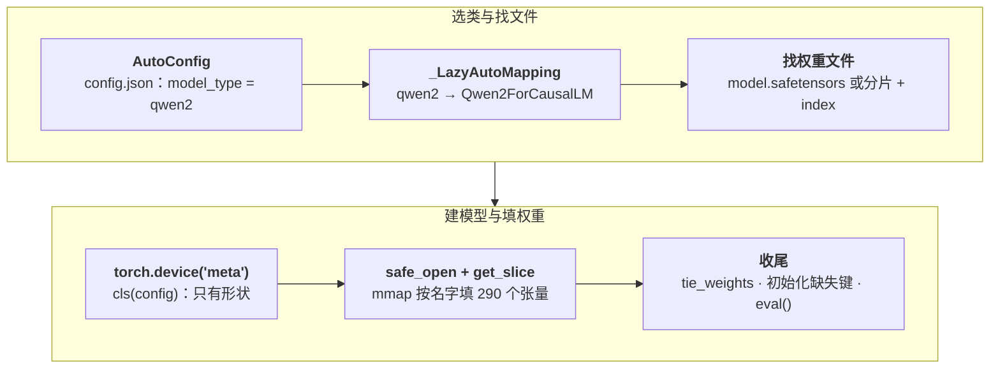

<aside class="notes" markdown="1">
原文 /transformers-from-pretrained-to-forward-and-loss.html。表存字符串、按需 import，所以「跳转到定义」跳不到 Qwen2ForCausalLM。对不上的键分 missing（随机初始化）/ unexpected（忽略）/ mismatched（默认报错）。返回的模型是 eval 模式。
</aside>

<!-- v -->

### 一次前向的张量形状（Qwen2.5-0.5B）

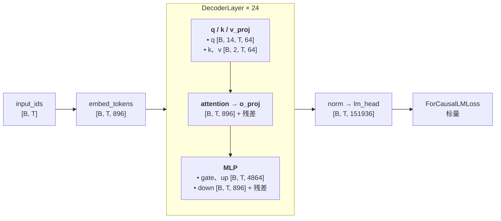

<!-- v -->

### 一个键同时选 attention 函数与 mask

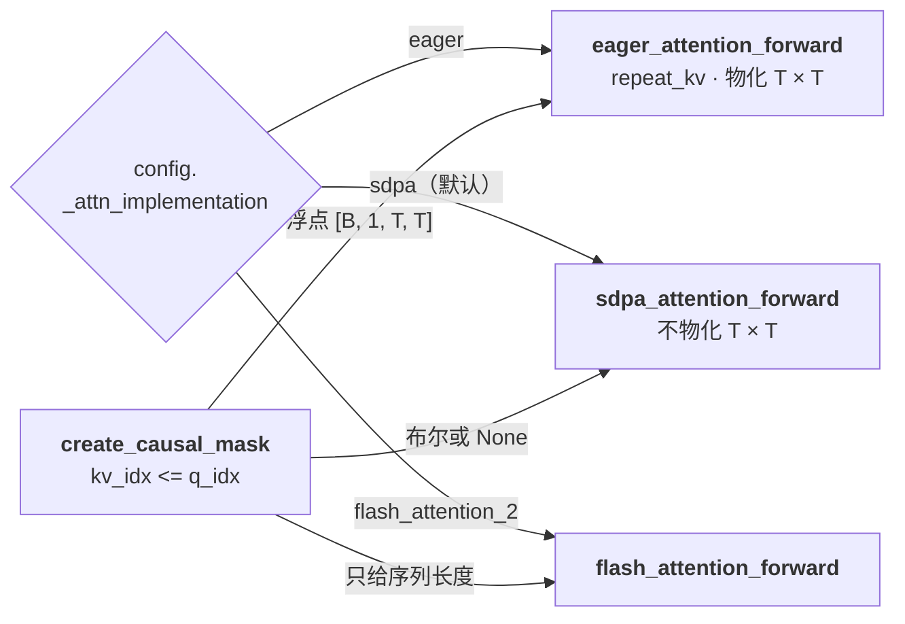

eager 与 sdpa：fp32 下 logits 最大差 $$1.7 \times 10^{-4}$$、argmax 全同；bf16 下差到 1.0

<!-- v -->

### KV cache：每层一个 `torch.cat`

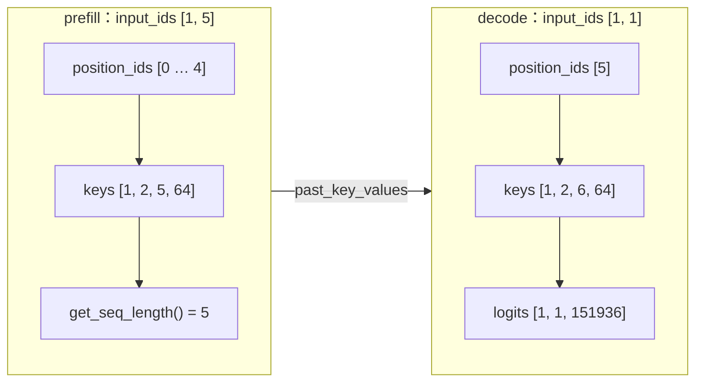

`position_ids` 从 `get_seq_length()` 来：忘了传 cache，每个新 token 都被当成第 0 位

<aside class="notes" markdown="1">
loss 不在建模文件里：self.loss_function 按类名分派到 loss/loss_utils.py 的 ForCausalLMLoss——升 fp32、labels 末尾垫 -100 再左移一位、ignore_index=-100、num_items_in_batch 修梯度累积。配套脚本 labels = input_ids 时 loss 3.9506，与手算 cross_entropy 相等。
</aside>

---

## 02 · generate：一串函数 + 一个循环

**配置 → 处理器串 → 停止条件 → `_sample` 循环；顺序由代码定**

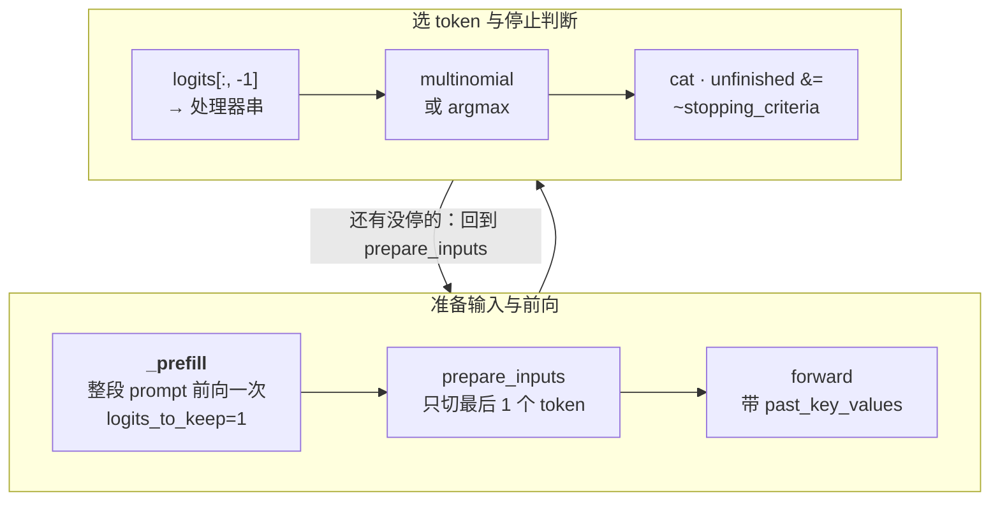

<aside class="notes" markdown="1">
原文 /transformers-generate-call-chain.html。配置三层优先级：kwargs > 仓库 generation_config.json > 全局默认；Qwen2.5 不传长度会生成到 2048。不认识的 kwargs 转给 forward，拼错的由 _validate_model_kwargs 报错。停了的序列填 pad 继续跟跑——静态 batch。DeferredStopCheck 把 GPU→CPU 同步推迟一步。
</aside>

<!-- v -->

### 处理器串：第一步还剩几个有限值

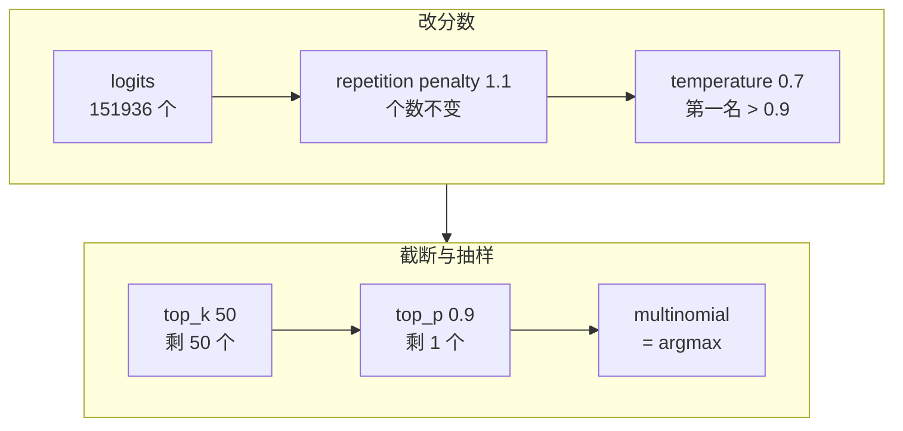

顺序由代码固定：penalty → temperature → top-k → top-p；`do_sample=False` 时 warper 一个都不装

<aside class="notes" markdown="1">
get_generation_mode：num_beams > 1 → beam search；传 assistant_model → assisted（投机解码）；否则 do_sample 决定 SAMPLE / GREEDY，两者是同一个 _sample，只在选 token 那一行分叉。contrastive 等模式 5.x 移到 Hub 的 custom_generate。
</aside>

---

## 03 · tokenizers 与 datasets：Python 只是壳

**`tokenizer.json` 描述 Rust 流水线；`Dataset` 是 Arrow mmap 视图**

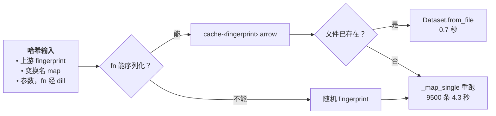

改函数里一个 print → 字节码变 → fingerprint 变 → 整个重跑

<aside class="notes" markdown="1">
原文 /tokenizers-and-datasets-from-messages-to-input-ids.html。tokenizer.json 五段：normalizer（NFC）→ pre_tokenizer（GPT-2 正则 + ByteLevel，数字逐位）→ BPE model → post_processor → decoder。chat template 是沙箱 Jinja；推理必传 add_generation_prompt；Qwen2.5 的模板没有 generation 标记，所以拿不到 assistant mask。batched=True 是 map 最大的性能开关。
</aside>

<!-- v -->

### 三个词表大小在 id 轴上的位置

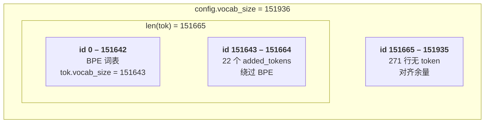

加几个特殊 token 只是在 151665 之后续编号，不到 151936 就不用 resize

<!-- v -->

### `shuffle` 只多一张行号表

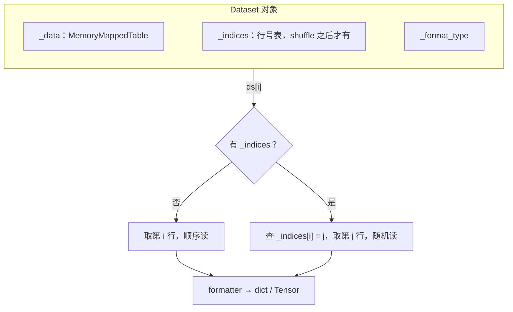

`shuffle` 只多写一张 `_indices`；之后的 `map` 变慢：先 `map` 再 `shuffle`，或 `flatten_indices()`

---

## 04 · peft 与 trl：换层与填 -100

**`setattr` 换掉 `nn.Linear`；`-100` 在训练前那一次 `map` 里填**

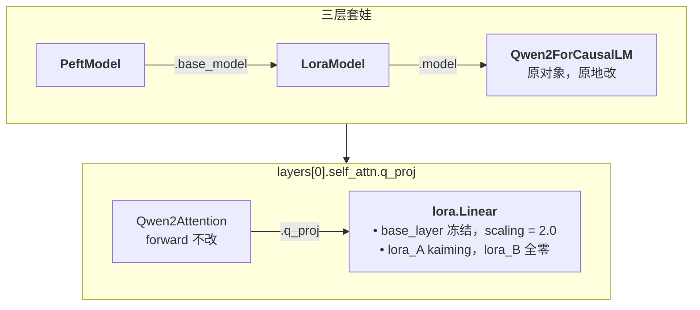

<aside class="notes" markdown="1">
原文 /peft-and-trl-lora-sft-dpo-grpo-in-source.html。forward 只多一项 lora_B(lora_A(dropout(x))) * scaling，先算瘦的，不物化 BA。24 层 × 7 = 168 处替换，可训练 8.8M（1.75%），state_dict 只存 adapter。all-linear 排除 lm_head；列表 target_modules 按最后一段匹配，字符串走 re.fullmatch。SFT：build_labels 是一次 datasets.map，所有 mask 位为 1 才等于 input_ids；collator 只 pad，labels 用 -100；padding_free 时每段首 token 置 -100。
</aside>

<!-- v -->

### DPO：参考 log p 的三种来源

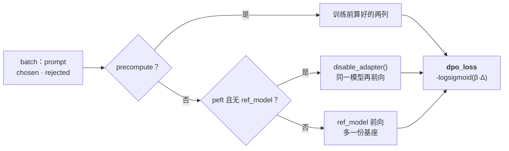

策略侧：`concatenated_forward` 把 chosen、rejected 拼成 2B 条前向一次

<!-- v -->

### GRPO：rewards 按组变成 advantages

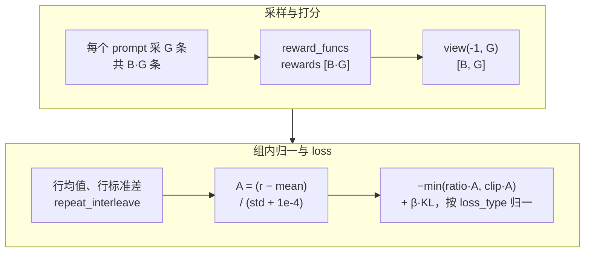

`loss_type`：grpo 每条按长度平均 · bnpo 全 batch token 平均 · dr_grpo 除以常数

---

## 贯穿全系列的四条线

| 线 | 在哪 |
|---|---|
| **注册表 + 字符串键** | `model_type` → 模型类、`_attn_implementation` → attention、类名 → `LOSS_MAPPING`、`loss_type` → 分支、`target_modules` → 层 |
| **Rust / Arrow 内核 + Python 壳** | `encode_batch` 之下是 Rust，`_data` 之下是 Arrow mmap |
| **`-100` 串起三个库** | assistant mask → `build_labels` 与 collator → `ForCausalLMLoss` 的 `ignore_index` |
| **一个上下文省一份模型** | `disable_adapter()` 就是参考模型，DPO 与 GRPO 都不用再加载基座 |

<!-- v -->

### 一次 LoRA SFT 里各库出场的时刻

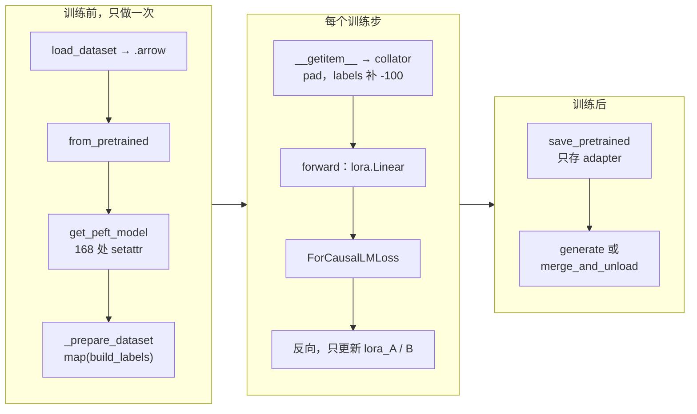

---

## 常见误区

- 「`architectures` 决定实例化哪个类」——Auto 类只看 `model_type` 查表
- 「加载峰值是权重的两倍」——meta 骨架 + mmap，峰值约等于权重
- 「传了 `temperature` 就在采样」——看 `do_sample`，Qwen2.5 默认 False
- 「`len(tok) == config.vocab_size`」——151665 ≠ 151936，后者是对齐补大
- 「datasets 有缓存，`map` 不会重跑」——缓存键是 fingerprint，函数一改就失效
- 「LoRA 显存约等于 1.8% 参数」——激活与反向的 $$gW$$ 没省，省的是优化器状态
- 「GRPO 一组全对是最好的样本」——优势全零，梯度零贡献
{: .fragments}

---

## 下一步

- **往前**：模型侧对应《Transformer 原理与实现》，LoRA 对应《算法工程师的数学》，三种 loss 对应《后训练》
- **推理侧**：《大模型推理系统揭秘》读 continuous batching 与 PagedAttention 怎么换掉静态 batch 与每层 `cat`
- **训练侧**：verl 源码导读读 rollout 与 actor 分到不同 worker 后的同一条 GRPO loss
- 方法不变：找到注册表、找到 `compute_loss`、找到 `forward` 里那一行调用

<aside class="notes" markdown="1">
系列总结与通关自测：/hf-source-reading-series-recap-and-self-test.html（A 组 10 题、B 组 5 题、C 组 6 道面试题）。总纲：/reading-hugging-face-source-code.html。
</aside>
