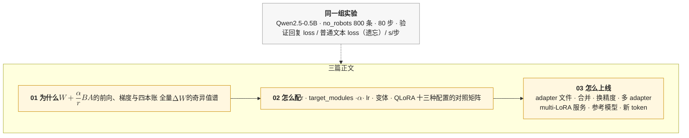
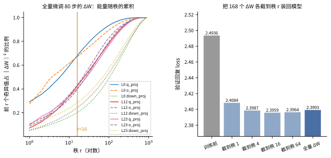
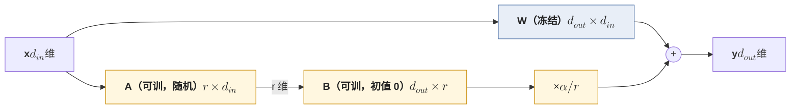
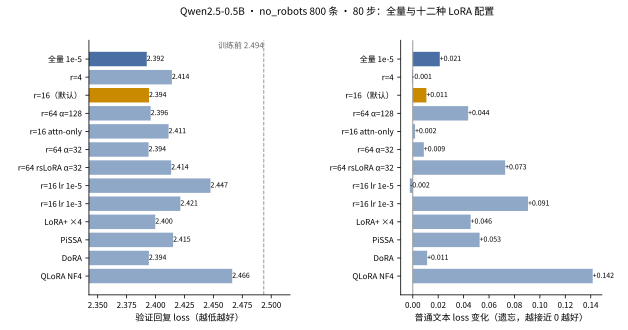

## 这个系列回答一个问题

> 为什么给几十亿参数的模型加**两个瘦矩阵**就能微调好？
> `r`、`lora_alpha`、`target_modules`、lr 各取多少、**依据是什么**？
> 训完的 adapter 怎么存、怎么合并、怎么让**一个底座服务几十个客户**？

- 默认配置 `r=16, lora_alpha=32, all-linear, lr=2e-4`——每个数都有一次对照实验
- 同一组实验贯穿三篇：Qwen2.5-0.5B · no_robots 800 条 · 80 步
- 训练前验证回复 loss **2.4936**，普通文本 loss **2.8748**；全量 80 步 **2.3924 / +0.0213**

<aside class="notes" markdown="1">
开场：这一行默认配置人人都抄，为什么是 16 不是 4 或 256、为什么 lr 比全量大一个量级——三篇各用一组数字回答。
所有数字在一台 8 线程 CPU 上跑出；peft 0.21.1 / trl 1.14.1 / transformers 5.17.0 / bitsandbytes 0.50.2。
总纲：/lora-for-sft-from-low-rank-hypothesis-to-serving.html
</aside>

---

## 三篇的全景



「为什么 → 怎么配 → 怎么上线」，每一篇都回到同一个验证集上重算

<aside class="notes" markdown="1">
三篇共用一个模型、一份数据、一组指标：验证回复 loss 看学到多少，wikitext-2 普通文本 loss 的变化看遗忘，s/步只看相对值。
800 条、80 步是刻意的小实验：能分辨旋钮之间的差别，绝对数字不代表 LoRA 能训到多好。
</aside>

---

## 01 · 低秩假设：两个瘦矩阵为什么够用

**$$\Delta W$$ 本身高秩，有用的部分低秩：截到秩 16 装回去好于不截**

{: style="max-height: 440px"}

<aside class="notes" markdown="1">
原文 /lora-low-rank-hypothesis-gradients-and-accounts.html
把 0.5B 全量微调 80 步得到的 168 个 ΔW 做 SVD：秩 16 只占方阵 40–68%、MLP 矩阵 20–28% 的能量，要到秩 256 才覆盖九成——这是 Biderman 等 2024 的「高秩」。
但截到秩 16 装回去，验证回复 loss 2.3959，比不截的 2.3993 还好——这是 Hu 等 2021 的「内在秩很低」。两者说的是同一个 ΔW 的不同部分。
边界：格式、风格、指令跟随上 LoRA 与全量接近且忘得少；注入大量新知识、继续预训练、代码/数学大幅提升上明显不如全量（Biderman 等 2024 代码差 5–10 个点），要么全量、要么 r ≥ 256 + all-linear；新 token 见第三篇；只服务一个模型且显存充足时全量更简单。
</aside>

<!-- v -->

### 公式与初始化



先算 $$Ax$$ 再乘 $$B$$，从不构造 $$d_{out} \times d_{in}$$ 的 $$BA$$；训完可以把 $$\frac{\alpha}{r}BA$$ 加回 $$W$$

一个零、一个随机：都为 0 学不动（20 步后仍 2.4936），都随机 loss 从 2.49 跳到 14.8

<aside class="notes" markdown="1">
梯度：∂L/∂B = s·G·(Ax)ᵀ，∂L/∂A = s·Bᵀ·G·xᵀ，没人算 ∂L/∂W；但 ∂L/∂x = WᵀG + … 必须穿过冻结的 W。
B = 0 时 ∂L/∂A 为零，第一步只有 B 动。2×3 手算例子：第一步 ∂L/∂B = (2, 2)ᵀ、∂L/∂A = 0；第二步 ∂L/∂A = (−0.96, −0.48, −0.48)，与 autograd 逐个一致。
五种初始化各训 20 步：默认（B = 0、A Kaiming）2.4473；A = 0、B 随机 2.4813；都随机 14.8172 → 10.0049；都为 0 不动；gaussian 2.4595。
</aside>

<!-- v -->

### 截秩：有用的改动集中在少数方向

| 装回的 $$\Delta W$$ | 验证回复 loss | 普通文本 loss |
|---|---:|---:|
| 训练前（不装） | 2.4936 | 2.8748 |
| 截到秩 1 | 2.4084 | 2.8734 |
| 截到秩 4 | 2.3987 | 2.8796 |
| 截到秩 16 | **2.3959** | 2.8823 |
| 截到秩 64 | 2.3964 | 2.8861 |
| 不截（168 个线性层的完整 $$\Delta W$$） | 2.3993 | 2.8917 |

秩 1 就拿到 95% 的收益；剩下的高秩成分只带来遗忘

<aside class="notes" markdown="1">
最后一行只装线性层的 ΔW（embedding / lm_head / norm 没装），所以与全量模型的 2.3924 不同。
LoRA 赌的是只学那个低秩的、有用的部分——「学得少也忘得少」是同一件事。
‖ΔW‖/‖W‖ 只有 10⁻³ 量级：这也是第三篇 BF16 合并要升到 FP32 的原因。
</aside>

<!-- v -->

### 四本账：省了一本半

| 账 | 全量 | LoRA r=16 全部线性层 | 0.5B / 8B 上的数 |
|---|---|---|---|
| 可训练参数 | $$N$$ | $$r(d_{in}+d_{out})$$ 每矩阵 | 494M → 8.8M（1.78%）；8B 41.9M（0.52%） |
| 训练状态 | 16 B/参数 | $$2N_{total} + 14N_{trainable}$$ | 8B：120 GiB → 15.5 GiB |
| 计算量 | $$6N$$/token | ≈ $$4N$$/token | 一步 3.46 s → 2.31 s；前向算子 5091 → 9963 |
| 激活值 | 不变 | 不变 | 0.5B 约 2.7 GiB，大于 LoRA 全部状态 1.03 GiB |

<aside class="notes" markdown="1">
可训练参数省 50–200 倍；训练状态省 5–8 倍，省的是 Adam 与主权重（0.5B 实测：梯度 1885 → 34 MB、Adam 3769 → 67 MB），冻结权重一个字节不少——这是 QLoRA 的切入点。
FLOPs 只省 1/3：对输入的梯度 WᵀG 照算。前向没变快（0.91 对 0.94 s），矩阵乘 437 → 1445。序列拉到 512 时差距缩到 6.7 对 6.3 s/步。
激活值：batch 4 × 512 下约 2.7 GiB（含 1.24 GB 的 logits），长序列靠梯度检查点，与 LoRA 无关。
</aside>

---

## 02 · 选参：十三种配置，同样 80 步

**挂哪里比 r 重要；scaling 与 lr 是同一个旋钮的两面**

{: style="max-height: 440px"}

<aside class="notes" markdown="1">
原文 /lora-hyperparameters-rank-targets-alpha-lr-and-variants.html
左边看学到多少，右边看忘了多少。验证 loss 上 r=16 all-linear（2.3943）、r=64、DoRA 与全量（2.3924）挤在一起；遗忘随 scaling、lr、r 单调变大。
每个旋钮都回到 W + (α/r)BA 里的位置：r 是容量，α/r 是缩放，target_modules 决定公式套在哪些 W 上。
</aside>

<!-- v -->

### r 与 target_modules

| 配置 | 可训练参数 | 验证回复 loss | 遗忘 | s/步 |
|---|---:|---:|---:|---:|
| 全量 lr 1e-5 | 494.0M | 2.3924 | +0.0213 | 6.7 |
| r=16 只挂 attention | 2.2M | 2.4113 | +0.0018 | 5.0 |
| r=4 全部线性层 | 2.2M | 2.4141 | −0.0007 | 6.4 |
| r=16 全部线性层 | 8.8M | **2.3943** | +0.0107 | 6.3 |
| r=64 全部线性层（α=128） | 35.2M | 2.3958 | +0.0436 | 8.7 |

参数同样翻 4 倍：attention → 全部线性层降 0.017，r 16 → 64 没有改善

<aside class="notes" markdown="1">
LoRA 行都是 lr 1e-4、α = 2r（scaling 2）。「遗忘」= wikitext-2 普通文本 loss 相对训练前 2.8748 的变化。
r 是容量不是越大越好：r=64 的遗忘已是全量的两倍。MLP 承载大部分变换，只改注意力等于只改「看哪里」不改「怎么算」。
all-linear 展开为所有 nn.Linear 减去 lm_head；embedding 不是 nn.Linear，也不在其中。
</aside>

<!-- v -->

### scaling 与 lr：越大学得越猛、忘得越多

| 配置（r=16 / r=64） | 验证回复 loss | 遗忘 |
|---|---:|---:|
| r=16 lr 1e-5 | 2.4475 | −0.0023 |
| r=16 lr 1e-4 | **2.3943** | +0.0107 |
| r=16 lr 1e-3 | 2.4215 | +0.0907 |
| r=64 α=32（scaling 0.5） | 2.3940 | +0.0087 |
| r=64 α=128（scaling 2） | 2.3958 | +0.0436 |
| rsLoRA r=64 α=32（scaling 4） | 2.4135 | +0.0727 |

<aside class="notes" markdown="1">
LoRA 的 lr 比全量大 10–20 倍：B 从零长出 ΔW。1e-5 只学到一半（降 0.046 对 0.099）；1e-3 遗忘是全量的 4 倍——LoRA 忘得少的前提是学得也少。
scaling 与 lr 在一阶上等价。rsLoRA 把 α/r 换成 α/√r，收益在大 r 要学得多的场合；800 条小任务上 scaling 0.5 没被压掉。
实践：α = 2r 固定 scaling，或 use_rslora=True 固定 α；改 r 时看一眼 scaling 变成多少。
</aside>

<!-- v -->

### 变体：小任务上都不比默认好

| 配置（r=16 全部线性层） | 验证回复 loss | 遗忘 | s/步 |
|---|---:|---:|---:|
| LoRA（默认） | **2.3943** | +0.0107 | 6.3 |
| LoRA+（B 的 lr ×4） | 2.3998 | +0.0455 | 5.7 |
| PiSSA（`pissa_niter_4`） | 2.4152 | +0.0526 | 5.6 |
| DoRA（`use_dora=True`） | 2.3942 | +0.0113 | 8.0 |
| QLoRA NF4 底座 | 2.4663 | +0.1415 | 6.7 |

<aside class="notes" markdown="1">
LoRA+ 等价于把 lr 再调大并偏向 B，lr 已在「够大」一侧时只会多遗忘。
PiSSA 训的是 W 的主奇异方向，动的正是通用能力，遗忘更大；它改底座，发布 adapter 要转换。
DoRA 每步要构造 W + BA 算列范数，慢 27%；收益在小 r。
QLoRA 的 +0.1415 大部分是底座本身的 NF4 量化误差：NF4 底座训练前就是 2.5780。NF4 = 正态分位数 16 格点，双重量化后约 4.127 bit/参数；0.5B 底座内存 988 MB → 430 MB。
</aside>

<!-- v -->

### 按任务与资源选

| 场景 | 配置 |
|---|---|
| 默认起点（指令 / 格式 / 风格 SFT） | $$r = 16$$、`all-linear`、$$\alpha = 32$$、lr $$1 \sim 2 \times 10^{-4}$$ |
| 数据多（10 万条以上）或领域远 | $$r = 64 \sim 128$$ + rsLoRA 或 $$\alpha = 2r$$ |
| 注入知识、继续预训练 | 全量；或 $$r \geq 256$$ 并接受差距 |
| 显存放不下 BF16 底座 | QLoRA（NF4 + 双重量化），可加 LoftQ |
| 几百个 adapter 同服、$$r$$ 必须很小 | $$r = 4 \sim 8$$ + DoRA |

<aside class="notes" markdown="1">
完整的选择表还有：几百条数据怕过拟合 → r=8、dropout 0.1；收敛慢 → 先调 lr，再试 EVA 或 LoRA+；加了新 token → trainable_token_indices；只服务一个模型且显存充足 → 全量。
</aside>

---

## 03 · 上线：adapter、合并与多 LoRA 服务

**一个底座 + 50 个 adapter 是 20 GB，50 份合并模型是 800 GB**

| 8B，$$N = 50$$ 个客户 | $$N$$ 份合并模型 | 一个底座 + $$N$$ 个 adapter |
|---|---|---|
| 显存 / 存储 | $$50 \times 16$$ GB = 800 GB | 16 GB + $$50 \times 84$$ MB = 20 GB |
| 切换一个客户 | 换模型：加载 16 GB | 换 adapter 名：零拷贝 |
| 一个 batch 混多个客户 | 不行 | 可以：每个请求带 adapter id |
| 每 token 计算 | 一个 GEMM | 一个 GEMM + 按请求分组的瘦 GEMM |

<aside class="notes" markdown="1">
原文 /lora-in-production-adapters-merging-multi-lora-and-serving.html
0.5B 上：46 GiB 对 1.75 GiB。vLLM 按 max_loras × max_lora_rank 预留槽位：8B 全部线性层、max_loras=8、max_lora_rank=64 是 2.7 GB，从 KV cache 预算里扣。
仍该合并的场合：只服务一个 adapter；batch 很小、延迟极敏感（8B decode B=1 多出 448 次小 kernel 启动）；推理框架不支持 LoRA。
</aside>

<!-- v -->

### adapter 文件与合并

```text
r16_all/
  adapter_config.json             1 KB   # r、alpha、target_modules、底座名
  adapter_model.safetensors    33.6 MB   # 336 个张量 = 24 层 × 7 × (A, B)
合并前后 logits 最大差 3.28e-04；一次前向 65 ms → 53 ms
```

- 没有 $$W$$：adapter 必须与训练时的底座配对，`base_model_name_or_path` **不校验**
- BF16 合并要在 FP32 里加：$$\Delta W$$ 比 $$W$$ 小两个数量级，会被舍入掉

<aside class="notes" markdown="1">
FP32 训的存下来 33.6 MB，BF16 约 17 MB；8B r=16 全部线性层 84 MB。
装回去验证 loss 2.3943，与训练结束时一致。merge_and_unload 后 lora 模块 0 个、参数量 494.0M，结构与原模型相同，可以交给任何推理框架；但一个 17 MB 的 adapter 变成一个 0.92 GiB 的模型。
PiSSA / OLoRA 的 adapter 对着改过的 W_res 学，发布前要用 path_initial_model_for_weight_conversion 转换（秩变 2r）。
</aside>

<!-- v -->

### 换底座精度：差别与量化误差同量级

| 组合 | 验证回复 loss | 相对同精度底座 |
|---|---:|---:|
| FP32 底座（训练前） | 2.4936 | — |
| NF4 底座（训练前） | 2.5780 | 量化误差 +0.0844 |
| FP32 底座 + adapter（训练时） | 2.3943 | −0.0993 |
| NF4 底座 + 同一个 adapter | 2.4860 | −0.0920 |
| 先合并再 NF4 量化 | 2.4854 | −0.0926 |
| QLoRA adapter + NF4 底座 | 2.4663 | −0.1117 |

<aside class="notes" markdown="1">
adapter 没有失效：FP32 上带来 −0.099，装到 NF4 上仍带来 −0.092。先合并再量化与量化底座挂 adapter 几乎一样——0.5B 上 ΔW 比 NF4 步长小得多，加进去再量化基本被四舍五入掉。
对着 NF4 训的 QLoRA adapter 好 0.02：它学会了补一部分量化误差。上线前在目标精度上重测一次。
</aside>

<!-- v -->

### 多个 adapter：切换与合成

| 方式 | 秩 | 验证回复 loss |
|---|---:|---:|
| `set_adapter('all')`（r=16 全部线性层） | 16 | 2.3943 |
| `set_adapter('attn')`（r=16 只挂 attention） | 16 | 2.4113 |
| `linear` 0.5 / 0.5 | 16 | 2.3992 |
| `cat` | 32 | 2.4065 |
| `svd` 截到秩 16 | 16 | 2.4063 |

同任务合成拿到的是平均，不是叠加；不同任务用 `cat` / `svd`

<aside class="notes" markdown="1">
set_adapter 只改 active_adapters 列表，零拷贝。
linear 算的是 (w₁B₁ + w₂B₂)(w₁A₁ + w₂A₂)，多了 B₁A₂、B₂A₁ 两个交叉项——独立训的 adapter 之间这是噪声，所以 linear 只用于同一任务的不同 checkpoint。cat 精确等于 B₁A₁ + B₂A₂。
cat 与 svd 几乎一样：秩 32 的和，有效秩不到 16——又一次印证低秩假设。
</aside>

<!-- v -->

### 参考模型与新 token

- `with model.disable_adapter():` 验证回复 loss **2.4936** = 底座：DPO / GRPO 的免费参考模型，8B 省 16 GB

| 新 token（id 151665）训一步 | 多出的可训练参数 | embedding 那一行的改动 |
|---|---:|---:|
| LoRA r=16 全部线性层 | 0 | 0 |
| + `trainable_token_indices` | 896 | $$1.0 \times 10^{-3}$$ |
| + `modules_to_save=["embed_tokens", "lm_head"]` | 272M | $$1.0 \times 10^{-3}$$ |

<aside class="notes" markdown="1">
B = 0 时 W' = W，训练开始时的策略就是底座。trl 的 DPOTrainer / GRPOTrainer 在 ref_model=None 时就这么做；省的是一整份模型的显存，参考前向的计算没省。
新 token 学不会：LoRA 只挂线性层，embed_tokens 与 lm_head 冻结。modules_to_save 训整张表，比 LoRA 本身大 30 倍，adapter 从 17 MB 变成 560 MB；能用 trainable_token_indices 就不用它。
</aside>

---

## 贯穿三篇的四条线

| 线 | 01 为什么 | 02 怎么配 | 03 怎么上线 |
|---|---|---|---|
| **一个公式** | 推 $$W + \frac{\alpha}{r}BA$$ 的梯度 | 调每个符号：$$r$$、$$\alpha/r$$、初始化、挂在哪 | 合并回 $$W$$、按请求切换、关掉当参考 |
| **四本账** | 建账：省一本半 | QLoRA 改冻结权重，DoRA 让计算变贵 | adapter 大小、槽位显存、`modules_to_save` |
| **一个假设** | 检验 $$\Delta W$$：高秩但有用部分低秩 | all-linear 让它成立得更好 | 新 token 不在任何 $$W$$ 里 |
| **同一组数字** | 截秩实验的标尺 | 十三行都对着比 | 加载、合并、换精度都回到同一验证集 |

<aside class="notes" markdown="1">
主轴是「低秩假设 → 超参 → 上线」：假设决定能不能用，超参决定用多少容量，上线决定 adapter 这个几十 MB 的对象怎么流转。
同一组数字：训练前 2.4936 / 2.8748，全量 80 步 2.3924 / +0.0213；一个数字能在三篇之间来回对上，是实验可复现的证据。
</aside>

---

## 常见误区

- 「可训练参数少 100 倍，训练就快 100 倍」——对输入的梯度照算，FLOPs 只省 1/3
- 「LoRA 省显存，长序列也不怕」——激活值一分不省
- 「$$r$$ 越大越好」——16 → 64 没有改善，遗忘从 +0.0107 涨到 +0.0436
- 「LoRA 不会遗忘」——lr 1e-3 下遗忘 +0.0907，是全量的 4 倍
- 「装错底座会报错」——`base_model_name_or_path` 不校验，形状对得上就能加载
- 「加了新 token，LoRA 训一训就会用」——embedding 冻结，那一行永远不动
{: .fragments}

<aside class="notes" markdown="1">
系列总结里还有：「只挂 q、v 就够了」（QLoRA 之后的共识是全部线性层）、「LoRA 用全量的 lr」（要大 10–20 倍）、「PiSSA 的 adapter 可以直接发布」（要转换）、「BF16 直接 W += ΔW」（要在 FP32 里加）、「linear 加权就是两个任务都会」（有交叉项）、「LoRA 训 DPO 要再放一份参考模型」（disable_adapter）。
系列总结：/lora-series-recap-and-self-test.html
</aside>

---

## 下一步

- **继续后训练**：《后训练：从 SFT 到可验证奖励》的偏好数据、DPO、GRPO——`disable_adapter()` 会再出现
- **读实现**：HF 源码系列的《peft 与 trl》——`inject_adapter`、`lora.Linear.forward`、`merge`
- **服务侧**：vLLM 系列的《请求形态的扩展：multi-LoRA 与多模态》——kernel 与调度
- **量化**：高效推理系列的量化篇——GPTQ / AWQ / FP8，NF4 是其中面向训练的一种
- 原文总纲：`/lora-for-sft-from-low-rank-hypothesis-to-serving.html`；通关自测在系列总结

<aside class="notes" markdown="1">
本系列是算法地图 L5 后训练层的专题篇，是后训练系列 SFT 一篇的放大。
</aside>
