## 这个系列的一句话主张

> **训练引擎围绕状态组织，先算再试。**

一个训练任务的全部状态只有**四样**——参数、梯度、优化器状态、激活：

| 事 | 对状态做什么 | 篇 |
|---|---|---|
| 算账 | 它们各多少字节、多少 FLOP | 01 |
| 并行 | 决定它们放在哪张卡上 | 02–07 |
| checkpoint | 把其中三样写到持久存储 | 08 |
| 容错 | 一部分卡消失后重建它们 | 09 |
| 稳定性 | 保证它们的数值不跑飞 | 10 |
| 可观测 | 让它们的字节数与位置成为指标 | 11 |

代入 Llama 3 的 8B / 70B / 405B 与 1024 或 16K 张 H100；到 Megatron Core、DeepSpeed、torchtitan 源码里找同一个系数。

<aside class="notes" markdown="1">
总纲：/large-scale-training-from-parallelism-to-fault-tolerance.html。配置不是试出来的，是算出来再校准的；checkpoint 间隔是一个平方根；有效训练时间是一个五项公式。
版本基线（总纲里声明一次）：Megatron Core 0.18.0、DeepSpeed v0.19.2、torchtitan v0.3.0、PyTorch 2.13.0、torchft v0.2.0、NVIDIA Resiliency Extension v0.6.0，硬件默认 H100 SXM。
</aside>

<!-- v -->

### 规格进来，两个乘数出去

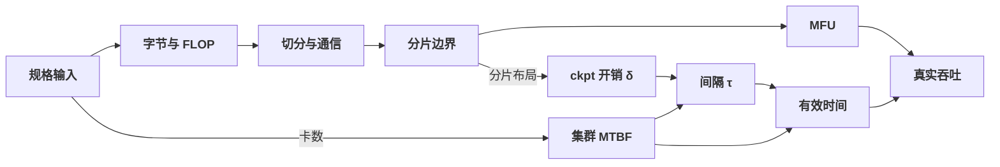

<aside class="notes" markdown="1">
这张图是总纲的量与量依赖图：规格是唯一的外部输入，其余每个量都是它的函数。两条线各自往下算——字节与 FLOP → 切分 → 分片边界 → MFU 是性能线；卡数 → M，加上分片布局推出的 δ，在 τ 处汇合成有效训练时间，是可靠性线。图上各量对应的篇目：字节与 FLOP 是第一篇，切分与通信是第二篇，分片边界是第三到六篇，MFU 是第七篇，ckpt 开销 δ 与间隔 τ 是第八篇，集群 MTBF 与有效时间是第九到十一篇。分片边界是唯一同时流向两侧的量：它既决定通信能不能重叠，也决定 checkpoint 要写哪些字节。最后 MFU 与有效训练时间是两个独立乘数，只提一个的收益会被另一个吃掉——这是系列分成前后两半的理由。
</aside>

---

## 十一篇怎么连起来

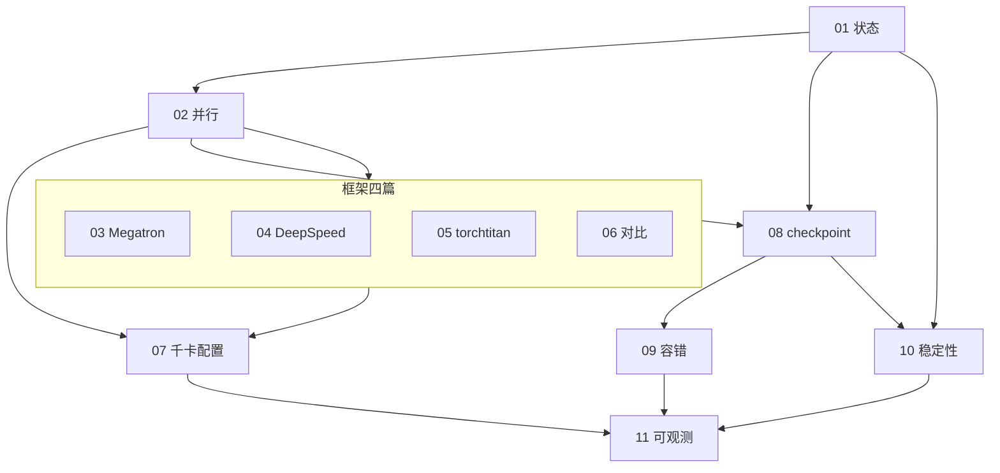

<aside class="notes" markdown="1">
箭头是推导或前置上的依赖，不是阅读顺序：箭头尾端的结论被箭头头端当作前提。01 的字节账是 02 的输入（放不下才要切），02 的切分方案是框架四篇的共同问题（同一个切法，三种容器），02 与框架四篇一起决定 07 能算出什么配置；01 与 02 决定 08 落盘哪些字节，08 的 δ 决定 09 的间隔，08 的可回放性决定 10 能回退到哪一步；07、09、10 的量都要变成 11 的指标。
</aside>

---

## 01 · 状态解剖：三种是 N 的线性函数，一种是 token 数的

**每参数 16 字节——70B 常驻 1.13 TB，一张 80 GB 卡的 14 倍**

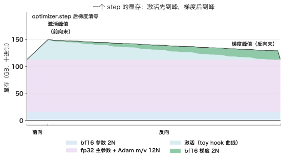{: style="max-height: 340px"}

<aside class="notes" markdown="1">
原文 /training-state-anatomy-memory-and-mfu.html。70B 每层激活 2.28 GB；每 token 449 GFLOP。
结论原文：每参数 **16 字节**（Megatron fp32 累加梯度 18）——70B 常驻 **1.13 TB**、405B 6.49 TB，是一张 80 GB 卡的 14 倍；激活每层 $$sbh(34 + 5as/h)$$，FlashAttention 后 $$34sbh$$；每 token $$6N + 6Lsh$$ FLOP。
各篇关键词：01 参数 / 梯度 / 优化器状态 / 激活的字节数与 MFU；02 每种并行切哪种状态、付哪种通信；03 Megatron / DeepSpeed / torchtitan 里找同一个系数；04 先算再试：并行搭配、micro-batch、重计算；05 三样状态写到持久存储、重分片恢复；06 故障率数学、straggler、SDC；07 让数值不跑飞；08 让字节数与位置成为指标、hang 排查。
</aside>

<!-- v -->

### 三个数的包含关系，与 MFU / HFU

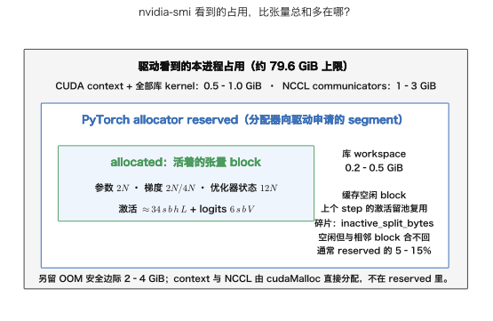{: style="max-height: 330px"}

<!-- v -->

### 要点

- 千卡 dense ≥ 40% MFU 是好成绩

<!-- v -->

### 常见误区

- **MFU 不含重计算、HFU 含**；全量重计算 \(\text{HFU}=\tfrac43\,\text{MFU}\)——「开重计算后 MFU 上去了」是误区

---

## 02 · 并行策略全景：每一个「切」对应一种通信

**并行是状态的放置方案——TP 锁 NVLink、PP 放最远**

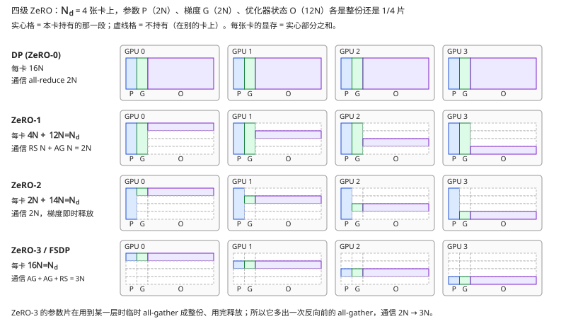{: style="max-height: 360px"}

<aside class="notes" markdown="1">
原文 /parallelism-strategies-which-state-to-shard.html。
Llama 3 论文（Dubey et al. 2024）Table 5 给的 405B 配置是**两档**，不是一档：16K 卡、$$s = 8192$$ 时 TP = 8、CP = 1、PP = 16、DP = 128（8K 卡那档 DP = 64）；长上下文阶段 $$s = 131072$$ 时 TP = 8、**CP = 16**、PP = 16、DP = 4，四维乘积 8192 张卡。本页的通信数字是 16K 卡那档：每 step TP 220 GB NVLink、DP 12.6 GB IB、PP 1 GB IB；每卡常驻 13 GB、在途激活可达 73 GB。长上下文档的 CP = 16 只多 47 GB 可重叠的 IB 通信，原因是 GQA 让 K/V 只有 Q 的 1/4–1/8。
结论原文：并行是**状态的放置方案**；不可重叠且量大的放最近（TP 锁在 NVLink 内，$$N_t \le 8$$），可重叠的放远（PP 量最小放最远）；组合顺序 **TP → CP → PP → DP**。
</aside>

<!-- v -->

### TP：列切不通信、行切要 all-reduce

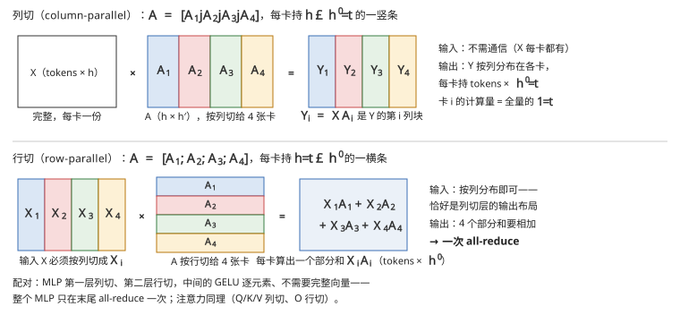{: style="max-height: 300px"}

| 并行 | 切什么 | 每 step 通信 | 链路 |
|---|---|---|---|
| DP / ZeRO-1 / ZeRO-2 | 复制 / O / O + G | 2N | 可重叠，放最远 |
| ZeRO-3 / FSDP | P + G + O | **3N** | 可重叠 |
| TP | 每层的矩阵 | 每层 2 + 2 次 all-reduce | **不可重叠**，NVLink 内 |
| PP | 层 | 层间激活，最小 | 可重叠；气泡 (p−1)/m，交错后 (p−1)/(vm) |

<!-- v -->

### PP：GPipe 与 1F1B；CP：ring attention

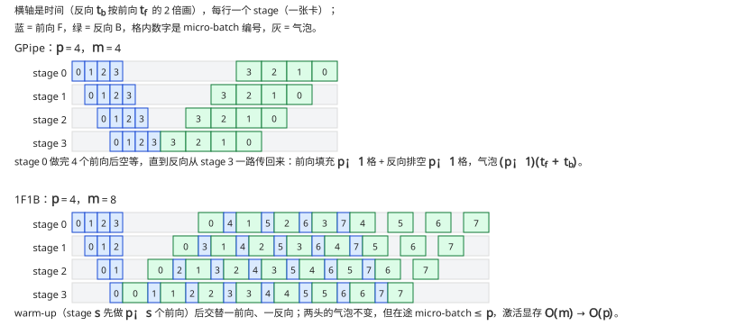{: style="max-height: 280px"}

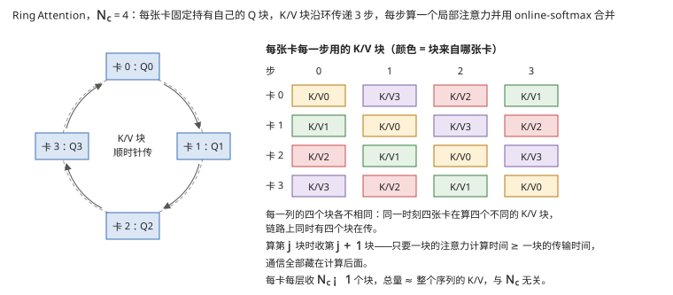{: style="max-height: 200px"}

---

## 03 · Megatron-LM：bf16 参数常驻完整

**bf16 参数拍进连续 buffer 从不释放；优化器状态按字节区间切到 DP**

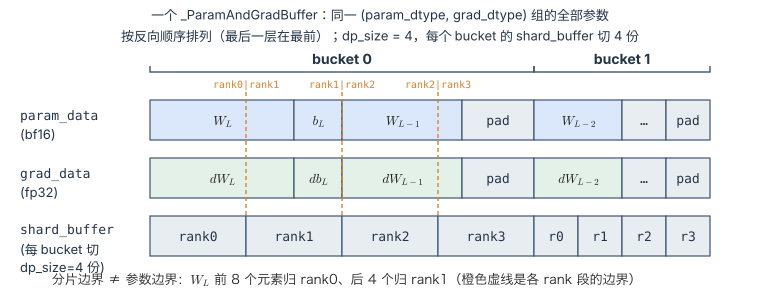{: style="max-height: 330px"}

<aside class="notes" markdown="1">
原文 /megatron-lm-architecture-and-source-guide.html。
参数 all-gather 不是在 `optimizer.zero_grad()` 里发的：`DistributedOptimizer.step_with_ready_grads()` 更新完主参数分片后调 `model_chunk.start_param_sync()`（分布式优化器只管自己那部分 bucket group 时走 `start_param_sync_for_bucket_group_subset()`），`overlap_param_gather=True` 时异步发起、逐 bucket group 接力；**等待**在下一 step 前向的 `DistributedDataParallel._make_forward_pre_hook()` 里按参数调 `finish_param_sync()`，所以下一 step 能边算边收。
</aside>

<!-- v -->

### 一个 step 的调用主线

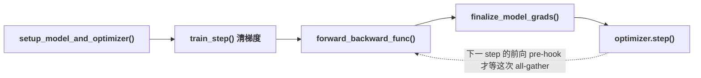

<aside class="notes" markdown="1">
三个核心对象都在 `setup_model_and_optimizer()` 里诞生：TP 分片参数、`_ParamAndGradBuffer` 的两段连续内存、按字节区间切开的 fp32 主参数分片。`train()` 把 `no_sync` / `start_grad_sync` / `start_param_sync` / `finalize_model_grads` 四个回调挂到 `config` 上，调度函数只认这四个回调。进程组由 `initialize_model_parallel()` 里的 `RankGenerator(order="tp-cp-ep-dp-pp")` 一次填进模块级全局变量。
</aside>

<!-- v -->

### 要点

- 每参数常驻 \(2+4+12/N_d\)；通信 \(\text{RS}+\text{AG}=2N\)，两处都与计算重叠

---

## 04 · DeepSpeed：参数是空壳，碎片是常态

**Stage 3：bf16 参数常驻 \(1/N_d\) 碎片，`param.data` 一个 step 换四次身份**

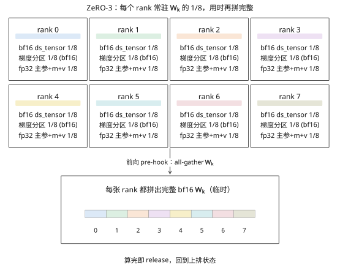{: style="max-height: 330px"}

<aside class="notes" markdown="1">
原文 /deepspeed-architecture-and-source-guide.html。
「参数是空壳」是字面意思：`_partition()` 把完整数据切成 `dp_size` 段、只留本 rank 一段进 `ds_tensor`，然后 `free_param()` 把 `param.data` 换成 `torch.empty(0)`——`param.shape` 读出来是 `(0,)`，真实形状只留在 `ds_shape` 里。窗口之外读 `param.data` 不报错，拿到的就是那个 0 元素张量。取回靠 `_pre_forward_module_hook` → `ParamCoordinator.fetch_sub_module()` → `all_gather_coalesced()`，`ds_status` 走 NOT_AVAILABLE → INFLIGHT → AVAILABLE，算完 `release_sub_module()` → `partition()` 换回空张量。
</aside>

<!-- v -->

### 要点

- 每参数常驻 \((16\text{ 或 }18)/N_d\) + 临时层；通信 \(3N\)；hook 外拿到空张量

---

## 05 · torchtitan：fp32 分片既是参数也是主参数

**bf16 不常驻：参数是 `Shard(0)` fp32 DTensor，unshard 出临时 bf16**

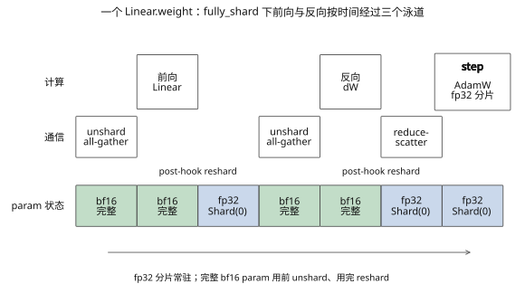{: style="max-height: 330px"}

<aside class="notes" markdown="1">
原文 /torchtitan-architecture-and-source-guide.html。
装配顺序就是架构：meta 设备上构造（只有形状没有存储）→ parallelize → `to_empty()` + `init_weights()` → 再建优化器，所以优化器拿到的已经是分片。FSDP 单元按层划分：本篇的 Llama 3.2 1B 走 `_1b()` 里 `enable_weight_tying=True` 的绑定权重那一支，`tok_embeddings`、`norm`、`lm_head` 被放进**同一个** FSDP 单元，16 个 Transformer 层各占一个；根模块那次 `fully_shard()` 没有剩下的参数可切，作用是让它成为 root。tied 后 $$N = 1{,}235{,}814{,}400$$，比 Megatron / DeepSpeed 两篇用的未绑定 1,498,482,688 少一个词表矩阵 128256×2048。
</aside>

<!-- v -->

### 要点

- 每参数常驻 \(16/N_d\) + 临时 bf16；通信 \(3N\)（不 reshard 则 \(2N\)）

---

## 06 · 三个框架对比：通信量相同，表示决定一切

**通信量相同，差别在分片的表示——DTensor 自描述可组合**

| 框架 | 每参数常驻 | 每 step 通信 | 进程组 |
|---|---|---|---|
| Megatron Core 0.18 | \(2+4+12/N_d\) | RS + AG = \(2N\) | `RankGenerator(order="tp-cp-ep-dp-pp")` |
| DeepSpeed 0.19 Stage 3 | \((16\text{ 或 }18)/N_d\) + 临时层 | AG + AG + RS = \(3N\) | `mpu` 委托 |
| torchtitan v0.3（FSDP2） | \(16/N_d\) + 临时层 | \(3N\) | `DeviceMesh` + DTensor |

<aside class="notes" markdown="1">
原文 /megatron-deepspeed-torchtitan-architecture-and-source-guide.html。
结论原文：三者通信量相同（2N 或 3N），差别在分片的**表示**——`ds_tensor` 灵活但私有、`FlatParameter` 高效但抹掉身份、`DTensor` 自描述可组合。
</aside>

<!-- v -->

### 从同一个问题分叉、合流、再分叉

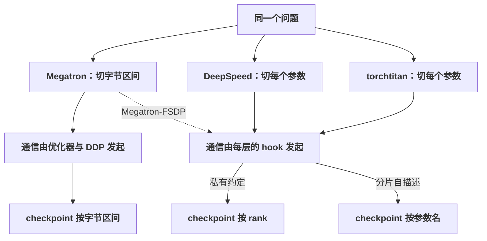

<aside class="notes" markdown="1">
四层：同一个问题 → 切的单位（字节区间 vs 每个参数）→ 谁发起通信（优化器与 DDP 的两大块 vs 每层 hook 的三小块）→ checkpoint 格式。容器决定格式：字节区间要靠偏移重建参数，`ds_tensor` 是私有约定所以换并行度要先转 universal，`DTensor` 自描述所以 DCP 能直接按参数名重分片。Megatron Core 0.18.0 的 Megatron-FSDP（`--use-megatron-fsdp`，`ShardingStrategy` 四级 NO_SHARD / OPTIM / OPTIM_GRADS / OPTIM_GRADS_PARAMS）打开后也走 hook 那条路。
</aside>

<!-- v -->

### 要点

- 选型：千卡 MFU → Megatron；零侵入放大 → DeepSpeed；新组合并行 → torchtitan

<!-- v -->

### 常见误区

- 「FSDP2 比 FSDP1 通信少所以快」——次数与量相同；差别是可组合性

---

## 07 · 千卡配置实战：70B、1024 张 H100，先算

**每卡 token 少时选 PP + ZeRO-1 不选 FSDP**

| 候选 A | 值 |
|---|---|
| 并行 | TP8 / PP4（v = 4 交错）/ DP32 |
| micro-batch | b = 1、m = 16；气泡 4.7% |
| 每卡显存 | 约 49 GB，不重计算 |
| 理论 step | 2.0 s；目标 42% MFU ≈ 4.75 s ≈ **88 万 token/s** |
| 只有 32% 时缺的 10 个点 | 配置约 6、硬件约 2、结构约 0.5、管线约 0.5 |

<aside class="notes" markdown="1">
原文 /thousand-gpu-configuration-and-mfu-tuning.html。s = 8192、global batch 4M。
结论原文：推导顺序 **TP → PP → DP → CP**；每卡 token 少时选 **PP + ZeRO-1 不选 FSDP**（FSDP128 每卡每 step 175 GB 节点间通信、3.5 s 盖不住）；MFU 损失拆成七项各自标价，先修配置错误。
显存口径（与第一篇对账）：唯一的硬约束是**静态状态 + 在途激活 + 8 GB 开销 ≤ 80 GB**，那 8 GB 是 CUDA context、NCCL buffer、库 workspace 与分配器碎片的预留，约占一成，所以留给张量的是 72 GB（约 67 GiB）。候选 A 的「约 49 GB」已含这 8 GB。
七项的顺序：① PP 气泡 ② 未重叠通信 ③ 重计算 ④ 数据等待 ⑤ kernel 效率 ⑥ CPU 发射开销 ⑦ straggler。前六项一份 trace 能测，第七项要多 rank trace 比计算时长的 max − median。④ 与 ⑥ 都是「GPU 全空」，只差 CPU 线程当时在不在 DataLoader 里；② 与 ⑦ 都是「通信 kernel 很长」，只差是带宽不够还是在等别人。
第六章那张「32% 是怎么来的」拆解表是**构造的示例**，用来演示拆解方法，不是实测。
</aside>

<!-- v -->

### 要点

- 全量重计算 +33% FLOP 省 94% 激活；FP8 step 时间降 20–25%

<!-- v -->

### 常见误区

- 「PP 加深激活就少」——1F1B 第一个 stage 同时持有 p 个 micro-batch 的激活；减激活靠 micro-batch、SP、CP、重计算

---

## 08 · 分布式 checkpoint：磁盘上是「全局张量的一组分片」

**与并行配置无关的唯一字节 → 零通信重分片；异步保存是必需不是优化**

$$
\tau_{opt} = \sqrt{2\,\delta\,M},\qquad \text{最小浪费} = \sqrt{2\delta / M}
$$

| 保存方式 | δ | τ_opt | 最小浪费（M ≈ 3.1 h） |
|---|---|---|---|
| 同步、rank-0 汇总写单文件 | 600 s | 61 min | **33%** |
| 同步、分片写到 100 GB/s 的 PFS | 60 s | 19 min | 10.4% |
| 异步、pinned + 与计算重叠 | 2 s | 3.5 min | **1.9%** |

<aside class="notes" markdown="1">
原文 /distributed-checkpoint-format-async-save-and-resharding.html。Young 公式 $$\tau_{opt} = \sqrt{2\delta M}$$，最小浪费 $$\sqrt{2\delta/M}$$；$$M \approx 3.1$$ h 来自 Llama 3 的 54 天 / 419 次意外中断。
中间那一行是「异步为什么是必需」的定量回答：同步保存在 3 小时 MTBF 下**无论如何调间隔**都要浪费 10% 以上，Llama 3 论文报告的 >90% 有效训练时间在同步保存下算不出来。异步把最优间隔压到 3.5 分钟，此时约束换成「后台写入时间 < 间隔」：5.7 TB 在 3.5 分钟内写完要 27 GB/s 聚合带宽，PFS 做得到，但每天 400 次 × 5.7 TB = 2.3 PB/天，保留策略必须跟上。
</aside>

<!-- v -->

### 常见误区

- 405B 5.7 TB：分片写每卡 350 MB 秒级；「大小随并行配置变」不成立——去掉 DP 复制的唯一字节不变

---

## 09 · 容错与弹性：故障是常态，有效时间是五项公式

**缩短有效时间：先 δ（异步保存）、再检测与重启、间隔最后**

$$
G = \frac{1 - (T_d + T_r + T_l + \tau/2)/M}{1 + \delta/\tau}
$$

| Llama 3 405B | 数 |
|---|---|
| 中断成因 | 78% 硬件、58.7% GPU；M = $$M_{gpu}/N$$，16K 卡 M ≈ 3.1 h |
| 16K 卡：同步 → 异步 → 压检测与重启 | 71% → 87% → 94% |

<aside class="notes" markdown="1">
原文 /fault-tolerance-and-elastic-training.html。Llama 3 论文第 3.3.4 节：16K 卡、54 天窗口里 466 次中断，47 次计划内、419 次意外，平均每 3.1 小时一次；意外里约 78% 归因硬件、GPU（含 HBM3）58.7%、6 次（1.4%）是 SDC。
**监视者比被监视者活得长**：NVRx 的 `ft_launcher`（`LocalElasticAgent.setup_rank_monitors_early()`）在拉起 worker **之前**就为每个 local rank fork 出一个 `RankMonitorServer` 子进程，这些监视进程**不随 worker 重启而重建**——`_start_workers()` 每次只用 `_send_cycle_to_rank_monitors()` 把新的 cycle 号发给它们，任务结束才 `shutdown_rank_monitors()`。超时后 `_shutdown_rank()` 用 `SIGKILL` 杀掉该 rank，把隐式故障转成显式故障。
**torchft 的 T_d 量级是心跳超时**：一个副本死了、心跳还没超时的那几秒里，其余副本被「等 straggler」那条规则拦着等它；心跳一超时（`heartbeat_timeout_ms` 默认 5000）它就不再算 healthy，「活着的都来了」随之成立，**新 quorum 立刻形成**。`join_timeout_ms`（默认 60 s）只是它的上限。
</aside>

<!-- v -->

### 一次故障的处理主线

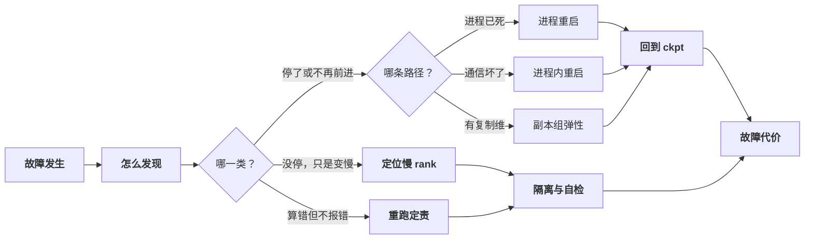

<aside class="notes" markdown="1">
图上各格对应的章节：怎么发现是第三章，三条恢复路径分别是第四、五、六章，隔离与自检是第七章，定位慢 rank 是第八章，重跑定责是第九章，故障代价回到第二章的公式。「卡住」与「算错」同样是故障，而且更难发现——这是分成三条处置路径的理由。三条恢复路径的差别只在重建的范围：进程重启把进程、CUDA、NCCL communicator 全部重建；进程内重启 abort 通信后保留进程、CUDA context 与 import，热备顶上；副本组弹性连 checkpoint 都不读，回归的副本从邻居拷参数。最后一格的那五项就是有效训练时间公式的分子，哪一项最大决定下一步缩短哪一段。
</aside>

<!-- v -->

### 要点

- 间隔由 $$\sqrt{2\delta M}$$ 决定：δ 不变缩间隔只是多付保存代价

<!-- v -->

### 常见误区

- 「straggler = 坏卡」——多数是序列长度 / stage 不均衡、每步换 rank

---

## 10 · 稳定性与数据管线：五种成因各有信号指纹

**三种形态 × 五种成因，靠事前记录的原始值归因；处理 = 回退 + 跳过**

| 成因 | 指纹 |
|---|---|
| 学习率 | 与调度拐点对齐；param norm 加速 |
| bf16 精度 | grad norm 平台后跳变 |
| attention logit | max logit 单调升过约 100 |
| 坏数据 | 换 seed / 跳 batch 后不复现 |
| 优化器状态 | 恢复 checkpoint 后仍在同一步附近 |

<aside class="notes" markdown="1">
原文 /training-stability-and-data-pipeline.html。裁剪阈值 1.0。
处置的算力代价：设 checkpoint 间隔 τ = 100 步、回退 k = 100 步、告警到处置的延迟 w = 50 步，$$T - T_c$$ 落在 [100, 200) 之间，一次处置是 $$w + (T - T_c)$$，即**约 150–250 步、均值约 200 步**；对一个 100 万步的任务是 0.02%，一次训练里 20 次 spike 合计不到 0.5%。这笔账说明回退 + 跳过是便宜的——贵的是发现它所需的信号与响应，以及让它成为可能的 checkpoint 密度与数据可回放性。
</aside>

<!-- v -->

### 归因决策树：先看发散，再依次排除

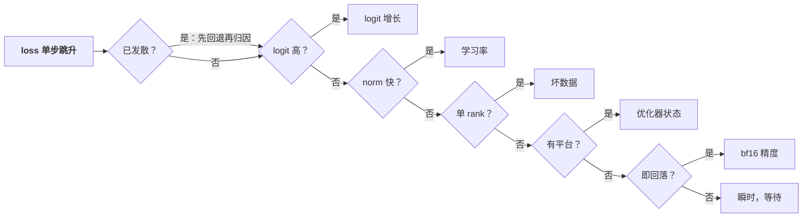

<aside class="notes" markdown="1">
菱形按「先看发散，再依次排除」的顺序问，六个判据的完整写法是：是否已 NaN 或持续上升；max attention logit 是否单调升过约 100；param norm 增速是否变快且 grad norm 缓升；是否只有某个 rank 的 max loss 远高于均值；spike 前 grad norm 是否有低于正常的平台；单步跳是否立刻回落且 num_zeros 异常。归因不是为了写报告，而是决定下一步。五种成因各自的处置：logit 增长 → 开 QK-LayerNorm 或 qk_clip，回退到上升开始之前；学习率 → 降 LR、加长 warmup、查调度拐点，回退到异常开始之前重训；坏数据 → 反查该 rank 那一步的样本，回退 + 跳过，特征加进过滤规则；优化器状态 → 回退约 100 步 + 跳过 200–500 batch（Megatron `--iterations-to-skip`），让状态与数据错相；bf16 精度 → 通常不处理，核对精度纪律检查表。瞬时 spike 多数 50–100 步内自行回落。
</aside>

<!-- v -->

### 要点

- PaLM：回退约 100 步 + 跳过 200–500 batch，代价约 150–250 步 / 次（均值约 200）
- 100 万步的任务一次 0.02%；20 次不到 0.5%——贵的是信号与基础设施，不是处置

<!-- v -->

### 常见误区

- 「loss spike 就是脏数据」——五种里两种是模型内部数值问题

---

## 11 · 可观测与运维：「step 是否前进」是 hang 唯一可靠的信号

**利用率 100% 照样可能在 hang——NCCL kernel 自旋**

| 凌晨三点 step 12 s → 40 s，四个嫌疑 | 决定性指标 |
|---|---|
| straggler | Timers minmax（哪个 rank 最慢、是否每步换） |
| 数据 | `data_loading(%)` |
| 通信 | 通信等待 + IB 端口计数器 |
| 降频 | `SM_CLOCK` |

<aside class="notes" markdown="1">
原文 /long-running-training-observability-and-operations.html。
结论原文：三层指标（任务 / 进程 / 硬件）、**按 rank 看、以 step 为时钟**；GPU 利用率 100% 时照样可能在 hang（NCCL kernel 自旋）；Flight Recorder 指出哪个 rank 缺席哪次集合通信。
</aside>

<!-- v -->

### 从一个症状到一个结论

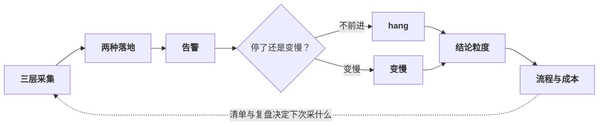

<aside class="notes" markdown="1">
图上各格对应的章节：三层采集与两种落地是第二章，告警是第五章，hang 是第三章，变慢是第四章，流程与成本是第六、七章。三层里「step 是否前进」是唯一能区分「在跑」和「卡住」的量。TensorBoard / W&B 与 Prometheus 有重叠但职责不换：一个存按 step 的曲线供分析，一个存按时间与 rank 的时序供告警。先分 hang / 变慢这一刀，是因为两条路径之后用的工具几乎没有交集。Flight Recorder 在 PyTorch 2.13.0 里默认开（`TORCH_FR_BUFFER_SIZE` 2000、`TORCH_NCCL_DUMP_ON_TIMEOUT` true、`ENABLE_MONITORING` true），要做的不是开它，而是把 `TORCH_FR_DUMP_TEMP_FILE` 指到事后能收集到的路径、缓冲加到 2 万、`ASYNC_ERROR_HANDLING` 保持 3（设成 1 时 watchdog 会先 abort，dump 来不及完成）。
</aside>

<!-- v -->

### 要点

- Flight Recorder 2.13.0 默认开（buffer 2000）；把 dump 路径接好、缓冲加到 2 万
- 2.5 美元 / 卡时下 1 个 MFU 点 ≈ 30 天任务的 0.71 天 ≈ **4.4 万美元**

---

## 四种状态在十一篇里

| 状态 | 01 多少 | 02–07 放哪 | 08 落盘 | 09 重建 | 10 数值 | 11 指标 |
|---|---|---|---|---|---|---|
| 参数 | 2N bf16 + 4N fp32 | TP / ZeRO-3 切 | 4 B（fp32 主）| 重分片加载 | param norm | 每 rank 显存 |
| 梯度 | 2N（Megatron fp32 则 4N） | DP 归约 | 不落 | — | grad norm、裁剪 | 通信等待 |
| 优化器状态 | 8N | ZeRO-1 切 | 8 B | 重分片 | 恢复后仍 spike → 是它 | — |
| 激活 | sbh(34 + 5as/h) | PP / CP / 重计算 | 不落 | — | max logit | 峰值显存 |

---

## 常见误区（一）

- 「bf16 训练每参数 2 字节」——16 字节，70B 1.13 TB
- 「开重计算后 MFU 上去了」——只计入 HFU
- 「TP 通信量最大所以最贵」——贵在不可重叠
- 「ZeRO-2 比 ZeRO-1 多通信」——都是 2N
- 「FSDP2 比 FSDP1 通信少」——差别是表示
- 「千卡上用 FSDP 代替 PP 更快」——每卡 4096 token 摊不薄参数通信
{: .fragments}

---

## 常见误区（二）

- 「PP 加深激活就少」——1F1B 持有 p 份
- 「checkpoint 大小随并行配置变」——唯一字节不变
- 「异步 checkpoint 是锦上添花」——同步最小浪费 ≥ 10%
- 「有效时间低先缩间隔」——先 \(\delta\)、再 \(T_d\)、再 \(T_r\)
- 「straggler = 坏卡」——多数每步换 rank
- 「GPU 利用率 100% 说明训练正常」——hang 时也 100%
{: .fragments}

---

## 十一个出口

| 篇 | 一个公式 / 一个数 |
|---|---|
| 01 | 16 B / 参数；$$sbh(34 + 5as/h)$$；$$6N + 6Lsh$$；HFU = 4/3 MFU |
| 02 | DP 2N / ZeRO-3 3N；TP ≤ 8；气泡 (p−1)/(vm)；TP → CP → PP → DP |
| 03 | 常驻 2 + 4 + 12/N_d；RS + AG = 2N；`start_param_sync` 发 all-gather |
| 04 | 常驻 (16 或 18)/N_d；3N；`free_param()` 换成 `torch.empty(0)` |
| 05 | 常驻 16/N_d；3N（不 reshard 则 2N）；fp32 分片就是主参数 |
| 06 | 通信量相同，容器决定 checkpoint 格式：buffer / ds_tensor / DTensor |
| 07 | TP8 / PP4 / DP32，b = 1、m = 16；42% ≈ 88 万 token/s；缺的 10 点 = 6 + 2 + 0.5 + 0.5 |
| 08 | $$\tau_{opt} = \sqrt{2\delta M}$$；405B 5.7 TB、每卡 350 MB；33% → 1.9% |
| 09 | $$G = \frac{1 - (T_d + T_r + T_l + \tau/2)/M}{1 + \delta/\tau}$$；419 次 / 54 天；71% → 87% → 94% |
| 10 | 3 形态 × 5 成因；max logit > 100；回退 100 + 跳 200–500 ≈ 200 步 / 次 |
| 11 | step 是否前进；FR buffer 2 万；1 MFU 点 ≈ 4.4 万美元 |

---

## 下一步

- **往下**：《通信与互联：从 NCCL 到 RDMA》——2N / 3N 的每一次通信走哪条链路；《分布式 PyTorch》——DDP / FSDP 的源码
- **往旁**：《AI 平台工程：资源层与交付层》——千卡怎么调度、故障怎么隔离；《RL 后训练基础设施》——训练引擎里再塞一个推理引擎
- **算法侧**：《训练配方与稳定性：学习率、batch、调度与 loss spike》——同一件事的算法视角
- 原文总纲：`/large-scale-training-from-parallelism-to-fault-tolerance.html`；通关自测在系列总结
