## 大模型推理系统揭秘

### 从动态请求到推理操作系统

**十五篇正文 · 一条请求路径 · 一切围绕动态请求、KV 状态与 GPU 资源**

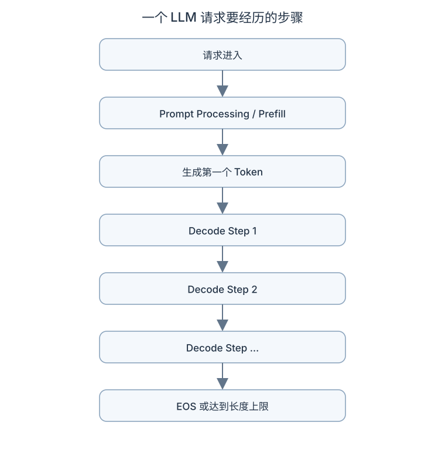{: style="max-height: 420px"}

<aside class="notes" markdown="1">
系列总纲：[/deep-dive-into-vllm.html](/deep-dive-into-vllm.html)。第 16 篇是系列总结与通关自测。主线：Serving 难点 → 指标 → 系统全景 → 调度、内存、执行 → 多卡和 PD → 模型、请求、硬件适配 → 未来、源码与 SGLang 对照。
</aside>

---

## 这个系列回答一个问题

> 一个持续生成的请求，如何在 SLO、KV 显存与 GPU 算力之间被系统持续协调？

- KV Cache 是随生成增长的状态；调度的单位是 token。
- 01–15：定义问题、建立指标、逐层拆系统，再用源码和第二个引擎检验分析框架。
- 目标不是最大 batch，而是在 SLO 约束下选择合适的执行规模。

<aside class="notes" markdown="1">
系列总纲：[/deep-dive-into-vllm.html](/deep-dive-into-vllm.html)。第 16 篇：[/deep-dive-into-vllm-series-recap-and-self-test.html](/deep-dive-into-vllm-series-recap-and-self-test.html)。
</aside>

---

## 全景：从请求问题到第二套系统

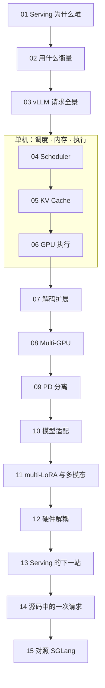

<aside class="notes" markdown="1">
01 [/why-llm-serving-is-hard.html](/why-llm-serving-is-hard.html)；02 [/how-to-measure-llm-serving.html](/how-to-measure-llm-serving.html)；03 [/vllm-request-lifecycle-overview.html](/vllm-request-lifecycle-overview.html)；04 [/scheduler-batch-and-fairness.html](/scheduler-batch-and-fairness.html)；05 [/kv-cache-memory-core.html](/kv-cache-memory-core.html)；06 [/gpu-execution-kernels-and-graphs.html](/gpu-execution-kernels-and-graphs.html)；07 [/decoding-extensions-sampling-speculative-and-structured-output.html](/decoding-extensions-sampling-speculative-and-structured-output.html)；08 [/multi-gpu-scaling-strategies.html](/multi-gpu-scaling-strategies.html)；09 [/prefill-decode-disaggregation.html](/prefill-decode-disaggregation.html)；10 [/model-adaptation-architecture.html](/model-adaptation-architecture.html)；11 [/request-shapes-multi-lora-and-multimodal.html](/request-shapes-multi-lora-and-multimodal.html)；12 [/hardware-abstraction-and-portability.html](/hardware-abstraction-and-portability.html)；13 [/future-of-serving-infra.html](/future-of-serving-infra.html)；14 [/source-code-request-walkthrough.html](/source-code-request-walkthrough.html)；15 [/vllm-vs-sglang.html](/vllm-vs-sglang.html)。系列总结：[/deep-dive-into-vllm-series-recap-and-self-test.html](/deep-dive-into-vllm-series-recap-and-self-test.html)。
</aside>

---

## 01 · 为什么 LLM Serving 比传统推理难

**Llama-3-70B、8×H100：每 token KV 320 KB、每请求约 734 MB**

{: style="max-height: 400px"}

<aside class="notes" markdown="1">
原文：[/why-llm-serving-is-hard.html](/why-llm-serving-is-hard.html)。难点从一次性静态前向，变成动态执行、带状态生成和 Prefill/Decode 混合 workload；同一组算账基于 Llama-3-70B、8×H100。
</aside>

<!-- v -->

### Prefill 与 Decode 争用不同资源

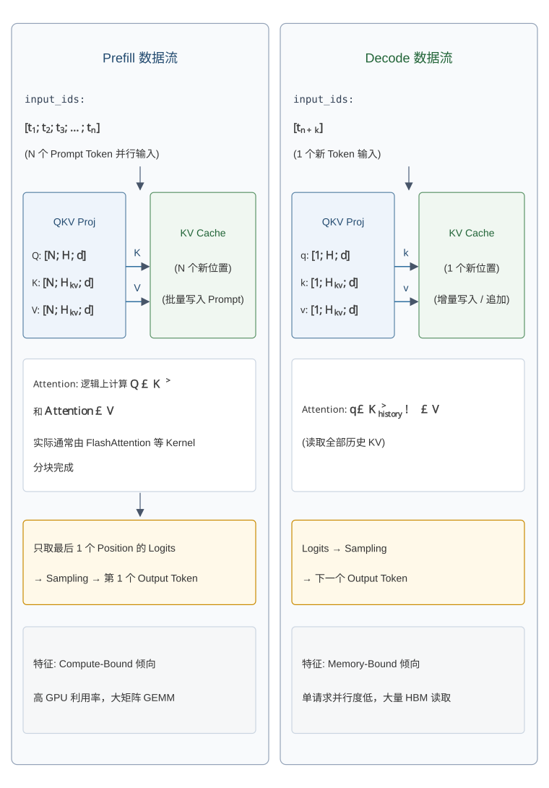{: style="max-height: 390px"}

**Prefill 偏计算密集，Decode 偏内存带宽；两者竞争同一组 GPU 资源。**

<aside class="notes" markdown="1">
原文：[/why-llm-serving-is-hard.html](/why-llm-serving-is-hard.html)。Decode 从 batch 1 到 64，单步时间从 5.3 ms 到 7.0 ms；batch 256 时 KV 读取达到 24 GB。
</aside>

---

## 02 · 如何衡量：吞吐、延迟与 Goodput

**吞吐算系统做了多少，延迟算用户等多久，Goodput 算 SLO 内有效工作**

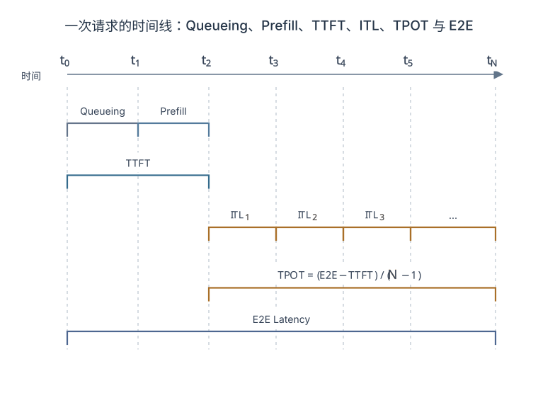{: style="max-height: 420px"}

<aside class="notes" markdown="1">
原文：[/how-to-measure-llm-serving.html](/how-to-measure-llm-serving.html)。指标覆盖延迟（TTFT、TPOT、ITL、E2E）、吞吐（Tokens/s、Requests/s、Goodput）、效率和质量；对比 benchmark 前需先统一统计口径。
</aside>

---

## 03 · 鸟瞰 vLLM：4+1 视图落到一次请求

**Executor 是引擎内对象：DP 定 EngineCoreProc 数、TP×PP 定 WorkerProc 数**

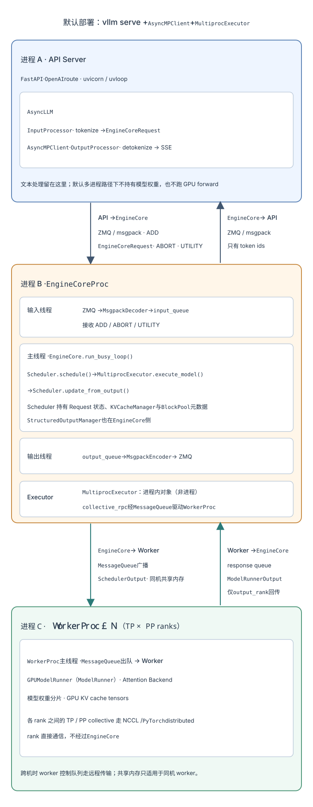{: style="max-height: 390px"}

<aside class="notes" markdown="1">
原文：[/vllm-request-lifecycle-overview.html](/vllm-request-lifecycle-overview.html)。Kruchten 4+1：逻辑、开发、进程、部署/物理四个视图，加上串联它们的场景。vLLM v0.27.1：world_size=1 默认选 UniProcExecutor，Worker 在 EngineCore 进程内初始化，没有 WorkerProc；多进程模式下 Executor 进程内调度 WorkerProc。DP size 对应 EngineCoreProc 数；每个 EngineCoreProc 内按 TP×PP×PCP rank 启动 WorkerProc；EP 复用已有 rank、不新增进程。
</aside>

<!-- v -->

### 4+1：部署视图

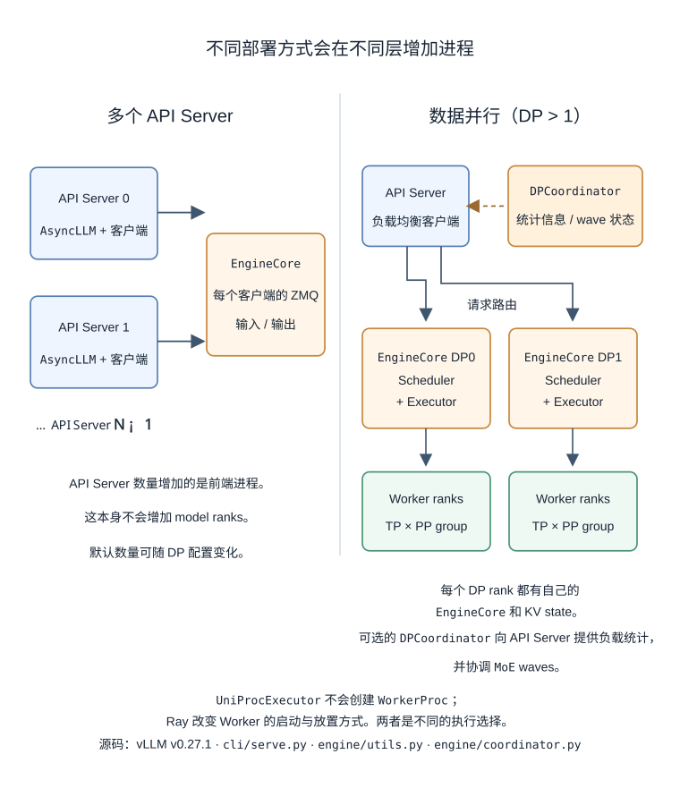{: style="max-height: 410px"}

**DP rank 各有一个 EngineCoreProc；每个执行 rank 对应一个 WorkerProc。**

<aside class="notes" markdown="1">
原文：[/vllm-request-lifecycle-overview.html](/vllm-request-lifecycle-overview.html)。源码版本 v0.27.1。EP 在既有 DP×TP rank 上执行，不额外创建进程。
</aside>

<!-- v -->

### 4+1：token 如何穿过 Serving 栈

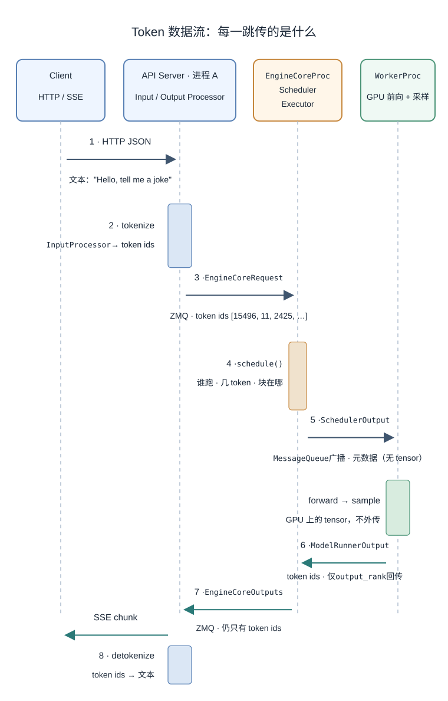{: style="max-height: 410px"}

**跨进程传递的是请求元数据、token IDs 与调度结果，不是完整模型状态。**

<aside class="notes" markdown="1">
原文：[/vllm-request-lifecycle-overview.html](/vllm-request-lifecycle-overview.html)。文本在 API Server tokenize，进程边界上传 token IDs；采样结果返回后在 API Server detokenize。
</aside>

<!-- v -->

### 4+1：一个 token 的回程

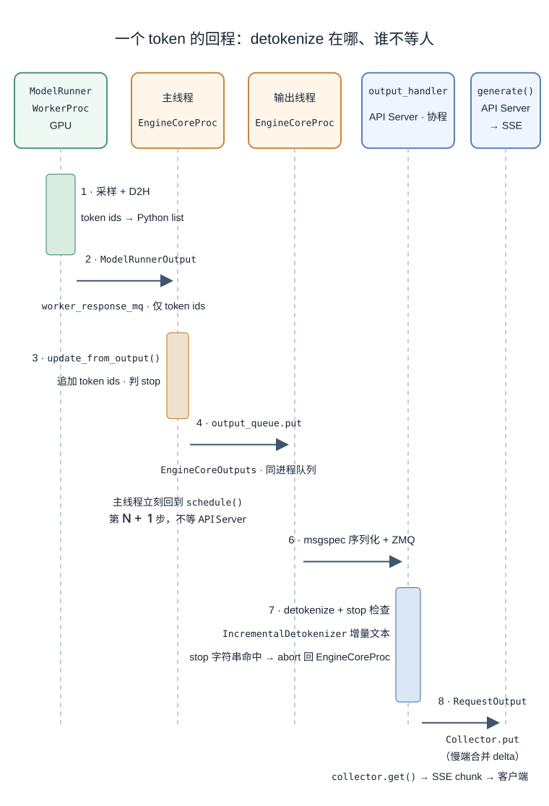{: style="max-height: 410px"}

**主线程立即回到 schedule；序列化走输出线程，detokenize 与 stop 检查在进程 A。**

<aside class="notes" markdown="1">
原文：[/vllm-request-lifecycle-overview.html](/vllm-request-lifecycle-overview.html)。stop 字符命中后 abort_requests_async 回到 B；RequestOutputCollector 合并 deltas，再由 generate() 发 SSE。
</aside>

<!-- v -->

### 4+1：开发视图与包依赖

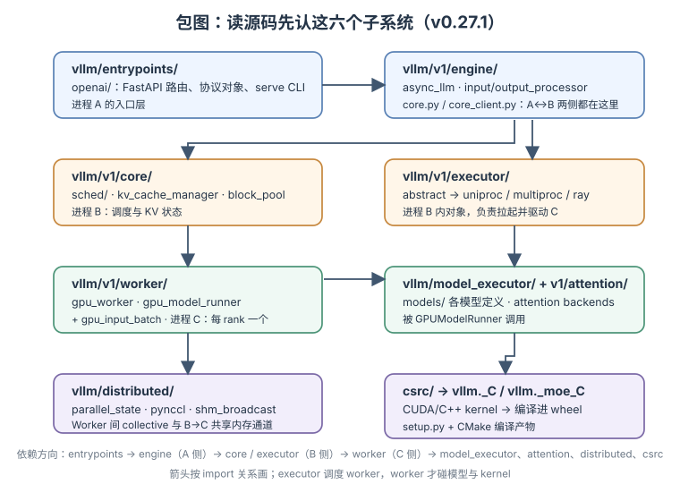{: style="max-height: 410px"}

**包图沿实际 import 展开；csrc 经 CMake / setup.py 编译进 Python wheel。**

<aside class="notes" markdown="1">
原文：[/vllm-request-lifecycle-overview.html](/vllm-request-lifecycle-overview.html)。模块覆盖 entrypoints、v1/engine、core、executor、worker、model_executor、attention、distributed 与 csrc；包图和构建说明以 v0.27.1 源码为准。
</aside>

---

## 04 · Scheduler：每轮按 token 推进请求

**每轮结合 token budget、请求状态与 KV 空间，决定运行哪些请求、每个请求推进多少 token。**

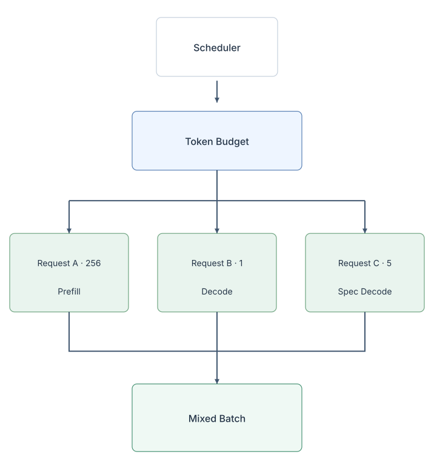{: style="max-height: 410px"}

<aside class="notes" markdown="1">
原文：[/scheduler-batch-and-fairness.html](/scheduler-batch-and-fairness.html)。Continuous Batching、Chunked Prefill 与 Mixed Batch 都是同一资源调度模型的结果；KV 不足时按策略抢占并重算。
</aside>

---

## 05 · KV Cache：管理增长中的状态

**block_size=16；2,050 token 占 129 块，Prefix Cache 只复用满块**

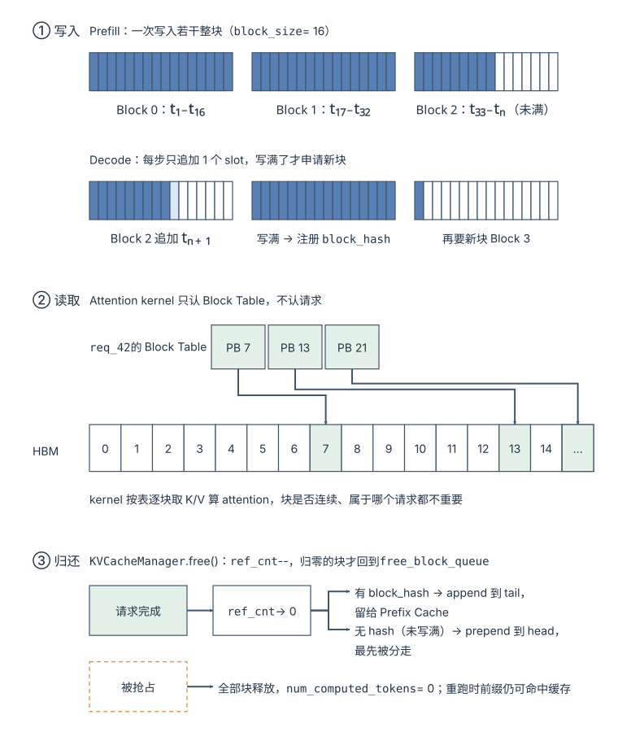{: style="max-height: 400px"}

<aside class="notes" markdown="1">
原文：[/kv-cache-memory-core.html](/kv-cache-memory-core.html)。固定大小的块按需分配；请求持 block table。示例中 2,000 token 前缀对应 125 个整块，可由后续请求复用。
</aside>

---

## 06 · GPU 执行：减少等待、搬运与轮次

**Decode 权重读取下界约 5.3 ms、实测约 10 ms；decode 占总时 97%**

{: style="max-height: 400px"}

<aside class="notes" markdown="1">
原文：[/gpu-execution-kernels-and-graphs.html](/gpu-execution-kernels-and-graphs.html)。Prefill 2,050 token 约 92 ms；300 步 decode 约 3,000 ms，占总时间 97%。四种浪费是 CPU launch、HBM 等待、数值过胖与解码轮次过多。
</aside>

---

## 07 · 解码扩展：不只改 Sampler

**接受长度 2.5、batch 1 时约 2.1×；batch 128 时每步慢 1.9 倍**

{: style="max-height: 400px"}

<aside class="notes" markdown="1">
原文：[/decoding-extensions-sampling-speculative-and-structured-output.html](/decoding-extensions-sampling-speculative-and-structured-output.html)。投机解码改变每步决定的位置数，并牵动预算、KV 预留和 CUDA Graph；结构化输出改变分布的支撑集与请求状态。
</aside>

---

## 08 · Multi-GPU：按瓶颈切分模型与请求

**TP/PP/EP/CP 解决装不下，DP 解决要更多吞吐且在最外层**

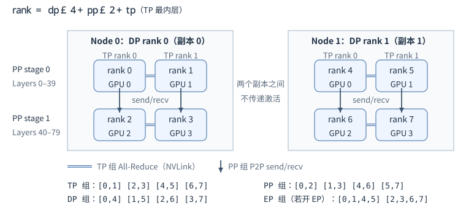{: style="max-height: 400px"}

<aside class="notes" markdown="1">
原文：[/multi-gpu-scaling-strategies.html](/multi-gpu-scaling-strategies.html)。TP decode 每步每层需要同步，80 层共 160 次 all-reduce，通信在关键路径上；PP 只在 stage 边界传激活。
</aside>

---

## 09 · PD 分离：状态交接需要明确契约

**匹配≠就绪、算完≠可回收；分离换来配置自由与交接成本**

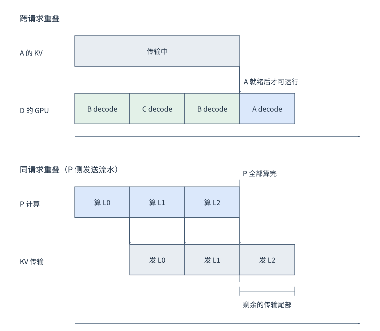{: style="max-height: 400px"}

<aside class="notes" markdown="1">
原文：[/prefill-decode-disaggregation.html](/prefill-decode-disaggregation.html)。分离后 P、D 两侧仍各自管理本地计算与内存；Connector 管状态交接，外围编排连接请求与池级资源。
</aside>

---

## 10 · 模型适配：变化落在哪一层

**模型层管结构，运行时层管调度/Cache/并行，算子层管 Kernel**

{: style="max-height: 400px"}

<aside class="notes" markdown="1">
原文：[/model-adaptation-architecture.html](/model-adaptation-architecture.html)。适配分为模型、运行时和算子三层；运行时层往往最贵，因为新状态形状会影响调度、缓存布局与执行路径。
</aside>

---

## 11 · 请求形态：multi-LoRA 与多模态

**8 个 rank-16 槽位静态占 1.44 GB/卡，与实际加载数无关**

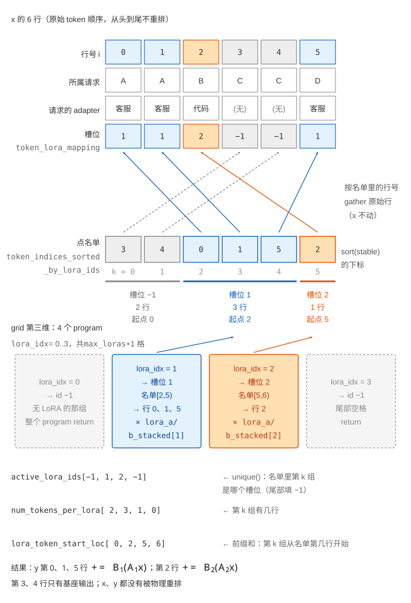{: style="max-height: 390px"}

<aside class="notes" markdown="1">
原文：[/request-shapes-multi-lora-and-multimodal.html](/request-shapes-multi-lora-and-multimodal.html)。LoRA FLOPs 只多 0.2%，但每步多 1,120 次 kernel launch；图片贵在持续驻留的 KV，而不是短命的 encoder 输出。
</aside>

<!-- v -->

### 多模态：图片 token 的 KV 成本

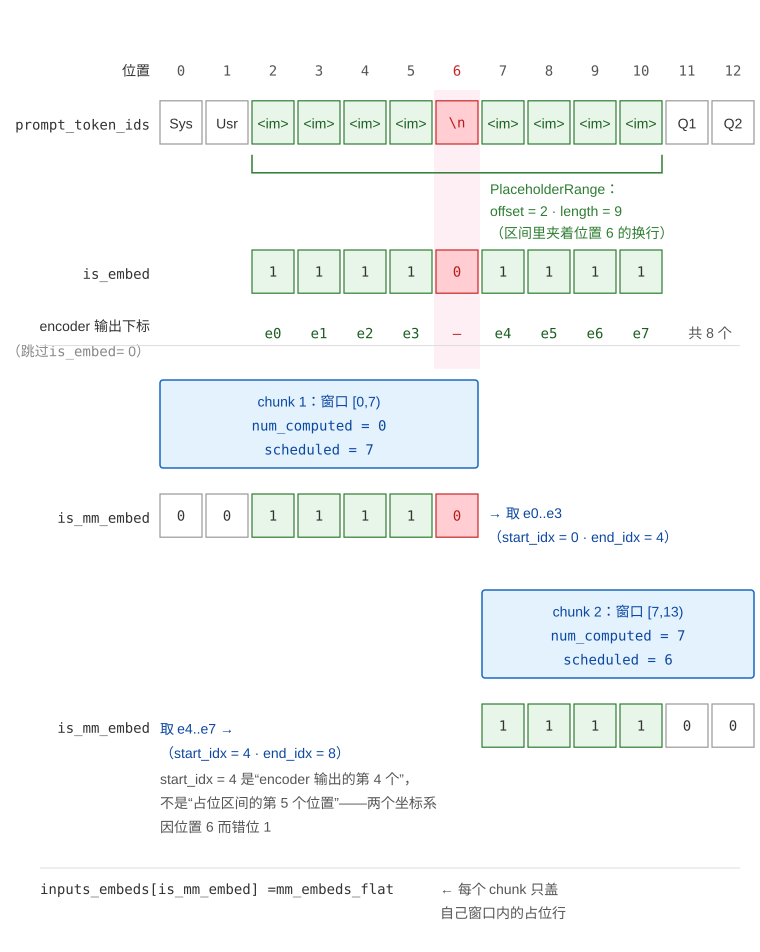{: style="max-height: 400px"}

**一张图 encoder 输出 9–22 MB，它占的 KV 184–438 MB，约 20 倍**

<aside class="notes" markdown="1">
原文：[/request-shapes-multi-lora-and-multimodal.html](/request-shapes-multi-lora-and-multimodal.html)。图片示例 576 或 1,369 个 token；encoder 输出短命，KV 在生成期间持续驻留。
</aside>

---

## 12 · 硬件解耦：Platform 是边界，不是万能胶

**核心依赖抽象能力而非具体芯片；OOT 靠主仓库的稳定契约**

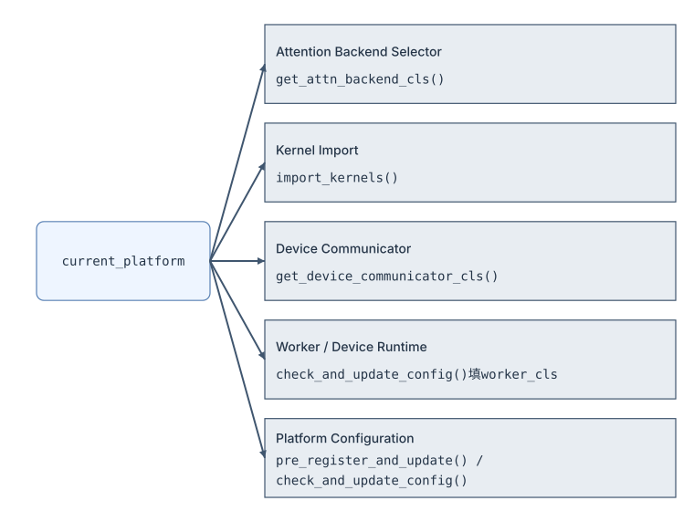{: style="max-height: 400px"}

<aside class="notes" markdown="1">
原文：[/hardware-abstraction-and-portability.html](/hardware-abstraction-and-portability.html)。Platform 是硬件能力中心，不是所有底层组件的唯一父类；Serving Core、抽象契约、平台实现、硬件运行时与 Kernel 形成多层边界。
</aside>

---

## 13 · Serving 的下一站：分布式智能操作系统

**四转变：配置→自动计划、缓存→分布式状态、执行→多阶段、目标→Goodput**

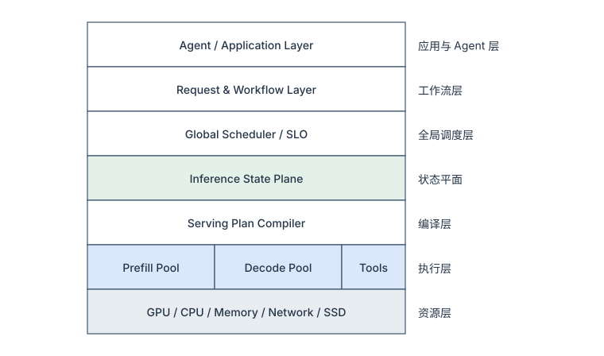{: style="max-height: 400px"}

<aside class="notes" markdown="1">
原文：[/future-of-serving-infra.html](/future-of-serving-infra.html)。未来系统还要管理可编排计算、可迁移状态、可恢复请求、异构资源和动态执行计划；vLLM 当前代表 Runtime 层。
</aside>

---

## 14 · 回到源码：一次请求的真实旅程

**同一请求五笔账：734 MB KV、5 段 chunk、decode 3,000 ms**

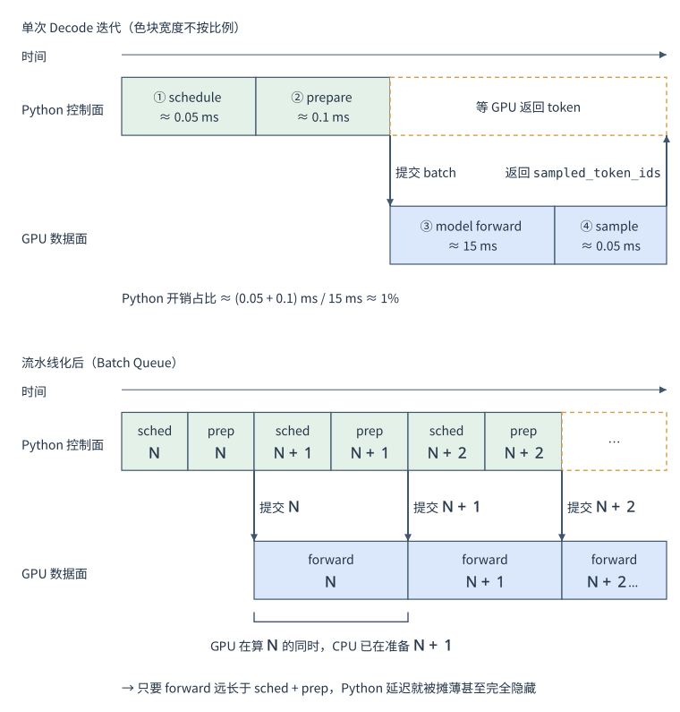{: style="max-height: 400px"}

<aside class="notes" markdown="1">
原文：[/source-code-request-walkthrough.html](/source-code-request-walkthrough.html)。完整数字来自正文汇总表：KV 147 块/734 MB；chunk=512 时 2,050 token 分 5 段；92 ms Prefill + 3,000 ms Decode；每 token 每步 8 卡同步约 2.5 MB；跨节点搬 KV 641 MB、约 13 ms。
</aside>

---

## 15 · vLLM 与 SGLang：同一请求，两种状态组织

| 维度 | vLLM v0.27.1 | SGLang v0.5.18 |
|---|---|---|
| 出发点 | PagedAttention：显存碎片 → 块 | RadixAttention：前缀复用 → 树 |
| 调度 | 一个调度器，token 预算，无阶段 | 每 rank 一份调度器，prefill 优先 |
| KV | block hash、`block_table` | RadixCache、`req_to_token` |
| 进程 | SchedulerOutput 跨进程到 WorkerProc | Scheduler 与 ModelRunner 同进程 |

**一句话：vLLM 是“一个调度器 + 块”，SGLang 是“N 个相同调度器 + 树”。**

<aside class="notes" markdown="1">
原文：[/vllm-vs-sglang.html](/vllm-vs-sglang.html)。两边功能面已重叠；结构差异来自状态归属与最初要解决的问题，而非单一 benchmark 排名。版本以正文标注的 vLLM v0.27.1 与 SGLang v0.5.18 为准。
</aside>

---

## 两条判断贯穿十五篇

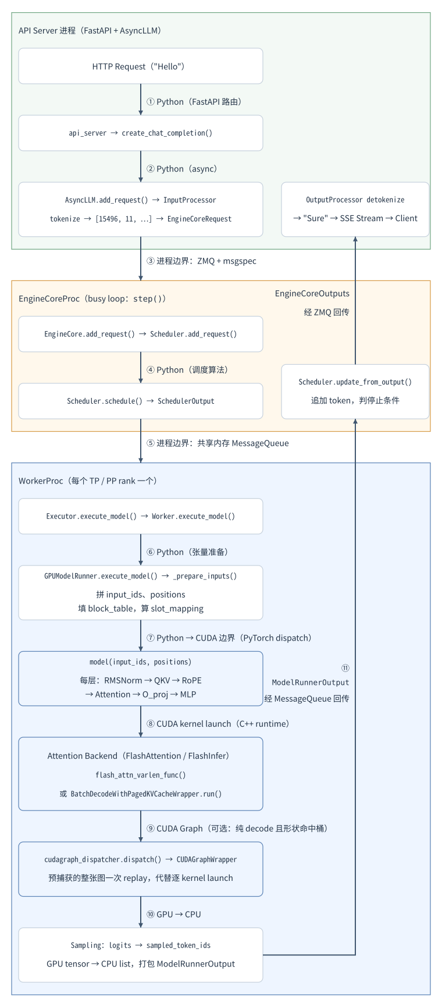{: style="max-height: 400px"}

- **KV 是一切约束的源头**：并发上限、抢占、前缀复用、Decode 带宽与 PD 交接。
- **调度单位是 token**：budget、chunk、投机 lookahead 与 encoder 预算都围绕 token 推进。

<aside class="notes" markdown="1">
系列总结：[/deep-dive-into-vllm-series-recap-and-self-test.html](/deep-dive-into-vllm-series-recap-and-self-test.html)。第 16 篇回顾十五篇正文并提供通关自测。
</aside>

---

## 常见误区

- “最大 batch 就是目标”——目标是在 SLO 下的 Goodput。
- “TTFT 等于 Prefill 时间”——TTFT 包含排队。
- “Prefix Cache 按 token 复用”——复用单位是完整块。
- “CUDA Graph 把 forward 融成超级 kernel”——它重放 kernel 序列，主要减少 launch 开销。
- “投机解码总能加速”——batch 与 draft 负载可能抵消验证收益。
- “图片贵在 encoder”——持续驻留的图片 KV 更大。
{: .fragments}

<aside class="notes" markdown="1">
对应原文：[/how-to-measure-llm-serving.html](/how-to-measure-llm-serving.html)、[/kv-cache-memory-core.html](/kv-cache-memory-core.html)、[/gpu-execution-kernels-and-graphs.html](/gpu-execution-kernels-and-graphs.html)、[/decoding-extensions-sampling-speculative-and-structured-output.html](/decoding-extensions-sampling-speculative-and-structured-output.html)、[/request-shapes-multi-lora-and-multimodal.html](/request-shapes-multi-lora-and-multimodal.html)。
</aside>

---

## 下一步

- **系列总结**：第 16 篇 [/deep-dive-into-vllm-series-recap-and-self-test.html](/deep-dive-into-vllm-series-recap-and-self-test.html)
- **往下**：《GPU Kernel 工程》与《通信与互联》——继续看 FlashAttention、PagedAttention、All-Reduce 与 KV 传输。
- **往旁**：《扩散模型推理 Infra》与《RL 后训练 Infra》——比较另一种 Serving 工作负载及训练中的推理引擎。
- **回看总纲**：[/deep-dive-into-vllm.html](/deep-dive-into-vllm.html)

<aside class="notes" markdown="1">
正文顺序为 01–15；系列总结与自测编号为 16。所有结论与数字以对应正文为准。
</aside>
