## 大模型推理系统揭秘

### 从动态请求到推理操作系统

**十五篇正文 · 一条请求路径 · 一切围绕动态请求、KV 状态与 GPU 资源**

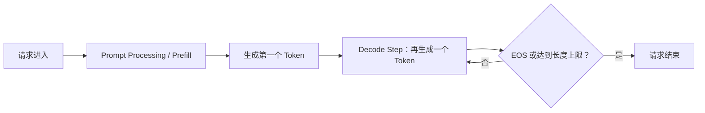

<aside class="notes" markdown="1">
系列总纲：[/deep-dive-into-vllm.html](/deep-dive-into-vllm.html)。第 16 篇是系列总结与通关自测。主线：Serving 难点 → 指标 → 系统全景 → 调度、内存、执行（含投机解码）→ 多卡和 PD → 输入、输出、模型、硬件适配 → 未来、源码与 SGLang 对照。
</aside>

---

## 这个系列回答一个问题

> 一个持续生成的请求，如何在 SLO、KV 显存与 GPU 算力之间被系统持续协调？

- KV Cache 是随生成增长的状态；调度的单位是 token。
- 01–15：定义问题、建立指标、逐层拆系统，再用源码和第二个引擎检验分析框架。
- 目标不是最大 batch，而是在 SLO 约束下选择合适的执行规模。

<aside class="notes" markdown="1">
系列总纲：[/deep-dive-into-vllm.html](/deep-dive-into-vllm.html)。第 16 篇：[/deep-dive-into-vllm-series-recap-and-self-test.html](/deep-dive-into-vllm-series-recap-and-self-test.html)。
</aside>

<!-- v -->

### 版本：基于 vLLM v0.27.1，之后的变化

| 变化 | 版本 | 涉及 |
|---|---|---|
| Model Runner V2 成为默认，V1 只作回退 | v0.29 | 03 · 06 · 10 · 14 |
| 持有 KV 的等待请求单独排队、优先调度 | v0.31 | 04 · 08 |
| TP all-reduce 默认走 FlashInfer | v0.29 | 07 |
| `max_num_batched_tokens` 默认 8192 → 16384 | v0.28 | 04 · 09 |
| 删除 Medusa 与旧 Ray executor | v0.33 rc | 03 · 06 |

<aside class="notes" markdown="1">
版本提示 @2026-11-12。全系列源码钉在 v0.27.1（2026-08-11）；截至 v0.32.0（2026-10-18），分层架构（API Server → AsyncLLM → EngineCore → Executor → Worker）与进程间通信不变，变化集中在 ModelRunner 层：v0.29.0 起 `vllm/v1/worker/gpu/` 的 Model Runner V2 是默认实现，有自己的 CUDA Graph 管理、采样器、logits processor 接口和投机解码子包；V1 的 `gpu_model_runner.py` 被宣布弃用，v0.32.0 中仍在。另有 prefix cache 的 `NONE_HASH` 默认改为确定值（v0.29，第 05 篇）。完整清单见总纲「版本与硬件基线」：[/deep-dive-into-vllm.html#版本与硬件基线](/deep-dive-into-vllm.html#版本与硬件基线)。
</aside>

---

## 全景：一个问题被不断放大

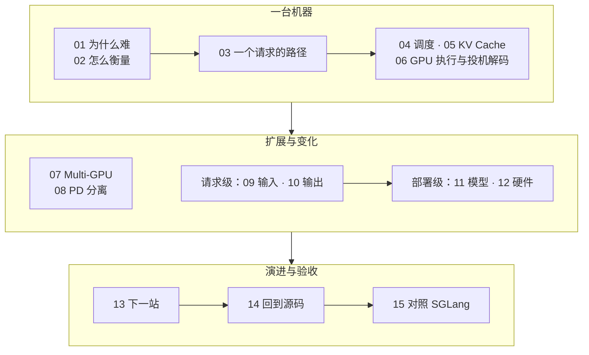

<!-- v -->

### 单机段与变化段的分界：改不改输出

| 机制 | 输出分布 | 归属 |
|---|---|---|
| 投机解码 | 不变（拒绝采样保证无损） | 06 执行效率 |
| 采样参数、结构化输出 | 改变「输出什么」 | 10 输出在变 |
| multi-LoRA、多模态 | 每个请求带进来的东西不同 | 09 输入在变 |

**变化段按粒度排：请求级（09、10，同一 batch 逐请求不同）→ 部署级（11、12，实例启动时定下）。**

<aside class="notes" markdown="1">
01 [/why-llm-serving-is-hard.html](/why-llm-serving-is-hard.html)；02 [/how-to-measure-llm-serving.html](/how-to-measure-llm-serving.html)；03 [/vllm-request-lifecycle-overview.html](/vllm-request-lifecycle-overview.html)；04 [/scheduler-batch-and-fairness.html](/scheduler-batch-and-fairness.html)；05 [/kv-cache-memory-core.html](/kv-cache-memory-core.html)；06 [/gpu-execution-kernels-and-graphs.html](/gpu-execution-kernels-and-graphs.html)；07 [/multi-gpu-scaling-strategies.html](/multi-gpu-scaling-strategies.html)；08 [/prefill-decode-disaggregation.html](/prefill-decode-disaggregation.html)；09 [/request-shapes-multi-lora-and-multimodal.html](/request-shapes-multi-lora-and-multimodal.html)；10 [/output-changes-sampling-and-structured-output.html](/output-changes-sampling-and-structured-output.html)；11 [/model-adaptation-architecture.html](/model-adaptation-architecture.html)；12 [/hardware-abstraction-and-portability.html](/hardware-abstraction-and-portability.html)；13 [/future-of-serving-infra.html](/future-of-serving-infra.html)；14 [/source-code-request-walkthrough.html](/source-code-request-walkthrough.html)；15 [/vllm-vs-sglang.html](/vllm-vs-sglang.html)。系列总结：[/deep-dive-into-vllm-series-recap-and-self-test.html](/deep-dive-into-vllm-series-recap-and-self-test.html)。
</aside>

---

## 01 · 为什么 LLM Serving 比传统推理难

**接纳时不知道要跑几轮 forward，KV 又跨步常驻、越长越大——请求有了生命周期**

<aside class="notes" markdown="1">
原文：[/why-llm-serving-is-hard.html](/why-llm-serving-is-hard.html)。输入长度可变不是 LLM 独有的问题（传统 Serving 用 padding / bucketing 规整），LLM 只是跨度大了几个数量级。真正改变服务对象的是两点：一个请求要循环多少次「Forward → 采样」，要到生成 EOS / `max_tokens` / stop 才知道，接纳时无法规划；KV Cache 从 Prefill 起一直占着显存并逐步追加，直到请求结束才释放。两点合起来，请求就有了接纳 → Prefill → 若干轮 Decode → 完成（或被抢占、重算）的生命周期，系统每一步都要重新决策。由此引出三个变化：动态执行、带状态推理、Prefill / Decode 混合 workload。贯穿全系列的例子：Llama-3-70B、8×H100，每 token KV 320 KB，2050 token prompt + 300 token 输出约 734 MB。
</aside>

<!-- v -->

### Prefill 与 Decode 争用不同资源

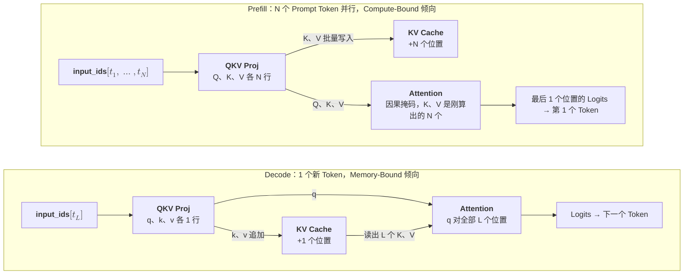

**Prefill 偏计算密集，Decode 偏内存带宽；两者竞争同一组 GPU 资源。**

<aside class="notes" markdown="1">
原文：[/why-llm-serving-is-hard.html](/why-llm-serving-is-hard.html)。Decode 从 batch 1 到 64，单步时间从 5.3 ms 到 7.0 ms；batch 256 时 KV 读取达到 24 GB。
</aside>

<!-- v -->

### 四个核心问题与四个横切约束

| 核心问题 | 主要机制 | 篇 |
|---|---|---|
| 这一轮谁执行、执行多少？ | Continuous Batching、Token Budget、Chunked Prefill、抢占 | 04 |
| 历史状态放哪、如何复用？ | PagedAttention、Prefix Cache、GQA / MLA、KV 量化 | 05 |
| 这一轮如何算得更快？ | FlashAttention、CUDA Graph、融合、量化、投机解码 | 06 |
| 一张卡不够，如何扩展？ | TP、PP、EP、CP、DP；PD 分离 | 07 · 08 |

**横切约束，从请求到芯片：输入在变 09 · 输出在变 10 · 模型在变 11 · 硬件在变 12**

<aside class="notes" markdown="1">
原文：[/why-llm-serving-is-hard.html#六阅读地图后续内容如何展开](/why-llm-serving-is-hard.html#六阅读地图后续内容如何展开)。对应 01 的表 4。代码落点：Scheduler、KVCacheManager / BlockPool、ModelRunner / Attention Backend、Executor / distributed。横切约束：一个请求可以带自己的 LoRA、带图片（09）；每个请求有自己的采样参数、可能要求符合 JSON schema（10）；MLA、MoE、MTP 等新结构（11）；同一套 Serving 逻辑跑在不同芯片上（12）。
</aside>

---

## 02 · 如何衡量：吞吐、延迟与 Goodput

**吞吐算系统做了多少，延迟算用户等多久，Goodput 算 SLO 内有效工作**

{: style="max-height: 420px"}

<aside class="notes" markdown="1">
原文：[/how-to-measure-llm-serving.html](/how-to-measure-llm-serving.html)。指标覆盖延迟（TTFT、TPOT、ITL、E2E）、吞吐（Tokens/s、Requests/s、Goodput）、效率和质量；对比 benchmark 前需先统一统计口径。
</aside>

---

## 03 · 鸟瞰 vLLM：4+1 视图落到一次请求

**控制面在 CPU 只动元数据，数据面在 GPU 只动张量；边界上只过两条消息**

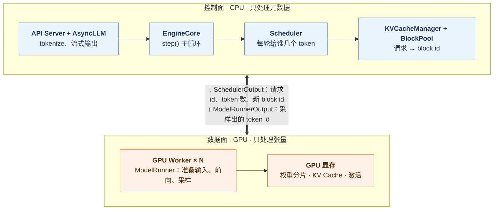

<aside class="notes" markdown="1">
原文：[/vllm-request-lifecycle-overview.html#二逻辑视图静态系统拓扑自顶向下](/vllm-request-lifecycle-overview.html#二逻辑视图静态系统拓扑自顶向下)。向下的 `SchedulerOutput`：首次调度的请求以 `NewRequestData` 带 prompt token ids、采样参数和 block ids，已在 Worker 上的请求以 `CachedRequestData` 只带增量；向上的 `ModelRunnerOutput` 主体是 `req_ids` 与 `sampled_token_ids`，只有 `output_rank` 回传。从不过边界的是权重、激活和 KV Cache：KVCacheManager 管的「块」只是 `block_id`、`ref_cnt` 与可选哈希，是显存里 KV 张量的下标；分配、释放、前缀复用、抢占都是整数运算。收益三条：CPU 工作（如填语法 bitmask、异步调度下一轮）与 GPU 前向重叠；边界消息大小与模型大小无关；调度状态只有一份，换 Uni / Multiproc / Ray 只换中间的 Executor。Executor 不是进程，是 EngineCore 构造时创建的对象：`UniProc` 本进程直接调，`Multiproc` 经共享内存 MessageQueue 广播，`Ray` 走 actor。
</aside>

<!-- v -->

### 4+1：进程视图

**Executor 是引擎内对象：DP 定 EngineCoreProc 数、TP×PP 定 WorkerProc 数**

{: style="max-height: 390px"}

<aside class="notes" markdown="1">
原文：[/vllm-request-lifecycle-overview.html](/vllm-request-lifecycle-overview.html)。Kruchten 4+1：逻辑、开发、进程、部署/物理四个视图，加上串联它们的场景。vLLM v0.27.1：world_size=1 默认选 UniProcExecutor，Worker 在 EngineCore 进程内初始化，没有 WorkerProc；多进程模式下 Executor 进程内调度 WorkerProc。DP size 对应 EngineCoreProc 数；每个 EngineCoreProc 内按 TP×PP×PCP rank 启动 WorkerProc；EP 复用已有 rank、不新增进程。（版本提示：v0.29 起默认是 Model Runner V2，`vllm/v1/worker/gpu/`；本页讲的是 v0.27.1 的 V1 路径。）
</aside>

<!-- v -->

### 执行层三层：Executor → Worker → ModelRunner

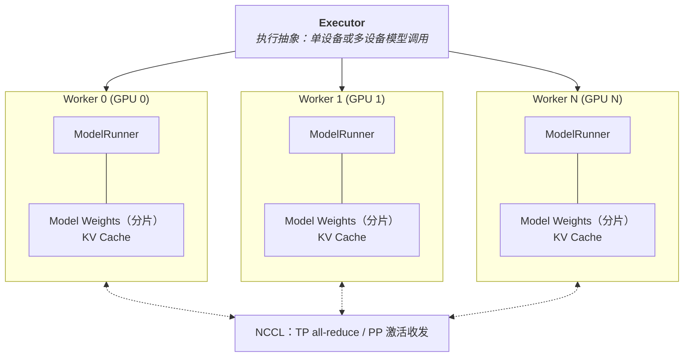

**Executor 定交给哪些 Worker，Worker 管一张卡，ModelRunner 跑完一轮。**

<aside class="notes" markdown="1">
原文：[/vllm-request-lifecycle-overview.html#4-executorworker-与-modelrunner模型执行的设备抽象](/vllm-request-lifecycle-overview.html#4-executorworker-与-modelrunner模型执行的设备抽象)。Executor：`UniProcExecutor`、`MultiprocExecutor`、`RayDistributedExecutor`、`RayExecutorV2`（继承 `MultiprocExecutor`，只把进程拉起方式换成 Ray）、`ExecutorWithExternalLauncher`——用不用 Ray 是部署方式的差异，不是执行模型的差异。Worker：初始化设备与 TP / PP 通信组、加载权重分片、测显存余量并分配 KV Cache、把 `execute_model()` 转给 ModelRunner。ModelRunner（`GPUModelRunner`）常驻一份 `InputBatch`，每轮准备输入（`_prepare_inputs()`）、前向（能用 CUDA Graph 时走捕获好的图）、采样（`sample_tokens()`）。
</aside>

<!-- v -->

### 4+1：开发视图与包依赖

{: style="max-height: 440px"}

**实线是一条请求从入口驱动到 kernel 的调用方向，虚线是主干之外的直接依赖。**

<aside class="notes" markdown="1">
原文：[/vllm-request-lifecycle-overview.html#四开发视图模块在源码树的哪里](/vllm-request-lifecycle-overview.html#四开发视图模块在源码树的哪里)。调用方向：entrypoints → v1.engine → v1.core 与 v1.executor；v1.executor → v1.worker → model_executor（含 v1/attention）与 distributed；model_executor → csrc。import 关系并不分层：v0.27.1 里这些目录两两之间有 38 个方向存在 import，量最大的是 model_executor → distributed（270 处，并行线性层与 collective）、model_executor → v1/attention（126）、model_executor → v1/worker（83）、distributed → v1/core（61，KV connector 读调度输出），多数是引用数据结构或注册表，不是运行时反向调用。
</aside>

<!-- v -->

### 开发视图：源码与 wheel 制品

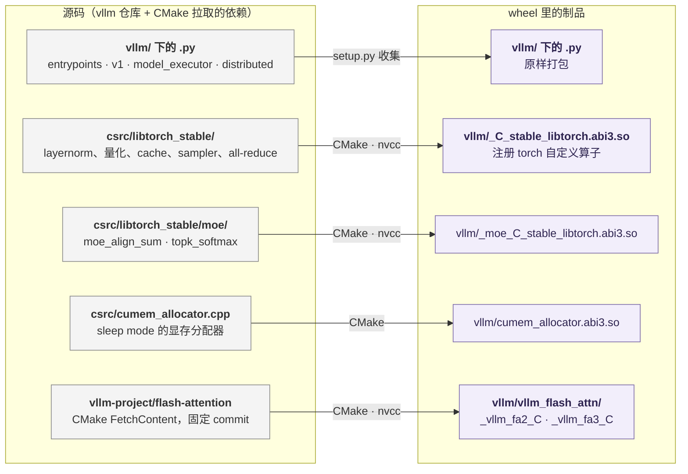

**Python 源码原样打包；csrc 与 FlashAttention 经 CMake 编译成扩展模块。**

<aside class="notes" markdown="1">
原文同上，第四章第 2 节。CUDA 平台上是 `_C_stable_libtorch` / `_moe_C_stable_libtorch`，名字不带 `_stable_libtorch` 的 `vllm._C` 只在 ROCm 和 CPU 上构建。`vllm/platforms/cuda.py` 在模块顶层导入 `_C_stable_libtorch`，所以 API Server、EngineCoreProc 也会加载这个 .so；真正在 GPU 上调用 kernel 的只有 WorkerProc。
</aside>

<!-- v -->

### 4+1：部署视图

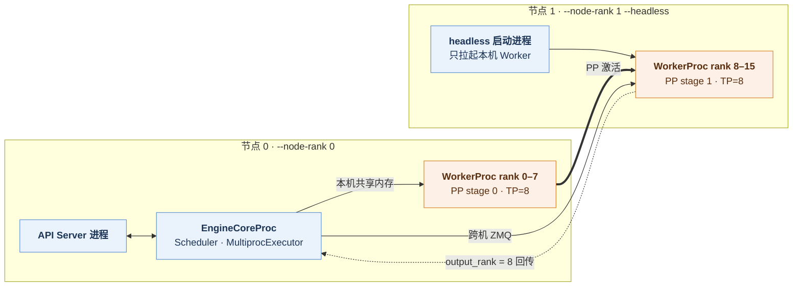

**两机 TP=8 × PP=2：节点 0 有完整的控制面，节点 1 只有 WorkerProc。**

<aside class="notes" markdown="1">
原文：[/vllm-request-lifecycle-overview.html#五部署物理视图进程怎样落到-gpu-和节点上](/vllm-request-lifecycle-overview.html#五部署物理视图进程怎样落到-gpu-和节点上)，文中按单卡、单机 TP=4、两机 TP×PP、单机 DP=2 × TP=2、多 API Server 各画了一张部署图。rank 按 TP 最内层编号，rank 0–7 是 PP stage 0、占满节点 0；output_rank = world_size − tp_size = 8 在节点 1。DP=2 时不指定 `--api-server-count` 默认起 2 个 API Server，另有一个 DPCoordinator 进程。EP 在既有 DP×TP rank 上执行，不额外创建进程。
</aside>

<!-- v -->

### 4+1：token 如何穿过 Serving 栈

{: style="max-height: 410px"}

**跨进程传递的是请求元数据、token IDs 与调度结果，不是完整模型状态。**

<aside class="notes" markdown="1">
原文：[/vllm-request-lifecycle-overview.html](/vllm-request-lifecycle-overview.html)。文本在 API Server tokenize，进程边界上传 token IDs；采样结果返回后在 API Server detokenize。
</aside>

<!-- v -->

### 4+1：一个 token 的回程

{: style="max-height: 410px"}

**主线程立即回到 schedule；序列化走输出线程，detokenize 与 stop 检查在 API Server 进程。**

<aside class="notes" markdown="1">
原文：[/vllm-request-lifecycle-overview.html](/vllm-request-lifecycle-overview.html)。stop 字符命中后 abort_requests_async 回到 EngineCoreProc；RequestOutputCollector 合并 deltas，再由 generate() 发 SSE。
</aside>

---

## 04 · Scheduler：每轮按 token 推进请求

**每轮结合 token budget、请求状态与 KV 空间，决定运行哪些请求、每个请求推进多少 token。**

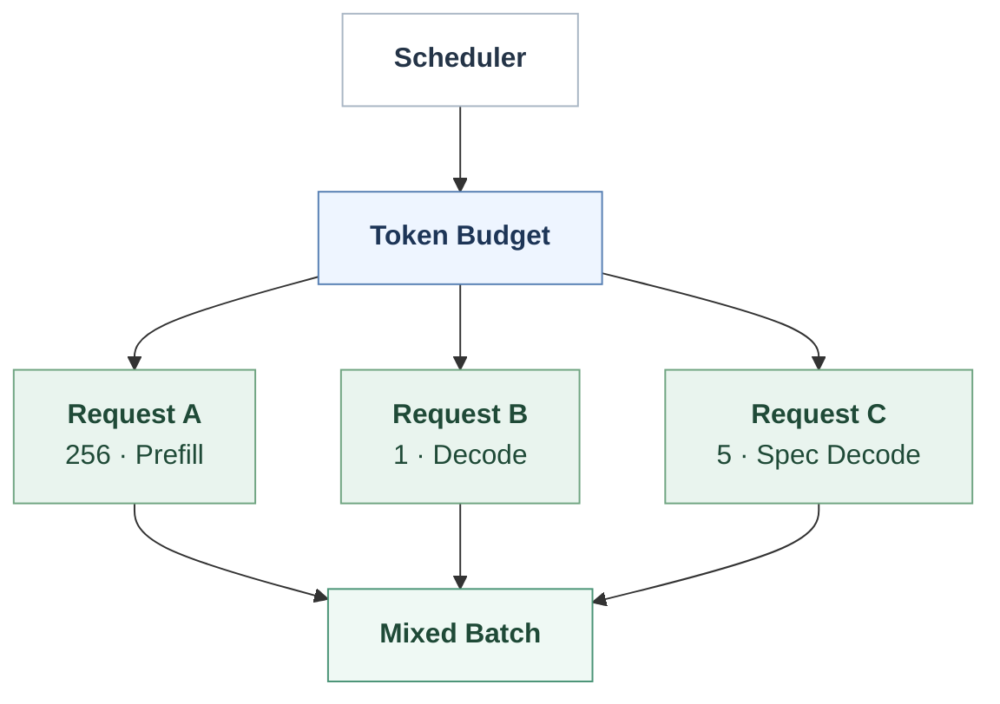

<aside class="notes" markdown="1">
原文：[/scheduler-batch-and-fairness.html](/scheduler-batch-and-fairness.html)。Continuous Batching、Chunked Prefill 与 Mixed Batch 都是同一资源调度模型的结果；KV 不足时按策略抢占并重算。没有 prefill / decode 两个阶段：每轮让 `num_computed_tokens` 追上 `num_tokens_with_spec`（prompt + 已生成 + 投机 token）。两者是精确等式：普通 decode 时 `num_tokens_with_spec = num_computed_tokens + 1`（上一轮采出的 token 正是这一轮的输入），带 k 个 draft 时是 `+ 1 + k`；默认开启的异步调度下用 `num_output_placeholders` 记已调度、结果未回的 token，`num_tokens_with_spec + num_output_placeholders = num_computed_tokens + 1`。
</aside>

---

## 05 · KV Cache：管理增长中的状态

**`block_size`=16；2,050 token 占 129 块，Prefix Cache 只复用满块**

{: style="max-height: 400px"}

<aside class="notes" markdown="1">
原文：[/kv-cache-memory-core.html](/kv-cache-memory-core.html)。固定大小的块按需分配；请求持 block table。示例中 2,000 token 前缀对应 125 个整块，可由后续请求复用。
</aside>

---

## 06 · GPU 执行：减少等待、搬运与轮次

**Decode 权重读取下界约 5.3 ms、实测约 10 ms；decode 占总时 97%**

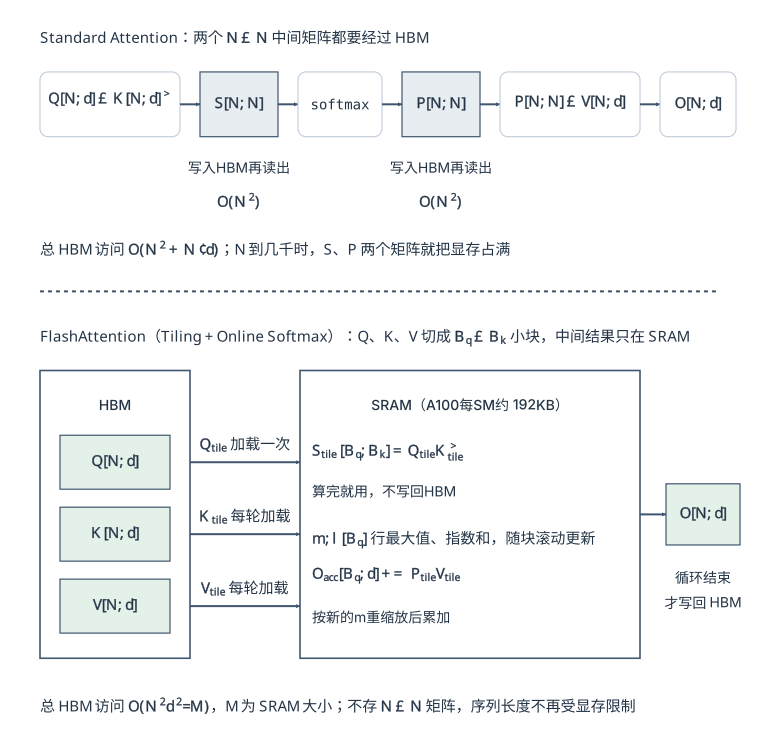{: style="max-height: 400px"}

<aside class="notes" markdown="1">
原文：[/gpu-execution-kernels-and-graphs.html](/gpu-execution-kernels-and-graphs.html)。Prefill 2,050 token 约 92 ms；300 步 decode 约 3,000 ms，占总时间 97%。四种浪费是 CPU launch、HBM 等待、数值过胖与解码轮次过多。
</aside>

<!-- v -->

### GPU 上的四种浪费

| 浪费形态 | 症状 | 对策 |
|---|---|---|
| GPU 在等 CPU 发指令 | kernel 之间有气泡 | CUDA Graph |
| GPU 在等 HBM 送数据 | 算力闲置、访存打满 | FlashAttention、算子融合 |
| 搬的每个数太胖 | 带宽被低信息密度的数据占满 | FP8 / INT8 / INT4 量化 |
| 轮次本身太多 | 每轮只产出 1 个 token | 投机解码 |

**Prefill 2050 token ≈ 92 ms 占 3%，300 步 decode ≈ 3000 ms 占 97%——优化都冲着 Decode。**

<aside class="notes" markdown="1">
原文：[/gpu-execution-kernels-and-graphs.html#一总览四种浪费与一笔账](/gpu-execution-kernels-and-graphs.html#一总览四种浪费与一笔账)。TP=8 下每卡 17.6 GB 权重、3.35 TB/s，一次 decode 的权重读取下界约 5.3 ms；加上 KV 读取、80 层 × 2 次 All-Reduce 和 kernel 开销，实测一步约 10 ms。量化与减少搬运次数正交、可叠加。
</aside>

<!-- v -->

### 投机解码：少跑几轮 forward

**无损：只改每步决定的位置数；batch 1、接受长度 2.5 约 2.1×，batch 128 每步慢 1.9 倍**

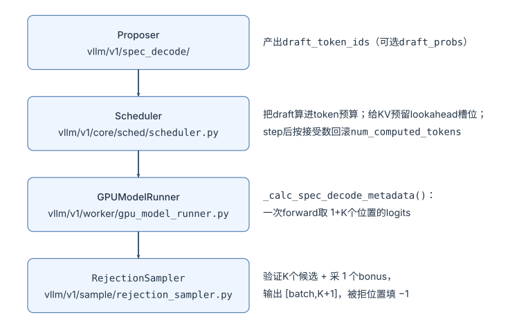{: style="max-height: 400px"}

<aside class="notes" markdown="1">
原文：[/gpu-execution-kernels-and-graphs.html#五能不能少跑几轮模型-投机解码](/gpu-execution-kernels-and-graphs.html#五能不能少跑几轮模型-投机解码)。投机解码用拒绝采样保证输出分布不变，所以归在执行优化；它改变每步决定的位置数（1 → 1 + K），牵动调度预算、KV lookahead 预留、回滚与 CUDA Graph。batch × (1 + K) 超过约 300 token / 步 / 卡后验证不再免费。（版本提示：v0.29 起 Model Runner V2 有自己的一套 speculator 与拒绝采样，`vllm/v1/worker/gpu/spec_decode/`，机制相同；Medusa 在 v0.33 预发布版中已删除。）
</aside>

<!-- v -->

### 投机解码在调度器里：进预算、预留 lookahead、按接受数回滚

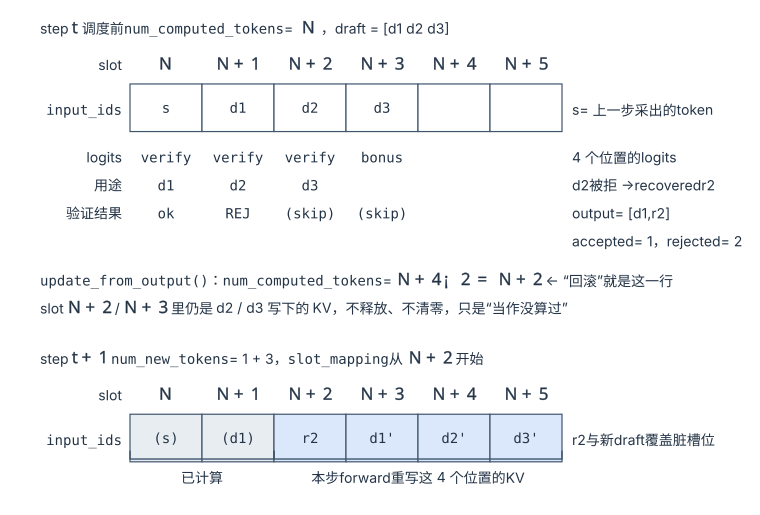{: style="max-height: 400px"}

**「KV 回滚」就是 `num_computed_tokens -= num_rejected`：被拒槽位不清理、不释放，下一步直接覆盖。**

<aside class="notes" markdown="1">
原文：[/gpu-execution-kernels-and-graphs.html#4-调度器与-kvdraft-进预算预留-lookahead-槽位按接受数回滚](/gpu-execution-kernels-and-graphs.html#4-调度器与-kvdraft-进预算预留-lookahead-槽位按接受数回滚)。① draft 进 token 预算：带 K 个 draft 的请求本轮推进 1+K 个 token，预算紧时 draft 被截断；chunked prefill 中的请求不调度 draft。② `allocate_slots(..., num_lookahead_tokens)` 为 draft 模型下一步写 KV 预留槽位：EAGLE / MTP / draft model 为 K，n-gram 为 0；例子里 K=3、每卡每 token 40 KB，只预留 120 KB，代价是更早碰到 watermark。③ step 后按接受数回滚，正确性靠 `num_computed_tokens` 这个游标，prefix cache 也以它为界，脏槽位不会被命中。EAGLE / MTP 开启时 prefix cache 命中的最后一块会被主动丢掉（125 块变 124 块），留一个位置真正跑 forward 产生 hidden state。model runner 一次 forward 算 K+1 个位置，`RejectionSampler` 得到 `[batch, K+1]`，被拒位置填 -1。
</aside>

<!-- v -->

### 收益有临界点：每步约 300 token / 卡

| batch | K | 每步 token | 验证免费？ | 每步（估） |
|---:|---:|---:|---|---|
| 1 | 3 | 4 | 是 | ≈ 10 ms |
| 32 | 3 | 128 | 是 | ≈ 10–11 ms |
| 64 | 3 | 256 | 接近临界 | ≈ 12 ms |
| 128 | 3 | 512 | 否，≈ 1.7× 临界 | ≈ 17 ms |
| 128 | 0（不开） | 128 | —— | ≈ 10 ms |

**batch=128 时每步慢 1.9 倍、只换来 2.5 倍步数减少——系统吞吐反降。**

<aside class="notes" markdown="1">
原文：[/gpu-execution-kernels-and-graphs.html#7-收益与代价的量化](/gpu-execution-kernels-and-graphs.html#7-收益与代价的量化)。临界点 $$T_\text{ridge} \approx 295$$ token / 步 / 卡（989 TFLOPS 对 3.35 TB/s）；40% MFU 时还要更低。batch=1、300 个输出 token：EAGLE K=3 接受长度 2.5 → 120 步 × 12 ms ≈ 1450 ms，≈ 2.1×；接受长度 1.6 → 1.3×；n-gram 抄 RAG 原文、接受长度 3.5 → 3.5×。不该开：每步 token 已近临界、输出很短、请求需要 `min_p` / `logit_bias`（开投机时在前端被拒）、高温高熵文本。动态 K（`num_speculative_tokens_per_batch_size`）在大 batch 时降到 0，但 DP > 1 时被关掉；draft 只在最后一个 PP rank；PD 下异步拉 KV 的那一步不预留 lookahead。
</aside>

---

## 07 · Multi-GPU：按瓶颈切分模型与请求

**TP/PP/EP/CP 解决装不下，DP 解决要更多吞吐且在最外层**

| 遇到的问题 | 策略 | 切的是什么 |
|---|---|---|
| 单卡放不下一个 Linear 层 | TP | 层内的矩阵，按行 / 列切 |
| 单层放得下，整个模型太大 | PP | 按层切，分段流水 |
| MoE 的 Expert 太多 | EP | 按 Expert 切 |
| 上下文太长，KV 装不下 | CP | 按 token 序列切 |
| 装得下，但要更多吞吐 | DP | 不切，整个模型复制一份 |

<aside class="notes" markdown="1">
原文：[/multi-gpu-scaling-strategies.html](/multi-gpu-scaling-strategies.html)。TP / PP / EP / CP 是被迫拆分，DP 的前提恰恰是装得下；生产部署先用前四种把模型塞进一组卡，再用 DP 把这组卡整体复制 N 份。
</aside>

<!-- v -->

### rank 布局：TP=2 × PP=2 × DP=2，两台 4 卡机器

{: style="max-height: 400px"}

**TP 组是相邻的卡、走 NVLink；PP 组隔一个 TP 组；DP 组隔一整个副本、跨机。**

<aside class="notes" markdown="1">
原文：[/multi-gpu-scaling-strategies.html](/multi-gpu-scaling-strategies.html)。vLLM 的 `initialize_model_parallel()` 按 DP × PP × PCP × TP 排布 rank，TP 在最内层。TP 组 [0,1] [2,3] [4,5] [6,7]：激活 All-Reduce，每层 2 次、在关键路径上；PP 组 [0,2] [1,3] [4,6] [5,7]：`hidden_states` 的 send / recv，每个 microbatch 1 次；DP 组 [0,4] [1,5] [2,6] [3,7]：不传激活，只在 MoE + EP 时 All-to-All 跨副本。每个 DP 副本一个 EngineCore，各自拉起 TP × PP = 4 个 WorkerProc。
</aside>

<!-- v -->

### TP 的代价：All-Reduce 在每层的关键路径上

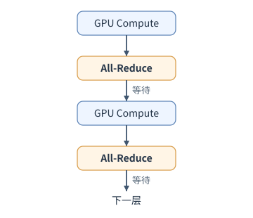{: style="max-height: 300px"}

1. 每层 All-Reduce 两次：Attention 后、MLP 后各一次
2. 每层通信量 $$2V$$，$$V = B \times S \times H \times \text{sizeof(dtype)}$$
3. 只适合 NVLink / NVSwitch 互联的同机多卡

<aside class="notes" markdown="1">
原文：[/multi-gpu-scaling-strategies.html#5-tp-的代价通信](/multi-gpu-scaling-strategies.html#5-tp-的代价通信)。列切的输出分片正好是行切的输入分片，中间不用通信，只有行切的部分和要在末尾求和；Attention 和 MLP 各一对「列切 → 行切」，所以每层两次。算例：batch 32、Decode $$S=1$$、$$H=8192$$、BF16，一次 512 KiB；80 层 × 2 次 = 160 次，一步约 80 MiB 逻辑通信量；Ring All-Reduce 单卡实际传输约 $$2\frac{N-1}{N}V$$，TP=8 时约 $$1.75V$$。所有卡要等 All-Reduce 完成才能算下一层，对带宽和延迟都敏感，跨机时改用 PP、DP、EP 减少高频同步。
</aside>

---

## 08 · PD 分离：状态交接需要明确契约

**匹配≠就绪、算完≠可回收；分离换来配置自由与交接成本**

{: style="max-height: 400px"}

<aside class="notes" markdown="1">
原文：[/prefill-decode-disaggregation.html](/prefill-decode-disaggregation.html)。分离后 P、D 两侧仍各自管理本地计算与内存；Connector 管状态交接，外围编排连接请求与池级资源。
</aside>

---

## 09 · 输入在变：multi-LoRA 与多模态

**8 个 rank-16 槽位静态占 1.44 GB/卡，与实际加载数无关**

{: style="max-height: 390px"}

<aside class="notes" markdown="1">
原文：[/request-shapes-multi-lora-and-multimodal.html](/request-shapes-multi-lora-and-multimodal.html)。变化段的第一篇，属于请求级变化：同一个 batch 里每个请求都可能带自己的 LoRA、带几张图片，引擎必须逐请求处理；模型类经 `SupportsLoRA` / `SupportsMultiModal` 声明能力，引擎据此启用对应路径（完整机制在 11）。LoRA FLOPs 只多 0.2%，但每步多 1,120 次 kernel launch；图片贵在持续驻留的 KV，而不是短命的 encoder 输出。
</aside>

<!-- v -->

### 多模态：图片 token 的 KV 成本

{: style="max-height: 400px"}

**一张图 encoder 输出 9–22 MB，它占的 KV 184–438 MB，约 20 倍**

<aside class="notes" markdown="1">
原文：[/request-shapes-multi-lora-and-multimodal.html](/request-shapes-multi-lora-and-multimodal.html)。图片示例 576 或 1,369 个 token；encoder 输出短命，KV 在生成期间持续驻留。
</aside>

---

## 10 · 输出在变：采样参数与结构化输出

**同一 batch 每行按自己的采样参数；grammar 变成每步一张 16 KB / 行的 bitmask**

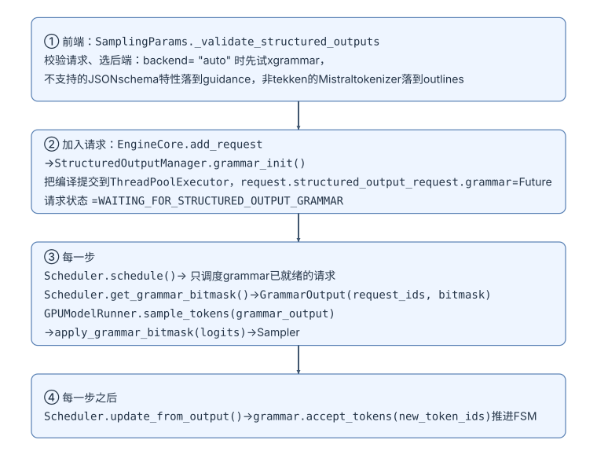{: style="max-height: 400px"}

<aside class="notes" markdown="1">
原文：[/output-changes-sampling-and-structured-output.html](/output-changes-sampling-and-structured-output.html)。采样参数改分布本身、结构化输出改分布的支撑集；参数按 batch 维张量向量化，penalties 每步搬历史输出；grammar 在调度器侧异步编译，与投机解码同开时逐个 draft 位置对账；TP 下每个 rank 都拿到完整 logits、各自采样，GrammarOutput 广播到所有 worker。（版本提示：v0.29 起默认的 Model Runner V2 有独立采样器 `vllm/v1/worker/gpu/sample/` 和新的 logits processor 接口；结构化输出的调度器侧不变。）
</aside>

<!-- v -->

### 两类输出变化落在哪几层

| 层 | 采样语义 | 结构化输出 |
|---|---|---|
| API | 校验参数；开投机时拒绝 `min_p` / `logit_bias` | 校验 schema、选后端 |
| Scheduler | —— | 异步编译 grammar、每步填 bitmask、推进 FSM |
| KV Cache | —— | —— |
| ModelRunner / Sampler | 每请求参数按行向量化 | GPU 上按行打掩码 |
| 多卡 | TP 每 rank 各自采样；PP 末 stage 采样 | `GrammarOutput` 广播给所有 worker |
| PD 分离 | 参数随请求交接 | P、D 各编译一次，都落在 TTFT 上 |

<aside class="notes" markdown="1">
原文：[/output-changes-sampling-and-structured-output.html#3-变化落在哪几层](/output-changes-sampling-and-structured-output.html#3-变化落在哪几层)。KV Cache 一行是空的，这本身就是结论：输出语义的变化不影响状态怎么存，不同参数、不同 grammar 产生的都是普通 token，KV 与 prefix cache 不需要多一个键（对比 09：LoRA 和多模态都要往块哈希里加 `extra_keys`）。代价：采样语义几乎为零，值得算的是 penalties（每步两张 `[B, V+1]` int64 直方图 + 历史输出上传）和 `seed`；结构化输出几乎全在 CPU 与 TTFT——编译、每步填 bitmask、FSM 推进，GPU 只有一个掩码 kernel。batch=64 全开 JSON：每步 H2D 64 × 16 KB = 1 MB。
</aside>

<!-- v -->

### 多卡与 PD 下：谁采样、grammar 在哪编译

- **TP**：logits all-gather 到每个 rank，各 rank 用同一种子各自采样，只有 `output_rank` 回复
- **PP**：只有末 stage 采样；异步调度下把采出的 token 广播回其他 stage
- **DP**：每个 DP rank 自己的调度器编译 grammar，同一 schema 打到 4 个 rank 编译 4 次
- **PD**：P、D 两侧各编译一次 grammar；D 上编译排在 KV 拉取之前，串行

<aside class="notes" markdown="1">
原文：[/output-changes-sampling-and-structured-output.html#四多卡与-pd-分离下的适配](/output-changes-sampling-and-structured-output.html#四多卡与-pd-分离下的适配)。TP：`lm_head` 按词表切，`Platform.use_all_gather()` 默认 True，CUDA 平台每个 rank 都得到完整 `[num_tokens, V]`；`sample_tokens(grammar_output)` 经共享内存一次广播；各 rank 自己采是为了让下一步输入直接留在本 rank 的 `InputBatch`，省一次广播，前提是 `set_random_seed(model_config.seed)` 对齐随机状态。例子 batch=64、TP=8：完整 bf16 logits 约 16 MB、每卡贡献 2 MB，all-gather 在 NVLink 上几十微秒。`external_launcher` 下每个 TP rank 一个调度器，异步编译会让各 rank 状态转换时刻不同而死锁，所以改同步编译。PD（NIXL toy proxy）：P 收到 `max_tokens=1` 的请求，同样等 grammar 就绪才调度、用掩码采出一个会被丢弃的 token；P 上的编译落在 $$Q_P$$，D 上的串在 $$T_{\text{handoff}}$$ 前。缓解：xgrammar 缓存让重复 schema 几乎免费；proxy 可在发往 P 的请求里去掉结构化输出参数。
</aside>

---

## 11 · 模型适配：变化落在哪一层

**模型层管结构，运行时层管调度/Cache/并行，算子层管 Kernel**

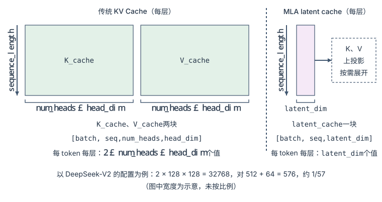{: style="max-height: 400px"}

<aside class="notes" markdown="1">
原文：[/model-adaptation-architecture.html](/model-adaptation-architecture.html)。四种外部变化里的第三种，进入部署级变化：模型在实例启动时就定下，引擎要在接口层把它隔离。适配分为模型、运行时和算子三层；运行时层往往最贵，因为新状态形状会影响调度、缓存布局与执行路径。09 用到的 `SupportsLoRA` / `SupportsMultiModal` 就是这里的能力声明。
</aside>

---

## 12 · 硬件解耦：Platform 是边界，不是万能胶

**核心依赖抽象能力而非具体芯片；OOT 靠主仓库的稳定契约**

{: style="max-height: 400px"}

<aside class="notes" markdown="1">
原文：[/hardware-abstraction-and-portability.html](/hardware-abstraction-and-portability.html)。四种外部变化的最后一种：输入、输出、模型都还是软件侧的变化，硬件也是部署级、实例启动时定下。Platform 是硬件能力中心，不是所有底层组件的唯一父类；Serving Core、抽象契约、平台实现、硬件运行时与 Kernel 形成多层边界。
</aside>

---

## 13 · Serving 的下一站：分布式智能操作系统

**四转变：配置→自动计划、缓存→分布式状态、执行→多阶段、目标→Goodput**

{: style="max-height: 400px"}

<aside class="notes" markdown="1">
原文：[/future-of-serving-infra.html](/future-of-serving-infra.html)。未来系统还要管理可编排计算、可迁移状态、可恢复请求、异构资源和动态执行计划；vLLM 当前代表 Runtime 层。
</aside>

---

## 14 · 回到源码：一次请求的真实旅程

**同一请求五笔账：734 MB KV、5 段 chunk、decode 3,000 ms**

{: style="max-height: 400px"}

<aside class="notes" markdown="1">
原文：[/source-code-request-walkthrough.html](/source-code-request-walkthrough.html)。完整数字来自正文汇总表：KV 147 块/734 MB；chunk=512 时 2,050 token 分 5 段；92 ms Prefill + 3,000 ms Decode；每 token 每步 8 卡同步约 2.5 MB；跨节点搬 KV 641 MB、约 13 ms。（版本提示：执行侧调用链走的是 v0.27.1 的 V1 `GPUModelRunner`；v0.29 起调试断点要打在 `vllm/v1/worker/gpu/model_runner.py`。）
</aside>

---

## 15 · vLLM 与 SGLang：同一请求，两种状态组织

| 维度 | vLLM v0.27.1 | SGLang v0.5.18 |
|---|---|---|
| 出发点 | PagedAttention：显存碎片 → 块 | RadixAttention：前缀复用 → 树 |
| 调度 | 一个调度器，token 预算，无阶段 | 每 rank 一份调度器，prefill 优先 |
| KV | block hash、`block_table` | RadixCache、`req_to_token` |
| 进程 | SchedulerOutput 跨进程到 WorkerProc | Scheduler 与 ModelRunner 同进程 |

**一句话：vLLM 是“一个调度器 + 块”，SGLang 是“N 个相同调度器 + 树”。**

<aside class="notes" markdown="1">
原文：[/vllm-vs-sglang.html](/vllm-vs-sglang.html)。两边功能面已重叠；结构差异来自状态归属与最初要解决的问题，而非单一 benchmark 排名。版本以正文标注的 vLLM v0.27.1 与 SGLang v0.5.18 为准。
</aside>

---

## 两条判断贯穿十五篇

{: style="max-height: 400px"}

- **KV 是一切约束的源头**：并发上限、抢占、前缀复用、Decode 带宽与 PD 交接。
- **调度单位是 token**：budget、chunk、投机 lookahead 与 encoder 预算都围绕 token 推进。

<aside class="notes" markdown="1">
系列总结：[/deep-dive-into-vllm-series-recap-and-self-test.html](/deep-dive-into-vllm-series-recap-and-self-test.html)。第 16 篇回顾十五篇正文并提供通关自测。
</aside>

---

## 常见误区

- “最大 batch 就是目标”——目标是在 SLO 下的 Goodput。
- “TTFT 等于 Prefill 时间”——TTFT 包含排队。
- “Prefix Cache 按 token 复用”——复用单位是完整块。
- “CUDA Graph 把 forward 融成超级 kernel”——它重放 kernel 序列，主要减少 launch 开销。
- “投机解码总能加速”——batch 与 draft 负载可能抵消验证收益。
- “图片贵在 encoder”——持续驻留的图片 KV 更大。
{: .fragments}

<aside class="notes" markdown="1">
对应原文：[/how-to-measure-llm-serving.html](/how-to-measure-llm-serving.html)、[/kv-cache-memory-core.html](/kv-cache-memory-core.html)、[/gpu-execution-kernels-and-graphs.html](/gpu-execution-kernels-and-graphs.html)、[/request-shapes-multi-lora-and-multimodal.html](/request-shapes-multi-lora-and-multimodal.html)。
</aside>

---

## 下一步

- **系列总结**：第 16 篇 [/deep-dive-into-vllm-series-recap-and-self-test.html](/deep-dive-into-vllm-series-recap-and-self-test.html)
- **往下**：《GPU Kernel 工程》与《通信与互联》——继续看 FlashAttention、PagedAttention、All-Reduce 与 KV 传输。
- **往旁**：《扩散模型推理 Infra》与《RL 后训练 Infra》——比较另一种 Serving 工作负载及训练中的推理引擎。
- **回看总纲**：[/deep-dive-into-vllm.html](/deep-dive-into-vllm.html)

<aside class="notes" markdown="1">
正文顺序为 01–15；系列总结与自测编号为 16。所有结论与数字以对应正文为准。
</aside>
