## 这个系列的三句话主张

> **循环之外的一切都是 harness**；**权限范围是错误的上限**；**能自动验证到什么程度，就能自主到什么程度**。

<aside class="notes" markdown="1">
总纲：/tools-agents-and-harness.html。
</aside>

---

## 几篇怎么连起来

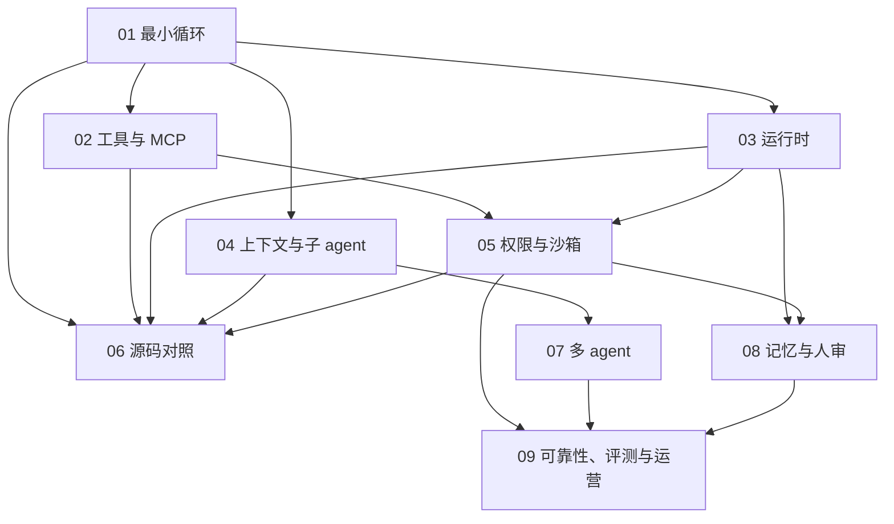

---

## 01 · 最小 agent 循环：从 40 行到生产级

**40 行循环 + 四个卫士 + 两个出口才够生产——能用工作流就不用 agent**

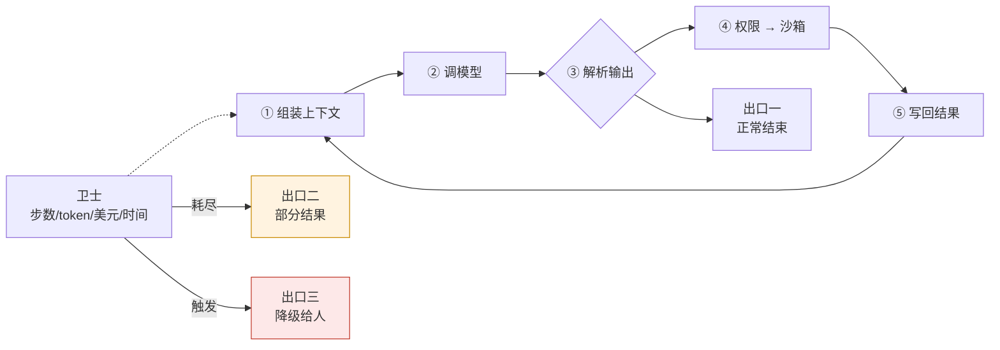

<aside class="notes" markdown="1">
原文 /anatomy-of-the-agent-loop.html。
各篇关键词：01 40 行 + 四个卫士 + 出口；02 工具从哪来、怎么被发现；03 会话日志 / durable execution；05 权限范围是错误的上限；06 Codex / DeepSeek Harness / Claude Code / OpenHarness；07 编排 / handoff / A2A。
③ 解析输出分两类：最终回答 → 出口一；tool_call → ④ 权限 → 沙箱执行。
③ 解析输出分两类：最终回答 → 出口一；tool_call → ④ 权限 → 沙箱执行。
卫士每圈查步数 / token / 美元 / 时间。
③ 的输出若是 tool_call 走 ④⑤ 循环，最终回答走出口一。
</aside>

<!-- v -->

## 要点

**四个卫士都在循环里；编排器不升级**

```python
while True:                                   # 四个卫士在这里：步数 / 预算 / 超时 / 重复
    resp = model(messages, tools)
    if not resp.tool_calls: return resp.text  # 出口一：模型停
    for call in resp.tool_calls:              # 编排器：审批 → 沙箱首试 → 不升级
        result = execute(call)                # 一切「模型可见」的都要「已记录」
        messages.append(tool_result(call, result))
```

<aside class="notes" markdown="1">
补充要点：编排器原则：审批 → 沙箱首试 → `never` / `on-request` 不升级；「模型可见 ⟺ 已记录」
</aside>

---

## 02 · 工具调用与 MCP：工具从哪来、怎么被发现

**工具按 schema 进注册表；tool search 按需加载、PTC 让中间结果不进上下文**

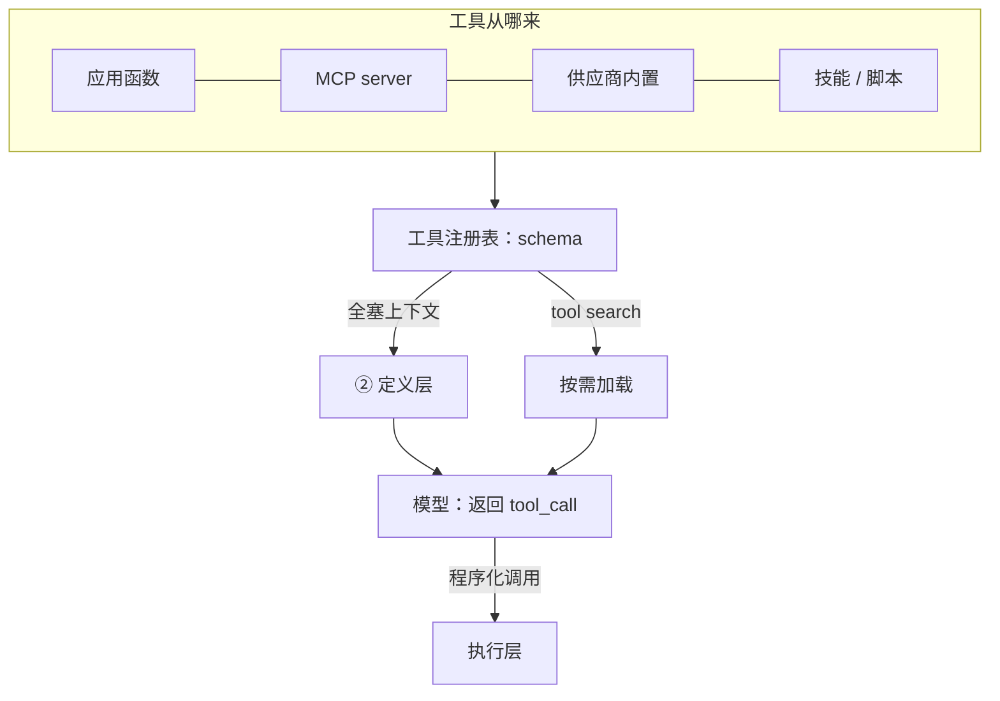

<aside class="notes" markdown="1">
原文 /tool-calling-mcp-tool-search-and-programmatic-tool-calling.html。
</aside>

<!-- v -->

## 要点

**工具按 schema 进注册表；PTC 让中间结果不进上下文**

| 项 | 数 |
|---|---|
| 治理 | AAIF；SDK 十亿下载 |
| 授权 | DCR → CIMD；`resource` 绑定受众 |
| 何时用 tool search | 二十个以上工具 |
| PTC | 四家都有 |


<!-- v -->


### 常见误区

- 「MCP 只是一个有会话的 RPC」——已改为无状态核心

<!-- v -->

### 传统调用 vs 程序化工具调用（PTC）

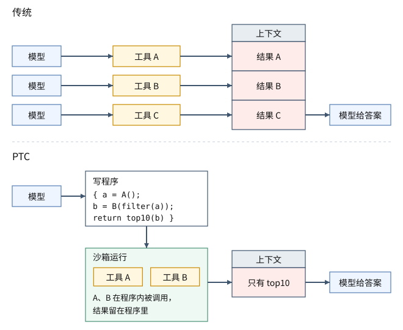{: style="max-height: 340px"}

- 中间结果不进上下文——长工具链省掉的是上下文预算与延迟，四家都有

---

## 03 · agent 运行时：第三种服务形态

**会话日志只追加是核心——resume / fork / replay 都是同一条流的重放**

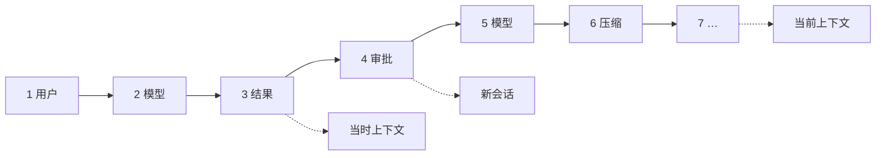

<aside class="notes" markdown="1">
原文 /agent-runtime-sessions-persistence-and-durable-execution.html。
resume / fork / replay 都是同一条流的重放。
E3 → 当时上下文 与 E7 → 当前上下文 都是重放；E4 → 新会话是分叉。
链条是会话日志（只追加）；E3→当时上下文、E7→当前上下文是重放，E4→新会话是分叉。
</aside>

<!-- v -->

## 要点

**日志只追加——resume / fork / replay 是同一条流**

| 项 | 数 |
|---|---|
| Agents API | 2026-09-10；九家沙箱；无额外费；失败响应 −86% |
| 100 个并发会话在等审批 | 不能占 100 个 worker——挂起释放 |
| 托管的代价 | 绑供应商模型、日志在供应商侧 |


---

## 04 · 长任务的上下文管理与子 agent

**隔离 → 卸载 → 清理 → 压缩；子 agent 只回摘要，但多 agent 约 15 倍 token**

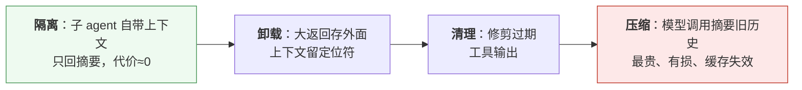

<aside class="notes" markdown="1">
原文 /long-horizon-context-management-and-subagents.html。
卸载 = DeepSeek Harness 的 spill；清理 = compaction-tool-result-pruner；压缩 = Codex compact* / Claude Code auto-compact。
</aside>

<!-- v -->

## 要点

**子 agent 只回摘要——隔离换上下文，不省钱**

| 规则 | 为什么 |
|---|---|
| 「无 > 10K token 的项」 | 任何单项超过就 spill 到文件 |
| subagent vs agent teams | 前者回摘要、后者共享目标 |
| 串行任务 | **不拆**子 agent——没有并行收益，多派发与摘要开销 |

<aside class="notes" markdown="1">
补充要点：「子 agent 只回摘要所以便宜」——token 不进主窗口，但都在账单上
</aside>

---

## 05 · 权限、沙箱与安全边界：压低错误的上限

**权限四层缺一不可——权限档、审批、执行策略、沙箱；deny 高于一切**

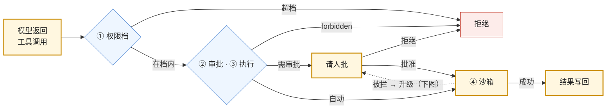

<!-- v -->

### 沙箱拦住以后：升级回到审批

**「never / on-request」决定拦截后是死路还是新审批——升级不是绕开沙箱，是重新问人**

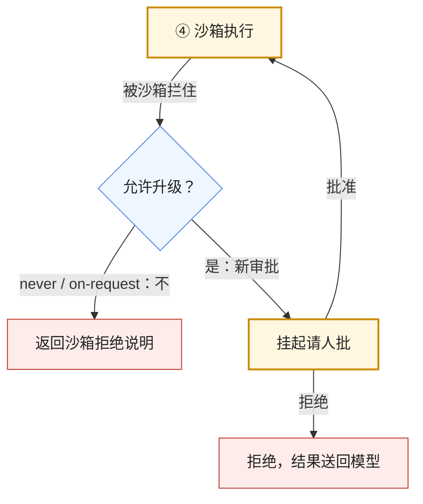

<aside class="notes" markdown="1">
原文 /permissions-sandboxes-and-security-boundaries-for-agents.html。调用示例：shell: rm -rf ./build · write: src/x.py · http: DELETE /volumes/7；审批可选 Guardian 模型先审；沙箱在受限的文件系统 / 网络 / 进程里执行。
</aside>

<!-- v -->

## 要点

**命令文本看不出效果——所以审批后还要沙箱**

| 层 | 例 |
|---|---|
| 权限档 | `:read_only` / `:workspace` / `:danger_full_access` |
| 审批策略 | allow / prompt / forbidden 带 `match` / `not_match`；策略化授权对抗审批疲劳 |
| 执行策略 | 命令文本看不出脚本的真实效果——所以还要沙箱 |
| 沙箱 | macOS Seatbelt / Linux Landlock + seccomp / Windows |


---

## 06 · 源码级对照：四个 harness 各怎么选

**四个 harness 换一样付一样——状态、压缩、策略语言、沙箱、模型耦合五个轴**

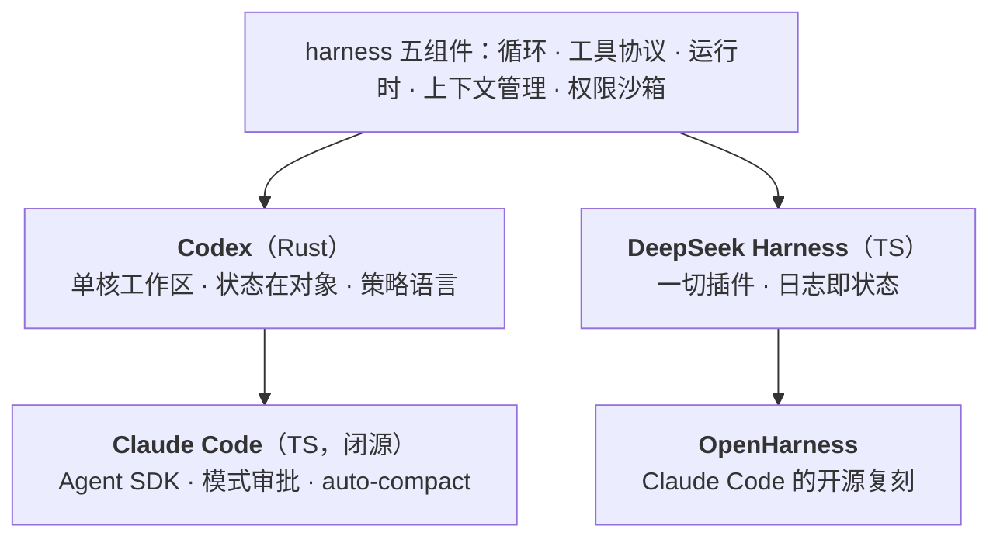

<aside class="notes" markdown="1">
原文 /coding-agent-harness-comparison-codex-deepseek-harness-claude-code.html。
Codex 三平台原生沙箱；DeepSeek Harness 可读事件、沙箱是接缝；OpenHarness 读它看结构。
</aside>

<!-- v -->

## 要点

**五轴对照：状态、压缩、策略、沙箱、耦合**

| | Codex | DeepSeek Harness | Claude Code | OpenHarness |
|---|---|---|---|---|
| 实现 | Rust 单核 | Python 轻量 | 闭源 + SDK | TS 一切皆插件 |
| 状态 | 对象 | 日志驱动 | 对象 + 加密压缩 | 插件 |
| 权限 | `execpolicy` Starlark | 规则 | 六步 deny 优先 | 插件 |
| 沙箱 | 原生三平台 | 接缝 | 原生 | 接缝 |
| 模型耦合 | 深 | 浅（能拉起别家） | 深 | 浅；Minimal 模式 |

---

## 07 · 多 agent：编排、handoff 与 A2A

**多 agent 只为隔离、并行、专业化——代价 15 倍 token、缓存不共享**

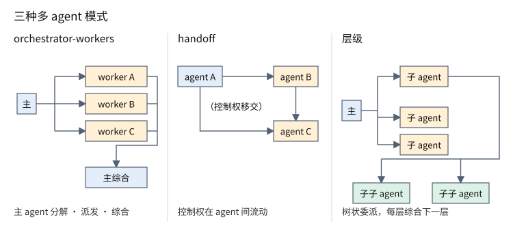{: style="max-height: 360px"}

<aside class="notes" markdown="1">
原文 /multi-agent-orchestration-handoff-and-a2a.html。三层评测。
</aside>

<!-- v -->

## 要点

**多 agent 只为隔离、并行、专业化——代价 15 倍**

| 量 | 数 |
|---|---|
| 多 agent 成本 | 约 15 倍 token |
| 缓存 | 只有分叉前的前缀共享 |
| A2A | 组织内先用子 agent |

<!-- v -->


### 常见误区

- 「并行 agent 共享缓存」——只有分叉前的前缀
- 「现在就要接 A2A」——组织内先用子 agent

<!-- v -->

### handoff 的一条时间线

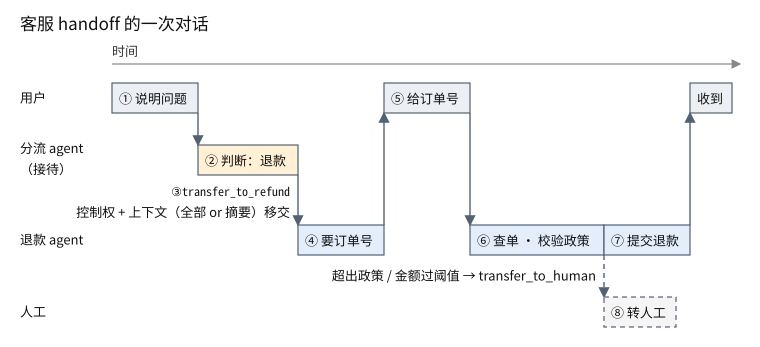{: style="max-height: 340px"}

- handoff 移交的是**控制权 + 上下文**——移交什么上下文是设计点，不是默认值

---

## 08 · memory 与 human-in-the-loop

**记忆是检索（写 / 取 / 忘、上限 25 KB）；人机分工六级、每级换验证方式**

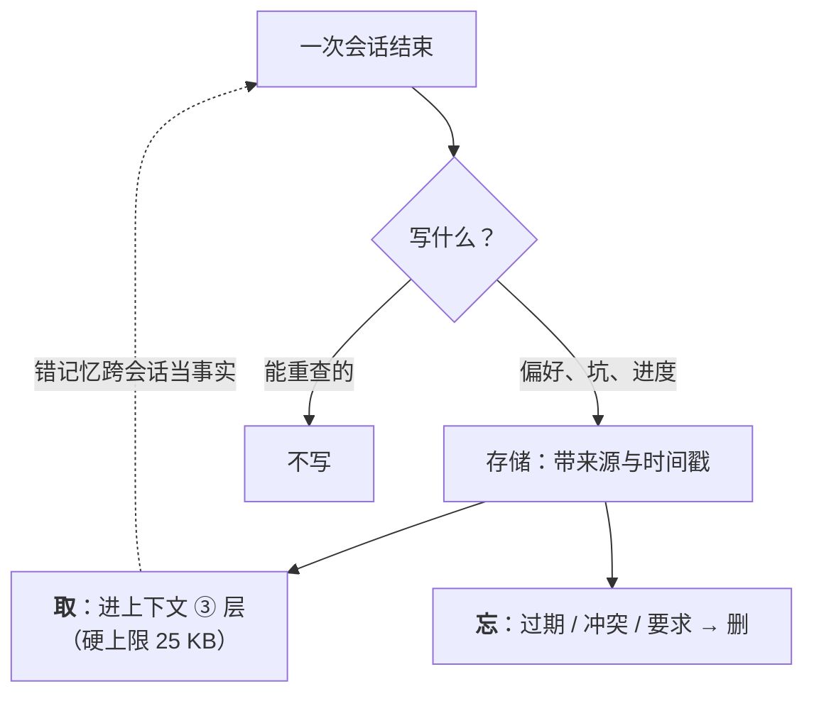

<aside class="notes" markdown="1">
原文 /agent-memory-and-human-in-the-loop.html。
写：下次会用到、且别处不易取回。
</aside>

<!-- v -->

## 要点

**不可逆止于提案；六级分工各换验证**

| 级 | 人做什么 | 验证靠什么 |
|---|---|---|
| 1 | 逐步确认 | 人 |
| 2–3 | 批准计划 / 抽检 | 人 + 规则 |
| 4–5 | 例外处理 | 结构（本体、类型、权限）+ 测试 |
| 6 | 不在环 | 全自动验证 + 可逆 |

<aside class="notes" markdown="1">
补充要点：提案先于落库；风险五级
</aside>

<!-- v -->


### 常见误区

- 「直接发送给客户 = 无人在环成功」——不可逆且不能验证

---

## 09 · 可靠性、评测与运营

**十类失败只有一类是异常；轨迹评测看六维——不只完成率**

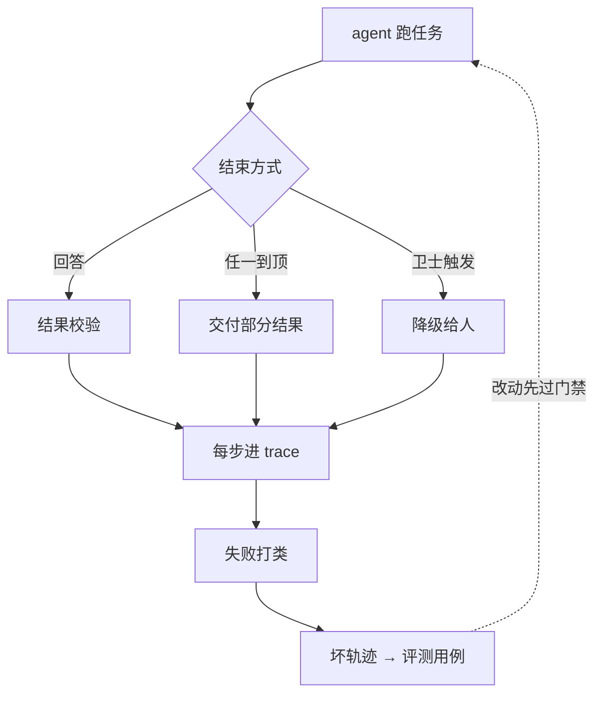

<aside class="notes" markdown="1">
原文 /agent-reliability-evaluation-and-operations.html。
十类失败每类有药；轨迹评测看过程。
十类失败每类有药。
</aside>

<!-- v -->

## 要点

**同一基准三协议三个数——看六维不只完成率**

| 量 | 数 |
|---|---|
| Terminal-Bench | 90.6 / 30.0 / 31.2——同一基准三种协议三个数 |
| demo 到生产 | 十二行清单 |
| 改工具 | 录制回放，不重跑模型回归 |


<!-- v -->


### 常见误区

- 「拒绝率降到零是好事」——审批疲劳或规则太松

---

## 三句话在九篇里

| 主张 | 落点 |
|---|---|
| **循环之外的一切都是 harness** | 卫士与出口（01）、工具发现（02）、会话日志（03）、压缩与子 agent（04）、权限（05）、四家对照（06） |
| **权限范围是错误的上限** | 四层缺一不可（05）、deny 高于一切、沙箱看真实效果、基础设施三环（05）、越权是评测项（09） |
| **能验证到什么程度就能自主到什么程度** | 六级分工每级换验证（08）、本体前移验证、不可逆不无人（08）、轨迹六维（09） |

---

## 常见误区（一）

- 「循环只要模型停就停」——四个卫士
- 「所有多步任务都做成 agent」——能工作流就工作流
- 「tool search 一定提高缓存命中率」——看绝对量
- 「用 Web 框架直接跑 agent」——durable execution
- 「审批等待占着 worker 没问题」——挂起释放
- 「子 agent 只回摘要所以便宜」——15 倍
{: .fragments}

---

## 常见误区（二）

- 「审批够了不需要沙箱」——命令文本看不出效果
- 「hook 返回 allow 就放行」——deny 优先
- 「有最好的 harness」——每个选择换一样付一样
- 「多 agent 更聪明」——只为隔离、并行、专业化
- 「记忆越多越好」——上限、来源、遗忘
- 「完成率 85% 就可靠」——六维
{: .fragments}

---

## 下一步

- **同一路线**：《Prompt 与上下文工程》——第 4 篇压缩的应用侧；《检索与知识》——agentic retrieval 与本体；《评测与可观测》——轨迹评测与 trace；《生产与运维》——运营 agent
- **Infra 侧**：《RL 后训练 Infra》第 6 篇——训练 agent 的 rollout 是同一个循环
- 原文总纲：`/tools-agents-and-harness.html`；通关自测在系列总结
